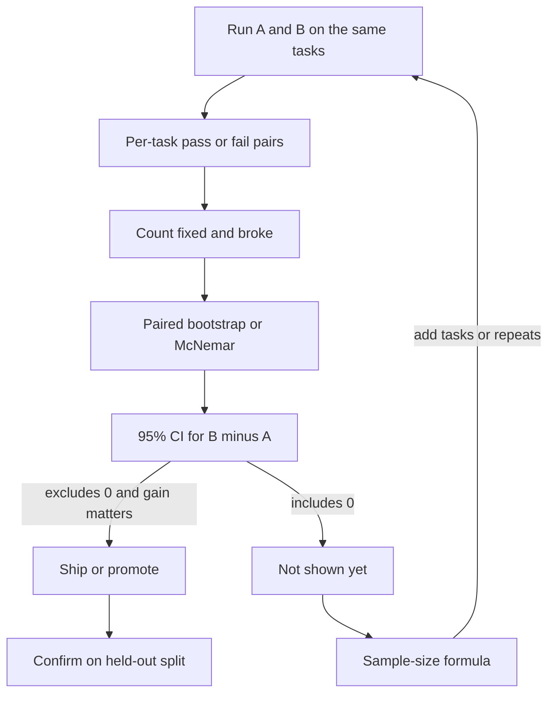

## TL;DR
An eval score is an estimate from a sample of tasks, so it has error. Confidence intervals, paired
comparisons, significance tests and sample-size math tell you whether a 2-point agent improvement is
real or noise before you ship it.

## For agent builders
- **Why it matters for agents.** Prompt, model and tool changes are judged by eval deltas of a few
  points on a few hundred tasks. At that size, noise alone moves scores by several points.
- **Where it shows up in your stack.** Eval harness reports, release gates in CI, A/B dashboards,
  judge-agreement studies, and any slide that says "+2.5 points".
- **What you control.** How many tasks you run, whether you compare models on the same tasks (paired),
  how many repeated samples per task, and which threshold a release gate uses.
- **What you can skip.** Deriving test statistics. Know the standard error of a proportion, the paired
  bootstrap and the sample-size formula; they cover nearly every eval decision.

## Why it exists
- **The eval set is a sample.** Your 200 tasks stand in for all tasks users will bring. A different 200
  would give a different score, and that spread is what a confidence interval quantifies.
- **Small sets are noisy.** At 72% accuracy on 200 items the standard error is about 3.2 points, so the
  95% interval is roughly ±6.2 points. A 2-point gain sits well inside that noise.
- **Eyeballing two intervals is too strict and too loose.** Overlapping intervals do not prove "no
  difference", and comparing unpaired scores throws away the fact that both models saw the same tasks.
- **Many comparisons create false wins.** Try 20 prompt variants at the 5% level and the chance that
  at least one looks "significant" by luck is about 64%.

## How it works
### Sampling and standard error
- **Each task is a draw.** Pass or fail per task is a Bernoulli outcome; the eval score is the mean.
- **Standard error (SE)** is the standard deviation of that mean across hypothetical re-samples:

```
SE = sqrt(p · (1 − p) / n)          # binary pass/fail
95% CI ≈ p ± 1.96 · SE              # normal approximation, fine for n ≥ ~100 and p not near 0 or 1
```

- **SE shrinks with the square root of n.** At p = 0.5, n = 100 gives ±9.8 points and n = 1,000 gives
  ±3.1 points: 10x the tasks for about 3x the precision.

### Paired comparisons
1. **Run both systems on the same tasks.** Most variation is "this task is hard", and pairing cancels it.
2. **Only disagreements carry signal.** Count tasks B fixed (A failed, B passed) and tasks B broke (A
   passed, B failed). The difference in accuracy is (fixed − broke) / n.
3. **Test it.** McNemar's test uses only those two counts. The paired bootstrap resamples tasks, keeping
   each task's (A, B) pair together, and reads the 2.5th and 97.5th percentiles of the difference.
4. **Repeated samples per task.** With temperature above 0, run each task k times and average per task
   first, so the task, not the sample, is the unit you resample.

### Significance and its limits
- **p-value:** the probability of a difference at least this large if the true difference were zero.
  It is not the probability the change works.
- **Prefer intervals.** "B − A = +2.5 points, 95% CI −2.0 to +7.0" tells you effect size and
  uncertainty; "p = 0.16" tells you less.
- **Correct for many tries.** Hold out a fresh test split for the final pick, or apply a Bonferroni
  threshold (0.05 divided by the number of comparisons).

### Sample size
```
n per arm (unpaired) ≈ (z_α/2 + z_β)² · (p1(1−p1) + p2(1−p2)) / Δ²
n (paired)           ≈ (z_α/2 + z_β)² · (d − Δ²) / Δ²       # d = share of tasks where A and B disagree
z_α/2 = 1.96 (95%),  z_β = 0.84 (80% power)
```
- **Pairing is cheaper when systems mostly agree**, because d is small. Detecting 72% versus 74.5% needs
  about 4,918 tasks per arm unpaired, but about 1,311 tasks paired when they disagree on 10.5% of tasks.

## Diagram
Read it as the decision path from a raw eval delta to a ship decision.



## Examples
### Is B's +2.5 points real? Unpaired intervals versus a paired bootstrap
Simulated per-task results for two agent versions on the same 200 tasks (seeded, numpy 2.0.2).

```python
import numpy as np

rng = np.random.default_rng(7)
n = 200
# Per-item pass/fail for baseline A and candidate B on the SAME 200 eval items.
a = rng.random(n) < 0.72
flip = rng.random(n)
b = a.copy()
b[(~a) & (flip < 0.30)] = True     # B fixes some of A's failures
b[a & (flip < 0.07)] = False       # and breaks a few of A's passes
print(f"A={a.mean():.3f}  B={b.mean():.3f}  diff={b.mean()-a.mean():+.3f}")

# Unpaired view: each score has its own 95% interval
for name, x in (("A", a), ("B", b)):
    se = np.sqrt(x.mean() * (1 - x.mean()) / n)
    print(f"{name} 95% CI: {x.mean()-1.96*se:.3f} to {x.mean()+1.96*se:.3f}")

# Paired view: only items where A and B disagree carry information
fixed, broke = int(((~a) & b).sum()), int((a & ~b).sum())
print("fixed:", fixed, "broke:", broke)

# Paired bootstrap: resample ITEMS, keep each item's (A, B) pair together
idx = rng.integers(0, n, size=(10_000, n))
diffs = b[idx].mean(axis=1) - a[idx].mean(axis=1)
lo, hi = np.percentile(diffs, [2.5, 97.5])
print(f"paired 95% CI for B-A: {lo:+.3f} to {hi:+.3f}")
print(f"share of resamples where B <= A: {(diffs <= 0).mean():.3f}")
```

Output:

```
A=0.720  B=0.745  diff=+0.025
A 95% CI: 0.658 to 0.782
B 95% CI: 0.685 to 0.805
fixed: 13 broke: 8
paired 95% CI for B-A: -0.020 to +0.070
share of resamples where B <= A: 0.159
```

- **Unpaired:** two wide intervals of about ±6 points that overlap almost entirely; no conclusion.
- **Paired:** the interval is narrower, but still includes zero. Only 21 of 200 tasks disagree, and
  13 versus 8 is weak evidence (McNemar's statistic (13 − 8)² / 21 ≈ 1.19, well below 3.84).
- **Decision:** not shipped on this evidence. The paired sample-size formula says about 1,311 tasks
  would detect a true +2.5 points 80% of the time.

### Worked scenario: the prompt sweep that "won"
An illustrative case: a team tried 20 system-prompt variants on a 150-task eval and shipped the best,
which scored +4 points.

| Step | What happened |
|---|---|
| 20 variants at the 5% level | about 64% chance at least one looks significant by luck |
| Winner re-run on a fresh 300-task split | +0.7 points, paired CI −2.1 to +3.4 |
| Root cause | selection on the same set that measured the gain |
| New process | sweep on a dev split, confirm the single pick on a held-out split |

## Production patterns
- **Report every score with an interval.** Have the eval harness print n, the mean and a 95% CI (or
  bootstrap percentiles) per metric, and refuse to render a bare percentage on dashboards.
- **Gate releases on a paired lower bound.** In CI, run baseline and candidate on the same task ids
  and block the release when the lower bound of the paired CI for B − A is below a set margin,
  such as −1 point for "no regression".
- **Size the eval before building it.** Use the sample-size formula with the smallest gain worth
  shipping; if the answer is 3,000 tasks, either build that many or accept that only larger gains will
  be detectable, and write that down.
- **Repeat stochastic agents.** For temperature above 0, run each task 3 to 5 times, average per task,
  and bootstrap over tasks. Track per-task variance to find flaky tasks worth fixing or removing.
- **Keep a held-out split.** Tune prompts and pick models on a dev split; touch the test split only to
  confirm the final choice, and refresh it when it leaks into prompts or few-shot examples.

## Trade-offs
- **More tasks vs cost.** Precision grows only with the square root of n, so halving the interval
  needs 4x the tasks and 4x the judge or model spend. Flips when a small paired set already suffices.
- **Paired vs unpaired designs.** Pairing needs both systems on identical tasks and versions, but cuts
  required n sharply when systems mostly agree; online A/B tests are usually unpaired by necessity.
- **Bootstrap vs formula.** The bootstrap handles any metric (judge scores, cost per task, clustered
  data) at some compute cost; the formula is instant but assumes simple binary independent items.
- **Strict gates vs speed.** A tight regression margin catches real drops but blocks harmless changes
  when the eval is small; loosen the margin or enlarge the set, not both silently.

## Pitfalls
- **Calling a delta inside the noise a win.** Symptom: gains that vanish on the next run or in
  production. **Diagnose** by computing the paired CI for B − A and the number of fixed versus broke
  tasks. Fix: require the CI to exclude zero, or gather the sample size the formula asks for.
- **Resampling the wrong unit.** Symptom: suspiciously tight intervals with repeated samples or
  multi-turn conversations. **Diagnose** by checking whether the bootstrap resamples individual
  generations instead of tasks or conversations. Fix: aggregate per task first, then resample tasks.
- **Overfitting the eval set.** Symptom: each iteration improves the dev score but users notice nothing.
  **Diagnose** by scoring the current and a months-old version on a fresh held-out split. Fix:
  separate dev and test splits and rotate in new tasks.
- **Ignoring judge noise.** Symptom: an LLM judge's verdicts change between runs on identical outputs.
  **Diagnose** by judging the same outputs twice and measuring agreement. Fix: average several judge
  samples, use a stronger rubric, or validate against human labels.

## When to use
- **Use when** comparing prompts, models, retrieval settings or tool designs on any offline eval.
- **Use when** setting a release gate or deciding how many tasks a new eval set needs.
- **Avoid** significance theater on huge effects (+20 points on 500 tasks); report the interval and move on.
- **Measure:** n, mean, paired CI of the difference, fixed and broke counts, and per-task variance.

## Exercise
**Goal:** add statistical reporting and a regression gate to an eval harness you own or a toy one.
- **Inputs:** per-task results (task id, system, sample index, pass or score) for two systems on at least
  100 shared tasks; simulate them with a seeded generator if needed.
- **Constraints:** numpy or plain Python; resample tasks, not samples.
- **Deliver:** a function returning mean, 95% CI, paired B − A CI, fixed and broke counts, and the
  sample size needed to detect a gain you choose; a CI step that exits non-zero on regression.
- **Acceptance:** across 200 simulated A-versus-A' runs (same per-task pass rates, fresh sampling
  noise) the paired CI contains zero at least about 93% of the time; a planted +10-point change on 300
  tasks is detected; and your sample-size estimate is within about 20% of a power simulation you run.

## Role lens
- **Engineer:** Builds the harness so every score carries n and a confidence interval, compares versions
  on the same task ids, and wires a paired regression gate into CI.
- **Architect:** Sets eval policy: minimum set sizes per decision, held-out splits, repeat counts for
  stochastic agents, and the margin a release gate enforces.
- **FDE:** Tells a customer whether a pilot's improvement is real given their sample of tickets, and
  how many more labeled cases would settle it.

## Check yourself
**Q:** A new retrieval setting moves your agent from 81% to 84% on 300 shared tasks: it fixes 21 tasks
and breaks 12. Is that enough to ship, and what would you do next?
**A:** The difference is (21 − 12) / 300 = 3 points. Only 33 tasks disagree, and McNemar's statistic
is (21 − 12)² / 33 ≈ 2.45, below the 3.84 needed at the 5% level, so the evidence is suggestive, not
conclusive. The paired 95% interval will include zero. Either run more tasks (the paired formula with
d = 0.11 and Δ = 0.03 asks for roughly 950), or ship behind a guarded online test if the change is cheap to
revert, and confirm on a held-out split.

## Interview questions
### Why are paired comparisons more powerful than comparing two independent eval scores?
- **Task difficulty dominates variance:** most score variation comes from which tasks are hard, and
  running both systems on the same tasks cancels that shared component.
- **Only disagreements matter:** the test then rests on fixed versus broke counts, which needs far fewer
  tasks than comparing two independent proportions.

### Your eval has 150 tasks and a candidate scores +2 points. What do you tell the team?
- **Quantify the noise:** with 150 binary tasks the standard error near 75% is about 3.5 points, so a
  2-point gain is well inside one standard error unpaired.
- **Then:** compute the paired CI from fixed and broke counts, and if it includes zero, size the set needed
  or treat the change as neutral.

### How would you design a CI release gate for a stochastic agent?
- **Same tasks, repeats:** run baseline and candidate on identical task ids, 3 to 5 samples each, and
  average per task before bootstrapping over tasks.
- **Gate on a bound:** fail when the lower end of the paired CI for candidate minus baseline falls below
  a margin such as −1 point, and log per-task flakiness.

### When would you not bother with significance testing on an eval?
- **Huge effects:** when the gain is far larger than the interval width, such as +20 points on 500 tasks,
  report the interval and decide.
- **Tiny, cheap, reversible changes:** use an online rollout with monitoring instead of an expensive
  offline set, while still reporting intervals there.

### How many tasks do you need to detect a 2-point improvement?
- **Use the formula:** unpaired near 75% accuracy, roughly 7,000 tasks per arm at 95% confidence and
  80% power, because the difference is small relative to binomial noise.
- **Pair to cut it:** if the systems disagree on about 8% of tasks, a paired design needs only about
  1,600 tasks.

## Quiz
### Q: An agent scores 72% on 200 tasks. Roughly what is the 95% confidence interval half-width?
- [ ] About 1 point
- [ ] About 3 points
- [x] About 6 points
- [ ] About 12 points
> The standard error is sqrt(0.72 × 0.28 / 200) ≈ 0.032, and 1.96 times that is about 0.062.
> So a single 200-task score is uncertain by roughly ±6 points.

### Q: In a paired comparison of A and B on the same tasks, which tasks carry the evidence about the difference?
- [ ] Tasks both systems pass
- [ ] Tasks both systems fail
- [x] Tasks where one system passes and the other fails
- [ ] All tasks equally
> Concordant tasks contribute zero to the difference. McNemar's test and the paired bootstrap's
> spread are driven by the counts of tasks B fixed and tasks B broke.

### Q: You test 20 prompt variants on one eval set and ship the best. What is the main statistical risk?
- [ ] The confidence intervals become too wide
- [x] The winner's gain is inflated by selection, so it often shrinks on fresh tasks
- [ ] Paired tests stop working after 10 comparisons
- [ ] The eval set becomes too small to compute a mean
> With 20 tries at the 5% level, the chance of at least one false win is about 64%. Pick on a
> dev split and confirm the single winner on a held-out split.

## Mastery test
**Problem:** a team compares two agents with an LLM judge scoring 1 to 5. Each agent ran 120
conversations, but the conversations differ (logged from separate weeks of traffic). Agent B averages
3.9 versus 3.7. The judge was sampled once per conversation. They want to ship B. Advise them.

**A strong answer:**
- notes the design is unpaired and confounded by week, so traffic mix could explain 0.2;
- sizes the noise: if per-conversation scores have a standard deviation near 1 point, the SE of the
  difference is sqrt(1/120 + 1/120) ≈ 0.13, so the 95% interval is about ±0.25 and a 0.2 gap is not established;
- asks for per-conversation scores and a bootstrap CI for the difference in means;
- measures judge noise by re-judging a subset and checks agreement with human labels;
- proposes replaying the same conversations through both agents, sized with the formula.

## Use cases & projects
### Use cases
- **Model or prompt upgrades.** Paired CIs on the golden set decide whether a new model is better,
  equal or a regression.
- **CI release gates.** A paired lower-bound gate blocks prompt and tool changes that reduce task
  success beyond a margin.
- **Customer pilots.** Sample-size math tells a customer how many labeled tickets a fair before/after
  comparison needs.
- **Judge validation.** Agreement statistics and repeated judging show whether an LLM judge is precise
  enough to detect the deltas you care about.

### Mini project
**Error bars for an agent eval (2-3 hours).**
- **Goal:** turn a single-number eval into a decision-ready report.
- **Steps:** run two prompt versions of a small tool-using agent on 100 or more shared tasks, three
  samples each; aggregate per task; compute each mean with a CI, the paired bootstrap CI, fixed and
  broke counts, and the sample size needed for a 3-point gain.
- **Done when:** the report states whether the difference is real, how sure you are, and how many tasks
  would be needed to settle it, with the code that reproduces every number.
