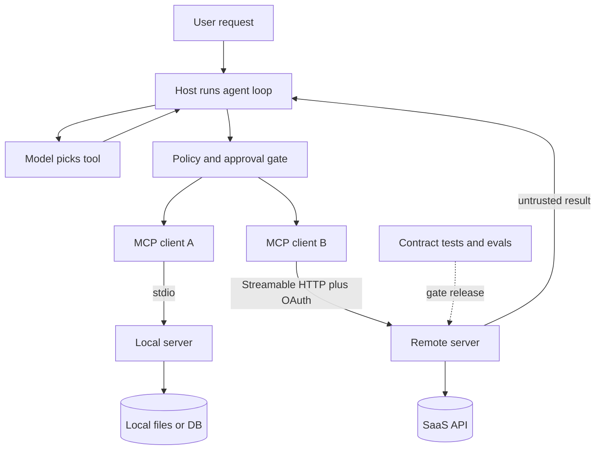

## Overview
The Model Context Protocol (MCP) is how an agent reaches tools and data it does not own. A host (your
agent) opens one client per connection to servers that expose tools, resources and prompts, all over
JSON-RPC 2.0.

This module takes you from the wire protocol to a secured, deployed server that several agents share.
Every lesson is written from the agent builder's seat: what the model sees, what it costs in tokens,
and what can go wrong in production.

**What this module gives an agent builder:**

- **Protocol literacy:** hosts, clients and servers, the lifecycle, capability negotiation, and stdio versus Streamable HTTP (the 2024-11-05 HTTP+SSE transport is deprecated).
- **Server craft:** building servers with FastMCP in Python or the TypeScript SDK, and choosing the right primitive for each capability.
- **Tool design for models:** names, schemas, actionable errors, pagination and token-efficient results.
- **Agent integration:** wiring servers into the OpenAI Agents SDK, the Claude Agent SDK and LangGraph adapters.
- **Production:** contract tests and the MCP Inspector, OAuth-protected remote servers, and defences against tool poisoning and injection.

**Core versus background for agent builders:**

- **Core (9 lessons):** mcp-architecture, mcp-server-primitives, mcp-transports, building-an-mcp-server-end-to-end, designing-mcp-tools-for-agents, using-mcp-servers-inside-agents, testing-and-debugging-mcp-servers, deploying-remote-mcp-servers and mcp-security-in-practice. You use each directly when you build or run an MCP-backed agent.
- **Useful (2 lessons):** mcp-client-primitives (sampling and roots are deprecated in the 2026-07-28 revision; elicitation stays relevant) and mcp-ecosystem (registries, popular servers and when not to use MCP).
- **Background:** none. Every lesson maps to code or configuration you will touch.

**What you can build afterwards:**

- **A reusable tool server:** one MCP server that IDE agents, chat apps and your own loop all use.
- **A framework-portable integration:** the same server plugged into three agent frameworks with filtered tool lists and approval for writes.
- **A remote, multi-user service:** a Streamable HTTP server that validates per-user OAuth tokens and scales behind a load balancer.
- **A defended agent:** one where an injected tool result cannot leak private data or trigger an unapproved write.

## Why it matters
- **Engineer:** You write the servers and the client wiring your agent depends on. Tool names, schemas and error messages are prompt text, so you decide how reliably the model picks and calls tools, and you debug the "tool missing", "hangs at start" and stray stdout bugs that are architecture bugs, not model bugs.
- **Architect:** MCP decides where integrations live and who owns them. You choose stdio or Streamable HTTP, stateless or sticky sessions, which servers a host may load, how tokens are scoped per server, and when a few native function tools beat an MCP server on latency and cost.
- **FDE:** Customers want their agent connected to their GitHub, database, ticketing or internal APIs this week. You need to pick vendor-official servers from the registry or ship a small custom one, connect it to the customer's framework, and explain consent, least privilege and injection risk to their security reviewer.

## Mental model
Think of MCP as a socket between your agent loop and everything it can touch. The host owns what the
model sees, each client speaks the protocol to one server, and each server owns the code and the
credentials behind it.

| Layer | Lessons | What it decides |
|---|---|---|
| Protocol and lifecycle | mcp-architecture, mcp-transports | Who connects to whom, which version and capabilities are agreed, how bytes travel |
| What a server offers | mcp-server-primitives, mcp-client-primitives | Tools the model calls, resources the app reads, prompts the user picks, and what a server may ask back |
| Building it well | building-an-mcp-server-end-to-end, designing-mcp-tools-for-agents | Tool boundaries, schemas, errors and result size |
| Agent integration | using-mcp-servers-inside-agents | Which tools reach the model, caching, timeouts and approvals |
| Running it | testing-and-debugging-mcp-servers, deploying-remote-mcp-servers | Frozen tool contracts, OAuth audience checks, sessions and scaling |
| Trust | mcp-security-in-practice, mcp-ecosystem | Which servers you load, pin and scope, and whether MCP is used at all |

- **Tools cost tokens every turn:** resources enter context only when the host loads them, so primitive choice is a context-budget choice.
- **Everything from a server is untrusted text:** tool descriptions and tool results can carry injections, so control what the agent can do, not just what it reads.

The host sits in the middle and decides which tools the model sees and which calls need a human. Each
client talks to one server over its transport, results flow back as untrusted text, and tests plus evals
guard the tool surface before a change ships.

## Suggested order
1. mcp-architecture — the host, client and server split, JSON-RPC lifecycle and capability negotiation that every later lesson assumes.
2. mcp-server-primitives — tools, resources and prompts, so you know which primitive each capability belongs under before building anything.
3. mcp-transports — stdio for local subprocess servers and Streamable HTTP for remote ones, which fixes deployment, auth and failure modes.
4. building-an-mcp-server-end-to-end — turns the concepts into a working FastMCP or TypeScript server driven by an agent loop.
5. designing-mcp-tools-for-agents — refines that server for its real user, a model under a token budget.
6. using-mcp-servers-inside-agents — plugs servers into the OpenAI Agents SDK, the Claude Agent SDK and LangGraph with filtering and approvals.
7. testing-and-debugging-mcp-servers — the Inspector, contract tests and tool-selection evals that protect the tool surface you just designed.
8. mcp-security-in-practice — tool poisoning, injection through results, consent and least privilege, once you have a real agent to defend.
9. deploying-remote-mcp-servers — OAuth resource servers, sessions, hosting and scaling, after security is in place.
10. mcp-client-primitives — useful: sampling, roots and elicitation for existing servers and human-in-the-loop confirmations.
11. mcp-ecosystem — useful: closes the module with the registry, popular servers and when native tools beat MCP.

## Capstone
### Brief
**Use case:** a support engineering team wants one ticketing integration that every agent in the
company can share: the IDE coding agent, the internal chat assistant and a LangGraph triage agent. This
is the module's major project, planned for several days to a week.

Build a remote MCP server over a ticket store and connect real agents to it. The server should be
something a security reviewer would approve for production.

**Use cases it serves:**

- **Triage:** an agent searches open tickets, reads one in full and proposes labels.
- **Resolution:** an agent closes a ticket only after a human confirms, using elicitation where the host supports it.
- **Shared reuse:** the same server works unchanged across three frameworks and one off-the-shelf host.

**How it combines the lessons:**

- **Server:** FastMCP or the TypeScript SDK, read tools, one write tool, a resource template for full ticket bodies and one prompt.
- **Tool design:** prefixed names, enums, bounded `limit`, cursors and actionable `isError` messages.
- **Transport and deploy:** stdio for local dev, Streamable HTTP in a container with two replicas, OAuth token validation for its own audience.
- **Agents:** OpenAI Agents SDK, Claude Agent SDK and LangGraph clients with allowlisted tools and approval on writes.
- **Security:** a planted injection in a ticket comment that must not cause a leak or an unapproved write.

Mini projects from each lesson are the stepping stones; this capstone stitches them into one service.

### Deliverables
- A repository with the server, a README covering every tool, resource and prompt, and a decision note on which capabilities use MCP and which stay native tools.
- A pytest contract suite through the official SDK client, a `tools/list` snapshot that fails CI on diff, and Inspector CLI smoke commands in a Makefile.
- A containerised Streamable HTTP deployment with two replicas behind a proxy, JWT validation of issuer, audience and scopes, and logs per tool call written to stderr or a log sink.
- Three agents (OpenAI Agents SDK, Claude Agent SDK, LangGraph via `langchain-mcp-adapters`) connected to the same server, plus a config entry for one IDE or desktop host.
- A 20-task eval reporting task success, correct-tool rate, invalid-argument rate and tokens per task for each agent.
- A short threat model and an injection test case with before-and-after logs.

### Rubric
- A request without a token, or with a token for another audience, gets `401` and never reaches a tool.
- Killing one replica mid-run does not break the agents, and the session mode chosen is documented and works behind the proxy.
- Renaming a tool parameter or rewording a description fails CI before deploy, and a deliberately vague description shows a lower correct-tool rate in the eval.
- The close-ticket write never runs without approval: interactive hosts elicit a reason and confirmation, headless agents must pass a `reason` argument, and a repeated close is idempotent.
- The planted injection in a ticket comment is read by the agent but produces no data leak and no unapproved write, shown in the logs.
- Large ticket bodies arrive through the resource or paginated results, and tokens per task stay within a stated budget across all three agents.
