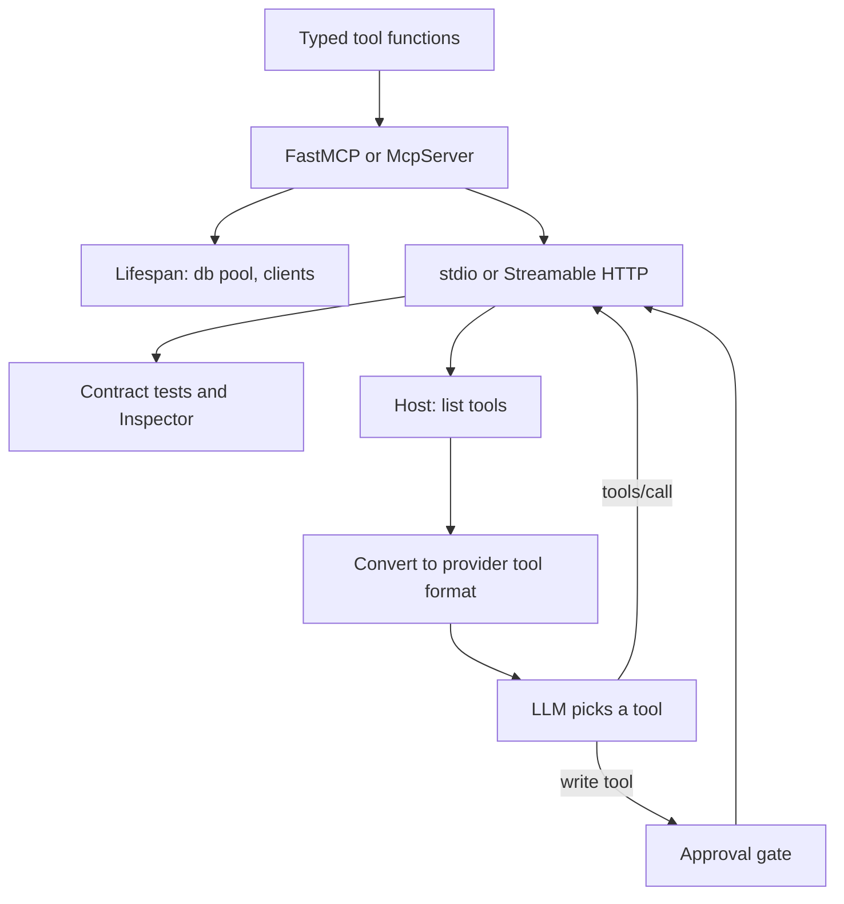

## TL;DR
Building an MCP server means wrapping one system's capabilities as typed tools with FastMCP (Python) or
the TypeScript SDK, then testing, packaging and wiring it into an agent loop. This lesson goes from an
empty file to an agent using your server.

## For agent builders
- **Why it matters for agents.** A server is written once and reused by every host: IDE agents, chat
  apps and your own loop. Getting schemas, errors and lifecycle right here decides how reliably every one
  of those agents uses it.
- **Where it shows up in your stack.** `FastMCP` in the official Python SDK 1.x (`MCPServer` in 2.x), the
  separate `fastmcp` package some teams use, `McpServer.registerTool` in TypeScript, host config files
  that launch servers, and the agent code that bridges MCP tools into model tool calls.
- **What you control.** Tool boundaries and names, input and output schemas, error messages, shared
  resources in the lifespan, transport, packaging and which tools need approval.
- **What you can skip.** The low-level `Server` API until you need dynamic tool lists or full wire
  control; the high-level APIs cover most servers.

## Why it exists
- **Every host wants the same tools.** Without a server, the same Jira or database wrapper is rewritten
  for each framework; a server packages it once with a schema every host understands.
- **Hand-written JSON-RPC is error-prone.** Framing, capability negotiation, pagination and error shapes
  are easy to get subtly wrong; the SDKs handle them and derive schemas from types.
- **Agents need more than a function.** They need clear descriptions, bounded results, recoverable errors
  and approval for writes, which a quick wrapper usually lacks.
- **Testing without a model is cheap.** A server can be exercised by a plain client in milliseconds,
  long before an LLM is involved, so bugs are found deterministically.

## How it works
### Pick the toolkit
| Option | Pick when | Watch out for |
|---|---|---|
| Official Python SDK 1.x, `mcp.server.fastmcp.FastMCP` | Python team, most examples and tutorials | Speaks up to 2025-11-25; pin `mcp>=1.10,<2` |
| Official Python SDK 2.x, `mcp.server.mcpserver.MCPServer` | New Python servers that need 2026-07-28 | Renamed classes and snake_case fields; read the migration guide |
| Standalone `fastmcp` package | You want its extra features (composition, proxies, client utilities) | A separate project with its own API and releases; check its docs |
| TypeScript SDK `@modelcontextprotocol/sdk` 1.x | Node or TypeScript team, edge or web deployments | Zod-based schemas; v2 splits into packages such as `@modelcontextprotocol/server`, so check current docs |

### The build sequence
1. **Scope the server to one system and its jobs.** List the 3 to 8 tasks agents actually need (search,
   get, create draft), not every API endpoint. See `mcp/designing-mcp-tools-for-agents`.
2. **Write typed tool functions.** In Python, type hints and `pydantic.Field` constraints become the
   `inputSchema`, the docstring becomes the description, and a typed return becomes the `outputSchema`
   with `structuredContent`. In TypeScript, pass Zod shapes as `inputSchema` and `outputSchema`.
3. **Put shared resources in the lifespan.** Database pools and HTTP clients open once in an async
   context manager and are reached via `ctx.request_context.lifespan_context`, because opening them per
   call is slow and leaks under load.
4. **Make errors recoverable.** Raise `ToolError` (Python) or return `isError: true` (TypeScript) with a
   message that tells the model what to do next. In Python SDK 1.x, argument validation failures also come
   back as `isError` results.
5. **Report progress and logs** with `ctx.report_progress(...)` and `ctx.info(...)` for long calls; plain
   logging goes to stderr.
6. **Annotate.** `readOnlyHint`, `destructiveHint` and `idempotentHint` let hosts decide what to
   auto-approve.
7. **Test without a model.** A stdio client in a test (or the MCP Inspector, `npx
   @modelcontextprotocol/inspector`) lists tools, checks schemas, and calls each tool with good and bad
   arguments.
8. **Package and configure.** Ship as a package runnable by one command (`uvx`, `npx` or a container) and
   give hosts a config entry with `command`, `args` and `env`; for remote use, run Streamable HTTP behind
   auth.
9. **Bridge into your agent.** List tools, convert them to the provider's tool format, call them when the
   model asks, feed results and `isError` back, and gate write tools.

### Bridging into a model's tool calls
| MCP | Anthropic Messages API | Notes |
|---|---|---|
| `tool.name`, `tool.description` | `name`, `description` | Prefix names when you load several servers |
| `tool.inputSchema` | `input_schema` | Passes through as JSON Schema |
| `tools/call` result `content` text | `tool_result` block `content` | Join text items; keep results small |
| `isError: true` | `is_error: true` | The model sees the error and can retry |

Other providers map the same way (a `parameters` field instead of `input_schema`); framework adapters do
this for you, but the mapping is worth knowing when debugging.

## Diagram
From code to agent: the server is tested without a model first, then the host bridges its tools into the
model's tool loop.



## Examples
### The server: a knowledge base with a lifespan, errors and annotations
Tested with the Python SDK 1.x (`pip install "mcp>=1.10,<2"`).

```python
# kb_server.py
import sqlite3, sys
from contextlib import asynccontextmanager
from dataclasses import dataclass
from pydantic import BaseModel
from mcp.server.fastmcp import FastMCP, Context
from mcp.server.fastmcp.exceptions import ToolError
from mcp.types import ToolAnnotations

@dataclass
class Deps:
    db: sqlite3.Connection

@asynccontextmanager
async def lifespan(server: FastMCP):
    db = sqlite3.connect(":memory:")            # open once, not per tool call
    db.execute("CREATE TABLE kb (id INTEGER PRIMARY KEY, title TEXT, body TEXT)")
    db.execute("INSERT INTO kb (title, body) VALUES ('Reset VPN token', 'Open the portal, then ...')")
    try:
        yield Deps(db=db)
    finally:
        db.close()

mcp = FastMCP("kb", lifespan=lifespan, instructions="Search before drafting. Drafts need review.")

class Hit(BaseModel):
    id: int
    title: str

@mcp.tool(annotations=ToolAnnotations(readOnlyHint=True))
async def kb_search(query: str, ctx: Context, limit: int = 5) -> list[Hit]:
    """Search knowledge-base titles. Returns ids and titles; call kb_get_article for the text."""
    db = ctx.request_context.lifespan_context.db
    await ctx.info(f"kb_search {query!r}")       # MCP log notification to the host
    rows = db.execute("SELECT id, title FROM kb WHERE title LIKE ? LIMIT ?", (f"%{query}%", limit))
    return [Hit(id=i, title=t) for i, t in rows]

@mcp.tool(annotations=ToolAnnotations(readOnlyHint=True))
async def kb_get_article(article_id: int, ctx: Context) -> str:
    """Full text of one article by id (from kb_search)."""
    row = ctx.request_context.lifespan_context.db.execute(
        "SELECT body FROM kb WHERE id = ?", (article_id,)).fetchone()
    if row is None:
        raise ToolError(f"No article {article_id}. Use an id returned by kb_search.")
    return row[0]

@mcp.tool(annotations=ToolAnnotations(destructiveHint=False, idempotentHint=False))
async def kb_create_draft(title: str, body: str, ctx: Context) -> Hit:
    """Create an unpublished draft article. A human publishes it later."""
    db = ctx.request_context.lifespan_context.db
    cur = db.execute("INSERT INTO kb (title, body) VALUES (?, ?)", (f"[draft] {title}", body))
    return Hit(id=cur.lastrowid, title=f"[draft] {title}")

if __name__ == "__main__":
    mcp.run(transport="streamable-http" if "--http" in sys.argv else "stdio")
```

### The agent: bridging MCP tools into a Claude tool loop
A step budget, an approval gate for the write tool, and `isError` passed back to the model. Set `MODEL` to
a current model id from the provider docs.

```python
# agent.py  (pip install anthropic "mcp>=1.10,<2")
import asyncio, os, sys
import anthropic
from mcp import ClientSession, StdioServerParameters
from mcp.client.stdio import stdio_client

APPROVE = {"kb_create_draft"}                      # write tools need a human yes
llm = anthropic.AsyncAnthropic()

async def run(task: str, max_steps: int = 6):
    server = StdioServerParameters(command=sys.executable, args=["kb_server.py"])
    async with stdio_client(server) as (r, w), ClientSession(r, w) as mcp:
        await mcp.initialize()
        tools = [{"name": t.name, "description": t.description or "", "input_schema": t.inputSchema}
                 for t in (await mcp.list_tools()).tools]
        messages = [{"role": "user", "content": task}]
        for _ in range(max_steps):                  # step budget: never loop forever
            resp = await llm.messages.create(model=os.environ["MODEL"], max_tokens=1024,
                                             tools=tools, messages=messages)
            messages.append({"role": "assistant", "content": resp.content})
            calls = [b for b in resp.content if b.type == "tool_use"]
            if not calls:
                return "".join(b.text for b in resp.content if b.type == "text")
            results = []
            for c in calls:
                if c.name in APPROVE and input(f"Allow {c.name}({c.input})? [y/N] ") != "y":
                    out, err = "User denied this action.", True
                else:
                    res = await mcp.call_tool(c.name, c.input)
                    out = "\n".join(x.text for x in res.content if x.type == "text")
                    err = bool(res.isError)         # tool errors go back to the model
                results.append({"type": "tool_result", "tool_use_id": c.id, "content": out, "is_error": err})
            messages.append({"role": "user", "content": results})
        return "Stopped: step budget exhausted."

if __name__ == "__main__":
    print(asyncio.run(run("How do I reset my VPN token? Draft an article if none exists.")))
```

### The same server in TypeScript
Tested with `@modelcontextprotocol/sdk` 1.x and Zod. Note `console.error` for logs: stdout is the wire.

```typescript
// server.mjs  (npm i @modelcontextprotocol/sdk zod)
import { McpServer } from "@modelcontextprotocol/sdk/server/mcp.js";
import { StdioServerTransport } from "@modelcontextprotocol/sdk/server/stdio.js";
import { z } from "zod";

const kb = new Map([[1, { title: "Reset VPN token", body: "Open the portal, then ..." }]]);
const server = new McpServer({ name: "kb", version: "1.0.0" });

server.registerTool("kb_search", {
  description: "Search knowledge-base titles. Returns ids and titles.",
  inputSchema: { query: z.string(), limit: z.number().int().min(1).max(20).default(5) },
  outputSchema: { hits: z.array(z.object({ id: z.number(), title: z.string() })) },
  annotations: { readOnlyHint: true },
}, async ({ query, limit }) => {
  const hits = [...kb].filter(([, a]) => a.title.toLowerCase().includes(query.toLowerCase()))
    .slice(0, limit).map(([id, a]) => ({ id, title: a.title }));
  return { content: [{ type: "text", text: JSON.stringify({ hits }) }], structuredContent: { hits } };
});

server.registerTool("kb_get_article", {
  description: "Full text of one article by id (from kb_search).",
  inputSchema: { article_id: z.number().int() },
  annotations: { readOnlyHint: true },
}, async ({ article_id }) => {
  const a = kb.get(article_id);
  if (!a) return { content: [{ type: "text", text: `No article ${article_id}. Use an id from kb_search.` }], isError: true };
  return { content: [{ type: "text", text: a.body }] };
});

console.error("kb server ready");
await server.connect(new StdioServerTransport());
```

### Worked scenario: what a test run catches before any model is involved
A contract test lists tools and calls each one through a stdio client; for a small server it runs in
seconds (illustrative), so it belongs in every CI run.

| Check | Typical bug it catches | Fix |
|---|---|---|
| Every tool has a description over 20 characters | A tool with no docstring, so the model never chooses it | Docstring with when to use it |
| Bad id returns `isError`, not a crash | An uncaught `KeyError` surfaces as a generic error | `ToolError` with a next step |
| `structuredContent` matches `outputSchema` | A renamed field breaks a downstream parser | Typed return model |
| Nothing on stdout but JSON-RPC | A library prints a banner and the host hangs | Redirect logs to stderr |

## Production patterns
- **Contract-test every tool in CI.** Spin up the server over stdio in a test, assert the tool list,
  schemas and descriptions, and call each tool with valid, invalid and edge-case arguments; fail the build
  on schema drift. Add a small model-in-the-loop eval separately for tool selection.
- **Keep shared clients in the lifespan and set timeouts on them.** One pool per process, a timeout on every
  backend call shorter than the host's tool timeout, and a clear `isError` on timeout. Monitor backend
  latency and timeout counts per tool.
- **Ship as one command with pinned dependencies.** Publish a package or container runnable with `uvx`,
  `npx` or `docker run`, pin the SDK major version, and document the host config entry (`command`, `args`,
  `env`). Secrets come from `env` or a secret manager, never arguments.
- **Trace tool calls end to end.** Log tool name, argument hash, duration, result size and `isError` for
  every call, with the agent's trace id when the host passes one (the 2026-07-28 revision documents
  `traceparent` in `_meta`). Feed failures into your eval set.
- **Gate writes in the host, not just the server.** Mark write tools with annotations, require approval or a
  policy check in the agent for anything destructive, and make writes idempotent so retries are safe.
- **Version tools like an API.** Add new tools or optional arguments rather than changing meanings; when a
  breaking change is unavoidable, ship a new tool name and remove the old one after hosts migrate.

## Trade-offs
- **High-level API vs low-level `Server`.** Decorators and `registerTool` give schemas from types and little
  code, but less control over dynamic tool lists and the exact wire format.
- **Python vs TypeScript.** Python fits data and ML backends and Pydantic validation; TypeScript fits web
  stacks, edge runtimes and Zod. Both SDKs track the spec, with occasional feature lag on one side.
- **Official SDK vs standalone `fastmcp`.** The official SDK follows the spec closely and has the widest
  examples; the standalone package adds conveniences at the cost of a second dependency and API to track.
- **Agent bridge by hand vs framework adapter.** A hand bridge is about 30 lines and fully transparent;
  adapters save code across many servers but hide conversion details you may need when debugging.

## Pitfalls
- **Mixing up SDK generations.** Symptom: `ModuleNotFoundError: mcp.server.fastmcp` or missing attributes
  after an upgrade. Fix: pin the major version and follow the migration guide when moving to 2.x.
- **Opening a database connection per tool call.** Symptom: latency spikes and connection exhaustion under
  agent traffic. Fix: a pool created in the lifespan with backend timeouts.
- **Leaking exceptions instead of guidance.** Symptom: the model sees "internal error" and retries the same
  call. Fix: catch expected failures and raise `ToolError` or return `isError` with what to do next.
- **Returning unbounded results.** Symptom: one search returns 2 MB and the agent's context overflows.
  Fix: limits, pagination and concise formats, as in `mcp/designing-mcp-tools-for-agents`.

## When to use
- **Build a server when** several hosts or teams need the same capabilities, or a vendor's agent must call
  your system.
- **Skip it when** one agent calls a few in-process functions; plain tool calling is simpler.
- **Measure:** tool call success rate, `isError` rate per tool, p95 latency, result size, and task success
  in a small agent eval.
- **Interviews:** walk through scoping, schemas, errors, lifespan, testing, packaging and the agent bridge.

## Role lens
- **Engineer:** Builds the server with typed schemas, a lifespan, actionable errors and annotations, writes
  contract tests in CI, and bridges the tools into the agent with approval and a step budget.
- **Architect:** Chooses SDK and transport, sets standards for tool naming, versioning, tracing and
  approval, and decides which systems get a shared server versus in-process tools.
- **FDE:** Wraps a customer's internal API as an MCP server in days, packages it as one command for their
  hosts, and proves it works with contract tests before the agent demo.

## Check yourself
**Q:** You built an MCP server whose tools work in your contract tests, but in the IDE agent the model never
calls `kb_create_draft` and often calls `kb_get_article` with made-up ids. What do you change?
**A:** Both are interface problems, not server bugs. The model skips `kb_create_draft` because its
description does not say when to use it; write a description that states the purpose, when to call it
(after searching finds nothing) and that a human publishes drafts. Made-up ids mean the model does not know
ids come from search; say "use an id returned by kb_search" in the description and in the not-found error,
and return ids prominently in search results. Then add a small eval of a few tasks that measures tool
selection and argument correctness, so you can see the fix work, and keep the approval gate on the write
tool.

## Interview questions
### Walk me through building an MCP server for an internal ticketing API.
- **Scope** to the 3 to 8 jobs agents need (search, get, comment, close) instead of mirroring every endpoint,
  with clear names and descriptions.
- **Implement** typed tools with FastMCP or `registerTool`, a lifespan-held HTTP client with timeouts,
  `isError` messages that suggest next steps, and annotations for write tools.
- **Ship** with contract tests in CI, a one-command package, stdio for local hosts and Streamable HTTP with
  OAuth for shared use.

### How do MCP tool results and errors map into a Claude tool-use loop?
- **Each MCP tool** becomes a tool definition with `name`, `description` and `input_schema` copied from
  `inputSchema`.
- **Each call result** becomes a `tool_result` block with the joined text, and `isError` maps to `is_error`
  so the model can see the failure and recover instead of the host crashing.

### Why put database connections in the lifespan rather than inside each tool?
- **Agents call tools in bursts,** sometimes in parallel; opening a connection per call adds latency and can
  exhaust the database's connection limit.
- **The lifespan** opens a pool once per process, closes it on shutdown, and exposes it through the request
  context, which also makes testing with a fake dependency easy.

### How do you test an MCP server before connecting it to a model?
- **Contract tests:** start it over stdio from a test client, assert tool names, descriptions and schemas,
  and call each tool with valid, invalid and boundary arguments, checking `isError` and `structuredContent`.
- **Interactive checks** with the MCP Inspector, then a small model-in-the-loop eval for tool selection,
  which is the only part that needs an LLM.

### When would you choose the TypeScript SDK over FastMCP?
- **TypeScript** when the team and backend are Node, the server runs on edge or web platforms, or you want
  Zod schemas shared with the rest of the codebase.
- **Python** when the system is data or ML heavy and Pydantic types already describe it; both speak the same
  protocol, so hosts cannot tell the difference.

## Quiz
### Q: In FastMCP, where does a tool's `inputSchema` come from?
- [ ] A separate JSON Schema file you register
- [x] The function's type hints and parameter defaults, converted to JSON Schema
- [ ] The host infers it from the first call
- [ ] The docstring, parsed by the model
> FastMCP inspects the signature, builds a Pydantic model and emits its JSON Schema. The docstring becomes
> the description, and a typed return becomes the output schema.

### Q: A tool cannot find the requested record. What should the server return?
- [ ] A JSON-RPC error with code `-32603`
- [ ] An empty result with no content
- [x] A normal result with `isError: true` and a message saying how to find a valid id
- [ ] Nothing; the host will time out and retry
> Not-found is an execution error the model can act on, so it belongs in a result with `isError: true` and
> a next step. JSON-RPC errors are for protocol failures such as an unknown tool.

### Q: Why should shared resources such as a database pool live in the server's lifespan?
- [ ] The MCP specification requires a lifespan for every server
- [x] They are opened once per process and reused, avoiding per-call setup cost and connection leaks
- [ ] Lifespan objects are automatically sent to the model as context
- [ ] Tools cannot use async code outside a lifespan
> Opening clients per call repeats setup and can exhaust connections when agents call tools in bursts. The
> lifespan opens them at startup, closes them at shutdown and exposes them through the request context.

## Use cases & projects
### Use cases
- **Internal API wrappers.** A platform team turns the ticketing, CRM or deploy API into one server that
  every team's agents and IDE hosts share.
- **Customer integrations.** An FDE wraps a customer's internal service in a few days so the customer's
  hosts and your agent use the same typed tools.
- **Coding-agent tooling.** A repo-specific server exposes build, test and log tools to IDE agents over stdio.
- **Data access for analysts' agents.** A read-only query server with schema resources and row limits gives
  agents safe database access.

### Mini project
**Ship a knowledge-base MCP server and drive it from your own agent (2-3 hours).**
- **Goal:** a server with two read tools and one write tool, tested without a model, then used by a small
  agent loop and by an off-the-shelf host.
- **Steps:** build `kb_server.py` from the example on a real SQLite file; add a contract test that lists
  tools and calls each with good and bad arguments; run `agent.py` with a step budget and the approval gate;
  add the server to an IDE or desktop host's config with `command` and `args`.
- **Done when:** contract tests pass in CI, the agent answers a question needing two tool calls, a bad id
  returns an `isError` the model recovers from, the write waits for approval, and the second host lists and
  calls the same tools.

### Major project
This lesson is the core of the module Capstone (see the module guide): a production MCP server for one real
system plus an agent that uses it.
- **Scope (multi-day):** Python or TypeScript server with lifespan-held clients, typed schemas, actionable
  errors and annotations; stdio and stateless Streamable HTTP; OAuth on HTTP; tracing; contract tests and a
  10-task agent eval.
- **Done when:** two hosts and your agent use it, the eval reports tool selection and task success, every
  write needs approval and is idempotent, and a breaking change is caught by CI before release.
