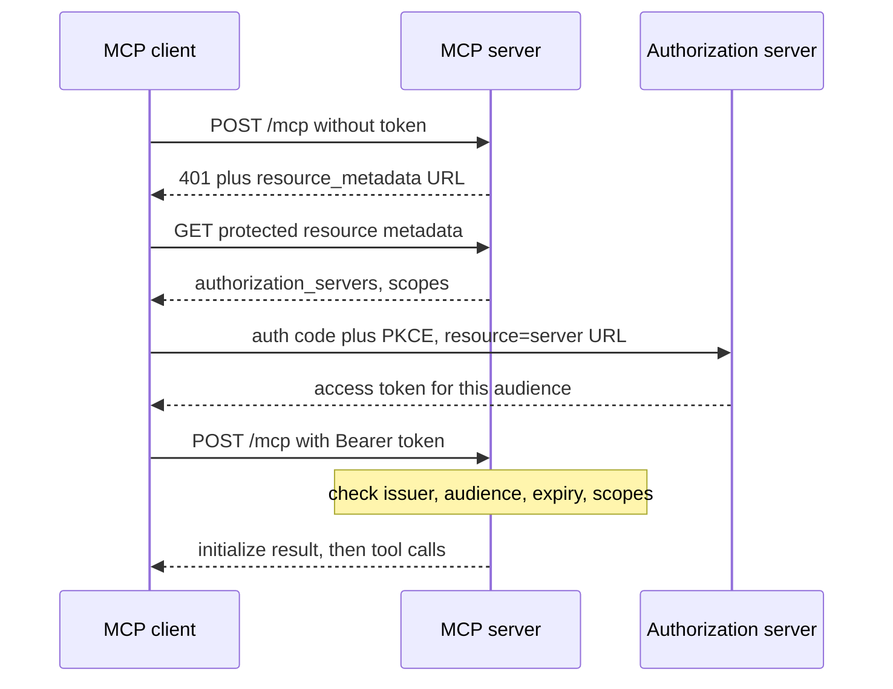

## TL;DR
A remote MCP server is an HTTP service on the Streamable HTTP transport that acts as an OAuth resource
server. Deploying it well means validating tokens for its own audience, choosing stateless or sticky
sessions, and running it behind proxies that do not break streaming.

## For agent builders
- **Why it matters for agents.** Remote servers are how one tool surface serves many agents and users:
  claude.ai connectors, ChatGPT, IDEs and your own agents all reach it over HTTPS with per-user tokens.
- **Where it shows up in your stack.** An ASGI app from the MCP SDK (`streamable_http_app()`), an identity
  provider issuing tokens, a load balancer, and a container or serverless platform.
- **What you control.** Token validation (issuer, audience, scopes), session mode, replica count and
  routing, timeouts for streamed responses, rate limits per client and logs per tool call.
- **What you can skip.** Writing your own authorization server. Use an existing identity provider and keep
  the MCP server a resource server that only validates tokens.

## Why it exists
- **Local stdio does not share.** A stdio server runs on one machine for one user; a team or a public
  product needs one HTTPS endpoint with per-user identity.
- **API keys pasted into configs do not scale.** They leak, cannot be scoped per user and cannot be revoked
  cleanly, so the spec standardises OAuth-based authorization for HTTP transports.
- **Sessions fight horizontal scaling.** A stateful session lives on one replica; without sticky routing
  or shared state the next request lands elsewhere and fails.
- **Streaming breaks behind ordinary proxies.** Server-Sent Events responses need unbuffered, long-lived
  connections, which default proxy and serverless timeouts cut off.

## How it works
### The transport: Streamable HTTP
- **One endpoint** (for example `/mcp`). Clients POST JSON-RPC messages; the server answers with JSON or
  with an SSE stream when it needs to send progress or server requests first. An optional GET opens a
  stream for server-initiated messages.
- **Sessions (2025-03-26 onwards).** The server may return `Mcp-Session-Id` on `initialize`; the client
  sends it on every later request, and DELETE ends the session.
- **Version header (2025-06-18 onwards).** Clients send `MCP-Protocol-Version` on requests after
  initialisation, so servers know which revision to speak.
- **Resumability.** With SSE event ids, a client can reconnect with `Last-Event-ID` and the server replays
  missed messages if it kept them in an event store.
- **Later revisions.** The Python SDK 2.x implements a 2026-07-28 revision in which each request is
  self-contained, with no `initialize` handshake or `Mcp-Session-Id`. Check which revisions your clients speak.

### Authorization, step by step (2025-06-18 and 2025-11-25 revisions)
1. **Challenge.** A request without a valid token gets `401` with `WWW-Authenticate` pointing at the
   server's Protected Resource Metadata (RFC 9728).
2. **Discovery.** The metadata lists the authorization servers; the client fetches their metadata
   (RFC 8414 or OpenID Connect discovery).
3. **Registration.** Pre-registered clients, Client ID Metadata Documents (added in 2025-11-25) or Dynamic
   Client Registration (RFC 7591) give the client an identity.
4. **Authorize.** Authorization code flow with PKCE, passing `resource` (RFC 8707) set to the MCP server's
   canonical URL so the token is bound to it.
5. **Call.** Requests carry `Authorization: Bearer <token>`; the server validates signature, expiry,
   audience and scopes, and answers `403` with `insufficient_scope` when a tool needs more.
6. **Downstream.** The server never forwards that token to other APIs; it uses its own credentials or a
   token exchange, because the spec forbids token passthrough.

### Sessions and scaling
| Mode | How | Scales by | Gives up |
|---|---|---|---|
| Stateless | `stateless_http=True`, often with `json_response=True` | Any replica serves any request | Server-to-client requests mid-call, resumable streams |
| Stateful, sticky | Load balancer routes on `Mcp-Session-Id` | Adding replicas; sessions pinned | Sessions die with their replica |
| Stateful, shared | Session and event state in Redis or similar | Any replica, resumable | More moving parts, store latency |

### Hosting choices
- **Containers** (Cloud Run, ECS, Kubernetes, Fly) fit most servers: long-lived connections, normal timeouts,
  easy sticky routing.
- **Serverless functions** fit stateless, short tool calls; check the platform's maximum response duration
  before relying on streamed responses.
- **Edge platforms** with durable state (for example Cloudflare Workers with Durable Objects) are a common
  home for remote MCP servers; their SDKs wrap sessions for you, so check their docs.

## Diagram
The first call fails on purpose: the `401` tells the client where to get a token bound to this server.



## Examples
### A token-protected, stateless server with the Python SDK
Python `mcp` SDK 2.x; on 1.x import `FastMCP` from `mcp.server.fastmcp` and pass `stateless_http` and
`json_response` to the constructor instead. Swap the toy verifier for JWT validation against your
identity provider.

```python
import os
from mcp.server.mcpserver import MCPServer                 # mcp SDK 2.x
from mcp.server.auth.provider import AccessToken
from mcp.server.auth.settings import AuthSettings

PUBLIC_URL = os.environ.get("PUBLIC_URL", "http://localhost:8000/mcp")
ISSUER = os.environ.get("ISSUER_URL", "https://auth.example.com")

class IntrospectingVerifier:
    """Replace with JWT validation against your IdP's JWKS or token introspection."""
    async def verify_token(self, token: str) -> AccessToken | None:
        if token != os.environ.get("DEV_TOKEN", "dev-token"):
            return None                                          # -> 401 with WWW-Authenticate
        return AccessToken(token=token, client_id="dev", scopes=["tickets:read"],
                           expires_at=None, resource=PUBLIC_URL)

mcp = MCPServer(
    "tickets",
    token_verifier=IntrospectingVerifier(),
    auth=AuthSettings(issuer_url=ISSUER, resource_server_url=PUBLIC_URL,
                      required_scopes=["tickets:read"], validate_token_resource=True),
)

@mcp.tool()
def get_ticket(ticket_id: str) -> dict:
    """Fetch one support ticket by id, for example 'T-1'."""
    return {"id": ticket_id, "status": "open"}

app = mcp.streamable_http_app(stateless_http=True, json_response=True)   # any replica can serve any request
# run: uvicorn remote_server:app --host 0.0.0.0 --port 8000 --workers 4
```

### What a client sees on the wire
Probing the server above with `curl` shows the discovery chain the spec requires.

```bash
curl -si -X POST http://127.0.0.1:8000/mcp -H 'content-type: application/json' \
  -H 'accept: application/json, text/event-stream' -d '{}'
# HTTP/1.1 401 Unauthorized
# www-authenticate: Bearer error="invalid_token", error_description="Authentication required",
#   resource_metadata="http://localhost:8000/.well-known/oauth-protected-resource/mcp"

curl -s http://127.0.0.1:8000/.well-known/oauth-protected-resource/mcp
# {"resource":"http://localhost:8000/mcp","authorization_servers":["https://auth.example.com"],
#  "scopes_supported":["tickets:read"],"bearer_methods_supported":["header"]}
```

### Worked scenario: sticky sessions during a rolling deploy
A team ran a stateful server on 4 replicas with sticky routing and deployed during business hours.

| Step | Effect |
|---|---|
| Replica 1 drains; its sessions are cut | Agents mid-run get `404` for their `Mcp-Session-Id` |
| Clients re-initialize | Some frameworks retry, others fail the run |
| Measured impact (illustrative) | ~25% of active agent runs saw one failed tool call |
| Fix | Tools did not need server-to-client requests, so the team moved to stateless mode and dropped sticky routing |

## Production patterns
- **Validate tokens for your audience.** Check issuer, signature, expiry, scopes and audience (the server's
  canonical URL), and reject anything else; in the Python SDK set `validate_token_resource=True`. Monitor
  `401` and `403` rates by client.
- **Default to stateless.** Use stateless mode unless tools need sampling, elicitation or progress
  mid-call; it removes sticky routing and lets autoscaling work. Monitor replica count against request rate.
- **Make streaming survive the proxy.** Disable response buffering for the MCP path, raise idle timeouts
  above your longest tool call, and send keep-alives on SSE. Monitor dropped streams and tool-call duration.
- **Rate limit and isolate per client.** Key limits on token subject or client id, scope data by tenant
  claims in the token, and cap concurrent calls per user. Monitor `429`s and the noisiest clients.
- **Log one structured line per tool call.** Include tool name, client id, subject, latency, `isError` and
  protocol version, with no token values. Alert on error rate per tool and on unknown protocol versions.
- **Protect the endpoint itself.** Serve only HTTPS, validate `Origin` on browser-reachable endpoints,
  restrict CORS to known origins, and never treat `Mcp-Session-Id` as authentication. Monitor rejected origins.

## Trade-offs
- **Stateless vs stateful.** Stateless scales trivially and survives deploys but cannot ask the client
  for input mid-call or resume streams; stateful supports richer interactions at the cost of routing and storage.
- **Your IdP vs an MCP-specific auth service.** Reusing the company IdP keeps one identity system, but it
  may lack the dynamic or metadata-based registration MCP clients expect; a dedicated service fills that gap.
- **Containers vs serverless.** Containers handle long streams and warm connections; serverless is cheaper
  for bursty, short calls but timeouts and cold starts hurt long tool runs.
- **One multi-tenant server vs one per customer.** Shared servers are cheaper to run; per-customer
  deployments simplify data isolation and compliance at a higher operating cost.

## Pitfalls
- **Accepting any valid token from the IdP.** A token minted for another API works on your server, so a
  compromised service can call your tools. Fix: enforce the audience and resource binding.
- **Forwarding the user's token downstream.** The spec forbids it, and it breaks audit and scoping. Fix:
  obtain separate downstream credentials or use token exchange.
- **Buffered SSE behind a proxy.** Symptom: long tool calls hang then arrive all at once, or time out.
  Fix: disable buffering for the MCP route and raise idle timeouts.
- **Stateful sessions with round-robin balancing.** Symptom: random `400` or `404` responses after the first
  request. Fix: stateless mode, sticky routing or a shared session store.
- **Wrong public URL in metadata.** Behind a proxy the server advertises an internal host, so clients fail
  discovery. Fix: set the resource URL from configuration, not from the incoming request.

## When to use
- **Deploy remotely when:** many users or agents share the server, users authenticate with their own
  accounts, or the server must be reachable from hosted clients such as web chat apps.
- **Stay local (stdio) when:** the server touches one developer's files or tools and never needs
  per-user identity.
- **Choose stateful when:** tools need sampling, elicitation or resumable long-running streams; otherwise
  stateless.
- **Measure:** auth failures, tool-call latency p95, dropped streams, `429`s per client and error rate per tool.

## Role lens
- **Engineer:** Builds the HTTP app from the SDK, wires token validation to the IdP, sets session mode and
  proxy settings, and adds per-call structured logs and rate limits.
- **Architect:** Chooses hosting, session strategy and tenancy model, integrates the MCP server with the
  company identity provider, and defines how downstream credentials are obtained.
- **FDE:** Deploys the server into a customer's cloud and IdP, debugs discovery and redirect issues with
  their security team, and proves per-user scoping works before go-live.

## Check yourself
**Q:** Your remote MCP server works with the Inspector using a static token, but claude.ai fails to connect,
and behind the load balancer some tool calls return `404`. What do you check?
**A:** For the connection failure, walk the discovery chain: an unauthenticated POST must return `401` with
a `WWW-Authenticate` header whose `resource_metadata` URL is public and correct, that metadata must list a
reachable authorization server, and that server must support a registration method the client uses (such
as Dynamic Client Registration or client metadata documents) plus PKCE and the `resource` parameter. For the
`404`s, the server is stateful while the balancer spreads requests, so sessions are unknown on other
replicas; switch to stateless mode, add sticky routing on `Mcp-Session-Id`, or share session state.

## Interview questions
### What role does an MCP server play in OAuth, and why does that matter?
- **It is a resource server.** It validates access tokens issued by an authorization server and does not
  need to issue tokens itself, so teams reuse an existing identity provider.
- **It must check audience.** Tokens must be bound to the server's URL via the `resource` parameter, which
  stops tokens for other services being replayed against it.

### How would you scale a remote MCP server to many replicas?
- **Prefer stateless mode** so any replica serves any request and autoscaling works on request rate.
- **If you need sessions,** route on `Mcp-Session-Id` or keep session and event state in a shared store,
  and drain replicas gracefully during deploys.

### Long-running tool calls time out in production but not locally. Where do you look?
- **The path between client and server:** proxy buffering of SSE, load-balancer idle timeouts, and
  serverless maximum durations.
- **Then the design:** send progress notifications, raise idle timeouts on the MCP route, or make the tool
  start a job and return an id the agent can poll.

### Why is token passthrough forbidden, and what do you do instead?
- **Passthrough breaks the trust chain.** Downstream APIs see a token not meant for them, audit trails lose
  which service acted, and a stolen token works in more places.
- **Instead:** keep separate downstream credentials, or exchange the user's token for a downstream token
  scoped to that API, and log both identities.

### What would you log and alert on for a multi-tenant remote MCP server?
- **Per call:** tenant, client id, subject, tool, latency, `isError` and protocol version, never token values.
- **Alerts:** error rate and p95 per tool, auth failures per client, `429` spikes and unknown protocol versions
  after a client update.

## Quiz
### Q: What does an MCP server return to an unauthenticated request so that a client can start OAuth?
- [ ] A redirect to the login page
- [x] A `401` with a `WWW-Authenticate` header pointing to its Protected Resource Metadata
- [ ] A JSON-RPC error with the client secret
- [ ] An `Mcp-Session-Id` with guest scopes
> The authorization spec uses RFC 9728 metadata: the challenge tells the client where to find the
> authorization servers, which starts discovery and the PKCE flow.

### Q: Why should clients send the `resource` parameter when requesting a token for an MCP server?
- [ ] It enables streaming responses
- [ ] It is required for stdio servers
- [x] It binds the token's audience to that server so it cannot be replayed against other services
- [ ] It replaces PKCE
> Resource Indicators (RFC 8707) let the authorization server mint a token for one specific resource; the
> MCP server then rejects tokens whose audience is not its own URL.

### Q: Which change most simply fixes random session errors when a stateful MCP server runs behind a round-robin load balancer?
- [ ] Increase the number of replicas
- [ ] Switch tools to return JSON instead of text
- [x] Run the server in stateless mode if no tool needs server-to-client requests
- [ ] Disable OAuth
> Stateful sessions live on one replica. If tools do not need sampling, elicitation or resumable streams,
> stateless mode lets any replica answer any request and removes the routing problem.

## Use cases & projects
### Use cases
- **SaaS vendors exposing their API to AI clients.** One remote MCP server with OAuth lets customers connect
  claude.ai, ChatGPT or IDE agents with their own accounts.
- **Internal tool platforms.** A company hosts MCP servers for ticketing, HR and data behind the corporate
  IdP, shared by every internal agent.
- **Per-customer deployments.** FDE teams deploy the same server into each customer's cloud with their IdP
  and data residency rules.
- **Agent backends at scale.** Stateless MCP servers autoscale with agent traffic like any other API.

### Mini project
**Deploy a protected, stateless MCP server (2-3 hours).**
- **Goal:** run the token-protected server above in a container behind HTTPS and connect an agent to it.
- **Steps:** replace the toy verifier with JWT validation against a free IdP tenant or a local Keycloak;
  containerise with uvicorn and two replicas behind a proxy; confirm the `401` and metadata responses with
  curl; connect with the Inspector and with an OpenAI Agents SDK agent using `MCPServerStreamableHttp`;
  then kill one replica mid-run.
- **Done when:** a token for another audience is rejected, the agent's run survives losing a replica, and
  logs show one structured line per tool call with no token values.
