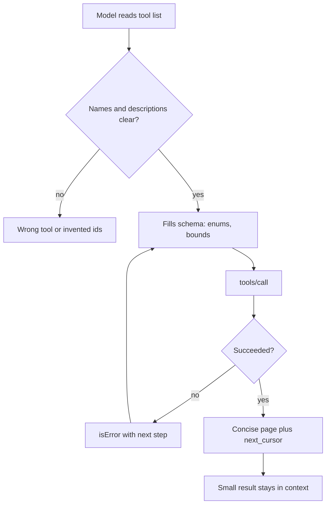

## TL;DR
An MCP tool's real user is a model reading its name, description, schema and results under a token
budget. Clear names, tight schemas, actionable errors, paginated and concise results make agents pick
the right tool and finish tasks.

## For agent builders
- **Why it matters for agents.** Tool selection accuracy, argument correctness and context growth are
  mostly decided by tool design, not by the model. The same model succeeds or flounders depending on how
  the tools read.
- **Where it shows up in your stack.** Tool names and docstrings, `Literal` and `Field` constraints in
  FastMCP, Zod schemas in TypeScript, `isError` messages, cursor arguments, and the size of every
  `tools/call` result that lands in the transcript.
- **What you control.** How capabilities are grouped into tools, what each tool returns by default, how
  errors guide the next step, and how big results can get.
- **What you can skip.** Mirroring every REST endpoint. Agents need task-shaped tools, not a full API
  surface.

## Why it exists
- **The model only sees text.** It cannot read your code; a vague name like `query` or a missing
  description makes it guess, and guesses become wrong calls.
- **Every tool definition costs tokens on every turn,** and every result stays in context for the rest of
  the run. A 20 KB result in step 2 is paid for again at steps 3 through 20.
- **APIs are designed for programs, not models.** Programs handle UUIDs, pagination loops and opaque error
  codes well; models need meaningful identifiers, small pages and errors that say what to do next.
- **Many servers share one tool list.** With several servers loaded, overlapping names (`search`,
  `get_item`) collide and confuse selection unless tools are named and scoped deliberately.

## How it works
### Naming
- **Verb plus object, prefixed by the service:** `crm_search_orders`, `crm_get_order`,
  `github_create_issue`. The prefix keeps names unique when hosts load several servers.
- **Spec rules (2025-11-25 onward):** names should be 1 to 128 characters, case-sensitive, using only ASCII
  letters, digits, `_`, `-` and `.`, and unique within a server. Hosts that aggregate servers should prefix
  to resolve collisions.
- **One meaning per name.** Never change what an existing tool does; add a new name and retire the old one.

### Descriptions are prompts
- **Say what it does, when to use it and when not to:** "Search a customer's orders. Use for questions
  about past purchases; for refunds use crm_refund_order."
- **Say what comes back and its limits:** "Returns id, total, status; at most 50 per page."
- **Name the source of ids:** "Use an order id returned by crm_search_orders" stops made-up ids.
- **Server `instructions`** carry cross-tool guidance ("search before you create") that hosts may add to
  the system prompt.

### Schemas that prevent mistakes
| Instead of | Use | Because |
|---|---|---|
| `status: str` | `Literal["paid", "refunded", "any"]` (an `enum`) | The model cannot invent a status |
| `limit: int` | `Field(20, ge=1, le=50)` | Bounds result size at the schema |
| `filters: dict` (free-form JSON) | Named, typed parameters | Models fill named fields far more reliably |
| Opaque UUID only | Accept a human key (slug, email) or return ids prominently | Fewer lookup round trips and fewer invented ids |
| Many optional flags | Two or three tools with clear jobs | Smaller schemas, clearer choice |
| No parameters, `{}` | `{"type": "object", "additionalProperties": false}` | Recommended by the spec; rejects junk arguments |

### Errors that steer the next step
- **Execution errors go in the result** with `isError: true`: API failures, validation errors (wrong date
  format, out of range) and business-rule failures, so the model can correct itself.
- **Protocol errors** (unknown tool, malformed request) are JSON-RPC errors the host handles in code.
- **Write messages as instructions:** what failed, why, and what to try ("No orders for 'acmee'. Check the
  slug with crm_find_customer."). A stack trace teaches the model nothing.
- **Expired or unknown handles** return an error that says how to get a new one.

### Pagination
- **Protocol pagination** covers the list methods (`tools/list`, `resources/list`, `prompts/list`) with an
  opaque `cursor` and `nextCursor`; hosts must loop.
- **Tool-level pagination is your design:** take `limit` and `cursor` arguments, return `next_cursor` (or
  null) and `total_matches`, so the agent knows whether to keep reading.
- **Cursors are opaque and stable:** encode an offset or keyset, reject tampered values with a clear error,
  and never require the model to compute page numbers.

### Token-efficient results
1. **Return the fields the next step needs** (id, title, status), not the whole record.
2. **Offer a `response_format`** (`concise` default, `detailed` on request) or a field list.
3. **Cap and say so:** truncate long text with a note such as "truncated at 2,000 characters, call
   crm_get_order for the rest".
4. **Point, do not inline:** return `resource_link` items or ids for large objects.
5. **Pair `structuredContent` with a short text summary,** so hosts can validate the data while the model
   reads a compact version.
6. **Keep tool order deterministic:** the 2026-07-28 revision asks servers to return `tools/list` in a stable
   order, which also keeps prompt caches warm.

### Consolidate around tasks
- **Prefer one task-shaped tool to a chain of CRUD calls:** `crm_order_summary(customer)` beats
  `list_customers`, `get_customer`, `list_orders`, `get_order` when agents always need the summary.
- **Stateful work uses explicit handles:** a creation tool returns `basket_id`, later tools take it, and the
  description states its lifetime.

## Diagram
How design choices show up in one agent step: what the model reads before the call and what it carries
afterwards.



## Examples
### An agent-friendly search tool
Prefixed name, enum and bounded schema, concise default, opaque cursor, and errors that say what to do.
Tested with the Python SDK 1.x (`mcp>=1.10,<2`).

```python
# design_server.py
import base64, json
from typing import Literal
from pydantic import BaseModel, Field
from mcp.server.fastmcp import FastMCP
from mcp.server.fastmcp.exceptions import ToolError
from mcp.types import ToolAnnotations

mcp = FastMCP("crm")
ORDERS = [{"id": f"o_{i}", "customer": "acme" if i % 3 else "globex", "total": 10 * i,
           "status": "refunded" if i % 7 == 0 else "paid", "lines": ["sku-1"] * 5} for i in range(1, 120)]

class OrderPage(BaseModel):
    orders: list[dict]
    total_matches: int
    next_cursor: str | None

def _cursor(offset: int) -> str: return base64.urlsafe_b64encode(json.dumps({"o": offset}).encode()).decode()
def _offset(cursor: str | None) -> int:
    if not cursor: return 0
    try: return json.loads(base64.urlsafe_b64decode(cursor))["o"]
    except Exception: raise ToolError("Invalid cursor. Pass the next_cursor value from the previous call unchanged, or omit it.")

@mcp.tool(annotations=ToolAnnotations(readOnlyHint=True, openWorldHint=False))
def crm_search_orders(
    customer: str = Field(description="Customer slug, e.g. 'acme'"),
    status: Literal["paid", "refunded", "any"] = "any",
    limit: int = Field(20, ge=1, le=50, description="Max orders per page"),
    cursor: str | None = Field(None, description="next_cursor from a previous call"),
    response_format: Literal["concise", "detailed"] = "concise",
) -> OrderPage:
    """Search a customer's orders. Use concise unless you need line items."""
    hits = [o for o in ORDERS if o["customer"] == customer and status in ("any", o["status"])]
    if not hits:
        raise ToolError(f"No orders for customer '{customer}'. Check the slug with crm_find_customer.")
    start = _offset(cursor)
    page = hits[start:start + limit]
    rows = page if response_format == "detailed" else [{k: o[k] for k in ("id", "total", "status")} for o in page]
    nxt = start + limit
    return OrderPage(orders=rows, total_matches=len(hits), next_cursor=_cursor(nxt) if nxt < len(hits) else None)

if __name__ == "__main__":
    mcp.run()
```

What a client sees (abridged output of calling it):

```
crm_search_orders(customer="acme", limit=2)
  -> {'orders': [{'id': 'o_1', 'total': 10, 'status': 'paid'}, {'id': 'o_2', 'total': 20, 'status': 'paid'}],
      'total_matches': 80, 'next_cursor': 'eyJvIjogMn0='}
crm_search_orders(customer="acmee")   -> isError: ... No orders for customer 'acmee'. Check the slug with crm_find_customer.
crm_search_orders(customer="acme", limit=500) -> isError: ... limit: Input should be less than or equal to 50
```

### Worked scenario: redesigning a tool set an agent kept failing with
A team's order-support agent used a server generated from their REST API. Token counts are illustrative
orders of magnitude for one 10-step task.

| Metric | Generated from REST (14 tools) | Redesigned (5 task-shaped tools) |
|---|---|---|
| Tool schema tokens per turn | ~4,500 | ~1,300 |
| Average result size | ~6,000 tokens (full records) | ~400 tokens (concise page) |
| Context after 10 steps (schemas plus accumulated results) | ~65k tokens (4,500 + 10 × 6,000) | ~5k tokens (1,300 + 10 × 400) |
| Common failure | Invented UUIDs, wrong endpoint chosen | Rare; errors name the right tool |
| Changes made | none | prefixed names, enums, bounded `limit`, `response_format`, `next_cursor`, actionable `isError` |

## Production patterns
- **Evaluate tools with an agent, not just unit tests.** Keep 10 to 30 realistic tasks, run the agent
  against the server, and track task success, tool selection accuracy, invalid-argument rate and tokens per
  task; rerun on every tool change. Read failing transcripts to rewrite descriptions.
- **Budget result size per tool.** Set a default page size, a hard cap, and truncation with an explicit
  note; log result tokens per call and alert when p95 grows. Large objects become resource links.
- **Lint tool definitions in CI.** Fail the build on missing or short descriptions, names outside the spec
  character set, missing service prefix, free-form `object` parameters or unbounded integers.
- **Write every error for the model.** Map backend errors to messages with cause and next step, return them
  as `isError` results, and track the retry-after-error success rate per tool to find unhelpful messages.
- **Version by adding, not mutating.** New optional arguments are safe; new semantics get a new tool name,
  announced with list-changed notifications, and old names are removed after usage drops to zero.
- **Keep definitions stable and ordered.** Deterministic tool order and unchanged descriptions keep the
  host's prompt cache hitting; avoid timestamps or per-request text in descriptions.

## Trade-offs
- **Fewer broad tools vs many narrow ones.** Broad task-shaped tools cut schema tokens and selection errors
  but need richer arguments and more server logic; narrow tools are simple to build but crowd the list.
- **Concise defaults vs completeness.** Small results keep context lean, but the agent may need a second
  call for detail; `response_format` makes the trade explicit per call.
- **Strict schemas vs flexibility.** Enums and bounds prevent invalid calls but must be updated when the
  backend adds values; loose strings accept anything and fail later with worse errors.
- **Human-readable ids vs opaque ids.** Slugs and emails reduce lookups and hallucinated ids, but can be
  ambiguous or change; opaque ids are stable but force extra search steps.

## Pitfalls
- **Generating tools straight from an OpenAPI spec.** Symptom: dozens of tools, low selection accuracy,
  huge results. Fix: design 3 to 8 task-shaped tools and keep the API behind them.
- **Unbounded list results.** Symptom: one call returns thousands of rows and the context overflows or
  costs spike. Fix: `limit` with a schema maximum, cursors and `total_matches`.
- **Errors without a next step.** Symptom: the agent repeats the same failing call. Fix: say what was wrong
  and which tool or argument fixes it.
- **Generic names across servers.** Symptom: the model calls `search` on the wrong server. Fix: service
  prefixes in tool names, and host-side prefixing for third-party servers.

## When to use
- **Apply this whenever** you write or review an MCP server that agents will call; it matters most for
  servers shared by many hosts.
- **Revisit when** tool selection accuracy, task success or tokens per task regress in your agent eval.
- **Measure:** schema tokens per turn, result tokens per call, invalid-argument rate, retry-after-error
  success, tool selection accuracy and task success.
- **Interviews:** expect to redesign a bad tool live: name, description, schema, error and pagination.

## Role lens
- **Engineer:** Writes prefixed, verb-noun tools with bounded schemas, concise defaults, cursors and
  actionable `isError` messages, and lints definitions in CI.
- **Architect:** Sets tool design standards across servers (naming, size budgets, versioning, error style)
  and requires an agent eval before a server is published to the platform.
- **FDE:** Reworks a customer's auto-generated tool set into task-shaped tools and shows the before and
  after on task success and token cost.

## Check yourself
**Q:** An agent using your `get_orders(customer_id)` tool keeps passing invented ids, and when it does get
results the context fills up after a few steps. Redesign the tool and explain each change.
**A:** Rename it with a prefix and verb, such as `crm_search_orders`, and accept a value the model actually
knows (a customer slug or email), or say in the description that ids come from `crm_find_customer`. Bound
the result with `limit` (schema maximum, small default), return a `next_cursor` and `total_matches`, and
default to a concise format with only id, total and status, offering `response_format="detailed"` when line
items are needed. Make not-found an `isError` result that names the lookup tool. Each change attacks a
cause: invented ids come from unknown id sources, and context bloat comes from unbounded full records.
Verify with an agent eval that tracks invalid arguments and tokens per task.

## Interview questions
### What makes a good MCP tool name and description?
- **Name:** a service prefix plus verb and object (`crm_search_orders`), within the spec's 1 to 128 safe
  characters, unique and never reused for a different meaning.
- **Description:** what it does, when to use it versus similar tools, what it returns and its limits, and
  where valid ids come from; it is effectively part of the prompt.

### How do you keep tool results from blowing up an agent's context?
- **Bound and shape them:** small default `limit` with a schema maximum, concise fields by default, a
  `response_format` for detail, and truncation with an explicit note.
- **Point to large data** with resource links or ids, and measure result tokens per call so regressions show
  up in monitoring.

### When should a failure be an `isError` result rather than a JSON-RPC error?
- **`isError`** for anything the model could fix or work around: bad arguments, not found, backend failures,
  business rules; the message should name the next step.
- **JSON-RPC errors** for protocol problems such as an unknown tool or a malformed request, handled by host
  code rather than the model.

### A team generated 40 MCP tools from their OpenAPI spec and the agent performs badly. What do you do?
- **Measure first:** an agent eval with real tasks, recording selection accuracy, invalid arguments and
  tokens per task.
- **Redesign around tasks:** consolidate into a handful of task-shaped tools with enums, bounds, concise
  results and actionable errors, then rerun the eval and compare.

### How would you design pagination for a search tool used by an agent?
- **Arguments:** `limit` with a small default and a hard maximum, plus an opaque `cursor` the model passes
  back unchanged.
- **Result:** the page, `total_matches` and `next_cursor` (null at the end), so the agent can decide whether
  reading more is worth it; reject tampered cursors with a clear error.

### How do tool definitions interact with prompt caching?
- **Tool definitions sit near the front of every request,** so any change to names, descriptions or order
  invalidates the cached prefix.
- **Keep them stable and deterministic:** no timestamps or per-request text, stable ordering (which the
  2026-07-28 revision recommends), and versioned changes rolled out deliberately.

## Quiz
### Q: Which schema change most directly stops a model from inventing invalid values for a `status` argument?
- [ ] Adding "be careful" to the description
- [x] Declaring `status` as an enum of the allowed values
- [ ] Making `status` optional
- [ ] Accepting a free-form `filters` object instead
> An enum constrains the argument at the schema level, so the model chooses from known values and the
> server rejects anything else. Descriptions help, but cannot enforce valid values.

### Q: A search tool may match 10,000 records. What is the best default result design for an agent?
- [ ] Return all records so the model has full information
- [ ] Return only a count and make the agent call again
- [x] Return a small concise page with `total_matches` and an opaque `next_cursor`
- [ ] Return a random sample of 50 full records
> A bounded concise page keeps context small, `total_matches` tells the agent how much exists, and the
> cursor lets it read more only when needed.

### Q: Why prefix tool names with the service, as in `crm_search_orders`?
- [ ] The MCP specification requires prefixes on all tools
- [ ] Prefixes make tools run faster
- [x] Hosts often load several servers, and generic names like `search` collide and confuse tool selection
- [ ] Prefixes encrypt the tool name on the wire
> Tool names only need to be unique within one server. When a host aggregates servers, prefixes keep names
> unique and tell the model which system a tool belongs to.

## Use cases & projects
### Use cases
- **Support and CRM agents.** Task-shaped order and customer tools with concise pages keep long support
  conversations within budget.
- **Coding agents.** Search tools that return file paths and line ranges with resource links, instead of
  whole files, keep multi-step edits affordable.
- **Platform tool reviews.** A platform team lints and evaluates every new MCP server against naming, size
  and error standards before publishing it.
- **Customer API onboarding.** An FDE turns a customer's OpenAPI-generated tools into a small, evaluated
  tool set.

### Mini project
**Redesign a bad tool set and prove it with an eval (2-3 hours).**
- **Goal:** take a server with deliberately poor tools (generic names, free-form arguments, unbounded full
  records, stack-trace errors) and make an agent measurably better at the same tasks.
- **Steps:** write 10 realistic tasks; run an agent and record task success, invalid-argument rate and
  tokens per task; redesign with prefixed names, enums, bounded `limit`, cursors, `response_format` and
  actionable `isError`; add a CI lint for descriptions and schemas; rerun the eval.
- **Done when:** a before and after table shows higher task success and at least half the tokens per task,
  and the lint fails if someone adds a tool without a description or a bounded limit.

### Major project
This lesson feeds the module Capstone (see the module guide): an agent-ready MCP server held to a design
standard.
- **Scope (multi-day):** a written tool design standard (naming, descriptions, schemas, errors, pagination,
  size budgets, versioning), a lint that enforces it, a 20-task agent eval, and one real server redesigned
  to pass both.
- **Done when:** the server passes the lint in CI, the eval runs on every change with tracked selection
  accuracy and tokens per task, and a deliberately vague description change is caught by a drop in the eval.
