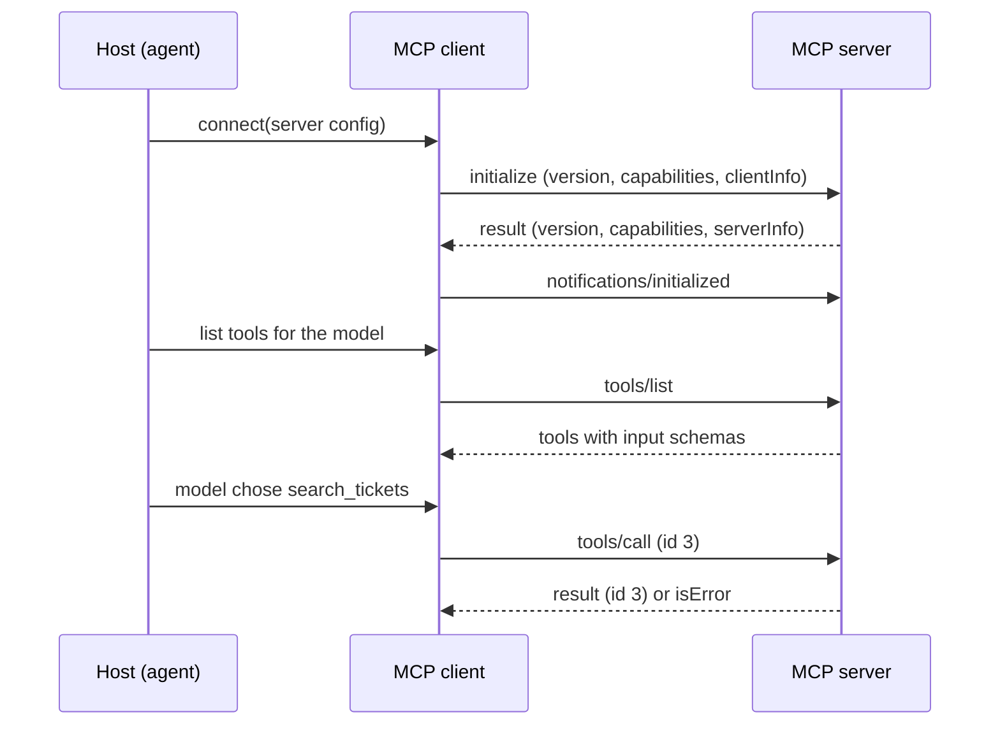

## TL;DR
MCP splits an agent app into a host (your agent), one client per connection, and servers that expose
capabilities, all speaking JSON-RPC 2.0. Knowing who owns what, and how versions and capabilities are
agreed, lets you debug and scale MCP-backed agents.

## For agent builders
- **Why it matters for agents.** Every MCP tool your agent calls crosses this architecture: the host
  decides what the model sees, the client speaks the protocol, the server runs the code. Most
  production bugs ("tool missing", "hangs at start", "works locally, fails behind a load balancer") are
  architecture bugs, not model bugs.
- **Where it shows up in your stack.** IDE and desktop agents (hosts), the official Python and TypeScript
  SDKs (clients and servers), agent frameworks with MCP adapters, and gateways that aggregate servers.
- **What you control.** Which servers a host connects to, which capabilities your client declares, which
  protocol versions you accept, and how server failures are isolated from the agent loop.
- **What you can skip.** Hand-writing JSON-RPC framing. The SDKs do it; you need to read a wire trace,
  not produce one.

## Lab
### Task
Build the connection layer of an agent host: the client side of the handshake-era lifecycle,
capability-aware discovery, and a connect step that isolates a hung server. This is the fix for the
Check yourself scenario (one vendor server stalling every turn).

The fake servers speak JSON-RPC as Python dicts, so you see every message without a subprocess or a model.

Time box: 45-60 min.
- **Prerequisites:** this lesson's How it works; `agents/model-context-protocol`; basic `asyncio`.
- **Setup:** Python 3.10+ and `pip install pytest`; no MCP SDK needed (checked with Python 3.13, pytest
  9.1). Save the starter as `lab.py`, the tests as `test_lab.py`.
- **You implement:** `Client.initialize` (version check, then `notifications/initialized`),
  `Client.list_tools` (skip undeclared capabilities, follow `nextCursor`) and `connect_all` (concurrent
  connects, each inside its own timeout).

### Starter code
```python
"""Lab: the connection layer of an MCP host, against fake servers. Run: python lab.py"""
import asyncio
import itertools

SUPPORTED = ("2025-11-25", "2025-06-18")   # protocol versions this host accepts, newest first
CLIENT_CAPS: dict = {}                       # headless host: no elicitation, sampling or roots
CONNECT_TIMEOUT = 0.5                        # seconds per server


class ProtocolError(Exception):
    def __init__(self, code: int, message: str):
        super().__init__(f"{code} {message}")
        self.code = code


class VersionMismatch(Exception):
    pass


class FakeServer:
    """Speaks handshake-era MCP as JSON-RPC dicts; stands in for a stdio subprocess."""

    def __init__(self, name, versions, tools=(), prompts=False, page_size=2, connect_delay=0.0):
        self.name, self.versions, self.tools = name, versions, list(tools)
        self.prompts, self.page_size, self.connect_delay = prompts, page_size, connect_delay
        self.seen: list[str] = []            # every method received, in order
        self.ready = False

    def caps(self) -> dict:
        c = {}
        if self.tools: c["tools"] = {"listChanged": False}
        if self.prompts: c["prompts"] = {}
        return c

    async def handle(self, msg: dict) -> dict | None:
        self.seen.append(msg["method"])
        if "id" not in msg:                                   # a notification: no reply
            if msg["method"] == "notifications/initialized": self.ready = True
            return None
        rid, method, params = msg["id"], msg["method"], msg.get("params", {})
        if method == "initialize":
            await asyncio.sleep(self.connect_delay)
            asked = params["protocolVersion"]
            version = asked if asked in self.versions else self.versions[0]
            return {"jsonrpc": "2.0", "id": rid, "result": {
                "protocolVersion": version, "capabilities": self.caps(),
                "serverInfo": {"name": self.name, "version": "1.0"}}}
        if not self.ready:
            return {"jsonrpc": "2.0", "id": rid, "error": {"code": -32600, "message": "not initialized"}}
        if method == "tools/list" and self.tools:
            start = int(params.get("cursor") or 0)
            page = self.tools[start:start + self.page_size]
            result = {"tools": [{"name": t, "inputSchema": {"type": "object"}} for t in page]}
            if start + self.page_size < len(self.tools):
                result["nextCursor"] = str(start + self.page_size)
            return {"jsonrpc": "2.0", "id": rid, "result": result}
        return {"jsonrpc": "2.0", "id": rid, "error": {"code": -32601, "message": f"no method {method}"}}


class Client:
    """One MCP client: exactly one connection to one server."""

    def __init__(self, server: FakeServer):
        self.server = server
        self._ids = itertools.count(1)
        self.version: str | None = None
        self.server_caps: dict = {}
        self.server_name: str | None = None

    async def request(self, method: str, params: dict | None = None) -> dict:
        rid = next(self._ids)                                 # unique among in-flight requests
        resp = await self.server.handle({"jsonrpc": "2.0", "id": rid, "method": method, "params": params or {}})
        assert resp["id"] == rid, "response correlated to the wrong request"
        if "error" in resp:
            raise ProtocolError(resp["error"]["code"], resp["error"]["message"])
        return resp["result"]

    async def notify(self, method: str, params: dict | None = None) -> None:
        await self.server.handle({"jsonrpc": "2.0", "method": method, "params": params or {}})

    async def initialize(self) -> None:
        # YOUR CODE HERE: send "initialize" with protocolVersion SUPPORTED[0], capabilities CLIENT_CAPS
        # and clientInfo {"name": "lab-host", "version": "0.1"}. If the returned protocolVersion is not
        # in SUPPORTED, raise VersionMismatch(f"version {v} not supported"). Otherwise store version,
        # server_caps and server_name, then send the "notifications/initialized" notification.
        raise NotImplementedError

    async def list_tools(self) -> list[str]:
        # YOUR CODE HERE: return [] without any request if the server did not declare "tools";
        # otherwise call "tools/list" and follow nextCursor until it is absent; return the names.
        raise NotImplementedError


async def connect_all(servers: list[FakeServer], timeout: float = CONNECT_TIMEOUT):
    """Connect every server concurrently, each inside its own timeout.

    Returns (clients, failed): clients maps server name -> initialized Client; failed maps
    server name -> reason, "connect timeout after {timeout}s" or the VersionMismatch message.
    """
    # YOUR CODE HERE: one Client per server, asyncio.wait_for(client.initialize(), timeout) for each,
    # all run together (asyncio.gather), so one hung server costs at most `timeout`, not a whole turn.
    raise NotImplementedError


def demo_servers() -> list[FakeServer]:
    return [
        FakeServer("tickets", ("2025-11-25", "2025-06-18"), tools=["search", "get", "create"]),
        FakeServer("docs", ("2025-06-18",), tools=["lookup"]),
        FakeServer("notes", ("2025-11-25",), prompts=True),
        FakeServer("legacy", ("2024-11-05",), tools=["old_search"]),
        FakeServer("vendor", ("2025-11-25",), tools=["crm_find"], connect_delay=30),
    ]


async def main():
    loop = asyncio.get_running_loop()
    t0 = loop.time()
    clients, failed = await connect_all(demo_servers())
    model_tools = []
    for name, c in clients.items():
        tools = [f"{name}__{t}" for t in await c.list_tools()]    # prefix: names stay unique
        model_tools += tools
        print(f"connected {c.server_name} {c.version} caps={sorted(c.server_caps)} tools={tools}")
    for name, reason in failed.items():
        print(f"failed {name}: {reason}")
    print(f"model tool list: {len(model_tools)} tools, within budget: {loop.time() - t0 < 2}")


if __name__ == "__main__":
    asyncio.run(main())
```

### Expected output
`python lab.py` with a correct solution prints exactly:

```
connected tickets 2025-11-25 caps=['tools'] tools=['tickets__search', 'tickets__get', 'tickets__create']
connected docs 2025-06-18 caps=['tools'] tools=['docs__lookup']
connected notes 2025-11-25 caps=['prompts'] tools=[]
failed legacy: version 2024-11-05 not supported
failed vendor: connect timeout after 0.5s
model tool list: 4 tools, within budget: True
```

### Tests
Run `pytest -q test_lab.py`. On the starter all 6 fail with `NotImplementedError`; a correct solution
passes all 6 in well under a second.

```python
import asyncio
import pytest
from lab import Client, FakeServer, VersionMismatch, connect_all

def run(coro):
    return asyncio.run(coro)

def test_handshake_order_and_version():
    s = FakeServer("tickets", ("2025-11-25", "2025-06-18"), tools=["search"])
    c = Client(s)
    run(c.initialize())
    assert s.seen == ["initialize", "notifications/initialized"]
    assert (c.version, c.server_name, c.server_caps) == ("2025-11-25", "tickets", {"tools": {"listChanged": False}})

def test_accepts_older_supported_version():
    c = Client(FakeServer("docs", ("2025-06-18",), tools=["lookup"]))
    run(c.initialize())
    assert c.version == "2025-06-18"

def test_rejects_unsupported_version():
    with pytest.raises(VersionMismatch, match="2024-11-05"):
        run(Client(FakeServer("legacy", ("2024-11-05",), tools=["x"])).initialize())

def test_list_tools_follows_cursor():
    async def go():
        c = Client(FakeServer("t", ("2025-11-25",), tools=["a", "b", "c", "d", "e"], page_size=2))
        await c.initialize()
        return await c.list_tools(), c.server.seen.count("tools/list")
    assert run(go()) == (["a", "b", "c", "d", "e"], 3)

def test_list_tools_respects_capabilities():
    async def go():
        c = Client(FakeServer("notes", ("2025-11-25",), prompts=True))
        await c.initialize()
        return await c.list_tools(), c.server.seen
    tools, seen = run(go())
    assert tools == [] and "tools/list" not in seen

def test_hung_server_is_isolated():
    async def go():
        loop = asyncio.get_running_loop()
        t0 = loop.time()
        ok, failed = await connect_all([FakeServer("a", ("2025-11-25",), tools=["x"]),
                                        FakeServer("slow", ("2025-11-25",), tools=["y"], connect_delay=30)],
                                       timeout=0.2)
        return sorted(ok), failed, loop.time() - t0
    ok, failed, elapsed = run(go())
    assert ok == ["a"] and failed == {"slow": "connect timeout after 0.2s"} and elapsed < 1
```

### Failure scenarios
- **Skip the `notifications/initialized` notification.** `list_tools` raises `ProtocolError` `-32600 not
  initialized`. Print `server.seen` to compare the message order with the lifecycle in How it works; the
  same symptom with a real SDK is a host that connects but never gets a tool list.
- **Read only the first page of `tools/list`.** The tickets server shows two tools instead of three and
  `test_list_tools_follows_cursor` reports one `tools/list` call. Log `nextCursor` on every page; a
  "tool missing in production but not in tests" ticket often has exactly this cause.
- **Connect servers one after another** (a `for` loop with `await`). With a 30-second `connect_delay` and
  no timeout the run takes 30 seconds; with `wait_for` but no `gather` the timeouts add up. Time each
  connect and check they overlap; the failed server's tools must simply be absent from the model's list.
- **Call `tools/list` on a server that declared only `prompts`.** You get `-32601` from a peer that never
  offered tools. Branch on `server_caps`, which is the capability rule in How it works.

### Submission
- `lab.py` with the three `YOUR CODE HERE` stubs implemented and no changes to `FakeServer` or `main`.
- A `pytest -q` run showing 6 passed, plus the `python lab.py` output matching Expected output exactly.
- A connect log from your own run with one line per server (name, version, capabilities, tools, or the
  failure reason), the shape the Production patterns ask for.
- A short note (5-8 lines): which failure scenario you reproduced, what you saw, and how the same bug would
  look with `ClientSession` over stdio.
- Evaluation: tests and output pass, connects overlap in time, and no request is sent for an undeclared
  capability.

## Why it exists
- **N agents times M systems is a lot of glue.** Before MCP, every agent framework wrapped every API in its
  own tool format. A shared protocol turns N×M adapters into N clients plus M servers.
- **Function calling alone is not a protocol.** Provider tool calling defines what the model emits, not
  how a separate process advertises tools, streams progress, or asks the user a question mid-call.
- **Capabilities differ per party.** A desktop host can show a form; a headless batch agent cannot.
  Capability declarations let each side use only what the other supports, instead of failing at runtime.
- **Versions move fast.** The spec has had five dated revisions (2024-11-05, 2025-03-26, 2025-06-18,
  2025-11-25, 2026-07-28). Explicit version agreement keeps old and new peers interoperable.

## How it works
### Three roles
| Role | Is | Owns | Example |
|---|---|---|---|
| **Host** | Your agent application | The model, the user, consent, which servers to load, what reaches the context | An IDE agent, a desktop chat app, your own LangGraph service |
| **Client** | A connector inside the host | One connection to one server: protocol, capabilities, request ids | `ClientSession` (Python), `Client` (TypeScript) |
| **Server** | A program exposing capabilities | Tools, resources, prompts and its own credentials to backends | A GitHub, Postgres or ticketing server |

- **One client per server, 1:1.** A host with three servers runs three clients. This isolates servers from
  each other, because a server never sees another server's traffic or the full conversation.
- **The host is the trust boundary.** Servers propose; the host decides which tools the model may see,
  which calls need approval, and what tool output is allowed into context.
- **Servers can be local or remote.** Local servers run as a subprocess over stdio; remote ones sit behind
  Streamable HTTP with OAuth (see `mcp/mcp-transports`).

### The message layer: JSON-RPC 2.0
- **Requests** carry an `id` and a `method` and expect exactly one response with the same `id`; the `id`
  must not be `null` and must be unique among in-flight requests.
- **Responses** carry either `result` or `error` (`code`, `message`, optional `data`).
- **Notifications** have no `id` and get no reply: progress, log messages, list changes, cancellation.
- **Standard error codes:** `-32700` parse error, `-32600` invalid request, `-32601` method not found,
  `-32602` invalid params, `-32603` internal error. In 2026-07-28 the range `-32020` to `-32099` is
  reserved for MCP-defined errors such as `UnsupportedProtocolVersion` (`-32022`).
- **Correlation by `id`** is what lets several tool calls be in flight on one connection, which is how a
  host serves parallel tool calls from one model turn.

### Lifecycle in the handshake era (2024-11-05 to 2025-11-25)
Most deployed servers and SDK 1.x releases still speak this model.
1. **`initialize`.** The client sends `protocolVersion` (the latest it supports), `capabilities` and
   `clientInfo`.
2. **Server reply.** The server answers with the same version if it supports it, otherwise another version
   it supports, plus its `capabilities`, `serverInfo` and optional `instructions` for the model. If the
   client cannot speak the returned version it should disconnect.
3. **`notifications/initialized`.** The client confirms; only then do normal requests flow.
4. **Operation.** Discovery (`tools/list`, `resources/list`, `prompts/list`) and use (`tools/call`, ...)
   within the negotiated capabilities. Either side may `ping`.
5. **Shutdown.** No shutdown message: on stdio the client closes stdin, then escalates to `SIGTERM` and
   `SIGKILL`; on HTTP the client closes connections or sends HTTP `DELETE` with its session id.

### Lifecycle in the stateless era (2026-07-28, the current revision)
- **No handshake.** `initialize` and `notifications/initialized` are gone. Every request carries
  `io.modelcontextprotocol/protocolVersion`, `io.modelcontextprotocol/clientCapabilities` and (should)
  `io.modelcontextprotocol/clientInfo` in `_meta`, and the server judges each request on its own.
- **`server/discover`.** Servers must implement it to return `supportedVersions`, `capabilities`,
  `instructions` and identity (`io.modelcontextprotocol/serverInfo` in `_meta`); clients may call it
  first, or just send requests and handle errors.
- **Every result carries `resultType`:** `complete` for ordinary results, `input_required` for an
  interim result that asks the client for more input. Clients treat a missing field from an older
  server as `complete`.
- **Removed utilities.** `ping` and `logging/setLevel` are gone; a client sets the log level per request
  with `io.modelcontextprotocol/logLevel` in `_meta`.
- **Version mismatch** returns `UnsupportedProtocolVersionError` with a `supported` list, and the client
  retries with a common version.
- **No sessions, no server-initiated requests.** Sampling, elicitation and roots ride inside results as
  input requests (multi round-trip requests, see `mcp/mcp-client-primitives`), and long-lived change
  notifications use a `subscriptions/listen` request.
- **Why the change:** a request that carries everything it needs can hit any replica, so remote servers
  scale like ordinary stateless HTTP services.
- **Dual-era peers.** A dual-era client probes (stdio: `server/discover` first; HTTP: inspect a `400`
  body) and falls back to `initialize` for legacy servers. Check the current spec before relying on
  details, because this revision is new.

### Capability negotiation
| Side | Capability | Means |
|---|---|---|
| Server | `tools`, `resources`, `prompts` | Offers that primitive; `listChanged` means it will announce changes |
| Server | `resources.subscribe` | Clients may subscribe to updates of one resource (handshake era; `subscriptions/listen` in 2026-07-28) |
| Server | `logging`, `completions` | Emits log messages; offers argument autocompletion |
| Client | `roots`, `sampling`, `elicitation` | Can list workspace roots, run an LLM call for the server, ask the user |
| Both | `experimental`, `extensions` (2026-07-28) | Opt-in features outside the core |

- **Rule:** neither side may use a feature the other did not declare. A server must not send an
  elicitation to a client without `elicitation`, which is why a headless agent can simply omit it.
- **Deprecations (2026-07-28):** roots, sampling and logging are marked deprecated with a migration path
  (tool parameters or config instead of roots, direct provider calls instead of sampling, stderr or
  OpenTelemetry instead of logging). They still work during the deprecation window of at least twelve
  months.

## Diagram
Follow one connection in the handshake era: the host creates a client, the client negotiates once, then
the agent loop drives discovery and calls through it.



## Examples
### A host that negotiates and inspects a server
Run `host.py` next to the server; it does what every agent host does at startup and prints what was
negotiated. Pin the 1.x SDK (`pip install "mcp>=1.10,<2"`); in the 2.x SDK `FastMCP` became `MCPServer`
and result fields became snake_case, so check the migration guide.

```python
# tickets_server.py
from mcp.server.fastmcp import FastMCP

mcp = FastMCP("tickets", instructions="Helpdesk tickets. Search before you create.")

@mcp.tool()
def search_tickets(query: str) -> list[str]:
    """Find ticket titles containing `query`."""
    return [t for t in ["VPN down", "Printer jam"] if query.lower() in t.lower()]

if __name__ == "__main__":
    mcp.run()                                        # stdio by default
```

```python
# host.py
import asyncio, sys
from mcp import ClientSession, StdioServerParameters
from mcp.client.stdio import stdio_client

async def main():
    params = StdioServerParameters(command=sys.executable, args=["tickets_server.py"])
    async with stdio_client(params) as (read, write):          # host spawns the server
        async with ClientSession(read, write) as session:      # one client for this server
            init = await session.initialize()                  # handshake-era negotiation
            print(init.protocolVersion)                        # 2025-11-25 on recent 1.x releases
            print(init.serverInfo.name, "|", init.instructions)
            print(init.capabilities.model_dump(exclude_none=True))  # tools, prompts, resources...
            tools = (await session.list_tools()).tools         # becomes the model's tool list
            res = await session.call_tool("search_tickets", {"query": "vpn"})
            print([t.name for t in tools], res.isError, res.structuredContent)

asyncio.run(main())
```

### Worked scenario: the same `tools/call` in both eras
What changes on the wire when a server moves to the current revision (abridged JSON).

| Step | Handshake era (2025-11-25) | Stateless era (2026-07-28) |
|---|---|---|
| Before first call | `initialize` plus `notifications/initialized` | Nothing, or an optional `server/discover` |
| Version and capabilities | Sent once, held in session state | Sent in `_meta` on every request |
| HTTP routing | `Mcp-Session-Id` header, sticky to one replica | Any replica; `Mcp-Method` and `Mcp-Name` headers |
| Server needs user input | Server sends `elicitation/create` mid-call | Result with `resultType: "input_required"`, client retries |
| Version mismatch | Server returns another version in `initialize` | `UnsupportedProtocolVersionError` with `supported` list |

```
-> {"jsonrpc":"2.0","id":7,"method":"tools/call","params":{"name":"search_tickets",
     "arguments":{"query":"vpn"},
     "_meta":{"io.modelcontextprotocol/protocolVersion":"2026-07-28",
              "io.modelcontextprotocol/clientCapabilities":{}}}}
<- {"jsonrpc":"2.0","id":7,"result":{"resultType":"complete",
     "content":[{"type":"text","text":"[\"VPN down\"]"}],"isError":false}}
```

## Production patterns
- **Isolate each server behind its own client and timeout.** Wrap every connection with a connect timeout,
  a per-call timeout and a restart policy, so one hung vendor server degrades one tool set instead of
  stalling the whole agent turn. Monitor per-server connect failures and call latency.
- **Log negotiated version, capabilities and server identity at connect time.** Put `protocolVersion`,
  `serverInfo` and declared capabilities in one structured log line per connection. Most "tool is missing"
  tickets resolve in seconds when you can see what was actually negotiated.
- **Pin the protocol versions you accept.** Configure clients to support a known set (for example
  2025-06-18 and later) and alert on fallbacks, because an old peer silently loses features such as
  structured output and elicitation.
- **Declare only the client capabilities you really implement.** A headless worker agent omits
  `elicitation` and `sampling`, so servers degrade gracefully instead of waiting on a UI that does not
  exist.
- **Treat the host as the policy layer.** Filter, rename and gate tools in the host (allow-lists, approval
  for write tools, output size caps) before they reach the model; never rely on server descriptions to
  enforce policy.
- **Plan the stateless migration.** For remote servers, move to an SDK that speaks 2026-07-28 or runs
  dual-era, then drop sticky routing once traffic is on the new revision. Track the share of requests per
  protocol version.

## Trade-offs
- **Standard protocol vs direct function calling.** MCP gives reuse across hosts and a process boundary,
  but adds a hop, a dependency and a second schema layer. For one agent calling three internal functions,
  plain tool calling is simpler.
- **1:1 client-server isolation vs connection count.** Isolation stops servers seeing each other's data,
  but a host with 20 servers manages 20 connections, 20 failure modes and 20 tool lists.
- **Handshake sessions vs stateless requests.** Sessions let servers push requests and keep context
  cheaply; stateless requests scale on any replica but repeat metadata on every call and push state into
  explicit handles.
- **Rich capabilities vs portability.** Using elicitation or sampling makes a server nicer in hosts that
  support them, and broken or degraded in hosts that do not.

## Pitfalls
- **Treating the server as the security boundary.** Symptom: a vendor server's tool description tells the
  model to read secrets, and it does. Fix: the host filters tools, requires approval for consequential
  calls and treats tool output as untrusted data.
- **Writing logs to stdout in a stdio server.** Symptom: the host hangs or fails at `initialize` with parse
  errors. Fix: log to stderr; stdout carries only JSON-RPC messages.
- **Assuming capabilities instead of checking them.** Symptom: a server's elicitation works in one IDE and
  errors in a headless agent. Fix: branch on the peer's declared capabilities and provide a fallback path.
- **Ignoring the version you negotiated.** Symptom: `structuredContent` is missing or `isError` handling
  differs between environments. Fix: log the version and test against each version you accept.

## When to use
- **Use this model when** an agent consumes capabilities owned by other teams or vendors, or one set of
  tools must serve several hosts (IDE agents, chat apps, your own service).
- **Avoid MCP when** tools live in the same process as one agent and nobody else needs them; in-process
  function calling is faster and simpler.
- **Measure:** connect success rate and time per server, negotiated version mix, per-server call latency
  and error rate, and tool count per host.
- **Interviews:** be ready to draw host, client, server and explain the handshake and what 2026-07-28 changed.

## Role lens
- **Engineer:** Wires `ClientSession` or `Client` into the agent loop with timeouts, logs the negotiated
  version and capabilities, and reads JSON-RPC traces to debug hangs and missing tools.
- **Architect:** Decides which systems become MCP servers, where the host enforces policy, how remote
  servers scale (sessions or stateless), and which protocol versions the platform supports.
- **FDE:** Connects a customer's existing MCP servers to the agent, explains why a server works in one host
  and not another (capabilities, versions), and isolates a flaky vendor server from the rest.

## Check yourself
**Q:** Your agent host connects to four MCP servers. One vendor server hangs at startup, and since then the
whole agent takes 60 seconds to answer anything. Explain what is happening in architecture terms and how you
would restructure the host.
**A:** Each server has its own client and connection, but the host is probably connecting to all four
serially and waiting for every `initialize` (or first request) to finish before building the tool list, so
one hung server blocks the turn until a long default timeout fires. Restructure so each client connects
concurrently with a short connect timeout, a server that fails is marked unavailable and its tools dropped
from the model's list, and a background task retries it. Log the negotiated version, capabilities and
server identity per connection so failures are visible. The other three servers keep working because the
1:1 client-server design already isolates them; the host just has to stop waiting on the slow one.

## Interview questions
### What are the host, client and server in MCP, and why is the client one-to-one with a server?
- **Host** is the agent application that owns the model, the user and policy; **client** is a connector
  that speaks the protocol to exactly one **server**, which exposes tools, resources and prompts.
- **One-to-one** keeps servers isolated: a server cannot see other servers' traffic or the conversation,
  and one failing connection can be dropped without affecting the rest.

### Walk me through the handshake-era lifecycle and what can go wrong at each step.
- **`initialize`:** version and capabilities are proposed; failures are version mismatches, or a stdio
  server printing logs to stdout so the client cannot parse the reply.
- **`notifications/initialized` then discovery:** missing tools usually mean a capability was not
  declared or the list is paginated and the host read one page.
- **Operation and shutdown:** hung calls need per-call timeouts; zombie stdio processes need the close
  stdin, `SIGTERM`, `SIGKILL` escalation.

### What changed in the 2026-07-28 revision, and why does it matter for remote servers?
- **Stateless requests:** no `initialize`, no `Mcp-Session-Id`; version and capabilities ride in each
  request's `_meta`, and `server/discover` advertises what the server supports.
- **Server-to-client requests became multi round-trip results,** so any replica can answer any request.
  Remote servers drop sticky sessions and scale like plain HTTP services, with state moved into explicit
  handles passed as tool arguments.

### A tool works in one IDE agent but fails in your headless batch agent. How do you debug it?
- **Compare negotiated capabilities and versions** from both hosts' connect logs. A tool that elicits or
  samples needs `elicitation` or `sampling`, which a headless client usually does not declare.
- **Fix on the right side:** the server should check capabilities and fall back (fail with an actionable
  `isError`, or accept the value as an argument); the batch agent should pass that input explicitly.

### When would you not put MCP between your agent and its tools?
- **Same process, single consumer:** if the functions live in the agent's codebase and no other host needs
  them, direct tool calling avoids a process hop, a second schema and a new failure mode.
- **Latency-critical loops** that call a tool dozens of times per turn may not want the extra hop; measure
  before choosing. MCP pays off when tools are shared across hosts or owned by other teams.

## Quiz
### Q: In MCP, which component decides which tools the model is allowed to see?
- [ ] The MCP server, through its tool descriptions
- [ ] The MCP client, during capability negotiation
- [x] The host application that embeds the model and the clients
- [ ] The JSON-RPC layer, by rejecting unknown methods
> The host owns the model, the user and policy. Servers only propose tools; the host filters, renames and
> gates them before they reach the model's tool list.

### Q: In the handshake-era lifecycle (2025-11-25 and earlier), what must happen before a client sends `tools/list`?
- [ ] The server sends `notifications/tools/list_changed`
- [x] The client sends `initialize`, receives the result, then sends `notifications/initialized`
- [ ] The client calls `server/discover`
- [ ] The client opens a `subscriptions/listen` stream
> Handshake-era sessions start with `initialize` and its result, then the client's initialized
> notification. `server/discover` and `subscriptions/listen` belong to the stateless 2026-07-28 revision.

### Q: Why does the 2026-07-28 revision put protocol version and client capabilities in every request's `_meta`?
- [ ] To make messages smaller than with a handshake
- [ ] Because JSON-RPC 2.0 requires it
- [x] So any server replica can handle any request without shared session state
- [ ] To let servers send requests to clients more easily
> Removing the handshake and sessions makes each request self-contained, so remote servers can scale on
> ordinary load balancers. Server-to-client requests were replaced by multi round-trip results for the
> same reason.

## Use cases & projects
### Use cases
- **IDE and desktop agents.** One host loads several local stdio servers (repo, tests, docs), each behind
  its own client, and gates which tools the model sees.
- **Internal agent platforms.** A gateway host aggregates team-owned remote servers, logs negotiated
  versions and capabilities, and enforces approval for write tools.
- **Customer deployments.** An FDE connects the agent to a customer's existing MCP servers and debugs
  capability or version mismatches between their hosts and yours.
- **Protocol migration.** A platform team moves remote servers from session-based Streamable HTTP to the
  stateless 2026-07-28 revision and removes sticky routing.

### Mini project
**Build a connection inspector for MCP servers (1-2 hours).**
- **Goal:** a small host that connects to any list of stdio servers concurrently and reports what each
  negotiated, so you can debug "tool missing" and "hangs at start" without a model in the loop.
- **Steps:** read server commands from a JSON config; open one `ClientSession` per server with a 5-second
  connect timeout; record protocol version, server name, instructions, capabilities and tool names; mark
  servers that time out; print one table.
- **Done when:** with one deliberately broken server (it prints to stdout before starting), the inspector
  reports that server as failed within the timeout while the others are listed with their capabilities.

### Major project
This lesson feeds the module Capstone (see the module guide): an agent host that consumes several MCP
servers safely.
- **Scope (multi-day):** concurrent connections with timeouts and restart, a per-server capability and
  version log, a host-side tool allow-list and approval gate, and support for both a handshake-era server
  and a 2026-07-28 server.
- **Done when:** killing any one server mid-run removes only its tools, the agent still finishes tasks
  that do not need it, and the connect log shows version and capabilities for every server.
