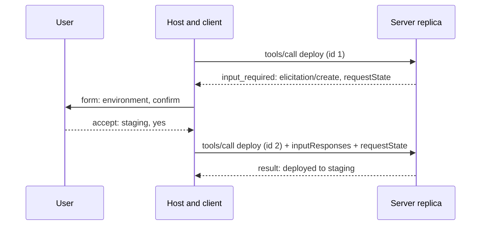

## TL;DR
Client primitives let a server ask the host for things mid-call: an LLM completion (sampling), the
user's workspace folders (roots), or user input (elicitation). In 2026-07-28 these arrive as
input-required results, and sampling and roots are deprecated.

## For agent builders
- **Why it matters for agents.** Elicitation is how a tool asks "deploy to staging or production?"
  without inventing the answer, which makes it a human-in-the-loop channel inside tool calls. Sampling
  and roots explain behavior you will meet in existing servers.
- **Where it shows up in your stack.** `ctx.elicit()`, `ctx.session.create_message()` and
  `ctx.session.list_roots()` in Python servers; `sampling_callback`, `elicitation_callback` and
  `list_roots_callback` on a Python `ClientSession` in your host.
- **What you control.** Which of these your host declares, the UI or policy that answers them, and
  whether a headless agent declines them so servers fall back.
- **What you can skip.** New sampling or roots integrations: the current revision deprecates both. Know
  them for existing servers, and prefer tool arguments and direct provider calls in new work.

## Lab
### Task
Build the mini project's core as a tested tool: `close_ticket` asks an interactive host to confirm with
elicitation, handles `accept`, `decline` and `cancel` correctly, and gives a headless agent an
actionable `isError` instead of a hang. Repeating a close must not close twice or ask again, the property
MRTR retries depend on.

Time box: 45-60 min.
- **Prerequisites:** this lesson's Elicitation and Delivery sections; `mcp/mcp-architecture` (capability
  rule); `agents/human-in-the-loop`.
- **Setup:** Python 3.10+, `pip install "mcp>=1.10,<2" pytest` (checked with mcp 1.30.0, pytest 9.1,
  Python 3.13). Save the starter as `lab.py`, the tests as `test_lab.py`.
- **No UI, no subprocess:** the user is played by an `elicitation_callback`, and client and server connect
  in memory with `create_connected_server_and_client_session` from `mcp.shared.memory` (the helper the SDK's
  own tests use; not a documented public API). SDK 1.x speaks the handshake era, so the server sends
  `elicitation/create` mid-call.
- **You implement:** the body of `close_ticket`.

### Starter code
```python
"""Lab: a write tool that elicits confirmation, with a headless fallback. Run: python lab.py"""
import asyncio
from typing import Literal, get_args
from pydantic import BaseModel, Field
from mcp import types
from mcp.server.fastmcp import Context, FastMCP
from mcp.server.fastmcp.exceptions import ToolError
from mcp.shared.memory import create_connected_server_and_client_session as connect

Reason = Literal["fixed", "duplicate", "wont_fix"]
ELICITATION = types.ClientCapabilities(elicitation=types.ElicitationCapability())


class Confirm(BaseModel):   # flat primitives only: SDK 1.x rejects Literal fields in elicit schemas
    reason: str = Field(description="fixed, duplicate or wont_fix")
    confirm: bool


def build_server(tickets: dict[str, str], closes: list[str]) -> FastMCP:
    """tickets maps id -> "open" | "closed"; closes records every real close (the side effect)."""
    mcp = FastMCP("tickets")

    @mcp.tool()
    async def close_ticket(ticket_id: str, ctx: Context, reason: Reason | None = None) -> str:
        """Close a ticket. Interactive hosts are asked to confirm; headless callers must pass reason."""
        # YOUR CODE HERE, in this order:
        # 1. Unknown id: raise ToolError(f"No ticket {ticket_id}.")
        # 2. Already closed: return f"{ticket_id} already closed." without asking anyone (idempotent).
        # 3. If the client declared elicitation (ctx.session.check_client_capability(ELICITATION)):
        #    answer = await ctx.elicit(f"Close {ticket_id}?", schema=Confirm). Proceed only on
        #    action "accept" with data.confirm True and data.reason in get_args(Reason), then use
        #    data.reason. Otherwise return f"Not closed ({answer.action})." (so an accepted but
        #    unconfirmed or invalid answer returns "Not closed (accept).").
        # 4. Headless: with no reason, raise ToolError(
        #    "Elicitation unavailable: pass reason explicitly (fixed, duplicate or wont_fix).")
        # 5. Close: tickets[ticket_id] = "closed", closes.append(ticket_id),
        #    return f"Closed {ticket_id} as {reason}."
        raise NotImplementedError("close_ticket is not implemented yet")

    return mcp


def answering(action: str, content: dict | None = None, asked: list | None = None):
    """An elicitation callback that plays the user: accept, decline or cancel."""
    async def on_elicit(ctx, params: types.ElicitRequestParams):
        if asked is not None:
            asked.append(params.message)
        return types.ElicitResult(action=action, content=content)
    return on_elicit


async def call(server, args, on_elicit=None):
    async with connect(server, elicitation_callback=on_elicit) as s:   # a callback declares the capability
        res = await s.call_tool("close_ticket", args)
        return res.isError, res.content[0].text


async def main():
    tickets, closes, asked = {"T-1": "open", "T-2": "open"}, [], []
    srv = build_server(tickets, closes)
    yes = answering("accept", {"reason": "fixed", "confirm": True}, asked)
    runs = [
        ("interactive accept", {"ticket_id": "T-1"}, yes),
        ("interactive repeat", {"ticket_id": "T-1"}, yes),
        ("interactive decline", {"ticket_id": "T-2"}, answering("decline", asked=asked)),
        ("interactive cancel", {"ticket_id": "T-2"}, answering("cancel", asked=asked)),
        ("headless no reason", {"ticket_id": "T-2"}, None),
        ("headless with reason", {"ticket_id": "T-2", "reason": "duplicate"}, None),
    ]
    for label, args, cb in runs:
        err, text = await call(srv, args, cb)
        print(f"{label:<21} isError={err!s:<5} | {text}")
    print(f"questions asked: {len(asked)}, closes: {closes}")


if __name__ == "__main__":
    asyncio.run(main())
```

### Expected output
`python lab.py` with a correct solution prints exactly this on stdout (SDK request logs go to stderr):

```
interactive accept    isError=False | Closed T-1 as fixed.
interactive repeat    isError=False | T-1 already closed.
interactive decline   isError=False | Not closed (decline).
interactive cancel    isError=False | Not closed (cancel).
headless no reason    isError=True  | Error executing tool close_ticket: Elicitation unavailable: pass reason explicitly (fixed, duplicate or wont_fix).
headless with reason  isError=False | Closed T-2 as duplicate.
questions asked: 3, closes: ['T-1', 'T-2']
```

### Tests
Run `pytest -q test_lab.py`. On the starter all 6 fail because every call returns `isError` with
`close_ticket is not implemented yet`; a correct solution passes all 6 (mcp 1.30.0).

```python
import asyncio
from lab import answering, build_server, call

def run(tickets, args, cb=None):
    closes = []
    out = asyncio.run(call(build_server(tickets, closes), args, cb))
    return out, closes

def test_accept_and_confirm_closes_with_elicited_reason():
    t = {"T-1": "open"}
    (err, text), closes = run(t, {"ticket_id": "T-1"}, answering("accept", {"reason": "duplicate", "confirm": True}))
    assert (err, text, closes, t["T-1"]) == (False, "Closed T-1 as duplicate.", ["T-1"], "closed")

def test_decline_cancel_and_unconfirmed_leave_ticket_open():
    for action, content in [("decline", None), ("cancel", None), ("accept", {"reason": "fixed", "confirm": False}),
                            ("accept", {"reason": "because", "confirm": True})]:
        t = {"T-1": "open"}
        (err, text), closes = run(t, {"ticket_id": "T-1"}, answering(action, content))
        assert (err, text, closes, t["T-1"]) == (False, f"Not closed ({action}).", [], "open")

def test_headless_without_reason_gets_actionable_error():
    (err, text), closes = run({"T-1": "open"}, {"ticket_id": "T-1"})
    assert err and "pass reason explicitly" in text and closes == []

def test_headless_with_reason_closes():
    (err, text), closes = run({"T-1": "open"}, {"ticket_id": "T-1", "reason": "wont_fix"})
    assert (err, text, closes) == (False, "Closed T-1 as wont_fix.", ["T-1"])

def test_repeat_is_idempotent_and_asks_nobody():
    asked = []
    (err, text), closes = run({"T-1": "closed"}, {"ticket_id": "T-1"}, answering("accept", {"reason": "fixed", "confirm": True}, asked))
    assert (err, text, closes, asked) == (False, "T-1 already closed.", [], [])

def test_unknown_ticket():
    (err, text), _ = run({}, {"ticket_id": "T-9"})
    assert err and "No ticket T-9" in text
```

### Failure scenarios
- **Elicit without checking the client's capability.** Both headless runs return `isError` with
  `Elicitation not supported`, even the one that passed `reason`. Compare what each host declared (the
  callback is what declares `elicitation`) and branch on `check_client_capability` first.
- **Read `answer.data` before checking `answer.action`.** Decline and cancel turn into `isError` results
  such as `'DeclinedElicitation' object has no attribute 'data'`. Print the result type per action;
  proceed only on `accept`.
- **Type `Confirm.reason` as the `Reason` literal.** Every interactive run fails with `Elicitation schema
  field 'reason' must be a primitive type` (SDK 1.30), although the spec allows enums. Read the full
  `isError` text, keep the form field a string and validate it in the tool.
- **Ask before the already-closed check.** The repeat run asks a second question (`questions asked: 4`)
  and `test_repeat_is_idempotent_and_asks_nobody` fails. Under MRTR the tool body re-runs on retry, so do
  reads and checks first and write only after the answer.

### Submission
- `lab.py` with `close_ticket` implemented and the helpers and `main` unchanged.
- A `pytest -q` run showing 6 passed and the stdout of `python lab.py` matching Expected output.
- A table of accept, decline, cancel and headless outcomes from your run, with the ticket state after each.
- A short note (5-8 lines): how this tool would change on the 2026-07-28 wire, where the question returns
  as `input_required` and what you would seal into `requestState`.
- Evaluation: tests pass, no path closes without an explicit confirmed `accept` or an explicit headless
  `reason`, and a repeat never closes twice.

## Why it exists
- **Tools sometimes need a decision only the user can make.** Guessing "which environment?" from the
  conversation is how agents deploy to production by accident. Elicitation stops the call and asks.
- **Servers wanted LLM help without their own model keys.** Sampling lets a server borrow the host's
  model, so a summarising server needs no API key and the user's model choice and billing apply.
- **Servers need to know where they may work.** Roots tell a file or git server which folders the user
  opened, instead of the server scanning the disk.
- **Server-initiated requests fought horizontal scaling.** A server waiting mid-call for a reply needs the
  same process to receive it. The 2026-07-28 revision turns these into multi round-trip requests (MRTR)
  that any replica can finish.

## How it works
### The three primitives
| Primitive | Method | Server asks for | Host must | Status in 2026-07-28 |
|---|---|---|---|---|
| **Sampling** | `sampling/createMessage` | An LLM completion | Let the user review the prompt and the result, pick the model | Deprecated: call a provider directly |
| **Roots** | `roots/list` | Workspace boundaries as `file://` URIs | Return only what the user exposed | Deprecated: pass paths as tool arguments or config |
| **Elicitation** | `elicitation/create` | Structured user input or an out-of-band URL visit | Show which server asks, allow decline and cancel | Active, delivered via MRTR |

A server may only use a primitive the client declared in its capabilities (`sampling`, `roots`,
`elicitation`), so a headless agent that declares none of them gets servers that must fall back.

### Sampling
- **Request:** `messages`, `maxTokens`, optional `systemPrompt`, `temperature`, `stopSequences`,
  `metadata` and `modelPreferences`.
- **Model preferences are advisory:** `hints` (model name substrings such as `claude` or `sonnet`) and
  `costPriority`, `speedPriority`, `intelligencePriority` from 0 to 1. The host maps them to a model it
  actually has.
- **Result:** `role`, `content`, `model` (what was used) and `stopReason`.
- **`includeContext`:** the values `thisServer` and `allServers` were soft-deprecated in 2025-11-25 and are
  deprecated in 2026-07-28; omit it or use `none`.
- **Human in the loop:** the spec expects hosts to let users see and edit the request and the response,
  because a server is otherwise spending the user's tokens with prompts the user never saw.
- **Tool use in sampling** (`tools`, `toolChoice`) was added in 2025-11-25; check the current docs before
  relying on it.

### Roots
- **`roots/list`** returns `roots`, each with a `uri` (a `file://` URI) and optional `name`.
- **Advisory, not a sandbox:** a well-behaved server stays inside roots, but enforcement must come from OS
  permissions or a sandbox around the server.
- **Changes:** `notifications/roots/list_changed` existed in the handshake era and was removed in
  2026-07-28.

### Elicitation
- **Added in 2025-06-18; URL mode added in 2025-11-25.**
- **Form mode:** `message` plus `requestedSchema`, a flat object of primitive properties only: `string`
  (formats `email`, `uri`, `date`, `date-time`), `number`/`integer`, `boolean` and enums (single or multi
  select), with optional defaults.
- **URL mode:** `mode: "url"`, `message` and `url`, for credentials, payments or third-party OAuth that must
  not pass through the client. The user opens the URL after explicit consent.
- **Never secrets in form mode:** servers must not ask for passwords, API keys, tokens or payment
  credentials through a form; URL mode exists for exactly that.
- **Response:** `action` is `accept` (with `content` for forms), `decline` (explicit no) or `cancel`
  (dismissed). Servers must handle all three.
- **Capability:** `elicitation: {"form": {}, "url": {}}`; an empty object means form only.
- **2026-07-28 removed `notifications/elicitation/complete` and `elicitationId`.** Under MRTR the client
  learns a URL-mode outcome by retrying the original request, so a server that must correlate across
  retries encodes its own id in `requestState`.

### Delivery: server-initiated requests vs MRTR
1. **Handshake era (2025-11-25 and earlier).** During `tools/call`, the server sends its own JSON-RPC
   request (for example `elicitation/create`) to the client, waits for the response, then finishes the
   call. On HTTP this needs the same server process for the whole exchange.
2. **Stateless era (2026-07-28).** The server ends the call with `resultType: "input_required"`, an
   `inputRequests` map (keys chosen by the server, values are elicitation, sampling or roots requests) and
   an opaque `requestState`; it must include at least one of the two, and only requests the client
   declared.
3. **Retry.** The client gathers the answers and re-sends the original request with a new JSON-RPC `id`,
   `inputResponses` keyed the same way, and the exact `requestState`.
4. **Finish or ask again.** Any replica decodes `requestState` and either completes or returns another
   input-required result. Only `tools/call`, `resources/read` and `prompts/get` may do this.
5. **Security.** `requestState` is attacker-controlled input: servers must integrity-protect it (HMAC or
   AEAD) when it affects authorization or business logic, and should bind it to the principal, a short
   expiry and the originating request.

## Diagram
The current revision's elicitation flow: the first call ends with a question, and the retry carries the
answer and the server's state, so any replica can complete it.



## Examples
### A tool that uses all three, and a host that answers them
Tested with the Python SDK 1.x (`mcp>=1.10,<2`), which uses handshake-era server-initiated requests. The
2.x SDK also speaks 2026-07-28, where `ctx.elicit()` and `ctx.session.create_message()` fail with
`NoBackChannelError`; there you use its resolver-based API (`Resolve(...)` returning `Elicit(...)`) or
return an `InputRequiredResult` yourself, so check the migration guide.

```python
# deploy_server.py
from pydantic import BaseModel
from mcp.server.fastmcp import FastMCP, Context
from mcp.types import SamplingMessage, TextContent

mcp = FastMCP("deployer")

class Confirm(BaseModel):
    environment: str
    confirm: bool

@mcp.tool()
async def release_notes_and_deploy(service: str, ctx: Context) -> str:
    """Summarize changes for `service` and deploy it after the user confirms."""
    roots = await ctx.session.list_roots()                            # roots: where may I look?
    repo = str(roots.roots[0].uri) if roots.roots else "unknown"
    answer = await ctx.elicit(f"Deploy {service}?", schema=Confirm)   # elicitation: ask the user
    if answer.action != "accept" or not answer.data.confirm:
        return f"Not deployed ({answer.action})."
    msg = await ctx.session.create_message(                           # sampling: host's LLM
        messages=[SamplingMessage(role="user", content=TextContent(
            type="text", text=f"Write one-line release notes for {service}"))],
        max_tokens=60)
    return f"Deployed {service} to {answer.data.environment} from {repo}. Notes: {msg.content.text}"

if __name__ == "__main__":
    mcp.run()
```

```python
# deploy_host.py: passing a callback is what declares the capability
import asyncio, sys
from mcp import ClientSession, StdioServerParameters, types
from mcp.client.stdio import stdio_client

async def on_roots(ctx):
    return types.ListRootsResult(roots=[types.Root(uri="file:///work/payments", name="payments")])

async def on_elicit(ctx, params):           # real host: render a form, user may decline
    print("ELICIT:", params.message, list(params.requestedSchema["properties"]))
    return types.ElicitResult(action="accept", content={"environment": "staging", "confirm": True})

async def on_sample(ctx, params):           # real host: show the prompt, call its own model
    return types.CreateMessageResult(role="assistant", model="host-model", stopReason="endTurn",
        content=types.TextContent(type="text", text="Fix retry storm in refunds."))

async def main():
    server = StdioServerParameters(command=sys.executable, args=["deploy_server.py"])
    async with stdio_client(server) as (r, w), ClientSession(
            r, w, list_roots_callback=on_roots,
            elicitation_callback=on_elicit, sampling_callback=on_sample) as s:
        await s.initialize()
        res = await s.call_tool("release_notes_and_deploy", {"service": "refunds"})
        print(res.content[0].text)  # Deployed refunds to staging from file:///work/payments. ...

asyncio.run(main())
```

### Worked scenario: the same elicitation on the 2026-07-28 wire
The server keeps no memory between the two calls; everything it needs is in `requestState` (abridged,
`_meta` omitted).

```
-> {"id":1,"method":"tools/call","params":{"name":"deploy","arguments":{"service":"refunds"}}}
<- {"id":1,"result":{"resultType":"input_required",
     "inputRequests":{"confirm":{"method":"elicitation/create","params":{"mode":"form",
       "message":"Deploy refunds?","requestedSchema":{"type":"object",
       "properties":{"environment":{"type":"string","enum":["staging","production"]},
                     "confirm":{"type":"boolean"}},"required":["environment","confirm"]}}}},
     "requestState":"<AEAD-sealed: principal, expiry, digest of the call>"}}
-> {"id":2,"method":"tools/call","params":{"name":"deploy","arguments":{"service":"refunds"},
     "inputResponses":{"confirm":{"action":"accept","content":{"environment":"staging","confirm":true}}},
     "requestState":"<same value, echoed unchanged>"}}
<- {"id":2,"result":{"resultType":"complete","content":[{"type":"text","text":"Deployed to staging"}]}}
```

| Concern | Handshake era | MRTR (2026-07-28) |
|---|---|---|
| Replica that finishes the call | Must be the one that asked | Any replica |
| State while the user thinks | Held in server memory | Sealed in `requestState`, held by the client |
| User takes 10 minutes | Request may time out | No open request; retry when ready |
| Server work before the question | Runs once | May re-run on retry, so keep it idempotent |

## Production patterns
- **Use elicitation for confirmations and missing parameters, not for chit-chat.** Ask once, with a tight
  enum schema ("staging" or "production"), right before a consequential action. Monitor accept, decline and
  cancel rates per tool; a high cancel rate means the question is unclear.
- **Give headless agents a non-interactive path.** Batch agents omit `elicitation`; servers check the
  client's capabilities and either accept the value as a tool argument or return an actionable `isError`
  ("pass environment explicitly"). Test both paths.
- **Seal and bind `requestState`.** Encrypt or sign it with a server key, include the authenticated
  principal, a short expiry and a digest of the original request, and reject anything that fails. Enforce
  single use server-side for one-time actions such as payments.
- **Make work before the question idempotent.** Under MRTR the tool may run again from the top on retry;
  do reads and validation first, write only after the answer arrives, and use idempotency keys for writes.
- **Route secrets through URL mode.** Third-party OAuth and API keys go through a URL the user opens in a
  real browser, with the server verifying it is the same user; the credential never touches the MCP client
  or the model.
- **Replace sampling in new servers.** Call your LLM provider directly with your own key and budget, or
  return data for the host's model to process; keep sampling only for existing integrations, and cap
  `maxTokens` when you do.

## Trade-offs
- **Elicitation vs tool arguments.** Elicitation gets a fresh, explicit answer from the human at the moment
  of action; arguments are faster and work headless but rely on the model having the right value.
- **MRTR vs server-initiated requests.** MRTR lets any replica finish and survives slow users, but the tool
  may re-run on retry and the state blob travels through the client, so it needs sealing.
- **Sampling vs direct provider calls.** Sampling uses the user's model and billing with no server key, but
  hosts vary in support and review UX, and the spec now deprecates it; direct calls are predictable but the
  server pays and chooses the model.
- **Roots vs explicit paths.** Roots give a server the user's workspace automatically, but are advisory
  and deprecated; explicit path arguments or config are clearer and auditable.

## Pitfalls
- **Asking for secrets in a form.** Symptom: API keys appear in client logs and transcripts. Fix: form mode
  must never request credentials; use URL mode or out-of-band setup.
- **Treating decline and cancel the same as accept.** Symptom: the tool proceeds with defaults after the user
  closed the dialog. Fix: proceed only on `accept` with valid content; return a clear "not done" result
  otherwise.
- **Trusting roots as a security boundary.** Symptom: a server reads `~/.ssh` despite roots pointing at the
  repo. Fix: enforce with OS permissions, containers or a sandbox; roots only express intent.
- **Unprotected `requestState`.** Symptom: a client edits the state to change the approved amount or user.
  Fix: AEAD or HMAC, principal binding, expiry and request digest checks on every retry.

## When to use
- **Use elicitation when** a tool needs a human decision or a missing value right before acting, and the
  host has a user to ask.
- **Avoid client primitives when** the agent is headless or the value can be passed as an argument; also
  avoid new sampling and roots integrations because 2026-07-28 deprecates them.
- **Measure:** elicitation accept, decline and cancel rates, retries per MRTR call, sampling token spend if
  you still use it.
- **Interviews:** explain why server-to-client requests moved to MRTR and how to secure `requestState`.

## Role lens
- **Engineer:** Implements elicitation with tight schemas and all three response actions, gives headless
  clients a fallback, and keeps work before the question idempotent so MRTR retries are safe.
- **Architect:** Decides which client capabilities each host declares, retires sampling and roots in favour
  of direct provider calls and explicit arguments, and sets the policy for sealing `requestState`.
- **FDE:** Explains to a customer why a server that asks questions works in their IDE but not in a batch
  pipeline, and configures the non-interactive path or URL-mode flow for their credentials.

## Check yourself
**Q:** A deploy tool on a remote server elicits "staging or production?" and works locally, but behind three
replicas on the 2025-11-25 wire it fails intermittently. After moving to 2026-07-28 it works, but some
deploys happen twice. Explain both problems and the fixes.
**A:** On the handshake-era wire the server sends `elicitation/create` mid-call and waits; the client's
reply must reach the same process holding that call, so without sticky routing it sometimes lands on
another replica and the call fails. Under MRTR the first call ends with an input-required result and the
retry can hit any replica, which fixes routing, but the tool body may run again from the top on retry. If
it starts the deploy before asking, the retry deploys again. Fix it by asking before any side effect,
making the write idempotent (an idempotency key derived from the request), and sealing the decision and a
request digest into `requestState` so a replayed or edited state is rejected.

## Interview questions
### What are MCP's client primitives, and why would a server need them?
- **Sampling** lets a server request an LLM completion from the host's model, **roots** tells it which
  workspace folders it may use, and **elicitation** asks the user for structured input or a URL visit.
- **Why:** the server lacks things only the host has: the user, the model and the workspace. Each must be
  declared by the client before the server may use it.

### How does elicitation differ from simply adding another tool argument?
- **Elicitation asks the human at the moment of action,** so the answer cannot be hallucinated by the model
  and the user sees which server is asking.
- **Arguments are better for headless agents** and when the value is already known; good servers support
  both and fall back to an argument when the client lacks the capability.

### Explain the multi round-trip request pattern in the 2026-07-28 revision.
- **The server returns `resultType: "input_required"`** with `inputRequests` (elicitation, sampling or roots
  requests keyed by server-chosen ids) and an opaque `requestState`.
- **The client retries the original request** with a new `id`, matching `inputResponses` and the unchanged
  `requestState`; any replica can complete it, which removes the need for sticky sessions.

### How would you secure the `requestState` blob that a server sends under MRTR?
- **Treat it as attacker-controlled:** seal it with AEAD or sign it with HMAC whenever it affects
  authorization or business logic, and reject anything that fails verification.
- **Bind it** to the authenticated principal, a short expiry and a digest of the originating method and
  arguments; enforce single use server-side for one-time operations.

### Your server uses sampling to summarise documents. What would you do given the current spec?
- **Plan a migration:** sampling is deprecated in 2026-07-28, so call a provider directly with a server-side
  key and budget, or return the raw data and let the host's agent summarise it.
- **Until then,** cap `maxTokens`, keep prompts short and visible for user review, and handle hosts that do
  not declare `sampling`.

## Quiz
### Q: Which client primitive should a server use to collect a third-party API key from the user?
- [ ] Form-mode elicitation with a password field
- [x] URL-mode elicitation, so the key is entered on a page the client and model never see
- [ ] Sampling, asking the host's model to request the key
- [ ] Roots, reading the key from the user's home directory
> Form mode must never request passwords, API keys, tokens or payment credentials. URL mode sends the user
> to a secure page outside the MCP client, so the secret never passes through the client or the model.

### Q: In the 2026-07-28 revision, how does a server ask the user a question during `tools/call`?
- [ ] It sends an `elicitation/create` request on a separate stream and waits
- [ ] It opens a `subscriptions/listen` stream
- [x] It returns a result with `resultType` `input_required`, and the client retries the call with `inputResponses`
- [ ] It returns a JSON-RPC error asking the client to retry
> Multi round-trip requests replace server-initiated requests: the question travels in an input-required
> result, and the retried request carries the answer and the opaque state, so any replica can finish it.

### Q: A user dismisses an elicitation dialog without choosing. What should the server receive and do?
- [ ] `accept` with empty content, then proceed with defaults
- [ ] `decline`, then retry the elicitation immediately
- [x] `cancel`, then stop the action and return a clear not-done result
- [ ] A JSON-RPC error that aborts the session
> Dismissing without a choice is `cancel`; an explicit no is `decline`. Servers must handle both without
> acting, and should only proceed on `accept` with valid content.

## Use cases & projects
### Use cases
- **Deploy and change-management tools.** Elicit the target environment and an explicit confirmation right
  before a release, instead of trusting the model's guess.
- **Third-party connections.** URL-mode elicitation runs an OAuth flow to a SaaS API so the server stores
  the token bound to the user and the client never sees it.
- **IDE file and git servers.** Roots (in existing integrations) scope the server to the folders the user
  opened; new servers take paths as arguments.
- **Server-side summarisation in legacy hosts.** Existing servers use sampling to summarise with the user's
  model; teams plan migration to direct provider calls.

### Mini project
**Add a safe confirmation step to a write tool (1-2 hours).**
- **Goal:** a `close_ticket` tool that elicits a reason and confirmation in interactive hosts and falls back
  to an argument in headless agents.
- **Steps:** add an elicitation with an enum `reason` and a boolean `confirm`; handle `accept`, `decline`
  and `cancel`; check client capabilities and require a `reason` argument when elicitation is absent; write
  two hosts, one with an `elicitation_callback` and one without; make the close idempotent.
- **Done when:** the interactive host closes only after accept, decline and cancel leave the ticket open,
  the headless host gets an actionable `isError` without the argument, and running the call twice closes the
  ticket once.

### Major project
This lesson feeds the module Capstone (see the module guide): consequential actions with humans in the loop.
- **Scope (multi-day):** a remote server whose write tools elicit confirmation, a URL-mode flow for one
  third-party OAuth connection, a sealed and principal-bound `requestState`, and a host that renders forms
  and URL consent.
- **Done when:** a write survives a retry on a different replica without running twice, a tampered
  `requestState` is rejected, and no third-party token ever appears in client logs or model context.
