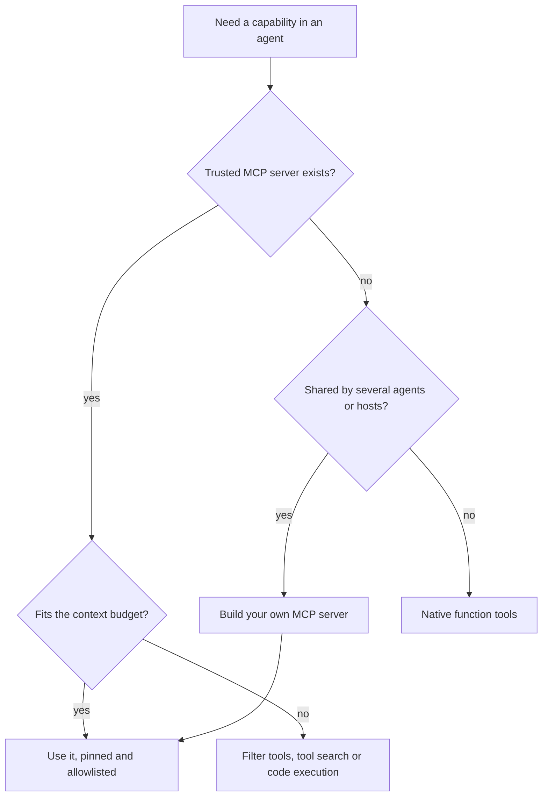

## TL;DR
The MCP ecosystem is an official registry, thousands of vendor and community servers, and many clients.
Use it to reuse integrations across agents and hosts; skip it when a few native function tools would be
simpler, faster and cheaper.

## For agent builders
- **Why it matters for agents.** Before building a GitHub, browser or database integration, check whether
  a maintained MCP server exists; it can save weeks and works across Claude, OpenAI and LangGraph agents.
- **Where it shows up in your stack.** The official MCP Registry and its API, vendor docs that ship an MCP
  endpoint, client catalogs (IDE and chat app connector lists), and your company's internal allowlist.
- **What you control.** Which servers you trust, which versions you pin, which tools you expose, and
  whether a capability goes through MCP at all.
- **What you can skip.** Chasing every directory. Pick servers published by the vendor that owns the API,
  or ones your team reviewed, and ignore the long tail.

## Decision case
### Scenario
A 40-engineer B2B SaaS company wants a triage agent for its support engineers. The agent reads an error
in Sentry, looks up the affected customer's order, and files a GitHub issue. A platform team of 3 owns
it.

Today the agent is the only consumer of the order tools; a billing agent that needs them is planned for
next quarter.
- **Capabilities:** GitHub (6 tools needed), Sentry (3 tools needed), and 4 order tools over the
  internal orders database (look up, list by customer, refund status, escalate).
- **What `tools/list` showed (this scenario's measurements):** the vendor-official GitHub server lists 40
  tools and the Sentry server 20. A registry search for "orders" returns a community server with 12
  tools that needs read access to the database.
- **Context budget:** at most 5k tool-definition tokens per model call. Assume about 250 tokens per tool
  definition (illustrative; measure your own).
- **Security review:** the security team can review 2 new MCP servers per month.
- **Deadline:** in production within 6 weeks.
- **Data residency:** order data must stay in the company's EU infrastructure.
- **Latency:** order lookups add at most 300 ms p95 to an agent step.

### Options
| Option | How it works | Context (≤5k tokens) | Reviews (2/month) | 6-week deadline | Residency and latency |
|---|---|---|---|---|---|
| A. Take what the registry offers | GitHub and Sentry servers with all tools, plus the community orders server | 40 + 20 + 12 = 72 tools × 250 = 18,000: fails | 3 servers, one of them unknown code holding database credentials: fails | Fast to wire | Data stays in EU if run locally, but trust fails |
| B. Vendor servers, allowlisted, plus native order tools | Allowlist 6 GitHub and 3 Sentry tools; the 4 order tools are functions in the agent service | 6 + 3 + 4 = 13 × 250 = 3,250: fits | 2 vendor servers: fits | Days for the native tools | In-process, in the EU service |
| C. Build our own MCP servers for everything | Thin internal servers wrapping the GitHub, Sentry and orders APIs | 13 × 250 = 3,250: fits | Internal review of 3 servers, plus OAuth and deploys | 3 servers to build, secure and run: high risk | Hosted in the EU; one extra hop per call |
| D. Vendor servers, allowlisted, plus an internal orders MCP server now | As B, but orders behind a remote MCP server | 3,250: fits | 2 vendor + 1 internal = 3: over in month one; weeks 5-6 at best, no re-review slack | Adds auth, deploy and versioning | EU-hosted; one extra hop, well inside 300 ms if co-located (illustrative) |

### Decision
Choose **B**: the vendor-official GitHub and Sentry servers, pinned and allowlisted to the 9 tools the
agent needs, and the 4 order tools as native functions.
- **Context:** 3,250 tokens per call against a 5k budget. On a 20-step run that is 65,000 definition
  tokens instead of the 360,000 (18,000 × 20) of option A.
- **Review:** 2 servers, both from the API owner, fit this month's review capacity.
- **Deadline and latency:** native order tools ship in days, run in-process and keep order data in the
  EU service, so the 6-week deadline and the 300 ms budget are safe.
- **Why not D yet:** the orders server has one consumer today, so its auth, deploy and versioning buy
  nothing until the billing agent arrives, and its review takes the last slot before the deadline.

**What would change it:**
- **A second consumer of the order tools** (the billing agent, an IDE) moves the
  order tools to an internal MCP server, option D. Write them now with typed inputs and clear
  descriptions so the move is packaging.
- **A vendor server's descriptions lowering the correct-tool rate** on the eval set means wrapping or
  forking that server.
- **Residency rules extended to error data** means running the Sentry server in the EU, or dropping it
  for direct API calls.

### Trade-offs accepted
- **No reuse for the order tools yet.** The billing agent needs a migration. Watch: its start date;
  begin the MCP server 4 weeks before it.
- **Vendor release cadence.** Tool definitions can change under us. Watch: fingerprint the 9 allowlisted
  definitions and block any tool whose hash changes until it is re-reviewed.
- **Vendor-designed tool descriptions.** We inherit their wording. Watch: correct-tool rate on a
  30-task eval set before launch and on every server version bump.
- **Issues leave the EU boundary.** GitHub issue bodies carry order ids, never order contents. Watch: a
  host-side check that rejects order fields in issue-writing calls.
- **Two kinds of tools to operate.** MCP and native tools trace differently. Watch: one span format for
  both, with tool name, latency and error flag.

### Review rubric
- **Constraints are explicit and numeric:** the write-up states the context budget, review capacity,
  deadline, residency rule and latency budget before comparing options.
- **The arithmetic is shown and correct:** tools × tokens per tool for each option, and per-run totals,
  with every estimated figure labelled.
- **Provenance is checked:** each server is identified by registry namespace and repository, and any
  community server holding credentials is either rejected or given a review plan.
- **The decision follows from the constraints:** each rejected option names the constraint it fails.
- **A reversal trigger is concrete:** for example "a second consumer of the order tools", not "if
  needs change".
- **Trade-offs have monitors:** every accepted cost names the metric or check that would show it going
  wrong.

## Why it exists
- **Integrations are the bottleneck.** Every agent needs tools, and each SaaS API has its own auth and
  quirks. MCP lets the vendor write the integration once for every client.
- **Discovery needs a source of truth.** Without a registry, servers live in scattered READMEs and
  copy-pasted configs, and nobody can tell an official server from a look-alike.
- **Not every tool belongs in a protocol.** A server adds a process or network hop, a session, a versioned
  contract and tool definitions in every model call; for a handful of private functions that cost buys nothing.
- **Context is finite.** Each connected server adds its tool definitions to the prompt, so the ecosystem's
  breadth becomes a token and accuracy problem if you load it naively.

## How it works
### Registries and directories
- **The official MCP Registry.** Run by the MCP project (launched in preview in September 2025). It
  stores metadata (`server.json`: name, description, version, packages or remote URLs) and points to
  where the code lives (npm, PyPI, container registries) rather than hosting code.
- **Namespaces are verified.** Names are reverse-DNS style (`io.github.<user>/<server>` or
  `com.example/<server>`), proved by GitHub login or domain ownership, so the prefix tells you the publisher.
- **Downstream catalogs.** Client marketplaces and community directories (for example Docker's MCP
  Catalog, Smithery, PulseMCP) consume or add to this metadata with their own curation.
- **Internal registries.** Enterprises mirror an allowlisted subset with pinned versions and owners.

### Kinds of servers you will meet
| Kind | Examples | Typical transport | Trust question |
|---|---|---|---|
| Reference servers from the MCP project | Filesystem, Fetch, Git, Memory, Time, Everything (a test server) | stdio | Teaching quality; read before production use |
| Vendor-official servers | GitHub's MCP server, Microsoft's Playwright MCP, Sentry, Stripe, Notion, Linear | Remote HTTP or stdio | Published by the API owner; still scope tokens |
| Community servers | Thousands in directories | Mostly stdio | Unknown code running with your credentials |
| Internal servers | Ticketing, CRM, data warehouse at your company | Remote HTTP | Your own review, auth and SLOs |

### Clients that load servers
- **Chat and desktop apps:** Claude (desktop and web connectors), ChatGPT (connectors and developer
  features), and others; check each app's current docs for which transports and auth they support.
- **IDEs and coding agents:** Claude Code, Cursor, VS Code with GitHub Copilot, and others load stdio and
  remote servers from a config file.
- **Agent frameworks:** OpenAI Agents SDK, Claude Agent SDK, LangGraph via adapters, and most others.

### The decision: MCP or not
| Situation | Better choice | Because |
|---|---|---|
| A vendor already ships an MCP server you trust | MCP | Reuse, vendor maintenance, works in many hosts |
| Several agents or hosts need the same tools | MCP (your own server) | One contract and auth layer for all of them |
| Two to five private functions in one agent | Native function tools | No extra process, session or version to manage |
| Hot-path tools with tight latency budgets | Native tools or direct API calls | Skip the IPC or HTTP hop |
| Delegating a whole task to another agent | A2A or a sub-agent | MCP exposes tools, not peer agents |
| Coding agent with a shell | CLI tools or code execution | The agent can call well-known CLIs without new schemas |
| Dozens of tools from many servers | MCP plus tool search, filtering or code execution over MCP | Keep definitions out of context until needed |

## Diagram
Start at the top: the first two questions settle most cases, and the context check catches the rest.



## Examples
### Search the official registry from Python
Stdlib only. The registry's search can take tens of seconds; check the docs for the current API
version and fields.

```python
import json, sys, urllib.parse, urllib.request

REGISTRY = "https://registry.modelcontextprotocol.io/v0.1/servers"   # check the docs for the current API version

def search(term: str, limit: int = 10) -> list[dict]:
    query = {"search": term, "limit": limit, "version": "latest"}     # one row per server, not per release
    url = f"{REGISTRY}?{urllib.parse.urlencode(query)}"
    with urllib.request.urlopen(url, timeout=60) as r:
        return [entry["server"] for entry in json.load(r)["servers"]]

for s in search(sys.argv[1] if len(sys.argv) > 1 else "github"):
    packages = [f"{p.get('registryType')}:{p.get('identifier')}@{p.get('version')}" for p in s.get("packages", [])]
    remotes = [f"{r['type']} {r['url']}" for r in s.get("remotes", [])]
    print(f"{s['name']}  v{s.get('version')}")
    print(f"   repo: {s.get('repository', {}).get('url', '-')}")
    print(f"   install: {packages or '-'}  remote: {remotes or '-'}")
```

- **What to notice.** A search for a popular tool name returns many look-alike servers from unrelated
  publishers. Read the namespace and repository before trusting one: GitHub's own server is
  `io.github.github/github-mcp-server`, and other `io.github.*` names belong to whoever owns that account.
- **Before an agent uses it.** Turn the chosen entry into a pinned launch command or remote URL in your
  agent config, then allowlist only the tools the agent needs.

### Worked numbers: when MCP is overhead
An internal support agent needs 4 tools: look up an order, issue a refund, read a policy, escalate.

| Option | Moving parts | Latency per call (illustrative) | Verdict |
|---|---|---|---|
| Native function tools in the agent service | The functions | In-process | Best: one agent, private logic |
| Internal MCP server over HTTP | Server, auth, deploy, versioning | Plus one network hop | Worth it once 3+ agents or hosts share these tools |
| Community "orders" MCP server | Unknown code plus your DB credentials | Plus one hop | Avoid: trust and fit problems |

### Worked numbers: loading five popular servers
| Setup | Tools in context | Definition tokens per call (rough) |
|---|---|---|
| Five vendor servers, all tools | ~120 | tens of thousands |
| Same servers, allowlist per agent | ~15 | a few thousand |
| Tool search or code execution over MCP | a handful until needed | small, grows on demand |

## Production patterns
- **Internal allowlist registry.** Keep an approved list of servers with owner, pinned version (package
  version or container digest), allowed tools and data classification; agent configs may only reference
  it. Monitor requests for new servers and review time.
- **Prefer vendor-official servers.** Choose servers published by the API owner (check the registry
  namespace and repository) over community re-implementations. Monitor vendor release notes for tool changes.
- **Publish your own servers to a registry.** Teams describe internal servers in `server.json` and publish
  to an internal registry (or the official one with the `mcp-publisher` CLI for public servers; check the
  docs). Monitor which agents depend on each server version.
- **Budget context per agent.** Measure tool-definition tokens per connected server and set a cap per
  agent; above it, filter tools, use the host's tool search, or move to code execution over MCP.
  Monitor definition tokens per call and correct-tool rate.
- **Native first for private logic.** Start one-agent, private tools as native functions and promote them
  to an MCP server when a second agent or host needs them. Track how many consumers each tool has.

## Trade-offs
- **Reuse vs control.** Vendor servers save build time but you inherit their tool design, descriptions and
  release schedule; wrap or fork when their tools hurt your agent's accuracy.
- **Breadth vs accuracy.** More servers give more capability but more tool definitions; past a few dozen
  tools, selection quality and cost both degrade unless you filter.
- **Standard protocol vs simplicity.** MCP buys portability across hosts at the cost of a process or
  service, sessions and versioning; for one agent's private tools that cost rarely pays back.
- **Open directories vs curated lists.** Open directories surface everything quickly; curated internal
  lists are slower to grow but safer.

## Pitfalls
- **Installing the first search result.** A look-alike server with a familiar name runs with your
  credentials. Fix: check namespace, repository and publisher, prefer the vendor's own server.
- **Wrapping everything in MCP.** A team builds servers for four private functions and adds a deploy, auth
  and a network hop for nothing. Fix: native tools until there is a second consumer.
- **Loading every server everywhere.** Symptom: rising token bills and wrong tool choices. Fix: allowlist
  per agent and measure correct-tool rate.
- **Treating the registry as a security review.** Registries verify who published metadata, not whether
  the code is safe. Fix: your own review, pinning and sandboxing.

## When to use
- **Use MCP when:** a trusted server exists, or several agents and hosts (chat apps, IDEs, your agents)
  should share one tool surface with per-user auth.
- **Avoid MCP when:** tools are few, private to one agent and latency-sensitive, or the capability is a
  whole agent (use A2A or a sub-agent) rather than a tool.
- **Measure:** tools and definition tokens per agent, correct-tool rate, number of consumers per server,
  and time spent maintaining each integration.
- **Interviews:** have a clear answer for "when would you not use MCP" with a concrete example.

## Role lens
- **Engineer:** Evaluates existing servers before building integrations, pins and allowlists the ones
  adopted, and keeps private one-agent tools native until they need sharing.
- **Architect:** Owns the internal MCP registry and the rules for which capabilities become shared MCP
  servers versus native tools, sub-agents or A2A peers.
- **FDE:** Maps a customer's systems to available vendor servers, flags gaps that need a custom server,
  and explains which community servers are not safe to connect.

## Check yourself
**Q:** A team wants to wrap three internal Python functions used by one agent as an MCP server "to be
future-proof". What do you advise, and what would change your mind?
**A:** Keep them as native function tools for now: an MCP server adds a process or service, a session,
auth, versioning and a hop per call, and only one agent benefits. The functions can be written so they
are easy to expose later, for example with typed inputs and clear descriptions. Change course when a second
consumer appears, such as another team's agent, an IDE or a chat app connector, or when the tools need
per-user OAuth; then one MCP server gives every consumer the same contract, and the switch is mostly packaging.

## Interview questions
### When does MCP beat direct function calling, and when does it not?
- **MCP wins** when tools are shared across agents or hosts, a vendor maintains the server, or users need
  their own OAuth identity per tool provider.
- **Direct calling wins** for a few private, latency-sensitive tools in one agent, where a protocol layer
  adds moving parts and no reuse.

### How do you decide whether a server from a directory is safe to use?
- **Provenance first:** registry namespace, repository, publisher and whether the API owner publishes it.
- **Then review and contain:** read the tool definitions and code, pin the version, scope its credentials,
  run it sandboxed, and add it to the internal allowlist with an owner.

### Your agent connects to six MCP servers and quality is dropping. What options do you have?
- **Expose less:** allowlist tools per agent and per task, or split into sub-agents that each own a server.
- **Load lazily:** use the host's tool search or deferred loading, or code execution over MCP, so
  definitions enter context only when needed. Measure correct-tool rate before and after.

### What does the official MCP Registry do, and what does it not do?
- **It does** store verified-namespace metadata about servers (versions, packages, remote endpoints) and
  serve it through an API that clients and catalogs consume.
- **It does not** host the code or certify that a server is safe; security review stays with you.

### How do MCP and A2A differ in what they connect?
- **MCP connects an agent to tools, resources and prompts** exposed by a server, with the agent in control.
- **A2A connects agents to other agents** as peers that accept tasks and return results; use it to
  delegate whole tasks across teams or vendors.

## Quiz
### Q: What does the official MCP Registry store?
- [ ] The source code and binaries of every server
- [x] Metadata about servers (name, version, packages or remote URLs) under verified namespaces
- [ ] Security audit results for each server
- [ ] Users' OAuth tokens for remote servers
> The registry is a metadata service: it points to packages and endpoints hosted elsewhere and verifies
> who owns a namespace, not whether the code is safe.

### Q: Which situation is the weakest case for building an MCP server?
- [ ] A SaaS vendor wants ChatGPT, Claude and IDE agents to use its API
- [ ] Five internal agents need the same ticketing tools with per-user auth
- [x] One agent needs three private helper functions on a latency-sensitive path
- [ ] A platform team wants one audited gateway for internal tools
> With one consumer and private logic, a protocol layer adds a process or network hop, versioning and auth
> without reuse; native function tools are simpler.

### Q: Why can connecting many MCP servers to one agent hurt quality?
- [ ] Servers block each other's sessions
- [x] Every tool definition goes into each model call, adding tokens and more chances to pick the wrong tool
- [ ] MCP limits agents to ten tools
- [ ] Remote servers disable prompt caching
> Tool definitions are part of the prompt. Dozens of unused tools cost input tokens on every step and make
> tool selection harder, so filter or load tools lazily.

## Use cases & projects
### Use cases
- **Speeding up agent prototypes.** Teams try vendor servers (GitHub, Playwright, Sentry) from the
  registry before writing any integration code.
- **Enterprise MCP governance.** A platform team runs an internal registry of approved, pinned servers
  that every agent and IDE must use.
- **SaaS distribution.** A vendor publishes its remote MCP server to the official registry so clients
  and catalogs can list it.
- **Architecture reviews.** Architects use the MCP-or-not table to keep private tools native and share
  only what has several consumers.

### Mini project
**Build an MCP adoption shortlist (1-2 hours).**
- **Goal:** pick the servers one agent of yours should use and justify each choice.
- **Steps:** list the agent's capabilities; for each, query the registry with the script above and note
  publisher, namespace, version and transport; choose vendor-official servers, native tools or a custom
  server using the decision table; connect the chosen servers and measure tool-definition tokens and
  correct-tool rate on 10 tasks.
- **Done when:** a one-page table lists every capability with its choice, publisher and pinned version, plus
  before-and-after numbers for definition tokens and correct-tool rate.
