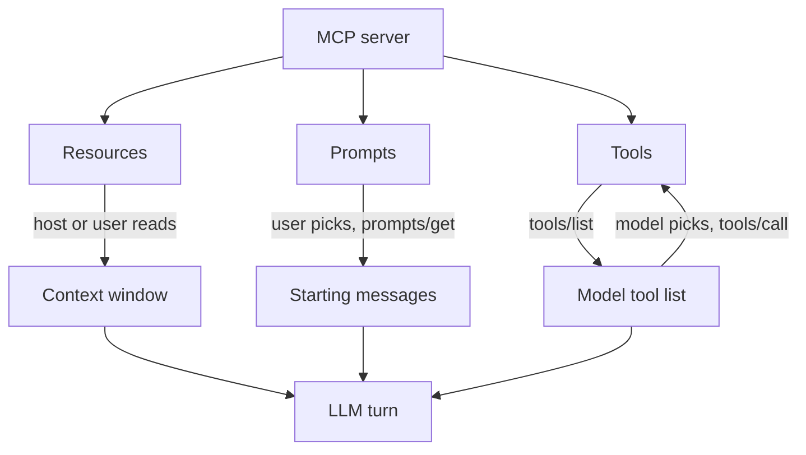

## TL;DR
An MCP server offers three primitives: tools the model calls, resources the application reads into
context, and prompts the user picks. Choosing the right one for each capability decides who is in
control and what your agent spends tokens on.

## For agent builders
- **Why it matters for agents.** Tools enter the model's tool list and cost tokens on every turn;
  resources enter context only when your host loads them; prompts start a workflow on the user's
  request. Putting a capability under the wrong primitive bloats context or hands the model control it
  should not have.
- **Where it shows up in your stack.** `@mcp.tool()`, `@mcp.resource()` and `@mcp.prompt()` in the Python
  SDK, `registerTool`, `registerResource` and `registerPrompt` in TypeScript, and how hosts render them:
  tool lists, attach-a-file pickers, slash commands.
- **What you control.** Which primitive each capability uses, tool annotations and output schemas,
  resource URIs and templates, and prompt arguments.
- **What you can skip.** Content annotations for display ordering and audience until a host actually uses
  them.

## Why it exists
- **Different capabilities need different controllers.** "Search tickets" is a model decision, "attach
  this log file" is an application or user decision, and "run the triage workflow" is a user decision.
  One primitive for all three would force every capability through the model.
- **Context is the scarce resource.** Exposing a 2,000-row table as a tool that returns everything burns
  tokens on every call; exposing it as a resource lets the host load just the slice it needs.
- **Reusable workflows were living in people's notes.** Prompts let a server ship a tested template (with
  arguments) that every host can offer the same way.
- **Discovery must be dynamic.** Each primitive has a list method, pagination and a change notification, so
  hosts learn what exists at runtime instead of hard-coding it.

## How it works
### The control model
| Primitive | Controlled by | Discovered with | Used with | Typical host UI |
|---|---|---|---|---|
| **Tools** | The model | `tools/list` | `tools/call` | Tool list sent to the LLM, approval dialogs |
| **Resources** | The application | `resources/list`, `resources/templates/list` | `resources/read` | File or context picker, automatic retrieval |
| **Prompts** | The user | `prompts/list` | `prompts/get` | Slash commands, menu entries |

All list methods are paginated with an opaque `cursor` in the request and `nextCursor` in the result, so a
host must loop until `nextCursor` is absent.

### Tools
- **Definition:** `name`, optional `title` (display), `description`, `inputSchema` (JSON Schema, an
  object), optional `outputSchema`, optional `annotations`, and in recent revisions `icons`.
- **Result:** `content` is a list of items: `text`, `image` and `audio` (base64 `data` plus `mimeType`),
  `resource_link` (a URI the client can fetch) and embedded `resource`. With an `outputSchema`, the server
  must also return `structuredContent` that conforms, and should still include the JSON as text for older
  clients (2025-06-18 onward).
- **Two error channels:** protocol errors (unknown tool, malformed request) are JSON-RPC errors; execution
  errors (API failed, bad date, business rule) are results with `isError: true`, which the host should feed
  back to the model so it can correct itself.
- **Annotations are hints:** `readOnlyHint`, `destructiveHint`, `idempotentHint`, `openWorldHint` and
  `title`. Clients must treat them as untrusted unless the server is trusted, so they inform approval UX,
  never replace authorization.
- **Changes:** with `tools.listChanged`, the server sends `notifications/tools/list_changed` and the host
  re-lists.

### Resources
- **Addressed by URI:** `file:///repo/README.md`, `postgres://db/schema`, or your own scheme such as
  `tickets://T-1`. `resources/read` returns `contents`, each with `uri`, `mimeType` and either `text` or
  base64 `blob`.
- **Templates:** `resources/templates/list` returns RFC 6570 URI templates (`tickets://{ticket_id}`) for
  parameterised resources; the completion utility can suggest values for template arguments.
- **Updates:** in the handshake era, `resources/subscribe` plus `notifications/resources/updated`; in
  2026-07-28 these move onto a `subscriptions/listen` stream.
- **Annotations:** `audience` (`user`, `assistant`), `priority` (0 to 1) and `lastModified` help a host
  decide what to show or include.
- **Not found:** `-32002` in earlier revisions, changed to `-32602` (invalid params) in 2026-07-28.

### Prompts
- **Definition:** `name`, `description` and an `arguments` list (each with `name`, `description`,
  `required`).
- **`prompts/get`** fills the arguments and returns `messages`, each with a `role` (`user` or `assistant`)
  and content (text, image, audio or an embedded resource). The host inserts them into the conversation.
- **Why a server ships prompts:** the server author knows how its tools work best together, so a "triage
  ticket" prompt encodes the right sequence once instead of every user rediscovering it.

### How your own agent uses them
1. **Tools:** convert each MCP tool to your provider's tool format and pass them on every model call.
2. **Resources:** your code decides when to read one (a retrieval step, a user attachment) and inserts the
   text as context, so the model never pays for resources it does not need.
3. **Prompts:** surface them as commands; when picked, call `prompts/get` and start the turn with the
   returned messages.

## Diagram
Each primitive reaches the model through a different controller; only tools are chosen by the model itself.



## Examples
### One server, three primitives, one host
A ticket server exposing a read-only tool with structured output, a resource template and a prompt, then
a host that uses each the way an agent should. Tested with the Python SDK 1.x (`mcp>=1.10,<2`).

```python
# tickets_server.py
from typing import Literal
from pydantic import BaseModel
from mcp.server.fastmcp import FastMCP
from mcp.types import ToolAnnotations

mcp = FastMCP("tickets", instructions="Helpdesk tickets. Search before you create.")
TICKETS = {"T-1": {"title": "VPN down", "status": "open", "body": "Users in Berlin cannot connect."}}

class Ticket(BaseModel):
    id: str
    title: str
    status: Literal["open", "closed"]

@mcp.tool(annotations=ToolAnnotations(readOnlyHint=True, openWorldHint=False))
def search_tickets(query: str, status: Literal["open", "closed"] = "open") -> list[Ticket]:
    """Find tickets whose title contains `query`. Returns id, title, status only."""
    return [Ticket(id=k, title=v["title"], status=v["status"])
            for k, v in TICKETS.items() if query.lower() in v["title"].lower() and v["status"] == status]

@mcp.resource("tickets://{ticket_id}", mime_type="text/markdown")
def ticket_body(ticket_id: str) -> str:
    """Full ticket text, for the host to load as context."""
    t = TICKETS[ticket_id]
    return f"# {t['title']}\n\n{t['body']}"

@mcp.prompt()
def triage(ticket_id: str) -> str:
    """User-picked template: triage one ticket."""
    return f"Triage ticket {ticket_id}: read tickets://{ticket_id}, pick a priority, explain why."

if __name__ == "__main__":
    mcp.run()
```

```python
# host.py
import asyncio, sys
from mcp import ClientSession, StdioServerParameters
from mcp.client.stdio import stdio_client

async def main():
    params = StdioServerParameters(command=sys.executable, args=["tickets_server.py"])
    async with stdio_client(params) as (r, w), ClientSession(r, w) as s:
        await s.initialize()
        tools = (await s.list_tools()).tools                    # 1. model-controlled
        print([(t.name, t.annotations.readOnlyHint) for t in tools])
        res = await s.call_tool("search_tickets", {"query": "vpn"})
        print(res.structuredContent)        # {'result': [{'id': 'T-1', 'title': 'VPN down', ...}]}
        doc = await s.read_resource("tickets://T-1")            # 2. application-controlled
        context = doc.contents[0].text                          # your code inserts this as context
        p = await s.get_prompt("triage", {"ticket_id": "T-1"})  # 3. user-controlled
        print(p.messages[0].role, p.messages[0].content.text)

asyncio.run(main())
```

FastMCP derives `inputSchema` from the signature (the `Literal` becomes an `enum`) and an `outputSchema`
from the return type; a list return is wrapped as `{"result": [...]}` in `structuredContent`.

### Worked scenario: choosing the primitive for each capability
A support-agent team maps six capabilities. Token figures are illustrative orders of magnitude.

| Capability | Primitive | Why | Context cost |
|---|---|---|---|
| Search tickets by text | Tool | The model decides when it needs it | ~150 tokens of schema on every turn |
| Close a ticket | Tool, `destructiveHint: true` | Model-initiated, but the host asks for approval | ~120 tokens per turn |
| Product manual (300 pages) | Resource template per section | The host retrieves one section, not the manual | Only the section read |
| Customer's open tickets on chat start | Resource | Loaded by the app once per conversation | Once, not per turn |
| "Write a weekly incident summary" | Prompt with a `week` argument | A user-started workflow with a tested recipe | Only when picked |
| Look up an SLA table (20 rows) | Resource, or a tool if the model must filter it | Static reference data | Small either way |

## Production patterns
- **Default to resources for bulk reference data.** Manuals, schemas and logs go behind resource templates
  that the host reads on demand (often via a retrieval step), instead of tools that dump everything.
  Monitor tokens per turn attributed to tool schemas versus tool results.
- **Set annotations honestly and gate on them in the host.** Mark read-only tools `readOnlyHint: true` and
  write tools `destructiveHint` and `idempotentHint` accurately; the host auto-approves read-only tools from
  trusted servers and asks the user for the rest. Log every approval decision.
- **Return structured output with a text mirror.** Declare an output schema (a typed return in FastMCP)
  and keep the serialized JSON in a text block, so new clients validate `structuredContent` and older ones
  still work. Validate in contract tests.
- **Return resource links instead of inlining large payloads.** A tool that finds a 50 KB log returns a
  `resource_link` plus a summary; the agent reads the resource only if needed. Track result sizes per tool.
- **Ship prompts for multi-step workflows you have tested.** Encode the tool sequence and output format in
  a prompt with typed arguments, version it with the server, and evaluate it like any other prompt.
- **Announce changes instead of restarting.** Declare `listChanged` and emit list-changed notifications
  when feature flags or permissions change the tool set; hosts re-list without reconnecting.

## Trade-offs
- **Tool vs resource for read access.** A tool lets the model fetch data on its own, at the price of
  schema tokens every turn and model-chosen reads; a resource keeps control and cost with the host but
  needs host logic to decide what to load.
- **Structured output vs free text.** `structuredContent` with a schema is machine-checkable and easy to
  post-process, but rigid; free text is flexible for the model and harder to validate or render.
- **Prompts vs host-side templates.** Server prompts travel with the server to every host, but you lose
  control over their wording inside your product; host templates are yours but must be rebuilt per host.
- **Many fine-grained tools vs few broad ones.** Fine-grained tools are precise but crowd the tool list and
  hurt selection; broad tools save tokens but need richer arguments.

## Pitfalls
- **Exposing everything as tools.** Symptom: 80 tools from one server, tool selection accuracy falls and
  every turn carries thousands of schema tokens. Fix: move reference data to resources and workflows to
  prompts; keep tools for actions and targeted queries.
- **Assuming hosts read resources automatically.** Symptom: the server exposes resources but the agent never
  uses them. Fix: many hosts only surface resources to the user; in your own agent, write the retrieval
  logic explicitly.
- **Trusting annotations from an unknown server.** Symptom: a tool marked `readOnlyHint` deletes data and the
  host auto-approved it. Fix: auto-approve only for servers you trust; otherwise approval follows your own
  policy.
- **Reading only the first page of a list.** Symptom: some tools or resources are missing in production but
  present in tests. Fix: loop on `nextCursor` until it is absent.

## When to use
- **Use tools when** the model must decide to act or query, with small arguments and bounded results.
- **Use resources when** data is large, static or chosen by the app or user, such as files, schemas or
  documents.
- **Use prompts when** a user starts a known workflow that benefits from a tested template.
- **Measure:** schema tokens per turn, result size per tool call, tool selection accuracy and how often each
  resource is actually read.

## Role lens
- **Engineer:** Implements tools, resources and prompts with typed schemas, output schemas and honest
  annotations, and writes host code that reads resources and surfaces prompts deliberately.
- **Architect:** Sets the policy for which capabilities become tools versus resources versus prompts, and
  how annotations map to approval and auto-approval across trusted and untrusted servers.
- **FDE:** Maps a customer's systems to primitives, for example their manuals as resources and their
  ticket actions as tools, and explains the context-cost and control trade-offs to them.

## Check yourself
**Q:** A team exposes their 300-page product manual as a tool `get_manual()` that returns the full text, and
complains that the agent is slow and expensive. What would you change, and why is that better?
**A:** Move the manual from a tool to resources. Expose a resource template such as
`manual://{section_id}` plus a small tool or retrieval step that finds the right section, so the host reads
only the one or two sections a question needs. Today every call to `get_manual()` pushes the whole manual
into context, which costs input tokens, slows every later turn and dilutes the model's attention. With
resources the application controls what enters context, results stay small, and the tool list keeps only
a compact search tool. If the model must search freely, return `resource_link` items with short summaries
rather than full text, and let the agent read the link it needs.

## Interview questions
### What are the three MCP server primitives and who controls each?
- **Tools** are model-controlled: the LLM sees them in its tool list and chooses when to call them.
- **Resources** are application-controlled: data addressed by URI that the host or user decides to load.
- **Prompts** are user-controlled: templates the user picks, which return starting messages for the turn.

### When would you expose data as a resource rather than a tool?
- **When the data is large, static or chosen by the app:** documents, schemas, logs. A resource keeps it out
  of context until the host reads the relevant part.
- **Use a tool instead** when the model must decide on its own, mid-task, to look something up with specific
  arguments, and the result is small and bounded.

### A tool fails because the user passed a date in the past. Should the server return a JSON-RPC error or `isError`?
- **`isError: true` in a normal result,** with a message such as "date must be in the future, today is ...",
  because it is an execution error the model can fix by retrying with new arguments.
- **JSON-RPC errors are for protocol failures** such as an unknown tool or a malformed request, which the host
  handles in code rather than showing to the model.

### How should a host use tool annotations like `readOnlyHint` and `destructiveHint`?
- **As UX hints for approval,** for example auto-approving read-only tools and confirming destructive ones,
  but only when the server itself is trusted.
- **Never as authorization:** the spec says to treat annotations from untrusted servers as untrusted, so
  real enforcement stays in the host's policy and the server's own access control.

### Your agent's tool calls return 30 KB JSON blobs and quality drops after a few steps. What do you change on the server?
- **Return less:** concise fields by default, a `response_format` or field selection argument for detail,
  and pagination for lists.
- **Point instead of inlining:** return `resource_link` items or IDs with short summaries, so the agent reads
  the full object only when needed. Measure result tokens per call before and after.

## Quiz
### Q: Which MCP primitive is controlled by the application rather than the model or the user?
- [ ] Tools
- [x] Resources
- [ ] Prompts
- [ ] Sampling
> Resources are application-controlled: the host or user decides which ones to read into context. Tools are
> model-controlled, prompts are user-controlled, and sampling is a client feature, not a server primitive.

### Q: A tool declares an `outputSchema`. What must its results contain?
- [ ] Only a text block with the JSON, so older clients work
- [x] `structuredContent` that conforms to the schema, ideally with the same JSON mirrored in a text block
- [ ] An embedded resource with MIME type `application/json`
- [ ] An `isError` flag set to false
> With an output schema the server must return conforming `structuredContent`. The spec recommends also
> returning the serialized JSON as text for backwards compatibility with clients that ignore structured
> results.

### Q: How should a host treat `readOnlyHint: true` on a tool from an unknown third-party server?
- [ ] As a guarantee that the tool cannot modify data
- [ ] As a reason to hide the tool from the model
- [x] As an untrusted hint that may inform UX but must not replace approval or authorization
- [ ] As a signal to call the tool in parallel with all other tools
> Annotations describe intended behavior and come from the server itself. Clients must consider them
> untrusted unless the server is trusted, so policy and approval stay in the host.

## Use cases & projects
### Use cases
- **Coding agents.** Repo search and test runs as tools, files and build logs as resources, and "review this
  diff" as a prompt.
- **Support agents.** Ticket actions as tools with destructive hints driving approval, product manuals as
  resource templates read by a retrieval step.
- **Analytics agents.** Database schema exposed as a resource loaded once per session, and a narrow read-only
  query tool for the model.
- **Workflow libraries.** A platform team ships tested prompts (incident summary, release notes) with each
  server so every host offers the same workflow.

### Mini project
**Refactor a tool-only server into the right primitives (1-2 hours).**
- **Goal:** take a server with five tools, including one that returns a large document, and redistribute its
  capabilities across tools, resources and prompts.
- **Steps:** measure tool-schema tokens and average result size per call; move the document to a resource
  template; add `readOnlyHint` and `destructiveHint` annotations; add an output schema to the search tool;
  add one prompt for the most common workflow; write a host that reads the resource only when a search
  hit references it.
- **Done when:** a 5-task evaluation completes with the same success rate as before and at least a third
  fewer input tokens, and the host asks for approval only on the destructive tool.

### Major project
This lesson feeds the module Capstone (see the module guide): a production MCP server for one internal
system.
- **Scope (multi-day):** tools with output schemas and honest annotations, resources and templates for
  reference data, two tested prompts, list-change notifications behind a feature flag, and pagination on
  every list.
- **Done when:** two different hosts (an IDE agent and your own agent) use all three primitives, contract
  tests validate every `structuredContent` against its schema, and tool-schema tokens per turn are tracked
  on a dashboard.
