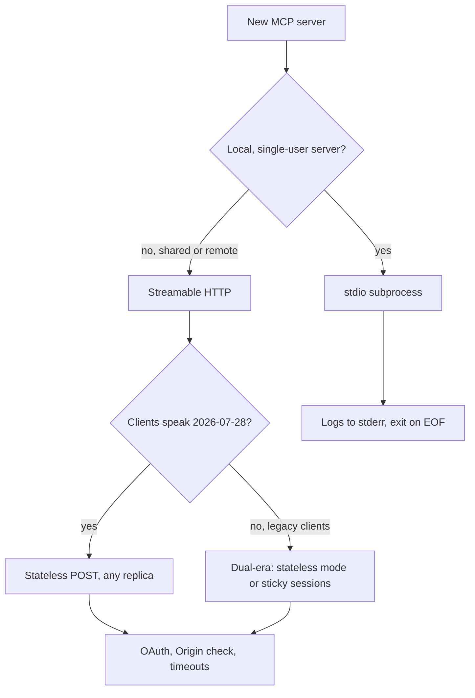

## TL;DR
MCP messages travel over stdio for local subprocess servers or Streamable HTTP for remote ones; the
2024-11-05 HTTP+SSE transport is deprecated. The choice sets your agent's deployment, auth, scaling and
failure modes.

## For agent builders
- **Why it matters for agents.** A local coding agent spawning a stdio server and a hosted agent calling
  a shared remote server have different latency, security and scaling problems. Picking the transport is
  picking which of those you own.
- **Where it shows up in your stack.** `mcp.run(transport="stdio" | "streamable-http")` in Python,
  `StdioServerTransport` and `StreamableHTTPServerTransport` in TypeScript, host config files that list a
  `command` or a `url`, and your load balancer and proxy settings.
- **What you control.** Transport per server, stateful or stateless HTTP, JSON or SSE responses, bind
  address, `Origin` checks and auth in front of the endpoint.
- **What you can skip.** Writing a custom transport. The spec allows them, but stdio and Streamable HTTP
  cover nearly every agent deployment.

## Why it exists
- **Local tools need zero network setup.** A subprocess over stdin and stdout needs no port, TLS or auth,
  and dies with the host, which suits per-user tools on a laptop.
- **Shared tools need a network endpoint.** One remote server serving many agents and users needs HTTP,
  authentication and horizontal scaling.
- **The first HTTP design was awkward.** HTTP+SSE (2024-11-05) required a long-lived SSE stream plus a
  separate POST endpoint, which broke on proxies and serverless platforms. Streamable HTTP (2025-03-26)
  replaced it with one endpoint.
- **Sessions fought load balancers.** Session-based Streamable HTTP needed sticky routing; the 2026-07-28
  revision removed protocol sessions so any replica can serve any request.

## How it works
### stdio
1. **The host launches the server** as a subprocess from a `command` and `args`.
2. **Framing:** one JSON-RPC message per line, UTF-8, with no embedded newlines; the client writes to the
   server's stdin, the server writes to stdout.
3. **stdout is sacred:** the server must write nothing to stdout that is not an MCP message; logs go to
   stderr, which the client may capture and must not treat as an error signal.
4. **Cancellation:** `notifications/cancelled` with the request id.
5. **Shutdown:** the client closes stdin and waits; if the server does not exit, `SIGTERM`, then `SIGKILL`
   on POSIX. Servers should exit promptly on end-of-file.

### Streamable HTTP, 2025-03-26 to 2025-11-25 (session era)
- **One MCP endpoint** (for example `/mcp`) supporting POST and GET.
- **POST** carries each client message; the client sends `Accept: application/json, text/event-stream`.
  For a request the server replies with one JSON object or an SSE stream; for a notification or response
  it replies `202 Accepted`.
- **GET** opens an optional standalone SSE stream for server-initiated messages (servers may answer `405`).
- **Sessions:** the server may return `Mcp-Session-Id` with the initialize result; the client sends it on
  every later request, `404` means the session expired (re-initialize), and HTTP `DELETE` ends it.
- **Resumability:** SSE event ids plus the `Last-Event-ID` header let a client resume a dropped stream.
- **`MCP-Protocol-Version` header** on every request after initialization, from 2025-06-18.

### Streamable HTTP, 2026-07-28 (current, stateless)
- **POST only.** GET and DELETE get `405 Method Not Allowed`; `Mcp-Session-Id` and `Last-Event-ID` are
  ignored.
- **Request-scoped SSE:** an SSE response carries progress and log notifications for that request, then the
  final response. Closing the stream is the cancellation signal.
- **Headers mirror the body** so gateways can route without parsing JSON: `MCP-Protocol-Version`,
  `Mcp-Method`, and `Mcp-Name` (tool or prompt name, or resource URI). Mismatches get `400` with
  `HeaderMismatch` (`-32020`). Tool parameters marked `x-mcp-header` are mirrored as `Mcp-Param-{name}`.
- **Errors carry a JSON-RPC body:** an unsupported version is `400` with `UnsupportedProtocolVersionError`,
  an unknown method is `404` with `-32601`. The body is what tells a modern server apart from a legacy one.
- **Broken streams lose the request;** the client re-issues it with a new id, so tools must be safe to retry.
- **Change notifications** use a long-lived `subscriptions/listen` POST instead of the GET stream.

### Legacy HTTP+SSE (2024-11-05, deprecated)
- **Two endpoints:** the client GETs an SSE stream, the server's first event is `endpoint` with a POST URL,
  and every client message is POSTed there while responses come back on the SSE stream.
- **Compatibility:** a client given a URL POSTs first; on `400`, `404` or `405` without a recognized modern
  error body, it GETs the URL and looks for the `endpoint` event. New servers should not adopt it.

### Security for any HTTP transport
- **Validate `Origin`** on every request and answer `403 Forbidden` when it is present and invalid; this
  stops DNS-rebinding attacks from web pages against local servers.
- **Bind local servers to `127.0.0.1`,** never `0.0.0.0`.
- **Authenticate remote servers** with OAuth per the authorization spec (see
  `agents/mcp-authentication-authorization-transport-security`).
- **Disable proxy buffering for SSE,** for example the `X-Accel-Buffering: no` response header for nginx.

## Diagram
The decision path most teams follow when choosing a transport for a new server.



## Examples
### One server, both transports
The same tool code serves a local host over stdio and remote agents over Streamable HTTP. Tested with the
Python SDK 1.x (`mcp>=1.10,<2`); defaults are `127.0.0.1`, port `8000`, path `/mcp`.

```python
# notes_server.py
import sys
from mcp.server.fastmcp import FastMCP

mcp = FastMCP("notes", stateless_http=True, json_response=True)   # no session affinity needed

@mcp.tool()
def count_words(text: str) -> int:
    """Count words in `text`."""
    print("count_words called", file=sys.stderr)   # stderr only: stdout is the stdio wire
    return len(text.split())

if __name__ == "__main__":
    mcp.run(transport="streamable-http" if "--http" in sys.argv else "stdio")
```

```python
# http_client.py: run the server with --http first
import asyncio
from mcp import ClientSession
from mcp.client.streamable_http import streamablehttp_client

async def main():
    async with streamablehttp_client("http://127.0.0.1:8000/mcp") as (read, write, get_session_id):
        async with ClientSession(read, write) as session:
            await session.initialize()
            res = await session.call_tool("count_words", {"text": "one two three"})
            print(res.structuredContent, get_session_id())   # {'result': 3} None (stateless)

asyncio.run(main())
```

With `stateless_http=True` no `Mcp-Session-Id` is issued and a bare POST works without `initialize`:

```
curl -s -X POST http://127.0.0.1:8000/mcp -H 'Content-Type: application/json' \
  -H 'Accept: application/json, text/event-stream' -H 'MCP-Protocol-Version: 2025-06-18' \
  -d '{"jsonrpc":"2.0","id":1,"method":"tools/list","params":{}}'
```

### Comparison: which transport for which agent deployment
| | stdio | Streamable HTTP (session era) | Streamable HTTP (2026-07-28) | HTTP+SSE (2024-11-05) |
|---|---|---|---|---|
| Where it runs | Subprocess of the host | Network service | Network service | Network service |
| Clients per server process | 1 | Many | Many | Many |
| Auth | Inherits the user's OS permissions | OAuth or gateway | OAuth or gateway | OAuth or gateway |
| Scaling | One process per host session | Sticky routing or stateless mode | Any replica | Sticky long-lived streams |
| Server-to-client messages | Same pipe | SSE (GET or response stream) | In results (MRTR) and `subscriptions/listen` | SSE stream |
| Typical failure | Logs on stdout, zombie processes | "session not found" after scale-out | Lost request when a stream drops | Proxy kills idle stream |
| Status | Active | Superseded by 2026-07-28 | Current | Deprecated |

## Production patterns
- **Run stdio servers as supervised children.** Start them with explicit `command`, `args` and a minimal
  `env` (no inherited secrets), restart on unexpected exit, close stdin then escalate to `SIGTERM` and
  `SIGKILL` on shutdown. Monitor restarts per server and stderr error lines.
- **Go stateless on HTTP whenever you can.** Use `stateless_http=True` (Python SDK 1.x) or an SDK that
  speaks 2026-07-28, keep state in explicit handles or a database, and put replicas behind an ordinary load
  balancer. Track the "session not found" or `404` rate if you must stay session-based.
- **Prefer JSON responses for short calls, SSE for long ones.** `json_response=True` is simpler through
  proxies and serverless; use SSE where progress notifications matter, and set `X-Accel-Buffering: no` and
  idle timeouts above your longest call.
- **Put a gateway in front of remote servers.** Terminate TLS, validate `Origin`, check OAuth tokens, rate
  limit, and route or log on `Mcp-Method` and `Mcp-Name`. Alert on `4xx` spikes per method.
- **Support legacy clients deliberately.** Run dual-era servers (or keep the old endpoint) while hosts
  migrate, measure traffic per protocol version and transport, and remove HTTP+SSE once its share is zero.
- **Make every tool safe to retry.** On 2026-07-28 a dropped stream loses the request and the client
  re-sends it with a new id, so writes need idempotency keys.

## Trade-offs
- **stdio vs HTTP.** stdio has no network attack surface or auth to build and near-zero latency, but runs
  one process per user on their machine with their permissions; HTTP is shared and centrally operated, but
  you own TLS, OAuth, scaling and abuse.
- **Session-based vs stateless HTTP.** Sessions let servers push requests and cache per-client context, at
  the cost of sticky routing and lost sessions on deploys; stateless requests scale freely but repeat
  metadata and move state into handles.
- **JSON vs SSE responses.** JSON is simpler and proxy-friendly but cannot stream progress; SSE streams
  progress but needs buffering disabled and long idle timeouts.
- **Dual-era support vs simplicity.** Serving legacy and modern clients keeps every host working during
  migration, but doubles the code paths and tests.

## Pitfalls
- **Printing to stdout from a stdio server.** Symptom: the host hangs or reports a parse error at connect.
  Fix: send every log to stderr, including logs from libraries you import.
- **Binding a local HTTP server to all interfaces without `Origin` checks.** Symptom: any web page the user
  visits can call the server via DNS rebinding. Fix: bind to `127.0.0.1`, validate `Origin`, require auth.
- **Scaling a session-based server without sticky routing.** Symptom: intermittent "session not found" or
  `404` after adding replicas. Fix: stateless mode, a shared session store, or sticky routing.
- **Proxies buffering or timing out SSE.** Symptom: progress arrives all at once, or long calls die near a
  fixed timeout such as 60 seconds. Fix: disable buffering and raise idle timeouts, or return JSON with a
  job handle for long work.

## When to use
- **Use stdio when** the server is per-user, runs on the user's machine and needs local files or CLIs.
- **Use Streamable HTTP when** many agents or users share the server, it lives near its data in your cloud,
  or it needs central auth and audit.
- **Avoid HTTP+SSE** for anything new; support it only for old clients you cannot upgrade.
- **Measure:** connect latency, call latency p95, `4xx` and `5xx` per method, restarts (stdio), and traffic
  share per protocol version and transport.

## Role lens
- **Engineer:** Runs the same tool code over stdio and Streamable HTTP, keeps stdout clean, and configures
  stateless mode, JSON or SSE responses and retries correctly.
- **Architect:** Decides which servers are local and which are remote, plans the migration to the stateless
  2026-07-28 transport, and puts gateways, OAuth and rate limits in front of remote endpoints.
- **FDE:** Gets a customer's server working inside their network, diagnosing stdout pollution, proxy
  buffering, `Origin` rejections or missing sticky routing at their load balancer.

## Check yourself
**Q:** A team runs a session-based Streamable HTTP server on one replica. After scaling to three, agents
report intermittent failures, and long report tools die after about a minute. What is going on, and what do
you change?
**A:** With session-era Streamable HTTP the server issues an `Mcp-Session-Id` and keeps that session in one
process's memory; when the load balancer sends a later request to another replica, the session is unknown
and the request fails, which looks intermittent. Fix it with stateless mode (or an SDK on the stateless
2026-07-28 revision), a shared session store, or sticky routing. The one-minute deaths are probably a proxy
or load-balancer idle timeout on the SSE response; raise the idle timeout, disable buffering
(`X-Accel-Buffering: no`) and emit progress notifications, or return a job handle and let the agent poll.
Retries after dropped streams also need idempotent tools.

## Interview questions
### When would you choose stdio over Streamable HTTP for an MCP server?
- **stdio** when the server serves one user on their machine, needs local files, CLIs or credentials, and
  should start and stop with the host; it needs no port, TLS or OAuth.
- **Streamable HTTP** when the server is shared across agents or users, runs next to its data, or needs
  central auth, audit and scaling.

### Why was HTTP+SSE replaced by Streamable HTTP?
- **HTTP+SSE needed two endpoints and a long-lived SSE stream** for every client, which proxies, serverless
  platforms and load balancers handled badly.
- **Streamable HTTP uses one endpoint** where each POST returns JSON or a request-scoped SSE stream, and the
  2026-07-28 revision removed sessions so any replica can serve any request.

### A stdio server works when you run it by hand but the host hangs at connect. How do you debug it?
- **Check stdout pollution first:** a banner, `print` or library warning on stdout corrupts the JSON-RPC
  stream; redirect every log to stderr.
- **Then check the launch:** the host may use a different working directory, PATH or interpreter; use
  absolute paths, inspect the host's captured stderr, and test with a minimal client or the Inspector.

### What changes in your load-balancer setup when moving to the 2026-07-28 transport?
- **Drop sticky sessions:** there is no `Mcp-Session-Id`, so round-robin works; GET and DELETE return `405`.
- **Use the mirrored headers** (`MCP-Protocol-Version`, `Mcp-Method`, `Mcp-Name`) for routing, rate limits
  and logs, and keep idle timeouts long enough for request-scoped SSE responses.

### How do you protect a local HTTP MCP server from malicious web pages?
- **Bind to `127.0.0.1`** rather than all interfaces, and validate `Origin` on every request with a `403` for
  unknown origins; this blocks DNS rebinding.
- **Require authentication** even locally if the server can do anything consequential, or use stdio, which
  has no network surface at all.

## Quiz
### Q: Why must a stdio MCP server never write logs to stdout?
- [ ] stdout is slower than stderr
- [x] stdout carries the newline-delimited JSON-RPC messages, so any other output corrupts the stream
- [ ] The host closes stdout after `initialize`
- [ ] Logs on stdout are sent to the model as tool results
> In the stdio transport stdout is the protocol channel and must contain only MCP messages. Logs belong
> on stderr, which the client may capture without treating it as an error.

### Q: What does the 2026-07-28 Streamable HTTP transport remove compared with the 2025-11-25 version?
- [ ] The single MCP endpoint and POST requests
- [ ] SSE responses for long-running requests
- [x] Protocol sessions (`Mcp-Session-Id`), the GET stream and `Last-Event-ID` resumability
- [ ] The `Origin` validation requirement
> The current revision is stateless: each POST is self-contained, may still return a request-scoped SSE
> stream, and needs no session. GET and DELETE return 405, and dropped streams are re-issued as new requests.

### Q: A client is given a URL and does not know whether the server speaks Streamable HTTP or legacy HTTP+SSE. What should it do?
- [ ] GET the URL and wait for an `initialize` event
- [x] POST a request first, and on a 400, 404 or 405 without a modern error body, GET the URL and look for an `endpoint` event
- [ ] Open a WebSocket and negotiate the transport
- [ ] Send `server/discover` over SSE
> The spec's backward-compatibility rule is to try Streamable HTTP with a POST first. Only if that fails
> without a recognized modern JSON-RPC error does the client fall back to the old SSE stream and its
> `endpoint` event.

## Use cases & projects
### Use cases
- **Local coding agents.** Repo, test and shell servers run over stdio as children of the IDE agent, with
  the user's own permissions.
- **Shared enterprise servers.** A CRM or ticketing server runs once behind a gateway over stateless
  Streamable HTTP and serves every team's agents with OAuth.
- **Serverless MCP endpoints.** Stateless JSON-response servers deploy on function platforms because no
  session or long-lived stream is needed.
- **Migration projects.** Platform teams move HTTP+SSE and session-based servers to the stateless transport
  and remove sticky routing.

### Mini project
**Serve one tool over both transports and break it on purpose (1-2 hours).**
- **Goal:** see each transport's failure modes before production does.
- **Steps:** run the `notes_server.py` example over stdio and Streamable HTTP; add a stray `print()` to stdout
  and watch the stdio host fail; run two HTTP replicas behind a simple proxy with `stateless_http=False`
  and observe session errors, then switch to stateless; send a request with a foreign `Origin` header and
  confirm how your server responds.
- **Done when:** you have a short table of four induced failures, the symptom each produced and the fix,
  and both transports pass the same three tool calls afterwards.

### Major project
This lesson feeds the module Capstone (see the module guide): one server, two transports, production-ready.
- **Scope (multi-day):** shared tool code exposed over stdio and stateless Streamable HTTP, a gateway with
  TLS, OAuth, `Origin` checks and rate limits, idempotent write tools, and dashboards per method and
  protocol version.
- **Done when:** an IDE host uses the stdio build, your agent uses three HTTP replicas behind round-robin
  with zero session errors, and a dropped stream mid-write never duplicates the write.
