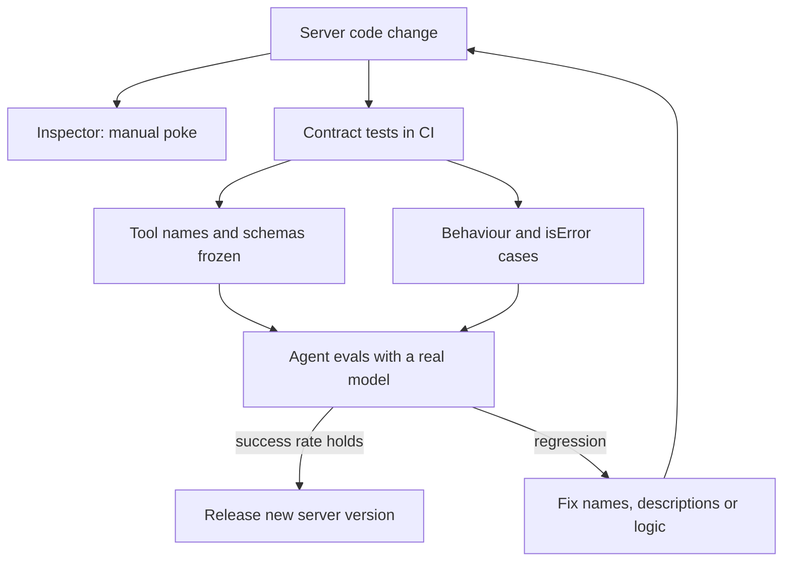

## TL;DR
Test an MCP server at three levels: poke it interactively with the MCP Inspector, pin its tool surface
and behaviour with contract tests through a real client, and run agent evals that check the model picks
and uses its tools correctly.

## For agent builders
- **Why it matters for agents.** A tool's name, description and schema are prompt text. Renaming a
  parameter or rewording a description can silently drop your agent's success rate, so the tool surface
  needs tests like any public API.
- **Where it shows up in your stack.** `npx @modelcontextprotocol/inspector` on a laptop, `pytest` contract
  tests in CI that talk to the server through the official SDK client, and an eval suite that runs your
  agent against the server.
- **What you control.** Which tools and schemas are frozen by tests, how errors are shaped, what the server
  logs (on stderr, never stdout for stdio), and which eval tasks gate a release.
- **What you can skip.** Testing the SDK's JSON-RPC plumbing; test your tools' contract and behaviour.

## Lab
### Task
A tickets server that agents depend on shipped three regressions: a debug `print()` on stdout, a raw
`KeyError` for unknown ids, and a renamed search parameter with its description deleted. Run the
contract suite through the real SDK client, read each failure, and fix the server until it is green.
Time box: 45-75 min.
- **Prerequisites:** Building an MCP server end to end; Using MCP servers inside agents; the contract-test
  example in this lesson.
- **Setup:** Python 3.10+ and `pip install mcp pytest` (`anyio` comes with `mcp`). Checked with Python 3.13,
  pytest 9.1 and both `mcp` 1.30.0 and 2.3.0 (the import fallback picks the right class). Save the starter as
  `tickets_server.py` and the tests as `test_contract.py` in one folder, and run pytest from it.
- **No model calls:** every check talks to the server as a stdio subprocess, exactly as a host launches it.

### Starter code
```python
"""Lab: a tickets MCP server with three contract bugs. Run: python tickets_server.py (stdio)"""
import sys
try:
    from mcp.server.mcpserver import MCPServer                     # mcp SDK 2.x
    from mcp.server.mcpserver.exceptions import ToolError
except ImportError:
    from mcp.server.fastmcp import FastMCP as MCPServer            # mcp SDK 1.x
    from mcp.server.fastmcp.exceptions import ToolError

mcp = MCPServer("tickets")
TICKETS = {"T-1": {"id": "T-1", "status": "open", "title": "Refund not received"},
           "T-2": {"id": "T-2", "status": "closed", "title": "Login loop on mobile"}}

# YOUR CODE HERE (1): on stdio, stdout IS the JSON-RPC stream. Keep the message, fix where it goes.
print(f"tickets server loaded {len(TICKETS)} tickets", flush=True)

@mcp.tool()
def get_ticket(ticket_id: str) -> dict:
    """Fetch one support ticket by id, for example 'T-1'."""
    # YOUR CODE HERE (2): an unknown id must come back as an isError result whose text says
    # "no ticket <id>; ticket ids look like T-1", not as a KeyError.
    return TICKETS[ticket_id]

@mcp.tool()
def search_tickets(q: str, status: str = "open") -> list[dict]:
    # YOUR CODE HERE (3): the parameter was renamed from `query` and the docstring deleted. Agents were
    # built against required ["query"] and a description under 300 characters: restore both.
    return [t for t in TICKETS.values() if q.lower() in t["title"].lower() and t["status"] == status]

if __name__ == "__main__":
    mcp.run()        # stdio by default
```

### Expected output
`pytest -q test_contract.py` on a fixed server prints these key lines (the timing varies), and
launching the server by hand shows the log line on stderr only:

```
....                                                                     [100%]
4 passed in 1.95s
```

- **On the starter, all 4 fail, each for its own reason:** `non-protocol text on stdout: 'tickets server
  loaded 2 tickets'`; `['q'] == ['query']`; a generic error text (`Error executing tool get_ticket`, plus
  `: 'nope'` on SDK 1.x); and the search call returned as an error because `q` is missing.

### Tests
```python
import json, subprocess, sys
import anyio, pytest
from mcp import ClientSession, StdioServerParameters
from mcp.client.stdio import stdio_client

SERVER = StdioServerParameters(command=sys.executable, args=["tickets_server.py"])
CONTRACT = {"get_ticket": ["ticket_id"], "search_tickets": ["query"]}   # tool -> required params

@pytest.fixture
def anyio_backend():
    return "asyncio"

async def session_call(fn):
    with anyio.fail_after(10):                       # a corrupted stream hangs instead of failing
        async with stdio_client(SERVER) as (read, write):
            async with ClientSession(read, write) as s:
                await s.initialize()
                # wire-format dict (inputSchema, isError) on SDK 1.x and 2.x alike
                return (await fn(s)).model_dump(by_alias=True, exclude_none=True)

def test_stdout_carries_only_json_rpc():
    init = {"jsonrpc": "2.0", "id": 1, "method": "initialize", "params": {
        "protocolVersion": "2025-06-18", "capabilities": {},
        "clientInfo": {"name": "contract-test", "version": "0"}}}
    p = subprocess.run([sys.executable, "tickets_server.py"], input=json.dumps(init) + "\n",
                       capture_output=True, text=True, timeout=10)
    lines = [l for l in p.stdout.splitlines() if l.strip()]
    assert lines, p.stderr
    for line in lines:
        assert line.startswith("{") and json.loads(line)["jsonrpc"] == "2.0", \
            f"non-protocol text on stdout: {line!r}"
    assert "loaded 2 tickets" in p.stderr               # the log line still exists, on stderr

@pytest.mark.anyio
async def test_tool_surface_matches_the_contract():
    tools = await session_call(lambda s: s.list_tools())
    surface = {t["name"]: t for t in tools["tools"]}
    assert set(surface) == set(CONTRACT)
    for name, required in CONTRACT.items():
        assert surface[name]["inputSchema"].get("required") == required, name
        assert 0 < len(surface[name].get("description", "")) < 300, f"{name} needs a description"

@pytest.mark.anyio
async def test_unknown_ticket_is_an_actionable_error():
    r = await session_call(lambda s: s.call_tool("get_ticket", {"ticket_id": "nope"}))
    assert r["isError"] is True
    assert "no ticket nope; ticket ids look like T-1" in r["content"][0]["text"]

@pytest.mark.anyio
async def test_known_ticket_and_search_still_work():
    r = await session_call(lambda s: s.call_tool("get_ticket", {"ticket_id": "T-1"}))
    assert r["isError"] is False and json.loads(r["content"][0]["text"])["status"] == "open"
    r = await session_call(lambda s: s.call_tool("search_tickets", {"query": "login", "status": "closed"}))
    assert r["isError"] is False and "T-2" in r["content"][0]["text"]
```

### Failure scenarios
- **Drop `flush=True` from the stray `print()`.** Under a pipe the text sits in a buffer, so stdout can
  look clean while the bug remains; only the stderr assertion still fails. Debug with
  `python -u tickets_server.py`, which shows the stray line at once. The fix is stderr, not buffering luck.
- **Leave the `print()` on stdout and watch a session test.** With `mcp` 1.30 and 2.3 the client skips the
  bad line and carries on, so only the raw-stdout test catches it; stricter hosts hang or mark the server
  failed. That is why the suite checks stdout directly instead of trusting one client.
- **Return `{"error": ...}` instead of raising `ToolError`.** The result has `isError` false, so the model
  treats a failure as data. The actionable-error test fails on `r.isError is True`; inspect the raw
  result with the Inspector CLI.
- **Rename the parameter back but keep no docstring.** Required params pass, the description check fails
  with `search_tickets needs a description`: the model would see a tool with no explanation.

### Submission
- **The fixed `tickets_server.py`** and `test_contract.py`, with `pytest -q` showing 4 passed.
- **A failure log from the starter** (the 4 failure lines) with one sentence per failure naming the
  root cause.
- **An Inspector CLI transcript** of `--method tools/list` against the fixed server, showing `query` in
  the schema.
- **One extra contract test** of your own, for example a snapshot of `tools/list` stored as JSON.
- **Evaluated on:** green suite, nothing but JSON-RPC on stdout, and error messages a model could act on.

## Why it exists
- **The model is the main consumer.** Unlike a REST API, a breaking change here often still "works": calls
  succeed but the agent picks the wrong tool or fills arguments badly. Only contract tests plus evals catch it.
- **Unit tests on the Python function miss the protocol.** Schema generation, argument validation, result
  serialisation and error mapping all happen in the SDK layer between your function and the client.
- **stdio servers fail in confusing ways.** A stray `print()` writes to stdout, corrupts the JSON-RPC
  stream and shows up in the client as a parse error or a hang, not as your bug.
- **Clients differ.** The same server can behave differently in Claude, an OpenAI Agents SDK agent and
  LangGraph because each converts schemas and results slightly differently, so you test through real clients.

## How it works
### Level 1: the MCP Inspector, interactively
- **What it is.** The official developer tool from the MCP project. It connects to a server over stdio or
  Streamable HTTP and lets you list and call tools, read resources, get prompts and watch notifications.
- **Web UI.** `npx @modelcontextprotocol/inspector` opens a local web app (port 6274 by default in recent
  versions); pass the server command after it to connect over stdio.
- **CLI mode.** `--cli` with `--method tools/list` or `--method tools/call --tool-name ... --tool-arg k=v`
  prints JSON, so you can script smoke checks. For HTTP use `--transport http --server-url ...` and `--header`.
- **Versions.** The Inspector moved to a v2 line with changed flags and config files; the legacy line is
  `@modelcontextprotocol/inspector@v1-latest`. Check the current docs before scripting it.

### Level 2: contract tests through a real client
1. **Start the server the way production does** (stdio subprocess or an HTTP app) and connect with the
   official SDK client, so schema generation and serialisation are inside the test.
2. **Freeze the tool surface.** Assert the set of tool names, required parameters and a length budget for
   descriptions; a change must be a deliberate test update in code review.
3. **Test behaviour and errors.** Happy path, not-found, invalid arguments, upstream timeout. Expected
   failures should return a tool result with `isError: true` and a message the model can act on.
4. **Snapshot when it helps.** Store `tools/list` output as JSON and diff it in CI, so reviewers see
   exactly what text the model will read.

### Level 3: agent evals against the server
- **Tool selection.** Given a task, does the agent call the right tool with valid arguments?
- **Task success.** Does the end-to-end answer come out right, and how many calls and tokens did it take?
- **Regression gate.** Run the same eval set on every server change that touches names, descriptions or
  schemas, and compare against the last release.

### Debugging checklist
| Symptom | Likely cause | Check |
|---|---|---|
| Client hangs or reports invalid JSON on stdio | Something writes to stdout | Log to stderr; run the server under the Inspector |
| `tools/list` empty or missing a tool | Import error or decorator not run | Start the server by hand and read stderr |
| Works in Inspector, fails in the agent | Framework schema conversion or filtering | Log the converted tool list in the agent |
| HTTP 400 or 404 on later requests | Session id missing or expired, or wrong path | Inspect `Mcp-Session-Id` and the endpoint path |
| Model ignores the tool | Vague name or description | Rewrite, then rerun tool-selection evals |

## Diagram
Each level catches a different class of bug; only the bottom one involves a model.



## Examples
### Smoke-test a server from the shell
These Inspector CLI calls print JSON, so they work in a Makefile or a CI step.

```bash
# list tools of a stdio server
npx @modelcontextprotocol/inspector --cli python tickets_server.py --method tools/list

# call one tool with arguments
npx @modelcontextprotocol/inspector --cli python tickets_server.py \
  --method tools/call --tool-name get_ticket --tool-arg ticket_id=T-1

# a remote Streamable HTTP server with a bearer token
npx @modelcontextprotocol/inspector --cli --transport http --server-url http://localhost:8000/mcp \
  --header "Authorization: Bearer $TOKEN" --method tools/list
```

### Contract tests with pytest and the official client
Runs the server as a real stdio subprocess and talks to it through `ClientSession`. Works with the Python
`mcp` SDK 1.x and 2.x (`pip install mcp pytest anyio`), against the `tickets_server.py` from
`mcp/using-mcp-servers-inside-agents`.

```python
import json, sys, pytest
from mcp import ClientSession, StdioServerParameters
from mcp.client.stdio import stdio_client

SERVER = StdioServerParameters(command=sys.executable, args=["tickets_server.py"])

@pytest.fixture
def anyio_backend():
    return "asyncio"

async def call(name, args=None):
    async with stdio_client(SERVER) as (read, write):
        async with ClientSession(read, write) as session:
            await session.initialize()
            if name == "tools/list":
                return [t.model_dump(by_alias=True, exclude_none=True) for t in (await session.list_tools()).tools]
            return (await session.call_tool(name, args or {})).model_dump(by_alias=True, exclude_none=True)

@pytest.mark.anyio
async def test_tool_surface_is_stable():
    tools = {t["name"]: t for t in await call("tools/list")}
    assert set(tools) == {"get_ticket"}                       # no tool added or removed by accident
    schema = tools["get_ticket"]["inputSchema"]
    assert schema["required"] == ["ticket_id"]
    assert len(tools["get_ticket"]["description"]) < 300      # description budget

@pytest.mark.anyio
async def test_known_ticket_returns_status():
    result = await call("get_ticket", {"ticket_id": "T-1"})
    assert result["isError"] is False
    assert json.loads(result["content"][0]["text"])["status"] == "open"

@pytest.mark.anyio
async def test_unknown_ticket_is_a_readable_error_not_a_crash():
    result = await call("get_ticket", {"ticket_id": "nope"})
    assert result["isError"] is True                           # a tool result, not a protocol error
    assert "no ticket nope" in result["content"][0]["text"]
```

- **Faster unit level.** SDK 2.x also accepts a server object directly, `async with Client(server) as c:`
  (`from mcp import Client`), for an in-memory session without a subprocess.
- **Errors on SDK 2.x.** Raise `ToolError` (from `mcp.server.mcpserver.exceptions`) for expected failures,
  as `tickets_server.py` does; other exceptions reach the model only as "Error executing tool <name>",
  with your message hidden. On 1.x the exception text is passed through, so do not put secrets in it.

### Worked scenario: a rename that passed unit tests
A team renamed `query` to `q` in a search tool's schema and shortened its description.

| Check | Result |
|---|---|
| Unit tests on the Python function | Pass: the function still works |
| Contract test on `inputSchema.required` | Fails: `["query"]` became `["q"]`, so the change is reviewed |
| Tool-selection eval (50 tasks) | Illustrative: correct-tool rate fell from 92% to 71% with the short description |
| Decision | Keep the rename, restore a precise description, rerun evals before release |

## Production patterns
- **Snapshot the tool surface in CI.** Dump `tools/list` (names, descriptions, schemas) to a JSON file
  and fail CI on any diff that is not committed with the change. Monitor snapshot changes per release.
- **Inspector CLI smoke check on deploy.** After each deploy, call `tools/list` and one read-only tool on
  the live endpoint with a test token; fail the rollout if either errors. Monitor smoke duration and failures.
- **stderr-only logging for stdio servers.** Configure logging to stderr with request ids and tool names,
  and add a test that starts the server and asserts stdout carries only JSON-RPC. Monitor parse errors
  reported by clients.
- **Eval gate on descriptive changes.** Any change to names, descriptions or schemas runs the agent's
  tool-selection and task-success evals against the new server build before release. Track correct-tool
  rate and calls per task.
- **Trace every tool call.** Emit one span per `tools/call` with tool name, latency, `isError` and payload
  size (the Python SDK 2.x emits an OpenTelemetry span per request by default; configure an exporter to
  collect them). Alert on error rate and p95 latency per tool.
- **Record and replay sessions.** Capture JSON-RPC traffic from real agent runs (with secrets redacted) and
  replay it against new builds to catch behaviour changes. Monitor replay mismatches.

## Trade-offs
- **Subprocess contract tests vs in-memory tests.** Subprocess tests cover the real launch path and stdout
  hygiene but cost a process start per test (about half a second each for the suite above); in-memory
  sessions are fast but skip transport bugs.
- **Strict snapshots vs agility.** Freezing descriptions catches accidental prompt changes but makes every
  wording tweak a review; that cost is the point while agents depend on the wording.
- **Evals with a real model vs cost.** They are the only check on tool choice, but cost tokens and are
  noisy; run a small set per change and the full set nightly.
- **Inspector vs scripted clients.** The Inspector is fastest for exploration but manual; anything you check
  twice should become a test.

## Pitfalls
- **Printing to stdout in a stdio server.** Symptom: the client hangs or fails to parse a message. Fix:
  log to stderr and test that stdout carries only protocol messages.
- **Testing only the function, not the protocol.** Symptom: unit tests pass but the client sees a
  different schema or a serialisation error. Fix: test through `ClientSession` or `Client`.
- **Raising exceptions for expected failures.** Symptom: the model sees a generic error and retries
  blindly. Fix: return an `isError` result (or `ToolError` on SDK 2.x) with an actionable message.
- **Disabling Inspector auth.** Its proxy can launch local processes, so turning off its token on a shared
  machine exposes command execution. Fix: keep auth on and the Inspector updated.
- **Trusting one client.** It works in the Inspector, then breaks in a framework that converts schemas
  differently. Fix: run at least one test through each framework you ship with.

## When to use
- **Use the Inspector when:** building a new tool, reproducing a bug report, or checking a remote server's
  auth and session behaviour by hand.
- **Use contract tests when:** the server is used by any agent you do not control or deploy in lockstep;
  the tool surface is now a public API.
- **Use agent evals when:** names, descriptions, schemas or result formats change, because only a model
  shows whether the change helps or hurts.
- **Measure:** contract test pass rate, correct-tool rate, calls per task, tool error rate and p95 latency.

## Role lens
- **Engineer:** Writes contract tests through the real SDK client, keeps stdout clean in stdio servers,
  and uses the Inspector CLI to reproduce bugs before touching code.
- **Architect:** Treats MCP tool surfaces as versioned APIs with snapshots, eval gates and deprecation
  rules, so many agents can depend on one server safely.
- **FDE:** Uses the Inspector at a customer site to prove a server works with their credentials and network,
  then hands over a smoke-test script their team can run.

## Check yourself
**Q:** Your stdio MCP server works when you call its functions directly, but Claude Desktop shows the
server as failed and the Inspector reports a parse error at startup. What do you suspect and how do you
confirm and prevent it?
**A:** Something writes non-protocol text to stdout, most often a `print()` or a library logging to stdout
at import time. With stdio the client reads stdout as JSON-RPC, so any other byte corrupts the stream.
Confirm by launching the server by hand and looking at stdout, or by watching the Inspector's raw output.
Fix it by sending logs to stderr and silencing chatty libraries. Prevent regressions with a contract test
that starts the server through the SDK client and fails if initialisation or `tools/list` breaks.

## Interview questions
### Why are contract tests on an MCP server's tool surface important when the code already has unit tests?
- **The surface is prompt text.** Names, descriptions and schemas steer the model, so a change can keep
  every unit test green while the agent's accuracy falls.
- **The SDK sits in between.** Schema generation, validation and serialisation happen in the protocol layer,
  which only a test through a real client exercises.

### How would you debug an MCP tool that works in the Inspector but not inside a LangGraph agent?
- **Compare what each client sees:** log the converted tool list and the exact arguments the agent sends.
- **Common culprits:** schema conversion differences, a tool filter excluding it, a name collision with
  another server, or a description the model does not connect to the task. Fix and rerun tool-selection evals.

### What should a tool return when the user asks for something that does not exist?
- **A tool result with `isError: true`** and a message such as "no ticket nope; ticket ids look like T-1",
  so the model can recover or ask the user.
- **Not a protocol error or crash,** which most clients surface as a generic failure and which gives the
  model nothing to act on.

### How do you stop a description change from silently breaking agents in production?
- **Snapshot `tools/list` in CI** so the change shows up as a reviewed diff.
- **Gate the release on evals:** run tool-selection and task-success evals against the new build, compare
  with the last release, and roll back if the correct-tool rate drops beyond an agreed threshold.

### What would you put in a post-deploy smoke test for a remote MCP server?
- **Connect with a test token,** run `initialize` and `tools/list`, then call one cheap read-only tool and
  check the shape of the result.
- **Also check failure paths:** a request without a token should get `401` with the expected
  `WWW-Authenticate` header, so auth regressions fail the rollout.

## Quiz
### Q: Why does a stray `print()` break a stdio MCP server?
- [ ] stdio servers cannot import the `print` builtin
- [x] The client reads stdout as the JSON-RPC stream, so extra text corrupts protocol messages
- [ ] Printing disables capability negotiation
- [ ] The Inspector blocks servers that print
> Over stdio, stdout is the transport. Anything that is not a protocol message breaks parsing, which is why
> stdio servers must log to stderr.

### Q: What does a contract test through the official SDK client catch that a unit test of the tool function misses?
- [ ] Bugs in the model's reasoning
- [x] Changes in generated schemas, argument validation and result serialisation in the protocol layer
- [ ] Network latency between regions
- [ ] Token costs per request
> The SDK turns your function into a tool schema and your return value into MCP content. Testing through a
> real client exercises that layer, which is what agents actually see.

### Q: Which check tells you whether a reworded tool description helps or hurts your agent?
- [ ] A JSON Schema validator
- [ ] The Inspector's tools/list output
- [x] A tool-selection and task-success eval run with a real model against the new server build
- [ ] A load test
> Descriptions influence the model's choices, so only running the agent on a fixed task set and comparing
> correct-tool rate and success against the previous build measures the effect.

## Use cases & projects
### Use cases
- **Platform teams publishing internal MCP servers.** Snapshots and contract tests let many product agents
  depend on one server without surprise breakages.
- **Vendor server releases.** A SaaS company runs Inspector smoke checks and eval gates before shipping a
  new version of its public MCP server.
- **Incident triage.** An on-call engineer reproduces a failing agent call with the Inspector CLI against
  production using a test token.
- **Tool description tuning.** Teams iterate on names and descriptions with an eval set measuring the
  correct-tool rate per change.

### Mini project
**Put a real MCP server under test (2 hours).**
- **Goal:** turn an MCP server you wrote or use into one with a CI-ready test suite.
- **Steps:** add Inspector CLI smoke commands to a Makefile; write pytest contract tests for the tool set,
  required parameters and two error cases; snapshot `tools/list` to JSON and fail on diff; write 20
  tool-selection eval tasks and run them with one agent framework.
- **Done when:** CI fails on an uncommitted schema change, a deliberately vague description shows a lower
  correct-tool rate in the eval report, and every expected failure returns an `isError` result.
