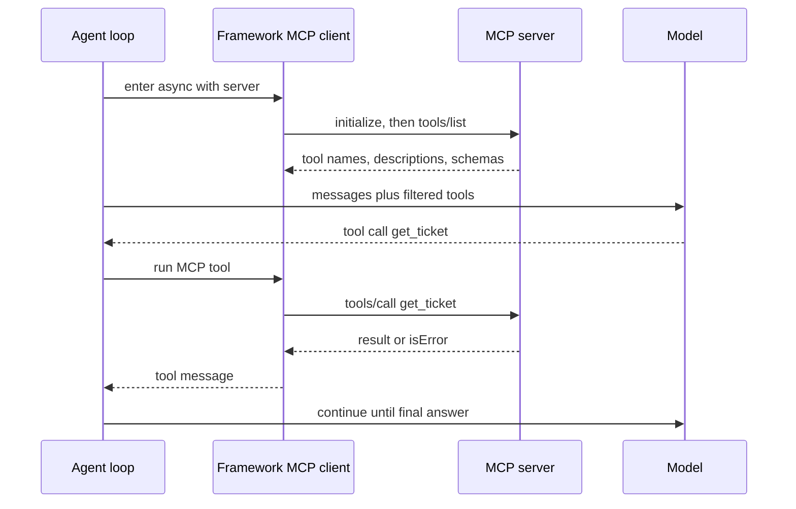

## TL;DR
Agent frameworks act as the MCP client for you: point them at a server and its tools appear next to your
own. The work is choosing the transport, filtering and caching the tool list, handling server failures
and controlling which calls need approval.

## For agent builders
- **Why it matters for agents.** One MCP integration gives your agent a vendor's whole tool surface (GitHub,
  a database, a browser) without writing adapters, and the same server works across Claude, OpenAI and
  LangGraph agents.
- **Where it shows up in your stack.** `mcp_servers=[...]` on an OpenAI Agents SDK `Agent`,
  `mcp_servers={...}` in `ClaudeAgentOptions`, and `MultiServerMCPClient` from `langchain-mcp-adapters`
  for LangGraph and LangChain agents.
- **What you control.** Transport (stdio for local, Streamable HTTP for remote), which tools are exposed,
  whether the tool list is cached, timeouts and retries, approval for risky tools, and tracing.
- **What you can skip.** Writing JSON-RPC by hand. The protocol details live in
  `agents/model-context-protocol`; here you only need the client knobs each framework exposes.

## Why it exists
- **Tools are the expensive part of an agent.** Each integration needs auth, schemas, pagination and error
  mapping; MCP lets a vendor write that once and every framework reuse it.
- **Frameworks differ, servers do not.** The same GitHub MCP server can back a Claude agent today and an
  OpenAI Agents SDK agent tomorrow, so tool work survives a framework switch.
- **Hand-wired clients get the lifecycle wrong.** Spawning a subprocess, running `initialize`, listing
  tools, mapping results and shutting down cleanly is easy to leak; framework integrations do it with an
  `async with` block.
- **Naive "load every tool" fails at scale.** Three vendor servers can add 50+ tools and thousands of
  tokens to every model call, so filtering and caching are part of using MCP, not an optimisation.

## How it works
### The shared lifecycle
1. **Connect.** The framework launches a stdio server (`command` plus `args`) or opens a Streamable HTTP
   connection to a URL, then runs the `initialize` handshake.
2. **List tools.** It calls `tools/list`, converts each tool's name, description and JSON Schema into the
   model's native tool format, and merges them with your function tools.
3. **Call.** When the model emits a tool call for an MCP tool, the framework sends `tools/call` and turns
   the result (text, structured content or an `isError` result) into a tool message.
4. **Close.** Leaving the context manager ends the session and stops the subprocess.

### The three integrations
| | OpenAI Agents SDK | Claude Agent SDK | LangGraph / LangChain |
|---|---|---|---|
| Client object | `MCPServerStdio`, `MCPServerStreamableHttp` | `mcp_servers` dict in `ClaudeAgentOptions` | `MultiServerMCPClient` |
| How tools reach the agent | `Agent(mcp_servers=[server])` | Named `mcp__<server>__<tool>` | `await client.get_tools()` returns LangChain tools |
| Filtering | `tool_filter=create_static_tool_filter(...)` | `allowed_tools` / `disallowed_tools` | Select from the returned list |
| Approval | `require_approval` on the server object | `permission_mode`, `can_use_tool`, hooks | Interrupts or middleware in the graph |
| In-process tools | Plain function tools | `create_sdk_mcp_server` with `@tool` | Plain LangChain tools |

### Hosted versus local MCP
- **Local (client-side).** Your process holds the MCP session, so it can reach stdio servers and private
  network URLs, and every call shows up in your own traces.
- **Hosted (provider-side).** OpenAI's `HostedMCPTool` and Anthropic's Messages API MCP connector let the
  model provider call a public remote server for you. You skip a round-trip, but the server must be
  reachable from the internet and the beta parameters have changed several times, so check the current docs.

### Knobs that matter in production
- **Tool list caching.** `cache_tools_list=True` (OpenAI Agents SDK) avoids a `tools/list` round-trip on
  every run; invalidate it when the server version changes.
- **Timeouts and retries.** `client_session_timeout_seconds` and `max_retry_attempts` on OpenAI's MCP
  server classes; the LangChain connection dicts take `timeout`.
- **Name collisions.** Two servers can both expose `search`; LangChain's `tool_name_prefix=True` and
  Claude's `mcp__server__tool` naming keep them apart.

## Diagram
Read it top to bottom: the framework is the MCP client, and the model only ever sees converted tool
schemas and tool messages.



## Examples
### An OpenAI Agents SDK agent over a local stdio server
`tickets_server.py` is a tiny server; the agent launches it, filters its tools and answers a question.
Needs `pip install openai-agents` and `OPENAI_API_KEY`.

```python
# tickets_server.py
try:
    from mcp.server.mcpserver import MCPServer           # mcp SDK 2.x
except ImportError:
    from mcp.server.fastmcp import FastMCP as MCPServer  # mcp SDK 1.x

mcp = MCPServer("tickets")
TICKETS = {"T-1": {"id": "T-1", "status": "open", "title": "Refund not received"}}

@mcp.tool()
def get_ticket(ticket_id: str) -> dict:
    """Fetch one support ticket by id, for example 'T-1'."""
    return TICKETS.get(ticket_id, {"error": f"no ticket {ticket_id}"})

if __name__ == "__main__":
    mcp.run()        # stdio by default
```

```python
# agent.py
import asyncio, sys
from agents import Agent, Runner
from agents.mcp import MCPServerStdio, create_static_tool_filter

async def main():
    async with MCPServerStdio(
        name="tickets",
        params={"command": sys.executable, "args": ["tickets_server.py"]},
        cache_tools_list=True,                                    # one tools/list per process
        tool_filter=create_static_tool_filter(allowed_tool_names=["get_ticket"]),
        client_session_timeout_seconds=10,
    ) as tickets:
        agent = Agent(
            name="support",
            instructions="Answer with the tickets tools. Quote the ticket id and status.",
            mcp_servers=[tickets],
        )
        result = await Runner.run(agent, "What is the status of ticket T-1?")
        print(result.final_output)

asyncio.run(main())
```

### The same server in a LangGraph agent, plus a remote one
`langchain-mcp-adapters` turns MCP tools into LangChain tools, which any LangGraph or LangChain agent can
use. The remote URL is a placeholder for a Streamable HTTP server you run.

```python
import asyncio, os, sys
from langchain_mcp_adapters.client import MultiServerMCPClient
from langchain.agents import create_agent        # LangChain 1.x; older code used langgraph.prebuilt.create_react_agent

async def main():
    client = MultiServerMCPClient(
        {
            "tickets": {"transport": "stdio", "command": sys.executable, "args": ["tickets_server.py"]},
            "kb": {"transport": "streamable_http", "url": "http://localhost:8000/mcp",
                   "headers": {"Authorization": f"Bearer {os.environ['KB_TOKEN']}"}},
        },
        tool_name_prefix=True,                   # tickets_get_ticket, kb_search: no collisions
    )
    tools = await client.get_tools()
    agent = create_agent(os.environ["MODEL"], tools)   # e.g. a provider:model string your account supports
    out = await agent.ainvoke({"messages": [{"role": "user", "content": "Summarise ticket T-1"}]})
    print(out["messages"][-1].content)

asyncio.run(main())
```

### The Claude Agent SDK: config, not code
The Claude Agent SDK takes servers as a dict and names tools `mcp__<server>__<tool>`, so the allowlist
doubles as the permission list.

```python
import asyncio, sys
from claude_agent_sdk import query, ClaudeAgentOptions

options = ClaudeAgentOptions(
    mcp_servers={"tickets": {"type": "stdio", "command": sys.executable, "args": ["tickets_server.py"]}},
    allowed_tools=["mcp__tickets__get_ticket"],    # anything else needs permission
    max_turns=5,
)

async def main():
    async for message in query(prompt="What is the status of ticket T-1?", options=options):
        print(message)

asyncio.run(main())
```

### Worked numbers: what three vendor servers cost per step
Illustrative sizes; measure your own with `tools/list`.

| Setup | Tools exposed | Tool-definition tokens per call (rough) | 20-step run |
|---|---|---|---|
| All tools from three servers | 60 | ~15k | ~300k input tokens on tool definitions alone |
| Static allowlist of the 8 tools this agent uses | 8 | ~2k | ~40k |
| Allowlist plus provider prompt caching | 8 | ~2k, mostly cached | a fraction of the above |

Accuracy usually improves too, because the model chooses among 8 relevant tools instead of 60.

## Production patterns
- **Allowlist per agent.** Expose only the tools an agent needs with `tool_filter` (OpenAI Agents SDK),
  `allowed_tools` (Claude Agent SDK) or by selecting from `get_tools()` (LangChain). Monitor tools exposed
  per agent and tool-selection accuracy on your eval set.
- **Long-lived sessions for remote servers.** Open the MCP connection once per worker (application
  startup), not per request, and reconnect on failure; per-request connects add a handshake and a
  `tools/list` to every turn. Monitor connection errors and reconnect counts.
- **Approval on write tools.** Use `require_approval` on OpenAI MCP servers, `can_use_tool` or hooks in the
  Claude Agent SDK, and interrupts in LangGraph for tools that write, send or delete. Monitor approval
  latency and rejection rate.
- **Trace MCP calls as tool spans.** The OpenAI Agents SDK traces MCP tool listing and tool calls by default;
  for LangGraph use LangSmith or OpenTelemetry callbacks. Record server name, tool name, latency and
  `isError`. Alert on per-server error rates.
- **Fail soft when a server is down.** Wrap connection in startup checks and give the agent a clear
  "tool unavailable" message rather than crashing the run. Monitor runs completed with degraded tools.
- **Pin server versions.** Launch local servers with a pinned package version or container digest, and
  record each remote server's version from `initialize`, so tool behaviour does not change under your evals.

## Trade-offs
- **MCP tools vs native function tools.** MCP gives reuse and vendor-maintained integrations; native
  functions are faster (no IPC or HTTP hop), simpler to test and fully typed. Prefer native for logic you
  own and only one agent uses.
- **Local client vs hosted MCP tool.** Hosted calls cut latency and code but need a public server and send
  your traffic through the provider; local calls keep control and private network access.
- **Caching the tool list vs freshness.** Caching saves a round-trip per run but misses servers that change
  tools dynamically; invalidate on deploys or `notifications/tools/list_changed`.
- **One framework vs portability.** Framework-specific features (approval hooks, hosted tools) are
  convenient but not portable; the MCP server itself stays portable.

## Pitfalls
- **Connecting inside the request handler.** Symptom: every chat turn pays a subprocess spawn or an HTTP
  handshake, and p95 latency jumps. Fix: connect at startup and reuse the session.
- **Loading every tool from every server.** Symptom: wrong tool choices and rising token bills. Fix:
  allowlist per agent and measure accuracy before and after.
- **Silent tool-name collisions.** Two servers expose `search` and one shadows the other. Fix: prefix tool
  names with the server name.
- **Treating `isError` results as crashes.** A tool error is information for the model to recover from;
  surfacing it as an exception ends the run. Fix: pass it back as a tool message and cap retries.
- **Mixing SDK generations.** The Python `mcp` package 2.x renamed FastMCP to `MCPServer` and changed result
  field names, while some adapters still pin 1.x. Fix: check which `mcp` version each dependency pins.

## When to use
- **Use when:** a maintained MCP server already exists for the system you need (GitHub, a browser, your
  company's internal tools), or several agents and hosts should share one tool surface.
- **Avoid when:** the tool is a few lines of code used by one agent; a native function tool is simpler.
- **Measure:** tools exposed per agent, tool-definition tokens per call, MCP call latency and error rate
  per server, and task success on your eval set before and after adding a server.
- **Interviews:** be ready to explain the client lifecycle, how you filter tools, and how a server
  outage affects a running agent.

## Role lens
- **Engineer:** Wires MCP servers into the agent framework with filters, timeouts, approval hooks and
  tracing, and keeps connections alive across requests instead of per call.
- **Architect:** Decides which systems are reached through MCP versus native tools, local versus hosted
  connections, and how server versions and credentials are managed across agents.
- **FDE:** Connects a customer's existing MCP servers to their chosen framework, trims the tool list to the
  use case, and shows latency and accuracy numbers before and after.

## Check yourself
**Q:** You add a vendor's MCP server with 35 tools to a working LangGraph agent and task success drops
while costs rise. What do you change, and how do you prove it helped?
**A:** The agent now sees 35 more tool definitions on every model call, which costs tokens and confuses
tool selection. Keep only the tools the task needs by selecting from `get_tools()` (or a server-side
filter), prefix names to avoid collisions, and open the client once at startup. Then rerun the same eval
set and compare task success, wrong-tool calls, tool-definition tokens per call and latency against both
the original agent and the unfiltered version. If accuracy is still low, rewrite the descriptions in a
thin wrapper or route to a sub-agent that owns that server.

## Interview questions
### What does an agent framework do for you when you attach an MCP server?
- **Lifecycle:** it launches or connects to the server, runs `initialize`, lists tools and closes the
  session when the context manager exits.
- **Translation:** it converts MCP tool schemas into the model's tool format, routes tool calls to
  `tools/call`, and turns results, including `isError`, into tool messages the model can read.

### Your agent's first message is slow on every request since you added an MCP server. Why?
- **Likely cause:** the server is connected per request, so each turn pays a process spawn or HTTP
  handshake plus `tools/list`.
- **Fix:** connect once at startup, enable `cache_tools_list` where available, and reconnect only on
  failure; confirm with per-span latency in traces.

### When would you use OpenAI's hosted MCP tool instead of a local MCP client?
- **Hosted fits** public remote servers where you want fewer round-trips and less client code, and you
  are comfortable with the provider calling the server.
- **Local fits** stdio servers, private network servers, custom approval logic and full tracing in your
  own infrastructure.

### How do you control what an MCP-backed agent is allowed to do?
- **Expose less:** allowlist tools per agent and use narrow credentials per server.
- **Gate more:** require approval for writes and sends (`require_approval`, `can_use_tool`, LangGraph
  interrupts), and log every call with arguments for audit.

### A remote MCP server goes down mid-run. What should happen?
- **The run should degrade, not crash:** the framework surfaces a tool error, the model explains the gap
  or uses another path, and your step budget stops retry loops.
- **Operationally:** health-check servers at startup, alert on per-server error rate, and reconnect with
  backoff instead of failing every request.

## Quiz
### Q: In the OpenAI Agents SDK, how do MCP tools reach an agent?
- [ ] You must convert each MCP tool into a `function_tool` by hand
- [x] You pass connected MCP server objects in `Agent(mcp_servers=[...])` and the SDK lists and calls their tools
- [ ] MCP tools only work through the hosted MCP tool
- [ ] You paste the server's JSON Schema into the instructions
> The SDK's `MCPServerStdio` and `MCPServerStreamableHttp` classes are MCP clients; attaching them to an
> agent makes the SDK list their tools for the model and route tool calls back to the server.

### Q: Why prefix MCP tool names with the server name when using several servers?
- [ ] The MCP spec requires prefixes
- [ ] Prefixes make tool calls faster
- [x] Two servers can expose tools with the same name, and prefixes keep them distinct for the model and the router
- [ ] Prefixes enable prompt caching
> Names like `search` or `get_item` are common. Without a server prefix one tool can shadow another, so
> calls go to the wrong server or the model picks the wrong tool.

### Q: What is the main cost of exposing every tool from three vendor MCP servers to one agent?
- [ ] Servers rate-limit `tools/list`
- [x] Every model call carries all tool definitions, which costs tokens and lowers tool-selection accuracy
- [ ] The agent can only call one server at a time
- [ ] Tool results are truncated
> Tool definitions are sent with each model call. Dozens of unused tools add thousands of input tokens per
> step and give the model more ways to choose wrongly, so allowlist per agent.

## Use cases & projects
### Use cases
- **Coding agents with GitHub and a browser.** A GitHub MCP server and a Playwright MCP server give an
  agent repository and web access without custom integrations.
- **Support agents over internal systems.** A platform team publishes ticketing and CRM as MCP servers once;
  each product team's agent consumes them in its own framework.
- **Framework migration.** Moving an agent from LangGraph to the OpenAI Agents SDK keeps the same MCP
  servers, so only the orchestration code changes.
- **Desktop and IDE assistants.** Claude apps and coding agents load local stdio servers for files, git and
  databases on the developer's machine.

### Mini project
**One server, three frameworks (2-3 hours).**
- **Goal:** connect the same MCP server to agents built with the OpenAI Agents SDK, the Claude Agent SDK and
  LangGraph, and compare behaviour.
- **Steps:** write the `tickets_server.py` above with two more tools (one read, one write); build the three
  agents from the examples; allowlist the read tools and require approval for the write tool; run the same
  10 questions through each and log latency, tool calls and answers.
- **Done when:** a table compares the three frameworks on success, latency and lines of glue code, and the
  write tool never runs without an approval in any of them.
