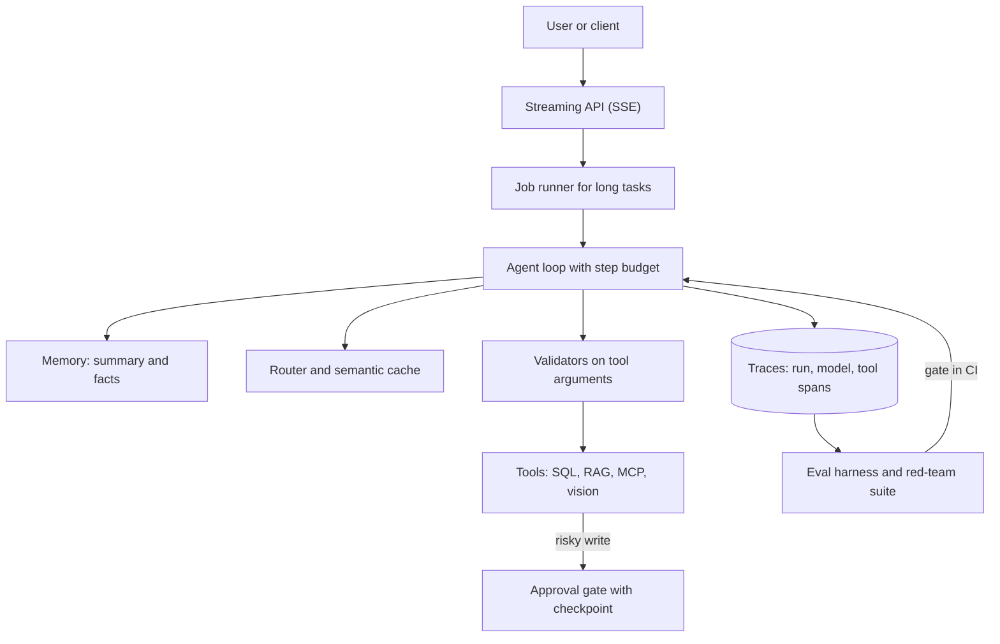

## Overview
This module is a set of fifteen mini projects, each a day or two of focused work, that turn agent
theory into something you can run, measure and show. Every lesson names the skills it exercises, the
earlier lessons it uses, where it shows up in real agents and what you can skip at first.

The thread that ties them together: each project builds one reusable part of an agent system. The tool
loop, typed outputs, retrieval, memory, streaming, approval gates, durable jobs, traces, evals, security
tests and cost controls are the same parts a production agent is assembled from.

What this module gives an agent builder:
- **Hands-on proof of the protocol.** A hand-written loop over three real tools (files, git, HTTP) with no framework, so you can debug tool calls at the message level.
- **The parts that make outputs trustworthy.** Pydantic validation with bounded retries, arithmetic checks on receipts, citations checked against chunks and a read-only SQL sandbox.
- **The parts that make agents operable.** SSE streaming, a 202-and-poll job runner with leases and checkpoints, LangGraph `interrupt` and `Command(resume=...)` approvals, and OpenTelemetry traces in Langfuse or Jaeger.
- **The parts that prove quality, safety and cost.** A 40-60 case LLM-as-judge harness gated in CI, a prompt-injection red-team suite scored by canary leaks, and a semantic cache plus model router.

Core versus background for agents:
- **Core (fourteen lessons, `agent_relevance: core`):** every project except the fine-tune is a part you will reuse in almost every agent.
- **Intro starters:** tool-calling-cli-assistant-with-three-real-tools and structured-extraction-pipeline-with-pydantic-validation-and-retries.
- **Advanced:** background-job-runner-for-long-agent-tasks and prompt-injection-red-team-suite-for-a-tool-using-agent.
- **Background (`agent_relevance: useful`, advanced):** small-fine-tune-for-tool-call-formatting, a LoRA adapter on a 0.5-1.5B model, worth it for cheap, local or on-device agents with a fixed tool set.

What you can build afterwards:
- A tool-using agent with validated arguments, a read-only data tool, cited retrieval and an approval gate before any risky write.
- A chat backend that streams tokens and tool events, remembers users across sessions and runs long tasks on workers.
- An evaluation, tracing and red-team setup that tells you whether a change made the agent better, cheaper or less safe.

## Why it matters
- **Engineer:** You write the real pieces of an agent: the model-tool-model loop, JSON Schema tools with argument validation, validate-then-retry extraction, SSE event streams with cancellation, lease-based job workers, checkpointed LangGraph state and spans for every model and tool call.
- **Architect:** You learn which part solves which agent risk: approval gates and idempotency for side effects, least-privilege tools for blast radius, durable checkpoints for long runs, memory with supersession and true deletion, and a router per step to cut cost.
- **FDE:** You arrive at a customer with small, proven builds you can adapt in days: a text-to-SQL agent over their database, RAG over their docs with an eval set, an MCP server for their API, and traces and evals their reviewers can inspect.

## Mental model
Picture one agent service and ask which mini project builds each box. The loop and its tools sit in the
middle; contracts and guards wrap the tools; streaming, jobs and memory carry the conversation; traces,
evals and red-team tests sit underneath and decide whether a change ships.

| Part of the agent system | Mini project that builds it |
|---|---|
| Tool-calling loop and step budget | tool-calling-cli-assistant-with-three-real-tools |
| Typed outputs and argument checks | structured-extraction-pipeline-with-pydantic-validation-and-retries, multimodal-receipt-or-invoice-reader |
| Data and knowledge tools | text-to-sql-agent-over-a-sample-database, rag-over-your-own-notes-with-citations-and-an-eval-set |
| Tools other hosts can call | mcp-server-for-a-personal-api |
| Conversation transport and state | streaming-chat-backend-with-fastapi-and-sse, memory-layer-for-a-chat-agent |
| Approvals and long runs | langgraph-agent-with-checkpoints-and-human-approval, background-job-runner-for-long-agent-tasks |
| Visibility, quality and safety | agent-tracing-dashboard, llm-as-judge-eval-harness-for-a-small-agent, prompt-injection-red-team-suite-for-a-tool-using-agent |
| Cost and small models | semantic-cache-and-model-router-to-cut-cost, small-fine-tune-for-tool-call-formatting |

- **Every tool call is a structured extraction.** The model fills arguments your code must trust, so the validate-then-retry loop guards tool inputs too.
- **Side effects need a pause point and state that outlives the process.** Checkpoints, thread ids and idempotent writes make resume-exactly-once possible.
- **An agent's failure lives in one step of many.** Per-request logs miss it; a trace tree of run, model and tool spans shows it.
- **Measure before and after.** Field-level accuracy, execution accuracy, citation correctness, attack success rate and cost per request turn each project into evidence.

The loop, validators, approval gate and evals are code you write in these projects; the models, trace
backend and databases are services you connect. Each mini project builds or hardens one box above.

## Suggested order
1. tool-calling-cli-assistant-with-three-real-tools — intro and agent core: the hand-written model-tool-model loop every other project builds on.
2. structured-extraction-pipeline-with-pydantic-validation-and-retries — intro: the validate-then-retry loop that also guards tool arguments.
3. text-to-sql-agent-over-a-sample-database — your first real tool set (list, describe, run) with a read-only sandbox and execution-accuracy evals.
4. rag-over-your-own-notes-with-citations-and-an-eval-set — the most common agent tool, retrieval, with citations validated against a 30-50 question set.
5. mcp-server-for-a-personal-api — packages tools as an MCP server so many hosts, including your own agents, can use them.
6. langgraph-agent-with-checkpoints-and-human-approval — adds the pause point and durable checkpoint every agent near real side effects needs.
7. streaming-chat-backend-with-fastapi-and-sse — ships the backend that streams tokens and tool events and survives disconnects.
8. memory-layer-for-a-chat-agent — adds rolling summaries, superseding facts and deletion for agents that talk to the same user across sessions.
9. agent-tracing-dashboard — instruments the agents above with OpenTelemetry spans so you can see which step failed and what it cost.
10. llm-as-judge-eval-harness-for-a-small-agent — turns traces and cases into scores and a CI gate, so changes stop being guesses.
11. multimodal-receipt-or-invoice-reader — reuses the extraction loop with a vision-language model, arithmetic validators and a review queue.
12. semantic-cache-and-model-router-to-cut-cost — needs the eval harness to prove that cheaper routing holds quality.
13. background-job-runner-for-long-agent-tasks — advanced: leases, per-step checkpoints, retries with backoff and cancellation for minute-long runs.
14. prompt-injection-red-team-suite-for-a-tool-using-agent — advanced: attacks your own tool-using agent and measures defenses by attack success rate.
15. small-fine-tune-for-tool-call-formatting — background and advanced: a LoRA adapter for an SLM, judged by the tool-call eval habits built above.

## Capstone
### Brief
**Use case:** a small finance team wants an expense assistant. Staff upload receipt photos, ask
questions about spending and policy, and request reimbursements that a manager must approve. This is
the module's major project (several days): build one agent service that combines most of the mini projects.

The assistant reads receipts with a vision model and validated schema, answers spending questions with
read-only SQL, answers policy questions from cited notes, and pauses for manager approval before any
reimbursement is recorded. Use synthetic staff, receipts and expense records.

What you will build:
- A tool-calling loop with a step budget, Pydantic-validated tool arguments and error results the model can recover from.
- Tools for receipt extraction, `run_sql` on a read-only role and policy search with citations, exposed as an MCP server.
- A LangGraph approval step with a durable checkpoint, plus SSE streaming of tokens and tool events.
- A memory layer for each staff member, traces on every run, an eval harness and an injection suite.

### Deliverables
- A running FastAPI service that streams answers over SSE, runs month-end batch reports on a job runner, and records reimbursements only after an approval resume.
- An MCP server exposing the three tools, tested in the Inspector and called by the agent.
- A receipt reader with arithmetic validators, bounded retries and a review queue for failures.
- An eval set of at least 40 cases (extraction, SQL answers, cited policy answers, approvals) scored by deterministic checks plus a calibrated judge, gated in CI.
- A red-team suite with indirect injections hidden in receipts and notes, and a trace dashboard showing latency, tokens, cost and tool errors.
- Optional stretch: a semantic cache and router with before-and-after cost and quality numbers.

### Rubric
- No reimbursement is recorded without an approval record; after a process restart the run resumes and writes exactly once, visible in the trace.
- Every SQL query runs on a read-only role and appears as a tool span, and spending answers match the database on the eval set.
- Every policy citation points to a chunk that contains the quoted text, checked in code.
- Receipt totals that fail the arithmetic checks never reach a reimbursement; they land in the review queue.
- The red-team report shows attack success rate before and after defenses, with zero canary leaks or forbidden tool calls after.
- A deleted staff member's facts no longer appear in memory, summaries or answers.
