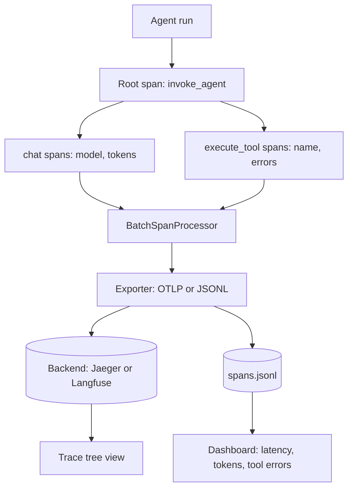

## TL;DR
Instrument a small agent with OpenTelemetry spans for every run, model call and tool call, send them to Langfuse or
Jaeger, and build a dashboard of latency, tokens, cost and tool errors. It proves you can see what an agent did and why.

## For agent builders
- **Skills it exercises.** Tracer setup, span hierarchy for agent runs, the OpenTelemetry GenAI attribute names,
  exporters (OTLP, console, custom), session grouping, and turning spans into per-run and per-tool metrics.
- **Earlier lessons it uses.** Tracing and OpenTelemetry for the model, Langfuse and LangSmith for hosted backends,
  token cost tracking for the money view, and audit logs and execution traces for retention.
- **Why it matters for agents.** An agent's failure lives in step 7 of 12: a wrong tool argument or a 9-second tool.
  Logs per request cannot show that; a trace tree can.
- **What you can skip.** Metrics pipelines and alerting rules. Spans and one dashboard come first.

## Why it exists
- **Agents are trees, not requests.** One user question becomes a run with several model calls and tool calls, often
  nested. Flat logs lose the parent-child structure you need to debug.
- **Cost hides in steps.** Two runs with the same answer can differ 5x in tokens because one looped; per-run token
  totals make that visible.
- **Vendor-neutral spans keep options open.** OpenTelemetry spans can go to Jaeger, Langfuse or another backend that
  accepts OTLP, so you are not locked to one tool's SDK.
- **A dashboard is a strong demo.** "Here is p95 latency per tool and the run that cost the most" shows production
  thinking in 30 seconds.

## How it works
### Stack and data
- **Agent:** the tool-calling CLI assistant or the RAG notes project.
- **Instrumentation:** `opentelemetry-sdk`, plus `opentelemetry-exporter-otlp-proto-http` for a real backend.
- **Backend, pick one:** Jaeger all-in-one in Docker (OTLP over HTTP on port 4318, UI on 16686), or Langfuse (cloud
  or self-hosted), which accepts OpenTelemetry traces and also has its own SDK.
- **Dashboard:** your own pandas plus Streamlit page over exported spans, or the backend's built-in views.

### Span model
| Span | Name | Key attributes |
|---|---|---|
| Run (root) | `invoke_agent` | `session.id`, user question length, final status |
| Model call | `chat` | `gen_ai.operation.name`, `gen_ai.request.model`, `gen_ai.usage.input_tokens`, `gen_ai.usage.output_tokens` |
| Tool call | `execute_tool <name>` | `gen_ai.tool.name`, argument size, result size, error status |

The GenAI semantic conventions are still marked as in development and attribute names have changed between
releases (for example the provider attribute); check the current conventions before you freeze names.

### Milestones
1. **Console spans.** Tracer provider, root run span, child spans for model and tool calls. Acceptance: one run
   prints a correct tree.
2. **Attributes.** Model, tokens, tool name, errors via `span.set_status` and `record_exception`. Acceptance: a failing
   tool shows as an error span.
3. **A real backend.** Export via OTLP to Jaeger or Langfuse. Acceptance: you can open a run and see its tree.
4. **Sessions.** Group runs of one conversation with a session id. Acceptance: filter a backend by session.
5. **Dashboard.** Per-run latency, model calls, tokens and cost; per-tool calls, p50 latency and error rate.
   Acceptance: p50 and p95 shown over 50+ runs.
6. **Privacy and sampling.** Redact or drop prompt content by config, sample when volume grows. Acceptance: a flag
   turns content capture off and a test proves it.

## Diagram
Spans flow from the agent through a batch processor to an exporter; the backend stores trees and the dashboard
aggregates them per run and per tool.



## Examples
### Starter code: agent spans with a JSONL exporter
Runs with only `opentelemetry-sdk`; swap `JsonlExporter()` for `OTLPSpanExporter()` to send to a backend.

```python
import json, time
from opentelemetry import trace
from opentelemetry.sdk.resources import Resource
from opentelemetry.sdk.trace import TracerProvider
from opentelemetry.sdk.trace.export import BatchSpanProcessor, SpanExporter, SpanExportResult

class JsonlExporter(SpanExporter):
    """Writes one JSON line per finished span; the dashboard reads this file."""
    def __init__(self, path="spans.jsonl"):
        self.f = open(path, "a")
    def export(self, spans):
        for s in spans:
            self.f.write(json.dumps({
                "trace_id": format(s.context.trace_id, "032x"), "span_id": format(s.context.span_id, "016x"),
                "parent_id": format(s.parent.span_id, "016x") if s.parent else None,
                "name": s.name, "start_ns": s.start_time, "end_ns": s.end_time,
                "status": s.status.status_code.name, "attrs": dict(s.attributes or {})}) + "\n")
        self.f.flush()
        return SpanExportResult.SUCCESS
    def shutdown(self):
        self.f.close()

provider = TracerProvider(resource=Resource.create({"service.name": "cli-assistant"}))
provider.add_span_processor(BatchSpanProcessor(JsonlExporter()))
trace.set_tracer_provider(provider)
tracer = trace.get_tracer("agent")

def call_model(messages):
    with tracer.start_as_current_span("chat") as span:
        span.set_attribute("gen_ai.operation.name", "chat")
        span.set_attribute("gen_ai.request.model", "your-model-id")
        time.sleep(0.05)                                  # stand-in for the real API call
        span.set_attribute("gen_ai.usage.input_tokens", 812)
        span.set_attribute("gen_ai.usage.output_tokens", 64)
        return {"tool": "read_file", "args": {"path": "README.md"}}

def run_tool(name, args):
    with tracer.start_as_current_span(f"execute_tool {name}") as span:
        span.set_attribute("gen_ai.tool.name", name)
        return "file contents"

with tracer.start_as_current_span("invoke_agent") as root:
    root.set_attribute("session.id", "demo-1")
    step = call_model([])
    run_tool(step["tool"], step["args"])
    call_model([])
provider.shutdown()
```

### Dashboard core: per-run and per-tool numbers
Wrap these tables in Streamlit (`st.dataframe`, `st.bar_chart`) for the visual version.

```python
import json, pandas as pd
rows = [json.loads(line) for line in open("spans.jsonl")]
df = pd.json_normalize(rows)                       # attrs become columns like "attrs.gen_ai.tool.name"
df["ms"] = (df["end_ns"] - df["start_ns"]) / 1e6
runs = df[df["parent_id"].isna()].set_index("trace_id")["ms"].rename("run_ms")
chats = df[df["attrs.gen_ai.operation.name"] == "chat"]
tokens = chats.groupby("trace_id")[["attrs.gen_ai.usage.input_tokens", "attrs.gen_ai.usage.output_tokens"]].sum()
steps = chats.groupby("trace_id").size().rename("model_calls")
tools = df[df["name"].str.startswith("execute_tool")]
tool_stats = tools.groupby("attrs.gen_ai.tool.name").agg(calls=("span_id", "count"),
                                                          p50_ms=("ms", "median"),
                                                          error_rate=("status", lambda s: (s == "ERROR").mean()))
per_run = pd.concat([runs, steps, tokens], axis=1)
print(per_run.describe(percentiles=[0.5, 0.95]).T[["mean", "50%", "95%"]])
print(tool_stats)
```

### Milestone plan with time estimates
| Milestone | Time | Done when |
|---|---|---|
| 1. Console spans | 1-2 h | one run prints a correct parent-child tree |
| 2. Attributes and errors | 2 h | failing tool shows an error span with the exception |
| 3. Real backend | 2-3 h | run tree visible in Jaeger or Langfuse |
| 4. Sessions | 1-2 h | runs filterable by session id |
| 5. Dashboard | 3-4 h | p50 and p95 latency, tokens and tool error rate over 50+ runs |
| 6. Privacy and sampling | 2 h | content capture off by flag, with a test |

## Production patterns
- **One root span per agent run.** Start it at the entry point and propagate context into tools and sub-agents, so a
  single trace id answers "what happened on this request". Put the trace id in user-facing error messages.
- **Batch export, never block the agent.** Use `BatchSpanProcessor` so exporting runs off the hot path, and call
  `provider.shutdown()` on exit so short CLI runs flush their spans.
- **Content capture off by default.** Record sizes and ids always, prompts and tool outputs only behind a flag with
  redaction, because traces often outlive the data-retention rules for the content inside them.
- **Cost from tokens, computed at query time.** Store token counts and model ids on spans and join a price table in
  the dashboard, so price changes do not require re-instrumenting.
- **Sample by outcome as volume grows.** Keep all error and slow traces and a percentage of the rest (tail-based
  sampling in an OpenTelemetry Collector), so rare failures survive sampling.

## Trade-offs
- **OpenTelemetry vs a vendor SDK.** Raw OpenTelemetry is portable and works with any OTLP backend; Langfuse's or
  LangSmith's SDKs add prompt management, evals and nicer LLM views with tighter coupling.
- **Self-hosted Jaeger vs hosted Langfuse.** Jaeger is free and local but generic, with no token or cost views;
  Langfuse shows LLM-specific views but is another service to run or pay for.
- **Full content vs metadata only.** Full prompts make debugging fast but raise privacy and storage cost; metadata
  is safe but often forces you to reproduce the run.
- **Own dashboard vs backend views.** Your page answers exactly your questions and is a portfolio piece; backend views
  are free and maintained but generic.

## Pitfalls
- **Spans not nested.** Tool spans appear as separate traces because context was not propagated into worker threads
  (thread pools do not copy it; asyncio tasks do). Use `start_as_current_span` in the same context or pass context explicitly.
- **No flush on exit.** A CLI run ends before the batch exports and the backend shows nothing. Call `shutdown()` or
  `force_flush()` at exit.
- **Logging secrets in attributes.** API keys and personal data end up in the trace store. Allowlist attribute names and redact.
- **High-cardinality span names.** Names like `read_file /home/x/y.md` explode the number of distinct operations. Keep
  names stable and put variable parts in attributes.
- **Trusting attribute names from memory.** The GenAI conventions changed between releases. Pin a version and note it in the README.

## When to use
- **Prerequisites.** A working small agent, plus the tracing and OpenTelemetry lessons.
- **Suits.** Engineers heading toward production agent work and platform teams standardising observability.
- **Avoid when.** You only run one-off scripts; a JSONL transcript is enough until runs are frequent.
- **Measure.** Run latency p50 and p95, model calls per run, tokens and cost per run, and error rate and p50 latency per tool.

## Role lens
- **Engineer:** Instruments runs, model calls and tools with correct nesting and attributes, and uses the dashboard to
  find the slow or looping step in minutes.
- **Architect:** Chooses OpenTelemetry as the contract, picks backends, and sets policies for content capture,
  retention and sampling.
- **FDE:** Shows a customer the trace of a failed run to explain exactly which system or step caused it, without
  reproducing it live.

## Check yourself
**Q:** Your dashboard shows p95 run latency jumped from 6 to 20 seconds this week, but model latency per call is flat.
How do you find the cause with your traces?
**A:** Break run latency into its children. If per-call model latency is flat, check model calls per run: a rise means
the agent loops more, often after a prompt or tool-description change. Then check per-tool p95 latency and error rate:
one slow or failing tool with retries can add seconds per run. Open the slowest traces to confirm the pattern, compare
them with last week's traces for the same question type, and fix the tool or loop before tuning anything else.

## Interview questions
### How do you structure traces for an agent?
- **A root span per run** with child spans for each model call and each tool call, nested so sub-agents and retries
  appear under their parent step.
- **Attributes** carry model id, token counts, tool name, sizes and error status, following the OpenTelemetry GenAI conventions.

### Why use OpenTelemetry instead of a vendor's tracing SDK?
- **Portability:** OTLP spans go to Jaeger, Langfuse or another compatible backend without re-instrumenting.
- **Shared context:** the same trace can include your HTTP services and databases, so agent steps sit next to the systems they call.

### How do you handle sensitive prompts and tool outputs in traces?
- **Metadata always, content behind a flag,** with redaction of personal data and secrets before export.
- **Retention and access rules** for the trace store match the strictest data inside it, and sampling reduces stored volume.

### A run cost 10x the average. How do you investigate?
- **Open the trace** and count model calls and tokens per call; a loop or one huge tool result is the usual cause.
- **Then fix the cause:** truncate the tool output, add loop detection or a step budget, and add the case to the eval set.

### What would you alert on for an agent in production?
- **Error rate per tool, run p95 latency and cost per run** compared with a baseline, because each maps to a fix.
- **Paired with traces:** every alert links to example trace ids so on-call starts from evidence.

## Quiz
### Q: A short CLI agent run produces no spans in the backend. What is the most likely cause?
- [ ] The tracer name is too short
- [x] The process exits before the batch processor flushes its spans
- [ ] OTLP does not support CLI programs
- [ ] Spans are only sent for errors
> `BatchSpanProcessor` exports in the background. If the program ends without `shutdown()` or `force_flush()`, buffered
> spans are lost.

### Q: Where should a tool's variable details, such as the file path, go?
- [ ] In the span name
- [x] In span attributes, with a stable span name
- [ ] In the trace id
- [ ] In the service name
> Stable names keep operations groupable in dashboards. Variable details belong in attributes, which can also be
> redacted or dropped by policy.

### Q: Why compute cost in the dashboard from token counts instead of storing dollars on each span?
- [ ] Spans cannot store numbers
- [ ] Token counts are more private
- [x] Prices change, so joining a price table at query time keeps history correct without re-instrumenting
- [ ] Backends reject cost attributes
> Token counts and model ids are facts about the run; prices are not. Joining at query time lets you recompute cost
> when prices or models change.

## Use cases & projects
### Use cases
- **Debugging looping agents.** Spot runs whose model-call count is far above the median and open their trees.
- **Cost reviews.** Show cost per run by model and route, and find the tool whose outputs inflate tokens.
- **Langfuse plus evals.** Attach eval scores from the LLM-as-judge harness to traces and filter failing runs.
- **Multi-service traces.** Propagate context from a FastAPI endpoint into the agent and its MCP server calls.
- **Tail-based sampling.** Run an OpenTelemetry Collector that keeps all error and slow traces and 10% of the rest.

### Mini project
**Warm-up: trace one agent run to the console (1-2 hours).**
- **Goal:** see an agent run as a tree of spans with tokens and tool names.
- **Steps:** add a tracer provider with `ConsoleSpanExporter` to the tool-calling CLI assistant; wrap the run, each
  model call and each tool call in spans; set model, token and tool attributes; make one tool fail and record the exception.
- **Done when:** the console shows one root span with correctly nested children, token counts on model spans, and an
  error status on the failing tool span.
