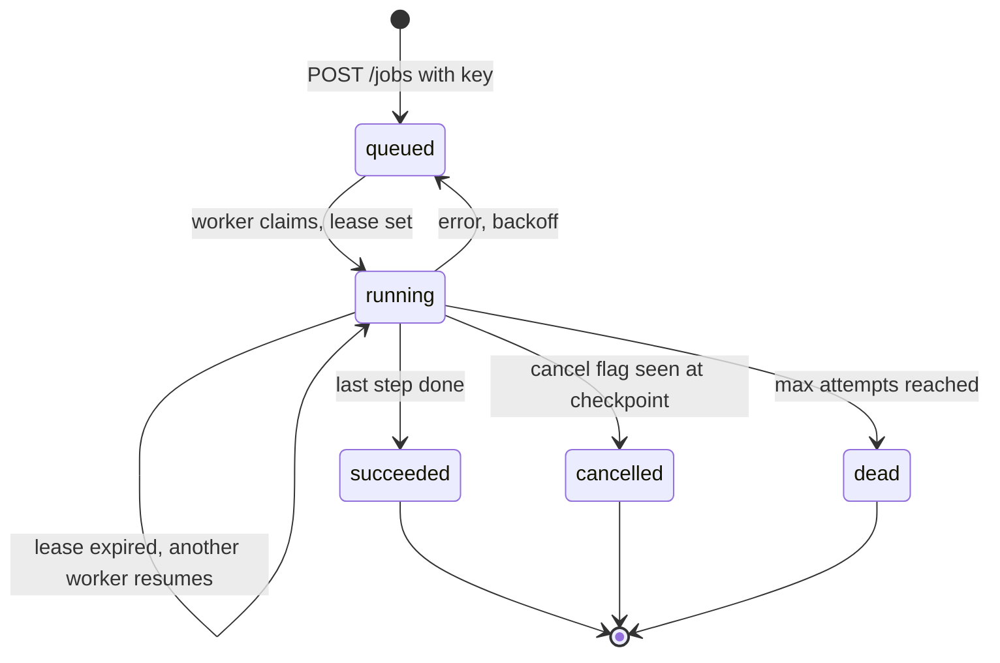

## TL;DR
Build a job runner that accepts long agent tasks over HTTP, runs them on workers with leases, checkpoints
each step, retries with backoff and supports cancellation. It proves your agents survive crashes and
minute-long runs.

## For agent builders
- **Skills it exercises.** The 202-and-poll API pattern, idempotency keys, lease-based claiming,
  per-step checkpoints, retries with backoff and a dead-letter state, cancellation and progress events.
- **Earlier lessons it uses.** Background jobs and durable workers, job queues in FastAPI, durable
  execution and checkpointing, idempotency keys, idempotent tool execution and workflow orchestration.
- **Where it shows up in agents.** Research agents, report writers, coding agents and batch document
  processing all run longer than an HTTP request should stay open.
- **What you can skip.** Building a full workflow engine. The point is to understand what Temporal,
  Celery, arq or a managed queue do for you, by building the smallest version that works.

## Lab
### Task
Harden a job runner for a research agent that writes a company brief and emails it. Fix the three gaps
that crash recovery exposes: a stale worker can overwrite the new owner's checkpoint, a resumed job sends
the email twice, and a job whose tool is down is retried forever.
- **Time box:** 60-90 minutes.
- **Prerequisites:** background jobs and durable workers, idempotency keys, and idempotent tool
  execution; this lesson's state diagram and starter code.
- **Runs offline:** an in-memory SQLite table, a fake `Clock` you advance by hand (so lease expiry and
  backoff need no sleeping), and an `Outbox` that honours idempotency keys. A worker "dies" by raising
  `SystemExit` after the email is sent but before the checkpoint.
- **Needs:** Python 3.10+ with SQLite 3.35+ (for `RETURNING`) and `pip install pytest`; checked with
  Python 3.12 and pytest 9.1.1.

### Starter code
```python
# jobs_lab.py: fenced checkpoints, idempotent side effects and dead letters for agent jobs, offline
import json, sqlite3, uuid

SCHEMA = """CREATE TABLE jobs(
  id TEXT PRIMARY KEY, status TEXT, payload TEXT, checkpoint TEXT, attempts INTEGER DEFAULT 0,
  lease_until REAL DEFAULT 0, run_after REAL DEFAULT 0, cancel INTEGER DEFAULT 0,
  result TEXT, error TEXT, created REAL)"""

class LeaseLost(Exception):
    """This worker's claim is stale: another worker owns the job now."""

class Clock:
    def __init__(self): self.t = 0.0
    def __call__(self): return self.t

class JobStore:
    def __init__(self, clock, lease_s=30, max_attempts=3):
        self.db = sqlite3.connect(":memory:", isolation_level=None)
        self.db.execute(SCHEMA)
        self.clock, self.lease_s, self.max_attempts = clock, lease_s, max_attempts

    def submit(self, jid, payload):
        self.db.execute("INSERT INTO jobs(id, status, payload, checkpoint, created) VALUES (?,?,?,?,?)",
                        (jid, "queued", json.dumps(payload), "{}", self.clock()))
        return jid

    def claim(self):
        now = self.clock()
        return self.db.execute(
            "UPDATE jobs SET status='running', attempts=attempts+1, lease_until=? WHERE id=("
            " SELECT id FROM jobs WHERE (status='queued' AND run_after<=?) OR (status='running' AND lease_until<?)"
            " ORDER BY created LIMIT 1) RETURNING id, payload, checkpoint, attempts",
            (now + self.lease_s, now, now)).fetchone()

    def _fenced(self, set_sql, args, jid, attempt):
        # YOUR CODE 1: only the current claim may write. Add "AND attempts=?" with `attempt`, and
        # raise LeaseLost(jid) when no row matched, so a stale worker cannot overwrite the new owner
        self.db.execute(f"UPDATE jobs SET {set_sql} WHERE id=?", (*args, jid))

    def checkpoint(self, jid, attempt, state):
        self._fenced("checkpoint=?, lease_until=?", (json.dumps(state), self.clock() + self.lease_s), jid, attempt)
        return bool(self.db.execute("SELECT cancel FROM jobs WHERE id=?", (jid,)).fetchone()[0])

    def finish(self, jid, attempt, status, result=None, error=None):
        self._fenced("status=?, result=?, error=?", (status, json.dumps(result), error), jid, attempt)

    def retry_or_dead(self, jid, attempt, error):
        # YOUR CODE 3: after max_attempts the job must end as "dead" with its error kept for a human
        self._fenced("status='queued', run_after=?, error=?", (self.clock() + 2 ** attempt, error), jid, attempt)

    def get(self, jid):
        cols = ("status", "checkpoint", "attempts", "result", "error")
        return dict(zip(cols, self.db.execute(f"SELECT {', '.join(cols)} FROM jobs WHERE id=?", (jid,)).fetchone()))

class Outbox:
    """A fake email API that honours idempotency keys, like most payment and messaging APIs."""
    def __init__(self): self.sent = {}
    def send(self, key, body): self.sent.setdefault(key, body)

def work_once(store, steps):
    job = store.claim()
    if job is None:
        return False
    jid, payload, ckpt, attempt = job
    state = json.loads(ckpt) or {"step": 0, "input": json.loads(payload), "notes": []}
    try:
        while state["step"] < len(steps):
            # YOUR CODE 2: derive the key from the job id and step index, so a re-run reuses it
            key = str(uuid.uuid4())
            state = steps[state["step"]](state, key)
            state["step"] += 1
            if store.checkpoint(jid, attempt, state):
                store.finish(jid, attempt, "cancelled", result=state); return True
        store.finish(jid, attempt, "succeeded", result=state)
    except LeaseLost:
        pass                                   # a newer claim owns the job: stop without writing
    except Exception as e:
        store.retry_or_dead(jid, attempt, repr(e))
    return True

OUTBOX = Outbox()
def research(s, key): s["notes"].append("research"); return s
def draft(s, key): s["notes"].append("draft"); return s
def send_brief(s, key): OUTBOX.send(key, f"brief for {s['input']['company']}"); s["notes"].append("sent"); return s
def flaky_search(s, key): raise RuntimeError("search API down")
STEPS = [research, draft, send_brief]

def killed_after(step):
    def run(s, key):
        step(s, key)
        raise SystemExit("worker killed after the side effect, before the checkpoint")
    return run

def main():
    clock = Clock()
    st = JobStore(clock)
    st.submit("job1", {"company": "ACME"})
    try:
        work_once(st, [research, draft, killed_after(send_brief)])
    except SystemExit:
        pass
    clock.t += 31                                              # the dead worker's lease expires
    work_once(st, STEPS)
    r = json.loads(st.get("job1")["result"])
    print("job1:", st.get("job1")["status"], r["notes"], "| emails sent:", len(OUTBOX.sent))

    st.submit("job2", {"company": "Globex"})
    _, _, _, stale = st.claim()                                # worker A claims, then stalls
    clock.t += 31
    work_once(st, STEPS)                                       # worker B takes over and finishes
    try:
        st.checkpoint("job2", stale, {"step": 1, "notes": ["stale"]})
        print("job2: stale write accepted")
    except LeaseLost:
        print("job2: stale write rejected")
    print("job2:", st.get("job2")["status"], "attempts", st.get("job2")["attempts"])

    st.submit("job3", {"company": "Initech"})
    for _ in range(5):
        work_once(st, [flaky_search])
        clock.t += 100
    j = st.get("job3")
    print("job3:", j["status"], "after", j["attempts"], "attempts:", j["error"])

if __name__ == "__main__":
    main()
```

As given it prints `emails sent: 2`, `job2: stale write accepted` and `job3: queued after 5 attempts`:
a duplicate email to the customer, a zombie overwrite and a retry loop with no end.

### Expected output
```
job1: succeeded ['research', 'draft', 'sent'] | emails sent: 1
job2: stale write rejected
job2: succeeded attempts 2
job3: dead after 3 attempts: RuntimeError('search API down')
```

Job 1 resumes at step index 2, the last checkpoint, so research and draft are not repeated; only the
email step runs again, and its key `job1:2` matches the first attempt. Job 3 waits 2 s after attempt 1
and 4 s after attempt 2, then is dead-lettered at attempt 3.

### Tests
```python
# test_jobs_lab.py: run with `pytest -q`
import json
import pytest
import jobs_lab as m

@pytest.fixture
def env():
    clock = m.Clock()
    return clock, m.JobStore(clock)

def test_stale_worker_cannot_overwrite(env):
    clock, st = env
    st.submit("j", {"company": "Globex"})
    _, _, _, stale = st.claim()
    clock.t += 31
    _, _, _, fresh = st.claim()
    st.checkpoint("j", fresh, {"step": 1, "notes": ["fresh"]})
    with pytest.raises(m.LeaseLost):
        st.checkpoint("j", stale, {"step": 1, "notes": ["stale"]})
    assert json.loads(st.get("j")["checkpoint"])["notes"] == ["fresh"]

def test_resumed_side_effect_is_not_repeated(env):
    clock, st = env
    outbox = m.Outbox()
    def send(s, key): outbox.send(key, "brief"); return s
    st.submit("j", {"company": "ACME"})
    with pytest.raises(SystemExit):
        m.work_once(st, [m.research, m.draft, m.killed_after(send)])
    clock.t += 31
    m.work_once(st, [m.research, m.draft, send])
    assert st.get("j")["status"] == "succeeded"
    assert len(outbox.sent) == 1                       # same key on the re-run, so one email

def test_always_failing_job_is_dead_lettered(env):
    clock, st = env
    st.submit("j", {"company": "Initech"})
    runs = 0
    while m.work_once(st, [m.flaky_search]) and runs < 10:
        runs += 1
        clock.t += 100                                 # past every backoff (2, 4 seconds)
    j = st.get("j")
    assert (j["status"], j["attempts"], runs) == ("dead", 3, 3)
    assert "search API down" in j["error"]
```

All three fail on the starter. Checkpoints cannot prevent the duplicate email on their own: the crash
lands between the side effect and the checkpoint, so only a stable idempotency key makes the re-run safe.

### Failure scenarios
- **Fence the checkpoint but not `finish`.** A zombie that wakes after its lease can still mark a job
  `succeeded` with stale results. Debug by logging the claim's attempt number on every write and
  alerting when a write's attempt is lower than the row's.
- **Use a random key per run.** Customers report duplicate emails after deploys, because deploys kill
  workers mid-step. Debug by counting outbox sends per job id and step; more than one means the key is
  not stable.
- **Set the lease shorter than the slowest step.** Healthy workers lose their jobs and every long step
  runs twice. Debug by comparing p99 step duration with `lease_s`, and renew from a heartbeat.
- **Drop the dead-letter branch.** Queue depth and token spend climb while nothing finishes. Debug with a
  retries-per-job histogram and the oldest queued job age.

### Submission
- **Repo** with `jobs_lab.py` and the unchanged tests; `pytest -q` shows 3 passed.
- **Program output** matching the expected block.
- **A timeline** for job 1 (claim, two checkpoints, crash, lease expiry, re-claim, finish) with the
  attempt number on each write.
- **A short note** naming one real side effect in your agent (payment, ticket, email), the key you would
  send with it, and how the receiving API deduplicates.
- **Evaluated on** tests passing, every write fenced, keys derived from job and step, and `dead` jobs
  keeping their error.

## Why it exists
- **Agent runs outlive requests.** A 10-step research agent can take 5 minutes; proxies, browsers and
  serverless limits cut a request long before that.
- **Workers crash mid-run.** A deploy or out-of-memory kill at step 7 must not restart from step 1 and
  repeat paid tool calls or side effects.
- **Retries cause duplicates.** A client that retries `POST /jobs` after a timeout must not start the same
  expensive job twice.
- **Users change their minds.** A cancel button that does not stop the worker keeps spending tokens on
  results nobody wants.

## How it works
### Stack and data
- **Stack:** FastAPI for the API, SQLite for the job table (Postgres with `FOR UPDATE SKIP LOCKED` as the
  stretch), one or more worker processes, an agent with 3-5 steps, pytest.
- **Data:** a scripted agent task, such as "research a company and write a one-page brief", whose steps
  call fake or real tools with a deliberate delay.
- **Job states:** `queued`, `running`, `succeeded`, `cancelled`, `dead`, with `attempts`, `lease_until`,
  `checkpoint` and `run_after` columns.

### Milestones
1. **Submit and poll.** `POST /jobs` with an `Idempotency-Key` header returns 202 and a job id;
   `GET /jobs/{id}` returns status, step and result. The same key returns the same job.
2. **Worker with leases.** A worker claims one job atomically, sets `lease_until` in the near future and
   renews it at every checkpoint, so a crashed worker's job becomes claimable again.
3. **Checkpoints.** After each agent step, save the state (step index, notes, tool results) so a resumed
   job continues from the last finished step.
4. **Retries and dead letters.** On an exception, requeue with exponential backoff; after the maximum
   attempts, mark it `dead` and keep the error for a human.
5. **Cancellation and progress.** `POST /jobs/{id}/cancel` sets a flag the worker reads at each
   checkpoint; `GET /jobs/{id}/events` streams progress over SSE.
6. **Chaos test.** Kill a worker mid-job with `kill -9`, start another, and confirm the job finishes with no
   repeated steps.

### Acceptance tests
- **Idempotent submit:** two posts with the same key return one job id and create one row.
- **Crash recovery:** a job killed after step 2 resumes at step 3 on another worker.
- **Bounded retries:** a step that always fails ends in `dead` after the configured attempts.
- **Cancellation:** a cancelled job stops within one step and its status is `cancelled`.

## Diagram
Follow a job through its states: workers claim it with a lease, checkpoint after each step, and an expired
lease sends it back to another worker instead of losing it.



## Examples
### Starter code: job store, leases, checkpoints and the worker loop
SQLite (3.35 or newer, for `RETURNING`) runs each `UPDATE ... RETURNING` atomically, which is enough for a
few workers on one machine; in Postgres the claim subquery uses `FOR UPDATE SKIP LOCKED` so many workers
never take the same job.

```python
import json, sqlite3, time, uuid

SCHEMA = """CREATE TABLE IF NOT EXISTS jobs(
  id TEXT PRIMARY KEY, idem_key TEXT UNIQUE, status TEXT, payload TEXT, checkpoint TEXT,
  attempts INTEGER DEFAULT 0, lease_until REAL DEFAULT 0, run_after REAL DEFAULT 0,
  cancel INTEGER DEFAULT 0, result TEXT, error TEXT, created REAL)"""

class JobStore:
    def __init__(self, path, lease_s=30, max_attempts=3):
        self.db = sqlite3.connect(path, isolation_level=None)       # autocommit; each UPDATE is atomic
        self.db.execute(SCHEMA)
        self.lease_s, self.max_attempts = lease_s, max_attempts

    def submit(self, payload, idem_key):
        self.db.execute("INSERT OR IGNORE INTO jobs(id, idem_key, status, payload, checkpoint, created) "
                        "VALUES (?,?,?,?,?,?)", (str(uuid.uuid4()), idem_key, "queued", json.dumps(payload), "{}", time.time()))
        return self.db.execute("SELECT id FROM jobs WHERE idem_key=?", (idem_key,)).fetchone()[0]

    def claim(self):
        """Take one queued job, or a running job whose worker stopped renewing its lease."""
        now = time.time()
        return self.db.execute(
            "UPDATE jobs SET status='running', attempts=attempts+1, lease_until=? WHERE id=("
            " SELECT id FROM jobs WHERE (status='queued' AND run_after<=?) OR (status='running' AND lease_until<?)"
            " ORDER BY created LIMIT 1) RETURNING id, payload, checkpoint, attempts",
            (now + self.lease_s, now, now)).fetchone()

    def checkpoint(self, jid, state):
        """Save progress and renew the lease; returns True if cancellation was requested."""
        self.db.execute("UPDATE jobs SET checkpoint=?, lease_until=? WHERE id=?",
                        (json.dumps(state), time.time() + self.lease_s, jid))
        return bool(self.db.execute("SELECT cancel FROM jobs WHERE id=?", (jid,)).fetchone()[0])

    def finish(self, jid, status, result=None, error=None):
        self.db.execute("UPDATE jobs SET status=?, result=?, error=? WHERE id=?",
                        (status, json.dumps(result), error, jid))

    def retry_or_dead(self, jid, attempts, error):
        if attempts >= self.max_attempts:
            return self.finish(jid, "dead", error=error)                # dead-letter: a human looks
        self.db.execute("UPDATE jobs SET status='queued', run_after=?, error=? WHERE id=?",
                        (time.time() + 2 ** attempts, error, jid))      # exponential backoff

    def get(self, jid):
        cols = ("status", "checkpoint", "attempts", "result", "error")
        return dict(zip(cols, self.db.execute(f"SELECT {', '.join(cols)} FROM jobs WHERE id=?", (jid,)).fetchone()))

def work_once(store, steps):
    """Run one job step by step, resuming from its checkpoint. `steps` are idempotent functions."""
    job = store.claim()
    if job is None:
        return False
    jid, payload, ckpt, attempts = job
    state = json.loads(ckpt) or {"step": 0, "input": json.loads(payload), "notes": []}
    try:
        while state["step"] < len(steps):
            state = steps[state["step"]](state)
            state["step"] += 1
            if store.checkpoint(jid, state):
                store.finish(jid, "cancelled", result=state); return True
        store.finish(jid, "succeeded", result=state)
    except Exception as e:
        store.retry_or_dead(jid, attempts, repr(e))
    return True
```

### Starter test: crash recovery without repeating a step
A negative lease makes every lease expire at once, which simulates a worker that died after its last
checkpoint.

```python
from jobs import JobStore, work_once

def step_a(s): s["notes"].append("a"); return s
def step_b(s): s["notes"].append("b"); return s

def test_resume_after_crash():
    st = JobStore(":memory:", lease_s=-1)        # leases expire instantly, like a dead worker
    jid = st.submit({}, "k")
    def crash(s): raise SystemExit("worker killed")
    try:
        work_once(st, [step_a, crash])
    except SystemExit:
        pass
    assert st.get(jid)["status"] == "running"     # lease expired, so another worker may take it
    work_once(st, [step_a, step_b])
    assert '"notes": ["a", "b"]' in st.get(jid)["result"]   # step a was not repeated
```

### Milestones, time estimates and done-when checks
| Milestone | Time | Done when |
|---|---|---|
| Submit and poll API with idempotency key | 2 h | duplicate posts return one job id |
| Worker with leases | 3 h | two workers never run the same job in a 100-job test |
| Per-step checkpoints | 3 h | the crash-recovery test passes |
| Retries, backoff and dead letters | 2 h | a failing step ends in `dead` with its error stored |
| Cancellation and SSE progress | 3 h | the UI shows steps live and stops within one step of cancel |
| Chaos test and README | 3 h | a recorded `kill -9` demo shows the job finishing on another worker |

## Production patterns
- **Make every step idempotent.** A step may run twice when a worker dies after the side effect but
  before the checkpoint, so pass an idempotency key derived from job id and step to every external write.
- **Lease, do not lock.** Leases with a short expiry and renewal at each checkpoint recover from crashed
  workers automatically; set the lease longer than the slowest step, or renew it from a heartbeat.
- **Fence every write with the claim.** A slow worker whose lease expired can wake up and overwrite the new
  owner's checkpoint. Add the attempt number from the claim to each update (`WHERE id=? AND attempts=?`)
  and stop the worker when no row matches. The starter code skips this for brevity.
- **Use a real engine when it grows.** Temporal, Celery, arq, Dramatiq, BullMQ or a managed queue give
  scheduling, retries and visibility; this project teaches what to configure in them.
- **Watch the queue, not just the workers.** Alert on queue depth, oldest queued job age, dead-letter
  count and retries per job, because a stuck queue looks healthy from inside a worker.
- **Portfolio polish.** A README with the state diagram and the API, the crash and duplicate tests in CI,
  a demo of `kill -9` mid-job, and traces linking each job to its agent steps.

## Trade-offs
- **Database-backed queue vs a broker.** A jobs table gives transactions, easy inspection and one fewer
  system; Redis or a message broker handles far higher throughput. As a rough rule of thumb, below a few
  hundred jobs per second a Postgres table is usually enough.
- **Fine vs coarse checkpoints.** Checkpointing after every tool call loses little on a crash but writes
  more state; checkpointing per agent step is cheaper but can repeat a few calls.
- **Polling vs pushing progress.** Polling `GET /jobs/{id}` is simple and robust; SSE progress feels live
  but needs the streaming setup from the chat backend project.
- **Hand-rolled vs durable workflow engine.** Your own runner is transparent and small; an engine adds
  versioning, timers and history replay at the cost of a new platform to operate.

## Pitfalls
- **Running the agent inside the request.** Symptom: timeouts at 60 seconds and repeated work on client
  retries. Fix: return 202 and run the job on a worker.
- **Using in-process background tasks for long jobs.** FastAPI `BackgroundTasks` die with the process, so a
  deploy loses running jobs. Fix: a persistent queue and separate workers.
- **Leases shorter than a step.** Symptom: two workers run the same job, doubling cost. Fix: lease longer
  than the slowest step or renew it during long tool calls.
- **Retrying non-retryable errors.** A validation error retried five times only burns tokens. Fix: classify
  errors, retry transient ones, and send the rest straight to `dead`.

## When to use
- **Prerequisites:** SQL, FastAPI basics and the durable execution lessons; the streaming chat backend
  project helps for progress events.
- **Suits:** backend engineers moving into agent platforms, and anyone whose agents run for minutes or
  process batches.
- **Avoid when:** tasks finish in a few seconds; a normal request or streaming response is simpler.
- **Measure:** time in queue, job duration, retries per job, dead-letter rate and repeated-step count after
  crashes.

## Role lens
- **Engineer:** Implements claiming, leases, checkpoints and retries, and proves crash recovery with a test
  that kills a worker mid-job.
- **Architect:** Decides between a database queue, a broker and a workflow engine, and defines idempotency
  and retry policy for every side-effecting agent step.
- **FDE:** Explains to a customer why reports arrive asynchronously, sets expectations for job duration and
  shows how to check status or cancel.

## Check yourself
**Q:** A worker is killed right after a step sends an email but before it saves the checkpoint. When the job
resumes, what happens and how do you prevent the customer receiving two emails?
**A:** The resumed worker starts from the last saved checkpoint, which is before the email step, so the step
runs again and sends a second email. Checkpoints cannot prevent this window on their own. The fix is to
make the step idempotent: derive a key from job id and step number, pass it to the email provider or store
it in an outbox table in the same transaction as the checkpoint, and skip the send when that key was
already used. Then add a chaos test that kills the worker at that point.

## Interview questions
### Why return 202 and a job id instead of keeping the request open?
- **Requests are fragile over minutes.** Proxies, load balancers, browsers and serverless platforms cut
  long requests, and a client retry would start the work again.
- **Jobs are durable.** The job row outlives any one connection, so the client can poll, stream progress
  or come back later.

### How do you make sure two workers never run the same job?
- **Atomic claim.** One `UPDATE ... RETURNING` (or `FOR UPDATE SKIP LOCKED` in Postgres) moves exactly one
  queued job to running per worker.
- **Leases for recovery.** A claimed job carries `lease_until`; only expired leases can be reclaimed, and
  the lease is longer than the slowest step.

### A worker dies at step 7 of 10. What should happen?
- **Resume, do not restart.** Its lease expires, another worker claims the job and continues from the step
  7 checkpoint.
- **Expect one repeat.** Step 7 may run again, so its side effects use idempotency keys derived from job id
  and step.

### When would you use Temporal or Celery instead of your own runner?
- **When you need more than a queue.** Timers, long sleeps, workflow versioning, history replay and a UI for
  operators are a lot to build and maintain.
- **Keep your own for small, simple jobs.** A Postgres jobs table is easier to reason about when volume is
  low and steps are few.

### Which metrics tell you the job system is unhealthy?
- **Queue age and depth.** Oldest queued job age growing means workers cannot keep up or are stuck.
- **Retries and dead letters.** Rising retries per job or dead-letter counts point to a failing tool or a
  bad deploy before users complain.

## Quiz
### Q: What does a lease on a running job provide?
- [ ] It guarantees each step runs exactly once
- [x] It lets another worker reclaim the job if the current worker stops renewing it
- [ ] It prevents users from cancelling the job
- [ ] It speeds up the database query that claims jobs
> A lease marks the job as owned only until a deadline. If the worker crashes it stops renewing, the lease
> expires and another worker resumes the job; it does not by itself prevent a step running twice.

### Q: Why should `POST /jobs` accept an idempotency key?
- [ ] To encrypt the job payload
- [ ] To decide which worker runs the job
- [x] So a client retry after a timeout returns the existing job instead of starting a duplicate
- [ ] To make the job run faster
> Clients retry when they do not see a response. With a unique key per logical request, the retry maps
> to the job already created, so expensive agent work is not duplicated.

### Q: Why are FastAPI `BackgroundTasks` a poor fit for 10-minute agent runs?
- [ ] They cannot call async functions
- [ ] They block the response from being sent
- [x] They run in the web process, so a restart or deploy loses the job with no record or retry
- [ ] They only work with WebSockets
> In-process tasks have no persistence. A durable queue with separate workers survives restarts,
> retries failures and records status for clients to poll.

## Use cases & projects
### Use cases
- **Research and report agents.** A multi-step run produces a brief in minutes while the user watches
  progress or leaves.
- **Batch document processing.** Hundreds of documents become one job per file, with retries and a
  dead-letter list for the ones that failed.
- **Stretch goal: Postgres and SKIP LOCKED.** Move the store to Postgres and run 10 workers against 1,000
  jobs with no duplicates.
- **Stretch goal: Temporal port.** Re-implement the same agent as a Temporal workflow and compare code size
  and failure handling.
- **Stretch goal: human approval step.** Add a `waiting_approval` state that pauses before a side-effecting
  step until a person approves it.

### Mini project
**Submit-and-poll warm-up (1-2 hours).**
- **Goal:** move a slow fake agent call out of the request path.
- **Steps:** write `POST /jobs` that stores a row and returns 202 with an id; run a separate worker script
  that polls the table, sleeps 20 seconds to simulate the agent and writes a result; add
  `GET /jobs/{id}`; repeat a post with the same `Idempotency-Key` header.
- **Done when:** the client gets an id instantly, polling shows queued then running then succeeded, and the
  duplicate post returns the same id.
