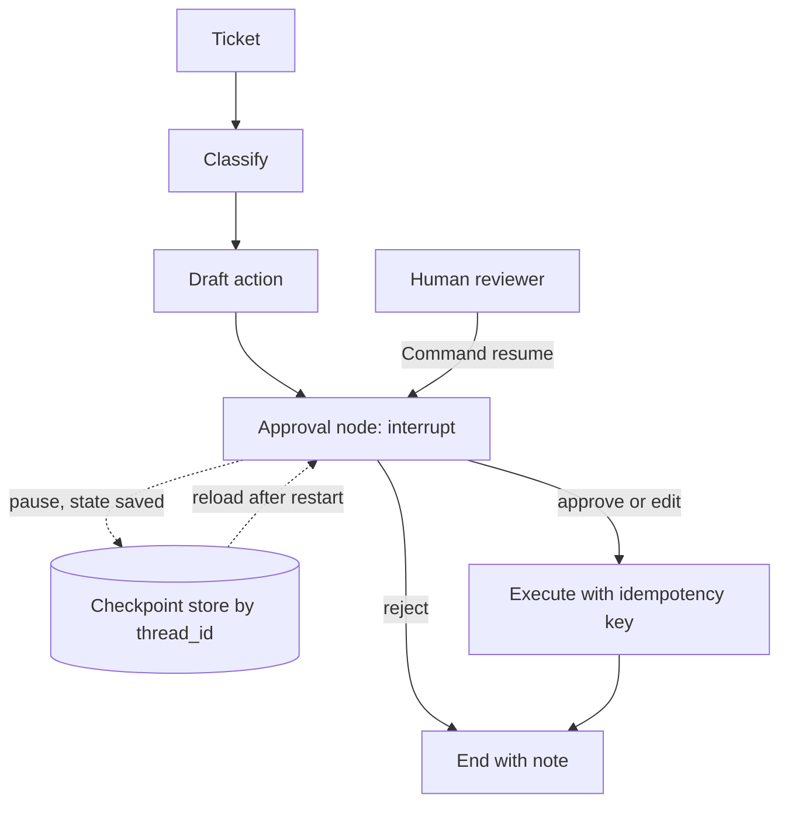

## TL;DR
Build a LangGraph agent that drafts a risky action, pauses for human approval, survives a process restart
from a durable checkpoint and resumes exactly once. It proves you can make agents safe to let near real side effects.

## For agent builders
- **Skills it exercises.** Graph state design, nodes and conditional edges, checkpointers and thread ids,
  `interrupt` and `Command(resume=...)`, state inspection and time travel, and idempotent side effects.
- **Earlier lessons it uses.** LangGraph fundamentals and LangGraph persistence and human-in-the-loop for the API,
  human-in-the-loop and durable execution for the patterns, idempotent tool execution for the side effect.
- **Why it matters for agents.** Any agent that sends email, merges code or refunds money needs a pause point a
  person controls and state that outlives the process holding it.
- **What you can skip.** Multi-agent supervisors and LangGraph Platform deployment. One graph, one approval.

## Why it exists
- **Approval in a `while` loop does not survive restarts.** An `input()` prompt dies with the process; a pending
  approval that waits hours for a manager needs persisted state.
- **Checkpoints are the mechanism, not a feature.** LangGraph saves state after each step under a thread id, so
  pause, resume, replay and crash recovery all use the same store.
- **Resume semantics trip people up.** A node that calls `interrupt` runs again from its start on resume, so a
  side effect placed before the interrupt executes twice. Finding this yourself is the lesson.
- **Reviewers look for it.** "Show me how a human approves a tool call and what happens if the server restarts"
  is a standard agent design question.

## How it works
### Stack and data
- **Python 3.11+, `langgraph`,** one chat model (via LangChain chat model integrations or a direct SDK call inside
  a node) and `langgraph-checkpoint-sqlite` for durable local checkpoints (Postgres saver for the stretch goal).
- **Scenario:** a support-triage agent reads a ticket, drafts a reply or refund, and needs approval for refunds
  over a threshold (for example 50 dollars). Use 20 synthetic tickets in a JSON file.

### Core abstractions
| Abstraction | What it does here |
|---|---|
| `StateGraph(State)` | a typed state dict passed between nodes |
| Node | a function returning a partial state update |
| Conditional edge | routes to `execute` or `END` based on the decision |
| Checkpointer | saves state after every step under `thread_id` |
| `interrupt(payload)` | pauses the graph and surfaces the payload to the caller |
| `Command(resume=value)` | resumes the paused thread, making `interrupt` return `value` |

### Milestones
1. **Graph without approval.** Classify ticket, draft action, execute (fake). Acceptance: 20 tickets run end to end.
2. **In-memory checkpoints and interrupt.** Add `InMemorySaver` and an approval node. Acceptance: a refund pauses
   and `get_state(config).next` shows the approval node.
3. **Resume paths.** Approve, reject and edit (resume with a modified draft). Acceptance: three tests, one per path.
4. **Durable checkpoints.** Swap to the SQLite saver, kill the process while paused, restart and resume by thread
   id. Acceptance: a test that restarts the process and resumes.
5. **Exactly-once side effect.** Put the side effect after approval in its own node and key it with an idempotency
   key. Acceptance: resuming twice performs one refund.
6. **Approval surface.** A tiny CLI or web page listing pending threads and their payloads. Acceptance: a reviewer
   can approve without touching code.

## Diagram
The graph pauses inside the approval node; the checkpoint store holds the thread until a human resumes it,
possibly from a different process.



## Examples
### Starter code: interrupt, inspect, resume
Runnable with only `langgraph` installed; replace `draft_action` with a model call once the flow works.

```python
from typing import TypedDict
from langgraph.graph import StateGraph, START, END
from langgraph.checkpoint.memory import InMemorySaver
from langgraph.types import interrupt, Command

class State(TypedDict):
    request: str
    draft: str
    decision: str
    result: str

def draft_action(state: State) -> dict:
    # In the real project an LLM proposes this; a fixed draft keeps the starter runnable.
    return {"draft": f"send_email(to='team', subject='{state['request']}')"}

def human_approval(state: State) -> dict:
    answer = interrupt({"question": "Approve this action?", "draft": state["draft"]})
    return {"decision": answer}

def route(state: State) -> str:
    return "execute" if state["decision"] == "approve" else END

def execute(state: State) -> dict:
    return {"result": f"executed: {state['draft']}"}   # the side effect runs only after approval

builder = StateGraph(State)
builder.add_node("draft_action", draft_action)
builder.add_node("human_approval", human_approval)
builder.add_node("execute", execute)
builder.add_edge(START, "draft_action")
builder.add_edge("draft_action", "human_approval")
builder.add_conditional_edges("human_approval", route, ["execute", END])
builder.add_edge("execute", END)
graph = builder.compile(checkpointer=InMemorySaver())

config = {"configurable": {"thread_id": "ticket-42"}}
first = graph.invoke({"request": "weekly report"}, config)
print(first["__interrupt__"][0].value)            # paused: the draft waits for a human
print(graph.get_state(config).next)               # ('human_approval',)
final = graph.invoke(Command(resume="approve"), config)
print(final["result"])
```

For milestone 4, install `langgraph-checkpoint-sqlite` and compile inside
`with SqliteSaver.from_conn_string("checkpoints.db") as saver:` using `from langgraph.checkpoint.sqlite import SqliteSaver`
(check the current docs for the exact package and async variants).

### Milestone plan with time estimates
| Milestone | Time | Done when |
|---|---|---|
| 1. Graph without approval | 2-3 h | 20 synthetic tickets processed |
| 2. Interrupt with memory saver | 2 h | refund tickets pause, others finish |
| 3. Approve, reject, edit | 2-3 h | one test per resume path |
| 4. Durable SQLite checkpoints | 2-3 h | restart-and-resume test passes |
| 5. Exactly-once side effect | 2 h | double resume gives one refund record |
| 6. Approval surface and README | 3-4 h | pending list, demo recording, state diagram in README |

### Worked scenario: the double refund
| Version | Where the refund call lives | Result on resume |
|---|---|---|
| Naive | in the approval node, before `interrupt` | node re-runs from the top: refund issued twice |
| Fixed | in a separate `execute` node after approval | runs once, after approval |
| Hardened | `execute` node plus idempotency key `ticket-42:refund` | a retried or replayed run is a no-op |

## Production patterns
- **One thread id per unit of work.** Use the ticket or job id as `thread_id`, so approvals, retries and audits
  all find the same history. Monitor the count and age of paused threads.
- **Side effects in their own nodes, after the gate.** Keep nodes that call `interrupt` free of side effects,
  because they re-execute on resume, and key each external write with an idempotency key.
- **Durable saver in anything but a demo.** SQLite for a single process, the Postgres saver for multiple workers.
  `InMemorySaver` loses every paused approval on restart.
- **Typed approval payloads.** Send the reviewer the draft, the reason, the risk level and the evidence, and validate
  the resume value (approve, reject, or an edited draft) before routing on it.
- **Trace every run.** Send runs to LangSmith or an OpenTelemetry backend so a reviewer can see what the agent read
  before it drafted the action, and log who approved what and when.

## Trade-offs
- **LangGraph vs a hand-written state machine.** You gain checkpointing, interrupts and time travel for free, and
  pay with a framework dependency and its versioning; a single fixed workflow may be simpler as plain code plus a table.
- **Approve everything vs approve by threshold.** Gating every action is safest but trains reviewers to click
  through; thresholds by amount or risk keep attention for cases that matter.
- **SQLite vs Postgres checkpoints.** SQLite is zero-ops but single-writer; Postgres supports many workers and
  backups at the cost of running a database.
- **Edit-and-resume vs approve-or-reject.** Letting reviewers edit drafts saves round trips but means the executed
  action was not the model's, so log both versions.

## Pitfalls
- **Side effects before `interrupt`.** Duplicate emails or refunds after approval. Move them to a later node.
- **Reusing a thread id across tickets.** Old state leaks into the new run and the agent references the wrong
  customer. Derive thread ids from the work item.
- **Forgetting the checkpointer.** `interrupt` needs one; without it there is nothing to resume from. Compile with
  a saver in every environment, including tests.
- **Unvalidated resume values.** A typo like "aprove" routes to the reject path silently. Validate and fail loudly.
- **Testing only the happy path.** Restart-while-paused is the scenario that breaks in production. Make it a test.

## When to use
- **Prerequisites.** LangGraph fundamentals, the persistence and human-in-the-loop lesson, and the tool-calling CLI
  project or equivalent experience.
- **Suits.** Engineers building agents with real side effects, and anyone targeting roles that use LangGraph.
- **Avoid when.** The agent is read-only; approval gates add latency and nothing else.
- **Measure.** Paused-thread count and age, approval rate, edit rate, time to decision, and duplicate side effects (should be 0).

## Role lens
- **Engineer:** Designs the state, places interrupts and side effects correctly, and proves restart-and-resume
  and exactly-once behaviour with tests.
- **Architect:** Sets the approval policy by risk and amount, chooses the checkpoint store, and defines how
  paused threads are monitored and expired.
- **FDE:** Maps a customer's existing approval chain onto interrupts and payloads, so the agent fits how their
  team already signs off.

## Check yourself
**Q:** After adding human approval, some customers receive the same email twice. The send happens in the same node
that calls `interrupt`. Why, and how do you fix it?
**A:** On resume LangGraph re-runs the interrupted node from its beginning, and `interrupt` returns the resume value
on that second pass. Any code before the `interrupt` call, including the send, runs again. Fix it by moving the send
into a separate node after the approval routing, and make it idempotent with a key such as the thread id plus action
name, recorded before or atomically with the send. Add a test that resumes a paused thread and asserts exactly one send.

## Interview questions
### How does LangGraph pause for a human and resume later?
- **A checkpointer saves state after every step** under a `thread_id`; a node calls `interrupt(payload)`, which stops
  the run and returns the payload to the caller.
- **The caller later invokes** the graph with `Command(resume=value)` and the same thread id, and `interrupt` returns that value.

### What happens to a paused approval if the server restarts?
- **With an in-memory saver it is lost,** which is why production uses a durable saver such as SQLite or Postgres.
- **With a durable saver** any worker can load the thread by id and resume, so the approval can arrive hours later.

### How do you guarantee a side effect runs once?
- **Place it in its own node after the approval,** because the interrupted node re-runs on resume.
- **Make the call idempotent** with a key derived from the thread and action, so retries, replays and double clicks are no-ops.

### How would you decide which actions need approval?
- **By risk and reversibility:** irreversible or costly actions (refunds above a threshold, external emails) are gated;
  reversible reads are not.
- **Then tune with data:** track approval and edit rates, and relax gates where reviewers approve nearly everything unchanged.

### When would you not use LangGraph for this?
- **When the flow is fixed and short,** a plain function with a database row for pending approvals is easier to own.
- **When a durable workflow engine is already in use,** its signals and timers may cover approvals better than adding a second runtime.

## Quiz
### Q: What does LangGraph need in order to support `interrupt` and later resumption?
- [ ] A streaming callback
- [x] A checkpointer and a thread id in the config
- [ ] A multi-agent supervisor
- [ ] A vector store
> The checkpointer saves state per thread, so the paused run can be loaded and resumed with `Command(resume=...)`.
> Without one there is no saved state to resume from.

### Q: A node sends a Slack message and then calls `interrupt`. What happens on resume?
- [ ] The message is sent once, before the pause
- [x] The node re-runs from its start, so the message is sent again
- [ ] The resume fails with an error
- [ ] The message is queued until approval
> Resuming re-executes the interrupted node from the top. Code before `interrupt` runs twice, so side effects belong
> in a later node.

### Q: Which checkpointer fits a demo that must survive a process restart on one machine?
- [ ] `InMemorySaver`
- [x] A SQLite checkpointer
- [ ] No checkpointer, with state in a global variable
- [ ] A vector database
> The in-memory saver loses state when the process exits. A SQLite saver persists to a local file and is the simplest
> durable option for a single process.

## Use cases & projects
### Use cases
- **Refund and credit agents.** Gate refunds above a threshold, with the ticket history and policy excerpt in the
  approval payload.
- **Outbound email and messaging.** Draft, pause for edit-or-approve, then send once with an idempotency key.
- **Code-change agents.** Pause before opening or merging a pull request, show the diff, resume on approval.
- **Postgres and multiple workers.** Move checkpoints to Postgres and run two workers that resume each other's threads.
- **Time travel debugging.** Use the state history to replay a run from a checkpoint with a changed prompt and compare outcomes.

### Mini project
**Warm-up: pause and resume in one script (1-2 hours).**
- **Goal:** see `interrupt`, state inspection and `Command(resume=...)` working end to end.
- **Steps:** run the starter code; add a reject path and an edit path where the resume value replaces the draft;
  print `graph.get_state(config)` before and after each resume; then move a `print("SIDE EFFECT")` above the
  `interrupt` call and watch it run twice.
- **Done when:** you can explain from your own output why the side effect ran twice, and you have moved it so it runs once.
