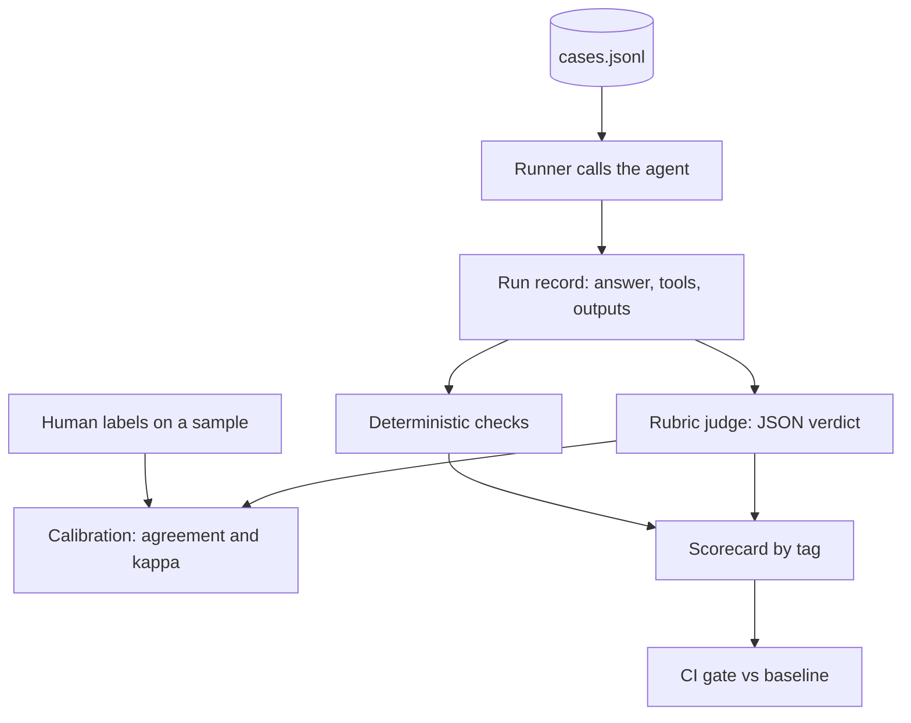

## TL;DR
Build a harness that runs a small agent over 40-60 cases, scores answers and trajectories with deterministic checks
plus a calibrated LLM judge, and gates changes in CI. It proves you can measure an agent, not just eyeball it.

## For agent builders
- **Skills it exercises.** Case design, deterministic and trajectory checks, rubric-based judge prompts with JSON
  verdicts, judge calibration against human labels, pairwise comparison with position swap, and regression gating.
- **Earlier lessons it uses.** LLM-as-a-judge, judge calibration and bias, rubrics, eval harnesses, agent trajectory
  evaluation and inter-annotator agreement; the evals tooling lesson covers frameworks you can swap in.
- **Why it matters for agents.** Agents change with every prompt, tool description and model swap; without a harness,
  each change is a guess and regressions ship silently.
- **What you can skip.** A hosted eval platform. A JSONL file, a script and a CI job are enough.

## Lab
### Task
Build the trust layer of the harness: a verdict parser that survives messy judge output, Cohen's kappa
against human labels, pairwise judging that cancels position bias by swapping order, and the CI gate that
blocks a pass-rate drop beyond a margin. Time box: 45-60 min.
- **Prerequisites:** LLM-as-a-judge; Judge calibration and bias; Inter-annotator agreement; Regression tests.
- **Setup:** Python 3.10+ and `pip install pytest` (checked with Python 3.12, pytest 9.1). Save the starter
  as `lab.py` and the tests as `test_lab.py`.
- **No judge model:** two fake judges stand in. `first_slot_judge` always prefers whichever answer it sees
  first (pure position bias); `fact_judge` prefers the answer that states the reference fact.

### Starter code
```python
"""Lab: verdict parsing, kappa, position-swapped pairwise judging and a CI gate. Run: python lab.py"""
import json
import re
from collections import Counter

def parse_verdict(raw: str) -> dict:
    # YOUR CODE HERE: judges sometimes wrap JSON in markdown code fences or add a sentence before it.
    # Take the first {...} object in raw, json.loads it, and require "correct" and "grounded" to be
    # "pass" or "fail"; otherwise raise ValueError(f"bad verdict: {raw[:80]}")
    raise NotImplementedError

def cohen_kappa(a: list[str], b: list[str]) -> float:
    # YOUR CODE HERE: (observed - expected) / (1 - expected), where expected agreement comes from
    # each rater's label frequencies; return 1.0 when expected == 1
    raise NotImplementedError

def pairwise(question: str, answer_1: str, answer_2: str, judge) -> str:
    """judge(question, first, second) returns "first" or "second". Ask twice with the order
    swapped. Return "1" or "2" only if both orders agree on the same answer, else "tie"."""
    # YOUR CODE HERE
    raise NotImplementedError

def gate(baseline: list[bool], candidate: list[bool], margin: float = 0.05) -> bool:
    # YOUR CODE HERE: True (merge allowed) unless the candidate pass rate is more than `margin`
    # below the baseline pass rate
    raise NotImplementedError

FENCE = "`" * 3                                         # a markdown code fence

def first_slot_judge(question, first, second):          # a judge with pure position bias
    return "first"

def fact_judge(question, first, second):                # prefers the answer stating the fact
    return "first" if "30 days" in first else "second"

if __name__ == "__main__":
    print(parse_verdict(f'Sure! {FENCE}json\n{{"reasoning": "matches", "correct": "pass", "grounded": "fail"}}\n{FENCE}'))
    human = ["pass", "pass", "fail", "pass", "fail", "pass", "fail", "pass"]
    judge_labels = ["pass", "pass", "fail", "pass", "pass", "pass", "fail", "pass"]
    print(f"kappa={cohen_kappa(human, judge_labels):.2f}")
    long_wrong = "Refunds are possible in many cases, depending on several policy factors. " * 3
    short_right = "You can return items within 30 days."
    print(pairwise("Refund window?", long_wrong, short_right, first_slot_judge),
          pairwise("Refund window?", long_wrong, short_right, fact_judge))
    base = [True] * 36 + [False] * 14                      # 72% on 50 cases
    print(gate(base, [True] * 35 + [False] * 15), gate(base, [True] * 32 + [False] * 18))
```

### Expected output
`python lab.py` with a correct solution prints exactly the lines below. The biased judge produces a tie
once the order is swapped, and the gate allows 72% to 70% but blocks 72% to 64%.

```
{'reasoning': 'matches', 'correct': 'pass', 'grounded': 'fail'}
kappa=0.71
tie 2
True False
```

### Tests
Run `pytest -q test_lab.py`. On the starter all 4 fail with `NotImplementedError`; a correct solution passes
all 4.

```python
import pytest
from lab import FENCE, cohen_kappa, fact_judge, first_slot_judge, gate, pairwise, parse_verdict

def test_parse_verdict_handles_fences_and_rejects_junk():
    v = parse_verdict(f'{FENCE}json\n{{"reasoning": "ok", "correct": "pass", "grounded": "pass"}}\n{FENCE}')
    assert v["correct"] == "pass" and v["grounded"] == "pass"
    assert parse_verdict('Verdict: {"correct": "fail", "grounded": "pass"}')["correct"] == "fail"
    for bad in ['{"correct": "yes", "grounded": "pass"}', "I think it passes.", '{"correct": "pass"}']:
        with pytest.raises(ValueError):
            parse_verdict(bad)

def test_kappa_matches_hand_computation():
    human = ["pass", "pass", "fail", "pass", "fail", "pass", "fail", "pass"]
    judge = ["pass", "pass", "fail", "pass", "pass", "pass", "fail", "pass"]
    assert cohen_kappa(human, judge) == pytest.approx(0.7143, abs=1e-4)   # (0.875 - 0.5625) / 0.4375
    assert cohen_kappa(["pass"] * 4, ["pass"] * 4) == 1.0
    assert cohen_kappa(["pass", "fail"] * 2, ["fail", "pass"] * 2) == pytest.approx(-1.0)

def test_pairwise_cancels_position_bias():
    assert pairwise("q", "a", "b", first_slot_judge) == "tie"
    assert pairwise("q", "about 30 days", "no idea", fact_judge) == "1"
    assert pairwise("q", "no idea", "about 30 days", fact_judge) == "2"

def test_gate_blocks_drops_beyond_margin():
    base = [True] * 36 + [False] * 14                     # 0.72
    assert gate(base, [True] * 34 + [False] * 16)         # 0.68: drop of 0.04, allowed
    assert not gate(base, [True] * 33 + [False] * 17)     # 0.66: drop of 0.06, blocked
    assert gate(base, [True] * 40 + [False] * 10)         # improvements always pass
```

### Failure scenarios
- **Ask the pairwise judge once.** `first_slot_judge` then reports a clear win for whichever version you
  list first, and the bias test fails. Log both orderings per case and count how often they disagree; that
  rate is your judge's position bias.
- **Parse with `json.loads(raw)` directly.** The fenced verdict raises `JSONDecodeError` and one malformed
  reply crashes the whole run. Store every raw verdict, and count parse failures as their own metric.
- **Accept any truthy label** (`"yes"`, `"PASS"`, `"partially"`). Pass rates drift with judge phrasing.
  The junk test fails; validate against the exact two labels and re-prompt or drop the case.
- **Report agreement instead of kappa.** With 90% pass labels, a judge that always says pass agrees 90% of
  the time and has kappa 0. Print both numbers next to each other on the calibration set.

### Submission
- **`lab.py`** with the four functions done and both fake judges unchanged.
- **A green test run** (4 passed) and the output of `python lab.py`.
- **A calibration table** from your own agent: 30 runs, your labels, the judge's labels, agreement and kappa.
- **A CI log** showing the gate failing on a deliberately broken prompt.
- **Evaluated on:** tests passing, both orders asked in pairwise mode, and kappa reported beside every
  judge score.

## Why it exists
- **Agents fail in ways exact-match cannot see.** A correct answer can be phrased many ways, and a correct answer
  reached by 9 tool calls instead of 2 is still a problem.
- **Judges are cheap but biased.** LLM judges show position, length and self-preference biases, so an uncalibrated
  judge can report a regression as an improvement.
- **Calibration makes the number trustworthy.** Comparing judge verdicts with 30-50 of your own labels gives an
  agreement rate and Cohen's kappa you can put next to every score.
- **CI gating turns evals into a habit.** A failing build when pass rate drops by more than a set margin stops
  "it felt better" merges.

## How it works
### Stack and data
- **The agent under test:** your tool-calling CLI assistant or RAG notes project, wrapped so a run returns the answer,
  tools called and tool outputs.
- **Cases:** `cases.jsonl` with `question`, `reference`, `expected_tool`, `max_steps` and a `tags` list (lookup,
  multi-step, should-refuse, adversarial).
- **Judge:** a different model from the agent where possible, temperature 0, JSON verdicts.
- **Optional frameworks:** Inspect AI, promptfoo or OpenAI Evals once the hand-rolled version works.

### Three layers of scoring
| Layer | Examples | Cost |
|---|---|---|
| Deterministic | expected tool called, steps under budget, valid JSON, no forbidden tool | free |
| Reference-based judge | answer agrees with reference facts, grounded in tool outputs | one judge call |
| Pairwise judge | is version B better than A, asked in both orders | two judge calls |

### Milestones
1. **Cases and runner.** 40-60 cases, a runner that saves each run as JSON. Acceptance: one command runs all cases.
2. **Deterministic checks.** Tool used, step budget, refusal on should-refuse cases. Acceptance: per-tag pass rates.
3. **Rubric judge.** Pass/fail per criterion with short reasoning first. Acceptance: verdicts parse 100% of the time.
4. **Calibration.** Hand-label 30-50 runs, compute agreement and kappa, refine the rubric until kappa is acceptable
   (many teams aim for roughly 0.6 or higher). Acceptance: numbers in README.
5. **Pairwise mode.** Compare two agent versions, swapping order to cancel position bias. Acceptance: win, loss, tie counts.
6. **CI gate.** Run on every pull request, fail on a drop beyond a margin. Acceptance: a deliberately broken prompt fails CI.

## Diagram
Cases flow through the agent once; cheap deterministic checks run first, the judge scores what remains, and
calibration decides how much to trust the judge.



## Examples
### Starter code: judge, deterministic checks and calibration
The judge model call is injected; the kappa function needs no libraries.

```python
import json
from collections import Counter
from typing import Callable

RUBRIC = """You are grading an AI agent's answer. Criteria:
1. correct: the answer agrees with the reference facts.
2. grounded: every claim is supported by the tool outputs shown.
Return JSON only: {"reasoning": "<one short paragraph>", "correct": "pass" or "fail", "grounded": "pass" or "fail"}"""

def judge(case: dict, run: dict, llm: Callable[[str], str]) -> dict:
    prompt = (f"{RUBRIC}\n\nQuestion: {case['question']}\nReference: {case['reference']}\n"
              f"Tool outputs: {json.dumps(run['tool_outputs'])[:4000]}\nAgent answer: {run['answer']}")
    verdict = json.loads(llm(prompt))
    assert verdict["correct"] in ("pass", "fail") and verdict["grounded"] in ("pass", "fail")
    return verdict

def deterministic_checks(case: dict, run: dict) -> dict:
    return {"used_expected_tool": case["expected_tool"] in run["tools_called"],
            "within_budget": len(run["tools_called"]) <= case.get("max_steps", 6)}

def cohen_kappa(a: list[str], b: list[str]) -> float:
    n = len(a)
    observed = sum(x == y for x, y in zip(a, b)) / n
    ca, cb = Counter(a), Counter(b)
    expected = sum(ca[k] * cb[k] for k in set(a) | set(b)) / (n * n)
    return 1.0 if expected == 1 else (observed - expected) / (1 - expected)

human = ["pass", "pass", "fail", "pass", "fail", "pass", "fail", "pass"]
judge_labels = ["pass", "pass", "fail", "pass", "pass", "pass", "fail", "pass"]
print(f"agreement={sum(h == j for h, j in zip(human, judge_labels)) / len(human):.2f} "
      f"kappa={cohen_kappa(human, judge_labels):.2f}")   # agreement=0.88 kappa=0.71
```

### Milestone plan with time estimates
| Milestone | Time | Done when |
|---|---|---|
| 1. Cases and runner | 3-4 h | 40-60 cases run with one command, results saved |
| 2. Deterministic checks | 2 h | per-tag pass rates printed |
| 3. Rubric judge | 2-3 h | 100% of verdicts parse, reasoning stored |
| 4. Calibration | 3 h | agreement and kappa on 30-50 human labels in README |
| 5. Pairwise mode | 2 h | swapped-order comparison with win, loss, tie counts |
| 6. CI gate | 2 h | a broken prompt fails the pull-request check |

### Worked scenario: the judge that liked long answers
Illustrative numbers showing the shape of a length-bias incident; your own will differ.

| Step | Observation |
|---|---|
| Agent v2 adds "be thorough" to its prompt | answers grow about 2x longer |
| Judge pass rate | rises from 71% to 80% |
| Human labels on the same 40 runs | pass rate flat at about 70% |
| Kappa on v2 runs | drops from 0.7 to 0.4 |
| Fix | rubric says "length is not a criterion", judge sees reference facts, pairwise runs swap order |

## Production patterns
- **Deterministic first, judge second.** Check tool use, step counts, schemas and refusals in code, and spend judge calls
  only on what code cannot decide. It cuts cost and gives exact failure reasons.
- **Binary criteria with reasoning first.** Ask for pass or fail per criterion and a short reasoning field before the
  verdict; binary labels calibrate better than 1-10 scales, and reasoning makes disagreements debuggable.
- **Calibrate and re-calibrate.** Keep 30-50 human-labelled runs, report agreement and kappa with every score, and
  re-check when the judge model or rubric changes.
- **Pin and version everything.** Store case-set version, judge model ID, rubric hash and agent commit with each run, so
  a score change can be traced to a cause.
- **Gate on a margin with repeats.** Agents are non-deterministic; run each case 2-3 times or use enough cases, and fail
  CI only on drops beyond the observed run-to-run noise.

## Trade-offs
- **Judge vs human review.** A judge scales to thousands of runs for cents each, while humans catch subtle errors; use
  humans to calibrate the judge rather than replacing either.
- **Reference-based vs reference-free judging.** References make verdicts more reliable but cost labelling time;
  reference-free rubrics suit open-ended tasks with lower agreement.
- **Hand-rolled harness vs a framework.** Your script is transparent and tiny; Inspect AI, promptfoo or OpenAI Evals add
  logging, viewers and parallelism, with their own conventions to learn.
- **Strong judge vs cheap judge.** A stronger judge agrees more with humans but costs more per run; measure kappa for
  both and pick the cheapest that meets your bar.

## Pitfalls
- **Same model as agent and judge.** Self-preference inflates scores. Use a different model family where possible and
  check calibration.
- **Pairwise without swapping.** Position bias favours whichever answer comes first. Ask in both orders and count a win
  only when both agree.
- **1-10 scales without anchors.** Scores cluster at 7-8 and differences are noise. Use binary criteria or anchored levels.
- **Cases only from the happy path.** The agent looks great until real users arrive. Tag and include should-refuse,
  ambiguous and adversarial cases.
- **Judging the answer but not the path.** The agent reaches the right answer by calling a write tool it should not have
  touched. Add trajectory checks.

## When to use
- **Prerequisites.** A working small agent (the CLI or RAG project), and the LLM-as-a-judge and calibration lessons.
- **Suits.** Anyone shipping agent changes regularly, and candidates for roles where evals are a core skill.
- **Avoid when.** Every answer is checkable by exact match or a unit test; skip the judge and use code.
- **Measure.** Pass rate per tag, judge-human agreement and kappa, cost per eval run and run-to-run variance.

## Role lens
- **Engineer:** Builds the runner, deterministic checks, judge prompt and calibration script, and wires the gate into CI
  with a noise-aware margin.
- **Architect:** Defines what every agent change must pass, which judges are trusted for which criteria, and how eval
  results are versioned and reviewed.
- **FDE:** Builds a case set from a customer's real requests in week one and uses calibrated scores to agree on
  acceptance criteria before launch.

## Check yourself
**Q:** After a prompt change your judge reports pass rate rising from 70% to 82%, but users complain answers got worse.
What do you check?
**A:** First check whether the judge is still calibrated: hand-label 30-50 runs of the new version and compute agreement
and kappa against the judge. If agreement dropped, look for a bias the change exploited, such as longer answers or more
confident tone. Then check the deterministic and trajectory checks, which judges cannot inflate, and the per-tag results,
since gains on easy lookups can mask losses on should-refuse cases. Fix the rubric, re-calibrate, and re-run before trusting either number.

## Interview questions
### How do you know your LLM judge is trustworthy?
- **I calibrate it against human labels** on 30-50 runs and report agreement and Cohen's kappa next to every score.
- **I re-calibrate** whenever the judge model, rubric or agent behaviour changes, because biases can appear with new answer styles.

### What do you check deterministically versus with a judge?
- **Code checks** whatever is exact: expected tool called, step budget, schema validity, refusals, forbidden tools.
- **The judge handles** what needs reading: factual agreement with a reference, groundedness in tool outputs, helpfulness.

### How do you handle position bias in pairwise comparison?
- **Ask in both orders** and count a win only when the judge prefers the same answer both times; otherwise record a tie.
- **Report** win, loss and tie counts rather than a single preference rate, so ties caused by bias are visible.

### How do you set a CI gate for a non-deterministic agent?
- **Measure noise first** by running the same version several times, then gate on drops larger than that spread.
- **Use enough cases per tag,** repeat flaky cases, and keep the gate per tag so a regression in one category cannot hide in the average.

### How would you evaluate the agent's trajectory, not just its answer?
- **Record every tool call and argument,** then check expected tools, forbidden tools, step counts and redundant calls in code.
- **Use a judge for path quality** only where it needs judgment, such as whether a search query was sensible.

## Quiz
### Q: Why ask the judge for pass or fail per criterion instead of a 1-10 score?
- [ ] Binary scores use fewer tokens
- [x] Binary criteria give more consistent verdicts that are easier to calibrate against human labels
- [ ] Judges cannot output numbers
- [ ] 1-10 scales are not valid JSON
> Unanchored numeric scales cluster and drift, so small changes are noise. Clear binary criteria are more repeatable and
> map directly to human pass or fail labels for calibration.

### Q: What does Cohen's kappa add over raw agreement between judge and human?
- [ ] It measures latency
- [ ] It counts tokens used by the judge
- [x] It corrects for agreement expected by chance, for example when most labels are pass
- [ ] It measures the agent's accuracy directly
> If 80% of runs pass, a judge that always says pass agrees 80% of the time. Kappa subtracts chance agreement, so it
> exposes judges that only look accurate.

### Q: In a pairwise comparison, how do you reduce position bias?
- [ ] Always put the new version first
- [ ] Use a longer rubric
- [x] Run each comparison in both orders and only count consistent preferences
- [ ] Use temperature 1 for the judge
> Judges tend to favour one position. Swapping order and requiring the same preference both times cancels that bias
> and turns inconsistent verdicts into ties.

## Use cases & projects
### Use cases
- **Prompt and model change reviews.** Attach the scorecard diff to every pull request that touches prompts, tools or the model.
- **Model bake-offs.** Run the same harness across three models and pick on pass rate, cost and latency together.
- **Production sampling.** Judge a daily sample of real traces and alert when pass rate on a tag drops.
- **Framework port.** Re-implement the harness in Inspect AI or promptfoo and compare effort and features.
- **Judge distillation.** Test whether a smaller judge model keeps kappa above your bar at a fraction of the cost.

### Mini project
**Warm-up: calibrate one judge on 20 answers (1-2 hours).**
- **Goal:** find out how often an LLM judge agrees with you on a simple criterion.
- **Steps:** collect 20 agent answers to questions with known references; label each pass or fail yourself first;
  run the rubric judge with reasoning-before-verdict; compute agreement and kappa; read every disagreement.
- **Done when:** you have the two numbers, a list of disagreements with a one-line cause each, and one rubric change
  that raises agreement on a re-run.
