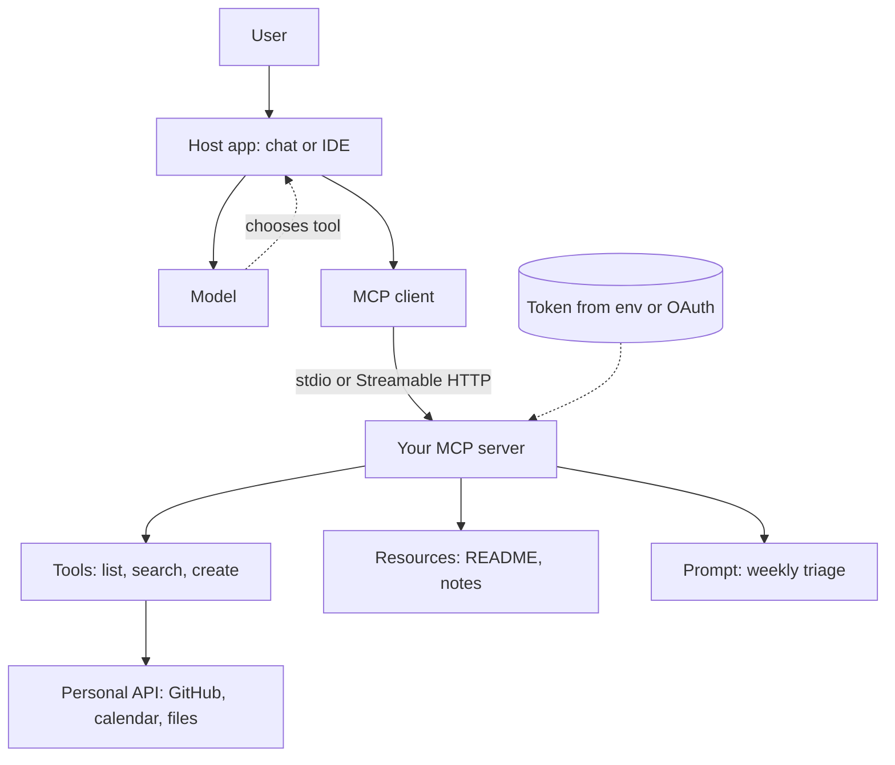

## TL;DR
Build an MCP server that exposes one personal API (calendar, GitHub or a files folder) as tools, resources
and a prompt, test it in the Inspector and use it from a real host. It proves you can design tools other agents consume.

## For agent builders
- **Skills it exercises.** MCP server primitives (tools, resources, prompts), tool naming and descriptions for
  model consumption, input schemas from type hints, stdio and Streamable HTTP transports, and token handling.
- **Earlier lessons it uses.** The Model Context Protocol and MCP server primitives lessons for concepts, the
  Python or TypeScript MCP SDK lessons for code, and MCP auth and transport security for the remote step.
- **Why it matters for agents.** MCP is how one tool implementation reaches many hosts (desktop chat apps, IDEs,
  your own agents). Designing a good server is designing an agent's hands.
- **What you can skip.** Writing an MCP client from scratch and implementing an OAuth authorization server.

## Why it exists
- **Tool design is the real skill.** Wrapping 40 REST endpoints one-to-one gives a model too many similar tools;
  choosing 4-6 task-shaped tools is what makes an agent reliable.
- **A personal API makes it real.** Your own GitHub, calendar or notes folder has real data, auth and failure
  modes, which a toy weather server lacks.
- **One server, many hosts.** The same server works in a desktop chat app, an IDE agent and the CLI assistant
  project, which demonstrates the protocol's point in a 2-minute demo.
- **It is a clean security exercise.** Tokens, read vs write tools and local vs remote transport force the
  least-privilege decisions interviewers ask about.

## How it works
### Concepts you will touch (MCP specification)
| Concept | In this project |
|---|---|
| Host, client, server | a desktop chat app or IDE is the host; it runs one client per server; you write the server |
| Tools | model-invoked actions such as `list_my_open_issues`, `create_issue` |
| Resources | readable context addressed by URI, such as a repo README |
| Prompts | user-invoked templates such as "weekly triage" |
| Transports | stdio for local use, Streamable HTTP for remote (introduced in spec 2025-03-26) |
| Authorization | OAuth-based for remote HTTP servers; local stdio servers read a token from the environment |
| Elicitation | server asks the user for input mid-call (spec 2025-06-18; host support varies) |

### Stack and data
- **Python 3.11+** with the official MCP Python SDK: `FastMCP` in 1.x (pin `mcp>=1.10,<2`), renamed
  `MCPServer` in 2.x. Add `httpx` for the API and `uv` for packaging. The TypeScript SDK works equally well.
- **Data:** your GitHub account via a fine-grained personal access token with read access to issues (add write
  only at milestone 5), or a local folder of notes, or a calendar API.

### Milestones
1. **Hello server over stdio.** One read-only tool, run in the MCP Inspector. Acceptance: the tool appears with
   its schema and returns real data.
2. **Task-shaped tools.** 3-5 tools named for tasks, not endpoints, with descriptions that say what they return.
   Acceptance: a host picks the right tool for 10 scripted requests.
3. **Resources and a prompt.** Expose a README or note as a resource and one prompt template. Acceptance: both
   are listed and readable in the Inspector.
4. **Errors and limits.** Map API errors (401, 404, 429) to clear tool errors, paginate and cap results.
   Acceptance: a revoked token yields "token invalid or expired", not a stack trace.
5. **One write tool, gated.** Add `create_issue` with a description that says it writes, and confirm through
   the host's approval prompt. Acceptance: the host asks before calling it.
6. **Remote option.** Run over Streamable HTTP behind auth (see the deploy and auth lessons). Acceptance: the
   unauthenticated request is rejected.

## Diagram
The host owns the model and the user; your server only answers protocol requests and calls the personal
API with a token it holds itself.



## Examples
### Starter code: a GitHub server with the Python SDK
Type hints become the input schema and the docstring becomes the description the model reads. This uses
the 1.x SDK; on 2.x the class is `MCPServer` from `mcp.server.mcpserver` (check the SDK migration guide).

```python
import os, httpx
from mcp.server.fastmcp import FastMCP

mcp = FastMCP("my-github")
API = "https://api.github.com"
HEADERS = {"Authorization": f"Bearer {os.environ['GITHUB_TOKEN']}",
           "Accept": "application/vnd.github+json"}

def gh(path: str, **params) -> list | dict:
    r = httpx.get(f"{API}{path}", headers=HEADERS, params=params, timeout=10)
    if r.status_code == 401:
        raise ValueError("GitHub token invalid or expired")
    r.raise_for_status()
    return r.json()

@mcp.tool()
def list_my_open_issues(repo: str, limit: int = 10) -> list[dict]:
    """List open issues in owner/repo, newest first. Returns number, title, labels and url."""
    items = gh(f"/repos/{repo}/issues", state="open", per_page=min(limit, 50))
    return [{"number": i["number"], "title": i["title"], "url": i["html_url"],
             "labels": [l["name"] for l in i["labels"]]} for i in items if "pull_request" not in i]

@mcp.resource("github://{owner}/{name}/readme")
def readme(owner: str, name: str) -> str:
    """The README of a repository as raw Markdown."""
    r = httpx.get(f"{API}/repos/{owner}/{name}/readme",
                  headers={**HEADERS, "Accept": "application/vnd.github.raw"}, timeout=10)
    r.raise_for_status()
    return r.text

@mcp.prompt()
def weekly_triage(repo: str) -> str:
    return f"List open issues in {repo}, group them by label, and propose the top 3 to fix this week."

if __name__ == "__main__":
    mcp.run()          # stdio by default; mcp.run(transport="streamable-http") for remote
```

Run it in the Inspector with `npx @modelcontextprotocol/inspector uv run server.py`, then register it in a host's
MCP config with the same command and `GITHUB_TOKEN` in its environment (check each host's current config format).

### Milestone plan with time estimates
| Milestone | Time | Done when |
|---|---|---|
| 1. Hello server | 1-2 h | tool listed and callable in the Inspector |
| 2. Task-shaped tools | 3-4 h | host picks the right tool on 10 scripted requests |
| 3. Resources and prompt | 2 h | both listed and readable |
| 4. Errors and limits | 2-3 h | 401, 404 and 429 each produce a clear message, with tests |
| 5. Gated write tool | 2 h | host asks for approval before `create_issue` runs |
| 6. Remote transport | 4-6 h | Streamable HTTP endpoint rejects unauthenticated requests |

### Worked scenario: endpoint-shaped vs task-shaped tools
An illustrative run of the same request against two designs of the same server.

| Design | Tools | What happened on "what should I work on today?" |
|---|---|---|
| Endpoint-shaped | 14 (`get_issues`, `get_pulls`, `get_events`, ...) | model called 6 tools, ran out of context on raw JSON |
| Task-shaped | 4 (`list_my_open_issues`, `my_review_requests`, ...) | model called 2 tools and answered from trimmed fields |

## Production patterns
- **Trim what tools return.** Return the 4-6 fields a model needs, not the raw API payload, because raw GitHub
  JSON can be thousands of tokens per item. Monitor result size per tool call.
- **Separate read and write tools.** Keep writes in their own clearly named tools and mark them with the spec's
  tool annotations (`readOnlyHint`, `destructiveHint`) so hosts can ask for approval. Treat hints as advisory.
- **Least-privilege tokens.** Use a fine-grained token scoped to the repos and permissions the tools need, from
  the environment, never in code or tool arguments. Remote servers follow the spec's OAuth-based authorization instead.
- **Contract tests over the protocol.** Use the SDK's client in pytest to list tools and call each one against a
  recorded API fixture, so a renamed argument fails CI before a host sees it.
- **Log every call with arguments and latency.** Write to stderr or a file, never stdout, because stdout carries
  the stdio protocol stream. Count calls and errors per tool.

## Trade-offs
- **stdio vs Streamable HTTP.** stdio is trivial to run and keeps the token on your machine; HTTP lets many users
  and remote agents share it but requires auth, TLS and deployment.
- **Few rich tools vs many thin tools.** Fewer tools improve selection and save context, but each does more
  and needs better tests; thin tools are simple but confuse the model past roughly a dozen.
- **Tools vs resources.** Resources let the host or user attach context deliberately, while tools let the model
  fetch on its own; hosts differ in how they surface resources, so check your target hosts.
- **Python SDK vs TypeScript SDK.** Pick the language of the API client libraries you need; both follow the same spec.

## Pitfalls
- **Printing to stdout in a stdio server.** Stray `print` output corrupts the protocol stream and the host
  disconnects. Log to stderr.
- **Leaking the token through errors.** An exception message that includes request headers ends up in the model
  context. Raise short, sanitised errors.
- **Descriptions written for humans.** "Gets issues" leaves the model guessing about arguments and output.
  Say what it returns, the format of each argument (`owner/repo`) and when to use it.
- **Unbounded pagination.** A tool that fetches every page of a busy repo times out the host. Cap `limit` and say so.
- **Assuming every host supports every feature.** Resources, prompts and elicitation are not surfaced the same
  way everywhere. Test in at least two hosts and document which features each uses.

## When to use
- **Prerequisites.** The Model Context Protocol lesson, Python or TypeScript, and an API token you control.
- **Suits.** Engineers who will build tool integrations or internal platforms, and FDEs connecting agents to
  customer systems.
- **Avoid when.** The tool is used by only one agent you own; a plain function tool is simpler.
- **Measure.** Tool-selection accuracy on scripted requests, tokens per tool result, error rate per tool, and
  latency per call.

## Role lens
- **Engineer:** Implements task-shaped tools with tight schemas, trimmed outputs and contract tests, and knows
  why stdout must stay clean in a stdio server.
- **Architect:** Decides which systems get MCP servers, how tokens and OAuth are scoped, and which tools need
  host approval before they can write.
- **FDE:** Stands up a server for a customer's system in days, demos it in their preferred host and documents
  exactly which permissions it holds.

## Check yourself
**Q:** Your MCP server works in the Inspector, but in a desktop host the model keeps calling the wrong tool and
answers slowly. What do you check and change?
**A:** Check how many tools are exposed and how similar their names and descriptions are, then look at result
sizes per call. Merge endpoint-shaped tools into a few task-shaped ones, rewrite descriptions to say what each
returns and when to use it, and trim results to the fields the model needs. Re-run a scripted set of 10 requests
and record which tool was chosen. Also check the server logs to stderr, since stdout noise can break or slow the connection.

## Interview questions
### Explain host, client and server in MCP using your project.
- **The host** is the app the user runs, such as a desktop chat app or IDE; it owns the model and decides which
  tool calls to allow.
- **It creates one client per server,** and my server exposes tools, resources and prompts over stdio or
  Streamable HTTP, calling the personal API with its own token.

### How did you choose which tools to expose?
- **Start from tasks users ask for,** not endpoints, and merge calls the model would chain anyway, landing on 4-6 tools.
- **Validate with a scripted set** of requests and measure which tool the model picks, then fix names and
  descriptions where it chose wrong.

### How would you make this server safe to run remotely for a team?
- **Streamable HTTP behind OAuth-based authorization** as the MCP spec defines for remote servers, with tokens
  scoped per user instead of one shared personal token.
- **Plus** TLS, origin checks, rate limits, audit logs per call and approval gates for write tools.

### What is the difference between a tool and a resource, and when do you use each?
- **Tools are model-invoked** actions with input schemas, used when the model should decide to fetch or act.
- **Resources are URI-addressed context** the host or user selects, good for documents the user wants attached
  deliberately rather than fetched at the model's discretion.

### How do you test an MCP server in CI?
- **Use the SDK's client** to connect in-process or over stdio, list tools and assert their schemas, then call each
  tool against recorded API responses.
- **Add negative tests** for expired tokens, 404s and rate limits so error messages stay clear and never leak secrets.

## Quiz
### Q: In a stdio MCP server, why must you avoid printing logs to stdout?
- [ ] stdout is slower than stderr
- [x] stdout carries the protocol messages, so extra output corrupts the stream
- [ ] Hosts delete stdout logs
- [ ] The spec forbids logging
> With the stdio transport the client reads protocol messages from the server's stdout. Any stray text breaks
> message parsing, so logs go to stderr or a file.

### Q: Which design usually gives a model the best tool-selection accuracy?
- [ ] One tool per REST endpoint
- [x] A few task-shaped tools with clear descriptions and trimmed outputs
- [ ] A single generic `call_api` tool with a URL argument
- [ ] As many tools as the host allows
> Many similar tools confuse selection and raw payloads waste context. A generic URL tool is hard to secure.
> A few task-shaped tools match how users ask and keep results small.

### Q: Which transport and auth combination fits a server shared by a team over the network?
- [ ] stdio with a token hardcoded in the server
- [ ] stdio with no auth
- [x] Streamable HTTP with OAuth-based authorization
- [ ] Streamable HTTP with the token passed as a tool argument
> The MCP spec defines Streamable HTTP for remote servers and OAuth-based authorization for them. Tokens in
> code or tool arguments leak into repos and model context.

## Use cases & projects
### Use cases
- **Personal productivity agent.** Combine your GitHub and calendar servers in one host to answer "what should I
  do before my 3 pm meeting?".
- **Team tool hub.** Deploy the server remotely with per-user OAuth so teammates' agents share one integration,
  which leads into the portfolio MCP tool hub project.
- **Agent integration test.** Load the server from the CLI assistant or a LangGraph agent and prove the same
  tools work across three hosts.
- **Elicitation for confirmations.** Where the host supports it (spec 2025-06-18 or later), ask the user to
  confirm issue titles before `create_issue` runs.

### Mini project
**Warm-up: a files server in one sitting (1-2 hours).**
- **Goal:** expose a local notes folder as an MCP server with two tools and one resource.
- **Steps:** create a `FastMCP` (2.x: `MCPServer`) server with `search_notes(query)` and `read_note(path)` confined to one folder;
  expose each note as a resource by URI; run it in the MCP Inspector; then register it in one desktop host.
- **Done when:** the host answers a question from your notes by calling `search_notes` then `read_note`, and a test
  shows `read_note("../secret.txt")` is refused.
