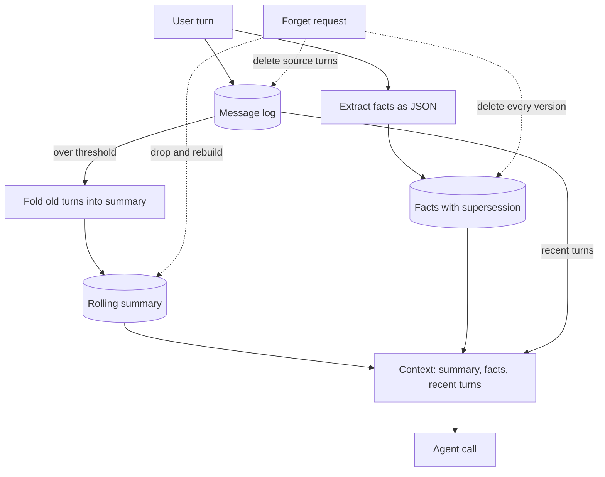

## TL;DR
Build a memory layer that rolls old turns into a summary, keeps typed facts that newer facts supersede,
and truly deletes on request. It proves your agent remembers what matters and forgets on command.

## For agent builders
- **Skills it exercises.** Context budgeting, rolling summaries, fact extraction with structured output,
  supersession instead of overwrite, per-user isolation, and deletion that reaches every derived copy.
- **Earlier lessons it uses.** Agent memory types, memory retrieval, update and deletion policies, context
  compaction, memory libraries, retention and deletion architecture, and PII redaction.
- **Where it shows up in agents.** Any assistant that talks to the same user across sessions: support,
  tutoring, coding agents with project notes, personal assistants.
- **What you can skip.** A vector database at first. One user's facts usually fit in the prompt; add
  embeddings and top-k recall only when a user has hundreds of facts.

## Why it exists
- **Context windows fill up.** A long conversation plus tool results outgrows the window or the budget, so
  something must be compressed, and the choice of what decides answer quality.
- **Summaries alone lose facts.** "My dog is called Pixel" disappears after two rounds of summarising, so
  stable facts need their own store.
- **Facts change.** A user who moved from Berlin to Lisbon must not get Berlin weather; overwriting loses
  history, appending without supersession returns both.
- **Deletion is a legal and trust requirement.** "Forget my address" must remove the fact, its source
  turns and any summary that repeated it, or the agent leaks it back later.

## How it works
### Stack and data
- **Stack:** Python, SQLite (Postgres later), one LLM for summarising and fact extraction with JSON or
  structured output, pytest. Embeddings are optional for milestone 5.
- **Data:** five scripted multi-session conversations, each planting facts, changing one, asking about
  them later and requesting one deletion.
- **Memory types:** recent turns verbatim, a rolling summary of older turns, and a facts table with
  `key`, `value`, `source_msg_id` and `superseded_by`.

### Milestones
1. **Message log.** Store every turn per user; build context as the last N turns. This is the baseline
   that forgets everything older.
2. **Rolling summary.** When unsummarised turns exceed a threshold, fold all but the newest few into the
   summary with one LLM call and record `upto_id`, so context is summary plus recent turns.
3. **Facts with supersession.** Extract facts from user turns as JSON; when a key already has an active
   value, insert the new one and point the old row's `superseded_by` at it.
4. **Deletion.** `forget_fact` removes every version of a fact, its source turns and the summary, then
   rebuilds the summary from what remains. `forget_user` removes everything for a user.
5. **Recall at scale (optional).** Embed facts and retrieve the top-k relevant ones per query once a user
   has too many to include all.
6. **Eval.** Replay the scripted conversations against an agent using the layer and score recall, update
   and deletion answers.

### Acceptance tests
- **Recall:** asked "what is my dog called?" 30 turns later, the agent answers correctly in 5 of 5 scripts.
- **Update:** after a move, the agent uses the new city and never the old one.
- **Deletion:** after `forget_fact`, the deleted value appears nowhere in the context, tables or index.
- **Isolation:** one user's facts never appear in another user's context.

## Diagram
Follow the write path from the user turn into the three stores, then the read path into the context. The
dotted forget edges cut across every store and force the summary to rebuild rather than being patched.



## Examples
### Starter code: the memory store
The LLM is injected as `llm(task, text)` so tests can use a fake. In the real version, `extract_facts`
returns a JSON list validated against a schema and `summarize` returns plain text.

```python
import json, sqlite3, time

SCHEMA = """
CREATE TABLE IF NOT EXISTS messages(id INTEGER PRIMARY KEY, user_id TEXT, role TEXT, content TEXT, ts REAL);
CREATE TABLE IF NOT EXISTS summaries(user_id TEXT PRIMARY KEY, text TEXT, upto_id INTEGER);
CREATE TABLE IF NOT EXISTS facts(id INTEGER PRIMARY KEY, user_id TEXT, key TEXT, value TEXT,
                                 source_msg_id INTEGER, ts REAL, superseded_by INTEGER);
"""

class Memory:
    def __init__(self, path, llm, keep_recent=6, fold_after=12):
        self.db = sqlite3.connect(path)
        self.db.executescript(SCHEMA)
        self.llm, self.keep_recent, self.fold_after = llm, keep_recent, fold_after

    def add(self, user_id, role, content):
        cur = self.db.execute("INSERT INTO messages(user_id, role, content, ts) VALUES (?,?,?,?)",
                              (user_id, role, content, time.time()))
        if role == "user":
            self._extract_facts(user_id, cur.lastrowid, content)
        self.db.commit()
        self._maybe_summarize(user_id)

    def _extract_facts(self, user_id, msg_id, text):
        for f in json.loads(self.llm("extract_facts", text)):      # [{"key": "city", "value": "Berlin"}]
            old = self.db.execute("SELECT id FROM facts WHERE user_id=? AND key=? AND superseded_by IS NULL",
                                  (user_id, f["key"])).fetchone()
            new = self.db.execute("INSERT INTO facts(user_id, key, value, source_msg_id, ts) VALUES (?,?,?,?,?)",
                                  (user_id, f["key"], f["value"], msg_id, time.time())).lastrowid
            if old:
                self.db.execute("UPDATE facts SET superseded_by=? WHERE id=?", (new, old[0]))

    def _summary(self, user_id):
        return self.db.execute("SELECT text, upto_id FROM summaries WHERE user_id=?", (user_id,)).fetchone() or ("", 0)

    def _maybe_summarize(self, user_id):
        prev, upto = self._summary(user_id)
        rows = self.db.execute("SELECT id, role, content FROM messages WHERE user_id=? AND id>? ORDER BY id",
                               (user_id, upto)).fetchall()
        if len(rows) < self.fold_after:
            return
        fold = rows[:-self.keep_recent]                              # keep the newest turns verbatim
        text = self.llm("summarize", prev + "\n" + "\n".join(f"{r}: {c}" for _, r, c in fold))
        self.db.execute("INSERT INTO summaries VALUES (?,?,?) ON CONFLICT(user_id) DO UPDATE "
                        "SET text=excluded.text, upto_id=excluded.upto_id", (user_id, text, fold[-1][0]))
        self.db.commit()

    def context(self, user_id):
        summary, upto = self._summary(user_id)
        facts = self.db.execute("SELECT key, value FROM facts WHERE user_id=? AND superseded_by IS NULL",
                                (user_id,)).fetchall()
        recent = self.db.execute("SELECT role, content FROM messages WHERE user_id=? AND id>? ORDER BY id",
                                 (user_id, upto)).fetchall()
        return {"summary": summary, "facts": dict(facts), "recent": recent}

    def forget_fact(self, user_id, key):
        src = [r[0] for r in self.db.execute("SELECT source_msg_id FROM facts WHERE user_id=? AND key=?",
                                             (user_id, key))]
        self.db.execute("DELETE FROM facts WHERE user_id=? AND key=?", (user_id, key))   # every version
        self.db.executemany("DELETE FROM messages WHERE id=?", [(i,) for i in src])     # the source turns
        self.db.execute("DELETE FROM summaries WHERE user_id=?", (user_id,))            # rebuild, never patch
        self.db.commit()
        self._maybe_summarize(user_id)

    def forget_user(self, user_id):
        for t in ("messages", "summaries", "facts"):
            self.db.execute(f"DELETE FROM {t} WHERE user_id=?", (user_id,))
        self.db.commit()          # also: vector index, caches, traces and backups per your retention policy
```

### Starter test: update, deletion and isolation
A fake LLM makes the behaviour deterministic. The deletion assertion checks the whole context, so a fact
that survived inside the summary fails the test.

```python
import json
from mem import Memory

def fake_llm(task, text):
    if task == "extract_facts":
        if "live in" in text:
            return json.dumps([{"key": "city", "value": text.split("live in ")[1].strip(". ")}])
        return "[]"
    return "SUMMARY:" + text.replace("\n", " ")[-200:]

def test_update_and_forget():
    m = Memory(":memory:", fake_llm)
    m.add("u1", "user", "I live in Berlin.")
    for i in range(14):
        m.add("u1", "user", f"chat {i}")
    m.add("u1", "user", "I live in Lisbon.")
    assert m.context("u1")["facts"]["city"] == "Lisbon"
    m.forget_fact("u1", "city")
    ctx = json.dumps(m.context("u1"))
    assert "Berlin" not in ctx and "Lisbon" not in ctx
    m.add("u2", "user", "I live in Paris.")
    assert "Paris" not in json.dumps(m.context("u1"))
    m.forget_user("u2")
    assert m.context("u2")["facts"] == {}
```

### Milestones, time estimates and done-when checks
| Milestone | Time | Done when |
|---|---|---|
| Message log and last-N context | 1 h | the baseline agent fails the recall script, as expected |
| Rolling summary | 3 h | context stays under a fixed token budget over a 100-turn script |
| Facts with supersession | 4 h | the update script answers with the new value and history keeps the old row |
| Deletion paths | 3 h | the deletion test passes, including the summary check |
| Optional embedding recall | 3 h | top-k facts beat "include all" once a user has 200+ facts |
| Eval and report | 3 h | a table of recall, update, deletion and isolation pass rates across 5 scripts |

## Production patterns
- **Tag every derived artifact with its sources.** Summaries, facts and embeddings carry the message ids
  they came from, so deletion can find every copy instead of guessing.
- **Rebuild, never patch, after deletion.** Regenerating a summary from the remaining turns is the only
  reliable way to remove a fact; asking an LLM to "remove Berlin from this summary" can miss paraphrases.
- **Gate what becomes a fact.** Store stable preferences and profile data, skip one-off remarks, and
  redact secrets and payment data before storage, because everything stored can be recalled and leaked.
- **Trace memory reads and writes.** Log which facts and summary version went into each agent call, so a
  wrong answer traces to a stale fact or a bad extraction.
- **Portfolio polish.** A README that states the memory policy in plain words, the five scripts with pass
  rates, a demo of "forget my city" end to end, and tests in CI.

## Trade-offs
- **Summaries vs verbatim history.** Summaries keep context small but lose detail and add an LLM call;
  verbatim history is exact but expensive. Keep the newest turns verbatim and summarise the rest.
- **Hand-built layer vs a memory library.** Mem0, Letta, Zep or a LangGraph store give extraction and
  retrieval quickly; building your own teaches the deletion and isolation rules you must still verify.
- **Hard delete vs soft delete.** Hard delete satisfies "forget me" but loses audit history; soft delete
  keeps an audit trail but must still be excluded everywhere and purged on schedule.
- **Extract on every turn vs in batches.** Per-turn extraction is fresh but costs a call per turn; batch
  extraction at summary time is cheaper but delays new facts.

## Pitfalls
- **Deleting the fact but not the summary.** Symptom: the agent "forgets" the address, then repeats it
  from the summary. Fix: drop and rebuild the summary, and test the full context string.
- **Overwriting facts in place.** Symptom: no way to explain why the agent used an old value. Fix:
  supersede with a pointer and keep the history for audit.
- **Mixing users in one namespace.** Symptom: a query without a user filter returns another user's
  facts. Fix: make `user_id` required in every query and add an isolation test.
- **Summary drift.** Each fold rewrites the previous summary, so errors compound over many rounds. Fix:
  keep facts out of the summary's job and periodically rebuild from the log.

## When to use
- **Prerequisites:** Python, SQL basics, one LLM API with JSON output, and the agent memory lessons.
- **Suits:** engineers building assistants that span sessions, and anyone preparing for questions on
  privacy and data deletion in agent systems.
- **Avoid when:** conversations are single-session and short; a plain message window is enough.
- **Measure:** recall, update and deletion pass rates, context tokens per call, and extraction precision on
  a labelled sample.

## Role lens
- **Engineer:** Implements the summary fold, fact supersession and deletion paths, and writes tests that
  search the whole context for a deleted value.
- **Architect:** Defines what is remembered, for how long and where every derived copy lives, so deletion
  and retention policies can actually be enforced.
- **FDE:** Walks a customer's privacy team through what the agent stores, how a deletion request flows
  through it and how they can verify it.

## Check yourself
**Q:** A user says "forget that I live in Berlin". Your code deletes the fact row, yet two turns later the
agent mentions Berlin. Where did it come from, and what is the complete fix?
**A:** The value survived in a derived copy: most often the rolling summary, otherwise the source message
in the recent-turn window, an embedding index or a cache. Deleting one row does not touch those. The full
fix tags each fact, summary and embedding with its source message ids, deletes every version of the fact
and its source turns, drops the summary and rebuilds it from the remaining log, removes index entries and
cached answers, and adds a test that searches the entire assembled context for the deleted value.

## Interview questions
### How does your memory layer decide what goes into the context window?
- **Three tiers.** The newest turns go in verbatim, older turns arrive as one rolling summary, and active
  facts for the user are always included because they are small and high value.
- **A budget drives it.** When unsummarised turns pass a threshold the oldest are folded, so the context
  stays under a fixed token budget however long the conversation runs.

### How do you handle a fact that changes, like a new address?
- **Supersede, do not overwrite.** The new value becomes active and the old row points to it, so the
  agent uses the new value and history explains past answers.
- **Extraction uses a stable key.** Facts are keyed by type such as `city`, so the update finds the
  previous value instead of creating a duplicate.

### A regulator asks you to prove a user's data was deleted from your agent. What do you show?
- **The deletion path.** Every derived artifact carries source ids, and deletion removes facts, turns,
  summaries, embeddings and caches, with backups purged on a stated schedule.
- **The evidence.** An automated test that searches all stores for the deleted values, plus a deletion log
  entry with time and scope.

### When would you use a memory library instead of building your own?
- **Use a library for speed.** Mem0, Letta, Zep or a LangGraph store give extraction, storage and recall
  quickly, which suits a product team shipping a first version.
- **Still own the policy.** You must verify isolation and deletion yourself, because those rules depend on
  your data and legal duties, not the library defaults.

### How would you evaluate whether memory makes the agent better?
- **Scripted multi-session tests.** Plant facts, change some, ask later, and request deletions, then score
  recall, update and deletion answers.
- **Compare against a baseline.** Run the same scripts with a last-N window only, so the report shows what
  the memory layer actually adds.

## Quiz
### Q: Why should the rolling summary be rebuilt rather than edited after a deletion request?
- [ ] Editing a summary costs more tokens than rebuilding it
- [x] An edit can miss paraphrased mentions, while a rebuild from the remaining log cannot contain the deleted turns
- [ ] Summaries are stored in a format that cannot be edited
- [ ] Rebuilding improves the summary's compression ratio
> The summary may mention the fact in other words. Regenerating it from the log after removing the source
> turns guarantees the deleted content is not an input, which an edit cannot promise.

### Q: What does a `superseded_by` column give a facts table?
- [ ] Faster lookups by key
- [ ] Automatic deletion of old facts after a TTL
- [x] The current value is unambiguous while the history of old values is kept for audit
- [ ] Deduplication of facts across different users
> Pointing the old row to its replacement means only one active value per key reaches the context, and
> the trail of earlier values explains past behaviour.

### Q: Which test best proves per-user isolation in a memory layer?
- [ ] Checking that each user has at least one fact stored
- [ ] Measuring context size per user
- [x] Planting a distinctive fact for user B and asserting it never appears in user A's assembled context
- [ ] Deleting all users and checking the tables are empty
> Isolation fails when a query forgets the user filter. A planted value for one user that must never show
> up in another user's context catches that bug directly.

## Use cases & projects
### Use cases
- **Support agents across tickets.** Facts such as plan, device and past issues carry over without
  replaying every old ticket.
- **Tutoring or coaching agents.** A summary of progress plus facts about goals keeps sessions coherent
  over weeks.
- **Stretch goal: memory as tools.** Expose `remember`, `recall` and `forget` as agent tools and compare
  agent-driven memory with automatic extraction on the same scripts.
- **Stretch goal: retention schedule.** Expire facts by type (30 days for temporary context, kept for
  preferences) and test the expiry job.
- **Stretch goal: Postgres and pgvector.** Move the store, add embedding recall and keep the isolation
  test passing under row-level security.

### Mini project
**Rolling summary warm-up (1-2 hours).**
- **Goal:** keep a chat agent's context under a fixed budget over a 60-turn conversation.
- **Steps:** store turns in a list; when more than 12 are unsummarised, fold all but the last 6 into a
  summary with one LLM call; build context as summary plus recent turns; count tokens per call with a
  tokenizer.
- **Done when:** a chart shows context tokens staying under the budget after the first fold (a sawtooth,
  not a rising line), and the agent still answers a question about a fact planted at turn 3 at turn 60.
