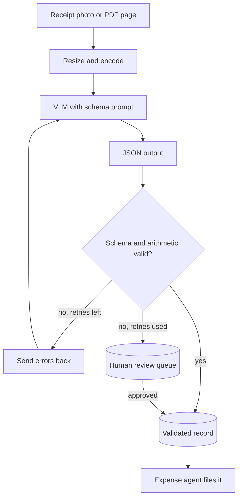

## TL;DR
Build a reader that sends a receipt or invoice photo to a vision-language model, validates the JSON with
arithmetic checks, retries with the errors and routes failures to review. It proves trustworthy multimodal
extraction.

## For agent builders
- **Skills it exercises.** Image preprocessing, multimodal prompts, schema-first extraction, validators
  that check the document's own arithmetic, retry with error feedback, a review queue, and field-level evals.
- **Earlier lessons it uses.** Vision-language models, OCR, document understanding, the Pydantic
  extraction pipeline mini project, Instructor and structured outputs.
- **Where it shows up in agents.** Expense agents, accounts-payable agents and document-processing agents
  all start by turning a picture into a typed record a tool can act on.
- **What you can skip.** Training a layout model. Current VLMs read most receipts well; your work is the
  schema, the checks and the eval.

## Lab
### Task
Stop an expense agent's receipt reader from filing wrong totals. Three bugs let errors through silently:
the totals check is skipped when a receipt prints no subtotal, retries resend the same prompt without the
errors, and an exhausted retry loop returns an unvalidated guess as `ok`.

You finish when the error rate of auto-accepted receipts, the number finance actually feels, is zero on
the recorded batch.
- **Time box:** 45-75 minutes.
- **Prerequisites:** vision-language models, structured outputs, and the Pydantic extraction pipeline
  mini project.
- **Runs offline:** `FakeVLM` replays recorded JSON answers for three receipts and moves to its next
  answer only when the last turn says what was wrong, which is how error feedback helps a real VLM. No
  image or API key is needed.
- **Needs:** `pip install pydantic pytest`; checked with Python 3.12, Pydantic 2.14.1 and pytest 9.1.1.

### Starter code
```python
# receipt_lab.py: validate VLM receipt JSON, retry with errors, route failures to review, offline
import json
from decimal import Decimal
from typing import List, Optional
from pydantic import BaseModel, Field, ValidationError, model_validator

TOL = Decimal("0.02")

class LineItem(BaseModel):
    description: str
    amount: Decimal

class Receipt(BaseModel):
    merchant: str
    currency: str = Field(pattern=r"^[A-Z]{3}$")
    items: List[LineItem] = []
    subtotal: Optional[Decimal] = None
    tax: Decimal = Decimal("0")
    tip: Decimal = Decimal("0")
    total: Decimal

    @model_validator(mode="after")
    def totals_add_up(self):
        # YOUR CODE 1: receipts without a printed subtotal skip every check here. Use the item sum
        # as the base instead, so the total is always checked
        if self.subtotal is None:
            return self
        items_sum = sum((i.amount for i in self.items), Decimal("0"))
        if self.items and abs(items_sum - self.subtotal) > TOL:
            raise ValueError(f"line items sum to {items_sum}, subtotal is {self.subtotal}")
        if abs(self.subtotal + self.tax + self.tip - self.total) > TOL:
            raise ValueError(f"subtotal + tax + tip = {self.subtotal + self.tax + self.tip}, total is {self.total}")
        return self

def rec(merchant, items, total, **kw):
    return json.dumps({"merchant": merchant, "currency": "EUR", "total": total,
                       "items": [{"description": d, "amount": a} for d, a in items], **kw})

# Recorded VLM answers per receipt: [first answer, answer after an error-feedback turn, ...]
RECORDED = {
    "r1": [rec("Cafe Lume", [("flat white", "3.50"), ("croissant", "2.80")], "6.80",
               subtotal="6.30", tax="0.50")],
    "r2": [rec("FreshMart", [("apples", "5.00"), ("coffee beans", "8.40")], "18.40"),     # 1 misread as 8
           rec("FreshMart", [("apples", "5.00"), ("coffee beans", "8.40")], "13.40")],
    "r3": [rec("City Taxi", [], "25.00", subtotal="20.00", tip="3.00"),                  # blurry photo
           rec("City Taxi", [], "26.00", subtotal="20.00", tip="3.00")],
}
GOLD_TOTAL = {"r1": Decimal("6.80"), "r2": Decimal("13.40"), "r3": Decimal("23.00")}

class FakeVLM:
    """Replays recorded answers. It moves to the next answer only when told what was wrong."""
    def __init__(self, answers):
        self.answers, self.i, self.calls = answers, 0, 0

    def complete(self, messages):
        self.calls += 1
        if self.calls > 1 and "Fix these problems" in str(messages[-1]["content"]):
            self.i = min(self.i + 1, len(self.answers) - 1)
        return self.answers[self.i]

def read_receipt(client, image_ref, retries=2):
    messages = [{"role": "system", "content": "Extract the receipt as JSON. Copy amounts exactly; never guess."},
                {"role": "user", "content": [{"type": "text", "text": "Extract this receipt."},
                                             {"type": "image_ref", "ref": image_ref}]}]
    for _ in range(retries + 1):
        raw = client.complete(messages)
        try:
            return Receipt.model_validate_json(raw), "ok"
        except ValidationError as e:
            # YOUR CODE 2: append the model's raw answer and a user turn starting with
            # "Fix these problems and return the full JSON: " plus the validation errors
            pass
    # YOUR CODE 3: an unvalidated guess must never be filed; return (None, "needs_review")
    return Receipt.model_construct(**json.loads(raw)), "ok"

def run_batch():
    out = {}
    for rid, answers in RECORDED.items():
        client = FakeVLM(answers)
        receipt, status = read_receipt(client, rid)
        out[rid] = (receipt, status, client.calls)
    return out

def report(out):
    accepted = [rid for rid, (_, s, _) in out.items() if s == "ok"]
    wrong = [rid for rid in accepted if Decimal(out[rid][0].total) != GOLD_TOTAL[rid]]
    rate = round(len(wrong) / len(accepted), 3) if accepted else 0.0
    return {"auto_accepted": len(accepted), "review": len(out) - len(accepted), "accepted_error_rate": rate}

def main():
    out = run_batch()
    for rid, (receipt, status, calls) in out.items():
        print(f"{rid}: {status} total={receipt.total if receipt else None} calls={calls}")
    print(report(out))

if __name__ == "__main__":
    main()
```

As given, all three receipts are accepted and the report shows `'accepted_error_rate': 0.667`: r2 is
filed at 18.40 instead of 13.40, and r3 at 25.00 although 20.00 + 3.00 is 23.00.

### Expected output
```
r1: ok total=6.80 calls=1
r2: ok total=13.40 calls=2
r3: needs_review total=None calls=3
{'auto_accepted': 2, 'review': 1, 'accepted_error_rate': 0.0}
```

Check r1 by hand: 3.50 + 2.80 = 6.30, and 6.30 + 0.50 tax = 6.80. For r2 the items sum to 13.40, so
the misread 18.40 is off by 5.00, far outside the 0.02 tolerance.

### Tests
```python
# test_receipt_lab.py: run with `pytest -q`
from decimal import Decimal
import pytest
from pydantic import ValidationError
import receipt_lab as m

def test_total_is_checked_without_a_subtotal():
    with pytest.raises(ValidationError, match="total is 18.40"):
        m.Receipt.model_validate_json(m.RECORDED["r2"][0])
    assert m.Receipt.model_validate_json(m.RECORDED["r2"][1]).total == Decimal("13.40")

def test_retry_feeds_the_errors_back():
    client = m.FakeVLM(m.RECORDED["r2"])
    receipt, status = m.read_receipt(client, "r2")
    assert (status, receipt.total, client.calls) == ("ok", Decimal("13.40"), 2)

def test_unfixable_receipt_goes_to_review():
    client = m.FakeVLM(m.RECORDED["r3"])
    assert m.read_receipt(client, "r3") == (None, "needs_review")
    assert client.calls == 3                               # one try plus two retries, then stop

def test_no_wrong_total_is_auto_accepted():
    assert m.report(m.run_batch()) == {"auto_accepted": 2, "review": 1, "accepted_error_rate": 0.0}
```

All four fail on the starter. Fixing only the validator is not enough: r2 then fails three times with
the same answer (`calls=3`), so the retry test still fails until the errors reach the model.

### Failure scenarios
- **Skip the check when a field is missing.** Receipts without a subtotal, often the cheapest ones,
  are filed unchecked. Debug by counting accepted receipts per validation path and alerting on any path
  that never fails.
- **Retry without the errors.** Every retry costs another image call and returns the same JSON. Debug by
  logging a hash of each raw answer; identical hashes across attempts mean the feedback is missing.
- **Return a best-effort object on exhaustion.** `model_construct` skips validation, so the filing tool
  sees a normal `Receipt`. Debug by grepping for `model_construct` and asserting the filing tool only
  accepts `status == "ok"`.
- **Use floats for amounts.** Change the fields to `float` and the sum that starts at `Decimal("0")`
  raises `TypeError`; switch that to floats too and sums such as 0.1 + 0.2 come out as
  0.30000000000000004. Debug by printing the repr of the computed base next to the printed total.

### Submission
- **Repo** with `receipt_lab.py` and the unchanged tests; `pytest -q` shows 4 passed.
- **Program output** matching the expected block.
- **The review record** for r3: raw answers, the exact validation errors and the image reference, as a
  reviewer would see it.
- **A short note** explaining why the review share going from 0 to 1 of 3 is an improvement, using the
  accepted error rate.
- **Evaluated on** tests passing, the total checked on every path, and no `model_construct` on the
  output path.

## Why it exists
- **Documents arrive as pictures.** Phone photos, scanned PDFs and screenshots are where most business data
  enters, so an agent that cannot read them stops at step one.
- **A VLM answer is not a record.** It can misread a digit, drop a line or invent a missing date, and the
  output still looks plausible.
- **Receipts check themselves.** Line items should add up to the subtotal, and subtotal plus tax should
  equal the total, so validation catches many misreads without a human.
- **Money errors are expensive.** A wrong total in an expense or payables flow becomes a real payment, so
  "needs review" must be a first-class outcome.

## How it works
### Stack and data
- **Stack:** Python, Pillow for resizing, any VLM API that accepts images (OpenAI-style `image_url`
  content parts shown), Pydantic v2 for the schema, pytest, and optionally Instructor for the retry loop.
- **Data:** 30-50 receipts or invoices: your own photos with personal data blurred, or a public set such
  as SROIE or CORD. Label merchant, date, currency, items and totals for each.
- **Schema:** `Receipt` with `Decimal` amounts, an ISO currency code, optional date and subtotal, and
  discount, tax and tip fields so the arithmetic closes.

### Milestones
1. **Schema and validators.** Write the Pydantic model and a validator that checks items against the
   subtotal and subtotal minus discount plus tax and tip against the total, within a 0.02 tolerance.
2. **First extraction.** Resize the image, send it with the schema in the prompt, ask for JSON only, and
   parse with `model_validate_json`.
3. **Retry with errors.** On a validation failure, send the model its own output and the exact errors,
   at most twice; after that, return `needs_review`.
4. **Golden set and eval.** Score each field separately: exact match for date, currency and total, fuzzy
   match for merchant, and item-level precision and recall.
5. **Review queue.** Store the image, the raw output and the errors for anything in `needs_review`, and a
   tiny page or CLI to correct and approve it.
6. **Agent tool.** Wrap the reader as a tool (`read_receipt(file_id)`) an expense agent calls before
   filing, and refuse to file anything not validated or approved.

### Acceptance tests
- **Total accuracy:** 95% or more of auto-accepted receipts have the exact total.
- **No silent errors:** every receipt whose arithmetic does not close ends in `needs_review`, not filed.
- **Unit tests:** the validator rejects a wrong total, and the retry loop recovers from one bad answer.
- **Cost:** tokens and latency per receipt are reported, before and after resizing.

## Diagram
Note the two exits: a validated record that the agent may act on, and a review queue for anything whose
numbers still do not add up after retries.



## Examples
### Starter code: schema, validator and reader with retries
The client is passed in so tests can use a fake. Model IDs change often, so the model comes from an
environment variable; check your provider's docs for image input limits and pricing.

```python
import base64, io, json, os
from datetime import date
from decimal import Decimal
from typing import List, Optional
from pydantic import BaseModel, Field, ValidationError, model_validator

TOL = Decimal("0.02")

class LineItem(BaseModel):
    description: str
    quantity: Decimal = Decimal("1")
    amount: Decimal                                   # line total as printed

class Receipt(BaseModel):
    merchant: str
    purchase_date: Optional[date] = None
    currency: str = Field(pattern=r"^[A-Z]{3}$")      # ISO 4217, e.g. EUR
    items: List[LineItem]
    subtotal: Optional[Decimal] = None
    discount: Decimal = Decimal("0")
    tax: Decimal = Decimal("0")
    tip: Decimal = Decimal("0")
    total: Decimal

    @model_validator(mode="after")
    def totals_add_up(self):
        items_sum = sum((i.amount for i in self.items), Decimal("0"))
        base = self.subtotal if self.subtotal is not None else items_sum
        if self.items and abs(items_sum - base) > TOL:
            raise ValueError(f"line items sum to {items_sum}, subtotal is {base}")
        if abs(base - self.discount + self.tax + self.tip - self.total) > TOL:
            raise ValueError(f"subtotal - discount + tax + tip != total {self.total}")
        return self

PROMPT = ("Extract the receipt as JSON matching this schema. Copy amounts exactly as printed. "
          "Use null for anything you cannot read; never guess. Schema: ")

def to_data_url(path, max_side=1600):
    from PIL import Image
    img = Image.open(path).convert("RGB")
    img.thumbnail((max_side, max_side))                # fewer image tokens, text stays legible
    buf = io.BytesIO(); img.save(buf, format="JPEG", quality=90)
    return "data:image/jpeg;base64," + base64.b64encode(buf.getvalue()).decode()

def read_receipt(client, path, model=os.environ.get("VLM_MODEL", "set-me"), retries=2):
    messages = [{"role": "system", "content": PROMPT + json.dumps(Receipt.model_json_schema())},
                {"role": "user", "content": [{"type": "text", "text": "Extract this receipt."},
                                             {"type": "image_url", "image_url": {"url": to_data_url(path)}}]}]
    for _ in range(retries + 1):
        r = client.chat.completions.create(model=model, messages=messages,
                                           response_format={"type": "json_object"})
        raw = r.choices[0].message.content
        try:
            return Receipt.model_validate_json(raw), "ok"
        except ValidationError as e:                    # feed the exact errors back once or twice
            messages += [{"role": "assistant", "content": raw},
                         {"role": "user", "content": f"Fix these problems and return the full JSON: {e}"}]
    return None, "needs_review"                         # route to a human queue, never guess
```

### Milestones, time estimates and done-when checks
| Milestone | Time | Done when |
|---|---|---|
| Schema and validators | 2 h | unit tests reject a wrong total and accept a correct receipt |
| First extraction | 2 h | 10 receipts parse into `Receipt` objects |
| Retry with errors | 2 h | a fake client test shows recovery after one bad answer |
| Golden set and field-level eval | 4 h | one command prints accuracy per field on 30+ receipts |
| Review queue | 3 h | a failed receipt can be corrected and approved from a CLI or page |
| Agent tool | 2 h | the expense agent files only validated or approved receipts |

### Worked scenario: reading the eval report (illustrative)
| Field | First pass | After resizing fix and retries |
|---|---|---|
| Total (exact) | 88% | 97% of auto-accepted |
| Date (exact) | 81% (day and month swapped) | 93% after adding the country to the prompt |
| Merchant (fuzzy) | 94% | 94% |
| Items (F1) | 0.79 | 0.86 |
| Sent to review | 0% (errors were silent) | 12% |

The review share rose, and that is the point: errors moved from silent to visible.

## Production patterns
- **Validate with the document's own math.** Arithmetic checks catch misread digits without labels; log
  which check failed so you can see whether the model or the photo is the problem.
- **Treat review as a product feature.** Store image, raw output and errors, let a person fix fields, and
  feed approved corrections back into the golden set.
- **Control image cost.** Resize to the smallest size that keeps text legible, crop borders, and log image
  tokens per receipt, because image tokens often dominate the bill.
- **Protect personal data.** Receipts carry names and card digits; restrict who sees the review queue,
  set a retention period for images and avoid sending more fields than needed to the model.
- **Portfolio polish.** A README with the per-field eval table, a demo of a corrected and an approved
  receipt, unit tests for validators and the retry loop, and a note on data handling.

## Trade-offs
- **VLM vs OCR plus a text model.** A VLM reads layout and handwriting in one call; OCR plus a text LLM is
  cheaper and gives word positions for highlighting. Managed services (Textract AnalyzeExpense, Azure
  Document Intelligence, Google Document AI) trade flexibility for ready-made receipt fields.
- **Strict validators vs throughput.** Tight tolerances send more to review but stop wrong payments;
  loosen them only for low-value expenses where a small error is acceptable.
- **Retries vs cost.** Each retry resends the image; two retries usually catch fixable misreads, and more
  rarely help.
- **One schema vs per-document types.** A single schema is simple but fits invoices and receipts poorly;
  classify the document first if you handle both.

## Pitfalls
- **Using floats for money.** Symptom: 0.1 + 0.2 checks fail or pass wrongly. Fix: `Decimal` everywhere,
  parsed from strings.
- **Letting the model guess missing fields.** Symptom: plausible dates on receipts with no date. Fix: allow
  null, tell the model never to guess, and measure invented values on the golden set.
- **Date format confusion.** 03/04 is March or April depending on country. Fix: pass the expected locale
  and store ISO dates.
- **Only measuring overall accuracy.** A single number hides that totals are fine and dates are not. Fix:
  report per field and per document source.

## When to use
- **Prerequisites:** Pydantic, one VLM API, and the structured extraction mini project.
- **Suits:** engineers aiming at document-heavy domains (finance, insurance, logistics) and FDEs who will
  meet scanned paperwork at customer sites.
- **Avoid when:** documents are born digital with a text layer or an API; parse that directly instead.
- **Measure:** per-field accuracy, review rate, tokens and latency per document.

## Role lens
- **Engineer:** Writes the schema, validators, retry loop and per-field eval, and tunes image size against
  accuracy and token cost.
- **Architect:** Chooses VLM, OCR or a managed document service, and designs the review queue and data
  retention around money and personal data.
- **FDE:** Collects a sample of the customer's real documents, builds the golden set with their finance
  team and agrees the review threshold before go-live.

## Check yourself
**Q:** Your reader extracts totals correctly on 97% of receipts, yet the finance team finds wrong amounts
in filed expenses every week. What is likely going on and how do you fix it?
**A:** The remaining errors are being filed silently instead of stopping. Either the validator does not run
on every path, it has a loose tolerance, or receipts without a subtotal skip the arithmetic check. Fix it
by making validation mandatory before the filing tool runs, sending any failure or missing check to the
review queue, and adding discount, tip and tax fields so honest receipts still close. Then measure the
error rate of auto-accepted receipts, not overall accuracy, because that is what reaches finance.

## Interview questions
### How do you know the model read a receipt correctly without a human checking each one?
- **The document checks itself.** Line items must sum to the subtotal and subtotal plus tax and tip minus
  discount must equal the total, so most misreads break the arithmetic.
- **Failures are visible.** Anything that still fails after retries goes to review instead of being filed,
  and I track the error rate of auto-accepted receipts.

### Why not just run OCR and skip the vision-language model?
- **OCR gives text, not structure.** You still need a model to map words to fields, and it struggles with
  odd layouts and handwriting.
- **But it can be cheaper.** For high volume with consistent layouts, OCR plus a small text model or a
  managed expense API can beat a VLM on cost; I would compare on the golden set.

### How would you turn this into a tool for an expense agent?
- **Typed tool contract.** `read_receipt(file_id)` returns either a validated record or `needs_review` with
  errors, never a half-trusted guess.
- **Policy in the agent.** The filing tool refuses anything not validated or approved, so the agent cannot
  file a receipt that failed checks.

### Image tokens make up most of your bill. What do you change?
- **Shrink the input.** Image tokens scale with pixel dimensions, not colour, so resize to the smallest
  legible size and crop margins, then rerun the eval to confirm accuracy held.
- **Route by difficulty.** Send clean, high-contrast receipts to a cheaper model or OCR path and reserve the
  larger VLM for hard ones.

### What personal data concerns does this project raise?
- **Receipts identify people.** Names, card digits and locations appear, so restrict access to images and
  the review queue and set a retention period.
- **Minimise what you send.** Send only the image needed, avoid logging raw images in traces, and redact
  fields you do not need to store.

## Quiz
### Q: Why does the schema use `Decimal` rather than `float` for amounts?
- [ ] Decimal values use fewer tokens in the prompt
- [x] Floats cannot represent many decimal amounts exactly, so totals checks fail or pass wrongly
- [ ] Pydantic cannot validate floats
- [ ] VLMs return amounts as integers
> Binary floats round values such as 0.1, so sums of prices drift. Decimal arithmetic on values parsed
> from strings keeps money exact and makes the totals check reliable.

### Q: What should happen when a receipt still fails the arithmetic check after two retries?
- [ ] File it with the model's total
- [ ] Retry until it passes
- [x] Return needs_review and send it with the errors to a human queue
- [ ] Recompute the total from line items and file it
> Repeated failures usually mean an unreadable image or an unusual receipt. Sending it to review keeps
> wrong amounts out of the books and produces labelled examples for the golden set.

### Q: Which metric best shows the risk the finance team actually faces?
- [ ] Overall field accuracy across all receipts
- [ ] Average latency per receipt
- [x] Error rate among receipts that were auto-accepted without review
- [ ] Share of receipts sent to review
> Errors caught by review never reach the books. The accepted-without-review error rate measures exactly
> the mistakes that get filed.

## Use cases & projects
### Use cases
- **Expense agents.** Read receipts from chat uploads, validate and file them with the right category.
- **Accounts payable.** Extract invoice numbers, supplier, due dates and totals before a payment agent
  proposes a payment for approval.
- **Stretch goal: invoice support.** Add an invoice schema with supplier tax ID and due date, plus a
  classifier step that picks the schema.
- **Stretch goal: bounding boxes.** Use an OCR engine's word positions to highlight where each field came
  from in the review page.
- **Stretch goal: model comparison.** Run two VLMs and an OCR path on the golden set and chart accuracy
  against cost per receipt.

### Mini project
**Validator-first warm-up (1-2 hours).**
- **Goal:** prove the validation layer catches misreads before any model is involved.
- **Steps:** write the `Receipt` model and its totals validator; hand-label five receipts as JSON; create
  five corrupted copies (wrong total, missing item, swapped digits); write pytest cases for all ten.
- **Done when:** the five correct receipts pass, the five corrupted ones fail with clear messages, and the
  README explains each check.
