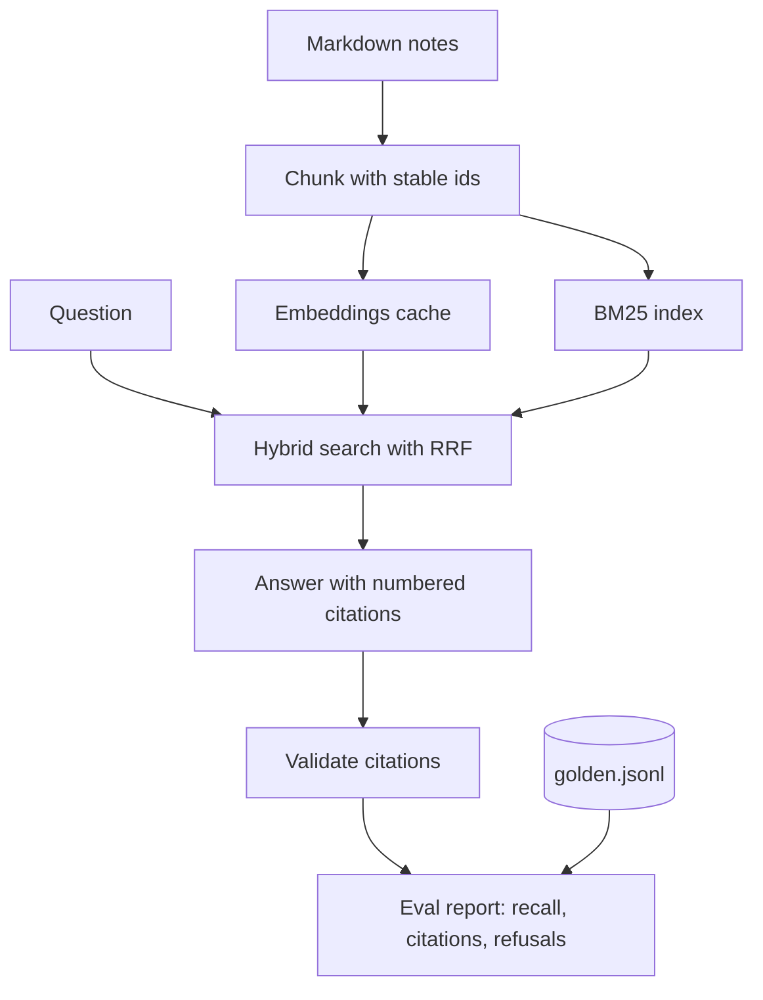

## TL;DR
Index your own Markdown notes, answer questions with inline citations to the exact chunks used, and grade
the system with a 30-50 question eval set. It proves you can measure retrieval and grounding, not just demo them.

## For agent builders
- **Skills it exercises.** Chunking with stable ids, embeddings plus BM25 hybrid search, citation-forcing
  prompts, citation validation, and retrieval and answer metrics on a golden set.
- **Earlier lessons it uses.** Chunking strategies, hybrid search, citations and grounding, citation
  correctness, retrieval evaluation and golden datasets.
- **Why it matters for agents.** A retrieval tool is the most common tool an agent calls; if you cannot tell
  whether it returned the right chunk, you cannot debug the agent above it.
- **What you can skip.** A hosted vector database and a web UI. NumPy over a few thousand chunks is enough.

## Why it exists
- **Demos hide retrieval failures.** A RAG demo answers the five questions its author tried. An eval set of
  30-50 questions exposes the ones that fail, and shows whether retrieval or generation is to blame.
- **Your own notes make labelling cheap.** You know which note answers each question, so building a golden
  set with expected sources takes an evening instead of an SME workshop.
- **Citations make answers checkable.** Each claim points to a chunk id, so you can verify faithfulness
  automatically and a reader can click through.
- **It separates the two failure layers.** Recall@k says whether the right chunk was retrieved; citation
  correctness says whether the answer used it. Without both you fix the wrong layer.

## How it works
### Stack and data
- **Data:** 100-500 of your own Markdown notes (or a docs folder you know well), kept in a git repo.
- **Retrieval:** `sentence-transformers` for embeddings, `rank_bm25` for keyword search, NumPy cosine
  similarity, reciprocal rank fusion to merge the two lists.
- **Generation:** any chat model; the prompt numbers the retrieved chunks and requires `[n]` citations.
- **Eval:** a `golden.jsonl` with `question`, `expected_sources` (note paths) and a short reference answer.

### Milestones
1. **Chunk and index.** Split notes by heading, then by ~300-word windows; give each chunk an id like
   `path#heading-2`. Acceptance: re-indexing produces identical ids.
2. **Dense retrieval.** Embed chunks once, cache to disk, return top-k by cosine. Acceptance: a CLI prints
   top-5 chunks with scores for any query.
3. **Golden set.** Write 30-50 questions: lookups, multi-note questions and 5 with no answer in the notes.
   Acceptance: each has expected sources or is marked unanswerable.
4. **Retrieval metrics.** Report recall@5 and MRR per question type. Acceptance: one command prints a table.
5. **Hybrid search.** Add BM25 and fuse with RRF. Acceptance: recall@5 is reported for dense, BM25 and hybrid.
6. **Cited answers and checks.** Generate with `[n]` citations, reject answers citing chunks that were not
   retrieved, and score citation correctness and refusal on unanswerable questions.

### Metrics that go in the README
| Metric | Measures | Computed by |
|---|---|---|
| Recall@5 | right note in top 5 | string match on `expected_sources` |
| MRR | how high the right note ranks | 1 / rank of first hit |
| Citation validity | every `[n]` refers to a retrieved chunk | parser, no LLM |
| Citation support | the cited chunk supports the sentence | LLM judge, spot-checked by you |
| Correct refusal | says "not in my notes" when it should | unanswerable subset |

## Diagram
Indexing runs once per change; each question goes through hybrid retrieval, a cited answer and the checks
that feed the eval report.



## Examples
### Starter code: hybrid retrieval and recall@5
The core piece is retrieval plus its metric; generation is a thin layer on top.

```python
import json, pathlib, re, numpy as np
from sentence_transformers import SentenceTransformer
from rank_bm25 import BM25Okapi

def slug(text):                        # heading-based id part, stable when other sections move
    first = text.strip().splitlines()[0]
    head = first.lstrip("#").strip().lower() if first.startswith("#") else ""
    return re.sub(r"[^a-z0-9]+", "-", head).strip("-") or "top"

def chunk_notes(root):
    chunks, seen = [], {}
    for p in sorted(pathlib.Path(root).rglob("*.md")):
        src = str(p.relative_to(root))
        for text in re.split(r"\n(?=#{1,3} )", p.read_text()):
            if text.strip():
                cid = f"{src}#{slug(text)}"
                seen[cid] = seen.get(cid, 0) + 1       # repeated heading in one note
                if seen[cid] > 1:
                    cid += f"-{seen[cid]}"
                chunks.append({"id": cid, "src": src, "text": text})
    return chunks

chunks = chunk_notes("notes")
model = SentenceTransformer("all-MiniLM-L6-v2")
emb = model.encode([c["text"] for c in chunks], normalize_embeddings=True)
bm25 = BM25Okapi([c["text"].lower().split() for c in chunks])

def search(q, k=5, rrf_k=60):
    dense = np.argsort(-(emb @ model.encode(q, normalize_embeddings=True)))[:50]
    sparse = np.argsort(-bm25.get_scores(q.lower().split()))[:50]
    score = {}
    for ranking in (dense, sparse):
        for rank, i in enumerate(ranking):
            score[i] = score.get(i, 0) + 1 / (rrf_k + rank + 1)
    return [chunks[i] for i in sorted(score, key=score.get, reverse=True)[:k]]

gold = [json.loads(l) for l in open("golden.jsonl")]
answerable = [g for g in gold if g["expected_sources"]]
hits = sum(any(c["src"] in g["expected_sources"] for c in search(g["question"])) for g in answerable)
print(f"recall@5 = {hits}/{len(answerable)} = {hits/len(answerable):.2f}")
```

### Citation prompt and validator
Number the chunks in the prompt, require `[n]` after each claim, then check the answer mechanically.

```python
def build_prompt(question, hits):
    ctx = "\n\n".join(f"[{i+1}] ({h['id']})\n{h['text']}" for i, h in enumerate(hits))
    return (f"Answer only from the numbered notes. Put [n] after every sentence. "
            f"If the notes do not contain the answer, say 'Not in my notes.'\n\n{ctx}\n\nQ: {question}")

def citations_valid(answer, n_hits):   # score refusals ("Not in my notes.") separately
    cited = {int(x) for x in re.findall(r"\[(\d+)\]", answer)}
    return bool(cited) and all(1 <= c <= n_hits for c in cited)
```

### Milestone plan with time estimates
| Milestone | Time | Done when |
|---|---|---|
| 1. Chunk and index | 2 h | stable chunk ids across two runs |
| 2. Dense retrieval | 2 h | top-5 CLI works, embeddings cached |
| 3. Golden set | 2-3 h | 30-50 questions, 5 unanswerable |
| 4. Retrieval metrics | 1-2 h | recall@5 and MRR table per question type |
| 5. Hybrid search | 2 h | dense vs BM25 vs hybrid compared |
| 6. Cited answers | 3-4 h | citation validity, support and refusal scores in README |

## Production patterns
- **Version the index with the eval.** Store the embedding model name, chunker settings and a hash of the
  notes next to every eval result, so a recall change can be traced to a chunking or model change.
- **Report by question type.** Split lookup, multi-note and unanswerable questions in every table, because
  hybrid search often helps names and codes while hurting paraphrased questions.
- **Validate citations without an LLM first.** A regex check that every `[n]` exists catches most broken
  answers for free; use an LLM judge only for "does the chunk support the claim", and spot-check 20 of its verdicts.
- **Trace retrieval as its own span.** Log query, chunk ids, scores and latency per question; when an answer is
  wrong, the trace shows at once whether retrieval or generation failed.
- **Run the eval in CI.** A GitHub Action that fails when recall@5 drops more than a few points keeps chunking
  experiments honest and makes a strong README badge.

## Trade-offs
- **Small chunks vs large chunks.** Small chunks give precise citations but lose context across headings; large
  ones answer more but cite vaguely. Measure both on the golden set rather than picking by taste.
- **Hybrid vs dense only.** Hybrid adds a second index and a fusion step, and pays off when notes contain names,
  error codes or acronyms that embeddings blur.
- **Local embeddings vs an API.** A small local model is free and offline but weaker on long or multilingual
  notes; an API model may raise recall at a per-token cost and a data-sharing decision.
- **Strict citation rules vs fluent answers.** Requiring `[n]` on every sentence makes checking easy but can make
  answers stilted; relax to per-paragraph citations only if validity stays high.

## Pitfalls
- **Writing questions from the chunks.** Copying phrases into questions inflates recall because BM25 matches
  them verbatim. Write questions the way you would actually ask, before looking at the notes.
- **No unanswerable questions.** The system never learns to refuse and confidently cites unrelated chunks. Keep
  at least 10% of the set unanswerable and score refusals.
- **Unstable chunk ids.** Ids based on list position shift when a note is edited, breaking the golden set. Use
  path plus heading-based ids.
- **Trusting the judge blindly.** An LLM judge marks weak support as fine. Hand-label a sample and report the
  agreement rate next to its scores.
- **Re-embedding on every run.** Indexing becomes slow and costly. Cache embeddings keyed by chunk hash.

## When to use
- **Prerequisites.** Python, basic NumPy, and the chunking, hybrid search and retrieval evaluation lessons.
- **Suits.** Anyone building agents that read documents, and anyone whose RAG experience is demo-only.
- **Avoid when.** Your notes are under 20 pages; long-context prompting is simpler and you will not learn retrieval.
- **Measure.** Recall@5, MRR, citation validity, citation support and correct-refusal rate, all per question type.

## Role lens
- **Engineer:** Builds the chunker, hybrid retriever, citation validator and eval script, and uses the
  numbers to choose chunk size and fusion settings.
- **Architect:** Treats the golden set and metrics as the contract for any RAG feature, so model or index
  changes ship only when the numbers hold.
- **FDE:** Reuses the same harness on a customer's documents in week one to show where retrieval fails
  before anyone argues about models.

## Check yourself
**Q:** Your notes assistant scores recall@5 of 0.9 but readers say answers are often wrong. Where do you look,
and what do you measure next?
**A:** High recall means the right note is usually retrieved, so the failure is likely downstream. Measure
citation validity (are `[n]` markers real), citation support (does the cited chunk say what the sentence
claims) and refusal on unanswerable questions. Read 10 failing transcripts: common causes are the right chunk
ranking fifth behind distractors, chunks cut mid-explanation, or the model blending notes. Fixes follow the
cause: rerank, adjust chunk boundaries, or tighten the prompt and reject answers with unsupported citations.

## Interview questions
### How did you build the eval set and why should I trust it?
- **Questions came before reading chunks,** phrased naturally, with expected source notes, a mix of lookup,
  multi-note and about 10% unanswerable questions.
- **I report per type and keep it versioned,** so improvements on one type that hurt another are visible.

### Your hybrid search lowered recall on some questions. How do you debug it?
- **Compare dense, BM25 and fused rankings per question** to see which list put the right chunk where; paraphrased
  questions often lose when BM25 pushes keyword matches up.
- **Then tune the fusion,** for example weight lists differently or rerank the fused top 20, and re-run the full set.

### How do you verify citations at scale?
- **Mechanically first:** every `[n]` must refer to a retrieved chunk, checked by a parser at zero cost.
- **Then support:** an LLM judge checks whether each cited chunk supports its sentence, calibrated against my own
  labels on a sample so I know its error rate.

### How would this change if the notes were 2 million documents for a company?
- **Index and permissions:** a real vector store with metadata filters and ACL-aware retrieval, plus incremental
  re-indexing and deletion handling.
- **Evaluation:** a golden set built with subject-matter experts and sampled from real queries, because my own
  intuition no longer covers the corpus.

### When would you not use RAG for this?
- **When the corpus fits comfortably in context** and changes rarely, long-context prompting with caching is simpler.
- **When answers need computation** over structured data, a SQL or API tool beats retrieving text chunks.

## Quiz
### Q: Recall@5 is high but answers are often unsupported. Which layer is most likely failing?
- [ ] The embedding model
- [ ] The chunk index
- [x] Generation and citation use after retrieval
- [ ] The golden set format
> High recall means the right chunk is usually in the context. Unsupported answers then point to how the model
> uses or cites that context, so measure citation validity and support next.

### Q: Why include unanswerable questions in the golden set?
- [ ] To raise the average score
- [x] To measure whether the system refuses instead of citing unrelated chunks
- [ ] Because BM25 needs negative examples
- [ ] To test embedding speed
> Without them you never measure refusals, and a system that always answers looks perfect. Real users ask about
> things your notes do not cover.

### Q: What does reciprocal rank fusion combine in this project?
- [ ] Two embedding models into one vector
- [x] The ranked lists from dense search and BM25 into one ranking
- [ ] Chunks from neighbouring headings
- [ ] The judge score and the recall score
> RRF sums 1 / (k + rank) for each item across ranked lists, so a chunk ranked well by either dense or keyword
> search rises in the fused list.

## Use cases & projects
### Use cases
- **Agent retrieval tool.** Wrap `search()` as a tool for the CLI assistant, so the agent decides when to look
  things up and you can measure whether it searched when it should.
- **Reranking experiment.** Add a cross-encoder reranker over the fused top 20 and report the recall@5 and
  latency change per question type.
- **Freshness and deletion.** Re-index only changed notes by hash and prove deleted notes never appear in answers.
- **Team docs assistant.** Point the same pipeline at a team wiki with metadata filters by space or owner.
- **Eval in CI.** Fail the build on a recall or citation-validity drop and publish the report as a CI artifact.

### Mini project
**Warm-up: recall@5 on 15 questions (1-3 hours).**
- **Goal:** measure dense retrieval quality on your own notes before writing any generation code.
- **Steps:** chunk 50-100 notes by heading; embed with a small local model; write 15 questions with expected
  note paths; compute recall@5 and list the misses with their top-5 results.
- **Done when:** you have a recall number, a list of misses, and one sentence per miss saying why it failed
  (wrong chunking, vocabulary mismatch, or the note does not really answer it).
