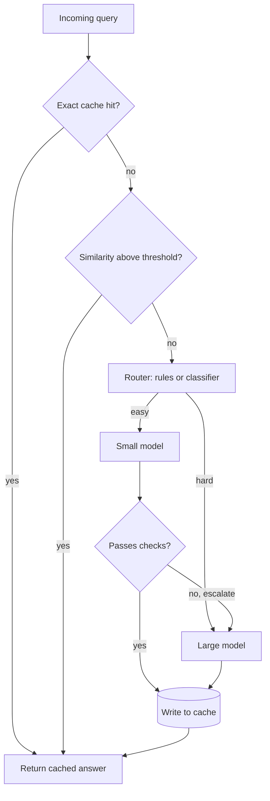

## TL;DR
Build a proxy that answers repeated questions from a semantic cache and sends the rest to a small or large
model by difficulty. It proves you can cut LLM spend with numbers while holding quality on an eval set.

## For agent builders
- **Skills it exercises.** Embeddings and cosine similarity, threshold tuning on labelled pairs, a router
  with escalation, per-request cost accounting, and an eval that compares quality before and after.
- **Earlier lessons it uses.** Model routing and cascades, response caching, provider prompt caching (a
  different lever), LiteLLM for one API over many models, token cost tracking and LLM-as-a-judge.
- **Where it shows up in agents.** The planner step of an agent often needs a large model, while
  classification, extraction and FAQ-style steps do not; a router per step is how teams cut cost.
- **What you can skip.** Building your own vector database. An in-memory NumPy matrix is enough until
  the cache holds tens of thousands of entries; swap in Redis or pgvector later.

## Why it exists
- **Cost is the first production complaint.** Agent traffic is repetitive (the same 50 support questions,
  the same classification step) and often over-served by the largest model, so most spend buys nothing.
- **Exact-match caching misses paraphrases.** "How do I reset my password?" and "password reset steps?"
  hash differently, so a plain key-value cache hits rarely on natural language.
- **Always using the small model loses quality.** Hard questions fail silently, so you need a router that
  knows when to escalate and an eval that proves it.
- **It is a classic interview story.** "I cut cost by X% at a quality loss of Y points, measured on Z
  examples" is exactly the evidence a hiring team wants to see.

## How it works
### Stack and data
- **Stack:** Python, `sentence-transformers` for embeddings (for example `all-MiniLM-L6-v2`), NumPy for
  similarity, LiteLLM to call a small and a large model behind one interface, FastAPI optional.
- **Data:** 300-500 real-looking questions with paraphrase clusters (write them, or sample a public FAQ
  dataset), plus 100 labelled pairs marked "same answer" or "different answer" for threshold tuning.
- **Eval set:** 100 questions with reference answers, a third of them deliberately hard.

### Milestones
1. **Baseline.** Send every query to the large model; log tokens, latency and cost per request. This is
   the number you will beat.
2. **Exact cache.** Normalise text (lowercase, strip whitespace) and hash it with the model name, system
   prompt hash and tool-schema version. Zero false positives, so it always goes first.
3. **Semantic cache.** Embed the query with normalised vectors, take the best cosine match in the same
   namespace, and return it only above a threshold. Add a TTL per entry.
4. **Tune the threshold.** Sweep 0.80-0.98 on the labelled pairs and pick the value where false hits stay
   under 1%; a wrong cached answer is worse than a cache miss.
5. **Router.** Start with rules (length, keywords, required tools), then optionally a small classifier.
   Route to the small model by default and escalate on a failed check: invalid JSON, a refusal, or low
   self-reported confidence.
6. **Measure.** Run the eval set through baseline and the new pipeline; report cost per 1,000 queries,
   hit rate, escalation rate, p95 latency and judge score.

### Acceptance tests
- **False-hit rate** under 1% on the labelled pairs at the chosen threshold.
- **Quality** within 2 points of the all-large baseline on the eval set (judge or exact match).
- **Cost** per 1,000 queries reported for baseline, cache only, router only and both.
- **Isolation:** a test proves a cached answer for tenant A is never served to tenant B.

## Diagram
Look at the order of checks: exact cache, then semantic cache, then the router, with escalation feeding
back into the large model and every answer written back to the cache.



## Examples
### Starter code: semantic cache plus router with escalation
Model names come from environment variables because provider model IDs change; pick current ones from your
provider's docs. The cache namespace hashes tenant, the model pair, system prompt and tool-schema version,
so a routing or prompt change starts a fresh namespace.

```python
import hashlib, os, time
import numpy as np
from litellm import completion
from sentence_transformers import SentenceTransformer

SMALL, LARGE = os.environ["SMALL_MODEL"], os.environ["LARGE_MODEL"]
embedder = SentenceTransformer("all-MiniLM-L6-v2")

class SemanticCache:
    def __init__(self, threshold=0.92, ttl_s=24 * 3600):
        self.threshold, self.ttl_s = threshold, ttl_s
        self.ns, self.vecs, self.answers, self.ts = [], [], [], []

    def get(self, ns, query):
        if not self.vecs:
            return None, 0.0
        q = embedder.encode(query, normalize_embeddings=True)
        sims = np.array(self.vecs) @ q                      # cosine, since vectors are normalised
        now = time.time()
        ok = [i for i in range(len(sims)) if self.ns[i] == ns and now - self.ts[i] < self.ttl_s]
        if not ok:
            return None, 0.0
        best = max(ok, key=lambda i: sims[i])
        return (self.answers[best], float(sims[best])) if sims[best] >= self.threshold else (None, float(sims[best]))

    def put(self, ns, query, answer):
        self.ns.append(ns); self.answers.append(answer); self.ts.append(time.time())
        self.vecs.append(embedder.encode(query, normalize_embeddings=True))

def namespace(tenant, system, tools_version):
    key = f"{tenant}|{SMALL}|{LARGE}|{system}|{tools_version}"         # anything that changes the answer
    return hashlib.sha256(key.encode()).hexdigest()[:16]

def looks_hard(q):
    return len(q.split()) > 60 or any(w in q.lower() for w in ("compare", "plan", "why", "debug"))

def ask(model, system, q):
    r = completion(model=model, messages=[{"role": "system", "content": system}, {"role": "user", "content": q}])
    return r.choices[0].message.content

def answer(cache, tenant, system, q, tools_version="v1"):
    ns = namespace(tenant, system, tools_version)
    hit, sim = cache.get(ns, q)
    if hit:
        return hit, {"route": "cache", "sim": sim}
    route = LARGE if looks_hard(q) else SMALL
    text = ask(route, system, q)
    if route == SMALL and (not text or "I'm not sure" in text):
        route, text = LARGE, ask(LARGE, system, q)           # escalate on a failed check
    cache.put(ns, q, text)
    return text, {"route": route, "sim": sim}
```

### Milestones, time estimates and done-when checks
| Milestone | Time | Done when |
|---|---|---|
| Baseline all-large with cost log | 2 h | every request logs tokens, latency and cost to a CSV |
| Exact cache with namespaced keys | 1 h | a repeated query costs zero tokens and a test proves tenant isolation |
| Semantic cache with TTL | 3 h | paraphrases hit; a hit rate is printed after replaying the dataset |
| Threshold sweep | 2 h | a table of threshold vs hit rate vs false-hit rate, and a chosen value |
| Router with escalation | 4 h | small model serves most easy queries; escalation rate is logged |
| Eval and report | 4 h | before/after table of cost per 1,000 queries and judge score |

### Worked scenario: the cost report (illustrative numbers)
Assume 10,000 queries a day, a large model at about $0.010 per query and a small one at $0.001.

| Setup | Large calls | Small calls | Daily cost |
|---|---|---|---|
| All large | 10,000 | 0 | $100.00 |
| Cache at 30% hit rate | 7,000 | 0 | $70.00 |
| Cache plus router (60% of misses small, 10% of those escalate) | 2,800 + 420 | 4,200 | $36.40 |

The router saves more than the cache here, but only the eval tells you whether the 64% saving cost quality.

## Production patterns
- **Exact cache first, semantic second.** The exact cache has zero false positives and costs one hash, so
  it filters cheap repeats before you spend an embedding call. Monitor each layer's hit rate separately.
- **Namespace every key.** Include tenant (or user for personal answers), model, system prompt hash and
  tool-schema version, so a prompt change or a new tenant never receives stale or foreign answers.
- **Version the embedding model with the threshold.** Store the embedding model name on each entry and
  re-tune when it changes, because similarity scales differ between models.
- **Log the route on every trace.** Record route, similarity score, escalation reason and cost per request
  in your tracing tool (Langfuse or LangSmith), so a cost regression points to a cause.
- **Sample cached answers for review.** Send 1-2% of cache hits to an LLM judge or a human queue to catch
  false hits that the offline threshold sweep missed.
- **Portfolio polish.** A README with the before/after table, a 2-minute demo of hits and escalations,
  pytest tests for isolation and TTL, and a script that reproduces the eval with one command.

## Trade-offs
- **Higher threshold vs hit rate.** A strict threshold (0.95+) almost never serves a wrong answer but
  hits rarely; a loose one saves more and risks confident wrong answers. Personal or regulated content
  flips the choice towards strict.
- **Rules vs a learned router.** Rules are transparent and free; a classifier routes better on messy
  traffic but needs labelled data and its own eval. Start with rules until escalation data exists.
- **Semantic cache vs provider prompt caching.** Prompt caching discounts a shared prefix but still calls
  the model; a semantic cache skips the call entirely, at the risk of stale or mismatched answers.
- **Escalation vs latency.** Trying the small model first and escalating costs two calls on hard queries,
  so p95 latency rises; route hard queries straight to the large model when latency matters.

## Pitfalls
- **Caching personalised or time-sensitive answers.** Symptom: one user sees another's order status, or
  yesterday's price. Fix: never cache answers built from user data or live tools, or key them by user and
  give them a short TTL.
- **Negation and small edits look similar.** "Cancel my order" and "do not cancel my order" embed close
  together. Fix: include such pairs in the labelled set and keep the threshold above where they collide.
- **Caching agent tool steps.** Replaying a cached step that should have called a tool skips the side
  effect or returns stale data. Fix: cache final answers to read-only questions only.
- **Judging the router on cost alone.** The bill drops and nobody notices quality fell. Fix: the eval set
  gates every threshold or routing change.

## When to use
- **Prerequisites:** comfortable with Python, one LLM API, embeddings and basic evals; LiteLLM or a
  similar gateway helps but is optional.
- **Suits:** engineers who want a cost-and-quality story for interviews, and anyone running an agent with
  repetitive traffic.
- **Avoid when:** traffic is mostly unique, long-form or personalised; the hit rate will be too low to
  justify the risk, so build only the router.
- **Measure:** hit rate, false-hit rate, escalation rate, cost per 1,000 queries and judge score.

## Role lens
- **Engineer:** Implements the cache layers, the router and the eval script, and turns the threshold sweep
  into a checked-in table that justifies the chosen value.
- **Architect:** Decides where caching is allowed, how keys are namespaced per tenant and which steps of an
  agent may be routed to a smaller model.
- **FDE:** Shows a customer the before/after cost table on their own traffic sample and agrees the quality
  bar that any routing change must hold.

## Check yourself
**Q:** Your semantic cache shows a 40% hit rate, but support reports that some users received answers meant
for a different product plan. What went wrong and how do you fix it?
**A:** The cache key is missing context that changes the answer: the product plan, tenant or user. Two
queries that read the same embed close together, so the cache served one plan's answer to another. Fix it
by adding the plan (and tenant) to the namespace, refusing to cache answers built from user-specific data,
and re-running the labelled false-hit test with cross-plan pairs. Add a test that a hit can only come from
the same namespace, and sample live hits for review so the next leak is caught early.

## Interview questions
### How did you choose the similarity threshold for your semantic cache?
- **With labelled pairs, not intuition.** I labelled about 100 pairs as same-answer or different-answer,
  swept the threshold and plotted hit rate against false-hit rate.
- **I optimised for false hits.** I picked the lowest threshold that kept false hits under 1%, because a
  wrong cached answer costs more trust than a miss costs money.

### How does a semantic cache differ from provider prompt caching?
- **Prompt caching discounts the prefix.** The model still runs, so answers stay fresh and correct, but
  you save only on the shared input tokens.
- **A semantic cache skips the call.** It saves the whole cost and latency, but it can serve a stale or
  mismatched answer, so it needs namespaces, TTLs and a threshold.

### Your router sends 70% of traffic to the small model and quality drops by 5 points. What do you do?
- **Find which slices fail.** Run error analysis on the eval set by category; usually one or two query
  types (multi-step reasoning, long inputs) account for most of the drop.
- **Fix the route, not the model.** Add rules or classifier features for those slices, add an escalation
  check, and re-run the eval until the gap closes.

### Which steps of an agent would you never cache?
- **Anything with side effects or live data.** Tool calls that write, answers built from a user's records
  and anything time-sensitive must run every time.
- **Planner steps with changing context.** The plan depends on the whole transcript, so a cache keyed on
  the last message would replay the wrong plan.

### How would you prove the cost saving in production rather than offline?
- **Log route and cost per request.** Tag each trace with route, cache layer and tokens, then compare cost
  per 1,000 requests before and after on the dashboard.
- **Run an A/B or shadow test.** Send a slice of traffic through the old path and compare judge scores and
  user feedback alongside cost.

## Quiz
### Q: Why should the exact-match cache run before the semantic cache?
- [ ] It returns more paraphrase hits than embeddings
- [x] It has no false positives and costs only a hash, so it filters repeats before any embedding call
- [ ] Semantic caches cannot store exact strings
- [ ] Provider prompt caching requires it
> An exact hash match can never serve a mismatched answer and is nearly free, so it should absorb literal
> repeats first; the semantic layer then handles paraphrases at the cost of an embedding and some risk.

### Q: What belongs in a semantic cache's namespace to avoid serving wrong answers?
- [ ] Only the user's query text
- [ ] The embedding vector of the answer
- [x] Tenant or user scope, model, system prompt hash and tool-schema version
- [ ] The current timestamp, rounded to the hour
> Anything that changes the correct answer must be part of the key. Without tenant, prompt and tool
> versions in the namespace, a cache can serve one tenant's or one prompt version's answer to another.

### Q: Which acceptance test best shows a model router is safe to ship?
- [ ] The monthly bill fell by more than half
- [ ] The small model handles most requests
- [x] Eval-set quality stays within an agreed margin of the all-large baseline while cost per 1,000 queries falls
- [ ] Latency improves at the median
> Cost and routing share mean nothing without quality. The router ships when the same eval set shows
> quality held within the agreed margin and the cost report shows the saving.

## Use cases & projects
### Use cases
- **Support and FAQ agents.** Repetitive questions make a semantic cache pay off, with a short TTL on
  anything policy-related.
- **Classification and extraction steps.** A router sends these agent steps to a small model and keeps the
  planner on the large one.
- **Multi-tenant gateways.** Per-tenant namespaces and cost tracking let a platform team show each
  customer their spend and savings.
- **Stretch goal: learned router.** Train a small classifier on logged escalations and compare it with the
  rule router on the same eval set.
- **Stretch goal: Redis backend.** Move the cache to Redis vector search with TTLs and measure lookup
  latency at 50,000 entries.

### Mini project
**Exact cache and cost log warm-up (1-2 hours).**
- **Goal:** prove that a plain exact-match cache and per-request cost logging already change the numbers
  for a tiny FAQ agent.
- **Steps:** wrap one LLM call in a function; add a dictionary cache keyed by a hash of normalised query,
  model and system prompt; log tokens and cost per call to a CSV; replay 100 queries with 30 duplicates.
- **Done when:** a short report shows calls made, tokens saved and cost with and without the cache, plus
  a test that a changed system prompt causes a miss.
