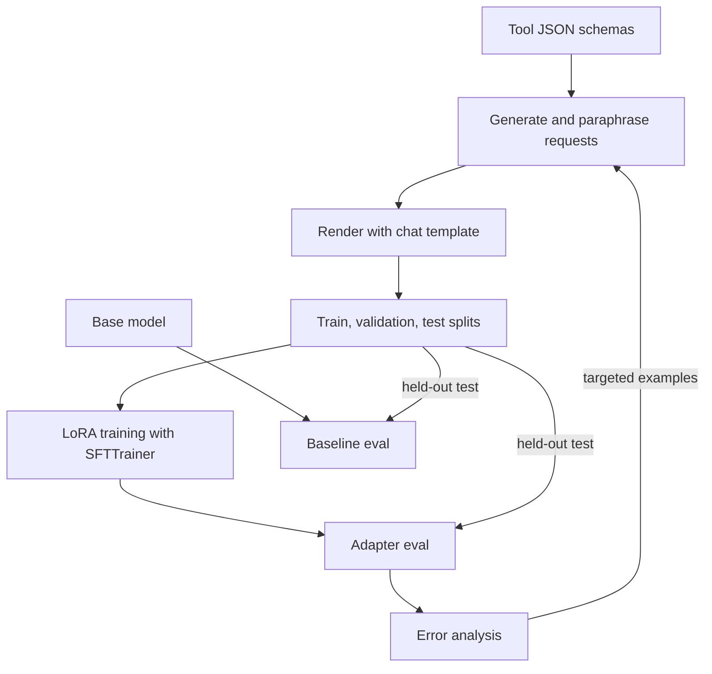

## TL;DR
Fine-tune a 0.5-1.5B instruct model with LoRA so it emits valid, correct tool calls for your own tools,
and prove the gain on a held-out eval. It shows you can measure and fix an SLM's agent behaviour.

## For agent builders
- **Skills it exercises.** Synthetic data from tool schemas, chat templates with tools, LoRA training with
  TRL and PEFT, reading loss curves, and a tool-call eval (parse rate, schema validity, exact match,
  no-call accuracy).
- **Earlier lessons it uses.** PEFT and LoRA, supervised fine-tuning, synthetic data generation,
  fine-tuning an SLM for an agent task, tool calling with SLMs, constrained generation and SLM evals.
- **Where it shows up in agents.** Cheap, local or on-device agents run small models that often break the
  tool-call format; a small adapter is how teams fix that for a fixed tool set.
- **What you can skip.** Full fine-tuning, multi-GPU training and RLHF. One GPU with 16 GB (or a free
  notebook GPU) is enough at this size.

## Lab
### Task
Decide whether a trained LoRA adapter may replace the base model in a weather agent, using recorded
outputs so no GPU is needed.

Training is the easy part; this lab fixes the three things that make an
adapter look better than it is: training data that leaks test templates, one averaged score that hides a
no-tool regression, and a release gate that checks only the parse rate.
- **Time box:** 45-75 minutes.
- **Prerequisites:** PEFT and LoRA, synthetic data generation, and evaluating SLMs on your agent tasks;
  this lesson's scorer.
- **Runs offline:** `TEST` holds 8 held-out prompts (5 need a call, 3 do not) with outputs recorded from a
  base 0.5B model and its adapter, in Qwen2.5-style `<tool_call>` tags. Rerun with your own recorded
  generations after you train.
- **Needs:** `pip install jsonschema pytest`; checked with Python 3.12, jsonschema 4.26.0 and pytest 9.1.1.

### Starter code
```python
# toolcall_eval.py: leak-free data, a sliced tool-call eval and a release gate for a LoRA adapter, offline
import json, re
from jsonschema import ValidationError, validate

SCHEMAS = {"get_weather": {"type": "object", "required": ["city"], "additionalProperties": False,
                           "properties": {"city": {"type": "string"}, "unit": {"type": "string", "enum": ["c", "f"]}}}}
CALL = re.compile(r"<tool_call>\s*(.*?)\s*</tool_call>", re.S)       # Qwen2.5-style tags

TEMPLATES = {                                    # id -> (request template, unit or None for no tool)
    "t1": ("What's the weather in {city}?", ""),
    "t2": ("Is it cold in {city}, in fahrenheit?", "f"),
    "t3": ("Weather for {city} please", ""),
    "t4": ("Tell me a joke about {city}", None),
    "t5": ("Thanks, that's all for {city}!", None),
}
CITIES = ["Oslo", "Lima", "Pune", "Accra", "Quito"]

def tc(args):
    return '<tool_call>\n{"name": "get_weather", "arguments": ' + json.dumps(args) + '}\n</tool_call>'

# Held-out test set with RECORDED outputs from the base model and the trained adapter (no GPU needed).
TEST = [
    {"t": "t3", "user": "Weather for Accra please", "gold": {"city": "Accra"},
     "base": "Sure! " + tc({"city": "Accra"}), "adapter": tc({"city": "Accra"})},
    {"t": "t3", "user": "Weather for Quito please", "gold": {"city": "Quito"},
     "base": '<tool_call>{"name": "get_weather", "arguments": {"city": "Quito"}</tool_call>',
     "adapter": tc({"city": "Quito"})},
    {"t": "t6", "user": "Quito weather in fahrenheit", "gold": {"city": "Quito", "unit": "f"},
     "base": '{"name": "get_weather", "arguments": {"city": "Quito", "unit": "f"}}',
     "adapter": tc({"city": "Quito", "unit": "f"})},
    {"t": "t7", "user": "How warm is Hanoi in celsius", "gold": {"city": "Hanoi", "unit": "c"},
     "base": tc({"city": "Hanoi", "unit": "celsius"}), "adapter": tc({"city": "Hanoi", "unit": "c"})},
    {"t": "t8", "user": "Hanoi forecast", "gold": {"city": "Hanoi"},
     "base": tc({"city": "Hanoi"}).replace("get_weather", "weather"),
     "adapter": tc({"city": "Hanoi", "unit": "c"})},
    {"t": "t4", "user": "Tell me a joke about Accra", "gold": None,
     "base": "Why did the cloud stay in Accra? It liked the sunshine.", "adapter": tc({"city": "Accra"})},
    {"t": "t9", "user": "Thanks, bye!", "gold": None, "base": "Bye!", "adapter": "Goodbye!"},
    {"t": "t10", "user": "What can you do?", "gold": None,
     "base": "I can look up the weather.", "adapter": "I can look up the weather for any city."},
]

def make_train_rows():
    # YOUR CODE 1: never train on a template the test set uses; drop every template id found in TEST
    rows = []
    for tid, (text, unit) in TEMPLATES.items():
        for city in CITIES:
            gold = None if unit is None else {"city": city, **({"unit": unit} if unit else {})}
            rows.append({"t": tid, "user": text.format(city=city), "gold": gold})
    return rows

def score(output, gold):
    m = CALL.search(output)
    if gold is None:
        return {"parsed": True, "valid": True, "correct": m is None}
    if not m:
        return {"parsed": False, "valid": False, "correct": False}
    try:
        call = json.loads(m.group(1))
        validate(call["arguments"], SCHEMAS[call["name"]])
    except json.JSONDecodeError:
        return {"parsed": False, "valid": False, "correct": False}
    except (KeyError, TypeError, ValidationError):
        return {"parsed": True, "valid": False, "correct": False}
    return {"parsed": True, "valid": True, "correct": call["name"] == "get_weather" and call["arguments"] == gold}

def report(test, who):
    rows = [(r["gold"], score(r[who], r["gold"])) for r in test]
    # YOUR CODE 2: averaging tool and no-tool prompts together hides regressions. Return
    # {"tool": {"parsed", "valid", "correct"} over prompts with a gold call,
    #  "no_tool": {"no_call_accuracy"} over prompts whose gold is None}, each rounded to 3 places
    return {k: round(sum(s[k] for _, s in rows) / len(rows), 3) for k in ("parsed", "valid", "correct")}

def gate(base, adapter):
    """Return (ship, reasons). Bar: tool parse rate >= 0.98, exact match >= base + 0.20,
    no-tool accuracy >= base. Every failed check adds a reason."""
    # YOUR CODE 3: check all three criteria on the sliced report, not only the parse rate
    return adapter["parsed"] >= 0.98, []

def main():
    train = make_train_rows()
    leaked = {r["user"] for r in train} & {r["user"] for r in TEST}
    print("train rows:", len(train), "| leaked test prompts:", len(leaked))
    base, adapter = report(TEST, "base"), report(TEST, "adapter")
    print("base:   ", base)
    print("adapter:", adapter)
    print("ship:", *gate(base, adapter))

if __name__ == "__main__":
    main()
```

As given it prints `leaked test prompts: 3` and `ship: True []`. The averaged adapter score of 0.75 looks
like a clear win over the base model's 0.5, which is exactly how the regression hides.

### Expected output
```
train rows: 15 | leaked test prompts: 0
base:    {'tool': {'parsed': 0.6, 'valid': 0.2, 'correct': 0.2}, 'no_tool': {'no_call_accuracy': 1.0}}
adapter: {'tool': {'parsed': 1.0, 'valid': 1.0, 'correct': 0.8}, 'no_tool': {'no_call_accuracy': 0.667}}
ship: False ['no-tool accuracy 0.667 < base 1.0']
```

Recompute the slices: the base parses 3 of 5 tool outputs (a missing brace and a missing tag fail) and
only 1 of 5 is schema-valid, because `celsius` breaks the enum and `weather` is an invented tool.

The adapter gets 4 of 5 exact (it adds an unasked `unit`) but calls a tool on 1 of 3 no-tool prompts.

### Tests
```python
# test_toolcall_eval.py: run with `pytest -q`
import copy
import toolcall_eval as m

def test_training_data_does_not_leak_test_templates():
    train = m.make_train_rows()
    assert {r["t"] for r in train} == {"t1", "t2", "t5"}
    assert len(train) == 15
    assert not {r["user"] for r in train} & {r["user"] for r in m.TEST}

def test_report_slices_tool_and_no_tool_prompts():
    assert m.report(m.TEST, "base") == {"tool": {"parsed": 0.6, "valid": 0.2, "correct": 0.2},
                                        "no_tool": {"no_call_accuracy": 1.0}}
    assert m.report(m.TEST, "adapter") == {"tool": {"parsed": 1.0, "valid": 1.0, "correct": 0.8},
                                           "no_tool": {"no_call_accuracy": 0.667}}

def test_gate_blocks_a_no_tool_regression():
    base, adapter = m.report(m.TEST, "base"), m.report(m.TEST, "adapter")
    assert m.gate(base, adapter) == (False, ["no-tool accuracy 0.667 < base 1.0"])
    fixed = copy.deepcopy(adapter)
    fixed["no_tool"]["no_call_accuracy"] = 1.0
    assert m.gate(base, fixed) == (True, [])
    fixed["tool"]["correct"] = 0.3                     # only +0.10 over the base model
    assert m.gate(base, fixed)[0] is False
```

All three fail on the starter. With 3 no-tool prompts one false call moves the slice by 0.333, so a real
gate needs the lesson's 200-prompt test set; the small set here keeps every number checkable by hand.

### Failure scenarios
- **Paraphrase training data from the test set.** Exact match jumps on the test set and falls on live
  traffic. Debug by intersecting train and test on template id and on normalised text, as the first test
  does, before every training run.
- **Report one blended score.** The adapter "wins" while calling tools on small talk. Debug by always
  printing the no-tool slice next to the tool slice, and the false-call count.
- **Change the chat template between training and eval.** Parse rate drops to near zero although loss
  looked fine. Debug by printing one rendered training row and one raw generation side by side.
- **Gate on parse rate alone.** A model that always emits a valid call passes. Debug by adding a
  deliberately bad candidate to CI and checking that the gate rejects it.

### Submission
- **Repo** with `toolcall_eval.py` and the unchanged tests; `pytest -q` shows 3 passed.
- **Program output** matching the expected block, and the same table rerun on your own adapter's
  recorded generations if you trained one.
- **An error-analysis list** grouping every failed test prompt for both models (parse, schema, wrong
  argument, false call).
- **A short note** with the targeted training examples you would add to fix the false call, and how you
  keep them out of the test templates.
- **Evaluated on** tests passing, zero leaked prompts, and a gate that names every failed criterion.

## Why it exists
- **Small models fumble tool calls.** They emit broken JSON, invent tool names, skip required arguments or
  call a tool when they should just answer, and each failure breaks the agent loop.
- **Prompting has a ceiling.** Few-shot examples help, but they cost context on every call and still
  leave a long tail of format errors on small models.
- **A narrow task suits LoRA.** Formatting calls for 3-5 fixed tools is a small behaviour change, so a
  rank-16 adapter trained on 1,000-2,000 examples is often enough.
- **The eval is the real skill.** Anyone can run a training script; showing a held-out before/after table
  with the right metrics is what hiring teams look for.

## How it works
### Stack and data
- **Stack:** Python, `transformers`, `peft`, `trl`, `datasets`, `jsonschema` for scoring, one GPU; base
  model a small instruct model whose chat template supports tools (for example `Qwen/Qwen2.5-0.5B-Instruct`).
- **Data:** 3-5 tools with JSON schemas; 1,000-2,000 synthetic user requests across all tools, generated
  from templates and paraphrased by a larger model, with about 20% that need no tool at all.
- **Splits:** hold out 10% for validation and a separate 200-example test set written with different
  templates, so the eval measures generalisation, not memorised phrasing.

### Milestones
1. **Baseline eval.** Prompt the base model with the tools through its chat template and score the test
   set. This number is what the adapter must beat.
2. **Dataset.** Render each example with `apply_chat_template(messages, tools=TOOLS, tokenize=False)` and
   inspect a few by eye, because a template mismatch silently trains the wrong format.
3. **LoRA training.** Train with TRL's `SFTTrainer` and a `LoraConfig` (rank 16, alpha 32, all linear
   layers), 1-3 epochs at a learning rate around 2e-4; watch train and validation loss.
4. **Eval the adapter.** Generate on the test set with the adapter loaded and score parse rate, schema
   validity, exact call match and no-call accuracy.
5. **Error analysis.** Group remaining failures (wrong tool, missing argument, extra call) and add targeted
   examples for the top group, then retrain once.
6. **Serve and compare.** Load the adapter in your agent loop (or merge it and serve with vLLM) and compare
   it with constrained decoding on the base model.

### Acceptance tests
- **Parse rate** of 98% or more on the held-out test set, up from the baseline.
- **Exact call match** at least 20 points above the base model, with the table in the README.
- **No regressions on no-tool prompts:** false tool calls stay at or below the baseline rate.
- **Reproducible:** one script rebuilds the dataset, trains and evaluates with fixed seeds.

## Diagram
Follow the loop: data comes from your tool schemas, the adapter is trained and evaluated against the same
held-out test set as the baseline, and error analysis feeds new examples back.



## Examples
### Starter code: render the data and train a LoRA adapter
TRL's argument names change between releases (for example how prompt tokens are masked), so check the
current SFTTrainer docs for your installed version. Print one rendered example before training.

```python
from datasets import Dataset
from peft import LoraConfig
from transformers import AutoTokenizer
from trl import SFTConfig, SFTTrainer

BASE = "Qwen/Qwen2.5-0.5B-Instruct"
tok = AutoTokenizer.from_pretrained(BASE)
TOOLS = [{"type": "function", "function": {
    "name": "get_weather", "description": "Current weather for a city",
    "parameters": {"type": "object", "required": ["city"],
                   "properties": {"city": {"type": "string"}, "unit": {"type": "string", "enum": ["c", "f"]}}}}}]

def render(user, call=None, reply=None):
    """call = (name, args) for a tool call, or reply = text when no tool is needed."""
    if call:
        out = {"role": "assistant", "content": "",
               "tool_calls": [{"type": "function", "function": {"name": call[0], "arguments": call[1]}}]}
    else:
        out = {"role": "assistant", "content": reply}
    msgs = [{"role": "user", "content": user}, out]
    return {"text": tok.apply_chat_template(msgs, tools=TOOLS, tokenize=False)}

rows = [render("What's the weather in Oslo in fahrenheit?", call=("get_weather", {"city": "Oslo", "unit": "f"})),
        render("Thanks, that's all!", reply="You're welcome!")]       # replace with 1,000-2,000 generated rows
print(rows[0]["text"])                                                 # check the tool-call format by eye

ds = Dataset.from_list(rows * 50).train_test_split(test_size=0.1, seed=0)
lora = LoraConfig(r=16, lora_alpha=32, lora_dropout=0.05, target_modules="all-linear", task_type="CAUSAL_LM")
args = SFTConfig(output_dir="out", num_train_epochs=2, learning_rate=2e-4,
                 per_device_train_batch_size=8, logging_steps=10, seed=0,
                 eval_strategy="steps", eval_steps=10)       # without this, validation loss is never computed
trainer = SFTTrainer(model=BASE, args=args, train_dataset=ds["train"], eval_dataset=ds["test"], peft_config=lora)
trainer.train()
trainer.save_model("out/adapter")                                      # saves only the small adapter weights
```

### Starter code: the tool-call scorer
Run the same scorer on base and adapter outputs. The tag pattern matches Qwen2.5-style `<tool_call>` blocks;
change it to whatever your model's template emits.

```python
import json, re
from jsonschema import ValidationError, validate

CALL = re.compile(r"<tool_call>\s*(.*?)\s*</tool_call>", re.S)     # Qwen2.5-style tags; match your template

def score(output, gold, schemas):
    """gold is {"name": ..., "arguments": {...}} or None when no tool should be called.
    schemas maps each tool name to its "parameters" JSON schema."""
    m = CALL.search(output)
    if gold is None:
        return {"parsed": True, "valid": True, "correct": m is None}
    if not m:
        return {"parsed": False, "valid": False, "correct": False}
    try:
        call = json.loads(m.group(1))
        validate(call["arguments"], schemas[call["name"]])
    except json.JSONDecodeError:
        return {"parsed": False, "valid": False, "correct": False}
    except (KeyError, TypeError, ValidationError):
        return {"parsed": True, "valid": False, "correct": False}
    return {"parsed": True, "valid": True,
            "correct": call["name"] == gold["name"] and call["arguments"] == gold["arguments"]}

def report(rows):
    n = len(rows)
    return {k: round(sum(r[k] for r in rows) / n, 3) for k in ("parsed", "valid", "correct")}
```

### Milestones, time estimates and done-when checks
| Milestone | Time | Done when |
|---|---|---|
| Tools, scorer and baseline | 3 h | a baseline table of parse, valid, correct and no-call accuracy |
| Synthetic dataset and splits | 4 h | 1,000+ rendered rows, a test set from different templates, 5 inspected by eye |
| LoRA training run | 2 h | validation loss falls and flattens; the adapter is saved |
| Adapter eval | 2 h | the same table for the adapter, beside the baseline |
| Error analysis and retrain | 3 h | the top failure group shrinks on the rerun |
| Agent integration and comparison | 3 h | the agent loop runs with the adapter; a row compares constrained decoding |

### Worked scenario: a before/after report (illustrative numbers)
| Metric on 200 held-out prompts | Base 0.5B | Base plus few-shot | LoRA adapter |
|---|---|---|---|
| Parse rate | 71% | 84% | 99% |
| Schema-valid calls | 64% | 78% | 97% |
| Exact call match | 52% | 63% | 88% |
| No-tool prompts answered without a call | 82% | 85% | 96% |
| Prompt tokens per call | 410 | 1,150 | 410 |

The adapter wins on accuracy without the few-shot token cost; the next step is checking whether constrained
decoding alone closes most of the parse gap.

## Production patterns
- **Keep the eval set out of training.** Write the test set from different templates or by hand, and never
  paraphrase from it, because leaked phrasing inflates every number.
- **Version adapter, data and template together.** Store the base model revision, chat template, tool
  schemas and dataset hash with each adapter, since a changed schema silently invalidates it.
- **Pair the adapter with validation.** Even at 99% parse rate, the agent loop should validate arguments
  against the schema and retry or fall back, because the last 1% still reaches production.
- **Serve adapters cheaply.** Merge the adapter for a single-purpose deployment, or load several LoRA
  adapters on one base model where your serving engine supports it; check its current docs.
- **Portfolio polish.** A README with the before/after table, the loss curve, a model card listing data
  and limits, a one-command reproduce script and the adapter on a model hub if licences allow.

## Trade-offs
- **LoRA vs constrained decoding.** Grammar or JSON-schema constrained decoding (Outlines, vLLM guided
  decoding, llama.cpp grammars) guarantees valid syntax with no training, but cannot teach which tool to
  pick or when not to call one; LoRA can.
- **Small model plus adapter vs a larger model.** The adapter is cheap to serve and runs locally, but you
  own retraining whenever tools change; a larger model handles new tools with no training.
- **Synthetic vs logged data.** Synthetic data is fast and covers every tool, but is less varied than real
  requests; mix in logged, reviewed traffic once you have it.
- **Higher rank vs overfitting.** Larger ranks and more epochs fit faster but can memorise templates; watch
  validation loss and the held-out test set.

## Pitfalls
- **Template mismatch.** Training text rendered differently from inference prompts teaches a format the
  agent never sees. Symptom: great training loss, no eval gain. Fix: render both with the same
  `apply_chat_template` call and inspect them.
- **No negative examples.** A model trained only on tool calls calls tools for "thanks". Fix: about 20% of
  examples that need a plain reply, and a no-call metric.
- **Measuring on the training distribution.** Paraphrases of training prompts score high and prove
  little. Fix: a test set from different templates, written before training.
- **Forgetting general ability.** Heavy training on one format can degrade normal answers. Fix: include
  plain chat examples and spot-check unrelated prompts after training.

## When to use
- **Prerequisites:** Python, the LoRA and SFT lessons, and access to one GPU with about 16 GB (a free
  notebook GPU works at 0.5B).
- **Suits:** engineers targeting local, on-device or cost-sensitive agents, and anyone who wants a
  fine-tuning story backed by an eval.
- **Avoid when:** a hosted model already calls your tools reliably, or tools change weekly; prompting and
  constrained decoding are cheaper to maintain.
- **Measure:** parse rate, schema validity, exact call match, no-call accuracy and prompt tokens per call.

## Role lens
- **Engineer:** Builds the synthetic dataset, trains the adapter and runs the before/after eval with the
  same scorer, then integrates the adapter into the agent loop.
- **Architect:** Decides when an adapter beats a larger model or constrained decoding, and how adapters are
  versioned and retrained as tool schemas change.
- **FDE:** Fine-tunes a small model on a customer's fixed tool set for an on-premise deployment and shows
  the held-out accuracy table before rollout.

## Check yourself
**Q:** After LoRA training, validation loss is low and the adapter scores 99% on your test set, but in the
real agent it still breaks the tool-call format often. What are the likely causes and how do you check?
**A:** The training and test data probably do not match how the agent prompts the model. Common causes are
a different chat template or system prompt at inference, tools rendered in another order or format, and a
test set made from the same templates as training, so the 99% reflects memorised phrasing. Check by
logging the exact prompt the agent sends and comparing it with a rendered training example, then build a
test set from real agent prompts. Retrain with data rendered through the same template and system prompt
the agent uses.

## Interview questions
### Why did you fine-tune instead of using constrained decoding?
- **Different problems.** Constrained decoding guarantees the JSON parses, but not that the model picks the
  right tool, fills the right arguments or skips tools when it should.
- **I measured both.** The report compares base, base with constraints and the adapter, so the choice is
  backed by the exact-match and no-call numbers.

### How did you build and protect the evaluation set?
- **Separate generation.** The test set came from different templates and hand-written requests, created
  before training, with no paraphrases of training prompts.
- **Several metrics.** Parse rate, schema validity, exact match and no-call accuracy are reported
  separately, so one strong number cannot hide a weak one.

### Your loss curve drops fast and validation loss starts rising after the first epoch. What do you do?
- **That is overfitting.** The adapter is memorising templates; keep the checkpoint with the lowest
  validation loss.
- **Then fix the data.** Add more varied phrasing, reduce epochs or rank, and confirm on the held-out test
  set rather than the loss alone.

### The product adds two new tools next month. What happens to your adapter?
- **It needs retraining.** The adapter learned the old tool set, so new schemas need new examples and a new
  eval run before release.
- **Plan for it.** Keep the data generator and eval in one script, version adapters with their tool
  schemas, and fall back to a larger model until the new adapter passes.

### How would you serve this adapter in production?
- **Merge or multiplex.** Merge it into the base weights for one dedicated deployment, or load several
  adapters on one base model if the serving engine supports multi-LoRA.
- **Keep guardrails.** The agent still validates every call against the schema and retries or escalates on
  failure.

## Quiz
### Q: What can LoRA fine-tuning fix that JSON-constrained decoding cannot?
- [ ] Output that is not valid JSON
- [x] Choosing the wrong tool or calling a tool when a plain reply was needed
- [ ] The number of tokens in the system prompt
- [ ] The model's maximum context length
> Constrained decoding forces valid syntax but does not change which tool the model chooses or whether it
> calls one. Training on correct examples, including no-tool cases, changes that behaviour.

### Q: Why should about a fifth of the training examples need no tool call?
- [ ] To reduce training time
- [ ] Because LoRA requires balanced classes
- [x] So the model learns when not to call a tool instead of calling one for every message
- [ ] To keep the dataset under the context window
> A model trained only on tool calls learns that every message needs one. Negative examples plus a no-call
> metric keep it answering plain messages directly.

### Q: Training loss is low but the eval shows no gain. What should you check first?
- [ ] Increase the LoRA rank
- [ ] Train for more epochs
- [x] Whether training text and inference prompts are rendered with the same chat template and tools
- [ ] Switch to full fine-tuning
> If training examples use a different format from the prompts the agent sends, the model learns a pattern
> it never sees at inference. Comparing a rendered training example with a logged agent prompt finds this
> quickly.

## Use cases & projects
### Use cases
- **On-device or offline agents.** A small model with an adapter calls a handful of local tools without a
  network connection.
- **Cost-sensitive routing tiers.** The adapter handles routine tool calls and escalates hard cases to a
  larger model.
- **Stretch goal: distillation.** Log a large model's tool calls on real prompts and train the adapter on
  them, then compare with synthetic-only data.
- **Stretch goal: multi-LoRA serving.** Serve two adapters for two tool sets on one base model and measure
  latency per request.
- **Stretch goal: constrained plus adapter.** Combine the adapter with schema-constrained decoding and see
  whether the last percent of parse errors disappears.

### Mini project
**Baseline tool-call eval warm-up (1-2 hours).**
- **Goal:** measure how badly a small model formats tool calls before deciding to fine-tune.
- **Steps:** define two tools with JSON schemas; write 40 test prompts (10 needing no tool); run a 0.5B
  instruct model locally with its chat template and tools; score parse rate, schema validity, exact match
  and no-call accuracy with the scorer above.
- **Done when:** a table shows the four metrics, and you can say in two sentences whether prompting,
  constrained decoding or fine-tuning is the next step.
