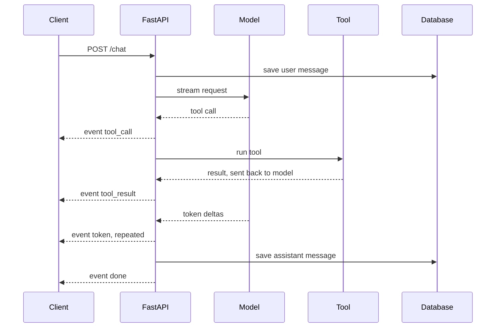

## TL;DR
Build a FastAPI endpoint that streams an agent's tokens and tool events over Server-Sent Events, survives
disconnects and persists the final message. It proves you can ship the backend every chat agent needs.

## For agent builders
- **Skills it exercises.** Async generators, the SSE wire format, typed event schemas, cancellation on
  client disconnect, heartbeats through proxies, persistence of partial answers and async tests.
- **Earlier lessons it uses.** Server-sent events, StreamingResponse, cancellation on disconnect, model
  streaming, structured event streams and testing with pytest-asyncio.
- **Where it shows up in agents.** Every chat UI shows tokens as they arrive and shows "calling search..."
  while a tool runs; that is an event stream, not a single JSON response.
- **What you can skip.** WebSockets, unless you need the client to talk mid-stream; SSE is one-way, plain
  HTTP and enough for almost every chat agent. Frontend frameworks are optional; a curl client works.

## Lab
### Task
Fix a chat agent's SSE endpoint so a browser can parse it, a closed tab stops the model, and every turn
is saved. The endpoint streams a `tool_call`, a `tool_result` and the answer tokens from a recorded fake
model, so you can test disconnects deterministically.
- **Time box:** 60-90 minutes.
- **Prerequisites:** server-sent events, StreamingResponse, and cancellation on client disconnect.
- **Runs offline:** `FakeModel` replays one tool call and five tokens and counts the chunks it produced,
  which is how the tests see tokens wasted after a disconnect.
- **Needs:** `pip install fastapi httpx pytest`; checked with Python 3.12, FastAPI 0.161.1, Starlette
  1.9.0, httpx 0.28.1 and pytest 9.1.1.

### Starter code
```python
# sse_chat.py: an SSE chat endpoint with tool events, disconnects and persistence, offline
import asyncio, json
from fastapi import FastAPI, Request
from fastapi.responses import StreamingResponse
from pydantic import BaseModel

app = FastAPI()
DB = {}                     # message_id -> {"text", "status"}; stands in for SQLite or Postgres

class ChatIn(BaseModel):
    conversation_id: str
    message: str

def sse(event: str, data: dict, eid: int) -> str:
    # YOUR CODE 1: an SSE event must end with an empty line; this one does not
    return f"id: {eid}\nevent: {event}\ndata: {json.dumps(data)}\n"

def parse(stream_text: str):
    """Client side: split the stream into (id, event, data) tuples."""
    out = []
    for block in stream_text.split("\n\n"):
        fields = dict(line.split(": ", 1) for line in block.splitlines() if ": " in line)
        if "event" in fields:
            out.append((int(fields["id"]), fields["event"], json.loads(fields["data"])))
    return out

class FakeModel:
    """Recorded upstream stream: one tool call, then tokens. Counts chunks to expose wasted work."""
    def __init__(self, tokens=("The ", "weather ", "is ", "sunny", ".")):
        self.tokens, self.produced, self.closed = list(tokens), 0, False

    async def stream(self, messages):
        try:
            yield {"tool_call": {"name": "get_weather", "args": {"city": "Paris"}}}
            for t in self.tokens:
                self.produced += 1
                await asyncio.sleep(0)
                yield {"token": t}
        finally:
            self.closed = True

def run_tool(call):
    return {"city": call["args"]["city"], "forecast": "sunny"}

async def events(model, messages, message_id, is_disconnected):
    eid, parts, status = 0, [], "interrupted"     # stays interrupted unless the loop finishes
    upstream = model.stream(messages)
    yield sse("start", {"message_id": message_id}, eid)
    try:
        async for chunk in upstream:
            # YOUR CODE 2: stop as soon as the client has gone (await is_disconnected())
            eid += 1
            if "tool_call" in chunk:
                yield sse("tool_call", chunk["tool_call"], eid)
                eid += 1
                yield sse("tool_result", run_tool(chunk["tool_call"]), eid)
            else:
                parts.append(chunk["token"])
                yield sse("token", {"text": chunk["token"]}, eid)
        else:
            status = "complete"
    except Exception:
        status = "error"
        yield sse("error", {"code": "upstream_failed"}, eid + 1)
    finally:
        # YOUR CODE 3: close the upstream stream, then save "".join(parts) and status
        # to DB[message_id], so a disconnect still leaves an interrupted message
        pass
    if status == "complete":
        yield sse("done", {"chars": sum(map(len, parts))}, eid + 1)

@app.post("/chat")
async def chat(body: ChatIn, request: Request):
    messages = [{"role": "user", "content": body.message}]
    gen = events(FakeModel(), messages, f"{body.conversation_id}-a1", request.is_disconnected)
    return StreamingResponse(gen, media_type="text/event-stream",
                             headers={"Cache-Control": "no-cache", "X-Accel-Buffering": "no"})

async def collect(model, message_id, disconnect_after=None):
    """Drive events() like a client that leaves after `disconnect_after` token events."""
    seen = []
    async def gone():
        return disconnect_after is not None and seen.count("token") >= disconnect_after
    text = ""
    async for raw in events(model, [{"role": "user", "content": "weather?"}], message_id, gone):
        text += raw
        seen = [e for _, e, _ in parse(text)]
    return parse(text), model.closed       # read before asyncio.run finalises leftover generators

def main():
    for label, cut in (("complete", None), ("disconnect", 2)):
        model, mid = FakeModel(), f"c-{label}"
        evs, closed = asyncio.run(collect(model, mid, cut))
        print(f"{label}:", " ".join(e for _, e, _ in evs))
        print("  saved:", DB.get(mid), "| upstream chunks:", model.produced, "| closed:", closed)

if __name__ == "__main__":
    main()
```

As given, both runs print only `done`: without the blank line the client sees one merged event. The
disconnect run also reports `upstream chunks: 5` and `saved: None`, so the tab that left still paid for
every token and left a gap in the history.

### Expected output
```
complete: start tool_call tool_result token token token token token done
  saved: {'text': 'The weather is sunny.', 'status': 'complete'} | upstream chunks: 5 | closed: True
disconnect: start tool_call tool_result token token
  saved: {'text': 'The weather ', 'status': 'interrupted'} | upstream chunks: 3 | closed: True
```

The third chunk is produced before the disconnect check sees the client has gone, which is what "stops
within one chunk" means in the acceptance tests.

### Tests
```python
# test_sse_chat.py: run with `pytest -q`
import asyncio
from fastapi.testclient import TestClient
import sse_chat as m

def test_each_frame_ends_with_a_blank_line():
    two = m.sse("token", {"text": "a"}, 1) + m.sse("token", {"text": "b"}, 2)
    assert two.endswith("\n\n")
    assert [d["text"] for _, _, d in m.parse(two)] == ["a", "b"]

def test_endpoint_streams_typed_events_in_order():
    with TestClient(m.app) as c:
        r = c.post("/chat", json={"conversation_id": "c1", "message": "weather?"})
    assert r.headers["content-type"].startswith("text/event-stream")
    evs = m.parse(r.text)
    assert [e for _, e, _ in evs] == ["start", "tool_call", "tool_result"] + ["token"] * 5 + ["done"]
    ids = [i for i, _, _ in evs]
    assert ids == sorted(set(ids))                       # strictly increasing

def test_disconnect_stops_and_closes_upstream():
    model = m.FakeModel()
    evs, closed = asyncio.run(m.collect(model, "c2", disconnect_after=2))
    assert [e for _, e, _ in evs][-1] == "token"         # no done after a disconnect
    assert model.produced <= 3                           # stopped within one chunk
    assert closed                                        # closed by us, not by garbage collection

def test_partial_answer_saved_as_interrupted():
    asyncio.run(m.collect(m.FakeModel(), "c3", disconnect_after=2))
    assert m.DB["c3"] == {"text": "The weather ", "status": "interrupted"}

def test_complete_answer_saved():
    asyncio.run(m.collect(m.FakeModel(), "c4"))
    assert m.DB["c4"] == {"text": "The weather is sunny.", "status": "complete"}
```

All five fail on the starter. The `closed` check is the subtle one: breaking out of `async for` does not
close the upstream generator, garbage collection does it later, and a real provider connection keeps
streaming until then. Fixing only the `break` still fails this test.

### Failure scenarios
- **Drop the blank line from `sse`.** `curl -N` shows text but the browser `EventSource` fires nothing,
  and `parse` returns one event. Debug by dumping the raw bytes with `curl -N | od -c` and checking for
  `\n\n` after each `data:` line.
- **Break without `aclose()`.** Tokens stop reaching the client, but provider usage per interrupted turn
  stays near a full answer. Debug by counting chunks produced upstream versus events sent, and log when
  the upstream stream closes.
- **Save after the loop instead of in `finally`.** Complete turns are stored, interrupted ones vanish,
  because a server that stops iterating closes the generator at a `yield` and code after the loop never
  runs. Debug by disconnecting mid-stream and querying the stored status.
- **Block the event loop in a tool.** Replace `run_tool` with one that calls `time.sleep(2)`, and every
  other open stream freezes. Debug with asyncio debug mode, which logs slow callbacks, or by timing two
  concurrent requests.

### Submission
- **Repo** with `sse_chat.py` and the unchanged tests; `pytest -q` shows 5 passed.
- **Program output** matching the expected block.
- **A raw stream capture** from `curl -N -X POST` against `uvicorn sse_chat:app`, showing the blank line
  after each event.
- **A short note** on why `aclose()` matters with a real provider SDK, and what you log per interrupted
  turn.
- **Evaluated on** tests passing, ids strictly increasing, `interrupted` turns persisted, and no `done`
  after a disconnect.

## Why it exists
- **Waiting 20 seconds for a full answer feels broken.** Streaming usually shows the first token within a
  second or two, so perceived latency drops even though total time is the same.
- **Agents emit more than text.** Tool calls, tool results, citations and a final usage summary all need
  typed events so the UI can render a step list, not one growing string.
- **Naive streaming breaks in production.** Proxies buffer the response, load balancers kill idle
  connections during long tool calls, and abandoned streams keep burning tokens.
- **It is a common take-home task.** Teams hiring agent engineers often ask for exactly this endpoint, and
  a clean, tested version stands out.

## How it works
### Stack and data
- **Stack:** FastAPI with `StreamingResponse`, an async LLM client with `stream=True`, SQLite or Postgres
  for conversations, `httpx` plus `pytest-asyncio` for tests, curl or a 30-line HTML page as the client.
- **Data:** none beyond conversations you create; seed three scripted conversations for tests.
- **Event schema:** `start`, `token`, `tool_call`, `tool_result`, `error`, `done`, each with a JSON body
  and an increasing `id`.

### Milestones
1. **Plain stream.** `POST /chat` returns `text/event-stream`; each model delta becomes
   `event: token` plus a JSON `data:` line and a blank line.
2. **Typed events.** Wrap tokens in `start` and `done` events; `done` carries token usage and the message
   id. Add `error` so failures reach the client as data, not a dropped connection.
3. **Tool events.** Add one fake tool (for example a weather lookup); emit `tool_call` before running it
   and `tool_result` after, then stream the model's final answer.
4. **Disconnects and heartbeats.** Check `await request.is_disconnected()` in the loop and stop the
   upstream stream; send a `: ping` comment every 15 seconds during slow tool calls.
5. **Persistence.** Save the user message before streaming and the assistant message at the end, marked
   `interrupted` if the client left, so a reload shows what happened.
6. **Deploy.** Run behind nginx or a cloud load balancer with buffering off, and confirm tokens arrive
   incrementally through the proxy.

### Acceptance tests
- **Order:** the first event is `start`, the last is `done` or `error`, and ids strictly increase.
- **Disconnect:** closing the client stops upstream generation within one chunk, checked with a fake model.
- **Persistence:** after a disconnect, the stored assistant message exists with status `interrupted`.
- **Proxy:** curl through the proxy prints tokens one by one, not in one burst at the end.

## Diagram
Follow one turn: the user message is saved, a `start` event goes out, tool and token events stream as the
model and tool run, and the final message is saved whether the stream finished or the client left.



## Examples
### Starter code: the SSE endpoint
`stream_tokens` is the only model-specific part, so tests can replace it with a fake. It uses the OpenAI
Python SDK's async streaming; any provider with async streaming fits the same shape.

```python
import json, os
from fastapi import FastAPI, Request
from fastapi.responses import StreamingResponse
from openai import AsyncOpenAI
from pydantic import BaseModel

app = FastAPI()
client = AsyncOpenAI()
MODEL = os.environ.get("CHAT_MODEL", "set-me")

class ChatIn(BaseModel):
    conversation_id: str
    message: str

def sse(event: str, data: dict, eid: int) -> str:
    return f"id: {eid}\nevent: {event}\ndata: {json.dumps(data)}\n\n"

async def stream_tokens(messages):
    stream = await client.chat.completions.create(model=MODEL, messages=messages, stream=True)
    async for chunk in stream:
        if chunk.choices and chunk.choices[0].delta.content:
            yield chunk.choices[0].delta.content

@app.post("/chat")
async def chat(body: ChatIn, request: Request):
    messages = [{"role": "user", "content": body.message}]      # load history from your DB here

    async def events():
        eid, parts, status = 0, [], "interrupted"      # stays interrupted unless the loop finishes
        yield sse("start", {"conversation_id": body.conversation_id}, eid)
        try:
            async for text in stream_tokens(messages):
                if await request.is_disconnected():
                    break
                eid += 1
                parts.append(text)
                yield sse("token", {"text": text}, eid)
            else:
                status = "complete"                     # the stream ended without a break
        except Exception:
            status = "error"
            yield sse("error", {"code": "upstream_failed"}, eid + 1)
        finally:
            pass  # save "".join(parts) with status here; finally also runs when the server closes the stream
        if status == "complete":
            yield sse("done", {"chars": sum(map(len, parts))}, eid + 1)

    return StreamingResponse(events(), media_type="text/event-stream",
                             headers={"Cache-Control": "no-cache", "X-Accel-Buffering": "no"})
```

### Starter test: event order with a fake model
`httpx.ASGITransport` runs the app in-process. It checks content and order, not timing, so verify
incremental delivery separately with curl through the proxy.

```python
import httpx, pytest
import app as appmod                     # the endpoint above, saved as app.py

async def fake_tokens(messages):
    for t in ["Hel", "lo", "!"]:
        yield t

@pytest.mark.asyncio
async def test_events_in_order(monkeypatch):
    monkeypatch.setattr(appmod, "stream_tokens", fake_tokens)
    transport = httpx.ASGITransport(app=appmod.app)
    async with httpx.AsyncClient(transport=transport, base_url="http://test") as c:
        async with c.stream("POST", "/chat", json={"conversation_id": "c1", "message": "hi"}) as r:
            assert r.headers["content-type"].startswith("text/event-stream")
            names = [l.split(": ", 1)[1] async for l in r.aiter_lines() if l.startswith("event:")]
    assert names == ["start", "token", "token", "token", "done"]
```

### Milestones, time estimates and done-when checks
| Milestone | Time | Done when |
|---|---|---|
| Plain token stream | 2 h | `curl -N` prints tokens as they arrive |
| Typed events and errors | 2 h | the ordering test passes with a fake model |
| Fake tool with tool events | 3 h | the client shows a tool step before the answer |
| Disconnect handling and heartbeats | 3 h | a test proves generation stops after the client closes |
| Persistence of complete and interrupted turns | 2 h | reloading a conversation shows both statuses |
| Proxy deployment | 2 h | tokens arrive incrementally through nginx or the load balancer |

## Production patterns
- **Disable proxy buffering.** Send `X-Accel-Buffering: no` and `Cache-Control: no-cache`, or set
  `proxy_buffering off` in nginx, because a buffering proxy turns a stream into one late burst.
- **Heartbeat long silences.** Emit an SSE comment line (`: ping`) every 15-30 seconds while tools run, so
  idle-timeout rules on load balancers do not cut the connection.
- **Version the event schema.** Put a `type` and a schema version in each event and document them in the
  README, because the frontend and any SDK clients depend on them like an API.
- **Trace a turn as one span tree.** Record time to first token, total tokens, tool durations and the
  final status on one trace, and alert on the share of `interrupted` and `error` turns.
- **Portfolio polish.** A README with the event table and a curl example, the ordering and disconnect
  tests in CI, a GIF of the UI streaming a tool step, and a Dockerfile with an nginx config.

## Trade-offs
- **SSE vs WebSockets.** SSE is one-way over plain HTTP, works with standard auth and proxies, and the
  browser `EventSource` reconnects automatically; WebSockets win only when the client must send messages
  mid-stream, such as interrupting with voice.
- **POST with fetch vs GET with EventSource.** `EventSource` supports only GET and no custom body, so many
  apps POST the message, get a turn id, then open `GET /turns/{id}/events`; fetch with a stream reader
  keeps one request but loses automatic reconnect.
- **Stopping vs finishing on disconnect.** Stopping saves tokens; finishing in the background lets the user
  reload and see the full answer. Long agent tasks usually belong in a background job instead.

## Pitfalls
- **Blocking calls inside the generator.** A synchronous SDK call or `time.sleep` freezes the event loop,
  so every other stream stalls. Fix: use async clients, or run blocking work in a thread.
- **Forgetting the blank line.** Each SSE event must end with an empty line; without it the browser
  buffers events and nothing renders. Fix: build every event with one helper and test it.
- **Ignoring disconnects.** Abandoned tabs keep the model generating and the bill growing. Fix: check
  `request.is_disconnected()` and cancel upstream work, and measure tokens spent on interrupted turns.
- **Losing the partial answer.** A crash or disconnect leaves no assistant message, so the history has a
  gap. Fix: save with an `interrupted` status in a `finally` path.

## When to use
- **Prerequisites:** async Python, basic FastAPI and one LLM SDK; the FastAPI SSE and StreamingResponse
  lessons cover the pieces.
- **Suits:** backend engineers moving into agent work and anyone who needs a frontend-ready agent API for
  their other projects.
- **Avoid when:** the agent runs for minutes; stream progress from a background job runner instead of
  holding one request open.
- **Measure:** time to first token, interrupted-turn share, tokens wasted after disconnect and p95 stream
  duration.

## Role lens
- **Engineer:** Writes the event generator, the disconnect handling and the async tests, and checks
  incremental delivery through the real proxy before calling it done.
- **Architect:** Chooses SSE or WebSockets, defines the versioned event schema, and decides when a turn is
  long enough to move into a background job.
- **FDE:** Debugs a customer's corporate proxy that buffers streams, using headers, curl traces and the
  heartbeat setting to get tokens flowing again.

## Check yourself
**Q:** Locally your SSE endpoint streams tokens smoothly, but in production users see nothing for 20
seconds and then the whole answer at once. What is happening and how do you fix it?
**A:** Something between the app and the browser is buffering the response, usually nginx, a CDN or a
load balancer. Locally there is no proxy, so chunks arrive as written. Fix it by sending
`X-Accel-Buffering: no` and `Cache-Control: no-cache`, setting `proxy_buffering off` (or the platform's
equivalent), and making sure no compression middleware waits for the full body. Verify with `curl -N`
through the real proxy, and add heartbeats so long tool calls do not hit idle timeouts after the fix.

## Interview questions
### Why did you choose SSE over WebSockets for your chat backend?
- **The data flows one way.** The server streams tokens and events; the client only sends a new message,
  which is an ordinary POST, so a bidirectional socket adds nothing.
- **SSE is plain HTTP.** It passes through standard auth, proxies and load balancers, and `EventSource`
  reconnects on its own and sends `Last-Event-ID`, so a server that stores events can resume the stream.

### How do you stop paying for tokens when a user closes the tab mid-answer?
- **Detect the disconnect.** Check `await request.is_disconnected()` between chunks, or catch the
  cancellation the server raises when the client goes away.
- **Cancel upstream.** Break out of the model stream and close it, then save the partial answer as
  `interrupted` and record how many tokens were spent.

### How would you stream tool calls, not just text, to the frontend?
- **Use typed events.** Emit `tool_call` with the tool name and arguments, then `tool_result` with a
  summary, then `token` events for the final answer.
- **Keep a stable schema.** Version the event types and document them so the UI renders a step list and
  other clients can parse the same stream.

### What breaks when you put this behind a load balancer, and how do you test for it?
- **Buffering and idle timeouts.** Proxies may hold the whole response or close idle connections during
  long tool calls.
- **Test through the real path.** Run `curl -N` through the deployed proxy, check tokens arrive one by one,
  and run a slow fake tool to confirm heartbeats keep the connection open.

### When would you not stream at all?
- **Machine consumers.** A batch pipeline or another agent that needs a validated JSON object gains nothing
  from partial tokens.
- **Very long tasks.** Minute-long agent runs belong in a background job with a status endpoint, because
  one open request is fragile over that span.

## Quiz
### Q: Why do production SSE endpoints often send a comment line every 15-30 seconds?
- [ ] To tell the browser which event type comes next
- [x] To keep proxies and load balancers from closing an idle connection during long tool calls
- [ ] Because the SSE format requires one event per 30 seconds
- [ ] To flush the model provider's buffer
> Load balancers and proxies close connections that are idle for too long. A comment line such as
> `: ping` carries no data for the client but keeps the connection active while a slow tool runs.

### Q: What is the main limitation of the browser `EventSource` API for a chat backend?
- [ ] It cannot receive JSON data
- [ ] It does not reconnect after a network drop
- [x] It only issues GET requests without a request body
- [ ] It requires WebSocket support on the server
> `EventSource` opens a GET request and cannot send a body, so many apps POST the message first and then
> open a GET stream for that turn, or use fetch with a stream reader instead.

### Q: A client disconnects halfway through an answer. What should a well-built endpoint do?
- [ ] Keep generating so the full answer is cached
- [ ] Raise an exception so the error is logged
- [x] Stop the upstream model stream and save the partial answer with an interrupted status
- [ ] Retry the request with the same conversation id
> Stopping upstream saves tokens, and saving the partial message keeps the conversation history accurate.
> If the user must see full answers after reloads, the work belongs in a background job instead.

## Use cases & projects
### Use cases
- **Customer-facing chat agents.** Token streaming plus tool events let the UI show progress while the
  agent searches or calls APIs.
- **Internal copilots behind corporate proxies.** Heartbeats and buffering headers are the difference
  between a working stream and a 20-second freeze.
- **Stretch goal: resumable streams.** Store events per turn and replay from `Last-Event-ID` so a dropped
  connection resumes instead of restarting.
- **Stretch goal: stop button.** Add `POST /turns/{id}/cancel` that cancels the generation task and emits
  a final `cancelled` event.
- **Stretch goal: load test.** Hold 500 concurrent streams with a fake model and record memory per stream
  and event-loop lag.

### Mini project
**Fake-model SSE warm-up (1-2 hours).**
- **Goal:** get the SSE wire format and event order right before touching a real model.
- **Steps:** write a FastAPI `GET /demo` that streams `start`, a fake `tool_call` and `tool_result` pair,
  ten `token` events from a fake async generator with a short sleep between them, and `done`; watch it
  with `curl -N`; open it from a tiny HTML page using `EventSource` that shows the tool step above the text.
- **Done when:** tokens appear one by one in both curl and the browser, and a pytest checks the exact event
  order.
