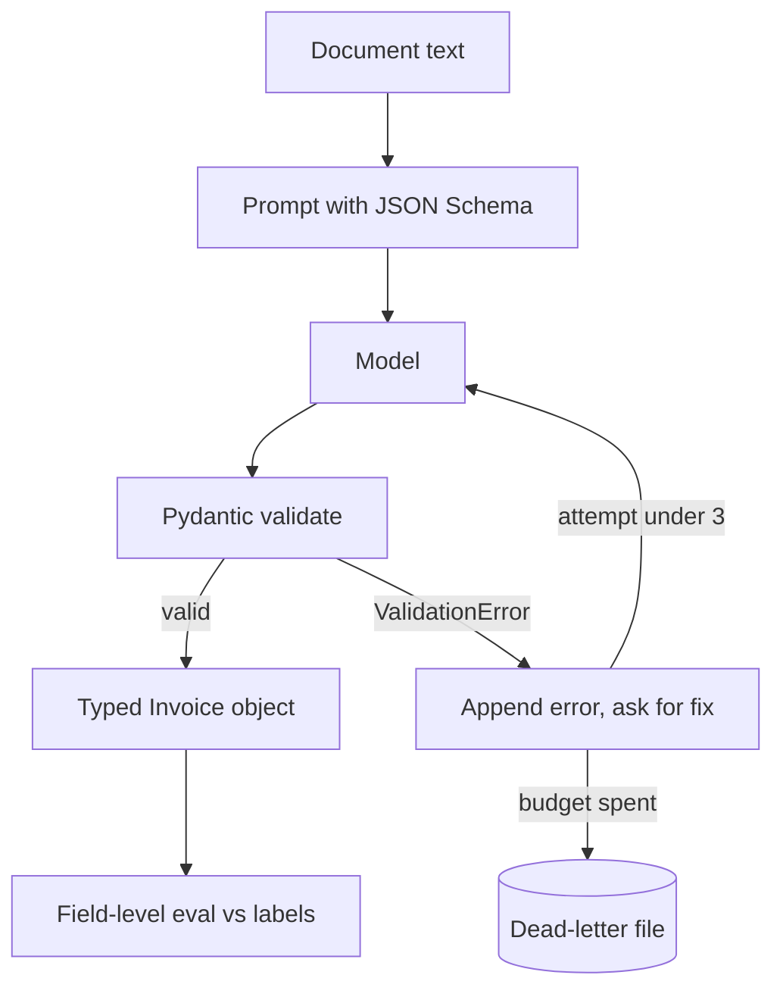

## TL;DR
Build a pipeline that turns messy documents (invoices, receipts or job posts) into validated Pydantic objects,
feeds validation errors back to the model for bounded retries, and reports field-level accuracy on a labelled set.

## For agent builders
- **Skills it exercises.** Pydantic v2 models, field and model validators, JSON Schema generation, provider
  structured-output modes, error-feedback retries, and field-level evaluation.
- **Earlier lessons it uses.** Pydantic and Instructor for the libraries, structured outputs and constrained
  generation for the provider side, typed tool contracts for why the same models guard tool arguments.
- **Why it matters for agents.** Every tool call is a structured extraction: the model fills arguments that your code
  must trust. The validate-then-retry loop here is the same loop that guards tool inputs.
- **What you can skip.** OCR and PDF layout parsing. Start from plain text; add parsing as a stretch goal.

## Why it exists
- **"Valid JSON" is not "correct data".** Schema-constrained output guarantees shape, not that the total equals the
  line items or the date is real. Business rules need validators.
- **Retries without feedback waste money.** Re-asking the same prompt often returns the same mistake; sending the
  exact validation error usually fixes it in one extra call.
- **Unbounded retries hide bad inputs.** A cap (for example 3 attempts) plus a dead-letter file turns silent loops
  into a review queue with numbers.
- **Field accuracy is the honest metric.** "92% of documents parsed" can hide that `total` is wrong on 1 in 5;
  per-field accuracy on 30-50 labelled documents shows where to work.

## How it works
### Stack and data
- **Python 3.11+, Pydantic v2,** one provider SDK, optionally Instructor to compare against your own loop.
- **Data:** 30-50 documents of one type, from public sample invoices or synthetic ones you generate, each with a
  hand-written expected JSON. Include 5 that are deliberately broken (missing totals, two currencies).

### The loop
1. **Prompt** with the model's JSON Schema (`Invoice.model_json_schema()`) and the document text.
2. **Parse and validate** with `Invoice.model_validate_json(raw)`; field constraints and validators run here.
3. **On `ValidationError`,** append the model's reply and the error text, ask for corrected JSON, and try again.
4. **Stop** on success or after `max_attempts`; failures go to a dead-letter file with every attempt.

### Milestones
1. **Schema.** Models with types, constraints and two business validators. Acceptance: unit tests reject 6 bad examples.
2. **Single-shot extraction.** One call per document. Acceptance: a run over the set writes results and a parse rate.
3. **Retry with feedback.** The loop above. Acceptance: parse rate and average attempts reported before and after.
4. **Labelled eval.** Compare each field with the expected JSON. Acceptance: a per-field accuracy table.
5. **Dead letters and cost.** Log attempts, tokens and failures. Acceptance: cost per document and failure list in README.
6. **Compare approaches.** Your loop vs Instructor vs the provider's strict structured-output mode. Acceptance: one table.

## Diagram
Validation sits between the model and your data; errors loop back with their exact messages until the attempt
budget runs out.



## Examples
### Starter code: models, validators and the retry loop
The model call is injected, so the loop is unit-testable with a fake.

```python
import json
from datetime import date
from decimal import Decimal
from typing import Callable
from pydantic import BaseModel, Field, ValidationError, field_validator, model_validator

class LineItem(BaseModel):
    description: str
    quantity: int = Field(gt=0)
    unit_price: Decimal = Field(ge=0)

class Invoice(BaseModel):
    vendor: str
    invoice_number: str
    issue_date: date
    currency: str = Field(pattern=r"^[A-Z]{3}$")
    items: list[LineItem] = Field(min_length=1)
    total: Decimal

    @field_validator("vendor")
    @classmethod
    def not_blank(cls, v: str) -> str:
        if not v.strip():
            raise ValueError("vendor must not be blank")
        return v.strip()

    @model_validator(mode="after")
    def total_matches_items(self):
        expected = sum(i.quantity * i.unit_price for i in self.items)
        if abs(expected - self.total) > Decimal("0.01"):
            raise ValueError(f"total {self.total} != sum of items {expected}")
        return self

def extract(text: str, llm: Callable[[list[dict]], str], max_attempts: int = 3) -> Invoice:
    schema = json.dumps(Invoice.model_json_schema())      # real JSON, not a Python dict repr
    messages = [{"role": "system", "content": f"Extract the invoice as JSON matching this schema: {schema}"},
                {"role": "user", "content": text}]
    last_error = None
    for attempt in range(1, max_attempts + 1):
        raw = llm(messages)
        try:
            return Invoice.model_validate_json(raw)
        except ValidationError as e:
            last_error = e
            messages += [{"role": "assistant", "content": raw},
                         {"role": "user", "content": f"Validation failed:\n{e}\nReturn corrected JSON only."}]
    raise RuntimeError(f"extraction failed after {max_attempts} attempts: {last_error}")
```

A real `llm` can wrap the OpenAI SDK: `client.chat.completions.create(model=..., messages=messages,
response_format={"type": "json_object"})` and return `choices[0].message.content`.

### The same extraction with Instructor
Instructor wraps a client so `response_model` and `max_retries` run a similar validate-and-retry loop for you.

```python
import instructor
from openai import OpenAI

client = instructor.from_openai(OpenAI())
invoice = client.chat.completions.create(
    model="your-model-id",            # a current model ID; check the docs
    response_model=Invoice,
    max_retries=3,
    messages=[{"role": "user", "content": document_text}],
)
```

Check the current Instructor docs for the client constructor for your provider; it has changed across versions.

### Milestone plan with time estimates
| Milestone | Time | Done when |
|---|---|---|
| 1. Schema and validators | 2 h | 6 bad examples rejected in unit tests |
| 2. Single-shot run | 1-2 h | parse rate printed for the whole set |
| 3. Retry with feedback | 2 h | parse rate and mean attempts before vs after |
| 4. Field-level eval | 2-3 h | accuracy per field, worst field named |
| 5. Dead letters and cost | 2 h | cost per document and failure file in README |
| 6. Compare approaches | 2-3 h | own loop vs Instructor vs strict mode table |

## Production patterns
- **Constrain shape at the provider, rules in Pydantic.** Use the provider's strict structured-output or JSON mode so
  syntax errors vanish, and keep cross-field rules (totals, date order) in validators, because no decoder enforces them.
- **Bounded retries with the real error.** Send the `ValidationError` text back, cap at 2-3 attempts, and record the
  attempt count per document. A rising mean attempt count is an early signal of prompt or input drift.
- **Dead-letter queue, not silent drops.** Write failed documents with all attempts to a file or table for review,
  and report the dead-letter rate in every run.
- **Field-level eval in CI.** Keep the labelled set in the repo and fail the build when any key field's accuracy
  drops, because a prompt change can fix `vendor` while breaking `total`.
- **Normalise before comparing.** Compare decimals as numbers, dates as dates and strings case-folded, so the eval
  measures extraction errors rather than formatting differences.

## Trade-offs
- **Own loop vs Instructor.** Your loop is 20 lines you fully understand; Instructor adds provider adapters, streaming
  partials and hooks, at the cost of another dependency whose API moves.
- **Strict schema mode vs prompt-only JSON.** Strict mode removes parse failures but supports a subset of JSON Schema
  on some providers; prompt-only works everywhere but needs more retries.
- **More retries vs cost and latency.** Each retry costs a full call; after 2-3 attempts the input is usually the
  problem, so send it to review instead.
- **Rich validators vs extraction recall.** Strict rules reject bad data but also reject odd-but-valid documents;
  measure how many real documents each rule rejects.

## Pitfalls
- **Retrying without the error message.** The model repeats the same mistake and attempts hit the cap. Include the
  exact validation error and the previous reply.
- **Floats for money.** `0.1 + 0.2` is not exactly 0.3 in binary floats, so exact totals checks fail at random and
  a loose tolerance can hide real cent errors. Use `Decimal`.
- **Measuring parse rate only.** Valid but wrong values pass unnoticed. Score each field against labels.
- **Labels written from model output.** Copying the model's answer into the expected file bakes its errors into the
  eval. Label from the source document.
- **Schema too permissive.** Everything `Optional[str]` always validates and teaches you nothing. Use real types and constraints.

## When to use
- **Prerequisites.** Python typing, the Pydantic lesson, and one provider API key.
- **Suits.** A first agent project for engineers coming from backend work, and anyone building document workflows.
- **Avoid when.** Documents follow a fixed template; a regex or template parser is cheaper and exact.
- **Measure.** Parse rate, mean attempts, per-field accuracy, dead-letter rate and cost per document.

## Role lens
- **Engineer:** Writes typed models and validators, the bounded retry loop and a field-level eval, and can show
  which field fails most and why.
- **Architect:** Standardises the pattern for every model-produced structure, tool arguments included: provider
  constraints for shape, validators for rules, budgets for retries.
- **FDE:** Builds the labelled set with the customer's real documents in the first week and reports field accuracy
  they can compare with manual entry.

## Check yourself
**Q:** Your extraction pipeline reports a 98% parse rate, but finance says one in six invoice totals is wrong. What is
missing, and what do you add?
**A:** Parse rate only measures that output matched the schema, not that values are correct. Add a labelled set and
per-field accuracy so `total` is measured directly. Add a model validator that checks the total against the sum of line
items (using `Decimal`), so mismatches trigger a retry with the error text instead of passing. Send documents that still
fail after the retry budget to a dead-letter queue, and track total accuracy and dead-letter rate in CI.

## Interview questions
### Why validate with Pydantic if the provider already supports structured outputs?
- **Structured outputs guarantee shape,** not business rules: a total that disagrees with line items or a date in the
  future still conforms to the schema.
- **Pydantic validators enforce those rules** in code you test, and their error messages make good retry feedback.

### How did you design the retry loop and its budget?
- **Each retry includes the previous reply and the exact validation error,** which usually fixes it in one more call.
- **I capped attempts at 3,** because further retries rarely helped in my eval, and sent remaining failures to a dead-letter file.

### How do you evaluate an extraction system?
- **A labelled set of real documents** with expected values, compared field by field after normalising numbers, dates and strings.
- **Report per-field accuracy, parse rate, mean attempts and cost,** and gate releases on the fields that matter most.

### When would you choose Instructor over your own loop?
- **When you need several providers,** streaming partial objects or hooks for logging, since it packages those around the same pattern.
- **Keep your own loop** when the dependency's API churn costs more than 20 lines of code you control.

### How does this relate to tool calling in agents?
- **Tool arguments are structured extraction:** the model fills a schema your code must trust before executing.
- **The same models and validators guard tools,** returning validation errors as tool results so the agent corrects itself.

## Quiz
### Q: A provider's strict JSON Schema mode is enabled. Which error can still reach your code?
- [ ] Invalid JSON syntax
- [ ] A missing required field
- [x] A total that does not equal the sum of the line items
- [ ] A string where an integer is required
> Schema-constrained decoding enforces shape and types, but cross-field business rules are invisible to it. A Pydantic
> model validator catches the mismatch.

### Q: What makes a retry after a validation failure most likely to succeed?
- [ ] Raising the temperature
- [ ] Sending the same prompt again
- [x] Including the previous reply and the exact validation error in the next request
- [ ] Removing the schema from the prompt
> The model needs to know what was wrong. The error text points at the field and rule, so the corrected reply usually
> passes on the next attempt.

### Q: Why use `Decimal` rather than `float` for invoice amounts?
- [ ] `Decimal` is faster
- [x] Floating-point rounding makes exact money comparisons fail unpredictably
- [ ] JSON cannot store floats
- [ ] Pydantic rejects floats
> Binary floats cannot represent many decimal amounts exactly, so totals that should match differ by tiny amounts and
> trigger false validation failures.

## Use cases & projects
### Use cases
- **Accounts-payable intake.** Extract invoices from email bodies and attachments, with totals checks and a review
  queue for dead letters.
- **Typed tool arguments.** Reuse the same validate-and-retry wrapper around every tool call in the CLI assistant.
- **Resume or job-post parsing.** Extract skills, years and locations into a searchable table, with per-field accuracy.
- **PDF and scanned input.** Add a document parser and measure how much accuracy drops versus clean text.
- **Small-model extraction.** Run the same eval with a small local model and report where it matches a large one.

### Mini project
**Warm-up: one model, ten documents (1-2 hours).**
- **Goal:** see validation errors drive successful retries on real model output.
- **Steps:** define a three-field model (for example `vendor`, `date`, `total`) with one validator; write 10 short
  documents and their expected values; run single-shot, then with the retry loop; count parse failures and wrong fields.
- **Done when:** you have a two-row table (single-shot vs retry) of parse rate and field accuracy, and one logged example
  of an error message that the model fixed on its second attempt.
