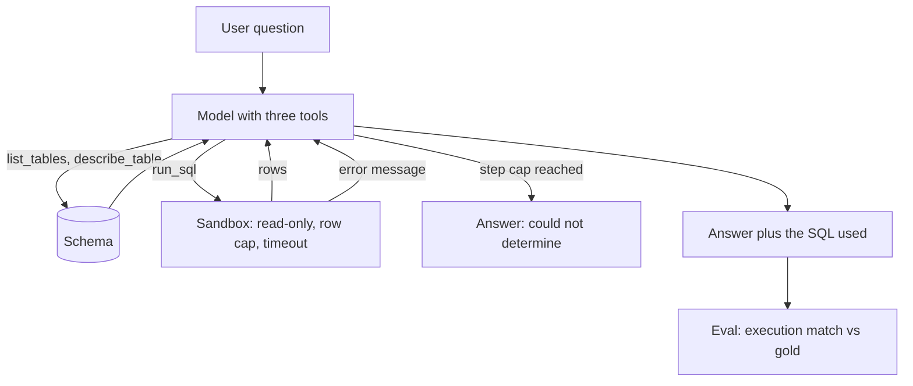

## TL;DR
Build an agent that answers questions over the Chinook sample database by exploring the schema, writing
SQL and fixing its own errors, behind a read-only sandbox. It proves safe tool design and measured accuracy.

## For agent builders
- **Skills it exercises.** Tool design (list, describe, run), least-privilege execution, error messages
  the model can act on, a self-correction loop, and execution-accuracy evals on a golden set.
- **Earlier lessons it uses.** Tool calling, typed tool contracts, tool permissions and least privilege,
  SQL basics, golden datasets, error analysis and sandboxing.
- **Where it shows up in agents.** "Ask your data" assistants, BI copilots and support agents that look up
  orders all generate queries against real databases.
- **What you can skip.** Fine-tuning a SQL model. A capable general model with good tools and a few
  examples is the baseline teams start from.

## Lab
### Task
Make a text-to-SQL agent loop self-correct and measure it honestly. The sandbox is done; the three bugs
are in what surrounds it: tool errors the model cannot act on, a loop that drops tool results, and an
eval that compares SQL text instead of results.
- **Time box:** 60-90 minutes.
- **Prerequisites:** tool calling, tool permissions and least privilege, SQL joins, and golden datasets.
- **Runs offline:** a mini Chinook (4 tables, 3 artists) is built in a temp file, and `fake_model` is a
  recorded policy that reacts to tool results the way a tool-calling model does: it follows a hint in an
  error, retries blindly without one, and one question makes it explore forever.
- **Needs:** Python 3.10+ (stdlib `sqlite3`) and `pip install pytest`; checked with Python 3.12 and
  pytest 9.1.1.

### Starter code
```python
# sql_agent.py: a self-correcting text-to-SQL loop over a sandboxed mini Chinook, offline
import sqlite3, statistics, tempfile, time
from pathlib import Path

def build_db(path):
    c = sqlite3.connect(path)
    c.executescript("""
    CREATE TABLE Artist(ArtistId INTEGER PRIMARY KEY, Name TEXT);
    CREATE TABLE Album(AlbumId INTEGER PRIMARY KEY, Title TEXT, ArtistId INTEGER REFERENCES Artist);
    CREATE TABLE Genre(GenreId INTEGER PRIMARY KEY, Name TEXT);
    CREATE TABLE Track(TrackId INTEGER PRIMARY KEY, Name TEXT, AlbumId INTEGER, GenreId INTEGER);
    INSERT INTO Artist VALUES (1,'AC/DC'),(2,'Accept'),(3,'Aerosmith');
    INSERT INTO Album VALUES (1,'For Those About To Rock We Salute You',1),(2,'Let There Be Rock',1),
                             (3,'Balls to the Wall',2);
    INSERT INTO Genre VALUES (1,'Rock'),(2,'Jazz');
    INSERT INTO Track VALUES (1,'Go Down',2,1),(2,'Whole Lotta Rosie',2,1),(3,'Balls to the Wall',3,1);
    """)
    c.commit(); c.close()

ALLOWED = {sqlite3.SQLITE_SELECT, sqlite3.SQLITE_READ, sqlite3.SQLITE_FUNCTION}

def open_readonly(path):
    db = sqlite3.connect(f"file:{path}?mode=ro", uri=True)
    db.set_authorizer(lambda action, *a: sqlite3.SQLITE_OK if action in ALLOWED else sqlite3.SQLITE_DENY)
    return db

def list_tables(db):
    return [r[0] for r in db.execute("SELECT name FROM sqlite_master WHERE type='table' ORDER BY name")]

def describe_table(db, table):
    row = db.execute("SELECT sql FROM sqlite_master WHERE type='table' AND name=?", (table,)).fetchone()
    return row[0] if row else f"unknown table {table!r}; call list_tables"

def run_sql(db, sql, max_rows=50, timeout_s=3.0):
    deadline = time.monotonic() + timeout_s
    db.set_progress_handler(lambda: 1 if time.monotonic() > deadline else 0, 10_000)
    try:
        cur = db.execute(sql)
        rows = cur.fetchmany(max_rows + 1)
        return {"rows": rows[:max_rows], "truncated": len(rows) > max_rows}
    except (sqlite3.Error, sqlite3.Warning) as e:
        # YOUR CODE 1: make errors actionable for the model: "no such table" -> add "; call list_tables",
        # "no such column" -> add "; call describe_table", "not authorized" -> add "; this tool is read-only"
        return {"error": str(e)}
    finally:
        db.set_progress_handler(None, 0)

TOOLS = {"list_tables": list_tables, "describe_table": describe_table, "run_sql": run_sql}

def fake_model(question, transcript):
    """Recorded policy standing in for a tool-calling LLM. transcript: [(action, observation)]."""
    last = transcript[-1][1] if transcript else None
    if "genre" in question.lower():
        return {"tool": "list_tables", "args": {}}               # an explorer that never commits
    k = "artists" if "artists" in question.lower() else "albums"
    first = {"artists": "SELECT COUNT(*) FROM Artists",
             "albums": "SELECT Album.Title FROM Album JOIN Artist ON Album.Artist = Artist.Name "
                       "WHERE Artist.Name = 'AC/DC'"}
    fixed = {"artists": "SELECT COUNT(*) FROM Artist",
             "albums": "SELECT Album.Title FROM Album JOIN Artist ON Album.ArtistId = Artist.ArtistId "
                       "WHERE Artist.Name = 'AC/DC'"}
    if last is None:
        return {"tool": "run_sql", "args": {"sql": first[k]}}
    if isinstance(last, dict) and "rows" in last:
        return {"answer": str(last["rows"]), "sql": transcript[-1][0]["args"]["sql"]}
    if isinstance(last, dict) and "error" in last:
        if "call list_tables" in last["error"]:
            return {"tool": "list_tables", "args": {}}
        if "call describe_table" in last["error"]:
            return {"tool": "describe_table", "args": {"table": "Album"}}
        return transcript[-1][0]                                  # blind retry of the same call
    return {"tool": "run_sql", "args": {"sql": fixed[k]}}        # after a schema look-up

def run_agent(question, db, model=fake_model, max_steps=8):
    transcript = []
    for _ in range(max_steps):
        action = model(question, transcript)
        if "answer" in action:
            return {"answer": action["answer"], "sql": action["sql"], "tool_calls": len(transcript)}
        obs = TOOLS[action["tool"]](db, **action["args"])
        # YOUR CODE 2: the model can only self-correct if it sees what the tool returned
        transcript.append((action, None))
    return {"answer": "could not determine", "sql": None, "tool_calls": len(transcript)}

GOLDEN = [
    ("How many artists are there?", "SELECT COUNT(*) FROM Artist"),
    ("Which albums does AC/DC have?",
     "SELECT Title FROM Album WHERE ArtistId = (SELECT ArtistId FROM Artist WHERE Name = 'AC/DC')"),
    ("Which genre has the most tracks?",
     "SELECT g.Name FROM Genre g JOIN Track t ON t.GenreId = g.GenreId GROUP BY g.GenreId "
     "ORDER BY COUNT(*) DESC LIMIT 1"),
]

def evaluate(db, golden, agent=run_agent):
    results = [(gold, agent(q, db)) for q, gold in golden]
    # YOUR CODE 3: score by execution match (same rows; order matters only if gold has ORDER BY),
    # not by comparing SQL text; a None sql is wrong
    norm = lambda s: " ".join(s.lower().split())
    correct = sum(r["sql"] is not None and norm(r["sql"]) == norm(gold) for gold, r in results)
    calls = [r["tool_calls"] for _, r in results]
    return {"accuracy": round(correct / len(golden), 3), "median_tool_calls": statistics.median(calls)}

def main():
    with tempfile.TemporaryDirectory() as d:
        build_db(Path(d) / "chinook_mini.db")
        db = open_readonly(Path(d) / "chinook_mini.db")
        for q, _ in GOLDEN:
            r = run_agent(q, db)
            print(f"{q} -> {r['answer']} ({r['tool_calls']} tool calls)")
        print("delete:", run_sql(db, "DELETE FROM Track")["error"])
        print("eval:", evaluate(db, GOLDEN))
        db.close()

if __name__ == "__main__":
    main()
```

As given, every question ends in `could not determine (8 tool calls)` and the eval prints an accuracy of
`0.0`: the model never sees an error, so it repeats its first query until the step cap.

### Expected output
```
How many artists are there? -> [(3,)] (3 tool calls)
Which albums does AC/DC have? -> [('For Those About To Rock We Salute You',), ('Let There Be Rock',)] (3 tool calls)
Which genre has the most tracks? -> could not determine (8 tool calls)
delete: not authorized; this tool is read-only
eval: {'accuracy': 0.667, 'median_tool_calls': 3}
```

The AC/DC answer is right although its SQL is a join and the gold SQL is a subquery, so a string
comparison scores 1 of 3 (0.333) and execution match scores 2 of 3 (0.667). Tool calls are 3, 3 and 8,
so the median is 3.

### Tests
```python
# test_sql_agent.py: run with `pytest -q`
import pytest
import sql_agent as m

@pytest.fixture
def db(tmp_path):
    m.build_db(tmp_path / "t.db")
    conn = m.open_readonly(tmp_path / "t.db")
    yield conn
    conn.close()

def test_errors_name_the_next_step(db):
    assert m.run_sql(db, "SELECT * FROM Artists")["error"].endswith("; call list_tables")
    assert m.run_sql(db, "SELECT Artist FROM Album")["error"].endswith("; call describe_table")
    assert m.run_sql(db, "DELETE FROM Track")["error"].endswith("; this tool is read-only")
    assert m.run_sql(db, "SELECT COUNT(*) FROM Track")["rows"] == [(3,)]   # reads still work

def test_agent_self_corrects_from_errors(db):
    r = m.run_agent("How many artists are there?", db)
    assert r == {"answer": "[(3,)]", "sql": "SELECT COUNT(*) FROM Artist", "tool_calls": 3}
    r = m.run_agent("Which albums does AC/DC have?", db)
    assert r["tool_calls"] == 3 and "Let There Be Rock" in r["answer"]

def test_step_cap_stops_an_explorer(db):
    r = m.run_agent("Which genre has the most tracks?", db)
    assert r == {"answer": "could not determine", "sql": None, "tool_calls": 8}

def test_eval_uses_execution_match(db):
    assert m.evaluate(db, m.GOLDEN) == {"accuracy": 0.667, "median_tool_calls": 3}
```

Three of the four fail on the starter, one per bug. The step-cap test already passes: it is a guard, so
your loop changes cannot remove the cap that bounds cost on a question the agent cannot answer.

### Failure scenarios
- **Return the raw database error.** Traces show the same `run_sql` call repeated until the cap. Debug by
  grouping trace steps by identical arguments; repeats after an error mean the error gave no next step.
- **Append the action but not the observation.** Every question costs the full 8 calls even when the
  first query worked. Debug by printing the transcript the model receives at step 2.
- **Score by SQL text.** Accuracy drops when the model's style changes, with no change in answers. Debug
  by listing failures whose result rows equal the gold rows.
- **Widen `ALLOWED` to make an error go away.** Adding `SQLITE_INSERT` or `SQLITE_ATTACH` silently
  breaks the sandbox. Debug by keeping the delete line in the output as a check, and add the lesson's
  safety suite to CI.

### Submission
- **Repo** with `sql_agent.py` and the unchanged tests; `pytest -q` shows 4 passed.
- **Program output** matching the expected block.
- **One trace** of the AC/DC question: each step's action and observation, showing the error, the
  `describe_table` call and the corrected join.
- **A short note** on why the genre question fails and which fix (a forced `run_sql` after N schema calls,
  or a worked join example) you would try first, measured how.
- **Evaluated on** tests passing, errors that name the next tool, and accuracy computed from result sets.

## Why it exists
- **Everyone wants to ask their database questions.** It is one of the most requested agent features, and
  a working demo over a real schema shows end-to-end skill.
- **One-shot generation is fragile.** The model guesses column names and joins; letting it inspect the
  schema and see execution errors fixes most of those mistakes.
- **Generated SQL is untrusted code.** A prompt-injected or confused model can write `DELETE` or run a
  query that scans for minutes, so the sandbox is part of the project, not an extra.
- **Accuracy is measurable.** Execution accuracy on a golden set gives a hard number, unlike most chat
  demos.

## How it works
### Stack and data
- **Stack:** Python, `sqlite3`, one LLM with tool calling (any provider or LiteLLM), pytest, and a tracing
  tool such as Langfuse to inspect trajectories.
- **Data:** the Chinook sample database (a music store: `Artist`, `Album`, `Track`, `Invoice`,
  `InvoiceLine`, `Customer`, `Employee` and more), downloaded as a SQLite file.
- **Golden set:** 40 questions with gold SQL, from single-table counts to three-way joins and date
  filters, written by you and checked by running the gold query.

### Milestones
1. **Read-only sandbox.** Open the file with `mode=ro`, install an authorizer that allows only reads and
   selects, cap rows and stop queries after a time limit.
2. **Three tools.** `list_tables`, `describe_table(table)` and `run_sql(sql)`, each with a JSON schema and
   errors written for the model, such as "unknown table; call list_tables".
3. **Agent loop.** The model explores, writes SQL, reads the result or error and retries, with a cap of
   about 8 tool calls, then answers in words with the SQL it used.
4. **Golden-set eval.** Run the 40 questions, compare predicted and gold results with execution match,
   and record tool calls and tokens per question.
5. **Error analysis.** Label each failure (wrong join, wrong filter, ambiguous question, date handling)
   and fix the top category with better tool descriptions or two worked examples.
6. **Safety suite.** Prompts that try to delete, attach other files, or run unbounded recursion must all
   come back as errors.

### Acceptance tests
- **Accuracy:** execution match on 80% or more of the golden set, with the number in the README.
- **Safety:** every write, `ATTACH` and runaway query in the safety suite returns an error, not a result.
- **Bounded cost:** no question uses more than 8 tool calls; the median is reported.
- **Transparency:** every answer shows the SQL that produced it.

## Diagram
Follow the loop: the model explores the schema, runs SQL through the sandbox, and retries on errors
until it can answer or hits the step cap.



## Examples
### Starter code: the sandboxed SQL tools and the eval metric
The authorizer denies every action except reads, selects and function calls, so writes, `ATTACH` and
`PRAGMA` fail even if the model is tricked. The progress handler aborts queries that run too long.

```python
import sqlite3, time

ALLOWED = {sqlite3.SQLITE_SELECT, sqlite3.SQLITE_READ, sqlite3.SQLITE_FUNCTION,
           getattr(sqlite3, "SQLITE_RECURSIVE", -1)}          # WITH RECURSIVE on newer Pythons

def open_readonly(path):
    db = sqlite3.connect(f"file:{path}?mode=ro", uri=True, check_same_thread=False)
    db.set_authorizer(lambda action, *args: sqlite3.SQLITE_OK if action in ALLOWED else sqlite3.SQLITE_DENY)
    return db

def list_tables(db):
    return [r[0] for r in db.execute("SELECT name FROM sqlite_master WHERE type='table' ORDER BY name")]

def describe_table(db, table):
    row = db.execute("SELECT sql FROM sqlite_master WHERE type='table' AND name=?", (table,)).fetchone()
    return row[0] if row else f"unknown table {table!r}; call list_tables"

def run_sql(db, sql, max_rows=50, timeout_s=3.0):
    """Tool the agent calls. Returns rows or an error string the model can act on."""
    deadline = time.monotonic() + timeout_s
    db.set_progress_handler(lambda: 1 if time.monotonic() > deadline else 0, 10_000)
    try:
        cur = db.execute(sql)
        cols = [d[0] for d in cur.description or []]
        rows = cur.fetchmany(max_rows + 1)
        return {"columns": cols, "rows": rows[:max_rows], "truncated": len(rows) > max_rows}
    except (sqlite3.Error, sqlite3.Warning) as e:   # denied writes, 2+ statements, syntax errors, timeouts
        return {"error": str(e)}
    finally:
        db.set_progress_handler(None, 0)

def execution_match(db, predicted_sql, gold_sql):
    """Execution accuracy: same result set, order ignored unless the gold query sorts."""
    got, want = run_sql(db, predicted_sql, max_rows=10_000), run_sql(db, gold_sql, max_rows=10_000)
    if "error" in got:
        return False
    if "order by" in gold_sql.lower():
        return got["rows"] == want["rows"]
    return sorted(map(repr, got["rows"])) == sorted(map(repr, want["rows"]))
```

### Starter test: the safety suite
Run it in CI so a refactor that loosens the sandbox fails the build.

```python
import sqlite3
from sqltool import open_readonly, list_tables, describe_table, run_sql, execution_match

def make(tmp_path):
    p = tmp_path / "t.db"
    c = sqlite3.connect(p)
    c.executescript("CREATE TABLE Artist(ArtistId INTEGER PRIMARY KEY, Name TEXT);"
                    "INSERT INTO Artist(Name) VALUES ('A'),('B'),('C');")
    c.commit(); c.close()
    return open_readonly(p)

def test_safety(tmp_path):
    db = make(tmp_path)
    assert list_tables(db) == ["Artist"]
    assert "CREATE TABLE" in describe_table(db, "Artist")
    assert "error" in run_sql(db, "DELETE FROM Artist")
    assert "error" in run_sql(db, "DROP TABLE Artist")
    assert "error" in run_sql(db, "SELECT 1; DELETE FROM Artist")
    assert "error" in run_sql(db, "ATTACH DATABASE 'x.db' AS x")
    assert "error" in run_sql(db, "WITH RECURSIVE c(x) AS (SELECT 1 UNION ALL SELECT x+1 FROM c) SELECT count(*) FROM c", timeout_s=0.2)
    r = run_sql(db, "SELECT Name FROM Artist", max_rows=2)
    assert r["truncated"] and len(r["rows"]) == 2
    assert execution_match(db, "SELECT Name FROM Artist ORDER BY Name DESC", "SELECT Name FROM Artist")
    assert not execution_match(db, "SELECT Name FROM Artist WHERE Name='A'", "SELECT Name FROM Artist")
```

### Milestones, time estimates and done-when checks
| Milestone | Time | Done when |
|---|---|---|
| Sandbox and tools | 3 h | the safety test passes on the Chinook file |
| Agent loop with retries | 4 h | the agent answers 5 hand-picked questions and shows its SQL |
| Golden set of 40 questions | 3 h | every gold query runs and its result is stored |
| Eval runner | 2 h | one command prints execution accuracy, tool calls and tokens |
| Error analysis and one fix | 3 h | failures are labelled by category and accuracy rises on a rerun |
| README and demo | 2 h | a 2-minute demo shows a self-corrected query and a blocked `DELETE` |

### Worked scenario: what error analysis found (illustrative)
| Failure category | Count of 40 | Fix | After |
|---|---|---|---|
| Wrong join path (`InvoiceLine` to `Track`) | 4 | list each table's foreign-key join paths in `describe_table` output | 1 |
| Date filters on text dates | 3 | one worked example using `strftime` | 1 |
| Ambiguous question ("top artists" by what?) | 2 | agent asks or states its assumption | 2 |
| Accuracy | 31 / 40 (78%) | | 36 / 40 (90%) |

## Production patterns
- **Least privilege at the database, not the prompt.** In Postgres use a read-only role, set
  `default_transaction_read_only` and `statement_timeout`, and expose views instead of raw tables; prompt
  rules are advice, grants are enforcement.
- **Schema linking for large databases.** With hundreds of tables, retrieve the 5-10 relevant table
  descriptions per question instead of dumping the whole schema into the prompt.
- **Curated semantic layer.** Document business terms ("active customer", "revenue") as views or notes
  the agent can read, because most wrong answers come from definitions, not syntax.
- **Trace every query.** Log question, generated SQL, rows returned, errors and retries per step, and
  review failed traces weekly to grow the golden set.
- **Portfolio polish.** A README with accuracy, the error-analysis table and the safety suite, a demo
  video, and a one-command eval that anyone can rerun.

## Trade-offs
- **Agentic exploration vs one-shot prompt.** Letting the model call tools and retry raises accuracy but
  costs more calls and latency; a one-shot prompt with the full schema is cheaper for small, stable
  schemas.
- **Raw tables vs curated views.** Raw tables let the agent answer anything, with more wrong joins; views
  limit what it can ask but encode correct definitions and access rules.
- **Answer in words vs return a table.** Prose is friendlier, but tables plus the SQL let users check the
  result; analysts usually want both.
- **Strict row caps vs completeness.** Small caps protect context and cost but can hide that an answer
  needed aggregation; return a `truncated` flag so the model knows.

## Pitfalls
- **Trusting a "read-only" instruction in the prompt.** Symptom: a red-team prompt deletes rows. Fix: a
  read-only connection, an authorizer or a read-only role, tested in CI.
- **Error messages the model cannot use.** A bare stack trace leads to blind retries. Fix: return short
  errors that name the problem and the next tool to call.
- **Comparing SQL strings instead of results.** Two different queries can be equally correct. Fix:
  execution match on result sets, ignoring order unless the gold query sorts.
- **Golden sets that are too easy.** Ten single-table counts score 100% and prove nothing. Fix: include
  joins, dates, aggregations and ambiguous questions.

## When to use
- **Prerequisites:** SQL joins and aggregations, one tool-calling API, and the tool permission lessons.
- **Suits:** engineers targeting data, analytics or internal-tools agent roles, and FDEs who will connect
  agents to customer databases.
- **Avoid when:** you cannot get a safe read-only copy of the data; build against Chinook instead.
- **Measure:** execution accuracy, tool calls per question, tokens per question and safety-suite pass rate.

## Role lens
- **Engineer:** Builds the sandboxed tools, the agent loop and the eval runner, and turns each failure
  category into a concrete tool or prompt fix.
- **Architect:** Decides the access model (roles, views, row-level security) and how schema context is
  retrieved as the database grows to hundreds of tables.
- **FDE:** Connects the agent to a customer's warehouse with a read-only role, builds a golden set with
  their analysts, and reports accuracy before launch.

## Check yourself
**Q:** Your text-to-SQL agent scores 95% on your golden set, but users say it is often wrong. What would
you check first, and how would you close the gap?
**A:** The golden set probably does not look like real traffic. Users ask ambiguous, business-term
questions ("active customers last quarter") while the set has clean, literal ones. Sample real questions
from traces, label the failures by category, and add them with gold SQL agreed with someone who knows the
data. Common fixes are documented business definitions or views, schema linking for the relevant tables,
and an agent that states its assumptions or asks when a question is ambiguous. Then rerun the eval.

## Interview questions
### How did you stop the agent from modifying or exfiltrating data?
- **Enforcement below the model.** The connection is read-only and an authorizer denies everything except
  reads, so writes, `ATTACH` and `PRAGMA` fail whatever the model writes.
- **Limits on cost.** A row cap and a time limit stop runaway queries, and a safety test suite runs in CI
  so the sandbox cannot silently loosen.

### How do you measure accuracy for text-to-SQL?
- **Execution match.** Run predicted and gold SQL and compare result sets, because many different queries
  are equally correct.
- **Plus process metrics.** Track tool calls, retries and tokens per question, and label failures by
  category so the score points to fixes.

### The database has 400 tables. What changes in your design?
- **Schema linking.** Retrieve the few relevant table descriptions per question with search over table and
  column descriptions, instead of putting all 400 in the prompt.
- **A curated layer.** Expose documented views for common business concepts so the agent does not
  rediscover joins and definitions each time.

### When would you not use an agent loop for text-to-SQL?
- **Small, stable schemas.** One prompt with the full schema and a few examples is cheaper and faster when
  accuracy is already high.
- **Fixed reports.** If users ask the same ten questions, parameterised queries behind tools beat
  generated SQL on safety and cost.

### How do you make tool errors useful to the model?
- **Short and actionable.** Return the database error in one line plus a hint, such as which tool to call
  next, instead of a stack trace.
- **Structured.** Use a consistent `error` field so the loop and the traces can count retries and error
  types.

## Quiz
### Q: Which control actually prevents a confused model from running `DELETE` in this project?
- [ ] A system prompt saying the agent must only read data
- [ ] A regex that rejects queries containing the word DELETE
- [x] A read-only connection with an authorizer that denies all non-read actions
- [ ] Asking the model to explain its query before running it
> Prompts and regexes can be bypassed or miss variants. Enforcement at the connection or database level
> denies writes no matter what SQL the model produces.

### Q: Why is execution match preferred over comparing SQL strings?
- [ ] It is faster to compute
- [x] Different SQL queries can return the same correct result, so the result set is what matters
- [ ] SQL strings cannot be compared reliably in Python
- [ ] It avoids running the gold query
> A join written in another order or with a subquery may be equally correct. Comparing results credits
> correct answers that a string comparison would mark wrong.

### Q: The agent fails mostly on questions spanning three tables. What fix should you try first?
- [ ] Switch to a much larger model
- [ ] Remove the step cap
- [x] Include foreign-key relationships in the describe_table output and add a worked join example
- [ ] Return more rows from run_sql
> Join failures usually come from missing relationship information. Showing foreign keys and one correct
> example targets the cause directly and is cheap to test with the golden set.

## Use cases & projects
### Use cases
- **BI copilots.** Analysts ask questions in plain language and get a table plus the SQL to check.
- **Support lookups.** An agent reads order and account tables through views scoped to one customer.
- **Stretch goal: Postgres with row-level security.** Move to Postgres, add a per-tenant policy and prove
  one tenant's agent cannot read another's rows.
- **Stretch goal: clarifying questions.** Detect ambiguous questions and ask one clarifying question;
  measure the effect on accuracy.
- **Stretch goal: benchmark slice.** Run a small slice of a public text-to-SQL benchmark such as Spider or
  BIRD and compare with your golden set.

### Mini project
**Read-only SQL tool warm-up (1-2 hours).**
- **Goal:** build the one tool that makes the project safe before any agent touches it.
- **Steps:** download the Chinook SQLite file; write `run_sql` with a read-only URI, an authorizer, a row
  cap and a timeout; write ten tests covering a valid select, a delete, a drop, an attach, two statements
  and a runaway recursive query.
- **Done when:** all ten tests pass and a short README explains why each layer exists.
