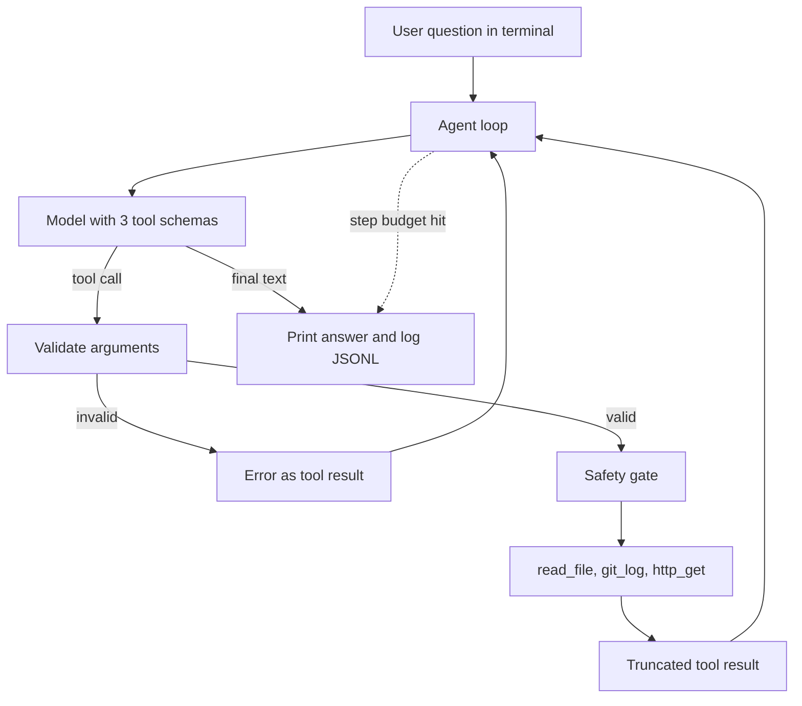

## TL;DR
Build a terminal assistant that runs a hand-written agent loop over three real tools (files, git, HTTP).
It proves you understand the tool-calling protocol itself, not a framework's wrapper around it.

## For agent builders
- **Skills it exercises.** The model-tool-model loop, JSON Schema tool definitions, argument validation,
  error results the model can recover from, a step budget and a confirmation gate for risky calls.
- **Earlier lessons it uses.** The agent loop and tool-calling lessons for the protocol, tool schemas and
  argument validation for the contracts, and sandboxing for the file and shell boundaries.
- **What it proves to a reviewer.** You can debug a tool loop at the message level: why the model looped,
  why it picked the wrong tool, and what a malformed argument looks like on the wire.
- **What you can skip.** Streaming UIs, multi-agent setups and any framework. Plain SDK calls are the point.

## Lab
### Task
Build the core of the CLI assistant without an API key: the tool loop, a confined `read_file` and an
allowlisted `http_get`, driven by a scripted fake model that replays Anthropic-shaped responses. Time box:
45-60 min.
- **Prerequisites:** The agent loop; Tool calling; Tool schemas and argument validation; Sandboxing.
- **Setup:** Python 3.10+ and `pip install pytest` (checked with Python 3.12, pytest 9.1). Save the starter
  as `lab.py` and the tests as `test_lab.py`.
- **Why a fake model:** the responses are recorded dicts with the same `stop_reason`, `tool_use` and
  `tool_result` shapes as the Messages API, so the loop you write here works with the real client later.

### Starter code
```python
"""Lab: the tool loop of a CLI assistant, driven by a scripted fake model. Run: python lab.py"""
import pathlib
import tempfile
from urllib.parse import urlparse

MAX_STEPS, MAX_CHARS = 8, 4000
ALLOWED_HOSTS = {"api.github.com", "pypi.org"}

def tool_use(id_, name, args):
    return {"type": "tool_use", "id": id_, "name": name, "input": args}

def text(t):
    return {"type": "text", "text": t}

class ScriptedModel:
    """Stands in for client.messages.create: replays recorded responses (the last one repeats)
    and records every request so tests can inspect what crossed the wire."""
    def __init__(self, responses):
        self.responses, self.requests = list(responses), []
    def create(self, messages, tools):
        self.requests.append(list(messages))
        return self.responses.pop(0) if len(self.responses) > 1 else self.responses[0]

def make_read_file(root: pathlib.Path):
    root = root.resolve()
    def read_file(path: str) -> str:
        # YOUR CODE HERE:
        # - resolve root / path; if it is not inside root return "error: path is outside the workspace"
        # - if it is not a file return f"error: no such file: {path}"
        # - return the text; if longer than MAX_CHARS keep the first MAX_CHARS characters and append
        #   f"\n[truncated, {total} chars total]"
        raise NotImplementedError
    return read_file

def make_http_get(fetch):
    def http_get(url: str) -> str:
        # YOUR CODE HERE: refuse hosts outside ALLOWED_HOSTS with f"error: host not allowed: {host}",
        # otherwise return fetch(url)[:MAX_CHARS]
        raise NotImplementedError
    return http_get

def run(question: str, model, impl: dict) -> str:
    messages = [{"role": "user", "content": question}]
    for _ in range(MAX_STEPS):
        resp = model.create(messages=messages, tools=list(impl))
        messages.append({"role": "assistant", "content": resp["content"]})
        # YOUR CODE HERE:
        # - if resp["stop_reason"] != "tool_use": return the joined text blocks
        # - for every tool_use block, run impl[name](**input); an unknown tool gives
        #   f"error: unknown tool {name}", any exception gives f"error: {type(e).__name__}: {e}"
        # - append ONE user message whose content is a list of
        #   {"type": "tool_result", "tool_use_id": <the call's id>, "content": <string>}
        raise NotImplementedError
    return "stopped: step budget reached"

if __name__ == "__main__":
    ws = pathlib.Path(tempfile.mkdtemp()) / "ws"
    ws.mkdir()
    (ws / "notes.txt").write_text("Deploy runs on Fridays.")
    impl = {"read_file": make_read_file(ws), "http_get": make_http_get(lambda url: "{}")}
    model = ScriptedModel([
        {"stop_reason": "tool_use", "content": [tool_use("t1", "read_file", {"path": "../secret.txt"})]},
        {"stop_reason": "tool_use", "content": [tool_use("t2", "read_file", {"path": "notes.txt"})]},
        {"stop_reason": "end_turn", "content": [text("Deploys happen on Fridays.")]},
    ])
    answer = run("When do we deploy?", model, impl)
    for msg in model.requests[-1]:
        if msg["role"] == "user" and isinstance(msg["content"], list):
            print(msg["content"][0]["tool_use_id"], msg["content"][0]["content"])
    print("answer:", answer, "| model calls:", len(model.requests))
    looping = ScriptedModel([{"stop_reason": "tool_use",
                              "content": [tool_use("t9", "http_get", {"url": "https://evil.test/x"})]}])
    print(run("loop forever", looping, impl), "| model calls:", len(looping.requests))
```

### Expected output
`python lab.py` with a correct solution prints exactly:

```
t1 error: path is outside the workspace
t2 Deploy runs on Fridays.
answer: Deploys happen on Fridays. | model calls: 3
stopped: step budget reached | model calls: 8
```

### Tests
Run `pytest -q test_lab.py`. On the starter all 6 fail with `NotImplementedError`; a correct solution passes
all 6.

```python
import pathlib
from lab import (MAX_CHARS, MAX_STEPS, ScriptedModel, make_http_get, make_read_file, run, text,
                 tool_use)

def workspace(tmp_path):
    ws = tmp_path / "ws"
    ws.mkdir()
    (ws / "a.txt").write_text("alpha")
    (ws / "big.txt").write_text("x" * 5000)
    (tmp_path / "ws-secrets").mkdir()
    (tmp_path / "ws-secrets" / "key.txt").write_text("sk-123")
    return ws

def test_read_file_is_confined(tmp_path):
    read_file = make_read_file(workspace(tmp_path))
    assert read_file("a.txt") == "alpha"
    for bad in ["../ws-secrets/key.txt", "/etc/passwd", "sub/../../ws-secrets/key.txt"]:
        assert read_file(bad) == "error: path is outside the workspace"
    assert read_file("nope.txt") == "error: no such file: nope.txt"

def test_read_file_truncates_and_says_so(tmp_path):
    out = make_read_file(workspace(tmp_path))("big.txt")
    assert out.startswith("x" * MAX_CHARS) and out.endswith("[truncated, 5000 chars total]")

def test_http_get_allowlist():
    http_get = make_http_get(lambda url: "body:" + url)
    assert http_get("https://pypi.org/pypi/httpx/json") == "body:https://pypi.org/pypi/httpx/json"
    assert http_get("https://evil.test/x?d=1") == "error: host not allowed: evil.test"

def test_results_echo_call_ids_in_one_message(tmp_path):
    impl = {"read_file": make_read_file(workspace(tmp_path))}
    model = ScriptedModel([
        {"stop_reason": "tool_use", "content": [text("checking"), tool_use("c1", "read_file", {"path": "a.txt"}),
                                                tool_use("c2", "read_file", {"path": "zz.txt"})]},
        {"stop_reason": "end_turn", "content": [text("done")]},
    ])
    assert run("q", model, impl) == "done"
    last = model.requests[-1]
    assert [m["role"] for m in last] == ["user", "assistant", "user"]
    results = last[2]["content"]
    assert [r["tool_use_id"] for r in results] == ["c1", "c2"]
    assert results[0]["content"] == "alpha" and results[1]["content"].startswith("error: no such file")

def test_errors_are_results_not_crashes(tmp_path):
    impl = {"read_file": make_read_file(workspace(tmp_path))}
    model = ScriptedModel([
        {"stop_reason": "tool_use", "content": [tool_use("b1", "read_file", {"pathh": "a.txt"}),
                                                tool_use("b2", "run_shell", {"cmd": "rm -rf /"})]},
        {"stop_reason": "end_turn", "content": [text("recovered")]},
    ])
    assert run("q", model, impl) == "recovered"
    results = model.requests[-1][2]["content"]
    assert results[0]["content"].startswith("error: TypeError")
    assert results[1]["content"] == "error: unknown tool run_shell"

def test_step_budget_stops_a_runaway_loop(tmp_path):
    impl = {"read_file": make_read_file(workspace(tmp_path))}
    model = ScriptedModel([{"stop_reason": "tool_use", "content": [tool_use("l1", "read_file", {"path": "a.txt"})]}])
    assert run("q", model, impl) == "stopped: step budget reached"
    assert len(model.requests) == MAX_STEPS
```

### Failure scenarios
- **Check confinement with `str(p).startswith(str(root))`.** The `../ws-secrets/key.txt` case passes the
  check and returns the key. Print the resolved path next to the root; the sibling folder shares the prefix,
  which is why `Path.is_relative_to` is the fix.
- **Send one user message per tool result.** The ids test fails on the role sequence. With the real API,
  results for one assistant turn belong in one user message; dump `messages` as JSON and compare roles.
- **Let a tool exception escape.** `test_errors_are_results_not_crashes` dies with `TypeError` instead of
  asserting. Wrap each call, return the error string, and count error results per tool in your transcript.
- **Return early on the first `tool_use` block.** The second call in a parallel turn never gets a result,
  which a real provider rejects. Assert that every `tool_use` id appears exactly once in the next message.

### Submission
- **`lab.py`** with the three `YOUR CODE HERE` parts implemented and no changes to `ScriptedModel`.
- **A green test run** (6 passed) and the output of `python lab.py`.
- **One extra test** of your own: a `read_file` call through a symlink that points outside the workspace.
- **A JSONL transcript** of the demo run (one line per message) committed next to the code.
- **Evaluated on:** tests passing, every refusal covered by a test, and ids that match call to result.

## Why it exists
- **Every agent framework hides this loop.** LangGraph, the OpenAI Agents SDK and others all run the same
  cycle; building it once by hand makes their abstractions legible instead of magical.
- **Toy tools teach the wrong lessons.** A fake `add(a, b)` never fails, never times out and never returns
  10,000 lines. Real tools force you to handle errors, truncation and side effects.
- **Three tools is the smallest set that tests selection.** With one tool the model cannot choose wrong;
  with three overlapping ones you can measure tool-selection accuracy.
- **It is a fast, honest portfolio piece.** A 300-line repo with tests and a recorded session shows more
  engineering judgment than a large demo built on a template.

## How it works
### Stack and data
- **Language:** Python 3.11+, `argparse` for the CLI, one provider SDK (Anthropic or OpenAI), or LiteLLM if
  you want to swap providers.
- **The three tools:** `read_file` (read-only, confined to a workspace folder), `git_log` (read-only
  subprocess with fixed arguments) and `http_get` (allowlisted hosts, size and time limits).
- **Data:** your own repo as the workspace, plus a public JSON API for `http_get` (any no-key weather or
  package-registry API works).

### Milestones
1. **Single-turn tool call.** Define one tool schema, send a question, execute the returned call, send the
   result back, print the final text. Acceptance: one question answered with one tool call.
2. **The loop.** Repeat until the model stops asking for tools or `MAX_STEPS` (for example 8) is hit.
   Acceptance: a question needing two tools finishes, and a loop that never ends is cut off with a clear message.
3. **Three real tools with validation.** Validate arguments before executing, return errors as tool
   results (not exceptions), truncate outputs. Acceptance: a bad path returns an error the model recovers from.
4. **Safety gates.** Path confinement, host allowlist, a `--yes` flag or interactive confirm for anything
   that writes. Acceptance: `../../etc/passwd` is refused, and a test proves it.
5. **Session log and tests.** Write every request, tool call and result to a JSONL transcript; add unit
   tests for each tool and a scripted end-to-end test. Acceptance: `pytest` green, transcript replayable.

### The protocol in one table
| Step | Who | What crosses the wire |
|---|---|---|
| 1 | You | system prompt, tool schemas, user message |
| 2 | Model | a tool call: name, id, JSON arguments |
| 3 | You | execute, then a tool result keyed by the same id |
| 4 | Model | another tool call, or final text |

## Diagram
Follow the loop: the model only ever proposes calls; your code validates, executes and feeds results back
until the model answers or the step budget runs out.



## Examples
### Starter code: the loop and one real tool
Uses the Anthropic Messages API tool-use format; set `MODEL` to a current model ID from the provider docs.

```python
import json, os, pathlib, anthropic

client = anthropic.Anthropic()
MODEL = os.environ["MODEL"]            # a current tool-capable model ID; check the docs
ROOT = pathlib.Path(os.environ.get("WORKSPACE", ".")).resolve()
MAX_STEPS, MAX_CHARS = 8, 4000

def read_file(path: str) -> str:
    p = (ROOT / path).resolve()
    if not p.is_relative_to(ROOT):
        return "error: path is outside the workspace"
    if not p.is_file():
        return f"error: no such file: {path}"
    return p.read_text(errors="replace")[:MAX_CHARS]

TOOLS = [{"name": "read_file", "description": "Read a text file inside the workspace.",
          "input_schema": {"type": "object", "properties": {"path": {"type": "string"}},
                           "required": ["path"]}}]
IMPL = {"read_file": read_file}

def run(question: str) -> str:
    messages = [{"role": "user", "content": question}]
    for _ in range(MAX_STEPS):
        resp = client.messages.create(model=MODEL, max_tokens=1024, tools=TOOLS, messages=messages)
        messages.append({"role": "assistant", "content": resp.content})
        if resp.stop_reason != "tool_use":
            return "".join(b.text for b in resp.content if b.type == "text")
        results = []
        for b in resp.content:
            if b.type == "tool_use":
                fn = IMPL.get(b.name)
                try:
                    out = fn(**b.input) if fn else f"error: unknown tool {b.name}"
                except Exception as e:     # bad arguments or a tool bug: report, do not crash
                    out = f"error: {type(e).__name__}: {e}"
                results.append({"type": "tool_result", "tool_use_id": b.id, "content": out})
        messages.append({"role": "user", "content": results})
    return "stopped: step budget reached"

if __name__ == "__main__":
    import sys; print(run(" ".join(sys.argv[1:])))
```

### Milestone plan with time estimates
| Milestone | Time | Done when |
|---|---|---|
| 1. Single tool call | 1-2 h | one question answered via `read_file` |
| 2. Loop with budget | 1-2 h | two-tool question completes; runaway loop stops at `MAX_STEPS` |
| 3. Add `git_log`, `http_get` | 3-4 h | each tool has unit tests for success, bad input and timeout |
| 4. Safety gates | 2 h | path escape and non-allowlisted host are refused in tests |
| 5. Transcript, tests, README | 3-4 h | `pytest` green; a recorded 2-minute demo in the README |

### Worked scenario: a question that needs two tools
"Which file changed most recently, and what does its first function do?" The model calls `git_log`
(name-only, last 5 commits), then `read_file` on the top path, then answers. A good transcript shows 2 tool
calls and 3 model turns; a bad one shows `read_file` guessed paths 4 times because `git_log`'s description
never said it returns file paths.

## Production patterns
- **Errors are results, not crashes.** Catch every tool exception and return a short `error: ...` string
  as the tool result, so the model can retry with different arguments. Monitor the share of tool results
  that are errors per tool.
- **Truncate and say so.** Cap each tool result (for example 4,000 characters) and append a note like
  `[truncated, 12,400 chars total]`, so the model knows to narrow its request instead of trusting a partial view.
- **Least-privilege tools.** Use fixed `subprocess` argument lists (never `shell=True`), a resolved-path check
  for files and a host allowlist for HTTP. Write a test for each refusal, because reviewers look for them.
- **Replayable JSONL transcripts.** Log every model request, tool call, result, token count and latency with
  a run id. This is the seed of tracing; see the tracing lesson before adding a backend.
- **A scripted eval of 10-20 questions.** Record the expected tool sequence for each and report tool-selection
  accuracy and steps per task in CI. It turns "seems to work" into a number you can put in the README.

## Trade-offs
- **Hand-written loop vs a framework.** You gain full visibility and zero dependencies, and pay in features
  you must write yourself (retries, streaming, parallel calls). Switch once you need durable state or many agents.
- **One provider SDK vs LiteLLM.** A single SDK keeps types and errors exact; LiteLLM lets you compare models
  on the same tools, at the cost of a translation layer that can lag new provider features.
- **Broad tools vs narrow tools.** A `run_shell` tool covers everything but is impossible to secure; three
  narrow tools are safer and easier for the model to choose between, but need more code.
- **Strict step budget vs task completion.** A low `MAX_STEPS` caps cost and loops but cuts off legitimate
  long tasks; log budget hits and raise it only when the eval shows real tasks need it.

## Pitfalls
- **Dropping the tool call id.** The result is not linked to its call and the API rejects the request or the
  model ignores the result. Always echo the provider's call id in the matching result.
- **Raising exceptions out of tools.** The CLI crashes on the first missing file. Wrap execution and return
  errors as tool results.
- **Vague tool descriptions.** The model guesses paths or calls the wrong tool. Write descriptions that say
  what the tool returns and when to use it, then re-run the selection eval.
- **Unbounded outputs.** One `git log` of a large repo fills the context and the next turn fails or costs
  10x. Fix arguments (`-n 20`, `--name-only`) and truncate.
- **Path checks with string prefixes.** `startswith("/work")` accepts `/work-secrets`. Resolve the path and
  use `Path.is_relative_to`.

## When to use
- **Prerequisites.** Comfortable Python, one provider API key, and the agent loop and tool-calling lessons.
- **Suits.** Engineers starting agent work, and anyone who has only used frameworks and wants to see the wire format.
- **Avoid when.** You already maintain a production tool loop; jump to the LangGraph or MCP projects instead.
- **Measure.** Tool-selection accuracy, steps per task, error-result rate and cost per question on your 10-20 question set.

## Role lens
- **Engineer:** Writes the loop, the validated tools and the tests, and can explain every message in a
  transcript when a run goes wrong.
- **Architect:** Uses the project to set tool-design rules for the team: narrow tools, error results,
  truncation limits and step budgets as defaults.
- **FDE:** Adapts the three tools to a customer's real systems in a day and demos the transcript to show
  exactly what the agent can and cannot touch.

## Check yourself
**Q:** Your CLI assistant answers simple questions but on harder ones it calls `read_file` five times with
guessed paths and then gives up. What do you change, in order?
**A:** First read the transcript to confirm the pattern. Then fix the cause, not the budget: the model has no
way to discover paths, so improve `git_log`'s description to say it returns file paths, or add a `list_files`
tool. Make `read_file`'s error say "no such file; use list_files to find paths" so the error teaches recovery.
Then add this question to the eval set with the expected tool sequence, re-run, and only then consider raising
`MAX_STEPS` if real tasks still need more steps.

## Interview questions
### Walk me through what happens on the wire in one tool-calling turn.
- **The request** carries the system prompt, the tool schemas and the conversation; the model replies with a
  tool call containing a name, an id and JSON arguments instead of final text.
- **Your code** validates and executes the call, then appends a tool result tagged with the same id and calls
  the model again, repeating until it returns plain text.

### How do you stop the loop from running forever or burning money?
- **A hard step budget** (for example 8 model calls) plus a per-run token or cost ceiling, both logged when hit.
- **Loop detection:** if the same tool is called with the same arguments twice, return an error result telling
  the model it already has that answer.

### Why return tool errors to the model instead of raising them?
- **The model can recover.** A message like "no such file" lets it list files or change arguments, which turns
  a crash into one extra step.
- **Raising** ends the run and loses context; reserve exceptions for bugs in your own code, which tests should catch.

### How did you secure the file and HTTP tools?
- **Files:** resolve the path and require it to be inside the workspace with `is_relative_to`, read-only, size-capped.
- **HTTP:** allowlist hosts, cap response size and timeout, and never forward credentials; each rule has a test
  that proves the refusal.

### When would you replace this hand-written loop with a framework?
- **When you need durable state,** human approval that survives restarts, parallel branches or many agents,
  because frameworks like LangGraph give checkpointing and interrupts you would otherwise rebuild.
- **Keep the hand-written loop** for small single-purpose tools where a dependency adds more surface than value.

## Quiz
### Q: In a tool-calling loop, what must the tool result include so the model can use it?
- [ ] The full tool schema again
- [x] The id of the tool call it answers
- [ ] The system prompt
- [ ] A new user question
> Providers link each tool result to the call that requested it by id. Without the matching id the request is
> rejected or the result is ignored, and the model cannot continue its reasoning.

### Q: A tool hits a missing file. What is the best behaviour for an agent loop?
- [ ] Raise an exception and exit the CLI
- [ ] Silently return an empty string
- [x] Return a short error message as the tool result so the model can adjust
- [ ] Retry the same call until it succeeds
> An error result keeps the run alive and gives the model information to recover, for example by listing files
> first. Empty strings hide the failure and blind retries repeat it.

### Q: Why use `Path.resolve()` plus `is_relative_to` instead of a string prefix check for workspace paths?
- [ ] It is faster on large directories
- [ ] It works only on Windows
- [x] It normalises `..` and symlinks and avoids prefix tricks like a sibling folder sharing the same name start
- [ ] It makes files read-only
> A string prefix accepts paths like `/work-secrets` for a `/work` root and misses `..` segments. Resolving first
> and checking containment closes both holes.

## Use cases & projects
### Use cases
- **Repo helper for a team.** Extend the tools to search code and open issues, so new engineers can ask
  "where is auth handled?" and get file-cited answers.
- **Ops triage CLI.** Swap `http_get` for read-only calls to a status page and log store, with a confirm gate
  before any restart command.
- **Provider bake-off.** Route the same eval set through two or three models with LiteLLM and publish a table
  of tool-selection accuracy, steps and cost per question.
- **Parallel tool calls.** Let the model request several independent calls in one turn and execute them
  concurrently, then measure the latency saved.
- **Swap tools for an MCP client.** Load the three tools from an MCP server instead of local functions, which
  leads straight into the MCP server project.

### Mini project
**Warm-up: one tool, one loop (1-2 hours).**
- **Goal:** get a model to answer a question by calling a single `read_file` tool through a loop you wrote.
- **Steps:** copy the starter code; create a workspace with three small text files; ask a question whose answer
  is in one of them; print each message as it is sent and received; then ask about a file that does not exist
  and watch the model handle the error result.
- **Done when:** you have a printed transcript showing the call id flowing from the tool call to the tool result,
  and a test proving `../` paths are refused.
