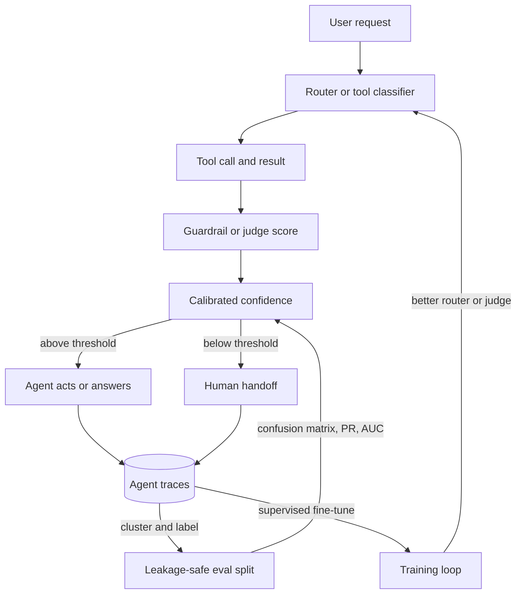

## Overview
This module covers the machine learning that sits underneath every model an agent builder touches. An
agent is full of small learned decisions: the intent router, tool selection, guardrails, LLM-as-judge
pass/fail and the "hand off to a human" check. It is also built on models you may fine-tune on your own
agent traces.

The module has three connected parts. The first covers problem framing. It looks at where the training
signal comes from (supervised, unsupervised or self-supervised), at the three main problem shapes
(classification, regression and clustering), and at the loss function, which is the differentiable
stand-in for the thing you actually want.

The second part covers how a loss becomes a trained model. Backpropagation produces the gradient.
Gradient descent and the optimizers turn it into updates. Learning-rate schedules, warmup, gradient
clipping, batch size, gradient accumulation and mixed precision decide whether those updates are stable,
fast and affordable.

Normalization, residual connections and dropout are the architectural pieces that make deep networks
trainable and keep them from memorizing. The third part covers evaluation: train-test leakage, class
imbalance, calibration, precision, recall and F1, ROC-AUC and the confusion matrix that all of those are
derived from.

- **What it gives an agent builder:** a way to treat every branch in an agent as a classifier with a
  confusion matrix, a tunable threshold and an abstain path, an eval set that cannot flatter the agent,
  and the vocabulary to run or question a fine-tune on agent trajectories.
- **Core for agents (use directly):** classification, confusion-matrix, precision-recall-f1,
  train-test-leakage, calibration.
- **Useful (when you fine-tune, evaluate or operate agents):** supervised-vs-unsupervised-vs-self-supervised-learning,
  regression, clustering, roc-auc, class-imbalance, loss-functions, gradient-descent, optimizers,
  learning-rate-schedulers, warmup, gradient-clipping, batch-size, gradient-accumulation, mixed-precision,
  dropout-regularization.
- **Background (recognise and reason with):** backpropagation, normalization, residual-connections.
- **What you can build afterwards:** read a fine-tuning config and say what every hyperparameter does
  and how they depend on each other; diagnose a loss curve that spikes, plateaus or never moves; set up
  an evaluation that cannot flatter the model; and choose a decision threshold from what each kind of
  error costs.

It matters most for AI Engineers, who train, fine-tune and evaluate models directly. It gives Architects
and FDEs the vocabulary to question a training budget or a headline metric.

## Why it matters
- **Engineer:** You will build routers, guardrails and judges whose thresholds, calibration and confusion matrices decide whether an agent is safe to ship. When prompting is not enough you will fine-tune models on agent traces with AdamW, warmup, cosine decay, clipping, bf16 and gradient accumulation, and debug NaNs, loss spikes and runs that never learn.
- **Architect:** Training memory, step count and GPU hours for an agent fine-tune follow from batch size, sequence length, precision and the roughly 16 bytes per parameter of optimizer state. Evaluation design (group and time splits, prevalence-aware metrics, calibrated scores feeding cascades and human handoff) decides whether offline agent numbers will hold in production, so both belong in the system design.
- **FDE:** Customers arrive with a 0.99 AUC model that fails in production, a fraud, abuse or injection detector tuned for accuracy on 1% positives, an agent eval set that leaks into its few-shots, or a request to fine-tune on two thousand tickets. You need to find the leak, reset the threshold to their costs and size the fine-tune on their own data, quickly.

## Mental model
Hold one loop and one gap.

- **The loop is training.** A batch goes through the network forward, a loss turns the output into one
  number, backpropagation sends that number's sensitivity back to every parameter, and an optimizer
  takes a step whose size is set by the learning rate schedule.
- **Every training topic controls one part of that loop.** Loss functions decide what the gradient
  says. Batch size and accumulation decide how noisy the gradient is. Warmup, clipping and mixed
  precision stop a single bad step from wrecking the run.
- **Depth and memorizing.** Normalization and residual connections keep the signal and the gradient at
  a usable scale through depth. Dropout and weight decay make memorizing harder.
- **The gap sits between offline evaluation and production.** A model outputs scores, a threshold turns
  scores into decisions, and the confusion matrix counts what those decisions got right and wrong.
- **Every evaluation topic asks whether that count will still hold on future data.** Leakage makes the
  gap look smaller than it is. Imbalance and accuracy hide which errors are being made. ROC-AUC measures
  ranking, calibration measures whether the probabilities can be trusted, and precision and recall
  measure the errors at the threshold you ship.
- **Debugging rule:** when something goes wrong, first decide whether the problem is in the loop (the
  model did not learn) or in the gap (the model learned the wrong thing, or the measurement was wrong).

The top half is the gap: every agent branch is a scored decision whose threshold comes from error
costs. The bottom half is the loop: traces become labels, a leakage-safe split measures the agent, and a
fine-tune feeds an improved model back in.

## Suggested order
1. supervised-vs-unsupervised-vs-self-supervised-learning — starts with where the training signal comes from, which frames every later choice about labels, pre-training, fine-tuning and which agent traces you log.
2. classification — the most common problem shape and the one behind routers, tool choice, guardrails and judges; it introduces logits, softmax and the separation of scoring from deciding.
3. confusion-matrix — the raw table of counts that every classification metric after it is derived from, and the view that shows which tool was called when another was needed.
4. precision-recall-f1 — the detection metrics read from the table, and how the threshold trades one against the other for retrievers, guardrails and judges.
5. train-test-leakage — the rule that a held-out set has to simulate the future, or every metric after it lies, including leaks through few-shots, memory and the RAG index.
6. roc-auc — scores the ranking across every threshold, which only makes sense once metrics at a single threshold are clear.
7. class-imbalance — uses the table, precision and recall, and AUC to show how defaults fail on rare positives and how to fix the threshold first.
8. calibration — turns scores into trustworthy probabilities for cost-based thresholds, abstention and cascades, repairing what imbalance fixes distort.
9. clustering — the unsupervised shape for data with no labels yet, done on embeddings of requests and traces, before any loss is trained.
10. regression — the quantity-shaped counterpart, showing that picking a loss means deciding what noise you expect and what you are estimating, such as run cost or step count.
11. loss-functions — turns each problem shape into a differentiable target and explains why cross-entropy and contrastive losses dominate.
12. gradient-descent — the update rule that minimizes the loss, and where the learning rate and the noise of mini-batches first appear.
13. backpropagation — how the gradient is computed in one backward pass, and why training memory grows with activations.
14. optimizers — SGD, Adam and AdamW turn raw gradients into per-parameter updates and add optimizer-state memory.
15. learning-rate-schedulers — makes the learning rate change over time, so it has to be planned in optimizer steps.
16. warmup — the start of every schedule, needed because Adam's statistics and the early gradients cannot be trusted.
17. gradient-clipping — limits how big a single update can be, building on backpropagation's exploding products and Adam's moment estimates.
18. batch-size — couples gradient noise, hardware use, learning rate and step count into one decision.
19. gradient-accumulation — reaches the effective batch the recipe asks for when memory only holds a small micro-batch.
20. mixed-precision — trades number format for speed and activation memory, which matters for clipping and accumulation order.
21. normalization — keeps activations at a stable scale through depth, and where it sits (Pre-LN or Post-LN) explains the need for warmup.
22. residual-connections — the identity path that keeps gradients alive in deep stacks, best read alongside normalization placement.
23. dropout-regularization — closes the training part by trading training fit for generalization, framed by the gap between training and validation loss.

## Capstone
### Brief
Use case: a support agent drafts replies to incoming tickets and needs an "escalate to a senior agent"
gate that decides, before it acts, whether a ticket goes to a human. You build that gate as a working
agent component and wire it into the agent loop.

About 4% of tickets need escalating. A missed escalation costs roughly twenty times as much as an
unnecessary one, and tickets the model is unsure about should go to a human review queue. Use a public
support or complaint dataset, or a synthetic one with realistic customer IDs and timestamps.

- Start by embedding and clustering the tickets to understand what they contain, and use the clusters
  to draw a stratified sample for labelling or to check the existing labels.
- Train a TF-IDF logistic regression baseline.
- Fine-tune a small pre-trained encoder with a training loop you write yourself. Use AdamW, warmup
  followed by cosine decay, global-norm gradient clipping, bf16 autocast and gradient accumulation to
  reach a target effective batch.
- Log loss, learning rate, gradient norm before clipping, and the fraction of steps that were clipped.
- Run one ablation (no warmup, no clipping, or a learning rate ten times higher) and explain how the
  curves change.
- Split the data by customer and by time, and measure how much a naive random split inflates the scores.
- Evaluate with a confusion matrix, precision–recall and ROC curves, and a reliability diagram. Compare
  class weighting with plain threshold tuning.
- Apply temperature scaling, then derive the escalation threshold and the review band from the cost
  ratio, not from 0.5.
- Expose the calibrated model as a gate the agent calls on every ticket: escalate, send to review, or
  let the agent draft the reply.

### Deliverables
- A reproducible training script or notebook containing the baseline and the fine-tuned encoder. Its config names peak learning rate, warmup steps, schedule, clip norm, precision, micro-batch, accumulation steps and effective batch. Logged curves show loss, learning rate, gradient norm before clipping and the fraction of clipped steps, and there is a one-paragraph explanation of the ablation run.
- A leakage audit giving metrics under a random split, a customer-group split and a time split, with exact and near-duplicate checks across splits and a list of every fitted preprocessing step and where it is fitted.
- An evaluation report with the confusion matrix at the shipped threshold, the precision–recall curve with average precision, ROC-AUC with a bootstrap confidence interval, and per-cluster recall, for both the baseline and the fine-tuned model, with and without class weighting.
- A calibration and decision note: a reliability diagram, ECE and Brier score before and after temperature scaling on a split the calibrator never saw, the threshold derived from the 20:1 cost ratio, the review band, and the expected escalations, misses and review-queue volume per thousand tickets at production prevalence.
- A short cluster summary that names the main ticket groups found by clustering, gives their sizes, and states which labelling or evaluation-sampling decision each one changed.
- A working escalation gate (a function or small service) that the support agent calls per ticket, returning escalate, review or draft with the calibrated probability, plus a run log over a held-out ticket batch.

### Rubric
- The effective batch equals micro-batch × accumulation steps × devices and is stated explicitly. Warmup and total steps are counted in optimizer steps. Printed learning rates at step 0, end of warmup, midpoint and end match the plan, and the ablation's change in its curves is explained by the right mechanism (early Adam variance, exploding gradient norm, noise floor).
- The reported headline metric comes from the group or time split, not the random split, the gap between the two is quantified, and no scaler, vectorizer, calibrator or threshold was fitted on data that the final evaluation scores.
- Accuracy is not used as the headline number. The confusion matrix, precision and recall at the shipped threshold, and average precision are reported together with prevalence and support, and precision measured on any enriched or rebalanced set is converted to production prevalence.
- The threshold is derived from the cost ratio using calibrated probabilities (close to C_FP / (C_FP + C_FN), about 0.05). Calibration error is lower after temperature scaling while ROC-AUC stays the same, and the note shows the expected cost at the chosen threshold compared with the cost at 0.5.
- The class-weighting comparison reports its effect on average precision and on calibration separately, and the recommendation states whether weighting is worth keeping once threshold tuning and recalibration are in place.
- On the held-out batch, the agent's routed share of escalate, review and draft decisions matches the volumes the calibration note predicted per thousand tickets, and every escalation decision in the run log carries its probability and threshold.
