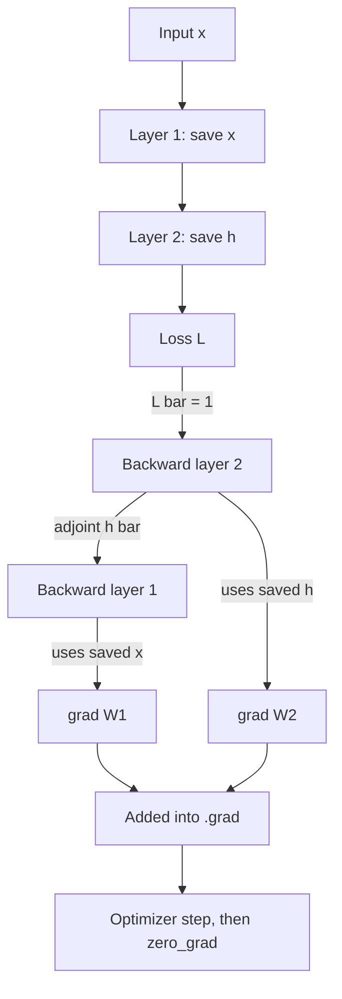

## TL;DR
Backpropagation gets the loss gradient for every parameter in one backward sweep of the chain rule, at a
small multiple of the forward cost regardless of parameter count. The price is memory: saved activations
scale with batch × sequence length × depth.

## Why it exists
- **Gradient descent needs ∇L,** one partial derivative per parameter.
- **Finite differences are hopeless.** Nudge a parameter, re-run the forward pass, measure the change:
  P + 1 forward passes per step. For seven billion parameters that is seven billion forward passes per
  update, and numerically poor besides.
- **Other options also fail.** Symbolic differentiation of the whole network produces expressions whose
  size explodes with depth. Forward-mode automatic differentiation is exact and cheap per direction, but
  computes one input direction at a time, so it also needs P passes.
- **The shape of the problem decides it.** One output (the scalar loss) and millions of inputs (the
  parameters). Reverse mode propagates "how sensitive is the loss to this value" backwards from the output;
  with a single output, one sweep yields the sensitivity to every intermediate value and parameter, at a
  small constant times the forward cost, independent of P.
- **What it is and is not.** Backpropagation is reverse-mode automatic differentiation specialised to
  layered networks; it was derived several times before the 1986 paper made it standard. It is not a
  learning algorithm by itself: it computes gradients; gradient descent and its descendants decide what to
  do with them.

## How it works
### The computation graph and adjoints
1. **Record.** A forward pass is a sequence of primitive operations, each recording its inputs, its output
   and which operation it was. The loss L sits at the end.
2. **Define adjoints.** For every intermediate value v, v̄ = ∂L/∂v, with L̄ = 1.
3. **Walk in reverse topological order.** For an operation y = f(x₁, …, xₙ), add to each input's adjoint
   the upstream adjoint times the local derivative: x̄ᵢ += ȳ · ∂f/∂xᵢ.
4. **Vector–Jacobian products, never full Jacobians,** which is what keeps the cost linear.
5. **The addition matters.** A value used in several places collects a contribution from each use: the
   multivariable chain rule.
6. **Read off the gradient.** When the sweep reaches the parameters, their adjoints are the gradient.

**The fan-out rule, concretely.** Let a = 3, b = a², c = 2a, L = b + c.

| Pass | Computation | Value |
|---|---|---|
| Forward | b = 9, c = 6, L = 15 | |
| Backward | L̄ = 1, so b̄ = 1 and c̄ = 1 | |
| Backward | a receives b̄·2a = 6 from the square and c̄·2 = 2 from the doubling | ā = 8 |
| Check | dL/da = 2a + 2 | 8 |

Forgetting the "+=" and keeping only the last contribution would give 2 or 6, a silently wrong gradient.

### What the framework actually does
- **Graph recorded during the forward pass.** In PyTorch every tensor produced by a differentiable op
  carries a `grad_fn` pointing at the op and the values it saved.
- **`loss.backward()`** walks those pointers in reverse, writes each parameter's adjoint into `.grad`, and
  then frees the graph and its saved tensors (unless `retain_graph=True`).
- **`.grad` is *added to*, not overwritten,** the same += rule applied across calls. That is why
  `zero_grad()` is needed between steps, and why gradient accumulation over several micro-batches works by
  calling `backward()` several times before `step()`.

### Why reverse rather than forward
| Mode | Cost | Training (1 output, P inputs) |
|---|---|---|
| Forward | one pass per input direction | P passes |
| Reverse | one pass per output | 1 pass: wins by a factor of P |

- **Cheap-gradient result.** Automatic differentiation theory bounds the backward sweep by a small
  constant multiple of the forward cost.
- **About 2× forward FLOPs** for matrix-multiply-dominated networks, because each linear layer needs two
  matmuls in the backward pass against one in the forward pass. Hence the rule of thumb that a training
  step costs about three forward passes.

### A linear layer, worked out
For y = xW with x of shape [B, d_in] and W of shape [d_in, d_out], given the upstream adjoint ȳ of shape
[B, d_out]:

```
W̄ = xᵀȳ      shape [d_in, d_out]   -> needs x, the layer's saved input activation
x̄ = ȳWᵀ      shape [B, d_in]
ReLU:        x̄ = ȳ ⊙ 1[x > 0]      -> needs the sign of its input
softmax + cross-entropy (fused):  z̄ = q − onehot(y)
```

Attention and normalisation layers are more involved but follow the same recipe: a local derivative
applied to the upstream adjoint, using saved forward values.

### Where training memory goes
- **Saved forward values are held until their backward step.** Per layer that is several tensors of shape
  [batch, sequence, hidden], so activation memory scales with B × T × d × depth and for long sequences
  dwarfs the parameters.
- **Gradient checkpointing** stores only each block's input and recomputes the interior during the
  backward pass, trading roughly a third more compute for a large memory reduction.
- **Fused attention kernels** recompute attention probabilities in the backward pass rather than storing
  the T × T matrix.
- **Freezing weights (as in LoRA)** removes their gradient and optimizer-state memory. But the backward
  sweep still passes through frozen layers to reach trainable ones earlier in the network, so activation
  memory does not disappear.
- **Compute falls less than you think.** What is skipped is the weight-gradient matmul for each frozen
  layer, roughly half the backward FLOPs, so compute per step falls by at most about a third, nowhere near
  in proportion to the parameter count.

### Vanishing and exploding gradients
- **Products of Jacobians.** The adjoint at the first layer is the upstream adjoint multiplied by the
  Jacobian of every layer above it; a product of many matrices shrinks or grows exponentially.
- **Sigmoid arithmetic.** A sigmoid's derivative is at most 0.25, so twenty sigmoid layers scale the
  gradient by at most 0.25²⁰ ≈ 10⁻¹²; early layers simply stop learning.

Every standard remedy is a response to this arithmetic:
- **ReLU and GELU** have derivative near 1 on their active side.
- **Residual connections** make each block's Jacobian I plus something small, so the product stays near
  the identity and gradients have a highway to early layers.
- **Normalisation** keeps activation scales from drifting.
- **Variance-preserving initialisation** starts the product near 1.
- **Clipping** bounds the explosions that remain.

### Where the graph stops
- **No useful derivative:** argmax, sampling, string operations and external tool calls. You cannot
  backpropagate through "generate a response and score it".
- **That gap is why** policy-gradient methods exist for RLHF, and why straight-through estimators and
  Gumbel-softmax are used when a discrete step must sit inside a differentiable model.
- **`detach()` cuts the graph deliberately,** for example to stop gradients flowing into a target network
  or a teacher.

## Diagram
The forward pass saves activations; the backward pass consumes them in reverse to produce every gradient.



## Examples
### A two-layer network by hand, checked numerically
A two-layer network with ReLU and softmax cross-entropy, differentiated by hand and checked against a
finite difference. Each backward line is one local derivative multiplied by the upstream adjoint; the
numeric check should agree to around 1e-10.

```python
import numpy as np
rng = np.random.default_rng(0)
X = rng.normal(size=(8, 4)); y = rng.integers(0, 3, size=8)            # 8 examples, 4 features, 3 classes
W1 = rng.normal(scale=0.5, size=(4, 5)); W2 = rng.normal(scale=0.5, size=(5, 3))

def forward(W1, W2):
    h_pre = X @ W1; h = np.maximum(h_pre, 0)                          # linear, ReLU
    logits = h @ W2
    p = np.exp(logits - logits.max(1, keepdims=True)); p /= p.sum(1, keepdims=True)
    loss = -np.log(p[np.arange(8), y]).mean()                         # cross-entropy
    return loss, (h_pre, h, p)

loss, (h_pre, h, p) = forward(W1, W2)

# backward: reverse order, each step = local derivative x upstream adjoint
d_logits = p.copy(); d_logits[np.arange(8), y] -= 1; d_logits /= 8     # dL/dlogits = (p - onehot) / N
dW2 = h.T @ d_logits                                                   # logits = h @ W2  -> needs h
d_h = d_logits @ W2.T
d_hpre = d_h * (h_pre > 0)                                             # ReLU gate     -> needs h_pre
dW1 = X.T @ d_hpre                                                     # h_pre = X @ W1 -> needs X

# finite-difference check on one weight
i, j, eps = 1, 2, 1e-5
W1p, W1m = W1.copy(), W1.copy(); W1p[i, j] += eps; W1m[i, j] -= eps
numeric = (forward(W1p, W2)[0] - forward(W1m, W2)[0]) / (2 * eps)
print(dW1[i, j], numeric)        # agree to ~1e-10; the saved h, h_pre, X are the "activation memory"
```

### The fan-out rule in code, then in autograd
The three-line graph from How it works, first by hand in plain Python, then confirmed by PyTorch.

```python
a = 3.0
b = a ** 2; c = 2 * a; L = b + c          # forward: 9, 6, 15
b_bar = c_bar = 1.0                       # L = b + c, and L_bar = 1
a_bar = 0.0
a_bar += b_bar * 2 * a                    # from b = a^2 -> +6
a_bar += c_bar * 2                        # from c = 2a  -> +2
print(L, a_bar)                           # 15.0 8.0, and dL/da = 2a + 2 = 8

import torch
t = torch.tensor(3.0, requires_grad=True)
(t ** 2 + 2 * t).backward()
print(t.grad)                             # tensor(8.)
```

### Worked numbers: how fast sigmoid gradients vanish
Upper bound on the gradient scale after n sigmoid layers, from the 0.25 maximum derivative.

| Sigmoid layers | Bound 0.25ⁿ | Effect on early layers |
|---|---|---|
| 5 | about 1e-3 | learning is slow |
| 10 | about 1e-6 | barely move |
| 20 | about 1e-12 | effectively frozen |

With ReLU on its active side the per-layer factor is near 1, and a residual block's Jacobian is near I,
which is why modern deep stacks still train.

### Per-layer gradient norms in a real training loop
The first diagnostic when "the model is not learning": print the gradient norm of every parameter after
`backward()`.

```python
import torch

def grad_norms(model):
    return {name: p.grad.norm().item()
            for name, p in model.named_parameters()
            if p.requires_grad and p.grad is not None}

model = torch.nn.Sequential(*[torch.nn.Sequential(torch.nn.Linear(64, 64), torch.nn.Sigmoid())
                              for _ in range(12)], torch.nn.Linear(64, 3))
x, y = torch.randn(32, 64), torch.randint(0, 3, (32,))
torch.nn.functional.cross_entropy(model(x), y).backward()
for name, n in grad_norms(model).items():
    if name.endswith("weight"):
        print(f"{name:12s} {n:.2e}")       # norms shrink by orders of magnitude toward layer 0
```

## Production patterns
- **Log per-layer gradient norms.** Compute norms from `named_parameters()` after `backward()` every N
  steps and send them to your experiment tracker. Monitor the ratio of first-layer to last-layer norms; a
  collapse of several orders of magnitude means vanishing gradients.
- **Gradient checkpointing to fit longer sequences.** In Hugging Face Transformers call
  `model.gradient_checkpointing_enable()`, or wrap blocks with `torch.utils.checkpoint.checkpoint`. Expect
  roughly a third more compute per step; monitor peak memory and step time.
- **Gradient accumulation for large effective batches.** Call `backward()` on several micro-batches
  (scale each loss by 1/k) before one `step()` and one `zero_grad()`. Monitor that the effective batch and
  learning rate match the intended recipe.
- **Log scalars, not tensors.** Use `loss.item()` or `loss.detach()` for metrics so the graph is freed
  each step. Monitor allocated memory per step; steady growth means a graph is being retained.
- **Gradient-check custom ops in float64.** For a custom `torch.autograd.Function`, run
  `torch.autograd.gradcheck` on small double-precision inputs before training. Monitor nothing in
  production; this is a pre-merge test.
- **Profile activation memory before buying hardware.** Use `torch.cuda.max_memory_allocated()` across a
  few sequence lengths and batch sizes to see how memory scales, then choose checkpointing, length and
  batch. Monitor peak memory against the GPU limit.

## Trade-offs
- **Reverse mode: cheap gradients vs stored activations.** Every gradient for about twice the forward
  compute, but forward activations must stay alive. When memory binds, checkpointing trades recompute for
  memory; forward mode (Jacobian–vector products) wins only when you need a few directional derivatives
  rather than the full gradient.
- **Eager vs compiled graphs.** Dynamic graphs built eagerly are flexible and easy to debug with ordinary
  Python; compiled graphs fuse operations and run faster. The compiled route pays off once the model is
  stable and step time matters more than iteration speed.
- **Freezing weights: memory vs compute expectations.** It cuts gradient and optimizer memory sharply, but
  the backward pass still traverses the frozen layers, so step time (at most about a third less) and
  activation memory fall far less than parameter counts suggest.
- **Recompute in fused kernels: FLOPs vs memory.** Kernels that recompute intermediate results in the
  backward pass trade FLOPs for memory bandwidth and capacity; they win when saved tensors would dominate
  memory, as attention does at long sequence lengths.

## Pitfalls
- **Forgetting `optimizer.zero_grad()`.** Gradients accumulate across steps; the gradient norm grows step
  by step and the run diverges without any change in the data.
- **Modifying a saved tensor in place.** Symptom: the autograd error about a variable needed for gradient
  computation having been modified by an in-place operation.
- **Breaking the graph mid-model.** Converting to NumPy, calling `.item()` or using a leaf created with
  `requires_grad=False` in the middle of the model; symptom: parameters that never change.
- **Vanishing gradients in a deep stack without residuals or normalisation.** Symptom: per-layer gradient
  norms that fall by orders of magnitude from the last layer to the first.
- **Keeping references to the loss tensor for logging** instead of `loss.item()`, which keeps the whole
  graph alive. Symptom: memory growing every step until an out-of-memory error.
- **Gradient-checking in fp16 or bf16.** Symptom: "mismatches" that are nothing but rounding noise. Do the
  check in float64.

## When to use
You do not choose backpropagation; the framework performs it. What you choose follows from its arithmetic.
- **Decide:** which parameters to freeze, where to checkpoint, what sequence length and batch fit in
  memory, and when a custom autograd function is needed for a non-differentiable step.
- **Debug** a model that is not learning by following gradients layer by layer.
- **Measure** per-layer gradient norms with hooks and peak activation memory with the framework's memory
  profiler.
- **Interviews:** run the chain rule through a two-layer network on a whiteboard, explain why reverse mode
  beats forward mode, account for where training memory goes, and say why residual connections keep
  gradients alive. Those four questions cover most of what is asked.

## Role lens
- **Engineer:** Debugs "the model is not learning" with gradient-norm hooks, fixes graph breaks and
  in-place errors, and turns on gradient checkpointing to fit a longer sequence length.
- **Architect:** Sizes training hardware from the memory accounting of parameters, gradients, optimizer
  state and activations, and decides between full fine-tuning and PEFT partly from that arithmetic.
- **FDE:** When a customer's fine-tuning job runs out of memory on their GPUs, explains activation memory
  and adjusts checkpointing, sequence length and batch size rather than demanding bigger hardware.

## Check yourself
**Q:** A twelve-layer MLP with sigmoid activations trains its last two layers well, but the weights of
the early layers barely move. Explain mechanically what is happening and what you would change.
**A:** Backpropagation multiplies the upstream adjoint by each layer's Jacobian on the way down. A
sigmoid's derivative is at most 0.25 and typically smaller, and with modest weights each layer's
Jacobian has norm well below one, so after ten layers the gradient has shrunk by many orders of
magnitude; the early layers receive almost no signal while the top layers learn normally. It is not a
data problem and not simply a learning-rate problem, since raising the rate enough for the early layers
would blow up the late ones. Replace sigmoids with ReLU or GELU, add residual connections so each block's
Jacobian is near the identity, add normalisation, and use variance-preserving initialisation. Confirm the
diagnosis before and after by logging per-layer gradient norms.

## Interview questions
### Walk me through what happens when you call loss.backward() in PyTorch.
- **Graph walk:** each tensor's `grad_fn` links to the op that made it and its saved inputs; backward
  visits them in reverse topological order.
- **Local rule:** each op multiplies the upstream adjoint by its local derivative and adds the result into
  its inputs' adjoints.
- **Result:** parameter adjoints are added into `.grad`, then the graph and saved tensors are freed unless
  `retain_graph=True`.

### Your fine-tune runs out of memory at sequence length 8k but not 4k. Where is the memory going and what do you do?
- **Activations, not weights:** saved tensors scale with B × T × d × depth, so doubling T roughly doubles
  them, and naive attention stores T × T matrices.
- **Levers:** enable gradient checkpointing (about a third more compute), use a fused attention kernel,
  lower the micro-batch and use gradient accumulation.
- **Measure** peak memory at a few lengths to confirm the scaling before changing hardware.

### Why does a training step cost about three forward passes?
- **Forward:** one matmul per linear layer.
- **Backward:** two matmuls per linear layer, one for the weight gradient (xᵀȳ) and one for the input
  adjoint (ȳWᵀ).
- **So** about 1 + 2 = 3 forward-equivalents, which is the basis of training compute estimates.

### LoRA freezes 99% of weights. Why is the step not 99% cheaper?
- **Backward still traverses frozen layers** to deliver adjoints to adapters earlier in the network, so
  activations must still be saved.
- **Only the weight-gradient matmul is skipped,** about half the backward FLOPs, so compute falls by at
  most about a third.
- **What does fall sharply** is gradient and optimizer-state memory for the frozen weights.

### Gradients in your early layers are tiny. What is the mechanism and which fixes address it?
- **Mechanism:** the early-layer adjoint is a product of every later layer's Jacobian; norms below 1
  shrink it exponentially (sigmoid bound 0.25 per layer).
- **Fixes:** ReLU or GELU, residual connections, normalisation, variance-preserving initialisation.
- **Verify** with per-layer gradient norms before and after.

## Quiz
### Q: Why is reverse-mode automatic differentiation the right choice for training neural networks?
- [ ] It is more numerically precise than forward mode
- [x] One backward pass yields the derivative of the single scalar loss with respect to all parameters, whereas forward mode needs one pass per parameter
- [ ] It does not need to store any forward activations
- [ ] It avoids the chain rule entirely
> The cost of reverse mode scales with the number of outputs, and training has exactly one, the loss.
> Forward mode scales with the number of inputs, which is every parameter. Reverse mode does require
> storing activations, which is its main cost.

### Q: For long-sequence fine-tuning of a mid-sized transformer, where does most of the training memory go?
- [ ] The model weights themselves
- [x] Saved activations, which scale with batch × sequence length × depth
- [ ] The metadata of the computation graph
- [ ] The gradients of the embedding table
> Every layer saves several tensors of shape [batch, sequence, hidden] for its backward step, so
> activation memory grows with sequence length while weights do not. This is why gradient checkpointing
> and fused attention kernels exist.

### Q: You freeze all weights except small LoRA adapters. What happens to the cost of the backward pass?
- [ ] The backward pass becomes essentially free
- [x] Gradient and optimizer memory for the frozen weights disappears, but the backward sweep still propagates through them to reach the adapters, so compute per step drops by at most about a third
- [ ] Activations no longer need to be stored at all
- [ ] The forward pass becomes twice as cheap
> Adapters in early layers need the adjoint of the loss with respect to their outputs, which can only be
> obtained by backpropagating through every frozen layer above them. What is skipped is the weight-gradient
> matmul (about half the backward FLOPs) and the optimizer state for frozen parameters.
