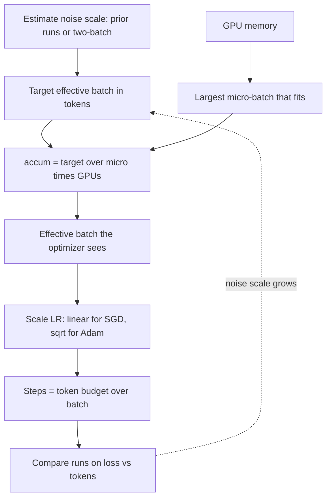

## TL;DR
Batch size is how many examples (for LLMs, tokens) feed one gradient estimate. When you fine-tune on a few
thousand agent traces, it decides how many optimizer steps you get, so batch, learning rate and steps
are one decision.

## For agent builders
- **Why it matters for agents.** Agent fine-tunes (tool-call format, routing, trajectory imitation) run on
  small datasets of a few thousand traces. A vendor-default batch of 128 can leave only a few dozen
  optimizer steps, and the adapter barely learns your tool schema.
- **Where it shows up in your stack.** `per_device_train_batch_size` and `gradient_accumulation_steps` in
  the Hugging Face Trainer and TRL trainers, the world size of your launcher, and the batch-size setting a
  hosted fine-tuning service exposes (often chosen for you).
- **What you control.** The effective batch in tokens (agent traces vary a lot in length), the step count
  that follows from it, and re-tuning the learning rate whenever the effective batch changes.
- **What you can skip.** Measuring the gradient noise scale and batch ramps for pre-training: recognise the
  terms, but agent fine-tunes are almost always in the regime where "enough steps" is the binding rule.
- **Not the serving batch.** Batching concurrent agent requests at inference is a different problem
  (continuous batching in the serving module), with latency rather than gradient noise as the cost.

## Why it exists
- **Full-batch descent is absurd at scale.** One exact step over billions of tokens would take hours, and
  the model would learn nothing until it finished. SGD estimates the gradient from a sample; the batch
  size is the sample size.
- **It is a statistics question.** The mini-batch gradient is an unbiased estimate with variance
  proportional to `1/B`: small `B` gives cheap, noisy steps, large `B` expensive, accurate ones.
- **Hardware pushes bigger.** GPUs are efficient only on large matrices, and batch × sequence length is
  what makes activations large. A few hundred tokens leave most of the chip idle and make the step
  memory-bandwidth bound, because weights are read once per step regardless of batch.
- **Bigger is nearly free per example, up to a point.** Doubling until compute-bound costs little
  wall-clock per example; data parallelism usually adds each GPU's examples to the batch rather than
  splitting a fixed batch finer.
- **Optimization pushes back.** Once the gradient is accurate, a batch twice as large gives essentially
  the same update: same steps, twice the tokens. That is wasted compute, and for a fixed dataset fewer
  epochs' worth of unique signal.
- **So "biggest batch that fits" is wrong both ways.** Too small wastes hardware; too large wastes data.
  The crossover depends on gradient noise, which changes over training. For a 3,000-trace agent fine-tune,
  "too large" mostly means "too few steps".

## How it works
### The agent fine-tune view: batch sets the step count
For small datasets the first question is not gradient noise but whether the optimizer gets enough steps.

```
optimizer_steps = num_examples × epochs ÷ effective_batch
effective_batch = micro_batch × gradient_accumulation_steps × data_parallel_world_size
```

- **Aim for at least a few hundred optimizer steps.** Below that, warmup and decay barely have room and
  the adapter sees too few updates to absorb the tool-call format.
- **Count tokens, not traces.** A batch of 16 short routing traces and a batch of 16 traces with 20k-token
  tool results are very different gradient estimates and memory loads.
- **Learning rate, warmup and decay follow.** Change the effective batch and all three move with it.

### Background: gradient noise and the critical batch size
Write the per-example gradient as the true gradient `G` plus noise with covariance `Σ`. The *gradient
noise scale* is roughly `B_noise = tr(Σ) / |G|²`: the batch at which noise is comparable to signal.

The empirical model of large-batch training relates steps `S` and examples `E` at batch `B` to the minimums
`S_min` (infinite batch) and `E_min` (infinitesimal batch):

```
S = S_min × (1 + B_noise / B)        steps
E = E_min × (1 + B / B_noise)        examples processed  (E = S × B)
```

| Regime | Doubling `B` does | Verdict |
|---|---|---|
| `B ≪ B_noise` | roughly halves `S` for the same `E` | perfect scaling: free speed-up from more hardware |
| `B = B_noise` | `S` and `E` are both 2× their minimum | the sensible "critical" batch |
| `B ≫ B_noise` | leaves `S` unchanged, doubles `E` | pure waste |

- **The noise scale grows during training,** because `|G|` shrinks as the loss falls while per-example
  noise does not. The useful batch is larger late in training, which is why some pre-training recipes ramp
  the batch up over the first part of the run.
- **It tracks how low a loss the run reaches and how hard the task is.** Kaplan et al.'s scaling-law work
  found the critical batch depends mainly on the loss rather than directly on parameter count (later
  studies dispute the details).
- **Hence the range of batch sizes.** LLM pre-training uses batches of millions of tokens while a small
  classifier (such as an agent's tool router) saturates at a few hundred examples.

### Background: measuring the noise scale
You do not have to guess it. The squared norm of a mini-batch gradient is biased upward by the noise,
`E|G_B|² = |G|² + tr(Σ)/B`, so the gradient norm at two batch sizes gives two equations in two unknowns:

```
|G|²   ≈ (B_big · |G_big|² − B_small · |G_small|²) / (B_big − B_small)
tr(Σ)  ≈ (|G_small|² − |G_big|²) / (1/B_small − 1/B_big)
B_simple = tr(Σ) / |G|²
```

- **Free under data parallelism:** each rank's local gradient before the all-reduce is the small batch;
  the reduced gradient is the big one.
- **Smooth before dividing:** single estimates are noisy, so average numerator and denominator separately
  over many steps (an exponential moving average).
- **Treat it as a guide:** `B_simple` assumes a well-conditioned loss surface, so use it as an
  order-of-magnitude view of where the critical batch is and how it moves, not a value to set to the
  nearest token.

### Learning rate must move with batch size
A bigger batch justifies a bigger step, because the step comes from a more trustworthy gradient.
- **SGD: linear scaling rule.** Multiply the learning rate by `k` when multiplying the batch by `k`. It
  works in the perfect-scaling regime with warmup; this recipe trained ImageNet in an hour at a batch of
  8,192.
- **Adam-family: less clean.** Square-root scaling is a common start with some theoretical support, but
  the peak rate is re-tuned when the batch changes by more than a small factor. AdamW is what agent
  fine-tunes and LoRA runs typically use, so expect to re-tune.
- **Either way,** changing the batch without touching the learning rate compares two different
  optimizers, not two batch sizes.

### Generalization
- **Early finding:** very large batches reached sharper minima and generalized worse.
- **Later, larger studies:** most of that gap closes when learning rate, warmup and step count are
  re-tuned for the larger batch. What remains is the noise-scale ceiling, not a mysterious property of big
  batches.
- **Practical reading:** a large batch is not harmful by itself; copying a small-batch recipe to a large
  batch is.

### Memory and the effective batch
Activation memory scales linearly with the batch (and roughly linearly with sequence length under fused
attention kernels, quadratically without them); weight, gradient and optimizer memory do not. The largest
*micro-batch* that fits is a hardware fact. The *effective batch* the optimizer sees is

```
effective_batch = micro_batch × gradient_accumulation_steps × data_parallel_world_size
```

and for LLMs it is usually quoted in tokens: `effective_batch × sequence_length`.

| Knob | Changes | Does not change |
|---|---|---|
| Gradient accumulation | effective batch | per-GPU memory, wall-clock per token |
| More data-parallel GPUs | effective batch, throughput | per-GPU memory |
| Gradient checkpointing, mixed precision | how large the micro-batch can be | the effective batch by itself |

Conflating them is a common confusion: "I added GPUs so I can raise the learning rate" is right; "I added
accumulation so training is faster" is wrong. Long agent traces usually force a small micro-batch, so
accumulation is how agent fine-tunes reach their target effective batch.

### Inference is a different problem
Serving-time batching shares the name, not the trade-off: it amortizes weight reads across concurrent
users (or concurrent agent sessions), with latency rather than gradient noise as the cost. That lives in
the serving module under continuous batching.

## Diagram
Planning goes top-down: the target batch comes from the noise scale (or, for a small agent fine-tune,
from the step budget), memory fixes the micro-batch, accumulation and GPUs fill the gap, and the
learning rate follows the effective batch.



## Examples
### Worked scenario: batch size for a tool-calling adapter
A team LoRA-tunes a model on 3,000 tool-call traces for 3 epochs. Traces average about 2,500 tokens
(illustrative). Only the effective batch changes between rows.

| Effective batch | Optimizer steps per epoch | Total steps | Tokens per step (approx.) | Outcome |
|---|---|---|---|---|
| 128 (vendor default) | 23 | 69 | ~320k | too few steps: warmup and decay barely fit, tool format half-learned |
| 32 | 93 | 279 | ~80k | a few hundred steps: room for warmup and decay |
| 16 | 187 | 561 | ~40k | more steps and more gradient noise; re-tune the peak rate down |

- **The fix was not more data or more GPUs.** Dropping the effective batch from 128 to 32 quadrupled the
  optimizer steps on the same traces.
- **Re-tune the learning rate after the change,** because the step count and gradient noise both moved.

### Turning a hardware constraint into config numbers
A planning function that turns a hardware constraint and a token budget into the three numbers written
into a config, with the learning-rate adjustment explicit. The numbers are illustrative; the structure is
what matters.

```python
def plan(tokens_budget, seq_len, target_batch_tokens,
         micro_batch_per_gpu, n_gpus, base_lr, base_batch_tokens, rule="sqrt"):
    seqs_per_step = target_batch_tokens // seq_len
    per_micro_step = micro_batch_per_gpu * n_gpus
    accum = max(1, seqs_per_step // per_micro_step)
    eff_tokens = accum * per_micro_step * seq_len          # what the optimizer actually sees
    steps = tokens_budget // eff_tokens
    ratio = eff_tokens / base_batch_tokens
    lr = base_lr * (ratio ** 0.5 if rule == "sqrt" else ratio)
    return dict(accum=accum, eff_tokens=eff_tokens, steps=steps, lr=lr)

print(plan(tokens_budget=10_000_000_000, seq_len=4096, target_batch_tokens=1_000_000,
           micro_batch_per_gpu=4, n_gpus=8, base_lr=3e-4, base_batch_tokens=524_288))
# -> accum 7, eff_tokens 917504, steps 10899, lr ~3.97e-4
#   244 seqs/step wanted, 32 per micro-step -> 7 accumulation steps -> 224 seqs = 0.92M tokens
#   10B tokens / 0.92M = ~10.9k optimizer steps; sqrt-scaling from a 0.5M-token recipe at 3e-4
#   gives ~4.0e-4 (linear scaling would give 5.25e-4; either is a starting point to re-tune).
```

- **Same function with `n_gpus=64`:** returns `accum=1` and `eff_tokens=1,048,576`. The target is reached
  without accumulation, steps drop to ~9.5k, and the learning rate moves only slightly (to ~4.2e-4)
  because the effective batch moved only slightly.
- **The point:** adding GPUs changed throughput, not the optimization problem, because the plan held the
  effective batch roughly fixed.

### Measuring the noise scale and reading the cost curve
Pure Python. The first part applies the two-batch estimator to illustrative squared norms from 8 ranks ×
32 sequences; the second evaluates the `S` and `E` formulas around that noise scale.

```python
def noise_scale(g2_small, g2_big, b_small, b_big):
    """Two-batch estimator: squared grad norms measured at two batch sizes."""
    g2 = (b_big * g2_big - b_small * g2_small) / (b_big - b_small)    # |G|^2
    tr_sigma = (g2_small - g2_big) / (1 / b_small - 1 / b_big)         # tr(Sigma)
    return tr_sigma / g2                                                # B_simple

# Data parallel: 8 ranks x 32 sequences. Local grad = small batch, all-reduced grad = big batch.
# Illustrative measured values (averaged over many steps, as the text says):
print(round(noise_scale(g2_small=32.25, g2_big=4.90625, b_small=32, b_big=256)))   # -> 1000

def cost(B, B_noise, S_min=1.0, E_min=1.0):
    return S_min * (1 + B_noise / B), E_min * (1 + B / B_noise)

for B in (250, 500, 1000, 2000, 4000):
    s, e = cost(B, B_noise=1000)
    print(f"B={B:5d}  steps x{s:.2f}  examples x{e:.2f}")
```

| Batch (noise scale 1,000) | Steps vs minimum | Examples vs minimum |
|---|---|---|
| 250 | 5.00× | 1.25× |
| 500 | 3.00× | 1.50× |
| 1,000 | 2.00× | 2.00× |
| 2,000 | 1.50× | 3.00× |
| 4,000 | 1.25× | 5.00× |

Going from 1,000 to 4,000 cuts steps only from 2× to 1.25× the minimum while examples rise from 2× to 5×:
past the noise scale, hardware buys little time and costs a lot of data.

## Production patterns
- **Check the step count before every agent fine-tune.** Compute `num_examples × epochs ÷ effective_batch`
  before launch and refuse runs with fewer than a few hundred optimizer steps; lower the effective batch
  rather than adding epochs of the same traces. Monitor the learning-rate trace to confirm warmup and
  decay both happened.
- **Plot every run against tokens.** Log tokens per optimizer step (`effective_batch × sequence_length`)
  and use tokens as the x-axis for loss curves, so runs with different batches (or different trace-length
  mixes) are comparable. Flattening loss-per-token after a batch increase is the sign you passed the noise
  scale.
- **Bucket or pack agent traces by length.** Grouping traces of similar length keeps tokens per step
  steadier and avoids padding a batch to its one 20k-token trace. Monitor tokens per step and peak memory
  per step, not just traces per step.
- **Scale GPUs at fixed effective batch.** When adding data-parallel ranks, divide accumulation by the
  same factor so the effective batch, learning rate and schedule stay put. Verify that loss-vs-tokens
  curves overlay the old run.
- **Re-tune the learning rate on every batch change.** Start from linear scaling for SGD or square-root
  for Adam, lengthen warmup, then sweep the peak briefly. Monitor early grad-norm spikes, loss per token
  and the agent eval (tool-call validity, task success) against the reference run.
- **Measure the noise scale on large runs only.** Under data parallelism, log each rank's local gradient
  norm and the all-reduced norm, keep EMAs of the two estimator terms, and track `B_simple`. For long
  pre-training, ramp the batch up early (GPT-3 did this), with the schedule defined in tokens.

## Trade-offs
- **Utilization vs data efficiency.** Larger batches raise GPU utilization and cut wall-clock per token,
  but past the noise scale they stop reducing step count, so each extra example costs data and compute
  with no loss benefit.
- **Small batches: steps and regularizing noise vs idle hardware.** More optimizer steps per token help on
  small datasets such as agent traces, but small batches under-use accelerators and make the step
  bandwidth-bound rather than compute-bound.
- **LR scaling vs exactness.** Scaling the learning rate with batch keeps the optimizer comparable across
  hardware sizes, but the exact rule (linear, square-root, re-tune) depends on the optimizer and breaks
  down near the noise scale.
- **Batch ramp vs schedule complexity.** A ramp matches the growing noise scale and saves data early, at
  the cost of a schedule whose step count and learning rate must be tied to tokens rather than steps.
- **Accumulation vs more GPUs.** A large effective batch through accumulation costs nothing in memory but
  delivers no speed-up; through more GPUs it costs hardware but actually shortens the run.

## Pitfalls
- **Assuming batch is irrelevant for small fine-tunes.** With a few thousand examples, a batch of 128 may
  give only a few dozen optimizer steps per epoch, too few for the optimizer to do anything. Symptom: the
  tool-call eval barely moves. Fix: shrink the effective batch until you have a few hundred steps.
- **Doubling the batch (or GPUs) but not the learning rate.** The run trains noticeably slower per token
  and the team blames the larger batch instead of the untouched learning rate. Fix: rescale the rate, then
  re-tune it.
- **Quoting batch in sequences across context lengths.** Two runs with "batch 64" at 2k and 8k context see
  4× different numbers of tokens per gradient. Agent traces make this worse because lengths vary per row.
- **Sizing the schedule in steps, then changing the batch.** Warmup and decay now cover a different
  fraction of the data than intended. Fix: recompute steps from the token budget after every batch change.
- **Pushing utilization past the noise scale.** Loss-per-token flattens: more tokens for the same loss,
  visible only when runs are plotted against tokens rather than steps.

## When to use
- **Fix batch size first** in a training plan, because learning rate, warmup and step count all follow
  from it.
- **Fine-tuning (including agent traces):** start small enough for at least a few hundred optimizer steps,
  raise the micro-batch until the GPU is busy, and use accumulation only to reach a target effective batch.
- **Pre-training or large-scale continued training:** pick the effective batch from the expected noise
  scale (prior runs of similar size are the best guide, and the two-batch estimator measures it on the
  live run), consider ramping it, and scale the learning rate when the batch changes.
- **Measure:** always compare runs on loss versus tokens, not loss versus steps, and confirm with the
  agent eval.
- **Interviews:** expect the noise-scale argument, the coupling with learning rate, and the distinction
  between micro-batch, effective batch and tokens per step.

## Role lens
- **Engineer:** Writes the micro-batch, accumulation and world-size arithmetic into the config, logs tokens
  per step, and re-tunes the learning rate whenever the effective batch changes.
- **Architect:** Decides how training throughput is scaled across the fleet (more GPUs at fixed effective
  batch versus larger batches) with the noise-scale ceiling in mind, because it bounds useful parallelism.
- **FDE:** Translates a customer's hardware constraint into an effective-batch plan their fine-tuning job can
  actually run, and explains why their small dataset needs a smaller batch than the vendor default.

## Check yourself
**Q:** A team moves a pre-training job from 8 GPUs to 64 GPUs by keeping the per-GPU micro-batch and
dropping gradient accumulation from 8 to 1, so the effective batch is unchanged. Throughput rises 8× but
a colleague proposes "since we have 8× the GPUs we should also use an 8× larger batch and finish faster".
How do you evaluate that?
**A:** The first move is sound: the effective batch, learning rate and schedule are unchanged, so the
optimization problem is identical and the run simply finishes sooner. The proposal is a different
experiment. Multiplying the batch by 8 only shortens the run if the current batch is well below the
gradient noise scale; if it is near or above it, the step count barely falls and the run consumes up to
8× more tokens for the same loss. The honest evaluation is to estimate the noise scale, which with 64 data-parallel ranks is nearly free
(compare each rank's local gradient norm with the all-reduced norm, as in the two-batch estimator), or
take it from prior runs of this model size, scale the learning rate (square-root for Adam as a
starting point, then re-tune), lengthen warmup, and compare both configurations on loss versus tokens.
If the data budget is fixed, exceeding the noise scale also means fewer effective passes over unique
data, which is a quality cost, not just a compute one.

## Interview questions
### What is the critical batch size, and why does it exist?
- **Definition:** roughly the gradient noise scale `tr(Σ) / |G|²`, the batch at which the mini-batch
  gradient's noise is comparable to its signal.
- **Why it caps scaling:** below it, doubling the batch nearly halves the steps; above it, steps barely
  fall and tokens consumed double.
- **It moves:** it grows as loss falls, so the useful batch is larger late in training.

### Your tool-calling fine-tune on 3,000 traces finished but the agent still emits malformed calls. What do you check about batch size?
- **Count the optimizer steps:** at an effective batch of 128 for 3 epochs that is about 69 steps, too few
  for warmup, decay and learning the format.
- **Then the learning rate and schedule:** after lowering the batch, re-tune the peak rate and recompute
  warmup and decay in optimizer steps.
- **Confirm on the agent eval:** score held-out tool calls for valid JSON and correct tool choice, not just
  training loss.

### Your team doubled the GPUs and the batch, and loss per token got worse. Debug it.
- **First suspect the learning rate:** a larger batch with an unchanged rate takes equally cautious but
  half as many steps, so progress per token slows.
- **Second, the noise scale:** if the old batch was already near it, the bigger batch mostly burns data.
- **Check the schedule:** if warmup and decay were sized in steps, they now cover different fractions of
  the data. Re-tune and compare on loss versus tokens.

### Agent traces range from 500 to 20,000 tokens. How do you set the batch for a fine-tune on them?
- **Think in tokens per step:** a fixed number of traces per batch gives wildly varying tokens and memory,
  so bucket or pack by length.
- **Micro-batch from the longest traces:** memory is set by the longest batch that can occur, and
  accumulation brings the effective batch up to target.
- **Steps from the dataset:** keep at least a few hundred optimizer steps, then monitor tokens per step
  and peak memory alongside loss.

### How would you measure the noise scale on a running data-parallel job?
- **Two batch sizes for free:** each rank's local gradient is the small batch, the all-reduced gradient
  the big one.
- **Solve two equations:** `E|G_B|² = |G|² + tr(Σ)/B` at both sizes gives `|G|²` and `tr(Σ)`, hence
  `B_simple`.
- **Smooth it:** EMA the numerator and denominator separately over many steps, and treat the result as an
  order-of-magnitude guide.

### Does a large batch hurt generalization?
- **Early work said yes:** large batches reached sharper minima and generalized worse.
- **Later, larger studies:** most of the gap closes once learning rate, warmup and step count are re-tuned
  for the larger batch.
- **What remains** is the noise-scale ceiling on useful batch size, so the risk is copying a small-batch
  recipe, not the large batch itself.

## Quiz
### Q: What determines the point beyond which increasing batch size stops reducing the number of training steps needed?
- [ ] GPU memory capacity
- [ ] The number of layers in the model
- [x] The gradient noise scale, the batch size at which the gradient estimate's noise becomes comparable to its signal
- [ ] The learning-rate schedule's total step count
> Once the mini-batch gradient is already an accurate estimate, more samples do not change the step, so
> steps stop falling while tokens consumed keep rising. Memory limits the micro-batch, not the useful batch.

### Q: A fine-tuning run doubles its effective batch size and keeps everything else fixed. What is the most likely immediate effect?
- [ ] Training loss per token improves because gradients are more accurate
- [x] Progress per token slows, because the learning rate is now too small for the less noisy gradient
- [ ] Memory per GPU doubles even if the micro-batch is unchanged
- [ ] The warmup period becomes twice as long in tokens, improving stability
> A larger batch justifies a larger step; holding the learning rate fixed means each step is as cautious
> as before but there are half as many of them. Per-GPU memory depends on the micro-batch, not the effective batch.

### Q: Which change increases the effective batch size without changing per-GPU memory or the time per optimizer step?
- [ ] Enabling gradient checkpointing
- [ ] Switching from fp32 to bf16
- [x] Adding data-parallel GPUs while holding the per-GPU micro-batch constant
- [ ] Doubling the sequence length
> Each data-parallel rank contributes its micro-batch to the effective batch, so more ranks mean a larger
> batch per step at the same per-GPU footprint. Checkpointing and bf16 change what fits, not the batch itself.

## Use cases & projects
### Use cases
- **Tool-call format fine-tunes.** Small trace datasets where the effective batch decides whether the run
  has enough optimizer steps to learn the schema.
- **Routers and small classifiers for agents.** Tool or sub-agent routers saturate at batches of a few
  hundred examples, so bigger batches only burn data.
- **Scaling a fine-tune onto more GPUs.** Holding the effective batch fixed while adding ranks keeps the
  learning rate and schedule valid and the run comparable.
- **Mixed-length trajectory datasets.** Length bucketing or packing keeps tokens per step steady when
  traces range from short calls to long tool results.

### Mini project
**Batch-size sweep on a tool-calling adapter (2-3 hours).**
- **Goal:** show how effective batch changes step count and tool-call quality on a small agent dataset.
- **Steps:** collect or synthesise about 2,000 tool-call traces; write a small planner that prints
  optimizer steps and tokens per step for effective batches of 16, 32 and 128; LoRA-tune a small open
  model at each setting with the learning rate re-tuned briefly; score held-out calls for valid JSON and
  correct tool choice.
- **Done when:** you have a table of batch, steps, tokens per step, final loss and tool-call accuracy, and
  a one-paragraph recommendation for the batch you would ship and why.
