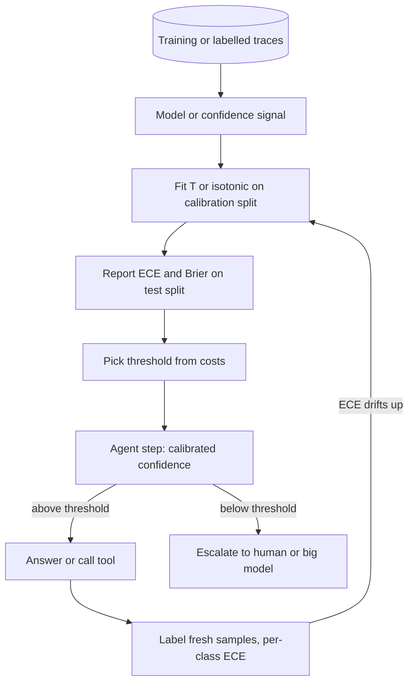

## TL;DR
Agents act on confidence: answer or escalate, route to the big model, block a tool call. Calibration
makes "90%" mean right about 90% of the time. Models, LLMs and judges are usually overconfident: measure
on held-out labels, fix post hoc.

## For agent builders
- **Why it matters for agents.** Every "if confidence < c then ..." in an agent (human handoff, cascade
  to a larger model, guardrail block, retry with more retrieval) assumes the number is a probability. If
  it is not, the threshold escalates the wrong share of runs and lets confident mistakes through.
- **Where it shows up in your stack.** Router and cascade thresholds, guardrail classifier scores, LLM
  judge scores in your eval harness, log-probabilities from APIs that expose them, and self-consistency
  (sampling agreement) when they do not.
- **What you control.** Which confidence signal you use, a labelled calibration split drawn from real
  agent traffic, the calibrator (temperature, Platt or isotonic), the threshold derived from costs, and
  a weekly ECE check on fresh labels.
- **What you can skip.** Proofs about proper scoring rules and the internals of LBFGS. Know the
  reliability diagram, ECE, temperature scaling and the rule "verbalised confidence is not p".

## Why it exists
- **A score and a probability are different contracts.** A score only promises an ordering. A probability
  promises that expected-value arithmetic works: predicting positive when p ≥ C_FP / (C_FP + C_FN) minimises
  expected cost, and "escalate when p < 0.8" escalates cases that are wrong about one time in five.
- **Downstream uses break without it.** Averaging two models' probabilities or feeding one into a Bayesian
  update is meaningless if "0.8" means "very sure" for one model and "coin flip" for another, or means
  different things for the same model on Monday and on Friday.
- **Models do not deliver the contract by default.** Cross-entropy is a proper scoring rule, but Guo et al.
  showed deep, wide networks with batch normalisation and little weight decay keep driving training NLL
  down after accuracy saturates, pushing confidence toward 1 and leaving the test set overconfident.
- **Other sources of distortion.** Margin-based learners (SVMs, boosted trees) emit scores with a
  characteristic sigmoid-shaped distortion (Niculescu-Mizil & Caruana). Class reweighting or resampling
  shifts the implied base rate by a known but usually ignored factor. LLMs have three signals (token
  probabilities, verbalised confidence, sampling agreement) with different calibration.
- **"Just tune the threshold on the raw score" is the naive fix.** It works for one fixed decision on a fixed
  distribution and nowhere else: not across customers, not when the probability is consumed downstream,
  not when the base rate drifts.

## How it works
### Definition, and why it is separate from accuracy
- **Binary:** perfectly calibrated when P(Y = 1 | p̂ = p) = p for every p.
- **Multi-class:** usually top-label calibration, P(ŷ = y | confidence = c) = c.
- **Orthogonal to discrimination:**

| Model | Calibrated? | Discriminates? |
|---|---|---|
| Outputs the base rate for every input | perfectly | useless |
| Ranks perfectly, every score in [0.49, 0.51] | useless as a probability | perfectly |

- **Which metric measures what:** AUC measures discrimination, calibration metrics measure calibration, and
  proper scoring rules such as the Brier score and log loss blend both.

### Measuring it
- **Reliability diagram:** bin predictions by confidence (equal-width or equal-mass bins), plot observed
  accuracy per bin against mean confidence. Perfect calibration is the diagonal; points below it are
  overconfidence.
- **Expected calibration error** turns the diagram into a number:

```
ECE = sum over bins m of  (|B_m| / n) * | acc(B_m) - conf(B_m) |
```

| Metric | What it is | Caveat |
|---|---|---|
| ECE | weighted gap per bin | depends on binning, biased upward on small samples; never compare ECEs with different bin counts |
| Maximum calibration error | the worst bin instead | noisy on small bins |
| Brier score, mean (p̂ − y)² | proper; decomposes into calibration, resolution and irreducible uncertainty | rewards calibration and sharpness without saying which moved |
| Log loss | proper | penalises a confident mistake without bound, which is why it is the training loss and Brier the reporting metric |

### Fixing it after training
Every post-hoc method learns a monotone map g from raw score to probability on a **calibration split not
used for training**, because fitting g on training data re-learns the overconfidence. Report on a third
split; fitting and reporting on the same split flatters every method, isotonic regression most.

| Method | Form | Strength | Limit |
|---|---|---|---|
| Platt scaling | g(z) = σ(a·z + b) on the logit z, fit by NLL | two parameters; good for sigmoid-shaped distortion; built for SVM margins | only that shape |
| Temperature scaling | softmax(z / T), one parameter | multi-class; argmax unchanged | cannot fix class-dependent or non-monotone miscalibration |
| Isotonic regression | non-parametric monotone step function | repairs any monotone distortion | needs thousands of points, overfits on fewer, ties can shave a little AUC |

- **Temperature direction:** T > 1 flattens the distribution (fixes overconfidence), T < 1 sharpens it.
- **Why accuracy is safe:** every logit is divided by the same positive constant, so the argmax is unchanged
  and accuracy and ROC-AUC are untouched by construction.
- **Evidence:** Guo et al. found this single scalar as effective as far more flexible methods on the networks
  they tested.
- **In scikit-learn:** `CalibratedClassifierCV` with `method="sigmoid"` or `method="isotonic"`.
- **Training-time influences change the starting point** rather than fixing it: label smoothing, mixup,
  stronger weight decay, early stopping on NLL rather than accuracy, and ensembles, whose averaged
  probabilities are less extreme than any member's.

### Prior shift and resampling
If the model learned at positive rate π_s (because you rebalanced) and serves at π_t, its probabilities are
off by the ratio of the odds. Assuming the class-conditional distributions did not change:

```
w   = (pi_t * (1 - pi_s)) / (pi_s * (1 - pi_t))
p_t = p_s * w / (p_s * w + (1 - p_s))
```

- **Example:** trained on a 50/50 rebalanced set, a model that says 0.6 means about 0.07 at a true prevalence of 5%.
- **Simpler alternative:** calibrate on a validation set drawn at the deployment prevalence and skip the algebra.

### Calibration does not survive drift
- **It is measured against one distribution.** Under shift, models typically become more overconfident on
  inputs unlike their training data.
- **So** a calibrated model in the eval harness is not a calibrated model six months later. Treat ECE on fresh
  labelled samples as a production monitor, not a one-time certificate.

### Abstention needs ranking *and* calibration
An "answer or escalate" rule asks two separate questions:
1. **Does sorting by confidence put wrong answers at the bottom?** That is discrimination: the AUROC of
   confidence against correctness, or the risk–coverage curve (error rate among kept answers as you keep the
   top 100%, 90%, 80%…).
2. **Where do I cut?** That needs calibration. With calibrated confidence, a threshold c means the marginal
   kept answer is wrong with probability 1 − c, the expected error among kept answers is the mean of
   1 − confidence over them, and the escalation rate can be predicted before launch.

- **Temperature scaling fixes only the second.** It cannot reorder answers, so a signal whose risk–coverage
  curve is flat stays useless however well calibrated.
- **Measure both before building a cascade.** If the curve is flat, the fix is a better signal (sampling
  agreement, a trained verifier), not a better calibrator.

### Three confidences in an LLM agent
Agents built on hosted models rarely have a trained classifier's logits; they choose among these three.

1. **Token probabilities.** For multiple-choice or classification formats, the probability mass on the
   answer token. Kadavath et al. report that large pretrained models are reasonably calibrated in this
   format; post-training with RLHF has been reported to degrade it, so re-check per model. Few-shot
   classifiers also carry majority-label and recency biases from the demonstrations, which can be
   estimated with a content-free input and divided out (contextual calibration).
2. **Verbalised confidence.** "I am 90% sure" is generated text, not a probability; it tends to cluster
   in a narrow high band regardless of correctness. Treat it as a feature to calibrate, not as p.
3. **Agreement under sampling.** Sample the answer n times at non-zero temperature and use the
   agreement rate. This behaves like an ensemble and is often the best cheap confidence signal for a
   black-box model, at n times the cost.

- **LLM-as-judge:** the same applies to the judge's score against human labels.
- **Routers and cascades:** a calibrated "probability the small model is right" is what makes a
  cost-versus-quality threshold mean anything.

## Diagram
Three disjoint splits, then the agent's production loop: the calibrator is fitted once but checked
forever, and the threshold it supports decides answer versus escalate.



## Examples
### Worked scenario: reading an overconfident reliability table
A five-class classifier's predictions on 1,000 held-out items fall into five confidence bins of 200 each.

| Bin | Mean confidence | Observed accuracy | Gap |
|---|---|---|---|
| 1 | 0.55 | 0.52 | 0.03 |
| 2 | 0.65 | 0.58 | 0.07 |
| 3 | 0.75 | 0.64 | 0.11 |
| 4 | 0.85 | 0.70 | 0.15 |
| 5 | 0.96 | 0.80 | 0.16 |

- **Every bin sits below the diagonal.** ECE = 0.2 × (0.03 + 0.07 + 0.11 + 0.15 + 0.16) = 0.104.
- **Mean confidence is 0.75 against an overall accuracy of 0.65:** a classic overconfident network.

### Agent scenario: setting a support agent's handoff threshold from costs
A support agent answers tickets or hands off to a human. A human review costs $2; a wrong answer shipped
costs $20 (refunds, churn). Answer only when the expected cost of answering, (1 − p) × 20, is below 2,
so the threshold is p ≥ 0.9, and that only means something if p is calibrated.

```python
import random
random.seed(0)
# Stand-in for 2,000 labelled validation runs: calibrated confidence per run, and whether it was right
runs = [random.betavariate(15, 1) for _ in range(2_000)]
labels = [random.random() < p for p in runs]        # calibrated by construction

C_ESC, C_WRONG = 2.0, 20.0                           # $ per human review, $ per wrong answer shipped
tau = 1 - C_ESC / C_WRONG                            # answer iff (1 - p) * C_WRONG < C_ESC
kept = [(p, ok) for p, ok in zip(runs, labels) if p >= tau]
escalation = 1 - len(kept) / len(runs)
kept_error = sum(not ok for _, ok in kept) / len(kept)
forecast = sum(1 - p for p, _ in kept) / len(kept)  # what calibration lets you predict before launch
print(f"tau={tau:.2f} escalate={escalation:.1%} kept error={kept_error:.1%} forecast={forecast:.1%}")
# This run: tau=0.90 escalate=20.2% kept error=3.9% forecast=4.0%
```

The same agent before calibration, using a raw confidence with a 0.8 cut (the Check yourself case),
per 10,000 tickets (illustrative figures):

| Setting | Escalated | Wrong answers kept | Cost |
|---|---|---|---|
| Raw confidence, cut at 0.8 | 500 (5%) | 30% of 9,500 = 2,850 | $1,000 + $57,000 = $58,000 |
| Calibrated, cut at 0.9 from costs | ~2,000 (20%) | ~4% of ~8,000 ≈ 320 | ~$4,000 + ~$6,400 ≈ $10,400 |

The honest escalation rate is four times higher, and total cost drops by more than 5×.

### Temperature scaling on synthetic overconfident logits
The code fits a temperature on synthetic logits built to be exactly twice as sharp as they should be, so the
fitted T should land near 2, ECE should drop by roughly an order of magnitude, and accuracy should not move.

```python
import torch, torch.nn.functional as F

def ece(probs, labels, n_bins=15):
    """Expected calibration error of the top label, equal-width bins."""
    conf, pred = probs.max(dim=1)
    hit = (pred == labels).float()
    edges = torch.linspace(0, 1, n_bins + 1)
    total = torch.zeros(())
    for lo, hi in zip(edges[:-1], edges[1:]):
        m = (conf > lo) & (conf <= hi)
        if m.any():
            total += m.float().mean() * (hit[m].mean() - conf[m].mean()).abs()
    return total.item()

def fit_temperature(logits, labels):
    """One scalar T fitted by NLL on a held-out calibration split. Argmax is unchanged, so accuracy is too."""
    log_t = torch.zeros(1, requires_grad=True)            # parametrise log T so T stays positive
    opt = torch.optim.LBFGS([log_t], lr=0.1, max_iter=200)
    def closure():
        opt.zero_grad()
        loss = F.cross_entropy(logits / log_t.exp(), labels)
        loss.backward()
        return loss
    opt.step(closure)
    return log_t.exp().item()

torch.manual_seed(0)
def make(n, k=5, overconf=2.0):
    """Stand-in for a trained net: the calibrated logits are 1.5*z; the 'net' emits twice that."""
    y = torch.randint(0, k, (n,))
    z = torch.randn(n, k) + 1.5 * F.one_hot(y, k)
    return overconf * 1.5 * z, y
logits_cal, y_cal = make(5_000)          # calibration split: never used for training
logits_test, y_test = make(5_000)        # reporting split: never used to fit T

T = fit_temperature(logits_cal, y_cal)
print(f"T={T:.2f}  ECE {ece(F.softmax(logits_test, 1), y_test):.3f} -> "
      f"{ece(F.softmax(logits_test / T, 1), y_test):.3f}  (T > 1 means the model was overconfident)")
# On this data T comes out close to 2 (about 1.94) and ECE falls from roughly 0.16 to below 0.02; accuracy is identical
```

### Production snippet: calibrate a scikit-learn model and check it
Calibration is fitted by internal cross-validation on the training data; the test split only reports.

```python
from sklearn.calibration import CalibratedClassifierCV, calibration_curve
from sklearn.ensemble import HistGradientBoostingClassifier
from sklearn.metrics import brier_score_loss

def calibrate_and_report(X_train, y_train, X_test, y_test):
    base = HistGradientBoostingClassifier()
    cal = CalibratedClassifierCV(base, method="isotonic", cv=5).fit(X_train, y_train)
    p = cal.predict_proba(X_test)[:, 1]
    frac_pos, mean_pred = calibration_curve(y_test, p, n_bins=10, strategy="quantile")
    worst_gap = max(abs(a - b) for a, b in zip(frac_pos, mean_pred))
    return cal, brier_score_loss(y_test, p), worst_gap   # store and alert on both
```

The exact fitted T in the previous example varies slightly with the PyTorch version (a recent run gave 2.02
and ECE 0.167 to 0.014); what matters is T near 2 and an order-of-magnitude drop in ECE.

Use `method="sigmoid"` instead when the calibration data is small, because isotonic overfits on few points.

## Production patterns
- **Ship the calibrator with the model.** Fit T (or the isotonic map) in the training pipeline on the
  validation split, save it in the same artefact, and apply it inside the serving code so no consumer sees
  raw logits. Add a serving test that a fixed input's served probability equals the calibrated value
  recorded at training, which catches a calibrator silently dropped in a refactor.
- **ECE as a scheduled monitor.** Label a fresh production sample weekly, compute ECE with equal-mass bins
  and a fixed bin count, per class, plus Brier. Alert when ECE rises past a reviewed bound or mean predicted
  probability departs from the observed rate.
- **Calibrate at deployment prevalence.** After any reweighting or resampling, recalibrate on data drawn at
  production prevalence, or apply the prior-shift correction with recorded π_s and π_t. Monitor base-rate
  drift, which silently invalidates the correction.
- **Predict the escalation rate before launch.** For a cascade, pick the threshold on calibrated confidence
  from the cost of escalation versus a wrong answer, and forecast escalation rate and kept-answer error from
  validation. After launch, alert when either departs from the forecast.
- **Sampling agreement for black-box LLM agents.** When no log-probabilities are available, sample n
  answers at non-zero temperature, use the agreement rate, and fit an isotonic map from agreement to
  correctness on labelled agent runs. Monitor cost per request, which grows n times; spend it only on
  steps that gate an irreversible action.
- **Calibrate the LLM judge before trusting pass rates.** Label a few hundred eval transcripts by hand,
  plot the judge's score against human verdicts, and fit a map so that of transcripts the judge scores
  0.8, humans pass about 80%. Re-check whenever the judge model or its prompt changes.

## Trade-offs
- **One-parameter temperature scaling vs flexibility.** It preserves accuracy and ranking and needs little
  data, but only corrects global over- or under-confidence; switch to isotonic or per-class scaling when the
  reliability curve is S-shaped or class-dependent and you have thousands of calibration points.
- **Cheap post-hoc calibration vs drift.** It is model-agnostic but fitted to one distribution and degrades
  under drift, so it buys you a production monitor to maintain rather than a one-time fix.
- **Proper scoring rules vs ECE.** Proper rules reward calibration and sharpness in one number but cannot say
  which moved; ECE isolates calibration but depends on binning and is biased on small samples. Report both
  when someone downstream will act on the probability.
- **A labelled calibration split vs training data.** The split costs training data; worth it whenever a threshold, cascade, human escalation
  or user-facing confidence consumes the probability; pointless when only the ranking is consumed.
- **Sampling confidence vs cost for LLMs.** It is the most reliable black-box signal but costs n calls per
  answer; flip to token log-probabilities when the API exposes them and the output format is constrained
  enough for them to mean something.

## Pitfalls
- **Fitting the calibrator on training data.** Symptom: ECE looks fine offline while production
  overconfidence persists untouched. Fix: a calibration split the model never trained on.
- **Fitting and reporting on the same split.** Symptom: an optimistic ECE, worst with isotonic regression,
  that does not reproduce on new data. Fix: report on a third split.
- **Shipping raw probabilities after class-weighting or resampling.** Symptom: mean predicted probability far
  above the observed base rate and a flooded queue at any sensible threshold. Fix: prior-correct or
  recalibrate at deployment prevalence.
- **Assuming better AUC means better probabilities, or vice versa.** Symptom: a calibration fix judged
  useless because AUC did not move, or a new model trusted because AUC rose.
- **Trusting verbalised LLM confidence as a probability.** Symptom: a reliability diagram flat at 85–95%
  confidence across correct and incorrect answers alike.
- **Keeping the threshold after swapping the agent's model.** Symptom: escalation rate or kept-answer
  error jumps the day a new model version ships. Fix: confidence scales differ between models, so refit
  the calibrator and re-pick the threshold on labelled runs before the switch.
- **Ten equal-width bins on 200 examples.** Symptom: ECE moving by 0.05 when you change the bin count. Fix:
  fewer, equal-mass bins and a bootstrap interval.
- **Reporting only the average ECE.** Symptom: a badly overconfident minority class hiding behind a
  calibrated majority. Fix: per-class ECE.

## When to use
- **Calibrate whenever an agent decision consumes the probability rather than the ranking:** a cost-based threshold,
  an abstain-or-escalate rule, a cascade to a larger model, a human-review queue sized by confidence, a
  user-facing "likely" or "unlikely", or any averaging of scores across models.
- **Skip it when only the order matters,** as in top-k retrieval or a leaderboard.
- **Measure:** a reliability diagram plus ECE and Brier on a split the calibrator never saw, per class when
  classes are imbalanced, and again on fresh production labels on a schedule.
- **Default fix:** temperature scaling; escalate to isotonic with enough data.
- **Interviews:** define calibration, distinguish it from discrimination, explain why temperature scaling
  preserves accuracy, and say how you would get a usable confidence out of a black-box LLM.

## Role lens
- **Engineer:** Fits the temperature on the validation split inside the training pipeline, stores T with
  the model artefact, and adds an ECE check on fresh labelled samples to the monitoring job.
- **Architect:** Decides which decisions in the system consume probabilities (routing thresholds,
  abstention, escalation budgets) and requires calibration evidence before any of them goes live.
- **FDE:** Turns the customer's "only escalate when the model is unsure" into a calibrated threshold with
  a measured escalation rate, and explains why a verbalised "95% confident" from the model is not that.

## Check yourself
**Q:** You built a cascade: a small model answers, and if its confidence is below 0.8 the request
escalates to a large model. After launch 5% of requests escalate, yet 30% of the non-escalated answers
are wrong. Diagnose the problem and say how you would fix it.
**A:** If a confidence of at least 0.8 were calibrated, at most about 20% of the kept answers could be
wrong; 30% means the small model is overconfident, so the threshold is not doing what its number
claims. Label a sample of production traffic, draw the reliability diagram, fit a temperature (or
Platt scaling) on it, and re-pick the threshold against the real costs: the price of an escalation
versus the price of a wrong answer. The escalation rate will rise, which is the honest number. If the
confidence is a verbalised one from a black-box model, replace it with sampling agreement or a trained
verifier. Then monitor ECE on fresh labels, because drift will undo the fix.

## Interview questions
### What does it mean for a model to be calibrated, and how is that different from being accurate?
- **Definition:** confidence matches hit rate; of everything called 0.9, about 90% is right.
- **Different property:** a base-rate predictor is perfectly calibrated and useless, while a perfect ranker
  with scores squeezed into [0.49, 0.51] is useless as a probability. AUC measures ranking, ECE calibration.

### Why are modern neural networks often overconfident, and what is the cheapest fix?
- **Cause (Guo et al.):** deep, wide networks with batch normalisation and little weight decay keep lowering
  training NLL after accuracy saturates, which pushes confidence toward 1.
- **Cheapest fix:** temperature scaling on a held-out split, one parameter, with accuracy and ranking
  unchanged because the argmax and score order are preserved.

### When would you pick isotonic regression over temperature scaling, and when not?
- **Pick isotonic** when the reliability curve is S-shaped or otherwise non-linear and you have thousands of
  calibration points.
- **Avoid it** with small calibration sets, where it overfits, and when tied scores shaving a little AUC
  would hurt a ranking consumer.
- **Per-class scaling** is the middle ground when miscalibration differs by class.

### Your agent's LLM says it is 95% confident on every answer. How do you get a usable confidence?
- **Do not use the verbalised number as p:** it clusters in a narrow high band regardless of correctness.
- **Use a better signal:** token probabilities on a constrained answer format if the API exposes them, or
  agreement across n samples at non-zero temperature.
- **Then calibrate and check ranking:** fit a map on labelled data and confirm the risk–coverage curve is not
  flat, because calibration cannot reorder answers.

### Your rebalanced fraud model outputs 0.6 and the real fraud rate is 5%. What do you tell the downstream team?
- **The 0.6 assumed 50/50 classes.** Prior correction gives odds 1.5 × (0.05/0.95) ≈ 0.079, so p ≈ 0.07.
- **Operationally:** apply the correction or recalibrate on data at deployment prevalence before they set any
  threshold, and monitor base-rate drift, which breaks the correction.

### You upgraded the model behind an agent and the human-handoff rate halved overnight. Good news?
- **Not yet.** A new model has a different confidence scale, so the same threshold now means something
  else; fewer handoffs can simply mean more confident wrong answers kept.
- **Check:** label a sample of kept answers from both versions, draw reliability diagrams, and compare
  kept-answer error, not handoff rate.
- **Fix:** refit the calibrator on the new model's labelled runs and re-derive the threshold from costs.

## Quiz
### Q: Why does temperature scaling leave accuracy and ROC-AUC unchanged?
- [ ] It only alters predictions whose confidence is below 0.5
- [x] Dividing every logit by the same positive T preserves each prediction's argmax and the ordering of scores
- [ ] It retrains the final layer with a calibration loss
- [ ] It is applied only during training, not at inference
> A single positive scalar is a strictly monotone transform of each logit vector, so the top class
> and the relative order of scores across examples are preserved; only the confidence values change.
> Accuracy depends on the argmax and AUC on the ordering, so neither can move.

### Q: A classifier trained on a 50/50 rebalanced set outputs p = 0.6 for an item. The true prevalence is 5%. Roughly what is the corrected probability?
- [ ] 0.60, because the model's probability already accounts for the prior
- [x] About 0.07
- [ ] About 0.03
- [ ] About 0.95
> The odds 0.6/0.4 = 1.5 must be multiplied by the ratio of deployment odds to training odds,
> (0.05/0.95)/(0.5/0.5) ≈ 0.053, giving odds ≈ 0.079 and a probability of about 0.073. The model's
> 0.6 silently assumed positives were as common as negatives.

### Q: Which statement about calibration metrics is correct?
- [ ] The Brier score measures calibration and nothing else
- [x] A predictor that always outputs the base rate has near-zero ECE yet no discriminative power, so calibration and discrimination are separate properties
- [ ] ECE is a proper scoring rule
- [ ] A low ECE implies a high ROC-AUC
> ECE only checks that confidence matches hit rate, which the constant base-rate predictor satisfies
> trivially. Brier blends calibration with resolution, ECE is a binned diagnostic rather than a proper
> scoring rule, and nothing about low ECE constrains the ranking that AUC measures.

## Use cases & projects
### Use cases
- **Human-handoff thresholds in support agents.** A calibrated confidence turns "escalate when unsure"
  into a threshold derived from the cost of a review versus a wrong answer, with a forecast escalation rate.
- **Model cascades and routers.** A calibrated "probability the small model is right" decides when to pay
  for the large model, so the cost-versus-quality trade is a number, not a guess.
- **Guardrails on tool calls.** Blocking or confirming a risky action (refund, delete, send) at a
  confidence threshold that is refitted after every model upgrade, so it keeps meaning the same risk.
- **LLM-as-judge in eval harnesses.** Mapping judge scores to agreement with human labels, so a
  dashboard's pass rate tracks what reviewers would say.

### Mini project
**Calibrate an agent's answer-or-escalate rule (2-3 hours).**
- **Goal:** turn a raw LLM confidence into a calibrated one and pick a handoff threshold from costs.
- **Steps:** run a small Q&A agent on 300+ questions with known answers; record verbalised confidence and
  agreement across 5 samples per question; label each answer right or wrong; split into calibration and
  test halves; fit an isotonic map from agreement to correctness; draw reliability diagrams and ECE for
  both signals; pick the threshold from two costs you choose.
- **Done when:** you have both reliability diagrams, ECE before and after, the chosen threshold, and the
  forecast versus observed escalation rate and kept-answer error on the test half.
