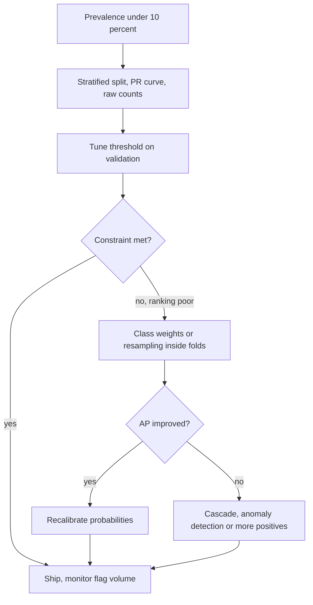

## TL;DR
With a rare class, accuracy, an unweighted loss and a 0.5 threshold quietly optimise for "say the common
class". It is a cost problem: fix evaluation, then the threshold, and only then weights, resampling or
focal loss, which distort probabilities.

## Why it exists
- **Rare positives are the valuable case.** Fraud, abuse, prompt injection, hallucinated answers, churn,
  defects, thumbs-down feedback. When positives are 1% of the data, three things go wrong at once.
- **The metric lies.** Accuracy for the constant "never positive" classifier is 99%, so the number cannot
  distinguish a useless model from a good one.
- **The optimisation is lopsided.** The loss sums over examples, 99% of them negatives, so the gradient
  mostly says "get the negatives right" and the boundary drifts to wherever majority errors are cheapest.
  With few minority examples the model also cannot learn the minority region well, whatever the weighting.
- **The decision rule is wrong.** Argmax, or a 0.5 threshold, is Bayes-optimal only when both errors cost the
  same. Elkan: with calibrated probabilities, predict positive when p ≥ C_FP / (C_FP + C_FN); a miss costing
  fifty times a false alarm gives a threshold near 0.02.
- **Naive responses fail.** "Collect more data" keeps the same ratio, and the minority is usually expensive to
  label. "Oversample until balanced" works only if duplicates stay out of validation folds and probabilities
  are repaired; carelessly done, it leaks and its "0.5" means 0.05. The enemy is the cost-default mismatch.

## How it works
### Step 0: measure with the right instruments
1. **Report the prevalence.**
2. **Split with stratification** so every fold keeps the ratio; otherwise a small test fold can contain zero
   positives and recall is undefined.
3. **Read the confusion matrix with raw counts.**
4. **Prefer the precision–recall curve and average precision to ROC-AUC** when positives are rare, because
   ROC's false-positive axis is normalised by the huge negative count and hides the alert volume.
5. **State the operating point as a constraint** ("recall ≥ 0.8 at the best precision", or "at most N false
   alarms per day") and pick the threshold on a validation split, never the test split.

**Check the evaluation set can measure what you claim.** Recall is estimated from the positives alone, so
its standard error is about √(r(1 − r) / n_pos):

| Positives | Measured recall | Standard error | 95% interval |
|---|---|---|---|
| 50 | 0.80 | near 0.057 | roughly ±0.11: cannot tell 0.75 from 0.85 |
| 400 | 0.80 | about 0.02 | about ±0.04 |

- **Dataset size is irrelevant; the number of positives buys precision on recall.** That is why evaluation
  sets for rare classes are deliberately enriched, and why that enrichment must be undone for precision (below).

### Lever 1: move the threshold
- **Most of the "imbalance problem" is the 0.5 default** for a model that already ranks reasonably.
- **Choose τ on validation** to meet the cost-optimal rule above or the product constraint. No retraining, no
  distortion of probabilities.
- **Try this first** *because* reweighting and resampling are, for a well-specified model, roughly equivalent
  to shifting the threshold, and the threshold is the cheaper knob.

### Lever 2: reweight the loss
- **Balanced heuristic:** w_c = N / (k · n_c). With 2% positives the minority weight is about 25 and the
  majority about 0.51 (scikit-learn's `class_weight="balanced"`). This is oversampling in expectation without
  duplicating rows.
- **It changes the whole fitted solution, not only the intercept.** It moves the boundary toward recall, so
  verify the ranking with average precision rather than assuming it improved.
- **Probabilities now reflect an artificial 50/50 prior** and must be recalibrated or corrected before
  anything consumes them.

When does reweighting genuinely help rather than merely relocate the threshold?
- **Limited capacity:** a misspecified or heavily regularized model must choose where to spend capacity; the
  weights tell it to fit the minority's boundary at the expense of the bulk of the negatives, which can
  improve ranking in the high-recall region you will actually operate in.
- **Minibatch SGD:** a 1%-positive class appears about once per hundred examples, and oversampling makes its
  gradient signal less noisy.
- **Both are empirical claims about your data,** so measure AP with and without.

For deep networks the same idea is weighted cross-entropy, or **focal loss**:

```
FL(p_t) = -alpha_t * (1 - p_t)^gamma * log(p_t)
```

- **p_t** is the probability assigned to the true class.
- **The (1 − p_t)^γ factor** shrinks the loss of examples the model already gets right, so the thousands of
  easy negatives stop dominating the gradient; γ = 2 is the value the original detection paper settled on.
- **Why it was invented:** in dense object detection the problem was not only the class ratio but that almost
  all negatives were trivially easy.

### Lever 3: resample
| Method | What it does | Right when | Risk |
|---|---|---|---|
| Random undersampling | drops majority rows; fast, loses information | negatives are abundant and redundant | lost signal; averaging models trained on different undersamples recovers much of it |
| Random oversampling | duplicates minority rows | cheap first try | trees and high-capacity models overfit to the copies |
| SMOTE | synthetic point on the segment to one of k nearest minority neighbours; widens the region | continuous feature spaces | nonsense on one-hot or embedding features; plants points in majority territory when classes overlap |

- **Resample *after* the split, or inside each cross-validation fold,** otherwise copies of the same row land in
  train and validation and scores inflate.
- **Borderline and adaptive SMOTE variants** exist for overlapping classes.
- **For text, the modern analogue is LLM-generated minority examples,** with the same two risks (distribution
  mismatch, label noise) and the same rule: validate only on real minority data.

### Lever 4: change the problem
When positives are below roughly one in a thousand, or unlabelled, reframe:
- **Anomaly or one-class detection.**
- **Active learning** to find positives worth labelling.
- **A two-stage cascade:** a cheap high-recall filter hands a small enriched set to an expensive precise model.
  This is how most LLM-based moderation and injection pipelines are actually built.
- **Multi-class:** merge rare classes into a parent class or handle them hierarchically.

### Translating between enriched evaluation and production
Recall and FPR transfer from an enriched set; precision does not. Convert with the production prevalence π:

```
precision_at_prod = TPR * pi / (TPR * pi + FPR * (1 - pi))
```

| Detector | Production prevalence | Precision |
|---|---|---|
| TPR 0.95, FPR 0.001 | injections 0.1% of traffic | about 0.49 |
| TPR 0.95, FPR 0.01 | injections 0.1% of traffic | about 0.09 |

### Imbalance in LLM systems
- **Few-shot majority-label bias.** If nine of ten demonstrations are "benign", the model leans benign
  regardless of input; balance the demonstrations or calibrate the outputs.
- **Judges.** On a set where 3% of outputs are failures, a judge can "agree with humans 97%" by passing
  everything; score it on recall of the failure class.
- **Feedback classifiers.** Production feedback is imbalanced by construction (thumbs-down is rare), so the
  headline should be recall on bad outputs at a fixed review budget.

## Diagram
Work down the levers in order of cost; stop at the first one that meets the operating constraint.



## Examples
### Unweighted vs balanced logistic regression on 2% positives
A 2%-positive problem, split three ways with stratification. Two logistic regressions, one unweighted and
one with balanced class weights, are compared on ranking (average precision), on behaviour at the default
threshold, and after choosing the threshold on validation for "recall ≥ 0.80". The last column shows what
the weights did to the probabilities.

```python
import numpy as np
from sklearn.datasets import make_classification
from sklearn.linear_model import LogisticRegression
from sklearn.model_selection import train_test_split
from sklearn.metrics import average_precision_score, precision_recall_curve, precision_score, recall_score

X, y = make_classification(n_samples=60_000, n_features=20, n_informative=6, n_redundant=2,
                           class_sep=1.5, flip_y=0.0, weights=[0.98, 0.02], random_state=0)
X_tr, X_rest, y_tr, y_rest = train_test_split(X, y, test_size=0.4, stratify=y, random_state=0)
X_val, X_te, y_val, y_te = train_test_split(X_rest, y_rest, test_size=0.5, stratify=y_rest, random_state=0)
print(f"prevalence train={y_tr.mean():.3f} val={y_val.mean():.3f} test={y_te.mean():.3f}")  # ~0.02 everywhere

for cw in (None, "balanced"):
    clf = LogisticRegression(max_iter=2000, class_weight=cw).fit(X_tr, y_tr)
    p_val, p_te = clf.predict_proba(X_val)[:, 1], clf.predict_proba(X_te)[:, 1]
    # Lever 1: choose the threshold on validation for the product spec "recall >= 0.80"
    prec, rec, thr = precision_recall_curve(y_val, p_val)
    ok = rec[:-1] >= 0.80
    tau = thr[np.argmax(np.where(ok, prec[:-1], -1))]
    print(f"class_weight={cw}: AP={average_precision_score(y_te, p_te):.3f} | "
          f"tau=0.5 recall={recall_score(y_te, p_te >= 0.5):.2f} "
          f"precision={precision_score(y_te, p_te >= 0.5, zero_division=0):.2f} | "
          f"tau={tau:.3f} recall={recall_score(y_te, p_te >= tau):.2f} "
          f"precision={precision_score(y_te, p_te >= tau):.2f} | "
          f"mean p={p_te.mean():.3f} vs base rate {y_te.mean():.3f}")
# Expect: at tau=0.5 the unweighted model has lower recall and the balanced one far lower precision;
# once tau is tuned both meet the recall floor; the balanced model's mean probability sits far above
# the 2% base rate; and its average precision is not better (in this run it is clearly worse, ~0.74 vs ~0.82).
```

The output is the one people miss. In one run:

| Model | AP | At τ = 0.5 | At tuned τ | Mean predicted p |
|---|---|---|---|---|
| Unweighted | 0.82 | recall 0.67 | τ about 0.13: recall 0.80 at precision 0.61 | near the 2% base rate |
| Balanced | 0.74 | recall 0.89, precision 0.16 | τ about 0.73: recall 0.83 at precision 0.31 | 0.17 on 2% data |

- **The weights taught the model nothing new about the minority.** They moved its operating point and
  inflated its probabilities.
- **They also changed which errors it traded off,** here for the worse, because a linear model on this data
  is misspecified.
- **The unweighted model reached the recall target by moving τ alone,** at twice the precision.

### Imbalance arithmetic you will need in a design review
Pure Python: the cost threshold, recall's interval, enriched-to-production precision, and prior correction.

```python
import math

def cost_threshold(c_fp, c_fn):                  # Elkan: predict positive when p >= this
    return c_fp / (c_fp + c_fn)

def recall_ci(r, n_pos):                         # normal-approximation 95% interval half-width
    return 1.96 * math.sqrt(r * (1 - r) / n_pos)

def prod_precision(tpr, fpr, pi):                # enriched eval -> production precision
    return tpr * pi / (tpr * pi + fpr * (1 - pi))

def prior_correct(p, pi_train, pi_prod):         # undo a shifted training prior
    r = (pi_prod / (1 - pi_prod)) / (pi_train / (1 - pi_train))
    return p * r / (p * r + (1 - p))

print(f"threshold for 50:1 costs  = {cost_threshold(1, 50):.3f}")
for n in (50, 400):
    print(f"recall 0.80 with {n:>3} positives: +/- {recall_ci(0.80, n):.3f}")
for fpr in (0.001, 0.01):
    print(f"TPR 0.95, FPR {fpr}: precision at 0.1% prevalence = {prod_precision(0.95, fpr, 0.001):.2f}")
for p in (0.5, 0.9):                             # balanced weights act like a 50/50 prior
    print(f"balanced-model p={p} -> {prior_correct(p, 0.5, 0.02):.3f} at 2% prevalence")
# threshold 0.020; +/- 0.111 and 0.039; precision 0.49 and 0.09; p 0.5 -> 0.020, 0.9 -> 0.155
```

The prior correction is exact only for a well-specified model; for anything else, recalibrate on a sample at
production prevalence and compare.

## Production patterns
- **Threshold from a cost model or alert budget.** Pick τ on validation with `precision_recall_curve`
  against a written constraint (recall floor, or N alerts per day), version τ with the model, and never
  hard-code 0.5. Monitor daily flag volume and precision on a reviewed sample.
- **Stratify every split.** Use `train_test_split(..., stratify=y)` and `StratifiedKFold` (or
  `StratifiedGroupKFold` with entities) so no fold lacks positives. Monitor positives per fold and the spread
  of recall across seeds.
- **Resample inside the fold only.** Put samplers in an imbalanced-learn `Pipeline` (for example
  `make_pipeline(SMOTE(), LogisticRegression())` from `imblearn.pipeline`), which applies sampling during
  `fit` only. Monitor the gap between cross-validation and a fresh holdout.
- **Recalibrate after reweighting.** Fit `CalibratedClassifierCV(..., method="isotonic")` or apply the prior
  correction on unweighted data at production prevalence. Monitor mean predicted probability versus the
  observed positive rate per day.
- **Cascade for very rare positives.** A cheap high-recall classifier routes a small enriched slice to an LLM
  judge or human review. Monitor stage-one recall on a labelled audit sample and stage-two queue volume.

## Trade-offs
- **Free threshold moving vs a ceiling.** It costs nothing and keeps probabilities honest, but cannot help a
  model that never learned the minority structure; if the precision–recall curve hugs the prevalence line,
  you need data or a different model, not a different τ.
- **Cheap recall from weights and oversampling vs inflated probabilities.** They push the boundary toward
  recall but change the fitted solution; the flip is any consumer that needs p, where you must recalibrate
  or prior-correct afterwards.
- **Fast undersampling vs lost data.** It often loses little when negatives are redundant; with millions of
  negatives undersample, with thousands weight instead.
- **SMOTE recall vs implausible points.** It widens the minority region in continuous spaces and can lift
  recall, but produces implausible points on categorical, one-hot or embedding features and across
  overlapping classes; prefer real or human-validated synthetic examples there.
- **Focal loss vs tuning and calibration.** It rescues deep detectors drowning in easy negatives, but adds two
  hyperparameters and changes the probability scale, so re-check calibration after switching.
- **Enriched eval sets: stable recall vs unrepresentative precision.** Convert through TPR, FPR and the
  production prior before promising a number.

## Pitfalls
- **Resampling or SMOTE before the split.** Symptom: near-perfect cross-validation then a production collapse,
  because neighbours of the same minority point sat in both folds.
- **Non-stratified splits with rare positives.** Symptom: folds with zero positives, undefined recall and
  wildly varying scores between random seeds.
- **Reporting accuracy or ROC-AUC alone.** Symptom: 0.99 accuracy with no positives caught, or 0.95 AUC with a
  review queue that is 90% false alarms.
- **Shipping raw probabilities from a reweighted model.** Symptom: everything looks "likely positive" and
  every downstream threshold breaks.
- **Measuring precision on the enriched evaluation set.** Symptom: 0.8 offline and 0.1 in production with no
  change in the model.
- **Few-shot prompts whose demonstrations are all one class.** Symptom: predictions skew to that class
  whatever the input says.
- **Validating on LLM-generated minority examples.** Symptom: excellent numbers on synthetic positives and no
  improvement on real ones.

## When to use
- **Treat prevalence under roughly 10% as imbalanced** and start with measurement discipline: prevalence,
  stratified splits, confusion matrix, precision–recall, a threshold chosen on validation against a stated
  constraint.
- **Use class weights or resampling** only when the ranking itself is poor and average precision shows they
  help; **focal loss** for deep detectors swamped by easy negatives; **undersampling** when negatives are
  enormous and redundant.
- **Use anomaly detection or a cascade** when positives are below one in a thousand.
- **Always recalibrate** before anyone consumes the probabilities, whatever you did to the training distribution.
- **Interviews:** why accuracy fails, the cost-optimal threshold formula, how resampling causes leakage, and
  how enriched-set precision converts to production precision.

## Role lens
- **Engineer:** Builds the stratified split, the threshold sweep and the prior correction into the
  training pipeline, and makes `class_weight` or resampling a tracked experiment rather than a default.
- **Architect:** Owns the cost model (what a miss and a false alarm each cost) that fixes the operating
  point, and decides whether a cascade or a human-review stage is the cheaper way to buy precision.
- **FDE:** Enriches the customer's evaluation set with real positives from their incident history,
  converts offline precision to their actual traffic mix, and sets the daily alert budget with the team
  that will work the queue.

## Check yourself
**Q:** You must build a prompt-injection detector. Injections are 0.1% of production messages; you
have 2,000 labelled injections and about a million benign messages. How do you build the training set
and the evaluation set, and how do you choose the threshold?
**A:** Train on all 2,000 positives against an undersampled but diverse negative set (tens of
thousands, deliberately keeping hard negatives such as benign messages that mention "ignore the
instructions"), or on everything with class weights; either way the probabilities will be shifted, so
plan to recalibrate on a sample drawn at production prevalence. Hold out a stratified evaluation set
with enough positives (several hundred) to estimate recall tightly and a large benign sample to
estimate FPR, then convert to production precision with the 0.1% prior rather than quoting precision
from the enriched set. Set the threshold from the cost model: a false block costs friction, a missed
injection risks exfiltration, so fix the FPR budget security will accept and read recall there on
validation. If the score feeds a second-stage LLM check, calibrate it. Monitor daily flag volume and
review a sample so drift in either class is noticed.

## Interview questions
### Why is accuracy a bad metric at 1% prevalence, and what do you report instead?
- **Definition-plus-why:** the constant "never positive" classifier scores 99%, so accuracy cannot separate a
  useless model from a good one.
- **Report instead:** prevalence, the confusion matrix in raw counts, the precision–recall curve with average
  precision, and recall and precision at the chosen operating point.

### A teammate added `class_weight="balanced"` and now every downstream threshold fires constantly. What happened?
- **Diagnosis:** balanced weights make the model behave as if the classes were 50/50, so its probabilities are
  inflated; mean predicted p far above the base rate confirms it.
- **Fix:** recalibrate on unweighted data at production prevalence or apply the prior correction, then re-pick
  thresholds on validation.
- **Also check** whether the weights improved average precision at all; often moving τ alone was enough.

### When would you undersample instead of reweighting?
- **Undersample** when negatives number in the millions and are redundant: training is faster and little is
  lost, and averaging models over several undersamples recovers more.
- **Reweight** when negatives number in the thousands and every one carries information.
- **Either way** the probabilities shift and need correcting before use.

### Your injection detector has TPR 0.95 and FPR 0.01 on a balanced test set. What precision will production see?
- **Convert with the prior:** at 0.1% prevalence, precision is 0.95·0.001 / (0.95·0.001 + 0.01·0.999), about 0.09.
- **So** roughly ten false alarms per true catch; driving FPR to 0.001 lifts precision to about 0.49.
- **Design response:** a cascade with a precise second stage, or a stricter threshold traded against recall.

### How many positives does your evaluation set need?
- **Recall's standard error is about √(r(1 − r) / n_pos):** 50 positives at recall 0.80 give a 95% interval near
  ±0.11; 400 give about ±0.04.
- **So size by positives, not rows,** and enrich the evaluation set, then convert precision back to
  production prevalence.

## Quiz
### Q: Missing a fraud costs about fifty times as much as a false alarm. With calibrated probabilities, which decision threshold minimises expected cost?
- [ ] 0.5, because that is where the model is most uncertain
- [x] About 0.02
- [ ] About 0.98
- [ ] It depends only on the prevalence of fraud
> The cost-optimal rule predicts positive when p ≥ C_FP / (C_FP + C_FN) = 1 / 51 ≈ 0.02. Prevalence
> is already inside a calibrated probability, so it does not enter the threshold separately; 0.5 is
> only optimal when both errors cost the same.

### Q: You apply SMOTE to the whole dataset and then run 5-fold cross-validation. Scores are excellent; production is poor. What is the most likely cause?
- [ ] SMOTE created too few synthetic points to matter
- [x] Synthetic points interpolated from a minority example land in other folds, leaking near-duplicates between train and validation
- [ ] Class weights should have been used as well
- [ ] ROC-AUC is unsuitable for imbalanced data
> Each synthetic point lies on a segment between two real minority points, so when those are split
> across folds the validation fold contains near-copies of training data and the score is inflated.
> Resampling belongs inside each fold, applied to the training portion only.

### Q: After training with class_weight="balanced", the mean predicted probability on the test set is 0.35 while the prevalence is 0.02. What is going on and what should you do?
- [ ] The model is broken; retrain without weights
- [x] This is expected: the weights shifted the learned prior, so recalibrate or apply the prior correction before anyone consumes the probabilities
- [ ] The test set is mislabelled
- [ ] Set the threshold to 0.35 and ship
> Balanced weights make the model behave as if positives were half the data, so its probabilities are
> systematically inflated by the odds ratio between the artificial and the real prior. The ranking may
> be fine; the probabilities are not, until you correct them or recalibrate on unweighted data.
