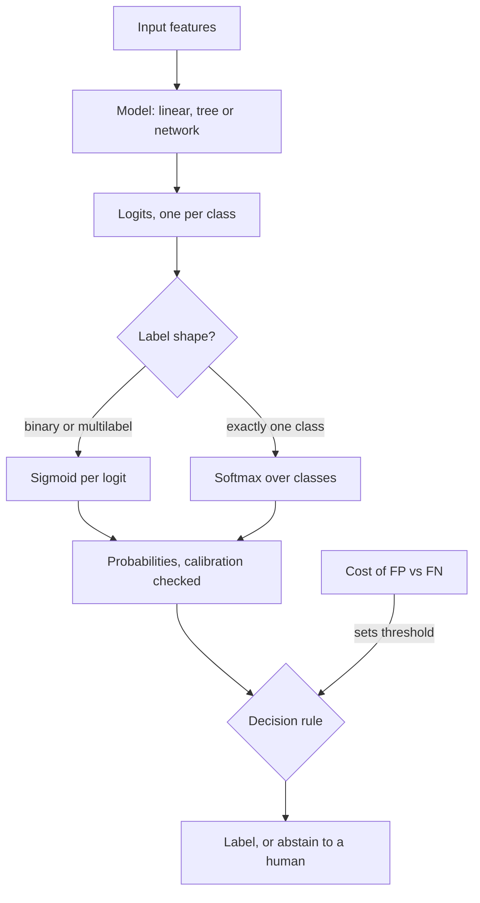

## TL;DR
An agent is full of classifiers: the intent router, tool selection, guardrails and LLM-as-judge pass/fail.
Each should score classes, turn scores into probabilities, then apply a separate threshold that encodes
the cost of each mistake.

## For agent builders
- **Why it matters for agents.** Every branch in an agent is a discrete decision: which tool, which
  sub-agent, block or allow, escalate or answer, pass or fail in an eval. Treating them as classifiers
  gives you a confusion matrix, a tunable threshold and an abstain path instead of a silent wrong turn.
- **Where it shows up in your stack.** Router prompts or small fine-tuned routers, safety and PII filters,
  judge prompts that output a label, and the tool choice inside the model itself (every generated token
  is a classification over the vocabulary).
- **What you control.** The label set (tool names, intents), whether you read token log-probabilities or
  only text, the threshold per route, and when to hand off to a human.
- **What you can skip.** Deriving logistic regression by hand and generative-versus-discriminative
  theory. Know cross-entropy, softmax versus sigmoid, the expected-cost threshold and the metric family.

## Why it exists
- **Many decisions are discrete.** Spam or not, which team handles this ticket, which intent, which tool
  to call, is this answer grounded in the source, which token comes next.
- **Hand-written rules fail.** They are brittle, do not scale to thousands of edge cases, and produce no
  notion of confidence; a rule either fires or it does not, so there is no way to send borderline cases to
  a human.
- **Regression on a class index 0..K−1 fails more subtly.** It imposes an ordering and a distance that do
  not exist: class 3 is not "between" classes 2 and 4, yet squared error would punish predicting 0 instead
  of 4 sixteen times harder than predicting 3. The model wastes capacity learning an arbitrary numbering.
- **What is needed:** one score per class, a loss that rewards putting probability on the correct class
  and nothing else, and a decision rule that accounts for asymmetric costs.
- **The probability matters on its own.** A 0.51 spam score and a 0.99 spam score should lead to
  different actions (flag for review versus delete), and a downstream system, such as an agent deciding
  whether to act, can only make that distinction if the classifier exposes it. Estimate P(class | input),
  then decide.

## How it works
### Background: from features to scores
1. **Linear scores.** A linear classifier computes z = Wx + b: one score per class, from a weight vector
   per class.
2. **Binary: sigmoid.** Logistic regression has one logit and p = σ(z) = 1/(1 + e^(−z)). Inverting the
   sigmoid gives z = log(p / (1 − p)), the log-odds. A weight is "change in log-odds per unit of this
   feature".
3. **The boundary is flat.** The decision boundary p = 0.5 is the hyperplane wᵀx + b = 0, which is why a
   linear classifier can only separate classes that a flat boundary can split.
4. **K classes: softmax.** p_k = exp(z_k) / Σ_j exp(z_j) turns K logits into a distribution that sums to
   one.

Other model families end the same way, with a score per class:
- **Neural networks** replace the raw features x with learned features and keep the same final linear
  layer. In a transformer the "LM head" is exactly this: a linear map from the hidden state to
  vocabulary-sized logits followed by softmax. When your agent's LLM picks a tool name, it is classifying.
- **Tree ensembles** partition the feature space instead of drawing linear boundaries.
- **k-nearest-neighbours** votes among similar training points.

| Family | Models | Data need |
|---|---|---|
| Discriminative | logistic regression, neural nets, trees: estimate P(y \| x) directly | usually win once data is plentiful |
| Generative | naive Bayes: model P(x \| y) and P(y), apply Bayes' rule | need less data when independence assumptions roughly hold |

### The loss
- **Cross-entropy, −log p_y,** the negative log probability assigned to the true class.
- **Why:** it is the maximum-likelihood objective for a categorical outcome, and its gradient with
  respect to the logits is simply p − onehot(y): large when the model is confidently wrong, near zero when
  it is confidently right. The same loss trains the LLM and any router you fine-tune.
- **Squared error on probabilities loses that property,** which is why it trains badly for classes. The
  loss-functions lesson derives this.

### Decision rule and threshold
- **Binary rule:** predict positive when p ≥ τ.
- **τ = 0.5 is rarely right.** The default is only optimal when both errors cost the same and the training
  distribution matches production.
- **Expected-cost rule.** Predicting positive costs (1 − p)·C_FP in expectation, predicting negative
  costs p·C_FN, so:

```
predict positive when  p > C_FP / (C_FP + C_FN)
missed fraud costs 10x a false alarm  ->  threshold = 1/11 ≈ 0.09, not 0.5
```

- **Needs calibration.** This only works if p is calibrated, which is why calibration is a separate lesson.
- **Agents add a third option: abstain.** Below a confidence cutoff the agent asks a clarifying question
  or hands off to a human, which is often cheaper than either error.

### Binary, multiclass, multilabel
| Shape | Output layer | Decision | Agent example |
|---|---|---|---|
| Binary | one logit, sigmoid | one threshold | guardrail allow or block |
| Multiclass (exactly one label) | K logits, softmax | argmax, or a threshold on the top probability with an "abstain" branch for low-confidence cases | intent router, next tool |
| Multilabel (any subset of K tags) | K logits, independent sigmoids | per-tag thresholds | policy categories a reply violates |

- **Softmax is wrong for multilabel,** because it forces the tags to compete for a total of one.
- **Ordinal and hierarchical labels** (small, medium, large; department, then team) need their own
  treatment; forcing them into flat multiclass throws away structure.

### Evaluation
- **Accuracy misleads whenever classes are imbalanced:** with 1% positives, predicting "negative" always
  scores 99%. Most guardrail and escalation classes are rare.
- **Use the metric family:** the confusion matrix shows where errors go; precision, recall and F1
  summarise it at one threshold; ROC-AUC and PR-AUC summarise ranking quality across thresholds;
  calibration checks whether a 0.8 means 80%. The metric lessons in this module cover each.

### Classification in the LLM era
| Approach | Strengths | Costs |
|---|---|---|
| Prompt an LLM to output the label | no training data, flexible | slow, costly per call, no calibrated probability unless you read token log-probabilities |
| Fine-tune a small encoder on labelled data | fast, cheap per call, reasonably calibrated | needs labels |
| Embed with a pre-trained encoder, fit logistic regression on top | a strong middle ground | needs some labels |

Routers, guardrails, intent detectors and LLM-as-judge pass/fail checks are all classifiers and deserve
the same rigour: a held-out set, a confusion matrix, and a threshold chosen from costs.

## Diagram
Scoring and deciding are separate stages; the threshold is where business cost enters. Sigmoid or softmax
outputs are not calibrated automatically, so check calibration before the decision rule uses them.



## Examples
### Agent scenario: a router with an abstain branch
The router scores each intent from label-token log-probabilities (or a small classifier), normalises them
and only dispatches when the top class is confident enough; otherwise the agent asks the user.

```python
import math

def route(label_logprobs, tau=0.7):
    """label_logprobs: {intent: log-probability of that label}, read from the model or a classifier."""
    m = max(label_logprobs.values())
    exp = {k: math.exp(v - m) for k, v in label_logprobs.items()}
    total = sum(exp.values())
    probs = {k: v / total for k, v in exp.items()}        # softmax over the closed label set
    best = max(probs, key=probs.get)
    return (best, probs[best]) if probs[best] >= tau else ("ask_clarifying_question", probs[best])

print(route({"refund": -0.1, "shipping": -2.5, "account": -4.0}))   # ('refund', ~0.90)
print(route({"refund": -0.9, "shipping": -1.0, "account": -2.0}))   # abstains: top prob ~0.45
```

Worked numbers for choosing τ on 1,000 labelled conversations (illustrative):

| τ | Auto-routed | Wrong tool among auto-routed | Clarifying questions |
|---|---|---|---|
| 0.5 | 960 | 58 | 40 |
| 0.7 | 870 | 17 | 130 |
| 0.9 | 640 | 4 | 360 |

If a wrong tool call costs a refund reversal and a clarifying question costs one extra turn, 0.7 is the
usual compromise; the table, not intuition, picks it.

### Same model, two thresholds
A fraud-style problem with 3% positives. The same trained model gives very different operating points
depending on the threshold; the threshold, not the model, is where the business decision lives.

```python
import numpy as np
from sklearn.datasets import make_classification
from sklearn.linear_model import LogisticRegression
from sklearn.model_selection import train_test_split
from sklearn.metrics import precision_score, recall_score

# Synthetic, illustrative: 20k rows, 20 features, ~3% positives
X, y = make_classification(n_samples=20_000, n_features=20, n_informative=8,
                           weights=[0.97, 0.03], random_state=0)
X_tr, X_te, y_tr, y_te = train_test_split(X, y, test_size=0.25, stratify=y, random_state=0)

clf = LogisticRegression(max_iter=1000).fit(X_tr, y_tr)
p = clf.predict_proba(X_te)[:, 1]              # scores in [0, 1]; no decision has been made yet

# A missed positive costs ~10x a false alarm  ->  Bayes threshold = C_FP / (C_FP + C_FN) = 1/11
for tau in (0.5, 1 / 11):
    pred = (p >= tau).astype(int)
    print(f"tau={tau:.2f}  precision={precision_score(y_te, pred):.2f}  "
          f"recall={recall_score(y_te, pred):.2f}  flagged={pred.mean():.1%}")
# Expect: tau=0.50 -> high precision, low recall, few flagged.
#         tau=0.09 -> recall rises sharply, precision falls, many more rows flagged.
# Same model, same probabilities; only the decision rule changed.
```

### Worked scenario: undoing a rebalanced training set
A team trained a guardrail on a 50/50 rebalanced set; production has 3% positives. For a single binary
logit, add the log of the ratio of prior odds: log((0.03/0.97) / (0.5/0.5)) ≈ −3.48.

| Score from the rebalanced model | Corrected probability at 3% prior |
|---|---|
| 0.50 | 0.03 |
| 0.80 | 0.11 |
| 0.95 | 0.37 |
| 0.99 | 0.75 |

Without the correction, every row above would be flagged at τ = 0.5 and the minority class would be
heavily over-predicted. With it, the expected-cost threshold can be applied to honest probabilities.

```python
import math

def correct_prior(p_train, pi_train=0.5, pi_prod=0.03):
    z = math.log(p_train / (1 - p_train))
    z += math.log((pi_prod / (1 - pi_prod)) / (pi_train / (1 - pi_train)))
    return 1 / (1 + math.exp(-z))

print(round(correct_prior(0.8), 2))   # 0.11
```

## Production patterns
- **Return probabilities, decide in config.** The router or guardrail service returns the score; the
  threshold lives in configuration per route or customer, so changing an operating point needs no retrain
  or prompt change. Monitor flag rate and precision on a weekly labelled sample.
- **Constrain the label set, then read log-probabilities.** Give the router an enum of tool or intent
  names (structured output or a closed list in the prompt) and score those label tokens rather than
  parsing free text. Monitor the share of outputs outside the label set; it should be zero.
- **Pick the threshold on a held-out set at the natural distribution.** Sweep τ with scikit-learn
  `precision_recall_curve`, pick the point that meets the cost or recall target, and record it with the
  model and prompt version. Monitor recall on the rare class after each deploy.
- **Calibrate before thresholding.** Wrap the model in scikit-learn `CalibratedClassifierCV` (sigmoid or
  isotonic) or fit temperature scaling on a validation set. Monitor a reliability curve and expected
  calibration error per release.
- **Abstain to a human or a clarifying question on low confidence.** Route predictions whose top
  probability falls below a cutoff to a review queue or back to the user. Monitor queue volume and the
  accuracy of auto-handled cases.
- **Embed-then-logistic-regression router before an LLM router.** Fit logistic regression on frozen
  embeddings; it is cheap, fast and often good enough. Compare per-class recall against the prompted LLM
  on the same held-out set, and log the predicted class distribution daily to catch drift.

## Trade-offs
- **Tunable probabilities vs calibration upkeep.** Exposing probabilities with a tunable threshold is more
  flexible than emitting hard labels, but obliges you to keep them calibrated. If calibration cannot be
  maintained, a fixed decision boundary validated on a confusion matrix is the honest alternative.
- **Softmax vs per-label sigmoids.** Softmax yields a proper distribution for mutually exclusive classes,
  but is wrong for overlapping labels; switch to per-label sigmoids the moment one input can legitimately
  carry two tags.
- **Prompted LLM vs trained classifier.** The LLM needs no labelled data and changes in minutes, but costs
  more per call, adds latency to every agent step and gives no calibrated score. Once you have a few
  thousand labels and real throughput, a trained small classifier usually wins on all three.
- **Fine taxonomy vs examples per class.** Finer labels (more tools, more intents) are more useful but
  give fewer examples per class, so tail classes degrade. A coarse classifier followed by a fine one
  within each branch flips the balance when tail classes matter.

## Pitfalls
- **Reporting accuracy on imbalanced data.** Symptom: 99% accuracy from a model that never predicts the
  minority class, visible instantly in the confusion matrix.
- **Leaving the threshold at 0.5.** Symptom: a respectable AUC with collapsed recall on the rare class,
  because the probabilities for that class rarely exceed 0.5.
- **Trusting an LLM's verbal confidence as a probability.** "I am 90% sure" is not one; the calibration
  curve shows stated confidence has little relation to observed accuracy.
- **Using softmax for a multilabel task.** Symptom: the model can never assign two tags to one document
  and splits probability between them instead.
- **Vague or overlapping class definitions.** Symptom: low inter-annotator agreement and a confusion
  matrix whose errors concentrate between the same two classes, a ceiling no model can break. In agents
  this looks like two tools with overlapping descriptions that the model confuses.
- **Training rebalanced, deploying on the natural distribution.** Symptom: systematic over-prediction of
  the minority class and miscalibrated probabilities. If only the class priors changed, add
  log(π_prod / π_train) to each class's softmax logit (for a single binary logit, the log of the ratio of
  prior odds) to undo the shift.

## When to use
- **Use when** the output is a choice from a fixed set and you can state what each kind of error costs.
  Day to day it appears as routing, tool selection, guardrails, intent detection, triage and judge
  pass/fail decisions.
- **Avoid when** the label set is open-ended or changes weekly (use extraction, retrieval or generation),
  or when the "class" is really a quantity in disguise (regression).
- **Measure** with a confusion matrix at the deployed threshold, one threshold-free metric for ranking
  quality, a calibration check, and per-class recall so tail classes are not hidden by the average.
- **Interviews:** the recurring questions are how you choose the threshold, why cross-entropy rather than
  squared error, and when accuracy is the wrong metric.

## Role lens
- **Engineer:** Builds the router or guardrail classifier, returns probabilities rather than bare labels,
  picks the threshold from a held-out confusion matrix and monitors class-distribution drift in production.
- **Architect:** Decides which decisions in the system are classifiers (router, safety filter, judge),
  sets the cost matrix and acceptable error rates for each, and chooses prompted-LLM versus trained
  classifier from volume, latency and calibration needs.
- **FDE:** Turns a customer's fuzzy categories into a label schema their experts can apply consistently,
  measures agreement before training anything, and sets thresholds against their stated cost of a miss.

## Check yourself
**Q:** An LLM-based guardrail flags about 1% of requests as unsafe and the safety team reports it is
"99% accurate". What questions do you ask, and what would you change about the system?
**A:** Accuracy says almost nothing when positives are rare; a filter that flags nothing would also score
near 99%. Ask for the confusion matrix on a labelled sample drawn at the natural distribution: how many
truly unsafe requests exist, how many were caught (recall), and how many flags were wrong (precision),
broken down by category. Then ask how the decision is made. If the model emits a text label, there is
no score and therefore nothing to tune; switch to the log-probability of the label token or to a trained
classifier that outputs a probability, check its calibration, and choose the threshold from the cost of a
missed unsafe request versus a wrongly blocked user. Finally add monitoring for drift in the flag rate
and periodic re-labelling, because the input distribution will move.

## Interview questions
### Why train classifiers with cross-entropy instead of squared error?
- **Maximum likelihood:** cross-entropy is the negative log-likelihood of a categorical outcome, so it is
  the principled objective for P(y | x).
- **Gradient shape:** with respect to the logits the gradient is p − onehot(y), large when confidently
  wrong, near zero when confidently right.
- **Squared error on probabilities** gives tiny gradients when a sigmoid saturates on the wrong side, so
  learning stalls exactly where it is needed.

### A missed fraud costs $500 and a false alarm costs $5. How do you set the threshold?
- **Expected-cost rule:** τ = C_FP / (C_FP + C_FN) = 5 / 505 ≈ 0.01, so act on even small probabilities.
- **Precondition:** the probabilities must be calibrated at the production base rate; check a
  reliability curve first.
- **Sanity check:** confirm the resulting flag volume is something operations can actually review.

### Your agent's intent router has 95% accuracy but users complain about one intent. How do you debug it?
- **Per-class recall and the confusion matrix** show whether that intent is being absorbed by a
  neighbour.
- **Check label definitions:** if errors concentrate between two classes, look at annotator agreement on
  that pair and at the two tool descriptions; overlapping definitions set a ceiling.
- **Fix** with clearer descriptions and guidelines, more examples for the tail class, or a per-class
  threshold, then re-measure that class specifically.

### How would you evaluate tool selection in an agent as a classification problem?
- **Build a labelled set** of (conversation state, correct tool or no tool) pairs from reviewed traces,
  including cases where the right answer is to ask the user.
- **Report a confusion matrix over tools** plus per-tool recall, because a frequent tool hides a rare,
  expensive one.
- **Re-run it on every prompt, tool-schema or model change,** since adding one tool can steal
  probability from its neighbours.

### When would you use a prompted LLM instead of a trained classifier?
- **Use the LLM** with no labels, a label set that changes often, or low volume where per-call cost does
  not matter.
- **Switch to a trained classifier** once you have a few thousand labels and real throughput: cheaper,
  faster and calibrated.
- **Hybrid:** use the LLM to pre-label data that humans verify, then train the small model.

### How do you get a usable confidence score from an LLM classifier?
- **Not from its words:** verbal confidence is poorly calibrated.
- **Read token log-probabilities** of the label tokens, constrained to the label set, and normalise across
  labels.
- **Calibrate** those scores on a labelled validation set, then threshold them like any other classifier,
  with an abstain branch for the agent below the cutoff.

## Quiz
### Q: Why not treat a K-class problem as regression on the label index 0..K−1?
- [ ] Regression models cannot represent more than two outcomes
- [x] It imposes an ordering and distance between classes that does not exist, so errors are penalised arbitrarily
- [ ] Regression cannot be trained with gradient descent
- [ ] Regression outputs are constrained to the range 0 to 1
> Squared error on an index would treat predicting class 0 for a class-4 example as far worse than
> predicting class 3, although both are simply wrong. One score per class with cross-entropy removes the
> fake geometry and yields probabilities you can threshold.

### Q: A missed positive costs ten times a false alarm and the model's probabilities are calibrated. Which threshold minimises expected cost?
- [ ] 0.5, because that is where the two classes are equally likely
- [ ] 0.9, because the positive class must be certain before acting
- [x] About 0.09, from C_FP / (C_FP + C_FN) = 1/11
- [ ] The base rate of positives multiplied by 0.1
> Predict positive when p·C_FN exceeds (1 − p)·C_FP, which rearranges to p > C_FP/(C_FP + C_FN) = 1/11.
> A threshold of 0.5 silently assumes equal costs, and 0.9 would miss most of the expensive positives.

### Q: Documents may carry several tags at once. Which output layer is appropriate?
- [ ] Softmax over tags followed by argmax
- [x] An independent sigmoid per tag, each with its own threshold
- [ ] One regression output predicting the number of tags
- [ ] Softmax with a fixed top-3 selection
> Softmax forces the tag probabilities to sum to one, so two correct tags compete for the same mass.
> Independent sigmoids treat each tag as its own binary decision and allow per-tag thresholds that
> reflect each tag's cost and prevalence.

## Use cases & projects
### Use cases
- **Intent and sub-agent routing.** A router decides which specialist agent or workflow handles a
  request; per-class recall and an abstain path keep misroutes from turning into wrong answers.
- **Guardrails before and after the model.** Prompt-injection, PII and policy filters are binary or
  multi-label classifiers whose thresholds encode the cost of a missed block versus a false refusal.
- **LLM-as-judge pass/fail.** Judges that emit a label are classifiers too, so they get a confusion
  matrix against human labels before anyone trusts their pass rate.
- **Escalate or answer.** Support agents classify whether to hand off to a human, with the threshold
  set from the cost of a wrong autonomous action.

### Mini project
**Thresholded tool router with an abstain path (2-3 hours).**
- **Goal:** route requests to one of four tools, or to "ask a human", using probabilities and a
  cost-based threshold instead of a bare argmax.
- **Steps:** write 200 labelled requests across four tools plus some out-of-scope ones; get class
  scores from an LLM (token log-probabilities if your provider returns them) or a small classifier on
  embeddings; build the confusion matrix; pick the abstain threshold from assumed costs of a misroute
  versus a handoff.
- **Done when:** you report per-tool precision and recall, the chosen threshold with its expected cost,
  and the share of traffic sent to a human at that threshold.
