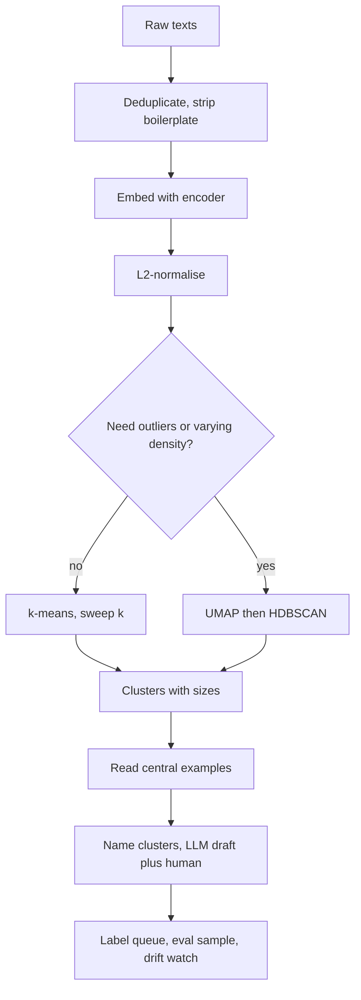

## TL;DR
Clustering groups items by similarity without labels, answering "what kinds of things are in this data?"
In AI engineering it runs on embeddings to find intents, deduplicate and sample evals. The distance
metric and the question matter more than the algorithm.

## Why it exists
- **No taxonomy, too much data.** You have 500,000 chat transcripts and no taxonomy. Reading them all is
  impossible, keyword search requires knowing what to search for, and a classifier requires the categories
  you do not have.
- **One fact makes it work.** Similar items are close together in some feature space, and with modern
  embeddings "close" means "about the same thing".
- **The naive alternatives fail.** Random sampling misses rare groups and cannot tell you how large any
  group is. Asking an LLM to summarise everything hits context and cost limits long before 500,000
  documents, and summarising a random subset inherits the sampling problem. Counting by existing metadata
  (product, region) only confirms the categories you already knew.
- **What clustering buys.** It partitions by content, scales to the whole corpus, and reports group sizes
  so attention goes where the volume is. Clustering plus an LLM to name each cluster is the production
  version, and it is cheap because the LLM reads a few central examples per cluster, not every document.
- **Two more jobs from the same machinery.** Near-duplicate detection is clustering with a very tight
  threshold, essential for cleaning training data and evaluation sets. Watching for a new dense region in
  production-traffic embeddings is the simplest useful drift detector.

## How it works
### The space and the distance come first
1. **Vectorise every item:** TF-IDF counts, hand-built features, or an embedding from a pre-trained
   encoder.
2. **Pick a distance.** For embeddings the standard is cosine similarity. The usual trick is to
   L2-normalise and run Euclidean algorithms, because for unit vectors ||a − b||² = 2 − 2·cos(a, b):
   Euclidean distance on normalised vectors ranks pairs exactly as cosine does.
3. **Scale hand-built features,** or the feature with the largest range decides the clusters by itself.
4. **Mind high dimensions.** Pairwise distances concentrate, which is why density-based methods are often
   preceded by dimensionality reduction (PCA or UMAP). k-means on embeddings usually works directly,
   because the encoder was trained to make cosine meaningful.

### k-means (Lloyd's algorithm)
- **Objective:** minimise the within-cluster sum of squared distances, Σ ||x − μ_c(x)||².
- **Algorithm:** alternate two steps: assign every point to its nearest centroid, then move every centroid
  to the mean of its points.
- **Convergence:** each step can only lower the objective, so it converges, but to a local minimum that
  depends on the starting centroids.
- **k-means++ initialisation** picks each new seed with probability proportional to its squared distance
  from the nearest seed chosen so far, spreading them out. Running several initialisations and keeping
  the best is standard.
- **Cost:** O(n·k·d) per iteration, so it scales to millions of points; mini-batch variants scale further.
- **Assumptions are the price:** clusters are roughly spherical, similar in size, and you choose k.
- **Choosing k:** the elbow of the objective curve, silhouette, or, most honestly, what the result is
  for: 20 for a taxonomy draft, 2,000 for deduplication buckets.

### Lloyd's algorithm by hand, and why seeding matters
Six 1-D points in three obvious pairs, {0, 1}, {10, 11}, {20, 21}, and k = 3, seeded badly at 0, 1 and 15.

| Step | What happens |
|---|---|
| Assign | 0 goes to 0, 1 goes to 1, and 10, 11, 20, 21 are all nearer 15 than 1 |
| Update | the third centroid moves to (10 + 11 + 20 + 21) / 4 = 15.5 |
| Reassign | 10 is still 5.5 from 15.5 but 9 from 1, so nothing changes: converged |
| Result | sum of squares 101, against 1.5 for the obvious solution (centroids 0.5, 10.5, 20.5) |

- **Every step lowered the objective;** it simply started in the wrong basin.
- **k-means++ makes that start unlikely.** After picking 0 first, the chance that the next seed is 1 is
  its squared distance over the total, 1 / (1 + 100 + 121 + 400 + 441) ≈ 0.1%, so seeds land in different
  groups almost always.
- **Restarts** with different seeds (`n_init`) cover the remaining cases.

### Hierarchical (agglomerative)
- **Procedure:** start with every point as its own cluster and repeatedly merge the closest pair under a
  linkage rule: single (nearest members), complete (farthest members), average, or Ward (smallest increase
  in within-cluster variance, which chases the k-means objective).
- **Output: a dendrogram** you can cut at any height, so no k is fixed in advance and the same run gives
  coarse and fine views.
- **Cost:** O(n²) memory for the distance matrix, which caps it at tens of thousands of points in practice.

### Density-based (DBSCAN, HDBSCAN)
- **Rule:** a point is a core point if at least `min_samples` neighbours lie within radius `eps`.
  Clusters are connected sets of core points plus their border points; everything else is labelled noise.
- **Strengths:** arbitrary cluster shapes, the number of clusters is decided by the data, and explicit
  outliers, which is exactly what "show me the weird requests" needs.
- **Weakness:** one global `eps` on data whose density varies, so sparse regions become noise or dense
  regions merge.
- **HDBSCAN removes `eps`** by building a hierarchy over density levels and extracting the most stable
  clusters.
- **Common recipe for topic discovery on text:** embed, reduce with UMAP, cluster with HDBSCAN, name each
  cluster from its top terms or with an LLM.

### Soft clustering
- **Gaussian mixture model:** assigns each point a probability of belonging to each cluster and fits by
  expectation–maximisation.
- **k-means is the limiting case** with hard assignments and equal spherical covariances. Use a mixture
  when membership is genuinely graded.

### Comparing the methods
| Method | Needs k | Shapes | Outliers | Scale |
|---|---|---|---|---|
| k-means | yes | roughly spherical, similar size | forced into a cluster | millions, O(n·k·d) per iteration |
| Agglomerative | no, cut the dendrogram | depends on linkage | forced into a cluster | tens of thousands, O(n²) memory |
| DBSCAN / HDBSCAN | no | arbitrary | labelled noise | large after dimensionality reduction |
| Gaussian mixture | yes | elliptical, soft | low probability everywhere | moderate |

### Evaluating without labels
- **Silhouette** for a point is (b − a) / max(a, b), where a is its mean distance to its own cluster and b
  the mean distance to the nearest other cluster. It ranges from −1 to 1 and averages over points.
- **Stability across seeds and subsamples:** a cluster that disappears when you reshuffle was never there.
- **With labels for a sample,** adjusted Rand index or normalised mutual information compare partitions.
- **Read the ten most central examples of each cluster.** None of the metrics replaces this; it is the
  only test of whether a cluster means anything.

## Diagram
The production pipeline: clean, embed, cluster, then let humans and an LLM read the centre of each group.



## Examples
### Discovering intents in chat logs
Embed, normalise, sweep k with a silhouette check, then print the most central messages per cluster. The
silhouette picks a k; the printed examples tell you whether the clusters are real.

```python
import numpy as np
from sentence_transformers import SentenceTransformer
from sklearn.cluster import KMeans
from sklearn.metrics import silhouette_score
from sklearn.preprocessing import normalize

texts = [line.strip() for line in open("messages.txt") if line.strip()]   # e.g. 20k user messages
model = SentenceTransformer("all-MiniLM-L6-v2")
E = normalize(model.encode(texts, batch_size=256))     # unit vectors: Euclidean k-means == cosine geometry

best = None
for k in (10, 20, 40, 80):
    km = KMeans(n_clusters=k, n_init=10, random_state=0).fit(E)
    s = silhouette_score(E, km.labels_, sample_size=5000, random_state=0)
    print(f"k={k:3d}  silhouette={s:.3f}  inertia={km.inertia_:.1f}")
    if best is None or s > best[0]:
        best = (s, k, km)

s, k, km = best
sizes = np.bincount(km.labels_)
for c in np.argsort(-sizes)[:5]:                               # five largest clusters
    members = np.where(km.labels_ == c)[0]
    d = np.linalg.norm(E[members] - km.cluster_centers_[c], axis=1)
    print(f"\ncluster {c}: {sizes[c]} messages ({sizes[c] / len(texts):.1%})")
    for i in members[np.argsort(d)[:3]]:                       # most central examples: read these
        print("  -", texts[i][:100])
```

### Bad seeds in pure Python
The hand-worked example from How it works, runnable with no libraries. Same algorithm, same data; only the
starting centroids differ.

```python
def lloyd(points, centroids, iters=10):
    for _ in range(iters):
        groups = [[] for _ in centroids]
        for x in points:                                   # assign step
            j = min(range(len(centroids)), key=lambda j: (x - centroids[j]) ** 2)
            groups[j].append(x)
        new = [sum(g) / len(g) if g else c for g, c in zip(groups, centroids)]  # update step
        if new == centroids:
            break
        centroids = new
    sse = sum(min((x - c) ** 2 for c in centroids) for x in points)
    return centroids, sse

pts = [0, 1, 10, 11, 20, 21]
print(lloyd(pts, [0, 1, 15]))      # ([0.0, 1.0, 15.5], 101.0): stuck in a bad basin
print(lloyd(pts, [0, 11, 21]))     # ([0.5, 10.5, 20.5], 1.5): k-means++-style spread seeds
```

## Production patterns
- **Clean before you embed.** Exact-dedupe on normalised text, strip greetings, signatures and templates,
  then embed. Monitor the share of the largest cluster; one cluster holding a large fraction of the data
  usually means boilerplate survived.
- **Mini-batch k-means for large corpora.** Use scikit-learn `MiniBatchKMeans` on normalised embeddings
  when full k-means is too slow, with several restarts. Monitor inertia and cluster sizes across seeds.
- **Name clusters from central examples.** Send the 10 to 20 messages nearest each centroid to an LLM to
  draft a name and description, then have a human verify. Monitor purity by sampling 50 members per top
  cluster and counting how many match the name.
- **Stable categories go into a classifier, not cluster ids.** Once clusters are named and reviewed, label
  a sample and train a classifier for the production path, because re-running clustering renumbers and
  reshapes clusters.
- **Drift watch on production embeddings.** Each week, assign new traffic to existing centroids and
  cluster the poorly fitting remainder; a new dense group is an emerging issue. Monitor the share of
  traffic far from every centroid.
- **Diverse eval and labelling samples.** Sample a fixed number per cluster (stratified) instead of
  uniformly, so rare groups are represented. Monitor per-cluster coverage in the eval set.

## Trade-offs
- **k-means speed vs shape assumptions.** Fast and scales to millions of vectors, but needs k and assumes
  convex, similar-sized clusters. Density-based methods win as soon as clusters vary in density or shape,
  or you need outliers.
- **Hierarchical granularity vs memory.** No k and every granularity at once, but quadratic memory makes it
  impractical beyond tens of thousands of points without sampling first.
- **Embeddings vs encoder bias.** Embeddings capture meaning that TF-IDF misses, but inherit the encoder's
  notion of similarity: a topic-oriented model puts "cancel my subscription" and "how do I upgrade"
  together because both are about accounts. Choosing or fine-tuning the encoder for the facet you care
  about (intent, sentiment, product) changes the clusters more than any algorithm choice.
- **More clusters vs reviewability.** More clusters are purer but more to review; fewer are coarser but
  digestible. The right number is set by the downstream use, not by a statistic.

## Pitfalls
- **Euclidean k-means on unnormalised embeddings.** Symptom: clusters organised by vector norm, which often
  tracks text length, rather than by meaning.
- **Treating cluster labels as categories without inspection.** Symptom: a "cluster" that mixes three
  intents united by shared boilerplate such as a greeting template.
- **Publishing cluster ids as stable production categories.** Symptom: next week's "cluster 7" is a
  different thing after a re-run, and dashboards built on it silently break.
- **Choosing k by the elbow when there is no elbow.** That is the normal case for embeddings: a smooth
  curve and an arbitrary choice. Use silhouette plus reading, or a hierarchical view.
- **Letting templated or duplicated messages dominate.** Symptom: one giant cluster holding 40% of the
  data. Fix by deduplicating and stripping boilerplate before embedding.
- **DBSCAN with a single `eps` on data of varying density.** Symptom: either one cluster containing
  everything or almost everything labelled noise.

## When to use
- **Use when** you need to understand data before categories exist, sample diverse items for labelling
  and evaluation sets, deduplicate, detect emerging issues as new dense regions in production embeddings,
  or summarise large logs cluster by cluster with an LLM.
- **Avoid when** you already have a taxonomy and labels (train a classifier), or you need stable,
  auditable categories in a production path, because clusters drift and renumber.
- **Measure** silhouette and seed stability as sanity checks, but the real test is whether the clusters
  changed a decision: which categories were added, which examples were labelled, which failure mode was
  found.
- **Interviews:** questions centre on how you choose k, what k-means assumes, and how you would find out
  what users are asking about.

## Role lens
- **Engineer:** Runs embed, normalise, k-means or HDBSCAN over logs in a notebook that prints central
  examples per cluster, then promotes the stable clusters into a labelled classifier.
- **Architect:** Positions clustering as an offline exploration and drift-detection tool rather than a
  production decision path, and decides which embedding model defines "similar" across the platform.
- **FDE:** Uses clustering in the first week at a customer to map an unlabelled corpus, show the size of
  each group, and pick the examples that go into the expert labelling session.

## Check yourself
**Q:** A customer hands you 500,000 support chats on Monday and asks for "the top issues" by Friday.
Walk through your approach and the ways it could mislead you.
**A:** Deduplicate and strip greetings and signatures first, or boilerplate becomes the biggest cluster.
Embed with a general sentence encoder and L2-normalise. Run mini-batch k-means with k around 50, or UMAP
plus HDBSCAN if you want outliers surfaced, and for each cluster read the ten most central chats, name the
cluster (an LLM can draft names, a human verifies), and report cluster sizes as shares of volume. The
ways it misleads: the encoder groups by topic, so two different problems with the same product merge and
one problem phrased two ways splits; a low silhouette in high dimensions is normal, not proof of failure;
sizes depend on k; some "issues" are really sentiment or channel differences. Validate by sampling 50
chats from each top cluster and measuring how many actually match the name, checking stability across
seeds, and comparing against any tags the customer already has.

## Interview questions
### What does k-means optimise, and what does it assume about clusters?
- **Objective:** the within-cluster sum of squared distances to each centroid, minimised by alternating
  assignment and centroid updates.
- **Assumptions:** roughly spherical, similar-sized clusters and a known k; every point is forced into a
  cluster.
- **Consequence:** it converges only to a local minimum, so k-means++ seeding and several restarts are
  standard.

### Your clusters of support messages seem to group by message length, not topic. What went wrong?
- **Likely cause:** Euclidean k-means on unnormalised embeddings, where vector norm tracks text length.
- **Fix:** L2-normalise so Euclidean distance matches cosine similarity.
- **Also check** for templates and duplicates, which create length-driven or boilerplate-driven clusters.

### When would you choose HDBSCAN over k-means?
- **Choose HDBSCAN** when density varies, shapes are irregular, you do not know the number of clusters,
  or you want explicit outliers.
- **Choose k-means** for speed on millions of vectors, a fixed number of buckets, or stratified sampling.
- **Typical text recipe:** UMAP to reduce dimensions, then HDBSCAN, then name clusters.

### How do you know a clustering is any good without labels?
- **Sanity metrics:** silhouette and stability across seeds and subsamples.
- **Reading:** the ten most central examples per cluster, plus a sample of 50 members to measure how many
  fit the name.
- **Outcome:** did it change a decision, such as a new category, a labelling sample or a found failure
  mode?

### Should cluster ids be used as features or categories in production?
- **Not directly:** re-running clustering renumbers and reshapes clusters, silently breaking dashboards.
- **Instead:** name and review clusters, label a sample, and train a classifier with a stable label set.
- **Keep clustering offline** for exploration, deduplication and drift detection.

## Quiz
### Q: Why L2-normalise embeddings before running k-means with Euclidean distance?
- [ ] k-means requires all inputs to lie in the range 0 to 1
- [x] For unit vectors squared Euclidean distance is a monotone function of cosine similarity, so clusters reflect direction (meaning) rather than vector magnitude
- [ ] Normalisation guarantees convergence in a single iteration
- [ ] It removes the need to choose the number of clusters
> After normalisation ||a − b||² = 2 − 2·cos(a, b), so the Euclidean objective and cosine similarity
> agree. Without it, differences in vector norm, which often track text length, drive the partition.

### Q: The data has clusters of very different densities and many outliers. Which method fits best?
- [ ] k-means with k-means++ initialisation and many restarts
- [ ] Agglomerative clustering with Ward linkage
- [x] HDBSCAN
- [ ] A Gaussian mixture with spherical covariances
> k-means and Ward assume compact, similar clusters and assign every point somewhere, so outliers distort
> centroids. HDBSCAN handles varying density by working across density levels and labels sparse points as
> noise instead of forcing them into a cluster.

### Q: What does k-means guarantee at convergence?
- [ ] The global minimum of the within-cluster sum of squares
- [x] A local minimum where no reassignment or centroid update lowers the objective further, which can differ between seeds
- [ ] Clusters of approximately equal size
- [ ] The maximum possible silhouette score for that k
> Each Lloyd step is non-increasing in the objective, so the algorithm stops at a fixed point, but that
> fixed point depends on initialisation. This is why k-means++ seeding and multiple restarts are standard.
