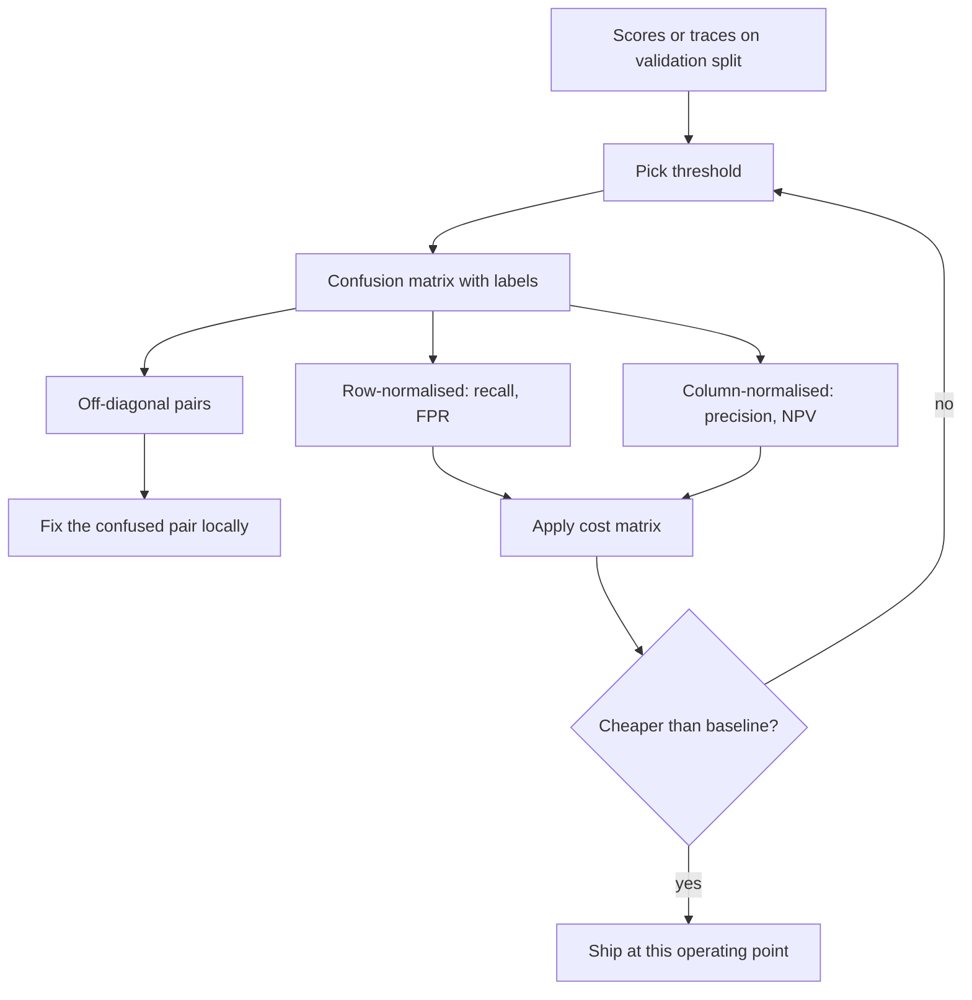

## TL;DR
A confusion matrix counts predictions against truth, one cell per (actual, predicted) pair. For agents
it shows which tool was called when another was needed, and which failures a judge passed. Read the table
first; which cell is expensive is a product decision.

## For agent builders
- **Why it matters for agents.** Tool selection, intent routing, guardrails and LLM judges are all
  classifiers. "80% correct tool calls" hides whether the misses are harmless (an extra search) or costly
  (a refund issued instead of a ticket); only the off-diagonal cells show which.
- **Where it shows up in your stack.** The eval harness for tool-use and routing, judge-versus-human
  agreement reports, guardrail block logs, and `confusion_matrix` or a plain `Counter` over
  (expected, actual) pairs from traces.
- **What you control.** The label set (including a "no tool" class), the cost of each cell, which
  confused pair you fix first (tool descriptions, few-shots, a disambiguation rule), and the axis convention.
- **What you can skip.** Type I and Type II terminology debates and exotic summary metrics. Know rows
  versus columns, the row and column rates, MCC, and how to price cells.

## Why it exists
- **Four outcomes, one label each.** In the binary case the model says yes and is right (true positive), yes
  and wrong (false positive), no and wrong (false negative), no and right (true negative).
- **Accuracy throws away the direction of the errors.** It collapses the four into one number and discards
  the only thing you need in order to act.
- **Error costs are almost never symmetric.** A missed fraud costs the bank money; a wrongly declined card
  costs a customer. A moderation model that lets harm through and one that blocks legitimate posts can both
  show "95% accuracy" when harm is 5% of traffic; so does the model that never flags anything.
- **Every other metric is derived from the table.** Precision, recall, specificity, F1 and MCC are ratios of
  its cells; the table is the primary data, so reporting "the metric" and moving on loses information.
- **Multi-class aggregates hide even more.** An intent router at 85% accuracy may be nearly perfect on ten
  intents and useless on two it confuses with each other. The fix (merge, relabel, add a disambiguation
  rule) is only visible in the off-diagonal cells.

## How it works
### Layout and the convention trap
scikit-learn's `confusion_matrix(y_true, y_pred)` puts **actual classes in rows and predicted classes in
columns**, ordered by sorted label value unless you pass `labels=`. For binary labels `[0, 1]`:

```
                 predicted 0   predicted 1
actual 0 (neg)       TN            FP
actual 1 (pos)       FN            TP
```

- **Unpack with** `tn, fp, fn, tp = cm.ravel()`.
- **Other tools, textbooks and Wikipedia put predictions in rows.** The numbers are the same; FP and FN swap
  positions.
- **A swapped reading silently exchanges precision and recall,** so always label both axes and pass `labels=`
  explicitly.
- **FP is the Type I error** (false alarm); **FN is the Type II error** (miss).

### Every metric is a ratio of cells
Group the derived quantities by what they *condition on*, because that determines how they behave.

**Row-normalised (condition on the truth).** "Given what the item really was, what did the model do?"
Properties of the model alone; changing how many positives exist does not move them in expectation.
- Recall = sensitivity = true-positive rate (TPR) = TP / (TP + FN)
- Specificity = true-negative rate (TNR) = TN / (TN + FP)
- False-positive rate (FPR) = FP / (FP + TN) = 1 − specificity
- False-negative rate (FNR) = FN / (FN + TP) = 1 − recall

**Column-normalised (condition on the prediction).** "Given the model said X, how often was it right?" This is
what a consumer of the prediction experiences. It mixes model quality with the base rate: the same model has
lower precision when positives are rarer, because the FP column fills from a larger pool of negatives.
- Precision = positive predictive value (PPV) = TP / (TP + FP)
- Negative predictive value (NPV) = TN / (TN + FN)

**Whole-table.**

| Metric | Formula | Note |
|---|---|---|
| Accuracy | (TP + TN) / N | dominated by whichever class is large |
| Prevalence | (TP + FN) / N | the base rate; report it next to every metric |
| Balanced accuracy | (TPR + TNR) / 2 | accuracy with both classes weighted equally |
| MCC | (TP·TN − FP·FN) / √((TP+FP)(TP+FN)(TN+FP)(TN+FN)) | see below |

- **MCC is the correlation between predicted and actual labels,** ranging from −1 to 1.
- **It is 0 for a random classifier** and, by convention, for a constant one, where the denominator vanishes
  (scikit-learn returns 0).
- **It uses all four cells,** so it cannot be gamed by predicting one class.

### Multi-class
- **Shape:** with *k* classes the matrix is *k × k*; the diagonal holds correct predictions and cell (i, j)
  counts items of class *i* predicted as *j*.
- **One-vs-rest counts per class:** TP_i is the diagonal cell, FP_i the rest of column *i*, FN_i the rest of
  row *i*, TN_i everything else.
- **Normalise to read rates:** by row (`normalize="true"`) for per-class recall; by column
  (`normalize="pred"`) for per-class precision.
- **Off-diagonal *mass* is the diagnostic.** One dense cell means two classes are not separable with the
  current features or prompt, and the fix is local to that pair.
- **In agents,** the tool-selection matrix has rows for the tool the step needed and columns for the tool
  the agent called, with an explicit "none" class so needless calls and missed calls are both visible.
- **In LLM systems** this is the matrix of an intent router, a guardrail classifier, or an LLM judge scored
  against human labels. With "pass" as the positive class, a too-lenient judge shows a heavy FP cell (failures
  passed); a too-strict one, a heavy FN cell (good outputs failed).

### One matrix is one threshold
- **A probabilistic model becomes a classifier only after you pick a threshold.**
- **Lowering it moves counts from FN into TP and from TN into FP at the same time.**
- **So the matrix describes one *operating point*;** ROC and precision–recall curves are the matrix evaluated
  at every threshold. Comparing two models' matrices at the default 0.5 compares two arbitrary points.

### From cells to a decision: the cost matrix
1. **Price each cell.** Write a cost matrix with the same layout, usually zero on the diagonal, C_FP and C_FN
   off it.
2. **Expected cost = Σ cell count × cell cost.** This is the only principled way to rank two matrices with
   different error mixes.
3. **Every single-number metric is a hidden, fixed cost ratio:** accuracy assumes C_FP = C_FN; F1 assumes the
   two errors are equally bad and TN are free.
4. **Multi-class cost matrices are k × k,** because confusing "refund" with "cancel" may be cheap while
   confusing "cancel" with "legal complaint" is not.
5. **Multi-label problems** (several labels per item) have no single k × k table: you get one 2 × 2 matrix per
   label (scikit-learn's `multilabel_confusion_matrix`) and aggregate as with per-class metrics.

## Diagram
From predictions (a classifier's labels or an agent's tool calls) to a decision: the table comes first,
the cost of each cell decides.



## Misconceptions
- **"Higher accuracy means the better model."** Accuracy discards the direction of the errors. The fraud
  screen scores 0.977, below the 0.99 of never flagging, yet costs $17,000 against $50,000 when a miss costs
  $500 and a false decline $10. Price the cells.
- **"Everyone lays the matrix out the same way."** scikit-learn puts actual classes in rows; many textbooks
  put predictions in rows. A swapped reading exchanges FP and FN, and so precision and recall. Label both
  axes and pass `labels=` explicitly.
- **"A confusion matrix describes the model."** It describes one operating point. Lowering the threshold
  moves counts from FN to TP and from TN to FP at once, so two matrices at the default 0.5 compare
  arbitrary points.
- **"Fix the heaviest off-diagonal cell first."** Count is not cost. In the tool-selection matrix the
  heaviest cell (no tool needed, search called: 10) costs seconds, while the second (ticket needed, refund
  called: 6) pays out money.
- **"An LLM judge with high agreement with humans is fine."** Agreement hides direction: with "pass" as the
  positive class, a lenient judge piles errors in the FP cell (failures passed). Track the FP and FN cells
  per release.

## Examples
### Worked scenario: a fraud screen read and priced
A fraud screen on 10,000 transactions where 1% (100) are fraud. The model flags 270: 70 real frauds and 200
legitimate ones, and misses 30 frauds.

| Metric | Calculation | Value |
|---|---|---|
| Recall | 70/100 | 0.70 |
| Precision | 70/270 | ≈ 0.26 |
| Specificity | 9,700/9,900 | ≈ 0.98 |
| FPR | 200/9,900 | ≈ 0.02 |
| Accuracy | 9,770/10,000 | 0.977 |
| Balanced accuracy | (0.70 + 0.98)/2 | 0.84 |
| MCC | formula above | ≈ 0.42 |

- **Accuracy is *worse* than the 0.99 of never flagging anything,** the whole argument against accuracy on
  imbalanced data.
- **Balanced accuracy and MCC say "useful but far from done",** which is what the table says too.

Now price the cells with illustrative costs (the model's cells: 30 misses, 200 false declines):

| Costs | Model | Never flag | Cheaper |
|---|---|---|---|
| Missed fraud $500, false decline $10 | 30 × 500 + 200 × 10 = $17,000 | 100 × 500 = $50,000 | model, despite *lower* accuracy |
| Flipped: false decline $500 (high-value customers), missed fraud $10 (insured) | 30 × 10 + 200 × 500 = $100,300 | $1,000 | never flag |

Same table, opposite verdict: the cost of the cells, not the table, decides. Here the model beats
"never flag" only when a miss costs more than about 2.9 times a false decline (200 × C_FP < 70 × C_FN).

```python
import numpy as np
from sklearn.metrics import confusion_matrix, classification_report, matthews_corrcoef

# Counts chosen to match the walkthrough above
tn, fp, fn, tp = 9_700, 200, 30, 70
y_true = np.array([0] * (tn + fp) + [1] * (fn + tp))
y_pred = np.array([0] * tn + [1] * fp + [0] * fn + [1] * tp)

cm = confusion_matrix(y_true, y_pred, labels=[0, 1])   # rows = actual, columns = predicted
print(cm)                                              # [[9700  200]
                                                       #  [  30   70]]
TN, FP, FN, TP = cm.ravel()
recall    = TP / (TP + FN)          # 0.70  share of fraud we caught
precision = TP / (TP + FP)          # 0.26  share of alerts that were fraud
fpr       = FP / (FP + TN)          # 0.02  looks tiny; it is 200 blocked customers
accuracy  = (TP + TN) / cm.sum()    # 0.977, and "never flag" would score 0.990
print(f"recall={recall:.2f} precision={precision:.2f} fpr={fpr:.3f} acc={accuracy:.3f}")
print("MCC", round(matthews_corrcoef(y_true, y_pred), 3))          # 0.417
print(classification_report(y_true, y_pred, target_names=["legit", "fraud"], digits=3))

# Multi-class routers: normalise by row to read per-class recall at a glance
# confusion_matrix(y_true, y_pred, labels=intents, normalize="true")
```

`classification_report` prints precision, recall, F1 and support per class plus macro and weighted averages.
The "legit" row looks excellent and the weighted average inherits that, while the "fraud" row carries the
actual story.

### Intent router: find the confused pair, standard library only
Count (actual, predicted) cells, read per-class recall, then list the heaviest off-diagonal cells.

```python
from collections import Counter

y_true = ["refund"] * 50 + ["cancel"] * 40 + ["billing"] * 30 + ["legal"] * 10
y_pred = (["refund"] * 46 + ["cancel"] * 4 +
          ["cancel"] * 22 + ["refund"] * 16 + ["billing"] * 2 +
          ["billing"] * 29 + ["refund"] * 1 +
          ["legal"] * 7 + ["cancel"] * 3)

cells = Counter(zip(y_true, y_pred))                 # (actual, predicted) -> count
labels = sorted(set(y_true) | set(y_pred))
for a in labels:                                     # per-class recall = diagonal / row total
    row = sum(cells[(a, p)] for p in labels)
    print(f"{a:8} recall={cells[(a, a)] / row:.2f}  support={row}")

off = [(n, a, p) for (a, p), n in cells.items() if a != p]
for n, a, p in sorted(off, reverse=True)[:3]:        # the pairs worth reading first
    print(f"actual {a} -> predicted {p}: {n}")
# billing 0.97, cancel 0.55, legal 0.70, refund 0.92
# actual cancel -> predicted refund: 16 / refund -> cancel: 4 / legal -> cancel: 3
```

- **Accuracy is 0.80, but the story is one cell:** 16 of 40 cancellations routed to refunds.
- **Read those 16 examples first;** overlapping definitions or inconsistent labels usually explain them, and the
  fix is local to that pair.
- **Legal has support 10,** so its 0.70 recall is noisy, yet a k × k cost matrix may still make legal → cancel
  the most expensive cell.

### Agent scenario: a tool-selection matrix for a support agent
120 labelled agent steps from golden tasks: which tool the step needed versus which the agent called.

```python
from collections import Counter

gold = ["search_docs"] * 60 + ["create_ticket"] * 25 + ["refund"] * 10 + ["none"] * 25
called = (["search_docs"] * 55 + ["none"] * 5 +
          ["create_ticket"] * 17 + ["refund"] * 6 + ["search_docs"] * 2 +
          ["refund"] * 9 + ["create_ticket"] * 1 +
          ["none"] * 15 + ["search_docs"] * 10)

cells = Counter(zip(gold, called))                   # (needed, called) -> count
tools = sorted(set(gold) | set(called))
for t in tools:
    row = sum(cells[(t, c)] for c in tools)          # steps that needed t
    col = sum(cells[(g, t)] for g in tools)          # steps where the agent called t
    print(f"{t:14} recall={cells[(t, t)] / row:.2f} precision={cells[(t, t)] / col:.2f} support={row}")
off = sorted(((n, g, c) for (g, c), n in cells.items() if g != c), reverse=True)
for n, g, c in off[:3]:
    print(f"needed {g} -> called {c}: {n}")
# create_ticket recall 0.68 precision 0.94 | none 0.60 / 0.75 | refund 0.90 / 0.60 | search_docs 0.92 / 0.82
# needed none -> called search_docs: 10 / create_ticket -> refund: 6 / search_docs -> none: 5
```

| Cell | Count | Cost to the business | Fix |
|---|---|---|---|
| needed none, called search_docs | 10 | a few seconds and tokens | accept, or tighten the tool description |
| needed create_ticket, called refund | 6 | money paid out wrongly | top priority: rewrite both descriptions, add a confirmation step |
| needed search_docs, called none | 5 | answer from memory, risk of hallucination | add few-shots showing when to search |

- **Accuracy is 0.80 (96/120),** but the heaviest off-diagonal cell is the cheapest one, while the
  second-heaviest (ticket → refund) is the one that costs money. Refund precision of 0.60 is the number
  to fix.
- **Price the cells before choosing what to fix,** exactly as with the fraud screen.

## Production patterns
- **Labelled axes in every eval report.** Always call `confusion_matrix(y_true, y_pred, labels=[...])` with an
  explicit label list and store it with axis names (rows actual, columns predicted) next to prevalence. Monitor
  that the label list matches the model's current class set after each release.
- **Row-normalised plots for routers.** Render `ConfusionMatrixDisplay.from_predictions(y_true, y_pred,
  normalize="true")` for multi-class models and attach the top confused pairs. Review those pairs before
  editing prompts or adding data.
- **Cost-weighted model selection.** Keep a reviewed cost matrix C in the repo and rank candidates by
  `(cm * C).sum()` at each one's chosen threshold, with a sweep across plausible cost ratios when prices are
  uncertain. Monitor realised cost per day in production.
- **Judges and guardrails scored by cell.** Score an LLM judge against human labels as a confusion matrix and
  track the FP cell (too lenient) and FN cell (too strict) per release, not just agreement rate.
- **Tool-selection matrix per agent release.** Label the expected tool (or "none") for each step of the
  golden tasks, build the (expected, called) matrix on every prompt, tool-description or model change, and
  gate on the cells that move money or data. Monitor per-tool call counts in production traces.
- **Per-label matrices for multi-label.** Use `multilabel_confusion_matrix` and alert on per-label FN counts,
  because a rare label's misses vanish in pooled averages.

## Trade-offs
- **All the information about one operating point vs no ranking on its own.** To compare two models you must
  first agree on a cost per cell, which is a product decision.
- **Portable row rates vs felt column rates.** Row-normalised rates (recall, FPR) are free of prevalence and
  portable across datasets but hide the absolute volume of false alarms; column-normalised rates (precision)
  show what users feel but move whenever the base rate moves.
- **One matrix equals one threshold.** Cheap to compute and easy to explain, but comparing models at a default
  threshold compares arbitrary points; use curves when the threshold is tunable and matrices when the product
  has fixed it.
- **A clear decision from a cost matrix vs estimated prices.** When prices are uncertain by more than the gap
  between candidate models, show the verdict across a range of cost ratios instead of one number.
- **Full picture vs readability at scale.** Multi-class matrices grow as k², readable at ten classes and
  unreadable at two hundred; past that you summarise (per-class recall sorted, top confused pairs) and lose
  the full picture.

## Pitfalls
- **Reading a rows-as-actual matrix with the predictions-as-rows convention.** FP and FN swap. Symptom:
  precision and recall exchange values, and "the model misses everything" turns into "the model over-flags".
  Fix: name both axes on every printed matrix.
- **Reporting accuracy on an imbalanced table.** Symptom: a model with 97.7% accuracy that loses to the
  constant classifier at 99%. Fix: report the four counts, prevalence and MCC or recall and precision.
- **Omitting `labels=` when a class can be missing from a batch.** Without it the label set is the union of
  `y_true` and `y_pred`, so a class absent from both (common in small eval slices) silently drops out:
  indices shift, `.ravel()` unpacks the wrong cells or fails, and derived metrics use the wrong numbers.
  Fix: always pass the full label list.
- **Treating the matrix at threshold 0.5 as "the" performance of a probabilistic model.** Symptom: a model
  declared to have terrible recall when nobody tried a lower threshold. Fix: sweep the threshold on validation.
- **Collapsing a multi-class matrix into macro-F1 before looking at confused pairs.** Symptom: weeks spent
  adding data to a class whose errors come from label ambiguity with its neighbour. Fix: read the top
  off-diagonal cells first.
- **Leaving "no tool" out of the agent's label set.** Symptom: a tool-selection matrix that looks clean
  while the agent makes needless calls or skips needed ones, because those steps were never counted. Fix:
  add an explicit "none" row and column.
- **Scoring an LLM judge only by agreement rate.** Symptom: a judge that "agrees 96%" because it passes nearly
  everything, and the 4% it misses are exactly the failures you built it to catch. Fix: recall on the failure
  class.

## When to use
- **Always first:** every time you evaluate a classifier, before any single-number metric, and every time
  someone quotes one, ask for the table and the prevalence.
- **Matters most** where error costs are asymmetric (fraud, safety, medical triage), where classes are
  imbalanced, and where the "classifier" is an LLM: an intent router, a guardrail, a feedback classifier, a
  judge scored against human labels, or an agent choosing which tool to call.
- **Day to day:** it is the first artefact of error analysis and what you put in front of a stakeholder to turn
  "the model is wrong" into "it confuses A with B".
- **Interviews:** derive precision, recall, specificity and FPR from a table, explain why accuracy misleads on
  rare classes, and know which axis is which in the library you claim to use.

## Role lens
- **Engineer:** Puts `confusion_matrix(y, ŷ, labels=...)` and the row-normalised multi-class plot into
  every eval report, and reads the off-diagonal cells of the router or guardrail before editing the prompt.
- **Architect:** Decides which cell is the expensive one for the product (missed fraud versus blocked
  customer) and encodes it as the metric, threshold and alerting policy the team optimises against.
- **FDE:** Walks the customer's subject-matter experts through the pilot's matrix, converts "the model is
  wrong" into "it confuses refund requests with cancellations", and gets a decision on which error they
  would rather live with.

## Check yourself
**Q:** A content-moderation classifier reports 99.2% accuracy. The product manager is pleased; the
trust-and-safety lead is not. Using the confusion matrix, explain what each of them may be looking at
and what you would report instead.
**A:** If harmful content is 0.8% of traffic, the constant "allow everything" classifier also scores
99.2%, so the number carries no information. On 100,000 items that is 800 harmful posts; a model with
TP = 400, FN = 400 and FP = 400 has exactly 99.2% accuracy while catching half the harm (recall 0.5) and
wrongly removing 400 legitimate posts (precision 0.5). The PM sees the aggregate; trust-and-safety sees
the FN cell, and the appeals team will see the FP cell. Report the four counts with the prevalence,
then recall at a fixed false-positive budget (or precision and recall at a threshold chosen on
validation), and compare candidate models with MCC or the precision–recall curve rather than accuracy.

## Interview questions
### Draw a binary confusion matrix and derive precision, recall, specificity and FPR from it.
- **Layout (scikit-learn):** rows actual, columns predicted, so [[TN, FP], [FN, TP]] for labels [0, 1].
- **Row rates:** recall = TP / (TP + FN), specificity = TN / (TN + FP), FPR = 1 − specificity; they condition on
  the truth and ignore prevalence.
- **Column rate:** precision = TP / (TP + FP); it conditions on the prediction, so it falls when positives get rarer.

### Your intent router's recall on "cancel" is 0.55. How do you debug it?
- **Read the row:** find where the missing cancellations went; one heavy cell such as cancel → refund points to
  a pair problem, not a data-volume problem.
- **Inspect those examples** for overlapping definitions or inconsistent labels.
- **Fix locally:** merge the intents, relabel, add a disambiguation rule or clearer prompt wording for that
  pair, then re-check the row.

### Two models have different error mixes. How do you choose between them?
- **Agree a cost matrix with the product owner,** then compare expected cost = Σ count × cost at each model's
  chosen threshold.
- **If prices are uncertain,** sweep the cost ratio and show where the verdict flips, as with the fraud screen
  that beats "never flag" only above roughly a 2.9:1 miss-to-false-decline cost ratio.
- **Avoid** accuracy or F1 as tie-breakers, because each hides a fixed cost ratio.

### When is MCC a better headline than F1 or accuracy?
- **When both classes matter:** MCC uses all four cells, while F1 ignores TN and changes if you relabel the
  positive class.
- **On imbalanced data:** a constant classifier scores 0 MCC but high accuracy; the fraud screen above has
  accuracy 0.977 yet MCC about 0.42.
- **Not when** the product only cares about the positive class at a fixed review budget; then report recall
  and precision at that point.

### An LLM judge agrees with humans 96% of the time. Is it good?
- **Ask for the matrix:** if failures are about 4% of outputs, a judge that passes everything also agrees about 96%.
- **Look at the FP cell** (failures passed) and compute recall on the failure class; that is the number the
  judge exists for.
- **Re-check per release,** because a prompt or model change can move errors between the FP and FN cells.

### Your agent picks the right tool 80% of the time. What do you report to decide if it can ship?
- **The tool-selection matrix,** rows needed tool (with "none"), columns called tool, with support per row.
- **Priced cells:** a needless search costs seconds, a refund issued instead of a ticket costs money; rank
  the off-diagonal cells by count × cost, not by count.
- **A gate per expensive cell,** for example zero wrong refunds on the golden set, plus a confirmation step
  for irreversible tools until that holds.

## Quiz
### Q: In scikit-learn's `confusion_matrix(y_true, y_pred)` with labels [0, 1], which cell holds the false negatives?
- [ ] C[0, 1]
- [x] C[1, 0]
- [ ] C[1, 1]
- [ ] C[0, 0]
> Rows are actual classes and columns are predicted, so row 1 (actually positive) and column 0
> (predicted negative) is a miss. C[0, 1] is the false-positive cell; tools that put predictions in rows
> transpose this, which is why you unpack with `tn, fp, fn, tp = cm.ravel()` and label both axes.

### Q: The model is unchanged but the positive class becomes rarer in production. Which metrics move?
- [ ] Recall and specificity
- [x] Precision and negative predictive value
- [ ] False-positive rate and false-negative rate
- [ ] None of them; they are all properties of the model
> Precision and NPV condition on the prediction, so their denominators mix true positives with false
> positives whose count scales with the number of negatives. Recall, specificity, FPR and FNR each
> condition on the true class and are unchanged in expectation when only the class ratio changes.

### Q: A 12-intent router has macro-F1 0.81 and most of its errors sit in one off-diagonal cell: actual "cancel_subscription" predicted as "refund_request". What is the most useful next step?
- [ ] Add more training examples for every intent equally
- [ ] Raise the decision threshold for "refund_request"
- [x] Inspect those examples for label ambiguity between the two intents, then merge them or add a disambiguation rule
- [ ] Switch the headline metric from macro-F1 to micro-F1
> A single dense off-diagonal cell is a separability problem between two specific classes, usually
> overlapping definitions or inconsistent labelling, so the fix is local to that pair. Spreading data
> across all classes or changing the aggregate metric does not touch the cause.

## Use cases & projects
### Use cases
- **Tool-use evals.** A (needed, called) matrix with a "none" class shows needless calls, missed calls and
  the confused tool pairs whose descriptions need rewriting.
- **Intent routers in front of agents.** Off-diagonal cells point to the two intents that overlap, so the
  fix is a merge or a disambiguation rule rather than more data everywhere.
- **LLM-judge validation.** The FP cell (failures passed) and FN cell (good runs failed) against human
  labels say whether the judge is too lenient or too strict for a release gate.
- **Guardrail reviews.** Counting missed attacks against wrongly blocked legitimate requests, priced per
  cell, decides where the block threshold should sit.

### Mini project
**Build a priced tool-selection report for an agent (1-3 hours).**
- **Goal:** find the single most expensive tool-choice error in a small agent.
- **Steps:** give an agent three tools plus the option of none; write 50 golden tasks labelled with the
  expected tool per step; run the agent and log calls from traces; build the (expected, called) matrix
  with row normalisation; assign a cost to each off-diagonal cell; change one tool description to fix the
  costliest cell and re-run.
- **Done when:** you have the matrix and priced cell table before and after the change, and the expected
  cost per 100 steps fell without a new expensive cell appearing.
