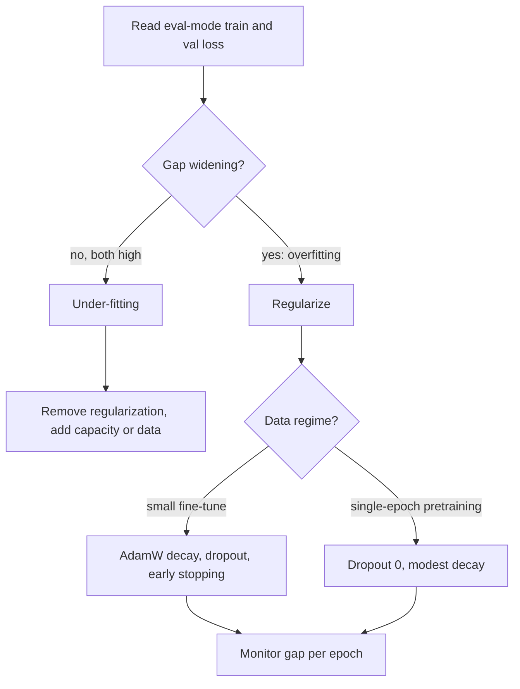

## TL;DR
Regularization makes a model fit training data worse so it generalizes better: weight penalties, injected
noise (dropout) or early stopping. Use it when the model can memorize, as in small fine-tunes; skip
dropout for single-epoch pretraining.

## Why it exists
- **Big networks memorize.** With more parameters than training examples a network can reach zero training
  loss by learning detectors that fire on accidents of the training set, not on structure that recurs in
  new data. Symptom: the train/validation loss gap widens as training continues.
- **Shrinking the model is the naive fix, and it fails.** It throws away capacity you need for the hard
  parts of the task, and the "right" size is unknowable in advance. Regularization keeps the capacity and
  changes *what kind* of solution the optimizer prefers.
- **Idea 1: penalize complexity.** Add λ·‖w‖² (L2) or λ·‖w‖₁ (L1) to the loss, so large weights must earn
  their keep by reducing the data loss by more than they cost.
- **Idea 2: inject noise.** Make the training problem harder than the test problem by corrupting inputs
  (data augmentation), labels (label smoothing) or hidden units (dropout). Noise forces features that are
  robust to perturbation, and robust features are the ones that transfer to unseen data.
- **Dropout attacks co-adaptation.** A unit can learn to fix its neighbours' specific mistakes, a fragile
  arrangement that only works on the training distribution. A unit cannot depend on a partner that is
  absent 10–50% of the time, so random deletion breaks those alliances.

## How it works
### The dropout mechanism
During a training forward pass each activation *x* gets an independent Bernoulli mask
*m* ~ Bernoulli(1−p), and the layer outputs

```
y = m ⊙ x / (1 − p)
```

1. **Inverted dropout scales survivors by 1/(1−p).** Every modern framework uses this form *because*
   E[y] = (1−p)·x/(1−p) = x: the expectation is unchanged, so inference runs the full network with no mask
   and no rescaling, and the next layer sees inputs on the scale it trained on.
2. **The original paper did it the other way.** It kept activations unscaled in training and multiplied
   the weights by (1−p) at test time. The two are equivalent; inverted dropout keeps inference code untouched.
3. **Backward goes through kept units only.** The mask is a constant for that step, so each step updates a
   random sub-network.
4. **Ensemble view.** *n* droppable units give 2ⁿ weight-sharing sub-networks. The inference-time full
   network is a cheap approximation to averaging all their predictions, which is why dropout generalizes.

- **Multiplicative and per unit is what matters, not Bernoulli.** The original paper found multiplicative
  Gaussian noise of matching variance works about as well. Additive jitter leaves a unit's dependence on
  its neighbours intact.

### Where it sits in a transformer
| Site | Where | Source |
|---|---|---|
| Embedding dropout | on the sum of token and positional embeddings | original Transformer paper |
| Residual dropout | on each sub-layer's output, just before it is added to the residual stream | original Transformer paper |
| Attention dropout | on attention probabilities after the softmax; removes some tokens from each head's view | reference implementation, BERT, GPT-2 |

- **One shared rate**, 0.1 in the base model.
- **The residual path itself is never dropped**, so information always has a clean route forward; dropout
  only perturbs the *corrections* each block adds.

### Weight decay, and why AdamW is not "Adam plus L2"
1. **L2 under SGD is weight decay.** The penalty (λ/2)‖w‖² has gradient λw, so the update is
   w ← w − η(∇L + λw) = (1 − ηλ)w − η∇L: every step shrinks weights by a constant factor.
2. **Under Adam they differ.** Adam divides each parameter's gradient by a running estimate of its gradient
   magnitude. Put λw in the gradient and parameters with large historical gradients get their penalty
   divided away, so they are barely regularized.
3. **AdamW decouples.** It applies the shrinkage (1 − ηλ)w *outside* the adaptive step; that is what
   "decoupled" means.
4. **Exclude biases and LayerNorm gains from decay**, because shrinking a scale parameter toward zero changes
   what the layer computes rather than how complex it is.

### L1 versus L2: why one produces zeros
| | L2 (ridge, weight decay) | L1 (lasso) |
|---|---|---|
| (Sub)gradient | λw: pull shrinks with the weight | λ·sign(w): constant pull of size λ |
| Where small weights end | small but non-zero, where the data gradient balances it | exactly zero if the data gradient is weaker than λ |
| Effect | shrinks | feature selection |
| Bayesian prior | Gaussian | Laplace (its sharp peak at zero is the sparsity) |

- **L1 needs a proximal step:** soft-thresholding w ← sign(w)·max(|w| − ηλ, 0), *because* plain gradient
  steps on a non-differentiable kink oscillate around zero rather than landing on it.
- **Deep networks almost always use L2-style decay:** sparsity in individual weights saves nothing on dense
  hardware, and smooth shrinkage interacts better with stochastic optimizers.

### Early stopping as a regularizer
- **Step count is a capacity budget.** Gradient descent from small initial weights fits the large,
  consistent directions first and noise-specific ones later.
- **For linear least squares this is precise:** stopping early behaves much like an L2 penalty whose
  strength falls as training continues.
- **Procedure:** evaluate the eval-mode validation metric every N steps, keep the best checkpoint, stop
  after no improvement for a patience window.
- **Cost:** no compute, which is why it is the first regularizer to apply. But it spends the validation
  split: the more checkpoints you pick among, the more optimistic that split's score becomes.

### Why the data regime decides
| Regime | Can it memorize? | Regularization |
|---|---|---|
| Fine-tune on 5,000 examples for three epochs | yes | dropout and weight decay do real work |
| Pretraining that streams trillions of tokens, each seen roughly once | not in the same way | dropout mostly costs capacity and slows convergence |

- **Hence** several large-scale pretraining recipes report no dropout at all, while parameter-efficient
  fine-tuning libraries still expose a `lora_dropout` knob.
- **Same logic for the rest:** early stopping, label smoothing, stochastic depth and data augmentation all
  buy the most when data is scarce relative to parameters.

## Diagram
Start from the train and validation curves; the diagnosis, not the technique, picks the lever.



## Examples
### Inverted dropout, train/eval switch and AdamW groups
The first block shows inverted dropout preserving the expectation and the train/eval switch. The second
shows the two dropout sites in a transformer block and the standard AdamW parameter split.

```python
import torch, torch.nn as nn

torch.manual_seed(0)
p = 0.3
x = torch.ones(1_000_000)
mask = (torch.rand_like(x) > p).float()            # keep each unit with probability 1-p
y_train = x * mask / (1 - p)                       # inverted dropout rescales the survivors
print(mask.mean().item(), y_train.mean().item())   # ~0.70 kept, mean ~1.00: expectation preserved

drop = nn.Dropout(p)
drop.train(); print(drop(x)[:6])                   # zeros and 1/(1-p) = 1.4286
drop.eval();  print(drop(x)[:6])                   # identity: inference is deterministic

class Block(nn.Module):
    def __init__(self, d, p=0.1):
        super().__init__()
        self.ln = nn.LayerNorm(d)
        self.attn = nn.MultiheadAttention(d, 8, dropout=p, batch_first=True)  # attention dropout
        self.drop = nn.Dropout(p)                                              # residual dropout
    def forward(self, h):
        z = self.ln(h)
        a, _ = self.attn(z, z, z, need_weights=False)
        return h + self.drop(a)                    # drop the correction, never the residual stream

model = Block(64)
decay, no_decay = [], []
for name, param in model.named_parameters():       # no decay on biases or LayerNorm gains
    (no_decay if param.ndim < 2 else decay).append(param)
opt = torch.optim.AdamW([{"params": decay, "weight_decay": 0.1},
                         {"params": no_decay, "weight_decay": 0.0}], lr=3e-4)
```

### L1 soft-thresholding vs L2 shrinkage, in plain Python
With no data gradient, watch what each penalty does to a weight over 20 steps.

```python
def l2_step(w, eta, lam):            # weight decay: shrink by a constant factor
    return (1 - eta * lam) * w

def l1_prox(w, eta, lam):            # soft-thresholding: subtract a constant, clip at zero
    s = (w > 0) - (w < 0)            # sign(w), 0 at 0
    return s * max(abs(w) - eta * lam, 0.0)

eta, lam = 0.1, 0.5                  # no data gradient: watch the penalty alone
for w0 in (2.0, 0.3, 0.04):
    a = b = w0
    for _ in range(20):
        a, b = l2_step(a, eta, lam), l1_prox(b, eta, lam)
    print(f"start {w0:>5}: L2 -> {a:.4f}   L1 -> {b:.4f}")
# start   2.0: L2 -> 0.7170   L1 -> 1.0000
# start   0.3: L2 -> 0.1075   L1 -> 0.0000
# start  0.04: L2 -> 0.0143   L1 -> 0.0000
```

L2 multiplies by 0.95 each step, so nothing reaches zero. L1 subtracts 0.05 each step, so small weights
hit exactly zero and stay there, while the large one only loses a fixed 1.0.

### Worked scenario: reading a fine-tune's curves
A LoRA fine-tune on 4,000 tickets, eval-mode losses per epoch (illustrative numbers):

| Epoch | Train loss | Val loss | Reading | Action |
|---|---|---|---|---|
| 1 | 1.20 | 1.15 | val below train: normal while train loss is measured with dropout on | continue |
| 2 | 0.85 | 0.98 | gap opening | keep this checkpoint as best so far |
| 3 | 0.55 | 1.06 | val rising, train falling: overfitting | stop, restore epoch 2, or raise decay and dropout |

If both losses had stayed near 1.2 and close together, the fix would be the opposite: lower dropout or
raise the adapter rank.

## Production patterns
- **Decay groups by parameter shape.** For every AdamW run, put tensors with `ndim < 2` (biases, norm
  gains) in a group with `weight_decay` 0.0, as in the example above. Monitor the weight-norm curve per
  group, and log the group sizes at startup so a refactor cannot silently merge them.
- **Early stopping on an eval-mode metric.** In Hugging Face `Trainer`, set `load_best_model_at_end=True`
  and `metric_for_best_model="eval_loss"`, and add `EarlyStoppingCallback(early_stopping_patience=3)`.
  Monitor the best step versus the final step; stopping at step 1 usually means a broken split.
- **Adapter dropout for small fine-tunes.** With PEFT, set `lora_dropout` in `LoraConfig` (values such as
  0.05 or 0.1 are common starting points) and tune it with weight decay on the validation set. Monitor
  the train/val gap per epoch.
- **Eval-mode guards in serving and tests.** Call `model.eval()` and run under `torch.inference_mode()` in
  every eval and serving path, and add a unit test that two forward passes on the same input are
  identical. Monitor prediction variance on repeated canary inputs.
- **Monte Carlo dropout for cheap uncertainty.** When a model has dropout and you need an uncertainty
  signal, switch only the dropout modules back to train mode, run T passes, and use the spread. Monitor
  added latency, which grows roughly with T.

## Trade-offs
- **Lower train/val gap vs slower convergence.** Each dropout step trains a thinner network with noisier
  gradients. With abundant data the gap was small anyway and you pay only the slowdown.
- **Generalization vs under-fitting with weight decay.** Decay improves generalization and keeps weights in
  a range where mixed precision is stable, but too much under-fits; the right λ falls as the dataset grows
  relative to the model.
- **Uncertainty vs cost with Monte Carlo dropout.** Keeping dropout active at inference gives a cheap
  uncertainty estimate from the spread of several passes, at the cost of several forward passes and
  non-deterministic outputs.
- **Accuracy vs probability scale with label smoothing.** It softens over-confident targets and often helps
  accuracy and reduces overconfidence, but caps the confidence the model can express and changes the
  probability scale, so re-measure calibration before anything downstream consumes the probabilities.
- **Sparsity vs stability with L1.** L1 yields sparse, inspectable linear models, but among correlated
  features it keeps one more or less arbitrarily and the choice changes between resamples. Flip to L2 or
  elastic net when features are correlated and you need stable coefficients, not a short feature list.
- **Free vs validation-dependent with early stopping.** It is the cheapest regularizer, but it ties your
  model to the validation split; if that split leaks or drifts, you stop at the wrong point.

## Pitfalls
- **Forgetting `model.eval()` before validation or serving.** Dropout stays on. Symptom: noisy,
  non-reproducible predictions and a validation loss worse than it should be.
- **Reading train-mode loss as a measure of fit.** Loss computed under dropout is systematically
  pessimistic, which is why validation loss sometimes looks *lower* than training loss early on.
- **Passing `weight_decay` to `torch.optim.Adam` and expecting AdamW.** Adam implements it as L2 in the
  gradient, so heavily-updated weights are barely regularized and results differ. Use AdamW.
- **Decaying LayerNorm gains and biases.** Symptom: a small, persistent accuracy loss that disappears when
  those parameters move to the no-decay group.
- **Adding dropout to an under-fitting model.** Training and validation loss are both high and close
  together; more noise only widens the capacity shortfall.
- **Dropout immediately before BatchNorm.** Activation variance differs between train and eval mode, so
  BatchNorm's running statistics are wrong at inference.

## When to use
- **Diagnose first.** Training loss falling while validation loss rises is overfitting, and regularization
  is the lever. Both losses high and close is under-fitting: remove regularization, add capacity or data.
- **Use for fine-tuning:** weight decay through AdamW, dropout (including `lora_dropout` for adapters),
  fewer epochs and early stopping on a clean held-out split.
- **Pretraining-scale data:** follow the recipe of the model family you are reproducing, which usually means
  dropout 0 and modest weight decay.
- **Measure:** the train/val gap per epoch and the validation metric at the eval-mode checkpoint, never the
  train-mode loss.
- **Interviews:** derive the 1/(1−p) scaling, explain why AdamW differs from Adam with L2, and argue from
  the data regime rather than reciting default rates.

## Role lens
- **Engineer:** Sets dropout and weight-decay groups in the training config, guards every evaluation
  path with `model.eval()`, and reads overfitting from the train/val curves before touching hyperparameters.
- **Architect:** Decides the fine-tuning data budget and epoch policy that make regularization
  necessary, and insists validation splits are clean enough that early stopping is trustworthy.
- **FDE:** Explains why a customer's 300-example fine-tune memorized their examples, and reframes the
  fix around more varied data and a held-out set rather than exotic regularizers.

## Check yourself
**Q:** The pretraining team trained your base model with no dropout. The fine-tuning team wants
dropout 0.1 and weight decay 0.1 for a LoRA run on 4,000 support tickets over three epochs. Are both
teams right, and what would you check during the run?
**A:** Both can be right because the regimes differ. Pretraining streams each token roughly once, so
the model cannot memorize individual examples; dropout would only slow convergence and remove
capacity, which is why several large-scale recipes omit it. The fine-tune sees each ticket three
times, and a 7B model can memorize 4,000 examples easily, so LoRA dropout, decoupled weight decay and
early stopping are appropriate. During the run, compare eval-mode validation loss with training loss
per epoch: a widening gap means stop earlier or regularize harder; two high, close losses mean the
regularization is too strong or the adapter rank is too small. Confirm decay excludes biases and
norm gains, and that validation tickets do not duplicate training ones, or early stopping will
trigger on a leak.

## Interview questions
### Why does inverted dropout let you serve the model without any changes?
- **Definition:** in training each activation is kept with probability 1−p and the survivors are divided by
  1−p, so the expected activation equals the un-dropped value.
- **Why it matters:** at inference you run the full deterministic network and the next layer sees inputs on
  the same scale it trained on, so no test-time weight rescaling is needed.

### Your fine-tuned model gives different answers to the same prompt in production. How do you debug it?
- **First suspect dropout left on:** check that the serving path calls `model.eval()`; noisy,
  non-reproducible outputs with otherwise sane quality are the classic symptom.
- **Prove it:** run the same input twice with sampling disabled; if logits differ, some module is in train
  mode. Then rule out sampling settings and non-deterministic kernels.
- **Prevent it:** add a determinism unit test and an eval-mode assertion at model load.

### Why is weight decay with Adam not the same as AdamW, and does it matter?
- **Mechanism:** Adam divides each gradient by a running magnitude estimate, so λw placed in the gradient is
  scaled away for weights with large historical gradients.
- **AdamW** applies (1 − ηλ)w outside the adaptive step, so every weight shrinks uniformly, as L2 does under SGD.
- **It matters:** results differ, and passing `weight_decay` to `torch.optim.Adam` silently gives the weaker form.

### When would you not use dropout at all?
- **Single-epoch pretraining:** each token is seen roughly once, so the model cannot memorize and dropout only
  costs capacity and convergence speed; several large-scale recipes use none.
- **Under-fitting runs:** if train and val loss are both high and close, more noise widens the capacity gap.
- **Right before BatchNorm:** train/eval variance mismatch corrupts running statistics.

### A customer fine-tuned on 300 examples and the model parrots them. What do you change?
- **Diagnose:** a near-zero train loss with rising validation loss on a held-out set confirms memorization.
- **Cheap levers first:** fewer epochs with early stopping, AdamW weight decay and `lora_dropout`.
- **The real fix is data:** more varied examples and a clean held-out set, rather than exotic regularizers;
  also check validation examples do not duplicate training ones.

## Quiz
### Q: Why does inverted dropout divide the kept activations by 1 − p during training?
- [ ] To compensate for the smaller number of gradient updates each unit receives
- [x] So the expected activation equals the un-dropped value, letting inference run the full network unchanged
- [ ] To keep the dropout noise on the same scale as the weight-decay penalty
- [ ] Because the dropped units are re-inserted with scaled weights at inference
> With probability 1 − p a unit survives, so without rescaling the next layer would see inputs
> shrunk by that factor in training but not at inference. Scaling by 1/(1 − p) makes the expectation
> match, which is what makes the deterministic full network a valid inference-time approximation.

### Q: Why does AdamW apply weight decay separately from the gradient instead of adding λw to it?
- [ ] Because the L2 penalty is not differentiable at zero and breaks Adam's second-moment estimate
- [ ] Because decoupling lets the learning rate and the decay rate share a single scheduler
- [x] Because Adam divides gradients by a per-parameter magnitude estimate, so an in-gradient penalty is scaled away for frequently updated weights
- [ ] Because decoupled decay regularizes biases and normalization gains more evenly
> Adam normalizes each parameter's update by its running gradient magnitude. If λw is part of that
> gradient, weights with large gradients get a proportionally tiny penalty. Applying (1 − ηλ)w
> outside the adaptive step shrinks every weight uniformly, which is the behaviour L2 has under SGD.

### Q: Which observation most strongly suggests that dropout is hurting a fine-tuning run rather than helping?
- [ ] Validation loss is slightly lower than training loss during the first epoch
- [ ] Training loss falls steadily while validation loss starts rising after epoch two
- [x] Training and validation loss are both high and stay close together throughout training
- [ ] Validation accuracy differs by a fraction of a point between two random seeds
> Two high, close losses are under-fitting: the model lacks effective capacity, and dropout removes
> more. A lower validation loss is a normal artifact of measuring training loss with dropout on, and a
> rising validation loss is overfitting, the case where dropout helps.
