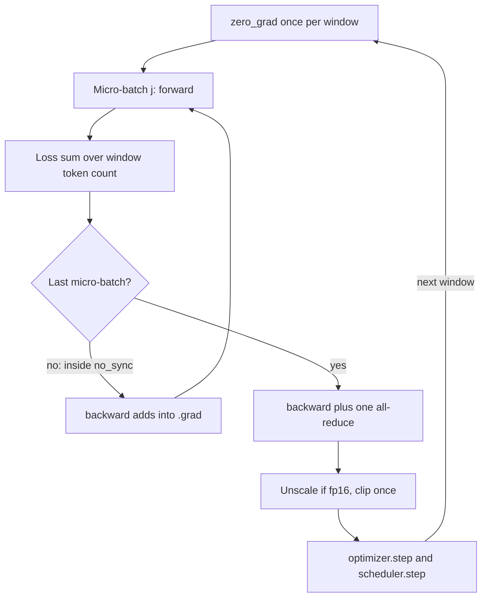

## TL;DR
Gradient accumulation sums gradients from several micro-batches before one optimizer step, so a single
GPU fine-tuning on long agent traces sees the recipe's batch. It costs no memory but buys no speed, and
variable-length traces need token-weighted loss.

## For agent builders
- **Why it matters for agents.** Agent traces are long (system prompt, tool schemas, tool results), so
  often only 1–4 fit per GPU. Accumulation is how a LoRA run on one 24 GB or 80 GB card reaches a sensible
  effective batch of agent trajectories.
- **Where it shows up in your stack.** `gradient_accumulation_steps` in the Hugging Face `Trainer` and TRL
  trainers, `accelerator.accumulate(model)` in Accelerate, `gradient_accumulation_steps` in DeepSpeed
  configs; hosted fine-tuning services handle it for you.
- **What you control.** The accumulation count `k`, counting warmup and decay in optimizer steps (not
  micro-batches), and normalizing loss by the window's trainable-token count when only assistant turns are
  trained and tool outputs are masked.
- **What you can skip.** FSDP and ZeRO reduce-scatter tuning unless you train across many GPUs; for a
  single-card agent fine-tune, the trainer setting plus correct step counting is the whole job.

## Why it exists
- **Memory has a fixed part.** Weights, gradients and optimizer moments are set by parameter count: with
  Adam in mixed precision about 16 bytes per parameter, so a 7B model needs roughly 112 GB before a single
  example is processed.
- **Only activations shrink.** They scale with micro-batch × sequence length × hidden size × layers, so
  the largest micro-batch that fits is a hardware fact, illustratively 1–8 sequences for a multi-billion
  parameter model at a few thousand tokens of context. Long agent traces sit at the low end.
- **The recipe wants a bigger batch.** It picks the effective batch from the gradient-noise scale and
  tunes the learning rate for it: hundreds of sequences for fine-tuning, millions of tokens for
  pre-training.
- **Training at the micro-batch is a different experiment.** The gradient is noisier, the tuned rate is
  too high, the schedule gets many more steps than planned, and per-step overhead (optimizer update,
  communication, kernel launches) is paid every few examples instead of every few hundred.
- **The alternatives cost money or capability.** Buy memory (bigger or more GPUs) or shrink the model
  (frozen or quantized parameters). Accumulation is free: the gradient of a sum of per-example losses is
  the sum of per-example gradients, so the big-batch gradient is built piece by piece.

## How it works
### The arithmetic
For a batch of `B` examples with mean loss `L = (1/B) Σ ℓ_i`, the gradient is `(1/B) Σ ∇ℓ_i`. Split it
into `k` micro-batches of `b = B/k` examples; micro-batch `j` has mean loss `L_j` and gradient `∇L_j`:

```
∇L = (1/k) × Σ_j ∇L_j
```

- **Exact while weights are frozen.** Dividing each micro-batch loss by `k` and summing gradients
  reproduces the big-batch gradient exactly, as long as the weights do not change in between, which is
  precisely the situation inside one optimizer step.
- **PyTorch makes summing free.** `backward()` *adds* into `.grad` rather than overwriting it, which is
  the only reason `zero_grad()` exists. Accumulation is simply not calling `zero_grad()` until the window
  is complete.

### The step, in order
1. **Zero once:** `zero_grad()` at the start of the window.
2. **Accumulate:** for each of the `k` micro-batches, forward, divide the loss by `k`, `backward()`.
   Gradients add up in `.grad`; each micro-batch's activations are freed when its backward finishes, so
   peak memory is that of one micro-batch.
3. **Step once:** after the k-th backward, unscale if using fp16 loss scaling, clip the global gradient
   norm once, then `optimizer.step()` and `scheduler.step()`.

- **The window *is* the batch.** Optimizer, scheduler, clipping and logging all operate on it.
- **Every "step" means optimizer step:** warmup steps, `num_training_steps` and log lines. A run with
  accumulation 8 that processes 80,000 micro-batches has taken 10,000 steps.

### Agent traces make loss normalization the main risk
- **Only some tokens are trained.** Agent fine-tunes usually set labels to -100 on the system prompt,
  user turns and tool results, so only assistant turns (tool calls, final answers) count.
- **Trainable tokens per micro-batch swing widely.** A micro-batch of short routing calls may hold tens of
  trainable tokens; one with a long final answer, thousands. Per-micro-batch means then over-weight the
  short ones, as the next subsection explains.

### Under data parallelism
- **DDP reduces inside `backward()`,** bucket by bucket. With accumulation that is `k` reductions per
  step, `k − 1` of them wasted, because only the sum matters.
- **`model.no_sync()`** disables the reduction for the first `k − 1` micro-batches, so one all-reduce
  carries the whole window. Accelerate's `accumulate()` wrapper does the same bookkeeping.
- **Sharded training (FSDP, ZeRO)** normally keeps only a gradient shard per rank. Postponing the
  reduce-scatter across the window means holding the full unsharded gradient on every rank until the
  step, a memory cost, so those frameworks expose it as an option decided per job.

### When the sum is not the big-batch gradient
- **Batch-coupled layers.** BatchNorm computes statistics per micro-batch, so `k` micro-batches of 4 do
  not behave like one batch of `4k`. Transformers use LayerNorm or RMSNorm, which are per-token, so this
  is a CNN concern.
- **Loss normalization.** LM loss is usually a mean over *tokens*, and micro-batches rarely hold the same
  number of non-padding tokens. `loss / k` with per-micro-batch means gives a micro-batch with 50 real
  tokens the same weight as one with 4,000, which is not the window's per-token mean.
- **The exact form:** sum token losses within each micro-batch and divide by the total token count across
  the window, computed once before the loop. This mismatch was found in widely used fine-tuning code in
  2024 and showed up as a training loss that depended on the accumulation count.
- **Under DDP:** gradients are *averaged* across ranks, so dividing by each rank's local token count gives
  a mean of per-rank means. The exact version all-reduces the window's token count once, divides each
  rank's summed loss by that global count, and multiplies by the world size to undo DDP's averaging.

### What it costs
| Resource | Cost |
|---|---|
| Memory | nothing beyond the `.grad` buffers, which exist anyway |
| Compute per step | `k` forward/backward passes, as many as a true batch of `kb` on an infinitely large GPU, minus amortized per-step overhead |
| Throughput | unchanged: set by how busy the GPU is during each micro-batch |

- **To go faster,** raise the micro-batch until memory is nearly full (or the step is compute-bound);
  accumulation then covers the remaining gap to the target effective batch.
- **Gradient checkpointing is complementary.** It shrinks per-sequence activation memory at the price of
  recomputation, so it can make a long sequence (such as a trace with a huge tool result) fit at all,
  which accumulation cannot.

## Diagram
One optimizer step spans `k` micro-batches; communication, clipping and the scheduler happen once, at the
end of the window.



## Examples
### Worked scenario: a tool-calling LoRA on one 24 GB card
A team tunes an adapter on 4,800 agent traces for 2 epochs. Only micro-batch 2 fits (illustrative), and
the target effective batch is 32, so `k = 32 / 2 = 16`.

| Quantity | Correct accounting | Counted per micro-batch |
|---|---|---|
| Micro-batches over the run | 4,800 | 4,800 |
| Optimizer steps | 4,800 ÷ 16 = 300 | 4,800 planned |
| 10% warmup | 30 steps | 480 steps, longer than the 300 that run |
| Decay progress when data runs out | 100% | the rate never even reaches its peak |

Token weighting, same run: a window mixes a micro-batch of two routing calls with 40 trainable tokens and
one with a long final answer holding 1,200. With per-micro-batch means, each routing token weighs
1,200 ÷ 40 = 30× a final-answer token; dividing by the window's total trainable tokens weighs them equally.

### One optimizer step with token-weighted loss under DDP
Token-weighted loss normalization, a single all-reduce per window under DDP, and clipping and the
scheduler applied once to the summed gradient. The model is assumed to be a Hugging Face causal LM; the
labels already mask non-assistant tokens of each agent trace with -100.

```python
import torch
from contextlib import nullcontext
from torch.nn.utils import clip_grad_norm_

def train_step(model, opt, sched, micro_batches, max_norm=1.0):
    """micro_batches: k dicts with input_ids and labels (-100 = ignore). Performs ONE optimizer step."""
    k = len(micro_batches)
    n_tokens = sum((mb["labels"][:, 1:] != -100).sum().item() for mb in micro_batches)  # whole window
    ddp = isinstance(model, torch.nn.parallel.DistributedDataParallel)
    opt.zero_grad(set_to_none=True)                     # once per window, not per micro-batch
    for j, mb in enumerate(micro_batches):
        sync_ctx = model.no_sync() if ddp and j < k - 1 else nullcontext()
        with sync_ctx:                                  # all-reduce only on the last micro-batch
            logits = model(mb["input_ids"]).logits[:, :-1]   # position t predicts token t+1
            labels = mb["labels"][:, 1:]                     # so shift labels left by one
            loss_sum = torch.nn.functional.cross_entropy(
                logits.reshape(-1, logits.size(-1)), labels.reshape(-1),
                ignore_index=-100, reduction="sum")
            (loss_sum / n_tokens).backward()            # grads add up in .grad across the k calls
    grad_norm = clip_grad_norm_(model.parameters(), max_norm)   # once, on the summed gradient
    opt.step(); sched.step()                            # one optimizer step, one scheduler step
    return grad_norm.item()

# Worked numbers: micro-batch 4 sequences x 2,048 tokens on one GPU, target 128 sequences per step.
#   k = 128 / 4 = 32 micro-batches per optimizer step.
#   100,000 micro-batches in the dataset -> 3,125 optimizer steps, so num_training_steps=3125 and
#   warmup=100 (3.2%) are what the scheduler must be given, not 100,000 and 3,200.
#   Peak memory: identical to k = 1.  Time per optimizer step: ~32x the time of one micro-batch.
#   With per-micro-batch means (loss.mean() / k) a micro-batch holding 300 real tokens would weigh
#   the same as one holding 8,000, so the gradient would differ from a true batch of 128.
```

Under DDP, `n_tokens` here is this rank's count, so the result is a mean of per-rank means. For exact
per-token weighting across ranks, all-reduce the count once and multiply the loss by the world size, as
described under "When the sum is not the big-batch gradient".

### Checking the identity, and the token-weighting bug, in pure Python
No dependencies. Part 1 shows the accumulated gradient equals the big-batch gradient for a 1-D linear
model; part 2 shows how a mean of per-micro-batch means over-weights a short micro-batch.

```python
import random
random.seed(0)

# 1) Linearity: accumulated gradient == big-batch gradient (1-D linear model, mean squared error)
xs = [random.uniform(-1, 1) for _ in range(64)]
ys = [3 * x + random.gauss(0, 0.1) for x in xs]
w = 0.5

def grad(batch):                          # d/dw of mean (w*x - y)^2 over the batch
    return sum(2 * (w * x - y) * x for x, y in batch) / len(batch)

data = list(zip(xs, ys))
k = 8
full = grad(data)
accum = sum(grad(data[j * 8:(j + 1) * 8]) / k for j in range(k))   # loss / k, gradients add
print(f"full {full:.6f}  accumulated {accum:.6f}")

# 2) Token weighting: two micro-batches with very different real-token counts
mbs = [dict(tokens=50, loss_sum=50 * 3.0), dict(tokens=4000, loss_sum=4000 * 2.0)]
naive = sum(mb["loss_sum"] / mb["tokens"] for mb in mbs) / len(mbs)     # mean of means / k
n_tokens = sum(mb["tokens"] for mb in mbs)                              # whole window
exact = sum(mb["loss_sum"] for mb in mbs) / n_tokens                    # per-token mean
print(f"naive {naive:.4f}  exact {exact:.4f}")
for mb in mbs:
    w_naive = 1 / (len(mbs) * mb["tokens"])
    print(f"{mb['tokens']:5d} tokens: weight per token naive {w_naive:.2e}  exact {1 / n_tokens:.2e}")
# full -1.549793  accumulated -1.549793
# naive 2.5000  exact 2.0123
#    50 tokens: weight per token naive 1.00e-02  exact 2.47e-04
#  4000 tokens: weight per token naive 1.25e-04  exact 2.47e-04
```

| Normalization | Window loss | Weight of one token in the 50-token micro-batch |
|---|---|---|
| Mean of per-micro-batch means | 2.50 | 1.00e-2, 80× a token in the long one |
| Sum over window ÷ window tokens | 2.01 | 2.47e-4, same as every other token |

## Production patterns
- **Let the trainer own the loop.** In Hugging Face `Trainer` set `gradient_accumulation_steps`; in
  Accelerate pass `gradient_accumulation_steps` to `Accelerator` and wrap each micro-batch in
  `accelerator.accumulate(model)`; in DeepSpeed set `gradient_accumulation_steps` in the config. Monitor
  the logged step count: it should equal micro-batches ÷ `k`.
- **Normalize by window tokens on masked agent traces.** Compute the window's trainable-token count (labels
  not -100) before the loop and divide summed token losses by it (recent Trainer versions pass this count
  to the loss as `num_items_in_batch`). Regression-test that the loss does not shift when `k` changes.
- **Max the micro-batch, then accumulate.** Raise the micro-batch (with gradient checkpointing if needed
  for long tool results) until memory is nearly full, then set `k = target ÷ (micro-batch × world size)`.
  Monitor tokens per second, step time and peak memory, and log the effective batch explicitly.
- **Size the schedule from optimizer steps before launch.** For an agent fine-tune, print micro-batches,
  `k`, optimizer steps and warmup steps, and refuse the run if warmup is a large share of it. Monitor the
  learning-rate trace in the run logs.
- **One all-reduce per window.** Under DDP use `no_sync()` for the first `k − 1` micro-batches; under
  FSDP or ZeRO decide per job whether to delay the reduce-scatter, weighing communication saved against
  unsharded-gradient memory. Watch communication time per step.
- **Golden test for the loop.** On a tiny fp32 model with dropout off and fixed data order, compare one
  accumulated window with one large batch; gradients should agree to around 1e-6. Run it in CI whenever
  the training loop changes.

## Trade-offs
- **Any effective batch vs zero speed-up.** It reaches any effective batch on fixed memory at no memory
  cost, but the forward/backward work runs serially, so time per optimizer step grows linearly with `k`.
- **Exact vs inexact cases.** Exact for per-token mean losses and per-token normalization layers;
  inexact for BatchNorm-style layers and a naive `loss / k` under variable-length batches, with error
  growing with the spread in tokens per micro-batch (large for masked agent traces).
- **Fewer all-reduces vs sharded memory.** Skipping the all-reduce until the last micro-batch cuts DDP
  communication `k`-fold, but under FSDP or ZeRO it means holding unsharded gradients for the whole window,
  which can cost the memory accumulation was meant to save.
- **Recipe fidelity vs steps per hour.** A large `k` preserves the effective batch, yet optimizer steps per
  hour fall with it; on a small fine-tuning set, fewer and larger steps can be worse than more and smaller
  ones, a batch-size question accumulation cannot answer.
- **Accumulation vs gradient checkpointing.** Accumulation costs no extra compute but cannot make a single
  long sequence fit; checkpointing costs roughly one extra forward pass (each checkpointed layer is recomputed once) but shrinks per-sequence
  activation memory. Most memory-constrained runs use both.

## Pitfalls
- **Not dividing the loss by `k`** (or by the window's token count). The summed gradient is `k`× too
  large: a `k`× learning rate for SGD, and distorted clipping thresholds and logged norms for Adam.
- **Stepping the scheduler or counting warmup per micro-batch.** Decay finishes `k`× early; the run spends
  most of its length at the floor learning rate. The reverse mistake, sizing the planned schedule in
  micro-batches, means the run ends before the decay does.
- **Clipping inside the loop.** Each clip rescales a partial sum, so the final gradient's direction and
  magnitude depend on `k`. Clip once after the last backward.
- **`zero_grad()` at the top of every micro-batch,** copied from a plain loop. Only the last gradient
  survives, so the model trains on a batch of `b` with a rate tuned for `kb`, and the loss curve is far
  noisier than the config suggests.
- **Expecting faster training.** Tokens per second are unchanged or slightly lower; setting
  `gradient_accumulation_steps=16` "for speed" makes each optimizer step 16× slower.
- **Per-micro-batch means on variable-length data.** The training loss shifts when `k` changes and short
  sequences (short tool calls) are over-weighted. Fix: sum token losses and divide by the window's token
  count (under DDP, by the global count across ranks if exactness matters).
- **Inconsistent last partial window.** A step from 3 micro-batches divided by `k = 8` is a 3/8-size step;
  drop the remainder or normalize by the actual count.

## When to use
- **Use it** whenever the micro-batch that fits is smaller than the recipe's effective batch, which
  describes most single-GPU and small-cluster fine-tuning, including nearly every agent-trace fine-tune.
- **Order of operations:** raise the micro-batch until memory is nearly full or the GPU is compute-bound
  (that is what raises throughput), set accumulation to close the gap, then size warmup and total steps in
  optimizer steps.
- **Avoid** pushing the effective batch past the gradient-noise scale: it costs data for no gain whether
  the batch comes from GPUs or from accumulation. On small agent datasets, also keep enough steps.
- **Measure:** tokens per optimizer step, step time and peak memory; log the effective batch explicitly.
- **Interviews:** the linearity argument, the ordering with clipping, loss scaling and the scheduler, the
  `no_sync` communication point, and the plain statement that it saves memory, not time.

## Role lens
- **Engineer:** Writes the accumulation loop, or configures the trainer, with per-window loss
  normalization, clipping and scheduler stepping, and verifies optimizer-step counts and tokens per step
  in the logs before launching.
- **Architect:** Decides when accumulation on existing hardware is acceptable versus when the schedule
  demands more GPUs, since accumulation holds the effective batch constant but stretches wall-clock
  linearly.
- **FDE:** Makes a customer's fine-tuning recipe run on the single 24 GB or 80 GB card they actually have
  by trading micro-batch for accumulation, and explains why the job is now correct but not faster.

## Check yourself
**Q:** A colleague reports that with `gradient_accumulation_steps=8` their training loss at step 500
differs from a run with a true batch 8× larger on a bigger GPU, and asks whether accumulation is
"approximate". What should be identical, what can legitimately differ, and which bugs would explain a
real discrepancy?
**A:** For a transformer with a per-token mean loss, the accumulated gradient equals the large-batch
gradient in exact arithmetic, so the two runs should follow the same trajectory. Legitimate differences
are small: floating-point summation order under bf16 or fp16, different dropout random streams, and
different data order if the loaders are not seeded identically. Because the gradient is the same, Adam's
`m` and `v` and therefore every update are the same too; there is no optimizer-side reason for drift. Anything larger points at a bug. The
usual suspects, in order: the loss normalized as a per-micro-batch mean divided by 8 when sequences
vary in length, so short micro-batches are over-weighted; the scheduler or warmup counting micro-batches,
so the learning rates at "step 500" are not the same; clipping applied inside the loop; `zero_grad()`
inside the loop, which discards seven of the eight gradients; or a BatchNorm layer somewhere. The clean
test is a tiny model in fp32 with dropout off and the same data order: the gradients after one window
and after one large batch should agree to around 1e-6, and whichever step of the loop breaks that
agreement is the bug.

## Interview questions
### Why does gradient accumulation give the same gradient as a larger batch?
- **Linearity:** the gradient of a mean loss is the mean of per-example gradients, so `k` micro-batch
  gradients, each scaled by `1/k`, sum to the big-batch gradient.
- **Weights are frozen inside the window,** so every micro-batch sees the same parameters.
- **PyTorch adds into `.grad`,** so accumulation is just delaying `zero_grad()` and the optimizer step.

### You fine-tune on agent traces with tool outputs masked, and the loss changes when you change k. Why?
- **Trainable tokens vary per micro-batch:** with tool results, system and user turns masked, some
  micro-batches hold tens of trainable tokens and others thousands.
- **Per-micro-batch means over-weight short ones,** so the window loss is not a per-token mean and depends
  on how traces fall into micro-batches.
- **Fix:** divide summed token losses by the window's trainable-token count (global across ranks under
  DDP), and add a test that the loss is stable across `k`.

### A team set gradient_accumulation_steps to 16 to speed training up. What happened?
- **No speed-up:** the 16 forward/backward passes run one after another, so tokens per second are
  unchanged or slightly lower and each optimizer step takes about 16× longer.
- **Memory is flat:** only one micro-batch of activations is alive at a time.
- **What actually helps:** a larger micro-batch until the GPU is compute-bound, or more GPUs.

### A single 32k-token agent trace does not fit even at micro-batch 1. Does accumulation help?
- **No:** accumulation only splits a batch across sequential passes; the smallest unit it can split down
  to is one sequence, so that sequence's activations must still fit.
- **Use gradient checkpointing:** it stores only some activations and recomputes the rest in backward,
  roughly one extra forward pass, shrinking per-sequence activation memory.
- **Combine them:** checkpointing makes one sequence fit, then accumulation reaches the target batch. Also
  ask whether the trace should be truncated or its tool result summarised.

### Under FSDP, should you delay gradient reduction until the end of the window?
- **Benefit:** fewer reduce-scatters, so less communication per optimizer step.
- **Cost:** every rank must hold the full unsharded gradient for the whole window, which can erase the
  memory saving that motivated sharding and accumulation.
- **Decide per job** from measured communication time against peak memory.

### Plan a fine-tune on one 80 GB GPU: micro-batch 4 sequences fits, target is 128. What are the numbers?
- **Accumulation:** `k = 128 / 4 = 32` micro-batches per optimizer step.
- **Steps:** 100,000 micro-batches give 3,125 optimizer steps, so `num_training_steps=3125` and a warmup
  of 100 steps (3.2%).
- **Expectations:** peak memory as for `k = 1`; each step takes about 32× one micro-batch.

## Quiz
### Q: Why is each micro-batch loss divided by the accumulation count k before `backward()`?
- [ ] To keep the activations small enough to fit in memory
- [x] So the k summed gradients equal the gradient of the mean loss over the whole window instead of k times it
- [ ] Because PyTorch overwrites `.grad` on every backward call
- [ ] To make the scheduler advance once per window
> `backward()` adds into `.grad`, so k unscaled micro-batch gradients sum to k times the big-batch
> gradient, which behaves like a k× learning rate. Dividing by k restores the mean; memory and the
> scheduler are unaffected by this division.

### Q: A run raises gradient accumulation from 1 to 16 while keeping the micro-batch fixed. Which statement is correct?
- [ ] Peak GPU memory rises roughly 16×
- [ ] Tokens per second rise because the optimizer runs less often
- [x] Peak memory is unchanged and each optimizer step takes about 16× longer
- [ ] The learning rate must be divided by 16 to compensate
> Only one micro-batch of activations is alive at a time, so memory is flat, and the 16 forward/backward
> passes run one after another. The larger effective batch would, if anything, justify a larger learning
> rate, not a smaller one.

### Q: In which situation does gradient accumulation NOT reproduce the gradient of one large batch?
- [ ] When the model uses LayerNorm and the loss is a per-token mean over the whole window
- [ ] When training under DDP with `no_sync()` on all but the last micro-batch
- [x] When the network contains BatchNorm layers whose statistics are computed per micro-batch
- [ ] When mixed precision is enabled with bf16
> BatchNorm couples the examples inside a micro-batch, so statistics over 4 examples differ from those
> over 64. LayerNorm is per-token, `no_sync` only delays communication, and bf16 adds rounding noise but
> no systematic difference.

## Use cases & projects
### Use cases
- **Single-GPU agent fine-tunes.** Long traces fit only 1–4 per card, so accumulation reaches a target
  effective batch of trajectories without buying more memory.
- **Assistant-only loss on tool-calling data.** Masking tool results and user turns makes trainable-token
  counts uneven, which is exactly where window-level token normalization matters.
- **Reproducing a recipe on smaller hardware.** An FDE runs a customer's 128-sequence recipe on the one
  card they have by trading micro-batch for accumulation.
- **Preference or RL phases on agent trajectories.** Long rollouts force small micro-batches, and the same
  step-counting rules apply to the schedule.

### Mini project
**Prove your accumulation loop on agent traces (1-2 hours).**
- **Goal:** show that your fine-tuning loop gives the same loss for `k = 1` and `k = 8` on masked agent
  traces, and that the naive version does not.
- **Steps:** build 64 synthetic tool-calling traces of very different lengths with labels masked to
  assistant turns; on a tiny causal LM in fp32 with dropout off, compute one window's gradient with a true
  batch, with accumulation and per-micro-batch means, and with accumulation and window-token
  normalization; print the gradient difference and the loss for each.
- **Done when:** the token-normalized loop matches the true batch to around 1e-6, the naive loop visibly
  does not, and the check runs as a test you can keep beside your fine-tuning code.
