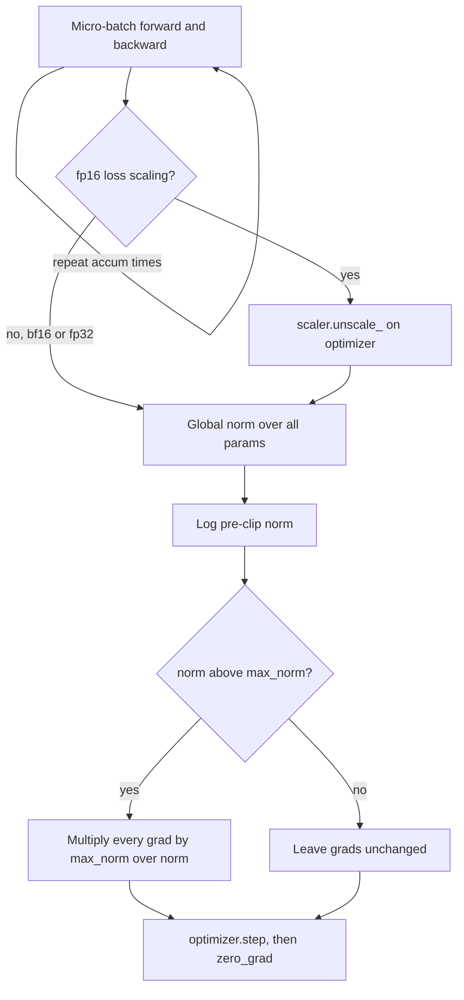

## TL;DR
Gradient clipping scales all gradients down by one factor when their global L2 norm exceeds a threshold,
keeping direction and bounding step length, because one rare batch can undo thousands of good steps or
corrupt optimizer statistics.

## Why it exists
- **Gradients occasionally explode.** Backprop multiplies Jacobians layer by layer; when the products line
  up, the bottom-layer gradient can be orders of magnitude larger than typical. In RNNs this was
  systematic along time, and the 2013 analysis proposed clipping as the fix.
- **Transformers hit it sporadically.** An unusual batch, a sharp region, a saturating attention pattern
  or a mixed-precision edge case gives a norm of 50 where the running average is 1.
- **One step does outsized damage.** Under SGD the weights jump by `η × 50` instead of `η × 1`, which can
  leave the basin the run spent a day finding.
- **Adam is not immune.** The raw step is normalized, softening the jump, but the huge gradient enters
  the moments. With a `v` decay like 0.95 or 0.999, one squared value 2,500× normal inflates `v` for
  hundreds of steps and shrinks later updates. The run quietly learns slower; the loss shows an
  unexplained plateau.
- **A lower learning rate is the blunt fix.** It penalizes every normal step to survive a rare one;
  clipping bounds only outliers. Theory later caught up: clipped descent can be shown to converge faster
  than fixed-step descent on functions whose smoothness varies with gradient magnitude, the regime deep
  networks live in.

## How it works
### Global norm clipping
Collect every parameter gradient and compute one scalar:

```
total_norm = sqrt( Σ_params Σ_elements g² )
scale      = min(1, max_norm / (total_norm + ε))
g         ← g × scale        for every parameter
```

- **The norm is global, not per tensor.** Per-tensor clipping rescales layers by different factors and
  changes the step's direction. One scalar for everything keeps the step pointing exactly where backprop
  said, only shorter.
- **No-op when `total_norm ≤ max_norm`.** On a healthy run clipping fires on a minority of steps.

### When it fires on almost every step
What that means depends on the optimizer:

| Optimizer | Effect of persistent clipping |
|---|---|
| SGD | update is `η × g`, so it is a hidden learning-rate cut that varies with the norm |
| Adam | a uniform rescale largely cancels in `m̂/√v̂` (scale by `c`: `m` scales by `c`, `√v` by `c`), so step size barely changes; it becomes Adam on unit-norm gradients and discards how large each batch's gradient was |

- **Either way it is no longer an outlier filter**, and the persistent high norm is itself a finding.
- **Usual causes:** a loss summed rather than averaged, a learning rate too high, or a threshold copied
  from a setup with a different parameter count. The global norm sums over every parameter, so its
  typical value depends on model size.

### Value clipping
- **Mechanism:** `clip_grad_value_` clamps each element to `[−c, c]`.
- **Cost:** cheaper to reason about, but it changes the gradient's direction, because large components are
  flattened while small ones are untouched.
- **Where:** mostly older RNN code. Transformer recipes use global norm clipping, most commonly with
  `max_norm = 1.0`.

### Adaptive variants and what clipping cannot do
- **A fixed threshold is a guess** about the typical norm. Adaptive clipping uses a relative rule instead.
- **AGC** (adaptive gradient clipping, from the normalizer-free ResNets work) clips each unit's gradient
  when it is large relative to that unit's weight norm.
- **Running-statistic schemes** clip against recent norms, so the threshold follows the norm as it drifts.
- **Hard limit:** clipping bounds each step, not a *sequence* of bad steps. Large pre-training runs that
  hit a spike clipping did not prevent usually rewind to a pre-spike checkpoint and skip or reshuffle the
  nearby batches, because a few hundred clipped-but-wrong steps can still push the model somewhere it does
  not recover from.

### Where it sits in the step
After the full gradient exists, before the optimizer uses it:
1. **Accumulate.** Run forward and backward for every micro-batch in the window; gradients sum in `.grad`.
2. **Unscale (fp16 only).** Scaled gradients are thousands of times larger than real, so clipping them at
   1.0 would clip everything to nearly zero.
3. **Clip.** Compute the global norm and clip. Log the pre-clip norm.
4. **Step.** `optimizer.step()`, then `zero_grad()`.

Clipping each micro-batch separately is wrong for the same reason per-tensor clipping is: the accumulated
gradient is a sum, and clipping the pieces changes both its magnitude and its direction.

### Distributed training
- **Data parallel:** the gradient is all-reduced before the step, so clipping the local gradient after the
  reduction equals clipping the global one.
- **Sharded (FSDP, ZeRO):** each rank holds part of the gradient, so the norm is a sum of squares across
  ranks plus a collective.
- **How frameworks handle it:** their own entry point (FSDP1's `model.clip_grad_norm_`, DeepSpeed's
  `gradient_clipping` config), or, as FSDP2 does by storing gradients as DTensors, making the standard
  utility reduce across ranks.
- **Trap:** the plain utility on local shards of a framework that does neither silently computes a
  per-rank norm.

### The norm as a health signal
The pre-clip gradient norm is one of the most informative training curves:

| Pattern | Reading |
|---|---|
| Large in the first steps, falls during warmup, then drifts slowly | healthy |
| Spikes that coincide with loss spikes | data or numerics |
| Steady upward trend late in training | learning rate too high for the current surface |
| Above the threshold for hundreds of consecutive steps | throttled by the clip, not protected by it |

## Diagram
The ordering is the whole lesson: accumulate the full gradient, unscale if fp16, measure and clip once,
then step.



## Examples
### A training step in the correct order
Accumulation, fp16 loss scaling and clipping in order. The function returns the pre-clip norm so it can
be logged; the comment works one concrete step.

```python
import torch
from torch.nn.utils import clip_grad_norm_

def train_step(model, opt, scaler, micro_batches, accum, max_norm=1.0):
    opt.zero_grad(set_to_none=True)
    for x, y in micro_batches:                       # len(micro_batches) == accum
        with torch.autocast("cuda", dtype=torch.float16):
            loss = torch.nn.functional.cross_entropy(model(x), y) / accum
        scaler.scale(loss).backward()                # grads are scaled by S (e.g. 65536)
    scaler.unscale_(opt)                             # divide grads by S BEFORE measuring the norm
    pre_clip = clip_grad_norm_(model.parameters(), max_norm)   # returns the norm before clipping
    scaler.step(opt)                                 # skips the step if any grad is inf/nan
    scaler.update()
    return pre_clip.item()

# Worked step: suppose the accumulated gradient has global norm 4.0 and max_norm is 1.0.
#   scale = min(1, 1.0 / 4.0) = 0.25 -> every element is multiplied by 0.25, direction unchanged.
# If instead the norm had been 0.7, scale = min(1, 1/0.7) = 1 -> nothing happens.
# Forgetting unscale_(): the scaled norm is 4.0 * 65536 = 262144, so the clip scales it to 1.0;
#   when the scaler then unscales internally, the real gradient norm is 1/65536 ~ 1.5e-5 instead of 4.0.
```

With bf16 there is no scaler: drop the `scaler` calls and call `clip_grad_norm_` directly after the last
`backward()`. The ordering rule (accumulate, unscale, clip, step) is the same.

### Worked scenario: one unclipped spike under Adam
One parameter's squared gradient normally averages 1, so `v ≈ 1`. A single batch arrives with gradient 50
(squared: 2,500). The table shows the update size relative to normal for later ordinary steps (illustrative,
ignoring `m`).

| Steps after the spike | β2 = 0.999: `v` | update size | β2 = 0.95: `v` | update size |
|---|---|---|---|---|
| 0 | 3.50 | 0.53× | 126 | 0.09× |
| 100 | 3.26 | 0.55× | 1.74 | 0.76× |
| 1,000 | 1.92 | 0.72× | 1.00 | 1.0× |
| 3,000 | 1.12 | 0.94× | 1.00 | 1.0× |

- **With β2 = 0.999** the parameter learns at roughly half speed for hundreds of steps: the "plateau
  nobody can explain".
- **With clipping at 1.0**, if the global norm spikes by the same factor as this parameter (typical norm
  about 1, spike about 50), the clip scales the gradient by about 1/50 before it reaches `v`, so `v` sees
  an ordinary-sized value instead of a 2,500× outlier.
- **With β2 = 0.95** the hit is deeper but shorter: updates drop to 0.09× at once and recover within a
  few hundred steps, while 0.999 takes a milder hit that lasts thousands of steps.

## Production patterns
- **Clip by default, log the norm always.** Set `max_norm = 1.0` (the Hugging Face Trainer's
  `max_grad_norm`, applied by default) and log the value `clip_grad_norm_` returns every step. Track the
  fraction of steps that clipped over a rolling window and alert when it stays high.
- **Set the threshold from data, not copy-paste.** Plot the pre-clip norm distribution for a few hundred
  healthy steps and set `max_norm` above the bulk, so it fires only on outliers. Re-check after changing
  optimizer, precision, batch size or model size.
- **Use the framework's sharded clip.** Under FSDP1 call `model.clip_grad_norm_`; under DeepSpeed set
  `gradient_clipping` in the config; under FSDP2 the standard utility reduces across DTensors. Verify by
  checking all ranks log the same norm.
- **Rewind on spikes clipping did not stop.** Keep frequent checkpoints; when loss and grad norm spike
  together, roll back to a checkpoint before the spike and skip or reshuffle the batches around it. Record
  the skipped batch indices for data review.
- **Correlate norm spikes with batches.** Log batch or shard ids with the norm so a spike can be traced to
  its data. Spikes aligned with loss spikes point at data or numerics; a slow upward drift points at the
  learning rate.

## Trade-offs
- **Outlier protection vs hidden recipe change.** Clipping bounds rare batches at no cost on normal steps,
  but a threshold far below the typical norm becomes a hidden learning-rate cut under SGD, or, under Adam,
  a switch to normalized gradients that silently changes the recipe you tuned.
- **Global norm vs value clipping.** Global norm preserves update direction; value clipping is simpler and
  cheaper but distorts direction whenever a few coordinates dominate.
- **Tighter threshold vs visibility.** It buys stability for aggressive learning rates and large models,
  but masks problems (bad data, numeric overflow) that would otherwise show as clear divergence.
- **Correct sharded norm vs a collective.** The global norm needs an extra collective per step; small next
  to the gradient all-reduce, but skipping it for local norms gives subtly inconsistent clipping.

## Pitfalls
- **Clipping before `unscale_()` under fp16.** Every step is clipped to near zero and the loss barely moves
  while nothing reports an error. Adam does not rescue this: once per-element gradients fall far below
  its `ε`, the denominator stops tracking them and the step shrinks with them.
- **Clipping after `optimizer.step()` or before `backward()`.** The call succeeds, does nothing useful,
  and the first real gradient spike still corrupts the run.
- **Clipping each micro-batch.** In an accumulation loop this changes the direction of the summed gradient
  and makes the effective threshold depend on the accumulation count. Fix: clip once, after the last
  backward of the window.
- **The plain utility on FSDP1 shards.** Using it instead of FSDP1's `clip_grad_norm_` method computes the
  norm over the local shard only, so clipping behaves differently on every rank.
- **Papering over divergence.** Clipping a too-high learning rate or missing warmup makes the clip fire on
  nearly every step, the signal that the root cause is still there.
- **Not logging the pre-clip norm.** It throws away the best early warning for bad data, numeric issues and
  a learning rate that has outlived its schedule.

## When to use
- **Use it on every transformer training run.** `max_norm = 1.0` is a sensible start, and frameworks such
  as the Hugging Face `Trainer` already apply it.
- **Read it, not just enable it:** log the pre-clip norm, note the fraction of steps that clipped, and
  treat sustained clipping as a configuration problem rather than a success.
- **Revisit the threshold** when changing optimizer, precision or batch size, because all three move the
  typical norm.
- **Interviews:** know the ordering (accumulate, unscale, clip, step), why global norm beats per-element
  clipping, and why clipping still matters with Adam even though Adam normalizes step sizes.

## Role lens
- **Engineer:** Places the clip call correctly relative to loss scaling and accumulation, logs the pre-clip
  norm, and alerts on it as part of training-run monitoring.
- **Architect:** Fixes clipping and norm-logging as part of the standard training recipe so that every
  team's runs produce comparable stability diagnostics across models and clusters.
- **FDE:** When a customer's fine-tuning diverged or stalled, pulls their gradient-norm trace to show
  whether the run was unprotected or quietly throttled, turning a vague complaint into a concrete fix.

## Check yourself
**Q:** A team trains with Adam, warmup, bf16 and clipping at 1.0. Their logs show clipping fired on 97% of
steps for the entire run, yet the loss decreased steadily and nothing diverged. Is this fine?
**A:** It is not a failure, but the configuration is not doing what they think, and the optimizer
decides what that means. Had this been SGD, clipping every step would be a hidden learning-rate cut that
fluctuates with the norm. With Adam the effect is different: rescaling a gradient by `c` scales `m` by `c`
and `√v` by `c`, so the step size is roughly unchanged, and what they are actually running is Adam on
unit-norm gradients, in which a batch with a genuinely large gradient gets the same weight in the moment
estimates as an ordinary one. That evidently trains, but it is not the recipe they tuned, and the
"fraction clipped" metric is now useless as an alarm: a real spike looks like every other step, so only
the pre-clip norm trace can reveal it. The persistent high norm is also a clue worth chasing: a loss summed
over tokens instead of averaged (the norm then scales with tokens per batch), a learning rate high enough
to keep the model in sharp regions, or a threshold copied from a smaller model whose global norm was lower.
The fix is to plot the pre-clip norm distribution, correct the loss normalization if that is the cause,
and set the threshold above the bulk of healthy steps so it fires only on outliers; a short A/B run with
the new threshold tells them whether the clip was changing the outcome.

## Interview questions
### What does gradient clipping change about an update, and what does it leave alone?
- **Global norm clipping** multiplies every gradient by one scalar `min(1, max_norm / total_norm)`, so the
  step keeps its direction and only its length is bounded.
- **It is a no-op** below the threshold, so normal steps are untouched; that is why it beats simply
  lowering the learning rate to survive the worst batch.

### Your fp16 fine-tune trains but the loss barely moves, and nothing errors. What do you check?
- **Clip placement:** if `clip_grad_norm_` runs before `scaler.unscale_(opt)`, it measures a norm
  inflated by the loss scale (65536 in the example) and clips every step to almost nothing.
- **Confirm:** the logged pre-clip norm will be enormous and clipping fires on every step.
- **Fix:** accumulate, unscale, clip, step, in that order.

### When would clipping at 1.0 be the wrong setting?
- **When the typical norm is well above 1.0**, for example a loss summed over tokens or a much larger
  model, so the clip fires on most steps and stops being an outlier filter.
- **Under SGD** that is a hidden, fluctuating learning-rate cut; under Adam it silently becomes training
  on unit-norm gradients.
- **Fix the cause** (loss normalization, learning rate) or set the threshold from the healthy-norm
  distribution.

### A large pre-training run spikes in loss even though clipping is on. What do you do?
- **Recognize the limit:** clipping bounds each step, not a sequence of bad steps.
- **Standard response:** rewind to a checkpoint before the spike and skip or reshuffle the batches around
  it, then watch whether the spike recurs.
- **Investigate:** check whether norm spikes line up with specific data, and whether the norm was trending
  up beforehand, which points at the learning rate.

### How does clipping work under FSDP or ZeRO, and what goes wrong if you ignore it?
- **Each rank holds a shard**, so the global norm needs a sum of squares across ranks plus a collective.
- **Use the framework's path:** FSDP1's `model.clip_grad_norm_`, DeepSpeed's `gradient_clipping`, or
  FSDP2's DTensor-aware standard utility.
- **Ignoring it** computes per-rank norms, so each rank clips by a different factor.

## Quiz
### Q: Why is global-norm clipping preferred over clamping each gradient element to a fixed range?
- [ ] It is cheaper because it needs only one pass over the gradients
- [x] It multiplies every gradient by the same scalar, so the update keeps its direction and only its length is bounded
- [ ] It works with Adam, whereas value clipping only works with SGD
- [ ] It automatically adapts the threshold to the learning rate
> Clamping elements flattens the large coordinates and leaves small ones alone, which changes where the
> step points. A single global scale factor shortens the step without rotating it.

### Q: In an fp16 training loop with a GradScaler, where must the clipping call go?
- [ ] Immediately after the loss is computed, before backward
- [ ] After `scaler.step()` so the optimizer has already applied the update
- [x] After `scaler.unscale_(optimizer)` and before `scaler.step()`
- [ ] Anywhere, because the scaler accounts for clipping automatically
> Gradients after backward are multiplied by the loss scale, so their norm is thousands of times too large.
> Unscaling first makes the threshold meaningful; clipping after the step is too late to affect it.

### Q: Adam already normalizes each parameter's update by its running gradient magnitude. Why does clipping still help?
- [ ] It does not; clipping is only useful with SGD
- [ ] Clipping replaces the need for a second-moment estimate
- [x] A single huge gradient still enters Adam's moment estimates and distorts updates for many subsequent steps
- [ ] Adam's normalization only applies to the first layer of the network
> Adam's second moment has a long memory, so one outlier inflates it and shrinks later updates for that
> parameter; clipping keeps the outlier out of the statistics in the first place. Adam's normalization
> limits the size of the immediate step, not the damage to its running statistics.
