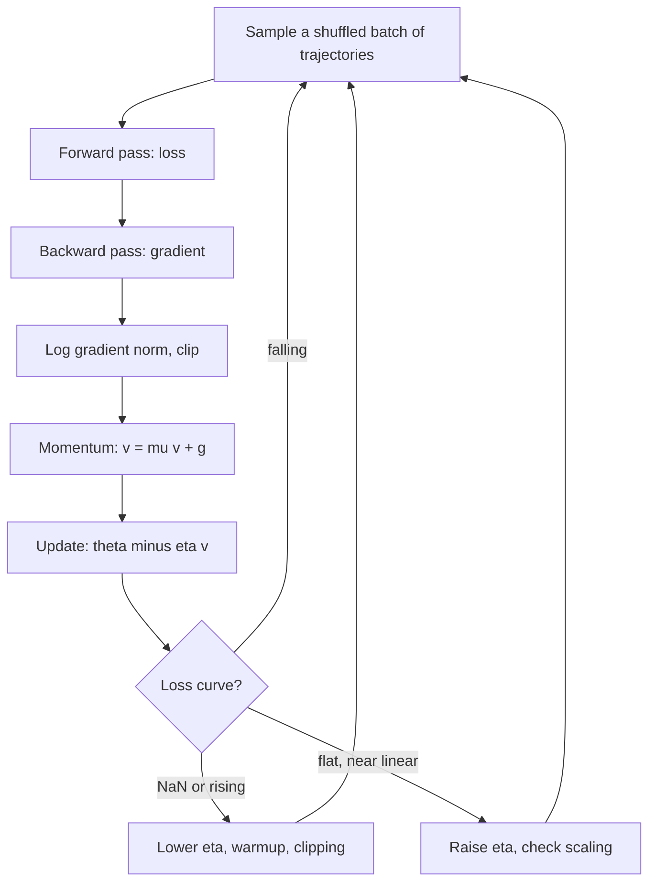

## TL;DR
Every fine-tune of an agent model, LoRA on tool-call traces included, is gradient descent:
θ ← θ − η∇L(θ). You need it to pick a learning rate, read the loss curve, and tell a diverged run from
a stalled one.

## For agent builders
- **Why it matters for agents.** When prompting is not enough and you fine-tune a model on agent
  trajectories, a router or a retriever, the run succeeds or fails on the learning rate, the batch size and
  the schedule. Most "the fine-tune did nothing" or "it went to NaN" reports are gradient-descent settings.
- **Where it shows up in your stack.** The `learning_rate`, batch size, gradient accumulation, warmup and
  clipping settings of your fine-tuning library or a hosted fine-tuning API, and the loss and gradient-norm
  curves it logs.
- **What you control.** Peak learning rate (found with a short sweep), effective batch size, warmup and
  decay, gradient-norm clipping, and when to stop.
- **What you can skip.** Convergence proofs and Hessian algebra. Know the η < 2/λ ceiling as intuition,
  why mini-batches work, what momentum does, and the loss-curve symptom table.

## Why it exists
- **Training is minimising L(θ),** the average loss over the data. Closed-form solutions exist only for a
  few special cases such as linear least squares.
- **Search does not scale.** Grid or random search is exponential in the number of parameters: ten
  candidate values per parameter is 10^P combinations, absurd when P is a billion. Derivative-free methods
  such as evolution strategies need on the order of P loss evaluations to learn as much as one gradient.
- **The gradient is the steepest direction, and cheap.** A first-order Taylor expansion says
  L(θ + δ) ≈ L(θ) + ∇L(θ)ᵀδ; among all small steps of fixed length, −∇L decreases L the most.
  Backpropagation delivers all P components in one backward pass costing roughly twice a forward pass.
  Nothing else offers that ratio.
- **Second-order methods do not fit in memory.** Newton's step δ = −H⁻¹∇L rescales every curvature
  direction and removes the conditioning problem, but the Hessian H has P² entries, 10¹⁸ for a billion
  parameters, and inverting it costs O(P³). At scale it is only approximated cheaply, which is what
  adaptive optimizers do with a per-parameter diagonal.
- **Two problems remain.** The approximation is local, so the step must be small enough (the learning
  rate, the most common training failure). And exact gradients over billions of examples are too
  expensive.
- **Noisy gradients are enough.** Robbins and Monro showed in 1951 that noisy, unbiased estimates suffice
  if steps are chosen sensibly, which licenses mini-batches: stochastic gradient descent, underneath every
  modern optimizer.

## How it works
### The update and why the learning rate has a ceiling
The update is θ_{t+1} = θ_t − η g_t, with g_t the gradient. Work it on a one-dimensional quadratic bowl:

```
L = ½λθ²   ->   g = λθ   ->   θ_{t+1} = (1 − ηλ)θ_t
converges only if |1 − ηλ| < 1, i.e. η < 2/λ;   one step at η = 1/λ
```

- **Many dimensions, one η.** Every eigen-direction of the Hessian has its own curvature λ_i, and the same
  η applies to all. It must satisfy η < 2/λ_max or the steepest direction diverges.
- **The flattest direction crawls.** Progress there shrinks by only (1 − ηλ_min) per step. With η near
  1/λ_max that factor is about 1 − λ_min/λ_max.
- **So iterations scale with the condition number** κ = λ_max/λ_min. This one ratio explains why
  unscaled features train slowly, why normalisation layers help, and why momentum and adaptive optimizers
  exist: they all attack κ.

### Mini-batches: stochastic gradient descent
- **Unbiased, noisy estimate.** The full gradient is an average over N examples. A mini-batch of B
  examples gives an unbiased estimate whose variance scales as 1/B, at a cost proportional to B.
- **Critical batch size.** For a fixed compute budget, smaller batches mean more updates. Beyond a
  problem-dependent critical batch size, extra examples reduce noise that was no longer limiting, and the
  compute is wasted.
- **Shuffle each epoch** so consecutive batches are not correlated, for example all trajectories from one
  customer or one tool in a row.
- **Scale η with B, up to a point.** When you raise the batch size the learning rate usually needs to rise
  with it to keep progress per epoch; the heuristic holds up to a point and then breaks.
- **Gradient accumulation** sums gradients over several micro-batches before one update, so long agent
  trajectories that fit only one or two per GPU still give a usable effective batch size.
- **Noise may help.** The widely held, still-debated view: noise helps escape saddle points and biases
  training toward flatter minima that generalise better. The batch-size lesson goes deeper.

### Momentum
- **Heavy-ball update:** v ← μv + g, θ ← θ − ηv. The velocity is an exponential moving average of
  gradients.
- **Zig-zags cancel, steady pulls accumulate.** In a steep direction where the gradient flips sign every
  step (across a valley), successive terms cancel and the effective step shrinks. In a consistent
  direction they accumulate, up to 1/(1 − μ), ten times with μ = 0.9.
- **Net effect: a smaller effective κ.** On a quadratic, with η and μ tuned to the curvature range, the
  iterations needed scale with √κ instead of κ: at κ = 10,000, from order 10,000 to order 100 steps for a
  fixed error reduction.
- **Nesterov momentum** evaluates the gradient at the look-ahead point θ − ημv; the practical difference
  is usually small.

### Non-convexity
- **Only a stationary point is guaranteed,** because deep-network losses are non-convex.
- **In high dimensions most stationary points are saddles,** not bad local minima; noise and momentum carry
  the iterate past them, and many different minima turn out equally good.
- **What decides outcomes** is the learning-rate schedule, warmup, batch size and initialisation, not
  fear of local minima.

### Reading the loss curve
| Symptom | Likely cause |
|---|---|
| Loss shoots up or becomes NaN | η above the stability limit, or no gradient clipping |
| Loss flat from the start | η far too small, dead units, or a bug stopping gradient flow |
| Loss oscillating with period two | η near 2/λ_max in some direction |
| Long plateau, then a sudden drop | a saddle |
| Training loss falls, held-out agent eval drops | overfitting the trajectories, or forgetting general skills |

Watching the gradient norm alongside the loss separates these cases quickly.

## Diagram
One training step of an agent fine-tune, and the checks that decide whether the learning rate is right.



## Misconceptions
- **"A run that goes to NaN needs more or cleaner data."** A loss that falls and then explodes is
  usually optimisation instability: the surface sharpened until η crossed 2/λ_max. Check the gradient
  norm for a spike, then lower η, lengthen warmup and enable clipping.
- **"The learning rate from the last fine-tune will do."** Its stable range depends on curvature, batch
  size and schedule. Doubling the effective batch halves the updates per epoch, so re-sweep peak η when
  any of them change.
- **"Bad local minima are the main reason training fails."** In high dimensions most stationary points
  are saddles, and many minima are equally good. Outcomes are decided by the schedule, warmup, batch size
  and initialisation.
- **"A smaller learning rate is always the safe choice."** Too small looks like a near-linear, barely
  moving loss and a fine-tune that "did nothing". On the bowl with κ = 50, η = 0.01 leaves w1 at 0.134
  after 200 steps.
- **"The lowest training loss is the best checkpoint."** Training loss keeps falling while trajectories
  are overfitted or general skills are forgotten. Pick the checkpoint on the held-out agent eval.

## Examples
### Worked scenario: learning-rate sweep for a LoRA fine-tune on agent traces
A team fine-tunes a small open model with LoRA on 3,000 successful tool-calling trajectories, effective
batch 16 (about 188 steps per epoch), and runs 300 steps at each of four peak learning rates spaced by
about 3×. All figures are illustrative.

| Peak η | Loss at step 300 | Gradient norm | Tool-call accuracy on held-out tasks | Verdict |
|---|---|---|---|---|
| 3e-5 | barely moved, near linear | small, steady | unchanged from base | too low |
| 1e-4 | falling smoothly | steady | improved | candidate |
| 3e-4 | falling fastest | occasional spikes, clipped | improved most | pick, with clipping |
| 1e-3 | spike, then NaN | exploding before NaN | not evaluated | above the stability limit |

- **Pick the largest η that does not spike,** then confirm on the agent eval, not on loss alone.
- **Watch for forgetting:** if general-instruction evals drop while tool-call accuracy rises, lower η or
  train fewer steps.
- **Retune if you change the batch:** doubling gradient accumulation halves the updates per epoch.

### Ill-conditioned bowl: plain GD vs momentum
A two-dimensional quadratic whose curvature is 50× larger along w2 than along w1 (condition number 50).
The stability limit is 2/50 = 0.04. Plain gradient descent must crawl along w1 to stay stable along w2;
momentum fixes it.

```python
import numpy as np

# Loss = 0.5 * (1*w1^2 + 50*w2^2): a bowl 50x steeper along w2 than along w1.
H = np.diag([1.0, 50.0])
grad = lambda w: H @ w                     # gradient of the quadratic; the minimum is at (0, 0)

def descend(eta, steps=200, mu=0.0):
    w, v = np.array([1.0, 1.0]), np.zeros(2)
    for _ in range(steps):
        v = mu * v + grad(w)               # mu = 0: plain GD;  mu > 0: heavy-ball momentum
        w = w - eta * v
    return w

for eta in (0.01, 0.03, 0.041):
    print(f"eta={eta}: w={descend(eta)}")
print(f"eta=0.03 + momentum 0.9: w={descend(0.03, mu=0.9)}")

# eta=0.01 : w1 is still 0.134 after 200 steps (0.99^200); w2 converged long ago. Too slow on the flat axis.
# eta=0.03 : w1 = 0.0023; w2 oscillated (factor -0.5 per step) but converged. Stable because 0.03 < 2/50.
# eta=0.041: w2 blows up to ~1.7e4 since |1 - 0.041*50| = 1.05 > 1, even though w1 is fine.
# momentum : both coordinates ~2e-5. The average cancels the w2 zig-zag and compounds the steady w1 pull.
```

### Worked numbers: the per-step multiplier
The error along each axis is multiplied by (1 − ηλ) every step. Same bowl, λ = 1 and λ = 50.

| η | Multiplier on w1 (λ = 1) | Multiplier on w2 (λ = 50) | Outcome |
|---|---|---|---|
| 0.01 | 0.99 | 0.5 | stable; w1 crawls |
| 0.02 = 1/λ_max | 0.98 | 0 | w2 solved in one step; w1 still crawls |
| 0.03 | 0.97 | −0.5 | stable, w2 oscillates |
| 0.041 | 0.959 | −1.05 | diverges along w2 |

No single η is fast on both axes, which is the condition-number problem in four rows.

### A production training step with the safety rails
The loop most fine-tunes run, including ones on agent trajectories: zero gradients, backward, clip and log
the norm, step, schedule.

```python
import torch

def train_epoch(model, loader, optimizer, scheduler, max_norm=1.0, log=print):
    model.train()
    for step, (x, y) in enumerate(loader):            # loader built with shuffle=True
        optimizer.zero_grad(set_to_none=True)          # otherwise gradients accumulate across steps
        loss = torch.nn.functional.cross_entropy(model(x), y)
        if not torch.isfinite(loss):
            raise RuntimeError(f"non-finite loss at step {step}")   # stop, inspect the batch
        loss.backward()
        gnorm = torch.nn.utils.clip_grad_norm_(model.parameters(), max_norm)  # returns pre-clip norm
        optimizer.step()
        scheduler.step()                               # warmup then decay
        if step % 50 == 0:
            log(f"step={step} loss={loss.item():.4f} grad_norm={gnorm.item():.2f} "
                f"lr={scheduler.get_last_lr()[0]:.2e}")
```

## Production patterns
- **Short learning-rate sweep before every new fine-tune.** Run a few hundred steps at several peak
  learning rates spaced by factors of about 3, keep the largest that does not spike. Monitor loss and
  gradient norm per run side by side, then score the survivors on the agent eval suite.
- **Gate checkpoints on agent evals, not loss.** Save checkpoints periodically and promote the one with
  the best task success or tool-call accuracy on held-out tasks; the lowest training loss is often an
  overfit one. Monitor a general-skills eval too, to catch forgetting.
- **Gradient-norm clipping as a default.** Call `torch.nn.utils.clip_grad_norm_` (max norm around 1.0 is
  a common starting value) before `optimizer.step()`. Monitor the returned pre-clip norm; frequent
  clipping means the learning rate is too high.
- **Warmup plus decay.** Wrap the optimizer in a scheduler that ramps η up over the first steps, because
  early updates from a random initialisation (and fresh optimizer statistics) are the least stable, then
  decays it, because the landscape sharpens as training proceeds. Monitor the logged learning rate next
  to the loss.
- **Fail fast on non-finite loss.** Check `torch.isfinite(loss)` each step, stop and dump the batch ids,
  then resume from the last good checkpoint with a lower η. Monitor NaN events per run.
- **Retune η when the batch size changes.** When moving to more GPUs or gradient accumulation, re-sweep
  the learning rate instead of reusing the old one. Monitor progress per token or per example, not per
  step, when comparing runs.
- **Standardise inputs and targets.** For classical models such as a cost predictor, fit a scaler on the
  training split only (for example scikit-learn `StandardScaler`) before gradient-based training. Monitor
  the number of steps to a target loss.

## Trade-offs
- **Large η: fast progress vs divergence.** It crosses flat regions quickly but diverges once it exceeds
  2/λ_max in any direction; since the landscape sharpens as training proceeds, schedules decay η over time.
- **Small batches: more updates vs utilisation.** More updates per epoch and helpful noise, but poor GPU
  utilisation and noisy estimates. Past the critical batch size, larger batches stop reducing the steps
  needed and only add cost.
- **Momentum: acceleration vs overshoot and memory.** It accelerates in consistent directions and damps
  oscillation, but overshoots when μ and η are both large and costs one extra copy of the parameters for
  the velocity.
- **Full-batch: exact vs one update per pass.** Exact and deterministic, pleasant for small convex
  problems, but one update per pass over the data is hopeless at dataset scale.
- **More steps: better tool use vs forgetting.** Longer fine-tunes fit your trajectories more closely but
  can erode general instruction following; the held-out agent eval decides where to stop.

## Pitfalls
- **Unscaled inputs or targets.** They inflate the condition number; the loss plateaus unless the learning
  rate is tiny. Fix by standardising features or adding normalisation layers.
- **Learning rate too high or too low.** Too high: loss rising after a few steps or NaN. Too low: loss
  decreasing slowly and almost linearly for the whole run.
- **Not shuffling between epochs.** Symptom: a loss curve with a periodic pattern once per epoch and a
  model biased by data order, for example by whichever tool's traces came last.
- **Forgetting to zero gradients between steps in PyTorch.** They accumulate, giving an effective learning
  rate that grows every step and a run that diverges for no visible reason.
- **Comparing batch sizes at the same learning rate.** The larger-batch run "learns slower" because it
  makes fewer updates per epoch, not because the optimizer is worse.
- **Judging convergence from training loss alone.** Training loss still falling while validation loss
  rises is overfitting, not an optimisation problem; for agents, check the eval suite too.

## When to use
Gradient descent is the default for every differentiable model; the decisions are about its variant and
its hyperparameters.
- **Variant:** plain SGD with momentum remains competitive for convolutional networks; AdamW is the
  default for transformers (see the optimizers lesson).
- **Settings:** choose the learning rate with a short sweep, pair it with warmup and a decay schedule, and
  pick the batch size from hardware and the critical-batch-size curve.
- **Avoid when** a tiny convex problem has a closed form, or the objective is non-differentiable, such as
  "did the agent complete the task", which is why reinforcement learning and surrogate losses exist.
- **Before fine-tuning at all,** check that better prompts, tool descriptions or retrieval do not already
  fix the agent; gradient descent is the expensive lever.
- **Measure** loss and gradient norm over steps.
- **Interviews:** why not a closed form, why the learning rate has an upper bound, why mini-batches, and
  what momentum does.

## Role lens
- **Engineer:** Runs the learning-rate sweep, reads loss and gradient-norm curves to tell divergence from
  stagnation, and checks feature scaling and the learning rate first when a fine-tune does nothing.
- **Architect:** Budgets training as steps multiplied by cost per step; the batch-size and learning-rate
  relationship decides how many GPUs actually shorten a run and when adding more stops helping.
- **FDE:** Explains to a customer why a fine-tune on their data needs a learning-rate sweep rather than
  defaults, and why "the loss went to NaN after an hour" is an optimisation setting, not a data problem.

## Check yourself
**Q:** Training loss decreases steadily for 300 steps, then climbs sharply and becomes NaN. A colleague
proposes adding more data. What is your diagnosis, and in what order would you act?
**A:** This is optimisation instability, not a data-volume problem. As training progresses the loss
surface sharpens, so a learning rate that was below 2/λ_max in every direction can cross it; a single
large-gradient batch then pushes the weights into a region from which the iteration diverges. Check the
gradient-norm log for a spike just before the NaN, confirm whether warmup and clipping are configured,
and check for mixed-precision overflow and for a batch containing extreme values. Then, in order: lower
the peak learning rate or lengthen warmup, enable gradient-norm clipping, verify loss scaling for fp16,
inspect the offending batch, and resume from the last good checkpoint. More data changes nothing about
the per-step dynamics that caused the blow-up.

## Interview questions
### Why do we train neural networks with gradient descent instead of a closed form or Newton's method?
- **No closed form** exists for non-linear models; only special cases such as linear least squares have one.
- **Newton needs the Hessian:** P² entries and O(P³) inversion, impossible at a billion parameters.
- **The gradient is cheap:** backpropagation gives all P components for about twice a forward pass, so
  first-order steps win on cost per unit of progress.

### Why is there an upper bound on the learning rate?
- **Quadratic analysis:** along curvature λ the error is multiplied by (1 − ηλ) each step, which shrinks
  only when η < 2/λ.
- **The steepest direction sets the limit:** η < 2/λ_max, while the flattest direction then crawls, so
  iterations scale with κ.
- **In practice** the landscape sharpens during training, which is why warmup, decay and clipping are
  used.

### Your LoRA fine-tune on agent trajectories lowers the loss but tool-call accuracy gets worse. What do you check?
- **Overfitting or forgetting:** compare held-out loss and a general-skills eval; a falling training loss
  with a falling eval means too many steps or too high a learning rate.
- **What the loss covers:** if tool results and prompts are not masked, the loss improves on text the
  agent never writes.
- **Fix:** pick the checkpoint by agent eval, lower η or the number of epochs, and re-sweep.

### Loss is flat for the first 1,000 steps of a fine-tune on agent trajectories. How do you debug it?
- **Check gradient flow:** log the gradient norm; zero or tiny means frozen parameters, dead units, or a
  detached graph.
- **Check the learning rate:** the scheduler may still be in warmup or η may be far too small.
- **Check data and scaling:** unscaled inputs or a loss mask that excludes everything also give flat loss.

### You move from 8 to 64 GPUs and keep the same per-GPU batch. What changes, and what do you retune?
- **Global batch rises 8×,** so there are 8× fewer updates per epoch with lower-variance gradients.
- **Raise the learning rate** (often with longer warmup) to keep progress per epoch, up to the point where
  the heuristic breaks.
- **Past the critical batch size,** extra GPUs stop shortening the run; measure progress per example.

### What does momentum actually buy you, in numbers?
- **Accumulation:** steady gradients sum to up to 1/(1 − μ), 10× at μ = 0.9, while zig-zags cancel.
- **Conditioning:** tuned on a quadratic, iterations scale with √κ rather than κ, so κ = 10,000 goes from
  order 10,000 to order 100 steps.
- **Cost:** one extra parameter-sized buffer and a risk of overshoot when μ and η are both large.

## Quiz
### Q: For a quadratic loss with curvature λ, plain gradient descent converges only when the learning rate satisfies which condition?
- [ ] η < λ
- [x] η < 2/λ
- [ ] η < 1
- [ ] η > 1/λ
> The update multiplies the error by (1 − ηλ) each step, which shrinks only when its magnitude is below
> one, i.e. 0 < η < 2/λ. The fastest convergence is at η = 1/λ; beyond 2/λ the iterate oscillates with
> growing amplitude.

### Q: Why does momentum help on an ill-conditioned problem?
- [ ] It raises the learning rate automatically in every direction
- [x] Gradients that alternate sign across a steep valley cancel in the running average while consistent gradients accumulate, so the effective step is large where it is safe and small where it is not
- [ ] It approximates second derivatives and takes Newton steps
- [ ] It removes all noise from mini-batch gradient estimates
> The velocity is an exponential average of past gradients. Across the steep direction successive
> gradients point opposite ways and cancel; along the flat direction they agree and sum to up to
> 1/(1 − μ) times a single gradient, which is what reduces the effective condition number.

### Q: You double the batch size and leave the learning rate unchanged. What happens to one epoch of training?
- [ ] Twice as many parameter updates, each with less noise
- [x] Half as many updates with lower-variance gradients, so progress per epoch typically drops unless the learning rate is raised
- [ ] An identical trajectory, because the gradient estimate is unbiased either way
- [ ] Guaranteed divergence, because the gradient magnitude doubles
> The gradient estimate stays unbiased but there are half as many steps per pass over the data. Lower
> variance lets you use a larger learning rate, which is why batch size and learning rate are tuned
> together rather than independently.

## Use cases & projects
### Use cases
- **Fine-tuning a tool-calling model.** A learning-rate sweep and clipping decide whether a LoRA run on
  agent trajectories improves tool use or diverges.
- **Debugging a failed hosted fine-tune.** Reading the returned loss curve against the symptom table tells
  you whether to change the learning rate, the epochs or the data.
- **Training small agent components.** Routers, guardrail classifiers and cost predictors are trained by
  the same loop, often on a laptop.
- **Scaling a training job.** Moving to more GPUs or gradient accumulation for long trajectories requires
  retuning the learning rate for the new effective batch.

### Mini project
**Learning-rate sweep for a tiny tool router (1-2 hours).**
- **Goal:** see divergence, stagnation and a good run side by side on a model that picks one of four tools.
- **Steps:** embed 400 labelled requests with any sentence encoder; train a linear softmax router with
  SGD plus momentum at four learning rates spaced by about 3×, widening the range upward until the top
  run visibly spikes or oscillates; log loss and gradient norm every step; add clipping to the fastest run
  and repeat.
- **Done when:** you have one chart with four loss curves, each labelled with its symptom from the table,
  and held-out routing accuracy for the run you would ship.
