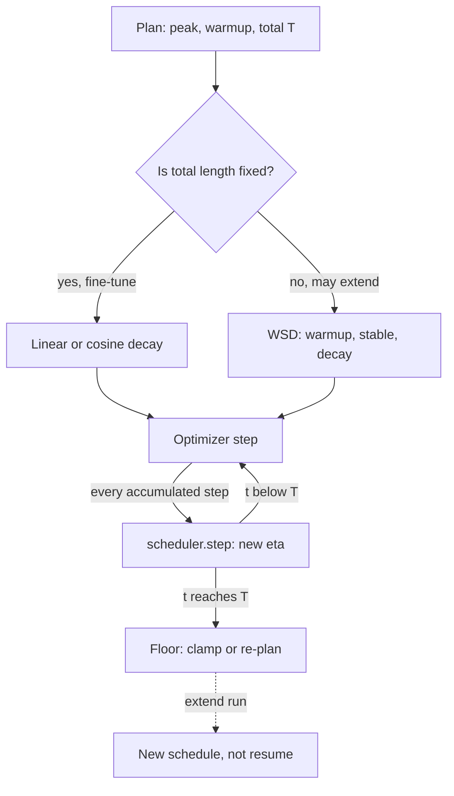

## TL;DR
A scheduler changes the learning rate over the run: big steps while the loss surface is forgiving, small
ones when it is not. It is defined over total optimizer steps, so plan it with batch size and run length.

## Why it exists
- **A fixed learning rate is a compromise.** Large enough to make progress early, it is too noisy to
  settle into a good minimum late.
- **Constant-η SGD converges to a region, not a point.** Each mini-batch gradient is the true gradient
  plus noise, and `θ ← θ − η·g` carries that noise into the weights. In a quadratic bowl the iterates
  bounce around the minimum with a spread proportional to `η × noise variance`; halve η and the spread
  shrinks, so η must eventually be small.
- **A small η from the start is wasteful.** Early gradients are large and consistently pointed, so small
  steps need many more iterations to cover the same distance, and a very small rate can leave the model
  stuck in a poor flat region a bigger step would carry it past.
- **Adam does not remove the tension.** It normalizes step sizes per parameter, but the global scale is
  still η and the same noise-floor argument applies. "Pick a medium η and train longer" pays twice: no
  fast early progress and no low final loss.
- **The start needs a smaller rate too.** Adam's running variance estimates are built from a handful of
  samples at first and are unreliable, so the first few hundred steps need a *smaller* rate. That ramp is
  warmup (its own lesson); this lesson is about what happens after it.

## How it works
A scheduler is a function `η(t)` of the optimizer step `t`, given a peak `η_max`, a warmup length and a
total length `T`. Frameworks apply it as a multiplier on the optimizer's base rate once per optimizer step.

### The common shapes
| Shape | Formula or rule | Needs `T`? | Typical use |
|---|---|---|---|
| Step decay | multiply η by a factor (often 0.1) at fixed milestones | milestones | older image classification |
| Linear decay | `η(t) = η_max × (1 − t/T)` after warmup, zero at exactly `T` | yes | fine-tuning; default in Hugging Face `Trainer` |
| Cosine decay | `η(t) = η_min + 0.5 × (η_max − η_min) × (1 + cos(π·t/T))` | yes | standard for LLM pre-training |
| Inverse square root | `η(t) ∝ min(t^−0.5, t·warmup^−1.5)` | no | original Transformer |
| Warmup–stable–decay (WSD) | hold `η_max`, decay over the final 10–20% of steps | no, until the decay | newer pre-training recipes |
| Warm restarts / one-cycle | restart the cosine (SGDR); `OneCycleLR` for one cycle | per cycle | smaller vision and tabular models |
| Reduce on plateau | `ReduceLROnPlateau` cuts η when a validation metric stalls | no | classic supervised training |

### Step decay
- **Why it works:** each plateau lets the model settle at one noise level before the next drop. It is the
  oldest recipe, from image classification.
- **Weakness:** milestones are hand-chosen hyperparameters, and the abrupt drops produce visible cliffs in
  the loss curve that make runs hard to compare.

### Linear decay
- **Why fine-tuning uses it:** runs are short, the total number of steps is known, and reaching a very
  small η at the end is what makes the final weights stable.

### Cosine decay
- **Shape:** spends longer near `η_max` than linear, drops fastest in the middle, flattens again near
  `η_min`. The smooth tail is why it became the LLM pre-training standard.
- **Floor:** many published recipes decay to about 10% of the peak rather than to zero, so the last phase
  still learns.
- **Catch:** `T` must be fixed in advance, because the shape is anchored to the end point. Training past
  `T` or stopping early both give a different, usually worse, result than planning the right `T`.

### Inverse square root
- **Shape:** linear warmup followed by `1/√t` decay. It needs no total length, which is convenient.
- **Cost:** it decays slowly and never gets small enough for the final-loss benefit of an explicit anneal.

### Warmup–stable–decay (WSD)
- **Mechanism:** hold `η_max` for most of the run, then decay sharply (linearly or cosine-like) over the
  final 10–20% of steps.
- **Why it helps:** the stable phase has no end point baked in, so you can keep training, or branch a
  stable-phase checkpoint and run a short decay to get a "finished" model at any point.
- **Evidence:** MiniCPM and related scaling studies showed it matches cosine at the same total steps while
  removing the need to commit to `T` up front.

### Cyclical and warm restarts
- **SGDR** restarts the cosine cycle periodically, jumping η back up. The intuition: a jump kicks the model
  out of a sharp basin into a wider one. The practical benefit: cheap snapshot ensembles, one per cycle.
- **Where:** rare in LLM work, common in smaller vision and tabular models.
- **One-cycle (`OneCycleLR`)** is a single cycle for short runs: ramp to a high peak over the first part,
  then anneal well below the starting value, so a fixed small budget gets both phases.

### Metric-driven: reduce on plateau
- **Mechanism:** `ReduceLROnPlateau` cuts η by a factor when a monitored validation metric stops improving
  for a set number of evaluations. It needs no horizon.
- **Problem:** the schedule now depends on eval cadence and metric noise. A noisy eval triggers early
  drops, and two identical configs can follow different schedules, which makes them hard to compare.
- **Where it survives:** classic supervised training with cheap, stable validation. LLM recipes prefer a
  schedule written as a function of the step, so it is reproducible and known in advance.

### What happens past `T`
Implementations disagree, and it matters whenever a run is extended:
- **Clamped:** a hand-written schedule usually uses `progress = min(1, ...)`, so η stays at the floor
  forever. Hugging Face's linear schedule clamps at zero.
- **Unclamped:** a cosine written as `cos(π·t/T)` keeps going. Past `T` it climbs back, so η rises
  towards the peak and reaches it at `2T`. PyTorch's `CosineAnnealingLR` and the Hugging Face
  cosine-with-warmup lambda both do this if stepped past their configured length.
- **Result:** an extended run either learns almost nothing (clamped) or silently re-warms to a high rate
  with no warmup (unclamped). Neither is the plan, and the learning-rate log is the only place it shows.

### What the scheduler steps on
- **Per optimizer step**, not per micro-batch and not per epoch.
- **With gradient accumulation of 8**, one scheduler step happens every 8 forward/backward passes.
- **If `T` is computed from the number of micro-batches**, the schedule finishes 8× too early and the
  model trains most of the run at η ≈ 0.

## Diagram
Read it top to bottom: the shape is chosen from whether the run length is known, and every optimizer step
(not micro-batch) advances the schedule.



## Examples
### Warmup plus cosine to a 10% floor, checked by eye
Linear warmup then cosine decay to 10% of peak, written as a plain `LambdaLR` so the arithmetic is
visible. The printout checks known points: step 0 is near zero, the end of warmup is the peak, and halfway
through the decay the multiplier is exactly the midpoint between 1.0 and 0.1.

```python
import math, torch

peak_lr, warmup, total, floor = 3e-4, 100, 1000, 0.1

def multiplier(step):
    if step < warmup:
        return step / warmup                       # linear ramp 0 -> 1
    progress = min(1.0, (step - warmup) / max(1, total - warmup))  # clamp: stay at floor past T
    cosine = 0.5 * (1 + math.cos(math.pi * progress))   # 1 -> 0
    return floor + (1 - floor) * cosine            # 1 -> floor

params = [torch.nn.Parameter(torch.zeros(10))]
opt = torch.optim.AdamW(params, lr=peak_lr)
sched = torch.optim.lr_scheduler.LambdaLR(opt, multiplier)

for step in range(total):
    # loss.backward(); opt.step()  -- one optimizer step per scheduler step
    opt.step(); sched.step()
    if step in (0, 99, 549, 999):
        print(step, f"{opt.param_groups[0]['lr']:.2e}")
# 0    -> 3.00e-06   (1/100 of the way up the ramp)
# 99   -> 3.00e-04   (end of warmup: peak)
# 549  -> 1.65e-04   (midpoint of decay: 0.1 + 0.9*0.5 = 0.55 of peak)
# 999  -> 3.00e-05   (floor: 10% of peak)
```

The same shape is available as `transformers.get_cosine_schedule_with_warmup`, and the WSD variant as
`get_wsd_schedule`; the hand-written version is here so the numbers can be checked by eye.

### Worked comparison: where each shape spends its steps
Peak 3e-4, floor 10%, measured as progress through the decay phase. WSD here holds the peak for the first
80% and decays over the last 20%.

| Decay progress | Cosine | Linear to floor | WSD |
|---|---|---|---|
| 0 | 3.00e-4 | 3.00e-4 | 3.00e-4 |
| 0.25 | 2.60e-4 | 2.32e-4 | 3.00e-4 |
| 0.5 | 1.65e-4 | 1.65e-4 | 3.00e-4 |
| 0.75 | 6.95e-5 | 9.75e-5 | 3.00e-4 |
| 1.0 | 3.00e-5 | 3.00e-5 | 3.00e-5 |

- **Cosine** stays higher than linear early and lower late, which is the "longer near the peak, smooth
  tail" shape described above.
- **An unclamped cosine stepped past `T`** has its raw factor `0.5 × (1 + cos(π·t/T))` back at 0.5 by
  1.5T and at 1.0 by 2T: the rate re-warms with no warmup.

## Production patterns
- **Print the plan before launch.** Before any long run, evaluate the schedule at step 0, end of warmup,
  midpoint and `T`, and assert they match the plan. Then log the rate each step (PyTorch
  `scheduler.get_last_lr()`) next to the loss so a bad curve can be attributed.
- **Derive the horizon from optimizer steps.** Compute `num_training_steps` as micro-batches ÷
  accumulation steps × epochs, and set warmup from it (for example the Trainer's `warmup_ratio`). Monitor
  the logged rate at the final step; it should sit at the planned floor.
- **Checkpoint scheduler state with the model.** Save `scheduler.state_dict()` alongside optimizer and
  weights, and load it on resume, so warmup does not restart. Watch for a loss jump at the resume step.
- **WSD for extendable pre-training.** When the token budget may change, hold the peak and keep
  stable-phase checkpoints; branch one and run a short decay (for example with `get_wsd_schedule`) to
  produce a releasable model. Track eval loss of each decayed branch against its stable parent.
- **Tune the peak before the shape.** Run a short sweep over the peak by a factor of 2–3 with a fixed
  shape, pick the best, and only then compare linear vs cosine. Monitor early-step loss spikes as the
  sign the peak is too high.

## Trade-offs
- **Lowest final loss vs fixed horizon.** Cosine and linear decay give the lowest final loss for a fixed
  budget but require knowing the total step count in advance; when length is uncertain, WSD or a
  constant-then-cooldown schedule is the better trade.
- **Higher floor vs clean anneal.** Decaying to 10% rather than 0 keeps the model learning to the end and
  makes continued pre-training easier, at the cost of a slightly noisier final checkpoint.
- **Restarts vs short budgets.** Warm restarts and cyclical schedules buy ensemble diversity and sometimes
  escape sharp minima, but each restart costs a temporary loss increase a short fine-tuning run cannot
  afford.
- **No horizon vs slow tail.** Inverse-square-root is robust to running longer, but its slow tail leaves
  loss on the table compared with an explicit decay phase of the same length.

## Pitfalls
- **Stepping at the wrong cadence.** Calling `scheduler.step()` once per epoch with a per-step schedule
  (or vice versa). Symptom: a rate stuck at the warmup value, or collapsing to near zero within the first
  epoch. Fix: step once per optimizer step.
- **Sizing the schedule in micro-batches.** Computing `num_training_steps` from micro-batches with
  gradient accumulation on, so the schedule finishes early and the second half trains near zero.
- **Resuming without scheduler state.** Warmup restarts or the decay resets; the loss curve shows a jump
  at the resume point that was not there before. Fix: restore the scheduler with the optimizer.
- **Extending a cosine run without re-planning.** Clamped, the extra steps run at the floor and barely
  move the model ("more data did not help"); unclamped, the rate climbs back towards the peak and the
  loss rises. Either way the logged learning rate shows it.
- **Reading the decay-phase drop as insight.** The sharp loss drop during decay is the noise floor
  shrinking as η falls, not the model suddenly "getting it"; it appears in every well-scheduled run.

## When to use
Every real training run has a schedule; the decision is which one, and it is smaller than the peak value.
- **Tune the peak first:** among reasonable decaying shapes, a well-tuned peak matters more than linear vs
  cosine, so sweep the peak over a factor of 2–3 and choose the shape second.
- **Fine-tuning:** linear or cosine decay with a short warmup, ending at a small rate, because total steps
  are known and stability of the final weights matters more than the last fraction of loss.
- **Pre-training or long continued pre-training:** prefer WSD or constant with a planned cooldown when the
  budget may change, so checkpoints stay useful at any point.
- **Measure:** print the rate at steps 0, end of warmup, midpoint and end before launching; log it with
  loss so a bad curve can be attributed.
- **Interviews:** explain *why* decay lowers final loss (noise floor), why the schedule is tied to
  optimizer steps, and when cosine's fixed horizon is a liability.

## Role lens
- **Engineer:** Sets `lr_scheduler_type`, `warmup_ratio` and `num_training_steps` in the training config, and
  verifies the schedule by logging the learning rate rather than trusting defaults.
- **Architect:** Decides the training-budget policy: whether runs have fixed horizons (cosine) or must be
  extendable and checkpoint-branchable (WSD), which shapes the data pipeline and evaluation cadence.
- **FDE:** Diagnoses a customer's "fine-tuning plateaued" complaint by inspecting the schedule first, since a
  mis-set step count or a missing decay explains most such reports before touching the data.

## Check yourself
**Q:** A team fine-tunes with cosine decay over 3,000 steps, then decides the model is undertrained and
runs 3,000 more steps by resuming the checkpoint with the same config. The extra steps barely change the
loss. What happened, and what should they have done?
**A:** The resumed run restored the scheduler at step 3,000 with the same 3,000-step horizon. Their
schedule clamps at the floor (the observation of "barely changes" says so), so all 3,000 extra steps ran
at the minimum learning rate and the weights hardly moved; with an unclamped cosine the same mistake would
instead have re-warmed the rate towards the peak with no warmup, which shows up as a loss rise. Either way
the experiment says nothing about whether more training helps. Options: restart from the original checkpoint with `T = 6,000`
so the schedule is planned for the full length; or, if resuming is required, create a new schedule that
re-warms briefly to a moderate peak and decays over the extra steps. Going forward, a WSD-style schedule
would let them extend the stable phase and apply the decay only once the final length is known. The
general lesson is that the schedule is a function of planned total steps, so changing the plan means
changing the schedule.

## Interview questions
### Why does decaying the learning rate lower the final loss at all?
- **Noise floor:** constant-rate SGD bounces in a region whose spread scales with `η × noise variance`,
  so it cannot reach the bottom of the basin.
- **Decay shrinks the region:** as η falls the iterates settle closer to the minimum, which is why the loss
  drops sharply during the decay phase of every well-scheduled run.
- **Adam too:** per-parameter normalization does not change the global scale η, so the argument holds.

### A loss curve shows a sudden jump exactly where a job resumed. How do you debug it?
- **Suspect scheduler state first:** if the scheduler was rebuilt instead of restored, warmup restarts or
  the decay resets, so the rate at the resume step differs from the rate before it.
- **Confirm from the log:** compare the logged learning rate on both sides of the resume step.
- **Fix:** save and load `scheduler.state_dict()` with optimizer and model state, and add a resume test.

### When would you not use cosine decay for a pre-training run?
- **When the horizon is uncertain:** cosine is anchored to `T`, so extending or stopping early gives a
  worse result than planning the right length.
- **Use WSD instead:** hold the peak, keep stable-phase checkpoints, and decay over the final 10–20% only
  once the length is known; MiniCPM-style studies found it matches cosine at equal steps.
- **Cost:** the decay must be run for each model you want to release.

### You have 24,000 micro-batches per epoch, accumulation of 8 and one epoch. How do you set the schedule?
- **Optimizer steps:** 24,000 ÷ 8 = 3,000, so `num_training_steps` is 3,000, not 24,000.
- **Warmup:** a `warmup_ratio` of 0.03 gives 90 warmup steps.
- **Verify:** print the rate at steps 0, 90, 1,545 and 3,000 and check the final value equals the planned
  floor before launching.

### Why do LLM recipes avoid ReduceLROnPlateau?
- **Not reproducible:** the drops depend on eval cadence and validation noise, so identical configs can
  follow different schedules and become hard to compare.
- **Unknown in advance:** a step-based schedule is known before launch, which matters for budgeting long
  runs and for branching checkpoints.
- **Where it still fits:** classic supervised training with cheap, stable validation.

## Quiz
### Q: Why does decaying the learning rate late in training usually lower the final loss?
- [ ] It reduces the model's capacity, which acts as regularization
- [x] Mini-batch gradient noise makes the weights bounce in a region whose size scales with the learning rate, so a smaller rate lets them settle closer to the minimum
- [ ] It forces the optimizer to revisit earlier examples more often
- [ ] It compensates for Adam's second-moment estimate becoming too large
> SGD with a constant rate converges to a noise-limited region, not a point; shrinking η shrinks that region.
> Capacity is unchanged, and Adam's second moment is a separate per-parameter scaling.

### Q: A run uses gradient accumulation of 4 and the schedule's total steps were set to the number of micro-batches. What goes wrong?
- [ ] The learning rate peaks at 4× the intended value
- [ ] Warmup takes 4× longer than intended
- [x] The schedule completes after a quarter of the run, so most training happens at the floor learning rate
- [ ] Nothing, because schedulers count micro-batches internally
> Schedulers advance once per optimizer step, and with accumulation of 4 there are a quarter as many
> optimizer steps as micro-batches, so a schedule sized in micro-batches reaches its end four times too early.

### Q: Which schedule lets you branch a usable "finished" model from a checkpoint partway through a long pre-training run?
- [ ] Cosine decay to zero
- [ ] Step decay with fixed milestones
- [x] Warmup–stable–decay, by running a short decay from a stable-phase checkpoint
- [ ] Inverse square root, because it has no horizon
> WSD keeps the learning rate constant for most of the run, so any stable-phase checkpoint can be annealed
> with a short decay to get the final-loss benefit. Cosine's shape is anchored to a fixed end point, and
> inverse-square-root never anneals sharply.
