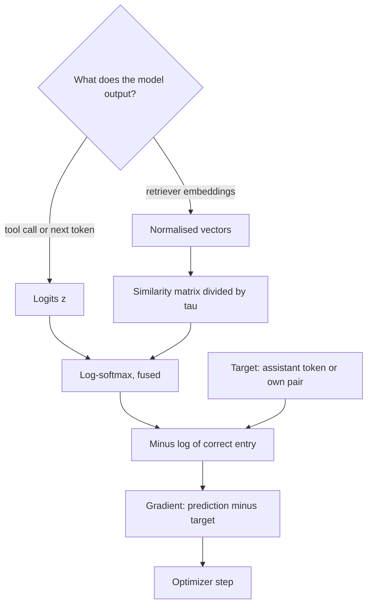

## TL;DR
When you fine-tune an agent's LLM or retriever, the loss is the model's only signal.
Cross-entropy, −log p(correct token), trains tool calls and answers; contrastive InfoNCE, cross-entropy
over similarity scores, trains the embeddings your RAG step searches with.

## For agent builders
- **Why it matters for agents.** Fine-tuning on agent trajectories, tuning a retriever on your corpus and
  training a reward model or DPO on preference pairs are all loss choices. Get the mask or the negatives
  wrong and the loss falls while the agent does not get better.
- **Where it shows up in your stack.** SFT trainers that mask prompt and tool-result tokens, the `-100`
  label convention in PyTorch, embedding fine-tuning with in-batch and mined negatives, the pairwise loss
  behind reward models and DPO, and perplexity in eval reports.
- **What you control.** Which tokens are supervised (assistant turns and tool calls only), per-token versus
  per-sequence averaging, label smoothing, batch size and temperature for contrastive training, and how
  negatives are mined.
- **What you can skip.** Deriving losses from scratch. Know that cross-entropy's gradient is prediction
  minus target, that InfoNCE is cross-entropy with a free label, and how to read a loss curve against a task
  metric.

## Why it exists
- **The real objective is not differentiable.** Accuracy, recall@10, user satisfaction and "did the agent
  complete the task" are piecewise constant in the parameters: nudge a weight and the metric does not
  move, so its gradient is zero almost everywhere. Gradient descent needs a scalar to minimise.
- **A surrogate must meet three requirements:** (1) be differentiable, (2) share its minimiser with the
  true objective, or come close, and (3) give useful gradient magnitudes everywhere, not just near the
  solution.
- **Embeddings need relations, not labels.** You know a query and the document that answered it belong
  together and most others do not. A loss on single outputs cannot express that; one on relative distances
  can. That is what contrastive losses are for, and needing no human labels is why most embedding models
  use them.
- **Agent fine-tuning inherits both.** The policy model learns tool calls through token cross-entropy; the
  retriever learns "relevant" through a contrastive loss; neither ever sees "task completed" directly, so
  the eval suite has to check that the surrogate moved the real metric.

## How it works
### Background: why cross-entropy, not squared error
- **Squared error fails requirement 3 for classes.** With p = σ(z), its logit gradient is
  (p − y)·p·(1 − p). When confidently wrong, p is near 0 for the true class, p(1 − p) is near 0, and the
  gradient vanishes exactly when the correction should be largest.
- **Cross-entropy removes that factor,** which is why it replaced squared error for classification.
- **In numbers,** for a true label y = 1 (squared error as ½(p − y)²): at p = 0.5 the logit gradient is
  −0.125 under squared error and −0.5 under cross-entropy; at p = 0.01, confidently wrong, about −0.0098
  versus −0.99. The more wrong the model, the more the two diverge.

### Cross-entropy from maximum likelihood
1. **Likelihood.** The model outputs a distribution q over K classes; the data gives the true class y. The
   likelihood of a dataset is Π q(y_i).
2. **Take the log and negate.** Maximising it is minimising −Σ log q(y_i), and −log q(y) is the
   cross-entropy H(p, q) = −Σ_k p_k log q_k with p the one-hot target.
3. **It is a KL divergence in disguise.** H(p, q) = H(p) + KL(p ‖ q), and H(p) does not depend on the
   model, so minimising cross-entropy is minimising KL(p_data ‖ q). It is not an arbitrary choice; it is
   the loss that makes "probability" mean something.

### The gradient is prediction minus target
```
q = softmax(z),  log q_y = z_y − log Σ_j exp(z_j)
∂L/∂z_k = q_k − 1[k = y]                 (softmax + cross-entropy)
∂L/∂z   = σ(z) − y                       (sigmoid + binary cross-entropy)
```

- **Bounded by 1, proportional to how wrong the model is,** never vanishing while it is wrong, and near
  zero once it is confidently right.
- **Why frameworks fuse softmax and cross-entropy** into one numerically careful operation: compute
  log-softmax with the max-subtraction trick, never log(softmax(z)) as two steps, or tiny probabilities
  underflow to log(0).

### Variants and LLM specifics
- **Label smoothing** replaces the one-hot target with (1 − ε)·onehot + ε/K. It stops logits growing
  without bound and often improves calibration, at the cost of never predicting with full confidence.
- **Class weights** scale each example's loss to counter imbalance, for example a rare "escalate" route.
- **LLM training loss** is cross-entropy averaged over token positions. **Perplexity** is exp of that
  average: a loss of 2.0 nats means perplexity ≈ 7.4, as uncertain as choosing uniformly among about
  seven tokens.
- **SFT loss masking:** in supervised fine-tuning the loss is usually masked so only assistant tokens
  count, because learning to predict the prompt teaches nothing you want.
- **Agent trajectories make masking critical.** System prompts, tool schemas and tool results are often
  over 90% of a trajectory's tokens. They are inputs, not behaviour, so they are masked and only the
  assistant's reasoning, tool calls and final answer are supervised.

### Regression losses in brief
- **Squared error** is cross-entropy's cousin: maximum likelihood under Gaussian noise; its minimiser is
  the conditional mean.
- **Absolute error** gives the median and resists outliers; **Huber** blends the two. The regression
  lesson covers when each applies.

### Contrastive losses
Setting: an encoder f maps items to vectors; you have pairs that should match (anchor, positive) plus
items that should not (negatives). The goal is a geometry where sim(anchor, positive) exceeds
sim(anchor, negative) for every negative. For RAG the anchor is a user question and the positive is the
chunk that answered it.

| Loss | Formula | Behaviour |
|---|---|---|
| **Pairwise contrastive** (the original form) | y·d² + (1 − y)·max(0, m − d)² for a pair at distance d | pulls matches together; pushes non-matches apart only until a margin m, because pushing already-distant negatives further is wasted effort |
| **Triplet** | max(0, d(a, p) − d(a, n) + m) | needs hard-negative mining, since random triplets are mostly already satisfied and contribute zero gradient |
| **InfoNCE / NT-Xent** (the modern default) | L = −log [ exp(s(a, p)/τ) / Σ_j exp(s(a, x_j)/τ) ] | softmax over similarities, then −log of the positive's share |

**Read InfoNCE carefully.** It is cross-entropy for the classification task "which of these candidates is
the match", with the label known because you built the pair. Contrastive learning is classification with
a free label, which is why it counts as self-supervised.

### Design choices that follow
- **In-batch negatives.** A batch of N pairs gives an N×N similarity matrix: the diagonal holds the
  positives and the off-diagonal entries are N(N − 1) negatives for free. Larger batches make the matching
  task harder and the gradient more informative, which is why SimCLR and CLIP use very large batches.
- **CLIP makes the loss symmetric,** averaging image-to-text and text-to-image cross-entropy over the same
  matrix.
- **Temperature τ** divides the similarities before the softmax. A small τ sharpens the distribution so
  gradient concentrates on the hardest negatives; too small makes training unstable and oversensitive to
  mislabelled negatives (CLIP learns τ, starting from 0.07).
- **Hard negatives.** In-batch negatives are mostly easy, so retrieval embeddings improve with mined
  negatives, such as documents BM25 ranks highly that are not the answer. The risk is false negatives,
  unlabelled true matches treated as impostors, which put a floor under the loss.
- **Cosine on normalised vectors** is the usual similarity, because unbounded dot products admit the
  trivial solution of making every vector longer.

### Matching the loss to the output
| Output | Loss | Agent component |
|---|---|---|
| Distribution over discrete options | cross-entropy | policy LLM, tool router, guardrail classifier |
| A quantity | squared, absolute or Huber | cost or latency predictor |
| Relations between items | contrastive or ranking losses | retriever, reranker, memory search |
| Preferences between two responses | pairwise logistic loss on the difference of scores: the Bradley–Terry form underlying reward models and DPO | preference tuning on good versus bad runs |

Multiple losses are summed with weights that are hyperparameters in their own right.

## Diagram
Both main losses end in the same place: a softmax over scores, then −log of the correct entry. The policy
LLM takes the logits path; the retriever takes the embeddings path.



## Examples
### Masking an agent trajectory for SFT
Only assistant tokens (reasoning, tool calls, final answer) are supervised; system prompt, user turn and
tool results get the label `-100`, PyTorch's default `ignore_index`.

```python
import torch, torch.nn.functional as F

IGNORE = -100                                   # default ignore_index of F.cross_entropy

def build_labels(segments):
    ids, labels = [], []
    for role, toks in segments:
        ids += toks
        labels += toks if role == "assistant" else [IGNORE] * len(toks)
    return torch.tensor(ids), torch.tensor(labels)

tok = lambda n: torch.randint(0, 32000, (n,)).tolist()   # stand-in for a tokenizer
segments = [("system", tok(1500)),              # system prompt plus tool schemas
            ("user", tok(100)),
            ("assistant", tok(60)),             # tool call 1
            ("tool", tok(2500)),                # search results
            ("assistant", tok(60)),             # tool call 2
            ("tool", tok(1700)),
            ("assistant", tok(80))]             # final answer
ids, labels = build_labels(segments)
print(len(ids), (labels != IGNORE).sum().item())   # 6000 tokens, 200 supervised

logits = torch.randn(len(ids), 32000)           # stand-in for model output
loss = F.cross_entropy(logits[:-1], labels[1:])  # position t predicts token t+1; -100 is skipped
```

### Worked scenario: the unmasked agent fine-tune
A team fine-tunes on 2,000 trajectories shaped like the one above. Numbers are illustrative.

| Setting | Supervised tokens per trajectory | What the loss mostly measures | Outcome |
|---|---|---|---|
| No mask | 6,000 | predicting tool results and the system prompt | loss drops fast, tool-call accuracy flat |
| Assistant-only mask | 200 (3.3%) | the agent's own tool calls and answers | loss falls slower, tool-call accuracy improves |

- **The unmasked loss is dominated by inputs:** 5,800 of 6,000 tokens are text the agent should read, not
  write, and the repeated system prompt is trivially easy to predict.
- **Log supervised tokens per batch** next to the loss; a sudden jump to the full sequence length means the
  mask broke.

### Cross-entropy gradient and InfoNCE in one script
Two things in one script: cross-entropy's gradient really is prediction minus target, and InfoNCE really
is cross-entropy over a similarity matrix, as used to tune a RAG retriever.

```python
import torch, torch.nn.functional as F

# 1) Cross-entropy on logits and its gradient (softmax(z) - onehot(y))
z = torch.tensor([[2.0, 0.5, -1.0]], requires_grad=True)   # one example, three classes
y = torch.tensor([0])
loss = F.cross_entropy(z, y)                               # takes logits; applies log-softmax inside
loss.backward()
print(round(loss.item(), 4))                               # 0.2413  (softmax = [0.786, 0.175, 0.039])
print(z.grad)                                              # [[-0.2144, 0.1753, 0.0391]]
print(z.softmax(-1).detach() - F.one_hot(y, 3))            # identical: the gradient is the error

# 2) InfoNCE, CLIP-style symmetric version, over a batch of (anchor, positive) embeddings
def info_nce(a, b, tau=0.07):
    a, b = F.normalize(a, dim=-1), F.normalize(b, dim=-1)  # cosine similarity
    sim = a @ b.T / tau                                    # [N, N]; sim[i, i] is the true pair
    target = torch.arange(a.size(0))                       # "row i's correct class is column i"
    return (F.cross_entropy(sim, target) + F.cross_entropy(sim.T, target)) / 2

N, d = 256, 64
q = torch.randn(N, d); pos = q + 0.3 * torch.randn(N, d)   # positives: noisy copies of the anchors
print(round(info_nce(q, pos).item(), 3))                   # near 0: each anchor finds its own positive
print(round(info_nce(q, torch.randn(N, d)).item(), 3))     # ~7 here, above log(256) ≈ 5.5: no better than chance
```

### Worked numbers: why squared error stalls when confidently wrong
Logit gradient for a true label y = 1 as the predicted probability falls (pure Python below reproduces it).

| Predicted p | Squared error gradient | Cross-entropy gradient | Ratio |
|---|---|---|---|
| 0.9 | −0.009 | −0.1 | about 11× |
| 0.5 | −0.125 | −0.5 | 4× |
| 0.1 | −0.081 | −0.9 | about 11× |
| 0.01 | −0.0098 | −0.99 | about 100× |

```python
def logit_grads(p, y=1):
    se = (p - y) * p * (1 - p)        # squared error 0.5*(p - y)^2 through a sigmoid
    ce = p - y                        # cross-entropy through a sigmoid
    return round(se, 4), round(ce, 4)

for p in (0.9, 0.5, 0.1, 0.01):
    print(p, logit_grads(p))          # (-0.009, -0.1) ... (-0.0098, -0.99)
```

- **Squared error peaks early:** its gradient magnitude, (1 − p)²·p, peaks at p = 1/3 (about 0.148) and
  shrinks again as the model gets more wrong, so a confidently wrong example barely moves the weights.
- **Cross-entropy keeps pushing:** its gradient, 1 − p in magnitude, grows monotonically with the error.

## Production patterns
- **Mask everything the agent did not write.** Set label ids for system, user, tool-result and padding
  positions to `-100`, the default `ignore_index` of PyTorch cross-entropy, so only assistant turns and
  tool calls count. Monitor the count of supervised tokens per batch and log it with the loss.
- **Pass logits, never probabilities, to the loss.** Use the fused op (PyTorch `F.cross_entropy` or
  `nn.BCEWithLogitsLoss`) and keep softmax out of the model's forward pass during training. Monitor for a
  loss that floors well above zero, the signature of a double softmax.
- **Track loss and agent metric together.** Log held-out cross-entropy (or perplexity) and the task metric
  (tool-call accuracy, task success on the eval suite) on the same schedule; when the loss keeps falling and
  the metric stalls, stop and inspect outputs.
- **Contrastive retriever tuning with mined hard negatives.** Build (query, positive) pairs from agent
  search logs or questions whose retrieved chunk led to an accepted answer, add BM25-ranked non-answers as
  negatives, and deduplicate so no true match lands in the negative set. Monitor recall@k on a held-out
  retrieval set rather than the loss value.
- **Scale in-batch negatives within memory.** Use the largest batch that fits for InfoNCE; when it cannot
  grow, add mined negatives instead. Monitor recall@k as batch size changes.
- **Label smoothing for calibrated routers.** Enable it via the `label_smoothing` argument of PyTorch
  `F.cross_entropy` (for example 0.1) for routers and guardrail classifiers whose probabilities feed
  thresholds. Monitor expected calibration error; skip it for distillation teachers that need sharp
  distributions.

## Trade-offs
- **Cross-entropy: strong gradients vs overconfidence.** Non-vanishing gradient while wrong and proper
  likelihood semantics, but it rewards ever-larger logits and drives models toward overconfidence. Label
  smoothing trades peak confidence for calibration, worth it unless you need sharp distributions, for
  example as distillation targets.
- **In-batch negatives: free vs memory-bound.** InfoNCE with in-batch negatives supplies negatives for free
  and scales well, but embedding quality is coupled to batch size and therefore GPU memory. When the batch
  cannot be large, mined hard negatives recover most of the benefit at the cost of a mining pipeline.
- **Small temperature: sharp retrieval vs fragility.** It focuses learning on the hardest negatives but
  amplifies the damage from false negatives and can destabilise early training; a learned temperature is
  the usual compromise.
- **Surrogate vs real metric.** Any surrogate can decouple: the loss keeps falling while recall@10 or task
  success stalls, so track both, and let the metric decide.
- **Imitation vs preference.** Cross-entropy on good trajectories copies them, including their quirks; a
  pairwise preference loss can push away from bad runs too, but needs paired data and a careful eval.

## Pitfalls
- **Softmax before a loss that applies log-softmax internally.** Probabilities get softmaxed twice; the
  loss floors well above zero and the model plateaus early.
- **log(softmax(z)) as two separate operations.** Symptom: NaN losses after a few steps when some
  probability underflows to zero.
- **Forgetting the loss mask in supervised fine-tuning.** Prompt, tool-result and padding tokens count;
  the loss drops fast while outputs do not improve, because predicting the prompt is easy and useless.
- **Per-token versus per-sequence averaging left to accident.** Symptom: long trajectories dominating the
  gradient, or short ones, depending on the accident. Decide which you want.
- **Duplicates inside a contrastive batch treated as negatives.** Symptom: a loss that cannot fall below a
  floor and embeddings that stop improving; fix by deduplicating before batching.
- **Comparing cross-entropy across tokenisers or vocabularies.** Symptom: "our loss is lower" claims that
  mean nothing, because the loss depends on the vocabulary.

## When to use
Choosing a loss is choosing what the model estimates.
- **Cross-entropy** whenever the output is a distribution over discrete options: classification,
  next-token prediction, tool selection, routing.
- **Contrastive** when you want geometry: retrieval embeddings for RAG and memory, deduplication, the space
  a clustering will run in, cross-modal alignment. **Regression losses** for quantities.
- **Measure** the loss curve and the task metric together; for contrastive training, evaluate recall@k on
  a held-out retrieval set, because the loss value alone says little. Debugging a fine-tune that is not
  learning starts at the loss: masks, double softmax, scale.
- **Interviews:** derive the cross-entropy gradient, explain why InfoNCE is cross-entropy, say why batch
  size matters for contrastive learning, and relate perplexity to loss.

## Role lens
- **Engineer:** Owns the training loop details: logits rather than probabilities into cross-entropy,
  masks that cover prompt and padding, deduplicated contrastive batches and a sane temperature.
- **Architect:** Decides what objective each learned component optimises, a contrastively trained
  retrieval embedding versus a classifier versus a scalar reward, because the objective fixes what
  "similar" or "confident" will mean across the platform.
- **FDE:** When fine-tuning an embedding model on a customer's data, assembles (query, relevant document)
  pairs and hard negatives from their search logs, and explains why forty positive pairs are not enough.

## Check yourself
**Q:** A supervised fine-tuning run's cross-entropy falls from 2.1 to 0.3 within one epoch, but held-out
task accuracy does not move. List the causes you would check, in order, and the evidence for each.
**A:** First, the loss is computed on the wrong tokens: if prompt or padding tokens are included, the
model learns to predict easy text and the loss collapses; check the label mask and the ignore index.
Second, the number is a training loss; look at held-out cross-entropy, which will be flat if the model
is memorising a small dataset. Third, label alignment: an off-by-one in the next-token shift or a
double softmax produces a loss that falls quickly and means nothing. Fourth, the model learned the
format but not the content, which shows as outputs with the right template and wrong answers. Fifth,
evaluation decoding differs from training: sampling settings, stop tokens or a system prompt that was
absent from the training data. Only after these would I suspect the data itself.

## Interview questions
### Why is cross-entropy the standard loss for classification and language modelling?
- **Maximum likelihood:** minimising −log q(y) maximises the data's likelihood and equals minimising
  KL(p_data ‖ q) up to a constant.
- **Good gradients:** through softmax the logit gradient is q − onehot(y), large while wrong and near zero
  once right.
- **Squared error on probabilities** carries a p(1 − p) factor that vanishes when the model is confidently
  wrong.

### You are fine-tuning a model on agent trajectories. Which tokens should carry loss, and why?
- **Supervise what the agent writes:** reasoning, tool-call arguments and the final answer.
- **Mask what it reads:** system prompt, tool schemas, user turns and tool results get `-100`, because
  predicting them teaches the model to imitate the environment, not to act.
- **Verify** by logging supervised tokens per batch and checking tool-call accuracy on held-out tasks, not
  just the loss.

### Explain InfoNCE to someone who knows only classification.
- **It is classification:** for each anchor, the candidates are the classes, the scores are similarities
  divided by τ, and the correct class is the constructed positive.
- **In-batch:** a batch of N pairs gives N(N − 1) negatives from the similarity matrix's off-diagonal.
- **Free label:** because you built the pair, no annotation is needed, which makes it self-supervised.

### Your agent's retriever fine-tune hits a loss floor and recall stalls. What do you check?
- **False negatives:** duplicates or near-duplicates in a batch, or mined "negatives" that are actually
  relevant chunks, cap how low the loss can go.
- **Temperature:** too small amplifies those errors; try a learned τ.
- **Fix** by deduplicating before batching and filtering mined negatives, then re-measure recall@k and the
  agent's answer accuracy on questions that depend on retrieval.

### When would you not use label smoothing?
- **Use it** for classifiers whose probabilities feed thresholds, because it curbs overconfidence and often
  improves calibration.
- **Avoid it** when you need sharp distributions, such as a teacher whose outputs serve as distillation
  targets.
- **Measure** calibration error and accuracy with and without it on the same held-out set.

### Model A scores 2.0 nats per token and model B 1.8, with different tokenisers. Which is better?
- **Per-token numbers do not compare:** perplexities are exp(2.0) ≈ 7.4 and exp(1.8) ≈ 6.0, but a token
  covers a different amount of text in each vocabulary, so B's lower loss may only mean shorter tokens.
- **Normalise by text, not tokens:** total nats = loss × token count; divide by bytes. If A averages 4
  bytes per token and B 3 (illustrative), A is 0.5 nats per byte and B 0.6, so A is better.
- **Report bits per byte** (divide nats by ln 2) on the same held-out text when comparing across models.

## Quiz
### Q: With softmax output q and true class y, what is the gradient of cross-entropy with respect to logit k?
- [ ] q_k·(1 − q_k)
- [x] q_k − 1[k = y]
- [ ] −1 / q_k
- [ ] log q_k − log q_y
> Differentiating z_y − log Σ exp(z_j) with respect to z_k gives 1[k = y] − q_k, so the loss gradient is
> q_k − 1[k = y]: the predicted probability minus the target. The q(1 − q) factor belongs to squared error
> through a sigmoid, which is exactly the term that makes it vanish when confidently wrong.

### Q: Why is InfoNCE described as a cross-entropy loss?
- [ ] It adds the entropy of the embedding distribution as a regulariser
- [x] It applies a softmax over similarity scores to a set of candidates and takes −log of the positive's share, which is cross-entropy for "which candidate is the match"
- [ ] It minimises the KL divergence between the anchor's and the positive's output distributions
- [ ] It requires one-hot labels supplied by annotators for each pair
> The denominator sums exp(similarity/τ) over all candidates and the numerator is the positive's term,
> so the loss is −log softmax at the correct index. The label is the index of the constructed positive,
> which is why no annotation is needed.

### Q: Why do contrastive training recipes favour very large batches?
- [ ] Larger batches reduce the memory needed per optimisation step
- [x] In-batch negatives grow with batch size, so the matching task gets harder and the gradient more informative
- [ ] Cross-entropy is only defined for at least 1,024 classes
- [ ] The temperature parameter only works correctly with large batches
> Each anchor is contrasted against every other item in the batch, so N pairs provide N(N − 1) negatives
> at no extra labelling cost. With few negatives the task is trivially easy and the embedding learns
> little; this coupling to batch size is the main practical constraint of InfoNCE.

## Use cases & projects
### Use cases
- **Fine-tuning a tool-calling model.** Assistant-only cross-entropy on successful trajectories teaches a
  smaller model the tool-call format and choices of a larger one.
- **Domain-tuning the RAG retriever.** InfoNCE with in-batch and mined hard negatives on (question, chunk)
  pairs from your own corpus lifts recall@k where a general embedding model misses jargon.
- **Preference tuning from run outcomes.** Pairs of a good and a bad run for the same task feed a reward
  model or DPO through the Bradley–Terry pairwise loss.
- **Calibrated routers and guardrails.** Cross-entropy with label smoothing gives probabilities that can be
  thresholded for escalate, block or answer decisions.

### Mini project
**Assistant-only masking for an agent SFT set (1-2 hours).**
- **Goal:** build correctly masked training examples from agent trajectories and prove the mask works.
- **Steps:** take 20 agent traces (real or synthetic) with system, user, assistant and tool messages;
  tokenize them with a chat template; set labels to `-100` on every non-assistant token; compute the
  supervised-token share per trace; run one forward pass of a small model and compare the loss with and
  without the mask.
- **Done when:** you have a table of supervised-token share per trace, a unit test that fails if any tool
  result token is supervised, and a note on how the two losses differ and why only the masked one measures
  the agent's own behaviour.
