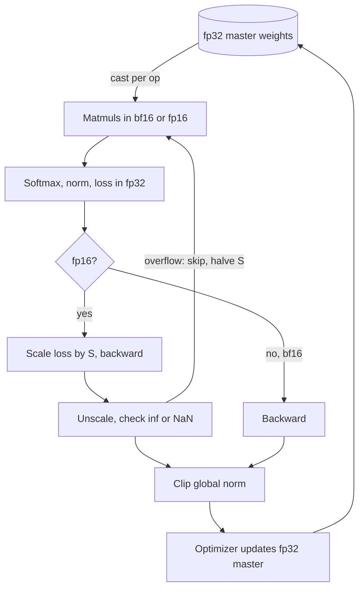

## TL;DR
Mixed precision runs matmuls in a 16-bit float for tensor-core speed and half the activation memory, while
an fp32 weight copy keeps tiny updates from rounding away. fp16 needs loss scaling; bf16 has fp32's range,
so it is the default where supported.

## Why it exists
- **The number format sets the speed.** Training time is dominated by matmuls. On an A100 the datasheet
  gives about 19.5 TFLOPS for fp32 on CUDA cores and about 312 TFLOPS for fp16 or bf16 on tensor cores, a
  16× gap on the same chip.
- **Half the bytes, half the traffic.** A 16-bit activation is half the bytes to store and move; for
  bandwidth-bound parts of a step (normalization, softmax, element-wise ops) that halving is the whole
  speed-up. Activation memory, scaling with batch × sequence length, also halves: a larger micro-batch or
  longer context on the same card.
- **"Cast everything to fp16" fails three ways** (documented by the 2018 mixed-precision paper):
  1. **Overflow:** fp16's largest value is 65,504; attention logits, loss sums and variance terms exceed
     it, becoming `inf` and then `NaN`.
  2. **Underflow:** the smallest normal is about 6e-5 (subnormals reach about 6e-8); many real gradients
     fall below it, become exactly zero, and those weights stop learning.
  3. **Swamped updates:** `w ← w − η·g` with `η` around 1e-4 is routinely under a thousandth of the
     weight. With 11 (fp16) or 8 (bf16) significant bits, updates below roughly 2^-11 or 2^-8 of the
     weight are rounded away: the optimizer steps and nothing moves.
- **Hence "mixed".** fp32 weights for the update make the arithmetic survivable; 16-bit matmuls make it
  fast.

## How it works
### The formats
```
           sign  exponent  mantissa   max value   smallest normal   spacing at 1.0
fp32         1       8        23       3.4e38       1.2e-38          2^-23 ≈ 1.2e-7
tf32         1       8        10       3.4e38       1.2e-38          2^-10 ≈ 1.0e-3   (tensor-core internal)
fp16         1       5        10       65,504       6.1e-5           2^-10 ≈ 1.0e-3
bf16         1       8         7       3.4e38       1.2e-38          2^-7  ≈ 7.8e-3
fp8 E4M3     1       4         3       448          1.6e-2           2^-3  = 0.125
fp8 E5M2     1       5         2       57,344       6.1e-5           2^-2  = 0.25
```

- **bf16 is fp32 with the low 16 mantissa bits cut off.** Converting is a shift, the range is identical,
  and it keeps only about three significant decimal digits.
- **fp16 spends its bits on precision instead of range.**
- **The exponent width decides everything downstream:** fp16 needs a mechanism against under- and
  overflow, bf16 does not, but bf16 rounds more coarsely, so long sums and the weight update are where it
  hurts.

### Autocast: which op runs in which precision
Frameworks apply a per-operator policy rather than a global cast. Under `torch.autocast`:

| Op class | Precision | Why |
|---|---|---|
| matmuls, convolutions, linear layers | 16-bit type, inputs cast on the way in | tensor cores accumulate products in fp32 even with 16-bit inputs, so it is safe |
| softmax, log-softmax, cross-entropy, layer norm, sums, exponentials | fp32 in, fp32 out | a softmax over thousands of logits or a variance over 4,096 features is a long sum whose rounding compounds in 16 bits |
| element-wise ops | widest input type | no reason to narrow |

- **Parameters stay fp32 in memory.** Autocast makes a 16-bit copy per op, cached for the duration of a
  forward pass.

### fp32 master weights and the update
The optimizer always updates an fp32 copy, whose rounding unit is 2^-23, so small updates accumulate; the
next forward casts the updated weights down again. Two common layouts cost the same:

```
autocast style (PyTorch AMP):   fp32 params 4 + fp32 grads 4 + Adam m 4 + v 4          = 16 bytes/param
master-copy style (Megatron,    bf16 params 2 + bf16 grads 2 + fp32 master 4 + m 4 + v 4 = 16 bytes/param
  DeepSpeed, ZeRO accounting)
```

- **Autocast style:** the parameters *are* the fp32 masters; 16-bit weights exist only as transient
  per-op casts, and gradients land in fp32 because autograd casts them back through the cast op.
- **Master-copy style:** frameworks keep persistent 16-bit weights and gradients (to halve gradient
  communication) and hold the fp32 master inside the optimizer.
- **Model state is not reduced.** Under Adam a 7B model carries about 112 GB of model state regardless.
  Mixed precision shrinks activation memory and buys compute speed; cutting model state is the job of
  sharding, 8-bit optimizers and quantization.

### Loss scaling (fp16 only)
By linearity the gradient of `S × loss` is `S` times the gradient of `loss` everywhere.
1. **Scale:** multiply the loss by `S` before backward, so gradients land in fp16's representable band.
2. **Unscale:** divide by `S` before clipping and before the optimizer uses them.
3. **Adapt:** a fixed `S` is fragile, so dynamic loss scaling starts large (2^16 in PyTorch's
   `GradScaler`) and checks gradients for `inf` or `NaN` after each backward.
4. **On overflow:** skip the optimizer step and halve `S`. **After a run of clean steps** (2,000 by
   default): double `S`.

- **A few skipped steps early are normal.** A scale that keeps collapsing means the *forward* is
  overflowing, which scaling cannot fix.
- **bf16 needs none of this:** its exponent range is fp32's, so gradients neither overflow nor underflow
  in practice. The cost is the 8-bit mantissa, which is why bf16 training keeps master weights in fp32
  without exception and why autocast keeps reductions in fp32.

### Hardware
| Generation | 16-bit and 8-bit support |
|---|---|
| Volta (V100), Turing (T4) | fp16 tensor cores, no bf16 hardware: fp16 with loss scaling is the only 16-bit option |
| Ampere (A100); TPUs had bf16 earlier | bf16 tensor cores; TF32 |
| Hopper (H100) | fp8 tensor cores: E4M3 for forward activations and weights, E5M2 for gradients |

- **TF32** rounds fp32 matmul inputs to 10 mantissa bits inside the tensor core, keeping fp32 storage and
  range. PyTorch enables it for cuDNN convolutions by default and for matmuls through
  `torch.set_float32_matmul_precision("high")`.
- **fp8** uses per-tensor scaling factors managed by a library such as Transformer Engine, because three
  mantissa bits leave no margin. fp8 training of production models is real (DeepSeek-V3 reported training
  in fp8 with fine-grained scaling), but it is a specialist recipe, not a flag.

### Inference
- **bf16 or fp16 weights are the serving baseline, not quantization:** the weights are stored in the type
  they trained in.
- **Quantization** to int8, fp8 or int4 is a further step with its own calibration and quality
  evaluation, covered in the training-adaptation and serving modules.

## Diagram
Follow one step: the fp32 master is cast down per op for the matmuls, sensitive ops stay fp32, and the
update always lands back on the fp32 master. The scale and unscale boxes exist only for fp16.



## Examples
### The failure modes and a correct training step
The first block shows the three failure modes on a CPU; the second is the training step. Note what is
absent: no `model.half()`, no casting of the optimizer, no change to the learning rate. The model stays
fp32 (those are the master weights) and autocast handles the per-op casting.

```python
import torch
from torch.nn.utils import clip_grad_norm_

# 1. What the formats can and cannot hold
f16, b16 = torch.float16, torch.bfloat16
print(torch.tensor(70_000., dtype=f16))        # inf      fp16 max is 65,504
print(torch.tensor(70_000., dtype=b16))        # 70144.   bf16 has fp32's range but ~3 digits
print(torch.tensor(1e-8, dtype=f16))           # 0.       below fp16's smallest subnormal (~6e-8)
print(torch.tensor(1., dtype=b16) + 0.001)     # 1.       bf16 spacing at 1.0 is 2^-7 ≈ 0.0078
print(torch.tensor(1., dtype=f16) + 0.001)     # 1.0010   fp16 spacing at 1.0 is 2^-10 ≈ 0.00098

# 2. One training step: fp32 master weights, 16-bit matmuls, a scaler only for fp16
def train_step(model, opt, x, y, dtype, scaler=None, max_norm=1.0):
    opt.zero_grad(set_to_none=True)
    with torch.autocast("cuda", dtype=dtype):   # matmuls in dtype; softmax, norm, loss stay fp32
        loss = torch.nn.functional.cross_entropy(model(x), y)
    if scaler is None:                           # bf16: range is fine, nothing to scale
        loss.backward()
        clip_grad_norm_(model.parameters(), max_norm)
        opt.step()
    else:                                        # fp16: scale so small grads do not underflow
        scaler.scale(loss).backward()
        scaler.unscale_(opt)                     # back to true scale BEFORE clipping
        clip_grad_norm_(model.parameters(), max_norm)
        scaler.step(opt)                         # skips the step if any grad is inf/nan
        scaler.update()                          # halves S on overflow, doubles after 2,000 clean steps
    return loss.item()

# model = MyModel().cuda()                       # parameters stay fp32: these are the master weights
# bf16: train_step(model, opt, x, y, torch.bfloat16)
# fp16: scaler = torch.amp.GradScaler("cuda"); train_step(model, opt, x, y, torch.float16, scaler)
```

### Why master weights matter, in pure Python
No GPU needed: Python's `struct` module packs IEEE half precision with the `"e"` format, so you can watch
an fp16 weight ignore 1,000 updates of 1e-4 that an fp32 master absorbs.

```python
import struct

def fp16(x):                      # round a Python float to the nearest fp16 value
    return struct.unpack("e", struct.pack("e", x))[0]

def fp32(x):
    return struct.unpack("f", struct.pack("f", x))[0]

lr, grad, steps = 1e-4, 1.0, 1000         # each update is 1e-4, the weight is 1.0
w16, w32 = fp16(1.0), fp32(1.0)
for _ in range(steps):
    w16 = fp16(w16 - lr * grad)           # weights stored in fp16: update rounded away
    w32 = fp32(w32 - lr * grad)           # fp32 master copy: updates accumulate
print(f"fp16 weights after {steps} steps: {w16}")     # 1.0   (spacing just below 1.0 is 2^-11)
print(f"fp32 master after {steps} steps:  {w32:.4f}")  # 0.9000
print(f"forward copy cast from master:   {fp16(w32)}") # 0.89990234375

try:
    fp16(70_000.0)                        # above fp16 max of 65,504
except OverflowError as e:
    print("fp16(70000):", e)              # float too large to pack with e format
```

| Weight storage | After 1,000 updates of 1e-4 | What training sees |
|---|---|---|
| fp16 only (`model.half()`) | 1.0 | loss plateaus: the optimizer steps and nothing moves |
| fp32 master, fp16 cast for forward | 0.9000 master, 0.8999 cast | the full update is applied |

## Production patterns
- **bf16 autocast by default.** On Ampere-class or newer GPUs and TPUs set `bf16=True` in the Hugging
  Face Trainer (or wrap the forward in `torch.autocast(..., dtype=torch.bfloat16)`) and keep parameters
  fp32. Measure step time and peak memory before and after: activations should roughly halve.
- **Watch the loss scale on fp16.** Where fp16 is forced (T4, V100), log `scaler.get_scale()` and the
  count of skipped steps. A scale that keeps halving means the forward overflows; fix softmax, norm and
  loss precision rather than tuning the scaler.
- **Turn on TF32 for the fp32 remainder.** Call `torch.set_float32_matmul_precision("high")` at startup
  so any fp32 matmuls use tensor cores. Note it in run metadata, because results will differ slightly from
  true fp32.
- **Checkpoint masters, export 16-bit.** Resumable checkpoints hold fp32 masters plus optimizer state;
  inference exports can be bf16-only. Test resume by checking the loss continues without a bump.
- **Parity test against fp32.** Before adopting a new precision recipe, run a few hundred steps of a small
  model in both and require the loss curves to overlap within noise. Repeat whenever custom kernels or
  norms change.
- **fp8 only with a library and a validation budget.** At pre-training scale on Hopper, use Transformer
  Engine's fp8 autocast with its per-tensor scaling, and compare loss against a bf16 baseline over a long
  window before committing.

## Trade-offs
- **bf16 vs fp16.** bf16 removes loss scaling and overflow from the failure list but keeps only about
  three significant digits, so long reductions must stay in fp32; fp16 is more precise per element but
  needs the scaler and still overflows on large logits.
- **Speed-up vs step shape.** 16-bit compute gives large speed-ups when the step is matmul-bound; for small
  models or tiny batches the step is launch- or bandwidth-bound and the gain shrinks to the halved
  activation traffic.
- **Activation savings vs model state.** Halved activation memory raises the feasible micro-batch, but the
  16 bytes-per-parameter model state is untouched; if weights plus optimizer state do not fit, it is the
  wrong tool.
- **fp32 masters vs pure bf16.** Masters cost 4 extra bytes per parameter and a cast per step; pure bf16
  with stochastic rounding saves that memory but makes convergence depend on the rounding scheme and on
  the learning rate staying above the rounding floor.
- **fp8 throughput vs engineering.** fp8 roughly doubles tensor-core throughput over bf16 again, but needs
  per-tensor scaling, a choice of which tensors tolerate three mantissa bits, and library support;
  justified at pre-training scale, rarely for fine-tuning.
- **TF32 free speed vs exactness.** It speeds up "fp32" matmuls several-fold with no code changes, at 10
  bits of mantissa: a free win for training and a silent source of small differences against true fp32.

## Pitfalls
- **`model.half()` or `.to(torch.bfloat16)` for training.** No master weights, so updates below the
  rounding unit vanish and the loss plateaus early (bf16) or NaNs appear (fp16). Keep parameters fp32 and
  use autocast.
- **Clipping before `scaler.unscale_()`.** Every step is clipped to near zero, the loss barely moves, and
  nothing raises an error.
- **A `GradScaler` on a bf16 run.** Harmless but pointless, and a sign an fp16 recipe was copied without
  understanding which problem the scaler solves.
- **Hand-written 16-bit normalization.** A custom RMSNorm doing `x * torch.rsqrt(x.pow(2).mean(-1) + eps)`
  on a bf16 tensor rounds every intermediate (squares, mean, `rsqrt`, product) to three significant digits,
  although PyTorch's built-in reductions accumulate in fp32 internally. A hand-written or blocked sum can
  lose small terms outright, and in fp16 an activation above 256 overflows when squared.
- **What the norm bug looks like.** The model trains slightly worse than the reference (bf16) or NaNs
  (fp16). Upcast to fp32 inside the op, as reference implementations do.
- **Checkpointing only the 16-bit copy.** On resume the fp32 master state is gone, so the run follows a
  different trajectory, often with a loss bump. Save fp32 masters plus optimizer state; bf16-only exports
  are for inference.
- **Blaming the model for precision gaps.** bf16 logits legitimately differ from fp32 in the third digit,
  and a greedy-decoded answer can flip on a near tie.
- **Porting recipes across hardware blindly.** Moving fp16 to a GPU without bf16 (T4, V100), or the
  reverse, without re-checking the scaler, softmax precision and loss computation. Symptom: stable on A100,
  NaNs on T4.

## When to use
- **Use bf16 autocast** for any training on Ampere-class or newer GPUs and on TPUs; **use fp16 with
  dynamic loss scaling** only when hardware forces it.
- **Always** keep fp32 master weights and fp32 reductions; frameworks default to this, and the main job is
  not to undo it. Enable TF32 for whatever remains in fp32.
- **Consider fp8** only for large pre-training runs with the budget to validate it.
- **Measure:** step time (large gain if the step was matmul-bound), peak memory (activations should
  roughly halve), and a few hundred steps of loss against an fp32 run on a small model, overlapping within
  noise.
- **Interviews:** why fp16 needs loss scaling and bf16 does not, why master weights stay fp32, and which
  memory mixed precision does not reduce. Answers: exponent bits, the rounding of small updates, and
  optimizer state.

## Role lens
- **Engineer:** Sets `bf16=True` (or fp16 plus a scaler) in the training config, keeps the
  unscale-clip-step order straight, upcasts custom reductions to fp32, and checks step time and memory
  before and after.
- **Architect:** Chooses GPU generations and numeric policy together: bf16 by default, fp8 where scale
  justifies the validation work, and checkpoint formats that keep fp32 master weights for resumability.
- **FDE:** Diagnoses customer runs that NaN on older cards or plateau after a naive `.half()`, and sets the
  expectation that bf16 serving can differ from the fp32 demo in the last digit.

## Check yourself
**Q:** A team trained a model stably on A100s in bf16. To cut cost they move fine-tuning to T4s, switch
the config to fp16, and the loss becomes NaN after a few hundred steps. Walk through why, and what you
would change.
**A:** A T4 has no bf16 tensor cores, so fp16 is the only 16-bit option, and fp16 trades exponent bits for
mantissa: maximum 65,504, smallest normal about 6e-5. Two different things can be going wrong. If
gradients underflow, a dynamic loss scaler fixes it; the first checks are that a scaler is actually in
the loop and that `unscale_` precedes clipping. If the *forward* overflows (attention logits, or the sum of
squares inside a norm, exceeding 65,504 once activations have grown over a few hundred steps), the scaler
cannot help: it keeps skipping steps and halving the scale, which is visible in its state. The fixes are
to keep softmax, layer norm and the loss in fp32 (autocast does this, a hand-rolled `.half()` model does
not), use an attention kernel that computes softmax in fp32, lower the peak learning rate slightly, and
confirm with a short fp32 run that the recipe itself is sound. If none of that is acceptable, the honest
answer is that this recipe wants bf16 hardware, and the saving on T4s is not real.

## Interview questions
### What exactly is "mixed" in mixed-precision training?
- **16-bit compute:** matmuls run in fp16 or bf16 on tensor cores (about 312 vs 19.5 TFLOPS on an A100)
  and activations take half the memory.
- **fp32 where it matters:** master weights, the optimizer update and long reductions (softmax, norms,
  loss) stay fp32, because small updates and long sums round away in 16 bits.

### A fine-tune after model.to(torch.bfloat16) plateaus early but never NaNs. What is wrong?
- **No master weights:** with bf16 weights, updates below about 2^-8 of a weight's magnitude round to no
  change, so many parameters stop moving. (`model.half()` gives fp16, where the floor is about 2^-11 and
  overflow NaNs are the more common symptom.)
- **Confirm:** compare against an autocast run with fp32 parameters; the loss curves separate early.
- **Fix:** keep parameters fp32 and use `torch.autocast`; do not cast the model or optimizer.

### Your GradScaler's scale keeps halving and steps keep being skipped. What do you do?
- **Recognize it:** occasional skips early are normal; a collapsing scale means the *forward* overflows
  fp16's 65,504, which scaling cannot fix.
- **Fix the forward:** keep softmax, norms and the loss in fp32, use an attention kernel with fp32
  softmax, upcast custom reductions, and consider a slightly lower peak learning rate.
- **Or change hardware:** if bf16 is available, use it.

### Why does mixed precision not let a 7B model fit on a smaller GPU?
- **Model state stays about 16 bytes per parameter** under Adam in either layout, roughly 112 GB for 7B.
- **Mixed precision cuts activations and time,** not weights plus optimizer state.
- **Use other tools for model state:** sharding (ZeRO, FSDP), 8-bit optimizers, or parameter-efficient
  methods.

### When would you choose fp8 training, and when not?
- **Choose it** for large pre-training on Hopper-class GPUs, where roughly doubling tensor-core throughput
  over bf16 pays for the engineering; DeepSeek-V3 reported fp8 training with fine-grained scaling.
- **Avoid it** for most fine-tuning: three mantissa bits need per-tensor scaling, library support and long
  validation against a bf16 baseline.

## Quiz
### Q: Why does fp16 training need loss scaling while bf16 training normally does not?
- [ ] fp16 has fewer mantissa bits, so gradients lose precision without scaling
- [x] fp16 has only 5 exponent bits, so many gradient values underflow to zero; bf16 keeps fp32's 8 exponent bits and the same range
- [ ] bf16 tensor cores apply scaling in hardware automatically
- [ ] Loss scaling compensates for Adam's bias correction, which bf16 does not use
> Loss scaling is a range fix, not a precision fix: it shifts small gradients up into fp16's representable
> band. bf16 actually has less precision than fp16, but its range matches fp32, so nothing underflows.

### Q: Why are the weights kept in fp32 even though forward and backward run in 16 bits?
- [ ] Because tensor cores can only read fp32 weights
- [ ] To keep checkpoints compatible with fp32 inference
- [x] Because an update much smaller than the weight's rounding unit would be rounded away in 16 bits, so the optimizer step would do nothing
- [ ] Because the optimizer state must have the same type as the weights
> With a learning rate near 1e-4, updates are routinely below 2^-8 of the weight's magnitude, which bf16
> cannot represent as a change. The fp32 master copy accumulates them; the 16-bit copy is just a cast for
> the matmuls.

### Q: Which of these does switching from fp32 to bf16 mixed precision NOT reduce?
- [ ] Activation memory per micro-batch
- [ ] Time per step on a matmul-bound model
- [x] Memory for Adam's optimizer state and the master weights
- [ ] Bytes moved per element in bandwidth-bound ops
> The master weights and both Adam moments stay fp32, so model state is still about 16 bytes per
> parameter. Sharding, 8-bit optimizers or parameter-efficient methods reduce that; mixed precision targets
> activations and compute.
