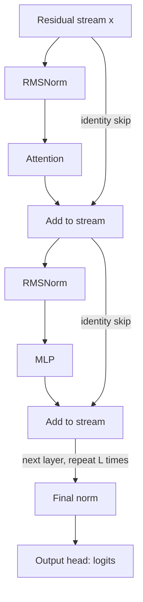

## TL;DR
Normalization rescales each token's activation vector before a sublayer, so attention and the MLP see a
stable scale. LayerNorm centers and scales; RMSNorm only scales, cheaper and as good. Pre-LN versus Post-LN
placement decides training stability.

## Why it exists
- **Each layer assumes a fixed input scale.** Without normalization a small change in layer 3 shifts the
  activations reaching layer 30, so layer 30's gradient was computed for inputs it no longer receives.
  Deeper stacks compound it: tiny safe learning rates, activations drifting to saturation or explosion,
  extreme sensitivity to initialization.
- **BatchNorm (2015) made very deep nets trainable** by standardizing each feature over the mini-batch.
  "Shifting inputs" was its original motivation; later analysis argued the larger effect is a smoother,
  better-conditioned loss surface that tolerates bigger learning rates (the scale-invariance mechanism
  below). The explanations differ, the practical outcome does not.
- **Transformers could not use BatchNorm.** Its statistics depend on which examples share a batch, so
  padding, varied lengths and small micro-batches leak into every token. Running averages at inference
  differ from training statistics, positions have different statistics, and data parallelism would need
  per-layer synchronization.
- **LayerNorm (2016) normalizes per token, across features.** Each token uses only its own `d_model`
  numbers, so the result is identical at batch size 1 and 1,024, in training and inference, and
  independent of padding.
- **The function is not optional.** Careful init plus a low learning rate trains shallow transformers but
  does not scale; norm-free attempts use substitutes (zero-initialized scalar gates per branch, bounded
  element-wise functions) to recover the same stability.

## How it works
### LayerNorm
For one token's activation vector `x ∈ R^d`:

```
μ   = (1/d) Σ_i x_i
σ²  = (1/d) Σ_i (x_i − μ)²
y_i = γ_i × (x_i − μ) / sqrt(σ² + ε) + β_i
```

- **Learned per feature:** `γ` (gain) and `β` (bias). `ε`, typically 1e-5 or 1e-6, prevents division by
  zero for a constant vector.
- **After normalization** the vector has zero mean and unit variance *across its features*; `γ` and `β`
  let the network place each feature back on whatever scale and offset the next layer prefers.
- **Why keep `γ` and `β`:** without them inputs are pinned to the unit sphere, costing expressivity. With
  them the network can undo the normalization exactly, so the layer never makes the model strictly less
  capable.

Two properties do the optimization work:
1. **Scale invariance.** `LN(a·x) = LN(x)` for `a > 0`. If the weights feeding the norm grow, the forward
   pass does not change while their gradient shrinks like `1/a`: large weights automatically get a smaller
   effective learning rate, a self-stabilizing effect.
2. **Orthogonal gradient.** The gradient through the norm is projected orthogonal to the input direction,
   removing the part of an update that would only have rescaled the activation.

### RMSNorm
```
rms = sqrt( (1/d) Σ_i x_i² + ε )
y_i = γ_i × x_i / rms
```

- **What it drops:** the mean subtraction and the bias. The 2019 paper argues LayerNorm's benefit comes
  from re-scaling invariance, not re-centering, and showed matching quality at lower cost.
- **The saving:** one reduction instead of two, no bias parameters, and a simpler kernel that fuses well.
  Small per token, but on the critical path of every layer, and at inference the norm is bandwidth-bound,
  so every pass over the vector counts.
- **Adoption:** Llama, Mistral and most open-weight decoders since 2023 use RMSNorm. Most implementations
  compute it in fp32 and cast back; some (Gemma, for example) parameterize the gain as `1 + γ`, so a
  zero-initialized `γ` means identity scaling.

### Where the norm sits: Post-LN versus Pre-LN
The original transformer normalized *after* the residual addition (Post-LN):

```
x ← LN(x + Attention(x));   x ← LN(x + MLP(x))
```

Modern decoders normalize the *input* of each sublayer and leave the residual stream untouched (Pre-LN),
with one final norm before the output head:

```
x ← x + Attention(LN(x));   x ← x + MLP(LN(x));   logits = W_out · LN_final(x)
```

| | Post-LN | Pre-LN |
|---|---|---|
| Gradient path | residual stream passes a norm every layer, so early-layer gradients are a product of per-layer factors | skip path is a pure identity from embeddings to the final norm |
| At initialization | gradient norm nearest the output is large and independent of depth, decaying toward the input (2020 analysis) | roughly uniform across layers; scales down roughly as `1/√L` |
| Warmup and learning rate | long warmup and small rate to survive the first steps | short warmup; deep models train without heroics |
| Residual stream | normalized | norm grows with depth, so later layers contribute relatively less |

- **The Pre-LN price:** every layer adds to the stream and nothing rescales it, so later layers see
  inputs dominated by the accumulated sum. The final norm fixes the scale before the head but not that
  imbalance.
- **Variants that address it:** normalizing both input and output of each sublayer; normalizing queries
  and keys before the attention dot product (QK-norm), so attention logits cannot grow without bound; and
  depth-dependent scaling of the residual branches.

### Numerics
The statistics are the fragile part under mixed precision, because the variance is a sum of thousands of
squares.
- **fp16 overflow:** any activation above 256 overflows when squared (65,504 is the ceiling), and residual
  streams in large models do carry values that big.
- **bf16 rounding:** the squares, the mean, the reciprocal square root and the normalized output are each
  rounded to about three significant digits, and a long sum accumulated in bf16 loses its small terms.
- **The fix:** autocast runs `layer_norm` in fp32 and returns fp32; a hand-written RMSNorm should upcast
  before squaring and cast back only at the end.
- **`ε` must survive the dtype:** 1e-8 is below fp16's smallest subnormal and becomes exactly zero if the
  norm runs in fp16, so a padding token's all-zero vector divides by zero.

### Training details
- **No weight decay on `γ` and `β`** (nor on biases), conventionally: decaying the gain toward zero fights
  the normalization's purpose.
- **Often left trainable in PEFT:** norm parameters are a tiny fraction of the model.

## Diagram
A Pre-LN decoder layer: the norms sit on the branch inputs, the residual stream (the straight path) is
never normalized until the final norm before the head.



## Examples
### LayerNorm and RMSNorm from scratch, plus the Pre-LN block
A from-scratch LayerNorm and RMSNorm checked against the built-in, with one token's numbers in the
comments, then the Pre-LN block every modern decoder layer reduces to. The offset test is the point:
RMSNorm leaves the mean in place, which is the entire difference between the two.

```python
import torch

def layer_norm(x, gamma, beta, eps=1e-5):
    mu = x.mean(-1, keepdim=True)
    var = x.var(-1, unbiased=False, keepdim=True)        # population variance over the features
    return gamma * (x - mu) / torch.sqrt(var + eps) + beta

def rms_norm(x, gamma, eps=1e-6):
    x32 = x.float()                                       # upcast: the sum of squares is a long reduction
    rms = torch.sqrt(x32.pow(2).mean(-1, keepdim=True) + eps)
    return (gamma * (x32 / rms)).to(x.dtype)

x = torch.tensor([[1., 2., 3., 4.]])                     # one token, d_model = 4
g, b = torch.ones(4), torch.zeros(4)
print(layer_norm(x, g, b))      # [-1.3416, -0.4472, 0.4472, 1.3416]   mean 2.5, std sqrt(1.25)
print(rms_norm(x, g))           # [ 0.3651,  0.7303, 1.0954, 1.4606]   rms = sqrt(7.5) = 2.7386
print(layer_norm(3 * x, g, b))  # same as layer_norm(x): scale invariance
print(rms_norm(x + 10, g))      # [0.8765, 0.9562, 1.0359, 1.1155]: RMSNorm does NOT remove an offset
print(torch.allclose(torch.nn.LayerNorm(4)(x), layer_norm(x, g, b)))   # True (gamma=1, beta=0 at init)

class PreLNBlock(torch.nn.Module):     # norm on the sublayer INPUT; the residual stream is untouched
    def __init__(self, d, attn, mlp):
        super().__init__()
        self.n1, self.n2 = torch.nn.RMSNorm(d), torch.nn.RMSNorm(d)   # torch.nn.RMSNorm: PyTorch 2.4+
        self.attn, self.mlp = attn, mlp
    def forward(self, x):
        x = x + self.attn(self.n1(x))
        return x + self.mlp(self.n2(x))
```

### Production snippet: keep norm gains out of weight decay
Handing `model.parameters()` to AdamW as one group decays every norm gain toward zero. The common fix
splits parameters by dimensionality: matrices are decayed, while 1-D tensors (norm gains, norm biases,
linear biases) are not.

```python
import torch

def adamw_with_no_decay_norms(model, lr=3e-4, weight_decay=0.1):
    decay, no_decay = [], []
    for name, p in model.named_parameters():
        if not p.requires_grad:
            continue
        (no_decay if p.ndim < 2 else decay).append(p)    # gamma, beta and biases are 1-D
    groups = [{"params": decay, "weight_decay": weight_decay},
              {"params": no_decay, "weight_decay": 0.0}]
    return torch.optim.AdamW(groups, lr=lr)

# Sanity check before launch: count what landed where.
# opt = adamw_with_no_decay_norms(model)
# print([sum(p.numel() for p in g["params"]) for g in opt.param_groups])
# For a transformer the no-decay group is a tiny fraction of the total.
```

| Numerics check (illustrative) | Value | Consequence |
|---|---|---|
| Activations of 255 and 256, squared in fp16 | 255² = 65,025 fits; 256² = 65,536 does not | above 65,504 the square becomes `inf` |
| `ε = 1e-8` cast to fp16 | 0 | an all-zero padding vector divides by zero |
| `ε = 1e-5` cast to fp16 | stays non-zero (a subnormal) | safe, though fp32 statistics are still preferred |

## Production patterns
- **Match the checkpoint's norm exactly.** Read norm type, `ε` (for example `rms_norm_eps` in Llama-style
  Hugging Face configs, `layer_norm_eps` in BERT-style ones), gain convention (`w` or `1 + w`) and cast
  order from the reference implementation. Verify a port by comparing logits on fixed prompts, then long
  greedy generations, against the reference.
- **fp32 statistics in every custom kernel.** Upcast before squaring, cast back at the end, as the
  reference RMSNorm does. Add a unit test that compares the kernel's bf16 output with an fp32 reference on
  activations containing values above 256.
- **No-decay group for norms and biases.** Split parameters by `p.ndim < 2` (or by name) into a
  zero-weight-decay group. Print group sizes at startup and alert if the no-decay group is empty.
- **Track residual and logit growth.** Log the residual-stream norm per layer and the maximum attention
  logit during training; both growing without bound predicts a loss spike. Add QK-norm when training at
  large scale or with aggressive learning rates.
- **Fused norm kernels for serving.** Because the norm is bandwidth-bound at inference, use the engine's
  fused RMSNorm (often fused with the residual add) rather than a chain of element-wise ops, and benchmark
  per-token latency before and after.

## Trade-offs
- **RMSNorm vs LayerNorm.** RMSNorm saves one reduction and the bias parameters per layer and matches
  LayerNorm quality in the published and open-model evidence; it keeps the mean, which matters only if a
  sublayer's input develops a large common offset nothing else removes.
- **Pre-LN vs Post-LN.** Pre-LN trains deep models with short warmup and higher learning rates, but lets
  the stream's norm grow with depth so late layers contribute less; Post-LN keeps the stream normalized
  and has been reported to reach slightly better final quality at equal depth when it can be trained.
- **Per-token vs per-batch statistics.** Per-token normalization makes training and inference identical
  and needs no synchronized statistics, but cannot use cross-example information as BatchNorm does, a
  loss only in vision-style settings with large homogeneous batches.
- **Small vs large `ε`.** A smaller `ε` normalizes near-zero vectors more faithfully, a larger one is
  safer in 16-bit arithmetic; the value is baked into the checkpoint, so inference must use the trained one.
- **QK-norm and sandwich norms vs simplicity.** They buy stability against attention-logit growth at large
  scale or high learning rate, at the cost of extra norm ops in attention and a departure from the plain
  layout pretrained weights and fused kernels assume.

## Pitfalls
- **Normalizing over the wrong axis.** `LayerNorm(normalized_shape)` normalizes the trailing dimensions, so
  a `[B, d, T]` tensor is normalized across time instead of features. The model trains but worse; the first
  clue is a norm whose parameter count equals the sequence length.
- **Statistics in bf16 or fp16 in a custom implementation.** Symptom: a slow quality gap against the
  reference (bf16) or NaNs after a few hundred steps (fp16 overflow in the sum of squares). Upcast to fp32
  inside the op.
- **Weight decay on norm gains and biases,** because the optimizer got `model.parameters()` as one group.
  The gains drift toward zero and per-layer effective learning rates wander. Use a no-decay group.
- **Porting weights across implementations that differ in detail:** gain `1 + w` versus `w`, multiplying
  by `γ` before or after casting back to bf16, and `ε`. Symptom: logits that match to two digits and
  generations that diverge after a few hundred tokens.
- **Forgetting the final norm in a Pre-LN model.** The raw residual stream's norm grows with depth, so
  logits are huge, the softmax saturates, and the loss sits high from step one.
- **Copying warmup across layouts.** Post-LN settings on Pre-LN waste thousands of steps at a needlessly
  low rate; Pre-LN settings on Post-LN diverge from an overly aggressive start.

## When to use
You do not choose whether a transformer has normalization; you choose which, where, and how it is
computed.
- **New decoder models:** Pre-LN with RMSNorm, fp32 statistics, a final norm before the head and no weight
  decay on norm parameters, the default the open-weight ecosystem has converged on.
- **Add QK-norm** when training at large scale or with aggressive learning rates and attention logits are
  seen growing.
- **Fine-tuning or serving existing models:** match the checkpoint exactly; norm type, `ε`, gain
  parameterization and cast order are part of the model.
- **Measure:** the residual-stream norm per layer and attention-logit magnitudes during training; both
  growing without bound predicts a loss spike.
- **Interviews:** write both formulas, explain why per-token statistics beat per-batch ones for sequences,
  and derive why Pre-LN needs less warmup from the gradient path through the skip connection.

## Role lens
- **Engineer:** Implements or configures the norm exactly as the checkpoint expects (type, `ε`, fp32
  statistics, gain convention) and excludes norm parameters from weight decay in the optimizer groups.
- **Architect:** Fixes the block layout (Pre-LN, RMSNorm, QK-norm or not) for an organization's model
  family, since it determines the warmup and learning-rate regime every downstream run inherits.
- **FDE:** When a customer's self-hosted port of an open model gives subtly different outputs from the
  reference, checks the norm implementation first, because `ε` and cast-order mismatches are the usual
  cause.

## Check yourself
**Q:** A team builds a 48-layer decoder with the original Post-LN layout and finds it only trains with a
10,000-step warmup and a peak learning rate a quarter of what a comparable Pre-LN model uses. Explain the
mechanism, what you would change, and what you give up.
**A:** In Post-LN the residual stream passes through a LayerNorm at every layer, so the gradient reaching
layer k is the loss gradient multiplied by a chain of per-layer Jacobians of norms and sublayers. At
initialization that chain is badly balanced: layers nearest the output receive gradients whose expected
norm is large and does not shrink as layers are added, so a full-size update there is far too large while
early layers see small gradients. The long warmup and the low peak rate are compensating for that imbalance, not fixing it.
Moving the norm to the sublayer input (Pre-LN) makes the skip path an identity from the embeddings to the
final norm, so gradients at initialization are similar in size at every depth; warmup can drop to a few
hundred steps and the peak rate can rise. What you give up is a normalized residual stream: its norm now
grows with depth, so late layers contribute proportionally less, and you must add a final norm before the
head and probably QK-norm or sandwich norms at larger scale. Some reports find Post-LN reaches a slightly
better final loss when it can be trained, but at 48 layers trainability dominates.

## Interview questions
### Write LayerNorm and RMSNorm, and explain what RMSNorm gives up.
- **LayerNorm:** `γ × (x − μ) / sqrt(σ² + ε) + β`, with mean and variance over the token's own features.
- **RMSNorm:** `γ × x / sqrt(mean(x²) + ε)`: no mean subtraction and no bias.
- **What is lost:** re-centering, which matters only if an input develops a large common offset; the
  stabilizing scale invariance is kept, at one reduction instead of two.

### Why does the scale invariance of a norm help optimization?
- **Forward unchanged:** `LN(a·x) = LN(x)`, so growing weights before the norm do not change the output.
- **Gradient shrinks like `1/a`:** large weights automatically get a smaller effective learning rate, which
  self-stabilizes training.
- **Plus an orthogonal gradient** that discards updates which would only rescale the activation.

### A port of an open model matches logits to two digits but generations drift after a few hundred tokens. What do you check?
- **The norm details first:** `ε`, gain convention (`w` versus `1 + w`), and whether `γ` is applied before
  or after casting back to bf16.
- **Then precision:** statistics must be computed in fp32, as the reference does.
- **Verify** by comparing per-layer hidden states against the reference to find the first divergence.

### When would you add QK-norm to a model?
- **When attention logits grow** during training at large scale or with aggressive learning rates, which
  predicts loss spikes.
- **Mechanism:** normalizing queries and keys before the dot product bounds the logits.
- **Cost:** extra norm ops in the attention path and a layout that pretrained weights and fused kernels may
  not expect.

### Why can a custom bf16 or fp16 RMSNorm silently hurt training, and what are the numbers?
- **fp16:** any activation above 256 overflows when squared, since 65,504 is the ceiling, and residual
  streams in large models carry values that big; NaNs follow.
- **bf16:** squares, mean, `rsqrt` and output each keep about three significant digits, so quality lags the
  reference slowly.
- **Fix:** upcast to fp32 before squaring, cast back at the end, and keep `ε` representable.

## Quiz
### Q: What does RMSNorm remove relative to LayerNorm, and why is that acceptable?
- [ ] The learned gain, because the next linear layer can absorb any scaling
- [x] The mean subtraction and the bias, because the stabilizing effect comes from rescaling the vector, not from re-centering it
- [ ] The epsilon term, because the root mean square is never zero
- [ ] The per-token statistics, replacing them with running averages
> Both norms divide by a scale computed over the token's own features; RMSNorm computes that scale
> without first subtracting the mean. Experiments show re-centering contributes little, so dropping it
> saves a reduction at no quality cost.

### Q: Why do transformers use LayerNorm or RMSNorm rather than BatchNorm?
- [ ] BatchNorm has no learnable parameters, so it limits model capacity
- [ ] LayerNorm is cheaper because it needs no division
- [x] Per-token statistics are independent of batch composition, padding and sequence length, and are identical at training and inference
- [ ] BatchNorm cannot be used together with residual connections
> BatchNorm's statistics depend on which examples share the batch and are replaced by running averages
> at inference, which breaks down with variable-length sequences and small micro-batches. Per-token
> normalization uses only the token's own vector.

### Q: Why does a Pre-LN transformer tolerate a much shorter warmup than a Post-LN one?
- [ ] Pre-LN has fewer normalization layers, so fewer parameters need to settle
- [ ] Pre-LN normalizes the gradients directly during backpropagation
- [x] In Pre-LN the residual path is an identity from the embeddings to the final norm, so gradients at initialization are similar in size across layers instead of being large near the output and small near the input
- [ ] Pre-LN uses RMSNorm, which has no bias to warm up
> Post-LN puts a norm on the residual stream at every layer, which at initialization leaves gradients near
> the output large and those near the input small; warmup compensates for that. Pre-LN leaves the skip path untouched, so the
> imbalance never arises. RMSNorm versus LayerNorm is independent of placement.
