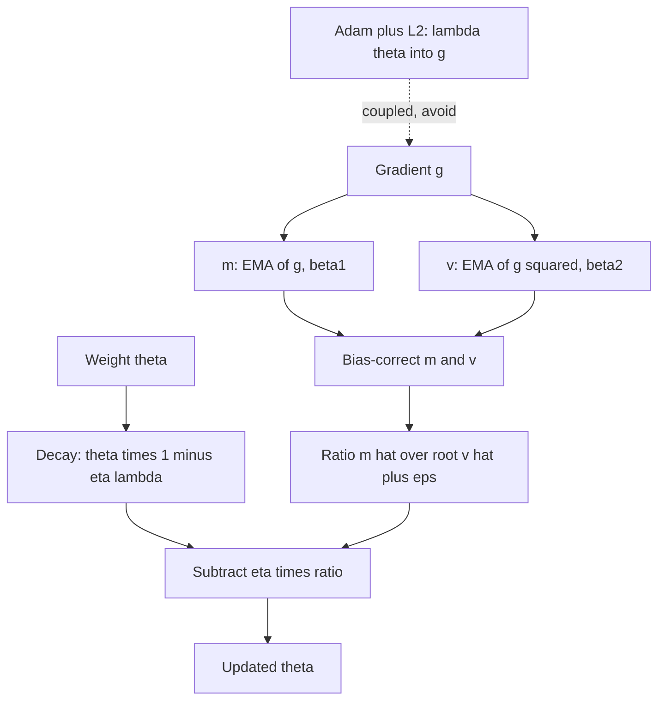

## TL;DR
AdamW drives almost every agent-model fine-tune. It moves each parameter about one learning rate per
step and decays weights directly; its optimizer state is why full fine-tuning a 7B model needs about
112 GB while LoRA fits one GPU.

## For agent builders
- **Why it matters for agents.** When you fine-tune a model to call your tools or follow your agent's
  format, AdamW's learning rate, warmup and memory decide whether the run fits your hardware and whether it
  converges. The 16-bytes-per-parameter rule is usually what makes LoRA the default for agent teams.
- **Where it shows up in your stack.** `torch.optim.AdamW` inside fine-tuning libraries, the optimizer and
  learning-rate settings of trainer configs, 8-bit optimizer options, FSDP or DeepSpeed ZeRO sharding, and
  the learning-rate knob of hosted fine-tuning services.
- **What you control.** Peak learning rate (very different for LoRA and full fine-tuning), warmup and
  decay, weight decay on matrices only, β2 for long runs, and whether optimizer state is saved with each
  checkpoint.
- **What you can skip.** Convergence theory and the zoo of newer optimizers. Know the update rule, why
  bias correction and warmup exist, coupled versus decoupled decay, and the memory arithmetic.

## Why it exists
- **Gradient scales differ by orders of magnitude.** The embedding row of a rare token, such as a tool
  name that appears only in your traces, receives a gradient only when that token appears, and a small
  one; layer-norm gains, attention projections and output heads each see their own typical magnitude.
- **One learning rate cannot fit all.** Either it suits the large-gradient parameters and the
  small-gradient ones barely move, or it suits the small ones and the large ones diverge. Plain gradient
  descent also crawls along low-curvature directions (see the gradient-descent lesson).
- **Per-parameter adaptation, step by step.** AdaGrad divided each gradient by the root of the sum of its
  past squares, so rare parameters got larger steps, but the sum grows forever and the effective learning
  rate decays to zero. RMSProp replaced the sum with an exponential moving average.
- **Adam combined** that moving average of squared gradients with momentum and a correction for both
  averages starting at zero. It became the default because it made the learning rate far less sensitive
  to the problem.
- **Then weight decay went wrong.** An L2 penalty enters Adam through the gradient and is divided by the
  same per-parameter scale, turning uniform shrinkage into one that depends on gradient history.
  Loshchilov and Hutter showed decoupling restores the intended behaviour and improves generalisation:
  AdamW, which every modern transformer recipe uses.

## How it works
### The Adam update
For each parameter, with gradient g_t at step t:

```
m_t = β1·m_{t-1} + (1 − β1)·g_t          # first moment: EMA of gradients        (β1 = 0.9)
v_t = β2·v_{t-1} + (1 − β2)·g_t²         # second moment: EMA of squared gradients (β2 = 0.999 default)
m̂ = m_t / (1 − β1^t);  v̂ = v_t / (1 − β2^t)     # bias correction
θ_{t+1} = θ_t − η · m̂ / (√v̂ + ε)
```

Each piece has a reason:
- **First moment = momentum.** It averages out mini-batch noise and accumulates in consistent directions.
- **Dividing by √v̂ normalises the step** by the parameter's typical gradient magnitude, so the update is
  about η · E[g]/√E[g²], whose magnitude is at most about 1·η.
- **Consequences of that ratio.** For a consistent-sign gradient it is near 1, so the parameter moves by
  roughly η per step whatever its gradient scale. That is why Adam behaves like sign descent early on, why
  its learning rates sit around 1e-4 to 1e-3 rather than SGD's 0.1, and why it is so forgiving.

### Bias correction, warmup and ε
- **Why correct.** m and v start at zero. After one step m₁ = 0.1·g₁ and v₁ = 0.001·g₁², so the
  uncorrected ratio m/√v would be 0.1/0.0316 ≈ 3.2 times too large; dividing each by (1 − βᵗ) removes the
  shrinkage.
- **Why warmup.** Even corrected, v is estimated from a handful of samples early in training and is noisy,
  which is the reason learning-rate warmup is standard with Adam.
- **ε is a floor.** It prevents division by zero; parameters whose gradient RMS is far below ε behave as
  if trained by SGD with rate η/ε. The default is 1e-8; some low-precision recipes raise it for stability.

### Weight decay: coupled L2 versus decoupled
1. **L2 penalty.** The loss becomes L + (λ/2)‖θ‖², so the gradient becomes g + λθ.
2. **Under SGD it works.** θ ← θ − ηg − ηλθ, a uniform shrink of every weight by the factor (1 − ηλ) per
   step: the intended regulariser.
3. **Under Adam it breaks.** λθ enters m and v and is divided by √v̂.
   - A weight with a large gradient history has a large √v̂, so its decay is scaled down almost to nothing.
   - A weight with tiny gradients has λθ dominating numerator and denominator, so the ratio is about
     sign(θ) and it decays at the full rate regardless of λ.
   - The regularisation strength has become a function of gradient statistics rather than of λ.

**A rough quantitative picture.** Near convergence a weight's loss gradient is mostly noise with RMS σ, so
m̂ ≈ λθ while √v̂ ≈ σ (when λθ ≪ σ). The coupled update shrinks the weight by about ηλθ/σ per step: the
effective decay coefficient is λ/σ, not λ.

| λ = 0.01, gradient RMS σ | Coupled L2 in Adam: effective coefficient λ/σ | AdamW: coefficient (shrink per step ηλ) |
|---|---|---|
| 1 | 0.01 | 0.01 |
| 0.1 | 0.1, ten times harder, for no reason anyone chose | 0.01 |

**What AdamW does.** It removes λθ from the gradient and applies decay as its own step:
θ ← θ − η(m̂/(√v̂ + ε) + λθ), implemented in PyTorch as θ ← θ·(1 − ηλ) followed by the ordinary Adam step.
- **Every weight shrinks by the same fraction per step,** independent of its gradient history, and λ can be
  tuned without re-tuning η.
- **API trap:** `torch.optim.Adam(weight_decay=...)` is the coupled L2 form while `torch.optim.AdamW` is
  decoupled, a frequent source of confusion.
- **Convention:** decay is not applied to biases or normalisation gains, because shrinking a layer-norm
  scale toward zero has no regularising meaning.

### Memory and compute
- **Optimizer state:** m and v, two fp32 values per parameter, so 8 bytes per parameter on top of the
  weights.
- **Mixed-precision accounting: 16 bytes per parameter.** 2 for fp16 weights, 2 for fp16 gradients, 4 for
  an fp32 master copy, 4 for m and 4 for v.
- **A 7-billion-parameter model** therefore needs about 112 GB before a single activation is stored, more
  than one 80 GB GPU.

That number drives the alternatives:

| Alternative | What it changes |
|---|---|
| 8-bit Adam | quantises m and v |
| Adafactor | stores a factored second moment and drops the first |
| ZeRO / FSDP | shards the optimizer state across GPUs |
| Parameter-efficient fine-tuning | keeps state only for the adapter weights |

### Hyperparameters in practice
| Setting | Typical value | Why |
|---|---|---|
| β1 | 0.9 almost everywhere | momentum averages over roughly the last 1/(1 − β1) = 10 steps |
| β2 | 0.999 default; 0.95 in many LLM pre-training recipes | a long memory in v reacts slowly when the gradient distribution shifts, and that lag produces loss spikes in long runs |
| Weight decay | 0.01 (the PyTorch default) to 0.1 (common in LLM recipes) | on matrices only |
| Peak LR, full fine-tuning | 1e-5 to 5e-5 (illustrative, recipe-dependent) | always with warmup, decay schedule and clipping around 1.0 |
| Peak LR, LoRA adapters | 1e-4 to 3e-4 (illustrative, recipe-dependent) | same |

- **SGD with momentum** still matches or beats Adam on some convolutional benchmarks with a tuned schedule.
- **Newer optimizers** such as Lion, Sophia and Muon trade memory or steps against Adam and should be
  compared under equal compute before adoption.
- **For agent fine-tunes** the dataset is often a few thousand trajectories, so runs are short; warmup,
  the peak learning rate and the number of epochs matter more than β2.

## Diagram
One AdamW step per parameter: decay is applied to the weight directly, while the gradient flows through
the two moment estimates. In a LoRA fine-tune this runs only for the adapter weights.



## Misconceptions
- **"`torch.optim.Adam(weight_decay=...)` is the same as AdamW."** It adds λθ to the gradient, where it
  is divided by √v̂, so large-gradient weights are barely regularised. `torch.optim.AdamW` shrinks every
  weight by the same factor (1 − ηλ) per step.
- **"A learning rate is a learning rate, whatever the optimizer."** Adam moves each parameter by about η
  per step regardless of gradient scale, so SGD's 0.1 diverges at once. LoRA and full fine-tuning also
  need different ranges, around 1e-4 to 3e-4 versus 1e-5 to 5e-5 (illustrative).
- **"If the bf16 weights fit, the fine-tune fits."** Full AdamW in mixed precision is about 16 bytes per
  parameter, 112 GB for 7B before activations; m and v alone are 56 GB. LoRA keeps state only for the
  adapters.
- **"Adaptive optimizers make warmup unnecessary."** Bias correction fixes the zero start, but early v
  is still estimated from a handful of samples. Skipping warmup produces early loss spikes.
- **"Optimizer state is disposable; the weights are the checkpoint."** Resuming without m and v
  restarts both from zero and shows up as a loss spike at the resume point. Save `optimizer.state_dict()`
  with every checkpoint.

## Examples
### Worked scenario: full fine-tune or LoRA for a 7B tool-calling model
A team wants a 7B model to follow its tool-call format on one 80 GB GPU. Adapter size is illustrative
(about 0.5% of parameters, 35M), with adapter weights, gradients, m and v in fp32.

| Setup | Weights | Gradients and optimizer state | Total before activations | Fits on 80 GB? |
|---|---|---|---|---|
| Full AdamW, mixed precision | 14 GB fp16 + 28 GB fp32 master | 14 GB grads + 56 GB m, v | about 112 GB | no |
| Full AdamW, 8-bit m and v | 42 GB | 14 GB grads + about 14 GB m, v | about 70 GB | barely, no room for long trajectories |
| LoRA, frozen bf16 base | 14 GB base + about 0.14 GB adapters | about 0.42 GB for adapter grads, m, v | about 15 GB | yes, with room for activations |

- **LoRA wins on memory by roughly 7×** here, leaving space for the long sequences agent traces need.
- **Its learning rate is higher:** start the sweep around 1e-4 to 3e-4 instead of 1e-5 to 5e-5.
- **Check quality, not just fit:** compare tool-call accuracy on held-out tasks against a full fine-tune
  on a sharded setup if the LoRA result falls short.

### Hand-written AdamW matches torch.optim.AdamW
A hand-written AdamW step compared against `torch.optim.AdamW` on the same parameters. The two must
agree exactly, which confirms the update rule above is the whole algorithm; the final print shows the
per-parameter step sizes settling near one learning rate each, whatever the gradient magnitudes.

```python
import torch
torch.manual_seed(0)
lr, b1, b2, eps, wd = 1e-3, 0.9, 0.999, 1e-8, 0.01

w = torch.randn(5, requires_grad=True)                   # hand-rolled AdamW updates this copy
w_ref = w.detach().clone().requires_grad_(True)           # torch.optim.AdamW updates this one
opt = torch.optim.AdamW([w_ref], lr=lr, betas=(b1, b2), eps=eps, weight_decay=wd)
m, v = torch.zeros(5), torch.zeros(5)                     # optimizer state: 2 extra floats per parameter
x = torch.randn(5)
loss_fn = lambda p: ((p * x).sum() - 1.0) ** 2

for t in range(1, 4):
    (g,) = torch.autograd.grad(loss_fn(w), w)
    with torch.no_grad():
        w.mul_(1 - lr * wd)                               # decoupled decay: shrink weights, gradient not involved
        m.mul_(b1).add_(g, alpha=1 - b1)                  # EMA of gradients (momentum)
        v.mul_(b2).addcmul_(g, g, value=1 - b2)           # EMA of squared gradients (per-parameter scale)
        m_hat, v_hat = m / (1 - b1 ** t), v / (1 - b2 ** t)   # undo the zero-initialisation bias
        step = lr * m_hat / (v_hat.sqrt() + eps)
        w.sub_(step)                                      # |step| ~ lr per parameter, whatever |g| is
    opt.zero_grad(); loss_fn(w_ref).backward(); opt.step()

print(torch.allclose(w, w_ref, atol=1e-6))                # True: this is exactly what AdamW does
print(step.abs() / lr)                                    # step sizes in units of lr: all close to 1
print(g.abs())                                            # ... even though the raw gradients differ a lot
```

### Production setup: parameter groups without decay on biases and norms
The common convention: matrices (2-D and above) get weight decay; biases and normalisation gains (1-D) do
not. β2 = 0.95 as in many LLM recipes. With LoRA, frozen base weights are skipped, so only adapters get
optimizer state.

```python
import torch

def build_adamw(model, lr=3e-4, weight_decay=0.1, betas=(0.9, 0.95)):
    decay, no_decay = [], []
    for name, p in model.named_parameters():
        if not p.requires_grad:
            continue                                  # frozen weights: no optimizer state at all
        (decay if p.ndim >= 2 else no_decay).append(p)
    groups = [{"params": decay, "weight_decay": weight_decay},
              {"params": no_decay, "weight_decay": 0.0}]
    return torch.optim.AdamW(groups, lr=lr, betas=betas, eps=1e-8)

# Checkpoint optimizer state too, or m and v restart from zero on resume:
# torch.save({"model": model.state_dict(), "optim": opt.state_dict(), "step": step}, path)
```

### Worked numbers: memory for full fine-tuning a 7B model
Mixed precision with AdamW, before activations (7 × 10⁹ parameters).

| Component | Bytes per parameter | Total |
|---|---|---|
| fp16 weights | 2 | 14 GB |
| fp16 gradients | 2 | 14 GB |
| fp32 master weights | 4 | 28 GB |
| m (fp32) | 4 | 28 GB |
| v (fp32) | 4 | 28 GB |
| **Total** | **16** | **112 GB** |

- **On one 80 GB GPU it does not fit,** so the options are sharding (ZeRO or FSDP across GPUs), quantised
  optimizer state, or PEFT.
- **With 8-bit m and v** (1 byte each, ignoring small quantisation constants) the two states drop from
  56 GB to about 14 GB, for roughly 70 GB in total: still tight before activations.

## Production patterns
- **LoRA plus AdamW as the default agent fine-tune.** Freeze the base, train adapters with AdamW at a LoRA
  learning rate found by a short sweep, and gate the checkpoint on the agent eval suite. Monitor tool-call
  accuracy and a general-skills eval side by side.
- **Use `torch.optim.AdamW`, never Adam plus `weight_decay`, for decay.** Build parameter groups so 1-D
  parameters (biases, norm gains) get `weight_decay=0.0`. Monitor the weight-norm trend per layer.
- **Save and restore optimizer state.** Include `optimizer.state_dict()` and the scheduler state in every
  checkpoint. Monitor the loss at each resume point; a spike means m and v were lost.
- **Lower β2 when long runs spike.** If loss spikes appear in long pre-training runs, set `betas=(0.9,
  0.95)`. Monitor spike frequency and the gradient-norm curve.
- **Warmup, decay and clipping together.** Pair AdamW with a warmup-then-cosine or linear schedule and
  gradient-norm clipping around 1.0. Monitor the logged learning rate, the clipped fraction and the loss.
- **Shrink optimizer memory before buying GPUs.** Shard state with FSDP or DeepSpeed ZeRO, use 8-bit
  optimizer states (for example the bitsandbytes 8-bit AdamW), or switch to LoRA so state exists only for
  adapters. Monitor peak memory at the first `optimizer.step()`.
- **Watch the update-to-weight ratio.** Every N steps log ‖Δθ‖/‖θ‖ per layer; it should be small but not
  negligible. Monitor for layers whose ratio is orders of magnitude off from the rest.

## Trade-offs
- **Adam/AdamW robustness vs memory and generalisation.** Robust to gradient-scale differences and to the
  learning-rate choice, with fast early progress, but two extra states per parameter and, on some vision
  tasks, slightly worse generalisation than tuned SGD. When memory binds, 8-bit states or Adafactor
  recover most of the benefit.
- **Decoupled decay vs schedule coupling.** Regularisation strength becomes independent of gradient
  statistics, but the effective decay per step is η·λ, so schedules that change η change the decay too,
  and λ must be chosen with that in mind.
- **β2 = 0.999 vs 0.95.** A high β2 gives a smooth, stable scale estimate but adapts slowly to shifts in
  gradient magnitude, showing up as loss spikes in long runs. 0.95 adapts faster at the cost of a noisier
  denominator; the balance tips toward 0.95 as runs get longer.
- **Larger ε: stability vs adaptivity.** It stabilises parameters with tiny gradients, especially in low
  precision, but damps the very adaptivity Adam exists for; move it deliberately, do not leave the default
  untouched in bf16.
- **LoRA vs full fine-tuning.** LoRA cuts optimizer memory to almost nothing and is easy to swap per agent
  or customer, but may fall short of a full fine-tune on large behaviour changes; the eval decides.

## Pitfalls
- **`torch.optim.Adam` with `weight_decay`, believed to be AdamW.** Symptom: regularisation that seems to
  do nothing, because the decay on large-gradient weights has been divided away.
- **Weight decay on biases and normalisation gains.** Symptom: a small but consistent loss penalty; fix
  with parameter groups that exclude them.
- **Carrying an SGD learning rate such as 0.1 into Adam.** Symptom: immediate divergence, since Adam's step
  is about η per parameter per step.
- **Reusing a full fine-tuning learning rate for LoRA, or the reverse.** Symptom: a LoRA run that barely
  moves, or a full fine-tune that forgets general skills; sweep in the right range for the method.
- **Skipping warmup.** Symptom: a loss spike in the first few hundred steps, sometimes unrecoverable,
  caused by updates computed from a second-moment estimate built on a handful of samples.
- **Resuming without optimizer state.** Symptom: a loss spike at the resume point as m and v restart from
  zero.
- **Forgetting optimizer state in capacity planning.** Symptom: an out-of-memory error at the first
  `optimizer.step()` even though the bf16 weights fitted comfortably.
- **Keeping m and v in plain bf16.** bf16 resolves only about 0.4% relative changes, so the per-step
  increment (1 − β2)·g² = 0.001·g² to v is rounded away and the scale estimate stops tracking. Symptom:
  training that stalls or drifts versus an fp32-state run; states stay in fp32 or use block-wise 8-bit
  quantisation designed for this.

## When to use
- **Default to AdamW** for transformers and most new architectures: learning rate from a short sweep,
  weight decay in the 0.01 to 0.1 range on matrices only, β2 of 0.95 for long pre-training runs if spikes
  appear, paired with warmup, a cosine or linear decay and gradient clipping.
- **Switch** to 8-bit Adam, Adafactor or parameter-efficient fine-tuning when optimizer memory is the
  binding constraint; keep SGD with momentum for convolutional recipes known to work with it.
- **For agent fine-tunes,** start with LoRA plus AdamW; move to full fine-tuning only when the eval shows
  adapters cannot reach the behaviour you need.
- **Measure** the loss and gradient-norm curves and the ratio of update size to weight size per layer, a
  useful sanity check that updates are neither negligible nor wild.
- **Interviews:** write the Adam update, explain bias correction, contrast coupled L2 with decoupled decay,
  and count the bytes of optimizer state per parameter.

## Role lens
- **Engineer:** Configures AdamW with parameter groups that exclude norms and biases from decay, sets
  β2 and ε per recipe, saves optimizer state in checkpoints and switches to 8-bit states when memory is tight.
- **Architect:** Counts optimizer-state bytes in training capacity, using the 16-bytes-per-parameter rule
  to decide GPU count, sharding strategy and whether full fine-tuning is even on the table versus PEFT.
- **FDE:** When a customer's fine-tune diverges or runs out of memory on their hardware, diagnoses learning
  rate, warmup, β2 and optimizer memory, and justifies the PEFT recommendation with the byte arithmetic.

## Check yourself
**Q:** Explain why an L2 penalty added to the loss does not behave like weight decay under Adam, and what
AdamW changes. Include what happens to a parameter with consistently large gradients.
**A:** Under Adam the L2 term adds λθ to the gradient, and that combined gradient feeds both moment
estimates; the update is η·m̂/(√v̂ + ε). For a parameter with a large gradient history, √v̂ is large and
the λθ portion of the numerator is divided down to almost nothing, so it is barely regularised at all.
For a parameter with tiny gradients, λθ dominates numerator and denominator alike, the ratio collapses
to about sign(θ), and it decays at the full rate η regardless of λ. The effective regularisation is
therefore set by gradient statistics rather than by λ. AdamW takes λθ out of the gradient and applies
θ ← θ(1 − ηλ) as a separate step before the Adam update, so every weight shrinks by the same fraction,
λ and η become separately tunable, and generalisation improves at the same learning rate. One caveat:
the shrink per step is ηλ, so a learning-rate schedule scales the decay along with it.

## Interview questions
### Write the Adam update and explain what each term is for.
- **m:** an EMA of gradients (β1 = 0.9), i.e. momentum that averages out mini-batch noise.
- **v:** an EMA of squared gradients (β2 = 0.999 or 0.95), the per-parameter scale; dividing by √v̂ makes
  each step about η regardless of gradient size.
- **Bias correction and ε:** dividing by (1 − βᵗ) undoes the zero start; ε prevents division by zero and
  sets a floor.

### You need a 7B model to learn your agent's tool-call format on a single 80 GB GPU. How do you set up the optimizer?
- **Do the byte arithmetic:** full AdamW is about 16 bytes per parameter, roughly 112 GB, so it does not
  fit; LoRA keeps optimizer state only for adapters and fits with room for activations.
- **Configure:** AdamW on adapter parameters, a LoRA-range learning rate from a short sweep, warmup, decay
  and clipping around 1.0, and optimizer state saved in each checkpoint.
- **Judge by the agent eval:** tool-call accuracy on held-out tasks plus a general-skills check for
  forgetting.

### Your LoRA fine-tune of a tool-calling model diverges in the first 200 steps with Adam at lr = 0.1. What happened and what do you change?
- **Wrong scale:** Adam moves each parameter by about η per step, so 0.1 is enormous; SGD-style rates do
  not transfer.
- **Fix:** sweep around 1e-4 to 3e-4 for LoRA (1e-5 to 5e-5 for full fine-tuning), add warmup so v is not
  estimated from a handful of samples, and clip gradients.
- **Verify** with the loss and gradient-norm curves over the first few hundred steps.

### A long AdamW pre-training run shows sudden loss spikes every few thousand steps. What do you look at?
- **β2 lag:** with β2 = 0.999, v remembers about 1,000 steps, so when a parameter's gradient suddenly
  grows, √v̂ is still small and the step jumps to several times η for dozens of steps. Lowering β2 to
  0.95 lets v track faster.
- **Rails:** confirm gradient-norm clipping around 1.0 is on, check ε under bf16, and lower the peak
  learning rate if spikes persist.
- **Evidence:** log gradient norm and per-layer update-to-weight ratio around each spike, inspect the
  batch, and resume from the last good checkpoint with optimizer state.

### How much GPU memory does full AdamW fine-tuning of a 7B model need, and what are your options if you have one 80 GB GPU?
- **16 bytes per parameter:** fp16 weights 2, gradients 2, fp32 master 4, m 4, v 4, so about 112 GB before
  activations.
- **Options:** shard state across GPUs with ZeRO or FSDP, quantise m and v to 8-bit, or use LoRA so state
  exists only for adapters.
- **Remember activations** come on top, so sequence length and batch still need checking.

### When would you not use AdamW?
- **Known-good SGD recipes:** some convolutional benchmarks match or beat Adam with SGD plus momentum and a
  tuned schedule, with less optimizer memory.
- **Memory-bound training:** Adafactor or 8-bit states trade some fidelity for much smaller state.
- **New optimizers** (Lion, Sophia, Muon) only after comparing under equal compute on your own task.

## Quiz
### Q: What does dividing by √v̂ achieve in Adam's update?
- [ ] It computes the diagonal of the Hessian exactly
- [x] It normalises each parameter's step by its typical gradient magnitude, so updates are about η in size regardless of gradient scale
- [ ] It removes the need to choose a learning rate at all
- [ ] It makes training deterministic across runs
> √v̂ estimates the root-mean-square gradient for that parameter; dividing by it makes the step roughly
> η·E[g]/√E[g²], bounded by about η. The learning rate is still needed, it just means "parameter units per
> step" instead of being entangled with gradient scale.

### Q: Why does Adam apply bias correction to m and v?
- [ ] Because mini-batch gradients are biased estimates of the full gradient
- [x] Both averages start at zero, so early estimates are shrunk by a factor of (1 − βᵗ); without correcting both, the first steps would be badly mis-scaled
- [ ] To prevent overfitting during the first epoch
- [ ] Because β1 is larger than β2
> After one step m is only 0.1·g and v only 0.001·g², and the two shrink by different amounts, so the
> uncorrected ratio is off by a factor of about three. Dividing by (1 − β1ᵗ) and (1 − β2ᵗ) restores
> unbiased estimates; the correction fades to nothing as t grows.

### Q: Full fine-tuning of a 7-billion-parameter model with AdamW in mixed precision: roughly how much memory do weights, gradients and optimizer state need before activations?
- [ ] About 14 GB
- [ ] About 28 GB
- [x] About 112 GB
- [ ] About 1 TB
> The usual accounting is 16 bytes per parameter: 2 (fp16 weights) + 2 (fp16 gradients) + 4 (fp32 master
> weights) + 4 (m) + 4 (v). 7 × 10⁹ × 16 bytes ≈ 112 GB, which is why full fine-tuning at this size needs
> several GPUs or sharded and quantised optimizer state, and why PEFT is so common.

## Use cases & projects
### Use cases
- **LoRA fine-tunes for tool calling.** AdamW on adapters is the standard recipe for teaching an open
  model your tool schemas and output format on a single GPU.
- **Per-customer or per-agent adapters.** Tiny optimizer state makes it cheap to train one adapter per
  tenant or specialist sub-agent and swap them at serving time.
- **Capacity quotes for fine-tuning.** The 16-bytes-per-parameter rule tells you how many GPUs a full
  fine-tune needs before anyone books hardware.
- **Diagnosing failed training runs.** Divergence, resume spikes and stalled LoRA runs usually trace back to
  learning rate, warmup or missing optimizer state.

### Mini project
**AdamW settings audit on a small agent fine-tune (2-3 hours).**
- **Goal:** see how learning rate, warmup and decoupled decay change a small fine-tune on tool-call data.
- **Steps:** build 500 synthetic (request, tool-call JSON) examples; fine-tune a small open model or a
  small transformer with LoRA using `torch.optim.AdamW` and parameter groups; run three peak learning
  rates with and without warmup; resume one run from a checkpoint without optimizer state.
- **Done when:** you have loss curves for all runs, the exact-match rate of generated tool calls on 100
  held-out requests, and a short note naming the resume spike and the best setting.
