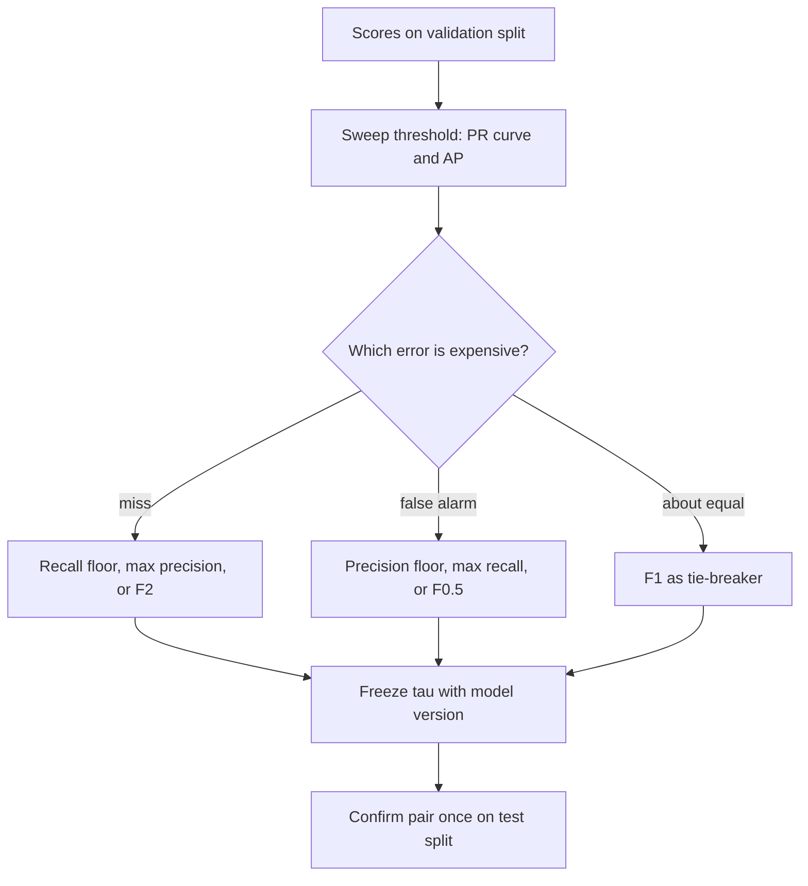

## TL;DR
Precision: of what I flagged, how much was right. Recall: of what was there, how much I found. The
threshold trades them, so a scorer is a curve; F1 picks one point and assumes both errors cost the same,
which production rarely grants.

## Why it exists
- **Accuracy is dominated by the common class.** On 2%-positive data a model that finds nothing scores 98%.
- **Accuracy treats a false alarm and a miss as the same error.** In fraud, abuse, prompt-injection or
  hallucination detection they have different owners and different costs.
- **Information retrieval made the failure extreme.** For a query over a million documents, true negatives
  number in the hundreds of thousands and say nothing about the search engine. So the field built its
  measures from the informative cells: relevant returned (TP), irrelevant returned (FP), relevant missed (FN).
- **Every detection task has the same shape,** which is why the retrieval vocabulary now covers
  classifiers, extractors, guardrails and RAG pipelines.
- **Each metric alone is trivially gamed, and so is their average.** Precision is maximised by flagging the
  single most certain item, recall by flagging everything. Precision 1.0 and recall 0.1 average to 0.55,
  rewarding a model that found almost nothing. Van Rijsbergen's effectiveness measure resists this, and F1 is
  its most common form.

## How it works
### Definitions from the confusion matrix
| Metric | Formula | Conditions on | Depends on |
|---|---|---|---|
| Precision P | TP / (TP + FP) | the prediction | the model *and* the base rate |
| Recall R (sensitivity, true-positive rate) | TP / (TP + FN) | the truth | the model alone |

- **Both ignore TN deliberately,** because in retrieval it is unbounded and in most detection settings it is
  uninteresting.

### Why the harmonic mean
- **F1 = 2PR / (P + R) = 2TP / (2TP + FP + FN).** The harmonic mean is pulled toward the smaller input: for
  P = 1.0 and R = 0.1 the arithmetic mean is 0.55 but F1 ≈ 0.18.
- **Chosen *because*** a score that can be bought by sacrificing one side is not a score of effectiveness.
- **Hidden assumption:** FP and FN are weighted equally in the denominator. When that is wrong, use the
  general form:

```
F_beta = (1 + beta^2) * P * R / (beta^2 * P + R)
```

- **β is how many times more you value recall than precision.** F2 for screening, where a miss is the
  expensive error; F0.5 where a false alarm is (for example, automatically blocking a user). F1 is β = 1.

Two consequences of the formula:
1. **F1 is not symmetric in the labels.** It has no TN term, so relabelling which class is "positive"
   changes F1, and a constant classifier that flags everything scores 2π / (1 + π) at prevalence π, not zero.
   When both classes matter, MCC uses all four cells.
2. **For calibrated scores the F1-maximising threshold is exactly half the F1 it achieves** (Lipton, Elkan &
   Narayanaswamy). If the best attainable F1 is 0.4, the best threshold is 0.2. Since F1 ≤ 1, that threshold
   is never above 0.5, the formal reason "maximise F1 at τ = 0.5" is almost always wrong on rare positives.

### The threshold is the knob
1. **A scorer outputs s(x);** predict positive when s(x) ≥ τ.
2. **Lowering τ flags more items:** recall can only go up (it is monotone in τ); precision usually goes
   down, but not monotonically.
3. **Plot (R(τ), P(τ)) for every τ** to get the precision–recall curve. A random scorer sits on a horizontal
   line at the prevalence, the floor to compare against.
4. **Average precision summarises it threshold-free:** AP = Σ_n (R_n − R_{n−1}) · P_n (scikit-learn's
   definition, which avoids the optimism of trapezoidal interpolation).
5. **Take the operating point from a product constraint on a validation split.** "Maximum precision subject
   to recall ≥ 0.9" beats "maximum F1", because it states which error you refuse to make.

### Prevalence changes precision, not recall
Fix a model with TPR 0.9 and FPR 0.01, on 1,000 items:

| Prevalence | TP | FP | Precision |
|---|---|---|---|
| 10% | 90 | 9 | ≈ 0.91 |
| 1% | 9 | 9.9 | ≈ 0.48 |

- **Nothing about the model changed;** only the pool of negatives feeding the FP count did.
- **So** precision measured on a balanced benchmark does not transfer to a 1%-positive production stream,
  while recall, in expectation, does.

### Averaging across classes
Each class gets one-vs-rest P, R and F1, then you aggregate:

| Average | How | Behaviour | Use when |
|---|---|---|---|
| Micro | pool TP, FP, FN counts first | in single-label multi-class, micro-P = micro-R = micro-F1 = accuracy | the promise is per item |
| Macro | unweighted mean of per-class scores | a rare intent counts as much as a common one; honest for long tails, noisiest | the promise is per class |
| Weighted | mean weighted by support | behaves like accuracy | a stable summary is enough |

- **Why micro equals accuracy:** every misclassified item is one class's FP and another class's FN.

### Undefined corners
- **Precision with zero predicted positives is 0/0;** scikit-learn's `zero_division` parameter decides what to
  return and warns by default.
- **Recall with zero actual positives is likewise undefined,** one reason to stratify small evaluation sets.
- **Per-class metrics with a support of three are noise;** always print the support column.

### Where it shows up in LLM systems
- **Retrieval:** with R relevant chunks and the top k retrieved, precision@k = (relevant in top k) / k and
  recall@k = (relevant in top k) / R. Recall@k decides whether the generator can possibly answer;
  precision@k decides how much noise it must ignore. k plays the threshold: raising k trades precision for
  recall exactly as lowering τ does.
- **Extraction:** span-level precision and recall, exact or partial match.
- **Extractive QA:** token-level F1 between predicted and gold answer strings (the SQuAD convention,
  reported alongside exact match).
- **Guardrails:** recall on injections versus the false-block rate on legitimate traffic.
- **Hallucination detection:** recall on fabricated claims is the safety number, precision the annoyance number.
- **LLM-as-judge:** treat the judge as a classifier and compute its precision and recall on a human-labelled
  set before trusting its pass rate.

## Diagram
One scorer, many products: the threshold choice comes from the product constraint, not from F1.



## Examples
### Hallucination detector: thresholds, a recall spec, micro vs macro
A hallucination detector scores 2,000 answers, about 5% containing a hallucination. The code:
1. computes precision, recall and F1 at three thresholds;
2. finds the threshold meeting "catch at least 90% of hallucinations" with the best precision;
3. contrasts micro and macro on a three-class router whose rarest class is never predicted (micro-F1 = 0.94
   because accuracy is 94%; macro-F1 ≈ 0.57 because the missing class contributes a 0).

```python
import numpy as np
from sklearn.metrics import (precision_recall_fscore_support, precision_recall_curve,
                             average_precision_score, f1_score)

rng = np.random.default_rng(0)
y = (rng.random(2_000) < 0.05).astype(int)                      # 1 = answer contains a hallucination
score = np.where(y == 1, rng.normal(0.65, 0.15, 2_000),          # detector score: positives score higher,
                 rng.normal(0.35, 0.15, 2_000)).clip(0, 1)       # but the two populations overlap

for tau in (0.5, 0.4, 0.3):
    p, r, f, _ = precision_recall_fscore_support(y, score >= tau, average="binary", zero_division=0)
    print(f"tau={tau}: precision={p:.2f} recall={r:.2f} F1={f:.2f} flagged={(score >= tau).sum()}")
# One run: tau=0.5 P=0.21 R=0.77 (405 flagged); 0.4 P=0.13 R=0.93 (815); 0.3 P=0.08 R=1.00 (1,327)

# Product spec: "catch at least 90% of hallucinations". Pick the most precise threshold that does.
prec, rec, thr = precision_recall_curve(y, score)
feasible = rec[:-1] >= 0.90                                      # the last curve point has no threshold
i = np.argmax(np.where(feasible, prec[:-1], -1))
print(f"recall>=0.90 -> tau={thr[i]:.3f}, precision={prec[i]:.2f}, AP={average_precision_score(y, score):.3f}")
# In real work choose tau on a validation split; the test split only confirms the pair you promised.

# Multi-class: macro treats a rare intent as equal to a common one; micro equals accuracy.
yt = np.array([0] * 90 + [1] * 8 + [2] * 2)
yp = np.array([0] * 88 + [1] * 2 + [1] * 6 + [0] * 2 + [0] * 2)  # the 2-example class is never predicted
print("micro", f1_score(yt, yp, average="micro"), "macro", round(f1_score(yt, yp, average="macro"), 3))
```

- **Same model, three products.** As τ drops from 0.5 to 0.3, recall climbs from 0.77 to 1.0, precision falls
  from 0.21 to 0.08, and the flagged count more than triples.
- **Why precision is so low:** the score distributions are two standard deviations apart (a ROC-AUC around
  0.92), but at 5% prevalence there are nineteen negatives per positive, so the negatives' overlapping tail
  fills the queue. Average precision of about 0.5 says the same in one number.
- **The spec, not F1, picks the point.** In one run "recall ≥ 0.90" lands at τ ≈ 0.42 with precision ≈ 0.14:
  about seven flags reviewed per hallucination caught, which is the number to agree with the review team.

### F-beta and retrieval at k, in plain Python
How β reweights the same (P, R) pair, and how k acts as the threshold for a retriever.

```python
def f_beta(p, r, beta=1.0):
    b2 = beta * beta
    return 0.0 if p == 0 and r == 0 else (1 + b2) * p * r / (b2 * p + r)

def at_k(ranked_ids, relevant, k):
    hits = sum(1 for d in ranked_ids[:k] if d in relevant)
    return hits / k, hits / len(relevant)          # precision@k, recall@k

p, r = 0.60, 0.90                                  # a high-recall, noisy detector
for beta in (0.5, 1, 2):
    print(f"F{beta}: {f_beta(p, r, beta):.3f}")    # F0.5 0.643, F1 0.720, F2 0.818

ranked = ["d7", "d2", "d9", "d4", "d1", "d8", "d3", "d5"]
relevant = {"d2", "d4", "d5"}
for k in (1, 3, 5, 8):
    pk, rk = at_k(ranked, relevant, k)
    print(f"k={k}: precision@k={pk:.2f} recall@k={rk:.2f}")
# k=1 0.00/0.00, k=3 0.33/0.33, k=5 0.40/0.67, k=8 0.38/1.00
```

- **F2 rewards this detector, F0.5 punishes it,** because its strength is recall.
- **Recall@k never falls as k grows;** precision@k wanders. If recall@5 is 0.67, one relevant chunk never reaches a
  top-5 generator, whatever the prompt says.

## Production patterns
- **Recall floor as the release gate.** Encode the product constraint ("recall ≥ 0.9 at best precision") in
  the eval harness, pick τ with `precision_recall_curve` on validation, and store τ with the model version.
  Monitor recall on a labelled audit sample and precision from reviewer verdicts.
- **Report volume, not just ratios.** Alongside precision and recall, publish expected flags per day at
  production prevalence from TPR and FPR. Monitor actual flag volume; a jump with no model change means the
  base rate or input distribution moved.
- **Per-class tables with support.** Use `classification_report` (or `precision_recall_fscore_support` with
  `average=None`) so every class shows P, R, F1 and support. Alert on per-class recall drops, not only
  macro-F1, and suppress alerts for tiny-support classes.
- **Retrieval measured separately from generation.** Log recall@k and precision@k for retrieval on a labelled
  query set on every index or chunking change, before touching prompts. Monitor recall@k per query segment.
- **Judges validated as classifiers.** Before trusting an LLM judge's pass rate, compute its precision and
  recall on the failure class against a human-labelled set, and re-run it when the judge model or prompt changes.

## Trade-offs
- **One comparable number vs hidden costs.** F1 bakes in "a false alarm costs the same as a miss"; it flips
  to Fβ or "recall at a fixed precision" as soon as one error is clearly more expensive, which is nearly
  always in production.
- **Precision shows the queue but moves with prevalence; recall is portable but blind to junk.** On a
  shifting base rate, report the (TPR, FPR) pair plus the expected alert volume instead.
- **Macro protects rare classes vs noise.** It makes the headline hostage to tiny-support classes whose
  estimates are noise; micro and weighted are stable but hide long-tail collapse. Choose by whether the
  promise is per item or per class.
- **Threshold-free summaries vs the shipped point.** AP compares rankers fairly, but you ship one threshold;
  a model with higher AP can be worse at the single operating point you need.

## Pitfalls
- **Reporting F1 at the default 0.5 threshold.** Symptom: "the model only has 0.3 recall" when lowering τ to
  0.2 would give 0.85 recall at an acceptable precision. Fix: sweep τ on validation.
- **Choosing the threshold on the test set.** Symptom: the promised precision/recall pair is not reproduced
  on the next batch, because the selection leaked test labels into the decision. Fix: pick on validation.
- **Comparing precision across datasets with different prevalence.** Symptom: a model that "degraded" when it
  moved from a 50/50 benchmark to 2% production traffic without changing at all. Fix: compare (TPR, FPR).
- **Choosing the positive class by convention rather than by what the product detects.** Symptom: an F1 that
  changes sharply when someone relabels the classes, because F1 ignores true negatives.
- **Quoting macro-F1 with classes of support one to five.** Symptom: the metric swinging by 0.1 between runs
  with no model change. Fix: print support and track micro alongside.
- **Blaming the generator when recall@k is the problem.** Symptom: weeks of prompt tuning while the right
  chunk is not in the top-k at all. Fix: measure recall@k before touching prompts.
- **Token F1 on free-text LLM answers against one gold phrasing.** Symptom: correct paraphrases marked wrong.
  Normalise aggressively or use a judge for anything non-extractive.

## When to use
- **Use when** the positive class is what matters and negatives are plentiful or uninteresting: detection,
  extraction, retrieval, moderation, routing to a rare action.
- **Report** them as a pair at a threshold chosen on validation, with prevalence and support; add the PR curve
  or AP when comparing scorers.
- **Choose the summary by cost knowledge:** F1 as a tie-breaker for dashboards and leaderboards, Fβ when costs
  are asymmetric and roughly known, a cost-weighted expected loss when they are known precisely.
- **Avoid when** the negative class matters as much as the positive; then look at specificity or balanced
  accuracy too.
- **Interviews:** derive F1 from the matrix, explain why the harmonic mean, and show how prevalence moves
  precision but not recall.

## Role lens
- **Engineer:** Writes the threshold sweep into the eval harness, stores the chosen τ with the model
  version, and reports recall@k and precision@k for retrieval separately from answer quality.
- **Architect:** Translates the business constraint into which metric is fixed and which is maximised
  (recall floor versus false-alarm budget) and makes that the acceptance criterion for every release.
- **FDE:** Asks the customer which error they would rather explain to their users, sets β or the recall
  floor from that answer, and shows the precision–recall curve so they see what each choice costs.

## Check yourself
**Q:** Your prompt-injection detector has precision 0.95 and recall 0.60 on the evaluation set. The
security team wants recall of at least 0.95. What will happen to precision, and how do you decide
whether the result is acceptable?
**A:** Raising recall means lowering the threshold, which flags more borderline inputs, so precision
falls; how far depends on how much the score distributions of injections and benign messages overlap,
which the precision–recall curve on the validation split shows directly. Acceptability is a volume
question, not a ratio question: at a production prevalence of 0.1%, every 100,000 messages contain
about 100 injections, recall 0.95 catches 95, and if precision drops to 0.5 there are also 95 false
blocks, roughly one legitimate message in a thousand. Whether that is acceptable depends on what a
false block costs (friction, a fallback to human review). If it is too high, the usual move is a
two-stage design: this high-recall detector feeding a slower, more precise check on the small flagged
set.

## Interview questions
### Define precision and recall, and explain why F1 uses the harmonic mean.
- **Definitions:** precision = TP / (TP + FP), of what I flagged how much was right; recall = TP / (TP + FN),
  of what existed how much I found.
- **Harmonic mean:** it is pulled toward the smaller value, so precision 1.0 with recall 0.1 gives F1 ≈ 0.18
  rather than 0.55; a score bought by sacrificing one side is not effectiveness.

### Your RAG answers are poor. How do you tell whether retrieval or generation is at fault?
- **Measure retrieval alone:** on a labelled query set, compute recall@k; if the right chunk is often not in
  the top k, the generator cannot answer whatever the prompt.
- **Then precision@k:** low precision means the generator must ignore a lot of noise.
- **Only then tune generation,** with retrieval held fixed, so you know which change moved the score.

### When would you not report F1?
- **Asymmetric costs:** a missed injection and a false block cost different amounts, so use Fβ or a recall
  floor with best precision.
- **Both classes matter:** F1 ignores TN and changes when you relabel the positive class; use MCC, specificity
  or balanced accuracy.
- **At τ = 0.5 on rare positives:** the F1-optimal threshold for calibrated scores is half the best F1, so
  never above 0.5.

### A detector has TPR 0.9 and FPR 0.01. What precision do you expect at 10% and at 1% prevalence?
- **Per 1,000 items at 10%:** 90 TP and 9 FP, precision ≈ 0.91.
- **At 1%:** 9 TP and 9.9 FP, precision ≈ 0.48. Recall stays 0.9 in both because it conditions on positives only.
- **So quote volume:** expected flags per day at production prevalence, not benchmark precision.

### Macro-F1 jumps by 0.1 between two runs with no model change. What is going on?
- **Likely tiny-support classes:** with one to five examples a class's F1 swings wildly, and macro gives it the
  same weight as large classes.
- **Fix the reporting:** print support per class, add more examples for rare classes, and track micro or
  weighted alongside macro.

## Quiz
### Q: A classifier has precision 1.0 and recall 0.1. What is its F1, and why does it differ from the arithmetic mean of 0.55?
- [ ] 0.55, because F1 is the average of precision and recall
- [x] About 0.18, because the harmonic mean is pulled toward the smaller value
- [ ] About 0.32, because F1 is the geometric mean
- [ ] 0.10, because F1 equals the minimum of the two
> F1 = 2 × 1.0 × 0.1 / 1.1 ≈ 0.18. The harmonic mean punishes imbalance so a model cannot score well by
> sacrificing one side; the geometric mean would be about 0.32 and the minimum 0.10, and neither of
> those is F1.

### Q: A model has TPR 0.9 and FPR 0.01 on a balanced benchmark. In production positives are 1% of traffic. Which metric transfers unchanged in expectation?
- [ ] Precision
- [ ] F1
- [x] Recall
- [ ] All three
> Recall is the TPR and conditions only on positives, so prevalence cancels. Precision mixes true
> positives with false positives whose count scales with the number of negatives: per 1,000 items the
> model goes from about 450 TP against 5 FP to 9 TP against 9.9 FP, so precision falls from 0.99 to
> about 0.48, and F1 falls with it.

### Q: In single-label multi-class classification, micro-averaged F1 is always equal to which quantity?
- [ ] Macro-averaged F1
- [x] Accuracy
- [ ] The F1 of the largest class
- [ ] The mean of the per-class recalls
> Pooling counts makes total FP equal total FN, because each misclassified item is a false positive for
> the predicted class and a false negative for the true class; micro-precision, micro-recall and
> micro-F1 therefore all equal correct/total. Macro-F1 differs whenever classes perform unequally.
