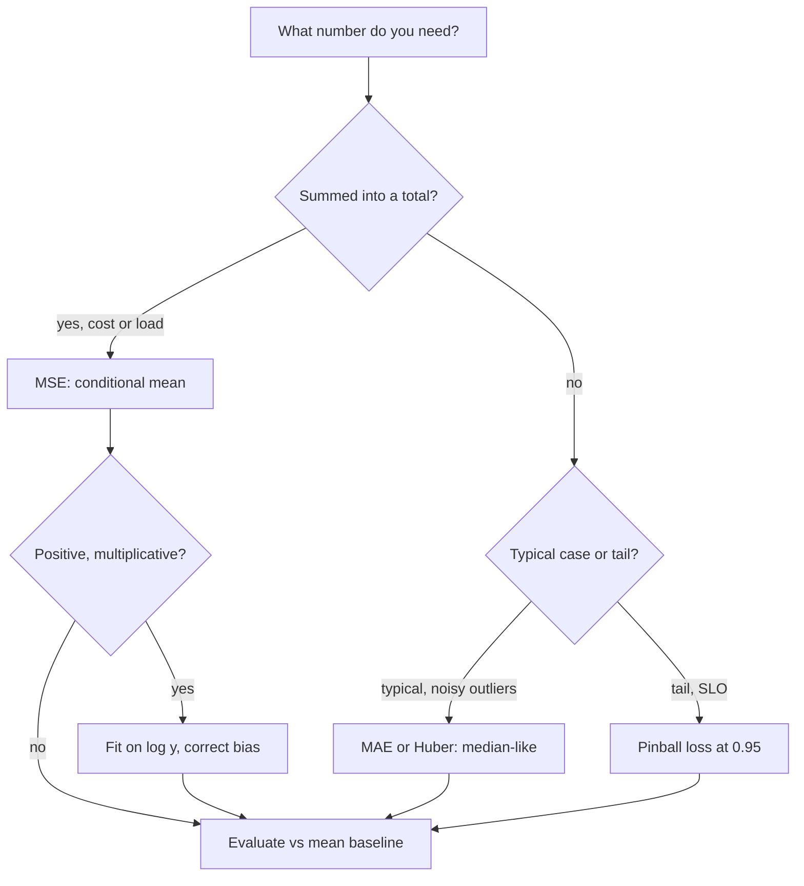

## TL;DR
Agents need numbers before they act: predicted run cost, step count, latency, a reward or judge score.
Regression predicts them, and squared versus absolute versus quantile loss decides whether you get the
mean, median or tail your budget needs.

## For agent builders
- **Why it matters for agents.** Agent runs are heavy-tailed: most finish in a few steps and cents, a few
  loop for dozens of steps and dollars. Budgets, timeouts, model-tier routing and capacity plans all rest
  on a predicted quantity, and the loss you fit decides whether that prediction is the average, the
  typical run or the tail.
- **Where it shows up in your stack.** Cost and latency predictors that pick a model tier before a run,
  step and token budgets, reward models (an LLM with a scalar head) used in preference tuning, LLM-judge
  1–5 scores, and token-usage forecasts for capacity.
- **What you control.** The target transform (log cost), the loss (mean, median or quantile), the feature
  contract (only what exists before the run starts) and the baseline you must beat.
- **What you can skip.** The normal-equation algebra and ridge derivations. Know which statistic each
  loss estimates, why log targets need a bias correction, and how leakage sneaks in.

## Why it exists
- **Some questions are "how much", not "which".** How long will this request take, how many steps will
  this agent run need, what will this month's token bill be, how good is this response on a scale.
- **Bucketing and classifying throws away order and resolution.** A prediction of "200–500 ms" cannot be
  summed into a capacity plan, and a value just over a bucket edge is treated as a different category from
  one just under it.
- **Lookup tables of averages per group do not scale.** They cannot interpolate to combinations they have
  not seen and explode combinatorially as features are added.
- **What is needed:** a function from features to a number plus a differentiable notion of error. Least
  squares was invented for astronomy to combine noisy observations into one estimate; machine learning
  kept the frame and replaced the linear function with anything differentiable.
- **The loss is a statement about the noise.** Squared error is the maximum-likelihood choice if the
  noise is Gaussian, and its minimiser is the conditional mean. If the noise is heavy-tailed or you care
  about the typical case, change the loss, not just the model.

## How it works
### The model
- **Form:** ŷ = f_θ(x). The simplest is linear, ŷ = wᵀx + b.
- **Linear is more powerful than it looks,** because x can contain transformed features: log(tokens),
  tokens², an embedding, an indicator for the model tier.
- **Neural regressors** apply the same final linear layer to learned features. A **reward model** is an
  LLM whose output head produces a single scalar instead of vocabulary logits.
- **Naming trap:** "logistic regression" is a classifier despite its name: it regresses the log-odds,
  then thresholds a probability.

### The loss decides what you estimate
At a fixed x, choose the single prediction c that minimises the expected loss over the noisy y values
seen there:

```
squared error:  d/dc E[(c − y)²] = 2(c − E[y]) = 0      ->  c = E[y], the mean
absolute error: d/dc E|c − y| = P(y < c) − P(y > c) = 0  ->  half the mass each side: the median
```

On latencies of 100, 110, 120 and 2,000 ms, MSE wants about 583 ms and MAE anything between 110 and
120 ms; neither is wrong, they answer different questions.

| Loss | Estimates | Behaviour |
|---|---|---|
| **Mean squared error**, mean (ŷ − y)² | E[y \| x], the conditional mean | gradient 2(ŷ − y) grows with the error, so a point 10× further away pulls 10× harder; outliers dominate |
| **Mean absolute error**, mean \|ŷ − y\| | the conditional median | gradient ±1 regardless of distance, so robust to outliers, but not smooth at zero and slower near the optimum |
| **Huber** | between mean and median | quadratic for \|ŷ − y\| ≤ δ, linear beyond: smooth near the solution, robust far from it; δ is where you decide "this residual is an outlier" |
| **Quantile (pinball)** | a chosen quantile | for a p95 latency target, fit the 0.95 quantile directly rather than predicting the mean and guessing the tail |
| **MSE on log y** | the geometric mean | for positive, multiplicative quantities (costs, latencies, durations); penalises relative rather than absolute error; evaluate on the original scale |

### Background: fitting
- **Closed form for linear + MSE:** the normal equation w = (XᵀX)⁻¹Xᵀy, costing roughly O(d³) in the
  number of features plus O(nd²) to build XᵀX.
- **Gradient descent** for non-linear models, huge n or huge d.
- **Standardise first.** Gradient descent on unscaled features is slow or unstable because the condition
  number of XᵀX governs convergence, so standardising features is the first step, not an afterthought
  (see the gradient-descent lesson).

### Background: regularisation
| Penalty | Effect | Note |
|---|---|---|
| Ridge, λ\|\|w\|\|² | shrinks coefficients, stabilises collinear fits | closed form (XᵀX + λI)⁻¹Xᵀy |
| Lasso, λ\|\|w\|\|₁ | drives some coefficients exactly to zero | selects features |

- **Why pay the bias: variance.** As the number of features approaches the number of rows, least squares
  starts fitting noise and test error climbs while training error falls.
- **λ is chosen by cross-validation** and sets where you sit on that trade.
- **Weight decay** in deep networks is the same idea: for plain SGD it is exactly ridge; for Adam see the
  optimizers lesson.

### Evaluation
- **RMSE** is in the units of the target and punishes large errors.
- **MAE** is easier to explain and robust.
- **R²** is the fraction of variance explained relative to predicting the mean; it can be negative on
  test data and is not comparable across datasets with different variance.
- **MAPE** breaks on targets near zero.
- **Always compare against a trivial baseline** (predict the training mean, or the last observed value).
- **Look at the residuals:** a fan shape means the noise grows with the prediction; a curve means the
  model is missing a non-linearity.

### Where it meets agents
- **Reward models** output a scalar trained from preference pairs.
- **LLM judges** emit 1–5 scores that are ordinal rather than truly continuous, so treat them with care.
- **Latency and cost predictors** drive routing between model tiers before an agent run starts.
- **Step and time budgets** are tail quantiles of run length, not means.
- **Value functions** in reinforcement learning are regressors; agent RL on task success uses them.
- **Token-usage forecasts** feed capacity planning for agent fleets.

## Diagram
The loss you pick decides which statistic of y the model learns; follow the question you need answered.



## Examples
### Agent scenario: setting a step budget from run logs
An agent fleet logs steps per completed run (illustrative distribution over 10,000 runs): median 6,
mean 9.7, p95 22, and a long tail of runs that looped on a failing tool.

| Budget set from | max steps | Runs cut off | What it means |
|---|---|---|---|
| Mean | 10 | roughly a third | many legitimate long tasks killed |
| Median | 6 | about half | half of all users see a truncated answer |
| p95 (pinball loss at 0.95, or the empirical quantile) | 22 | about 5% | only the tail is stopped, mostly loops |

Fit the tail per task type with a quantile model on request-time features, so a "summarise one file"
task gets a small budget and a "refactor this repo" task a large one.

### Agent scenario: predicting run cost on a log scale
Run cost is multiplicative in the number of tools offered, so fit log(cost), then correct the
back-transformed total, which is biased low.

```python
import math, random
random.seed(0)
runs = []                                         # (tools offered, dollar cost), synthetic
for _ in range(4000):
    tools = random.randint(1, 11)
    runs.append((tools, math.exp(-4 + 0.25 * tools + random.gauss(0, 0.8))))

xs = [t for t, _ in runs]; ys = [math.log(c) for _, c in runs]
mx, my = sum(xs) / len(xs), sum(ys) / len(ys)
b = sum((x - mx) * (y - my) for x, y in zip(xs, ys)) / sum((x - mx) ** 2 for x in xs)
a = my - b * mx                                   # least squares on log(cost)
smear = sum(math.exp(y - (a + b * x)) for x, y in zip(xs, ys)) / len(xs)   # bias correction factor

actual = sum(c for _, c in runs)
naive = sum(math.exp(a + b * x) for x in xs)
print(f"actual ${actual:.0f}  naive ${naive:.0f}  corrected ${naive * smear:.0f}")
# actual $598  naive $436  corrected $595: without the correction the budget runs ~27% low
```

### Latency model: closed form vs gradient descent
A latency model from serving logs, fitted two ways. The closed form recovers the generating
coefficients directly; gradient descent recovers them too, but only after the features are scaled,
because prompt lengths in the thousands make the raw problem badly conditioned.

```python
import numpy as np
rng = np.random.default_rng(0)

# Synthetic serving logs (illustrative): latency ≈ 40 + 0.05*prompt_tokens + 25*output_tokens + noise.
# Output tokens are fine for *explaining* past latency (per-token decode cost for capacity planning);
# a request-time predictor could not use them, because they are unknown before generation (see Pitfalls).
n = 5000
prompt = rng.integers(50, 4000, n); out = rng.integers(1, 400, n)
latency = 40 + 0.05 * prompt + 25 * out + rng.normal(0, 30, n)

X = np.column_stack([np.ones(n), prompt, out]).astype(float)   # bias column + 2 features
w_closed = np.linalg.solve(X.T @ X, X.T @ latency)              # normal equation
print("closed form:", np.round(w_closed, 3))                    # ≈ [40, 0.05, 25]

# Gradient descent on MSE: standardise features first, or the 'prompt' axis dominates the curvature
mu, sd = X[:, 1:].mean(0), X[:, 1:].std(0)
Xs = np.column_stack([np.ones(n), (X[:, 1:] - mu) / sd])
w = np.zeros(3)
for _ in range(2000):
    grad = 2 * Xs.T @ (Xs @ w - latency) / n
    w -= 0.1 * grad
print("GD intercept (= mean latency in scaled space):", round(w[0], 1))
print("GD slopes back in original units:", np.round(w[1:] / sd, 3))   # ≈ [0.05, 25]
```

### Which statistic does each loss pick?
Pure Python, no libraries: find the constant prediction that minimises each loss on the four latencies
from How it works.

```python
y = [100, 110, 120, 2000]                       # latencies in ms

def mse(c):  return sum((c - v) ** 2 for v in y) / len(y)
def mae(c):  return sum(abs(c - v) for v in y) / len(y)
def pinball(c, q):
    return sum(max(q * (v - c), (q - 1) * (v - c)) for v in y) / len(y)

grid = [i / 2 for i in range(0, 4201)]          # constant predictions 0..2100 ms
best = lambda loss: min(grid, key=loss)
print("MSE picks", best(mse))                    # 582.5, the mean
flat = [c for c in grid if mae(c) == mae(best(mae))]
print("MAE picks", flat[0], "to", flat[-1])      # 110.0 to 120.0, any median
print("pinball q=0.95 picks", best(lambda c: pinball(c, 0.95)))  # 2000.0, the top of the tail
```

| Loss | Prediction | Answers |
|---|---|---|
| MSE | 582.5 ms | "what is the average, to sum into a budget?" |
| MAE | 110 to 120 ms | "what does a typical request take?" |
| Pinball, q = 0.95 | 2,000 ms | "what latency must the SLO tolerate?" (with four points the tail is a single request) |

## Production patterns
- **Budget agent runs from tail quantiles.** Set max steps, token budgets and wall-clock timeouts per task
  type from the p95 or p99 of logged runs (a quantile model or the empirical quantile), not the mean.
  Monitor the share of runs hitting the budget and read a sample of them: loops should dominate.
- **Ship a naive baseline first.** Before any model, log the error of "predict last week's mean" per
  segment. Every candidate must beat it on MAE and RMSE; monitor the gap over time, because drift often
  erases it. Report error by model tier, prompt-length bucket, task type and customer, not just overall,
  because routing and capacity decisions fail in specific segments.
- **Quantile models for SLOs.** Fit the tail directly, for example scikit-learn
  `GradientBoostingRegressor(loss="quantile", alpha=0.95)`, or `QuantileRegressor` for a linear model.
  Monitor empirical coverage: about 95% of real latencies should fall under the predicted p95.
- **Robust fits on noisy logs.** When a few pathological requests distort the fit, use scikit-learn
  `HuberRegressor` or a Huber loss in your framework. Monitor coefficients across retrains for stability.
- **Log-target with bias correction for cost.** Fit on log(cost), then compare summed predicted spend
  with actual spend each week; apply a multiplicative correction if the back-transformed totals run low.
- **Request-time feature contract.** Keep a list of features available before the request runs (prompt
  length, tier, tool flags) and fail the training job if any other feature appears. Monitor the
  offline-vs-online error gap, which is the signature of leakage.

## Trade-offs
- **MSE vs robust losses.** MSE is smooth and estimates the mean, which is what you want when predictions
  will be summed into a total such as monthly cost, but a handful of extreme points can drag the whole
  fit. Switch to MAE or Huber when the tail is noise rather than signal.
- **Linear vs flexible models.** A linear model is interpretable, data-efficient and extrapolates
  predictably; trees and neural regressors capture interactions and curvature at the cost of overfitting
  and erratic extrapolation. The balance tips toward flexible models when n is large and the relationship
  is clearly non-linear.
- **Point prediction vs tail or interval.** A single number is simple, but SLO and capacity decisions
  need a tail quantile or an interval, which costs an extra model or a quantile loss.
- **Log target vs bias.** Fitting on log(y) gives relative error and positive predictions, but the
  back-transformed mean is biased low; correct for it or report medians when you use it.

## Pitfalls
- **Extrapolating beyond the training range.** Symptom: confident predictions for 32k-token prompts from
  a model that only ever saw up to 4k, and a sharp error jump at the boundary.
- **Leakage through features known only after the target.** Using output token count to predict latency
  gives a near-perfect offline R² and a model that cannot be run at request time because the feature does
  not exist yet.
- **Optimising MSE and then reporting MAPE or median error.** Symptom: metrics that disagree and a model
  tuned for a quantity nobody reads.
- **Averaging ordinal judge scores as if 1–5 were a ratio scale.** Symptom: "quality went from 3.2 to 3.4"
  claims with no idea whether that gap means anything. For agent evals, report pass rates against a
  rubric threshold or pairwise win rates, and check judge agreement with humans.
- **Ignoring heteroscedastic noise.** Symptom: a residual plot that fans out and prediction intervals that
  are far too narrow for large requests.
- **Budgeting agent runs on the mean.** Symptom: a max-steps limit set at the average run length cuts off
  a large share of legitimate long tasks. Budget from a tail quantile per task type instead.
- **High-leverage points.** A few requests with extreme feature values, such as one 100k-token prompt in a
  set of short ones, can swing a linear fit on their own. Symptom: coefficients that move sharply when a
  handful of rows are dropped. Fix: inspect influence (for example Cook's distance), cap or log-transform
  the feature, or fit that segment separately.
- **Collinear features.** Symptom: coefficients that flip sign between retrains while predictions barely
  change, which destroys any story told about feature importance.

## When to use
- **Use when** the output is a quantity and the size of the error matters. Day to day it appears in
  latency and cost predictors for routing, agent step and token budgets, reward and judge heads, and
  usage forecasting.
- **Avoid when** the quantity is a probability of an event in disguise (classify, then take an expected
  value), or when you need the whole distribution rather than a point (quantile regression or a
  probabilistic model).
- **Measure** RMSE and MAE against a naive baseline, inspect residuals, and report per-segment error,
  because an average hides the segments where routing or capacity decisions actually go wrong.
- **Interviews:** expect "why does MSE estimate the mean", "when would you use MAE or Huber", and the
  caveats around R².

## Role lens
- **Engineer:** Builds the scalar head or sklearn regressor, chooses the loss to match the noise, checks
  residual plots, and ships a mean-prediction baseline first so improvements are measurable.
- **Architect:** Decides where a predicted quantity drives a system decision, such as routing to a cheaper
  model or autoscaling on predicted load, and what error tolerance that decision can survive.
- **FDE:** Reconciles a customer's "predict it exactly" expectation with error bars, defines the target from
  their actual tables (resolution time, cost per case) and hunts leakage in their historical data.

## Check yourself
**Q:** You must predict the dollar cost of each request before it runs, to route it between a cheap
and an expensive model. Costs are heavy-tailed: most requests cost cents, a few cost dollars. Which loss
and target transform do you use, and how do you evaluate?
**A:** Costs are positive and multiplicative, so fit on log(cost) with MSE, which penalises relative error
and stops a few dollar-sized requests dominating; Huber on the raw scale is the alternative if the tail
is mostly noise. Features must be available before the request runs (prompt length, user tier, tool
flags), never output length, or the model leaks. Evaluate on the original dollar scale: MAE and RMSE
against a baseline that predicts last week's mean, calibration of predicted total spend against actual
spend (the back-transformed log mean is biased low and needs a correction), and above all the routing
decision quality: what fraction of genuinely expensive requests were sent to the expensive model and how
much cheap traffic was misrouted. Check error separately for the tail, because that is where routing
pays off.

## Interview questions
### Why does minimising squared error give you the conditional mean?
- **Derivation:** at fixed x, the derivative of E[(c − y)²] with respect to c is 2(c − E[y]), which is
  zero at c = E[y].
- **Contrast:** absolute error is minimised where half the mass lies on each side, the median.
- **Why it matters:** pick MSE when predictions are summed into totals, because sums of means are
  unbiased; pick median-like losses when you care about the typical case.

### Your latency model has R² = 0.6 and residuals fan out for long prompts. What do you do?
- **Diagnose:** a fan shape is heteroscedastic noise; the error grows with request size.
- **Fixes:** fit on log(latency) so error becomes relative, or model quantiles directly for the tail.
- **Re-evaluate** per prompt-length bucket and check interval coverage on the large requests.

### When would you not use R² to compare models?
- **Across datasets:** R² depends on the target's variance, so a model on a narrow-range dataset looks
  worse for the same absolute error.
- **On test data** it can be negative, meaning worse than predicting the mean.
- **For decisions:** report RMSE or MAE in target units, plus the routing or capacity outcome.

### The coefficients of your cost model flip sign between weekly retrains. Should you worry?
- **Likely collinearity:** correlated features let the fit trade weight between them while predictions
  barely change.
- **Predictions may be fine,** but any feature-importance story is not.
- **Fix:** ridge regularisation chosen by cross-validation, or drop or combine the correlated features.

### How would you set per-run step and time budgets for an agent from logs?
- **Quantile loss at 0.95,** for example gradient-boosted trees with a quantile objective, using only
  request-time features (task type, prompt length, tools offered), or the empirical p95 per task type.
- **Do not** add 1.645 residual standard deviations to a mean model; run lengths and latency residuals
  are skewed.
- **Monitor coverage:** about 95% of completed runs should fall below the budget, per segment, and the
  runs that hit it should mostly be loops.

### Your LLM judge's mean 1–5 score rose from 3.2 to 3.4 after a prompt change. Did the agent get better?
- **Not provably:** judge scores are ordinal, so a 0.2 change in the mean has no fixed meaning, and on a
  small eval set it may be noise.
- **Better readouts:** the pass rate at a rubric threshold (for example score of 4 or more), or a pairwise
  win rate of new versus old outputs, with a confidence interval from the number of cases.
- **Check the judge too:** measure its agreement with human labels on a sample before trusting any shift.

## Quiz
### Q: Which statement about MSE versus MAE is correct?
- [ ] MAE estimates the conditional mean and MSE the conditional median
- [x] MSE's minimiser is the conditional mean and its gradient grows with the error, so outliers pull the fit harder than under MAE
- [ ] MAE is differentiable everywhere and MSE is not
- [ ] For linear models the two losses always produce the same coefficients
> The gradient of a squared residual is proportional to the residual, so distant points dominate and the
> solution moves toward the mean; absolute error has a constant-magnitude gradient and settles on the
> median, which is why it resists outliers.

### Q: A latency regressor reaches R² = 0.98 offline but is useless in production. What is the most likely cause?
- [ ] The learning rate was set too high during training
- [ ] The target should have been standardised before fitting
- [x] A feature such as output token count is only known after the request completes, so the offline fit leaked the answer
- [ ] R² above 0.95 is not achievable on real data, so the evaluation code is wrong
> Output length almost determines latency, so including it yields a near-perfect fit; at request time the
> feature does not exist, so the model cannot be used. Leakage is the first suspect whenever an offline
> score looks too good.

### Q: You need a p95 latency estimate for SLO planning. What is the most defensible approach?
- [ ] Fit MSE and add 1.645 times the residual standard deviation to the prediction
- [x] Fit a quantile (pinball) loss at the 0.95 level
- [ ] Fit MAE and add the largest residual seen in training
- [ ] Train a classifier for "slow versus fast" and report its threshold
> Mean plus 1.645 standard deviations only works for Gaussian, constant-variance residuals; latency
> residuals are skewed and grow with request size. The pinball loss estimates the 95th percentile
> directly without that assumption.

## Use cases & projects
### Use cases
- **Model-tier routing by predicted cost.** Predict a run's token cost before it starts and send cheap,
  short tasks to a smaller model while long ones get a budget and a stronger model.
- **Step and timeout budgets.** A high-quantile prediction of step count or wall time sets a per-run
  cap that stops loops without killing legitimate long runs.
- **Reward models and judge scores.** A scalar head trained on preferences, or a 1-5 judge score, is a
  regression target whose noise and scale you must understand before optimising against it.
- **Capacity planning for agent traffic.** Forecasting tokens per hour drives GPU or rate-limit
  provisioning, where the tail matters more than the mean.

### Mini project
**Predict agent run cost before it starts (2-3 hours).**
- **Goal:** predict the token cost of an agent run from features available at request time, and use
  the p90 prediction as a budget.
- **Steps:** log (or simulate) 500 runs with request length, task type, tool count and final tokens;
  fit a mean baseline, an MSE model on log tokens and a quantile model at 0.9; evaluate on a time-based
  split with MAE and quantile coverage.
- **Done when:** you show the model beats the baseline, the p90 budget covers about 90% of held-out
  runs, and you name one feature you rejected because it would leak the future.
