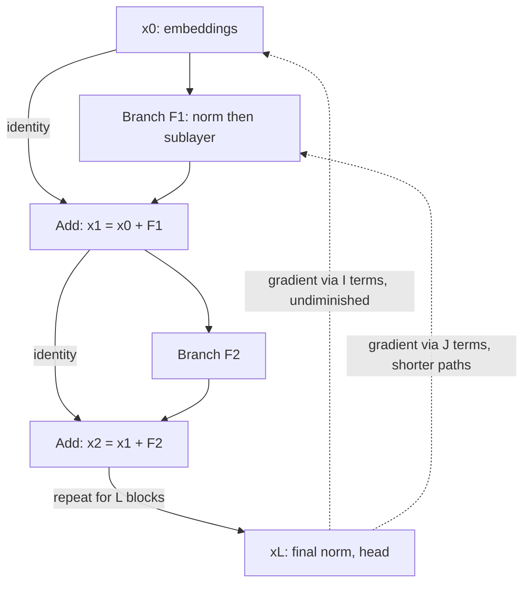

## TL;DR
A residual connection adds a layer's input to its output, `y = x + F(x)`, building the residual stream
every LLM shares across layers. For agent builders, that additive stream is why LoRA, steering, logit-lens
debugging and layer dropping behave predictably.

## For agent builders
- **Why it matters for agents.** You will not add skip connections, but you will adapt and debug the models
  behind your agents. LoRA adapters, activation steering and the logit lens all work because each layer
  adds into one shared stream rather than replacing it.
- **Where it shows up in your stack.** `target_modules` in a PEFT LoRA config (the projections that read
  from and write into the stream), forward hooks for interpretability or steering, and layer-pruned or
  early-exit variants of open models offered for low-latency routing.
- **What you control.** Which projections get adapters, which tensor you hook (the stream is a cumulative
  sum, the branch output is one layer's contribution), and whether a pruned model passes your agent eval.
- **What you can skip.** The ResNet history and the full `2^L` path derivation: remember that the identity
  path keeps gradients alive, which is why deep models fine-tune with ordinary settings.

## Why it exists
- **Deeper was supposed to be at least as good.** The 2014–2015 expectation: a 56-layer network can
  represent anything a 20-layer one can by making 36 layers compute the identity.
- **The experiment said otherwise.** He et al. trained plain convolutional stacks of 20 and 56 layers on
  CIFAR-10, and the deeper one had *higher training error*, not just higher test error.
- **It was an optimization failure.** Not overfitting (more capacity fit the training data worse) and not
  classic vanishing gradients (both used batch normalization and sound init, and gradients were not zero).
  Gradient descent from a random point could not find a solution known to exist, because learning an
  identity through random nonlinear layers is far from trivial: each layer must undo what the next does.
- **Existing fixes did not close the gap.** Careful init keeps activation scale constant at step zero but
  says nothing about step one thousand; normalization keeps inputs well-scaled but still asks every layer
  to transform its input; training longer did not help.
- **Change what a layer learns.** Learn the residual `F(x) = H(x) − x` instead of `H(x)`, and add the
  input back. Near-identity mappings mean `F` near zero, exactly where small random weights start. Networks
  of more than a hundred layers then trained without difficulty, and the transformer adopted the block
  within two years and has never dropped it.

## How it works
### What the agent builder does with it
- **Know what an adapter changes.** LoRA adds a low-rank term to a projection inside a branch (attention
  or MLP), so whatever it learns reaches the stream only as a change to that branch's added increment,
  which is why it can be switched off or swapped per agent.
- **Hook the right tensor.** The stream at layer k is the sum of all earlier writes; a layer's own
  contribution is its branch output.
- **Debug fine-tunes layer by layer.** The logit lens decodes intermediate streams, showing where a tuned
  agent model starts preferring a different tool or token.
- **Treat layer dropping as an eval question.** Any prefix of the sum is a usable output, so pruning is
  often cheap in quality, but only your agent eval says how cheap.

### Background: forward, additive composition
- **The block:** `y = x + F(x, W)`, where `F` is the sublayer: a pair of convolutions in a ResNet,
  attention or the MLP in a transformer.
- **Shapes must match** for the addition. That is why a ResNet uses a projection shortcut only where width
  or resolution changes, and why a transformer keeps `d_model` constant through every layer: the network
  is one vector of fixed width that successive layers add to.

Stack `L` blocks and the output is a sum:

```
x_L = x_0 + Σ_{l<L} F_l(x_l)
```

Each layer's contribution is a *term in a sum* rather than a *factor in a product*. That structural fact
is behind everything else.

### Background: backward, the identity term
Differentiate one block: `∂y/∂x = I + ∂F/∂x`. Through `L` blocks, the gradient with respect to an early
activation is

```
∂L/∂x_0 = ∂L/∂x_L × Π_l (I + J_l)        with  J_l = ∂F_l/∂x_l
```

1. **Expand the product:** a pure `I` term, every single `J_l`, every pair, and so on: `2^L` paths of
   different lengths.
2. **A plain network has one path,** the product of all `L` Jacobians. Many matrices with norm below one
   shrink exponentially; above one, they explode. Residuals keep that path and add the shorter ones beside
   it.
3. **So the gradient at layer 0 always contains `∂L/∂x_L` itself,** undiminished, plus corrections.
4. **Measured:** Veit et al. found most of the gradient in trained ResNets flows through paths only a few
   tens of layers long, even in a 110-layer network. That is why deleting one block at test time barely
   hurts a ResNet, while deleting a layer from a plain network destroys it.

### Background: why the shortcut must be the identity
- **Tested alternatives:** the identity-mappings follow-up tried scaling the skip path by a constant,
  gating it as highway networks did, and placing a 1×1 convolution or dropout on it.
- **All trained worse,** because anything multiplicative on the skip path turns the clean `I` back into a
  factor that compounds across depth.
- **Same logic for norms:** normalization belongs on the branch input (Pre-LN), not on the stream after
  the addition (Post-LN), when easy optimization is the goal; the normalization lesson covers that
  placement and its cost.

### The residual stream in a transformer
A decoder layer is `x ← x + Attn(Norm(x))`, then `x ← x + MLP(Norm(x))`. The vector `x`, of width
`d_model`, is the *residual stream*.

Heads and MLPs read it through input projections and write back
through output projections; because all writes are additive, it behaves like a shared bus later layers
read in any combination. Techniques that depend on this picture:

| Technique | Why it works on a sum |
|---|---|
| Logit lens | final norm plus unembedding on an intermediate `x` gives meaningful predictions; the stream at layer 12 is already a rough draft of the final one |
| LoRA | adds a low-rank term to a projection, so its downstream shift is predictable |
| Activation steering | adds a vector to the stream at one layer, with a predictable downstream shift |
| Early exit, layer dropping | any prefix of the sum is a usable, if coarser, output |

### What it costs and what it changes
- **The stream norm grows with depth,** because every layer adds. Deep Pre-LN models scale down the init
  of each branch's output projection (GPT-2 divides those weights by the square root of the number of
  residual layers) so the sum starts at a sensible scale; some recipes add a learned scalar per branch
  initialized near zero.
- **Activation memory:** the stream must be stored for backward at every layer, `[batch, seq, d_model]`
  per block, a visible slice of activation memory when fine-tuning on long agent traces.
- **Fixed width** spends capacity uniformly across depth; architectures that change width mid-network pay
  with projection shortcuts at those points.

## Diagram
Forward, each block adds its branch to the stream; backward, the dotted identity path carries the output
gradient to layer 0 untouched, beside the branch Jacobians.



## Examples
### Worked scenario: pruning layers from an agent's tool router
A team serves a 32-layer open model as the first-step tool router of an agent and wants lower latency.
Because the output is a sum of layer increments, they test dropping late blocks one at a time against a
500-case routing eval. Accuracy figures are illustrative; the method is the point.

| Blocks removed | Share of layer compute saved | Routing accuracy | Decision |
|---|---|---|---|
| 0 | 0% | baseline | reference |
| 2 (late layers) | ~6% | within noise of baseline | keep |
| 4 (late layers) | 12.5% | small drop on rare tools | keep only after a short LoRA heal |
| 4 (early layers) | 12.5% | large drop | reject: cost varies by layer |

- **Why it is possible at all:** any prefix of the residual sum is a usable output, and short paths
  dominate, so single blocks matter less than in a plain network.
- **Why you still measure:** the cost depends on which layer goes, and on rare tools more than common ones.

### Gradient at layer 1 of a 64-layer stack, with and without skips
A 64-layer stack of `tanh(Linear)` blocks with and without the skip connection, comparing the gradient
norm at the first layer with the last. The loss has a random target, so the output gradient is of order
one in both cases; what differs is how much of it reaches layer 1.

```python
import torch, torch.nn as nn
torch.manual_seed(0)
d, depth = 256, 64

class Block(nn.Module):
    def __init__(self, residual):
        super().__init__()
        self.lin, self.residual = nn.Linear(d, d), residual
    def forward(self, x):
        f = torch.tanh(self.lin(x))                 # the branch F(x)
        return x + f if self.residual else f        # y = x + F(x)   or   y = F(x)

def first_vs_last_grad(residual):
    net = nn.Sequential(*[Block(residual) for _ in range(depth)])
    x, target = torch.randn(64, d), torch.randn(64, d)
    nn.functional.mse_loss(net(x), target).backward()
    return net[0].lin.weight.grad.norm().item(), net[-1].lin.weight.grad.norm().item()

for residual in (False, True):
    first, last = first_vs_last_grad(residual)
    print(f"residual={residual!s:5} layer 1: {first:.1e}  layer {depth}: {last:.1e}  ratio: {first/last:.1e}")
# One CPU run, seed 0 (exact digits vary by version; the orders of magnitude do not):
#   residual=False  layer 1: 1.5e-16  layer 64: 1.1e-02  ratio: 1.3e-14
#   residual=True   layer 1: 1.9e+01  layer 64: 4.3e+00  ratio: 4.4e+00
# Plain stack: the layer-1 gradient is ~14 orders of magnitude below layer 64's, because it is the
#   product of 64 Jacobians each with norm below one (tanh' <= 1 and the default init shrinks variance).
# Residual stack: the two are within a small factor of each other, because the identity term in every
#   (I + J_l) carries dL/dx_64 straight back to layer 1 regardless of depth.
```

### Stream growth, scaled init, and why a learned skip scale hurts
Pure Python, no dependencies. It adds 96 random branch outputs (48 blocks × attention and MLP) to a
unit-scale embedding, with and without GPT-2-style `1/√N` scaling, then shows what a learned skip scale
`α` does to the identity path over 48 layers. Branch outputs are independent stand-ins, so the numbers are
illustrative.

```python
import math, random
random.seed(0)
d, n_blocks = 512, 48
n_res = 2 * n_blocks                         # attention + MLP branch per block = 96 residual adds

def stream_rms(branch_scale):
    x = [random.gauss(0, 1) for _ in range(d)]           # embedding, rms ~1
    for _ in range(n_res):
        f = [random.gauss(0, branch_scale) for _ in range(d)]   # stand-in for an independent branch output
        x = [a + b for a, b in zip(x, f)]                 # x <- x + F(x)
    return math.sqrt(sum(v * v for v in x) / d)

print(f"unscaled branches:        stream rms {stream_rms(1.0):.1f}")                 # ~sqrt(97) = 9.8
print(f"branches x 1/sqrt({n_res}): stream rms {stream_rms(1 / math.sqrt(n_res)):.2f}")  # ~sqrt(2) = 1.41

for alpha in (0.9, 0.95, 1.0, 1.05):                      # learned skip scale y = alpha*x + F(x)
    print(f"alpha={alpha}: identity-path factor over {n_blocks} layers = {alpha ** n_blocks:.3g}")
```

| Setting | Result |
|---|---|
| 96 unscaled branch adds | stream rms about 9.9 (≈ √97) |
| Branches scaled by 1/√96 | stream rms about 1.44 (≈ √2) |
| `α` = 0.9 / 0.95 / 1.0 / 1.05 over 48 layers | identity-path factor 0.0064 / 0.085 / 1 / 10.4 |

A drift of just 5% in `α` either way shrinks the direct gradient path about 12× or grows it about 10×.

## Production patterns
- **Attach adapters and steering deliberately.** Choose LoRA's target modules in the PEFT config (all
  linear projections is a common default; narrow to specific layers when localizing a behaviour), add
  steering vectors at a single chosen layer, and hook the branch output when you need a layer's own
  contribution rather than the cumulative sum. Monitor the agent eval with the adapter on and off.
- **Debug agent fine-tunes with the logit lens.** Apply the final norm and unembedding to intermediate
  streams on a fixed prompt set (for example the first tool-choice token of your eval traces) and track
  how early the right token appears. Use it to locate where a fine-tune changed behaviour.
- **Validate layer dropping before shipping it.** For latency, remove or share blocks one at a time and
  measure eval quality per removal; the additive structure makes many layers cheap to drop, but the cost
  varies by layer and must be measured, including on rare tools and long trajectories.
- **Monitor branch-to-stream ratios.** Register forward hooks (`module.register_forward_hook`) on each
  block to log the branch-output norm next to the stream norm. A branch at 1% of the stream is a layer
  doing little; a ratio that climbs sharply mid-run is worth lining up against the loss and grad-norm
  traces.
- **Scale branch output projections at init (when training from scratch).** In deep Pre-LN models
  initialize each block's attention and MLP output projection with standard deviation divided by
  `√(2 × n_layers)` (GPT-2's rule; nanoGPT writes it as `0.02 / math.sqrt(2 * n_layer)`). Log the stream
  norm per layer at step zero; it should stay near the embedding scale.

## Trade-offs
- **Optimizable depth vs fixed width.** Hundreds of layers train with ordinary SGD or Adam, but every layer
  keeps the same width, and changing representation size mid-network needs projection shortcuts that put a
  learned factor back on the skip path.
- **Free gradient flow vs a growing stream.** The identity path keeps gradients alive without tuning, yet
  the additive stream grows in norm with depth, which is why Pre-LN models need scaled branch init and a
  final norm, and why late layers in very deep models still contribute less.
- **Robust to removing blocks vs underused depth.** Short gradient paths enable pruning, early exit and
  layer sharing, but the same redundancy can leave late layers of very deep, narrow models underused;
  whether the next parameter goes to depth or width is an empirical, model-family question the residual
  argument does not settle.
- **Stored stream vs memory.** The stream must be stored per layer for backward, costing
  `batch × seq × d_model` activations per block; gradient checkpointing trades recompute for that memory
  when long sequences (long agent traces) make it dominant.
- **Gated shortcuts vs plain identity.** Gated or scaled shortcuts add flexibility and can train without
  normalization, but any non-identity factor on the skip path compounds across depth and in practice
  trains worse unless the gate starts as pass-through.

## Pitfalls
- **Treating the stream as "the layer's output"** when hooking activations for interpretability or
  steering. The stream at layer k is the sum of all previous writes, not what layer k computed; read the
  branch output for the layer's own contribution.
- **Shipping a pruned agent model on aggregate accuracy alone.** Layer removal can look free on common
  tools and hurt rare ones or long trajectories. Fix: evaluate per tool and per trajectory length before
  rollout.
- **Dropout, a projection or a scale on the skip path** instead of on the branch output. The model trains
  noticeably slower and deeper configurations stop converging: the identity-mappings result rediscovered.
- **Unscaled branch output projections in a deep Pre-LN model.** The stream norm at step zero grows
  steadily with layer index (log it per layer to see it) and the final norm hides it from the logits.
  Symptom: less stable than the recipe predicts, with early loss spikes at the target learning rate.
- **"Fixing" shape drift with a learned projection on every residual path.** When a sublayer changes the
  hidden size and every layer gets a projection shortcut, the network is effectively plain and the
  gradient-path argument no longer holds.
- **Normalizing after the addition** in a new architecture because the original paper did, then needing
  thousands of warmup steps. Check whether the path through the stream is still an identity.
- **Zero-padding or truncating across a dimension mismatch.** Part of the signal is silently discarded;
  the symptom is a deep model that matches a shallower baseline exactly, because the extra layers add
  nothing.

## When to use
- **Use residual connections** in any network more than a handful of layers deep; every transformer does,
  and the decision is how they are arranged.
- **Default arrangement:** keep the skip path an identity, normalize the branch input, scale branch init
  with depth, and fix `d_model` for the whole stack.
- **Reach for the stream picture** when debugging deep-model training (plot each layer's branch-output
  norm against the stream norm: a branch at 1% of the stream is a layer doing little), when placing
  adapters or steering vectors on an agent model, and when evaluating early-exit or layer-pruning
  proposals for latency; all rest on the additive structure.
- **Interviews:** the degradation-problem story, the `I + J` Jacobian argument and the link to Pre-LN
  placement are the expected depth; explaining why a gate on the shortcut is harmful separates recall from
  understanding.

## Role lens
- **Engineer:** Writes blocks as `x + f(norm(x))`, scales output projections at init, hooks the residual
  stream rather than branch outputs when a technique needs it, and reads per-layer contribution norms when
  a deep model trains poorly.
- **Architect:** Treats the residual stream's width and depth as the capacity budget of a model family and
  decides where depth-related techniques (early exit, layer pruning, adapter placement) are allowed to
  intervene.
- **FDE:** Uses the additive-stream picture to explain why dropping or sharing layers of an open model for
  latency keeps most of its quality, and to place LoRA adapters where their effect is predictable.

## Check yourself
**Q:** A colleague proposes making each transformer block's skip connection learnable, `y = α·x + F(x)`
with `α` trained per layer, arguing it gives the model more flexibility. What do you expect in a 48-layer
model, and why?
**A:** The gradient reaching layer k is `∂L/∂x_L` multiplied by `Π (α_l I + J_l)` over the layers above
it. With `α` fixed at 1 that product always contains an undiminished identity term; with learned `α` the
identity path acquires the factor `Π α_l`, which across 48 layers is tiny if the values drift below one
and huge if they drift above, and nothing in the loss pulls them to exactly one, because the loss has no
direct stake in protecting the gradient path. The identity-mappings experiments tried exactly this on
ResNets (constant scaling, gating, projections on the shortcut) and every variant trained worse than the
plain identity, with the gap widening with depth. The flexibility argument is also weak: `F` already ends
in an output projection, so any per-layer scaling the model wants is available on the branch without
touching the skip. If the real goal is stability at depth, the better tools are scaled branch
initialization, Pre-LN placement, or a learned scalar on the *branch* initialized at zero, all of which
leave the skip path clean.

## Interview questions
### What problem did residual connections actually solve?
- **The degradation problem:** a plain 56-layer network had higher *training* error than a 20-layer one
  on CIFAR-10, so it was optimization, not overfitting.
- **The fix:** learn `F(x) = H(x) − x` and add `x` back, so every layer starts near the identity and only
  learns a correction.
- **Result:** networks of more than a hundred layers trained without difficulty.

### Derive why gradients survive depth with residuals but not without.
- **One block:** `∂y/∂x = I + J`, so across `L` blocks the gradient is a product of `(I + J_l)` terms.
- **Expanded,** it has `2^L` paths including the pure identity, so `∂L/∂x_L` reaches layer 0 undiminished.
- **A plain stack** has only the full product of `L` Jacobians, which shrinks or explodes exponentially; in
  the 64-layer example the layer-1 gradient was about 14 orders of magnitude below the last layer's.
- **Debugging corollary:** if a deep Pre-LN model you built spikes early at the recipe's learning rate,
  check the stream norm at step zero per layer; steady growth with depth means branch output projections
  were not scaled at init (divide by the square root of the number of residual layers, as GPT-2 does),
  and also check the final norm and that nothing multiplicative sits on the skip path.

### You want to steer or adapt your agent's model. What is the residual stream, and why does it matter?
- **A shared additive bus:** every head and MLP reads `x` through input projections and adds its output
  back, so the stream at layer k is the sum of all earlier writes.
- **Techniques that rely on the sum:** the logit lens decodes intermediate streams, steering adds a vector
  at one layer, and LoRA adds a low-rank term to a projection, each with a predictable downstream shift.
- **Hook the right tensor:** read the branch output for one layer's own contribution; the stream gives
  the cumulative sum.

### Your agent's tool router is too slow. Can you drop layers from it, and how would you decide?
- **The output is a sum:** each layer writes an increment into the stream, and any prefix is a usable, if
  coarser, output.
- **Short paths dominate:** Veit et al. found most gradient flows through paths a few tens of layers long,
  so single blocks matter less than in a plain network.
- **But measure it:** quality cost varies by layer, so evaluate each removal before shipping, per tool and
  per trajectory length, and consider a short LoRA heal after pruning.

### Your LoRA fine-tune changed the agent's tool choices in unexpected places. How do you localize it?
- **Logit lens on both models:** decode the intermediate streams of the base and adapted models on the
  same eval prompts and find the first layer where the preferred tool token differs.
- **Compare branch outputs at that layer,** not the stream, to see which sublayer's write changed.
- **Then act:** restrict the adapter's target modules or layers, or fix the training traces that taught
  the behaviour, and re-run the eval with the adapter on and off.

## Quiz
### Q: Why does a residual connection keep gradients from vanishing through depth?
- [ ] It normalizes the gradient at every layer
- [x] Each block's Jacobian is `I + ∂F/∂x`, so the product across layers always contains an identity term that passes the gradient back unchanged
- [ ] It doubles the learning rate for early layers
- [ ] It replaces the nonlinearity with a linear function in the backward pass
> Expanding the product of `(I + J_l)` terms yields paths of every length, including the direct one; a
> plain network has only the full-length product, which shrinks or explodes exponentially with depth.

### Q: Why is `d_model` the same in every layer of a transformer?
- [ ] Attention requires square weight matrices
- [ ] Positional encodings only work at a fixed width
- [x] The residual addition `x + F(x)` requires input and output of the same shape, so the stream keeps one width from the embeddings to the output head
- [ ] Tensor cores are only efficient at powers of two
> Each sublayer writes into the stream by addition, which needs matching shapes. Networks that change
> width, such as ResNets at stage boundaries, must insert projection shortcuts there, which transformers
> avoid entirely.

### Q: What did the "identity mappings" experiments show about modifying the skip path?
- [ ] A learned gate on the shortcut improves accuracy by letting layers be skipped
- [ ] Adding dropout to the shortcut regularizes deep networks better
- [x] Any scaling, gating or projection on the shortcut trained worse than the plain identity, because the factor compounds across depth
- [ ] The shortcut can be replaced by a 1×1 convolution at no cost
> Multiplicative changes to the skip path turn the clean identity term in the gradient back into a
> product, undoing the benefit; all tested variants degraded training, and increasingly so with depth.

## Use cases & projects
### Use cases
- **LoRA adapters for agent behaviour.** Adapters on stream-writing projections add a removable increment,
  so one base model can serve several agents with different adapters.
- **Debugging a fine-tuned agent model.** The logit lens shows at which layer the model starts preferring
  a different tool or answer token.
- **Low-latency routers and classifiers.** Layer-pruned or early-exit variants trade a little quality for
  speed on the first step of an agent loop, judged by the agent eval.
- **Activation steering experiments.** Adding a vector to the stream at one layer is a research tool for
  nudging behaviour such as verbosity or refusal, with predictable downstream effects.

### Mini project
**Logit lens on an agent's tool choice (2-3 hours).**
- **Goal:** see at which layer a small open model commits to the right tool, and what dropping late layers
  does to that choice.
- **Steps:** write 30 prompts that each require one of three tools; register forward hooks to capture the
  residual stream after every block; apply the final norm and unembedding to each captured stream and
  record the rank of the correct tool-name token per layer; then skip the last 2 and last 4 blocks and
  re-score tool choice.
- **Done when:** you have a per-layer chart of the correct tool's rank, a table of tool-choice accuracy
  with 0, 2 and 4 late blocks removed, and a note on the earliest layer where the choice is reliable.
