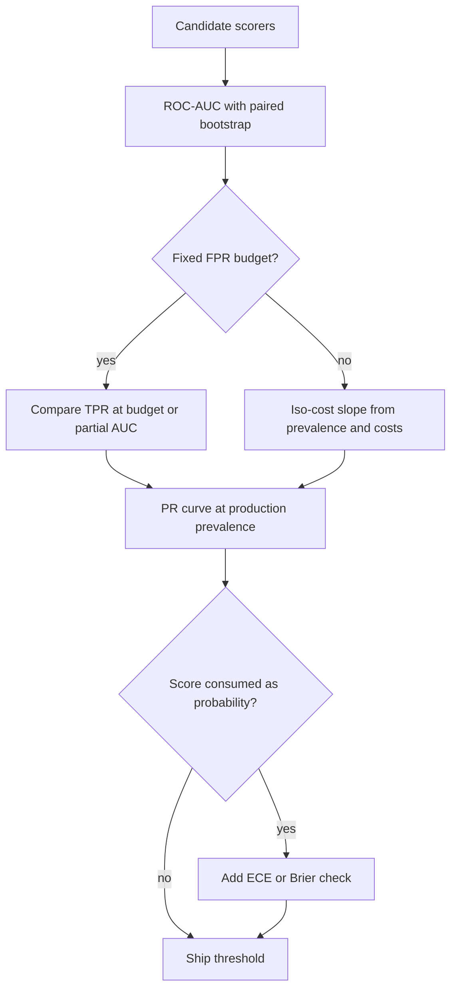

## TL;DR
ROC-AUC is the probability that a random positive outscores a random negative: ranking quality across all
thresholds, unaffected by prevalence. Right for comparing scorers; wrong for judging a deployed rare-positive
classifier, where it hides false-alarm volume and calibration.

## Why it exists
- **Every confusion-matrix metric depends on a threshold,** and the threshold is usually decided late, per
  customer, or by a cost model that does not exist yet when the model is chosen.
- **Comparing at the default 0.5 compares two arbitrary points.** The better model at 0.5 is often the worse
  one at the threshold you will actually ship. You need to score the *scorer*, independent of any cut.
- **It comes from signal-detection theory.** Radar operators in the 1940s needed to separate a receiver's
  discriminative power from how trigger-happy the operator was (the threshold). Plotting TPR against FPR for
  every threshold does exactly that, and the area collapses the curve into one probabilistic number.
- **The naive alternatives fail.** Accuracy at 0.5 is threshold-bound and prevalence-bound. "F1 at the best
  threshold" picks the threshold with evaluation labels, which is leakage, and still describes one point.
- **Log loss mixes in calibration.** A well-ranked but overconfident model looks bad even when a monotone fix
  would make it excellent. AUC isolates the one property that survives recalibration and rethresholding:
  the ordering.

## How it works
### Building the curve
1. **Sort items by score, descending.** Start at (FPR, TPR) = (0, 0) with the threshold above the highest score.
2. **Lower the threshold one item at a time.** Each positive admitted moves the curve up by 1/n_pos, each
   negative moves it right by 1/n_neg, and a group of tied scores moves diagonally.
3. **End at (1, 1)** when everything is flagged.

| Curve shape | Meaning |
|---|---|
| Along the diagonal | random ranking |
| Straight up to (0, 1), then across | perfect ranking |
| Below the diagonal | not useless: score is anti-correlated with the label; negating it gives AUC of 1 − AUC |

### What the area means
- **Pairwise probability:** AUC = P(s(x⁺) > s(x⁻)) + ½ · P(s(x⁺) = s(x⁻)) for a random positive x⁺ and
  negative x⁻.
- **Mann–Whitney U normalised by n_pos · n_neg:** count, over all positive–negative pairs, how many are
  ordered correctly. Equivalent rank formula, with R⁺ the sum of the positives' ascending ranks:

```
AUC = (R_plus - n_pos * (n_pos + 1) / 2) / (n_pos * n_neg)
```

- **A rank statistic, so blind to calibration.** Any strictly monotone transform leaves it unchanged: a model
  whose probabilities all lie between 0.49 and 0.51 can have an AUC of 0.95, and temperature scaling never
  changes AUC.

### Why prevalence does not move it
- **TPR is estimated within positives and FPR within negatives,** so changing the class ratio changes neither
  in expectation.
- **The strength:** AUC on a 50/50 benchmark is a fair estimate of ranking quality on 1%-positive traffic.
- **The weakness, in numbers:**

| Quantity | Value |
|---|---|
| Positives / negatives | 1,000 / 1,000,000 |
| Operating point | FPR 0.01, TPR 0.9 |
| False alarms | 10,000 |
| True positives | 900 |
| Precision | about 8% |

- **The ROC curve looks excellent; the precision–recall curve shows the pain.** Davis & Goadrich: one curve
  dominates another in ROC space if and only if it does so in PR space, but the *areas* weight regions
  differently. On rare positives the PR curve is far more sensitive to the low-FPR region, the only region
  you can afford.

### From curve to operating point
The curve is a menu; costs and prevalence pick the item. With prevalence π, miss cost C_FN and false-alarm
cost C_FP, expected cost per item is

```
cost = pi * (1 - TPR) * C_FN + (1 - pi) * FPR * C_FP
```

- **Iso-cost lines are straight** with slope (1 − π)·C_FP / (π·C_FN); the optimal threshold is where a line
  of that slope touches the curve from the upper left.
- **Prevalence re-enters here even though AUC ignores it.** At π = 0.01 and equal costs the slope is 99, so the
  best point sits in the steep bottom-left corner, at a very low FPR.
- **Consequence 1:** a model whose curve is higher in that corner is the better product even with a lower
  total area.
- **Consequence 2:** any point on the segment between two achievable operating points is achievable by
  randomly choosing between their thresholds, so the upper convex hull is the set worth considering.

### Reading the number
- **0.5 is random, 1.0 is perfect separation,** and nothing about 0.8 means "80% correct".
- **Scale is task-dependent:** compare models on the same data, not AUCs across problems.
- **Differences of 0.01 can be noise with few positives,** because each positive contributes one full row of
  the pair matrix. Report a bootstrap interval; for two models on the same items use a paired method (a paired
  bootstrap, or DeLong's test) because their errors are correlated.
- **Gini = 2·AUC − 1** (credit scoring, some ML libraries): the same information, random 0 and perfect 1.
- **When only a slice of operating points is feasible,** use partial AUC over FPR ≤ your budget, or read TPR
  at that FPR.

### Multi-class
- **`roc_auc_score(multi_class="ovr")`** computes a one-vs-rest AUC per class and averages them (macro or
  support-weighted).
- **`"ovo"`** averages pairwise AUCs between every pair of classes, which is less sensitive to imbalance.
- **Both need probability vectors,** not hard labels.

### Where it shows up in LLM systems
- **Guardrail, moderation and injection detectors:** AUC chooses the model or version; then the PR curve and a
  threshold at the false-positive budget make it a classifier.
- **Rerankers:** AUC over (relevant, irrelevant) pairs is a sanity check beside NDCG.
- **Routers and cascades:** the AUC of "confidence versus whether the small model was right" tells you whether
  routing can work at all, before you tune a threshold.
- **LLM-as-judge with a numeric score:** AUROC against human pass/fail labels says whether the judge is a
  usable detector, separately from where you cut it.

## Diagram
AUC picks the scorer; the budget, prevalence and calibration checks turn it into a shipped classifier.



## Examples
### Ten items by hand, then prevalence vs PR-AUC
Four positives and six negatives give 24 positive–negative pairs.
- **20 are ordered correctly:** the positive at 0.3 loses to three negatives and the one at 0.6 loses to the
  negative at 0.7, so AUC = 20/24 ≈ 0.833.
- **The rank formula agrees:** positives have ascending ranks 4, 7, 9 and 10, so (30 − 10)/24.
- **The code** checks both against scikit-learn, shows cubing or logging the scores changes nothing, and prints
  the confusion-matrix sweep behind the curve.
- **Then two datasets with identical separation** (unit-variance Gaussians two standard deviations apart,
  theoretical AUC Φ(√2) ≈ 0.92) at prevalences of 50% and 1%: ROC-AUC barely moves while average precision
  collapses.

```python
import numpy as np
from sklearn.metrics import roc_auc_score, average_precision_score, roc_curve

y = np.array([1, 1, 1, 1, 0, 0, 0, 0, 0, 0])                         # 4 positives, 6 negatives
s = np.array([0.9, 0.8, 0.6, 0.3, 0.7, 0.5, 0.4, 0.2, 0.1, 0.05])    # detector scores

def auc_by_pairs(y, s):
    pos, neg = s[y == 1], s[y == 0]
    wins = (pos[:, None] > neg[None, :]).sum() + 0.5 * (pos[:, None] == neg[None, :]).sum()
    return wins / (len(pos) * len(neg))

print(auc_by_pairs(y, s), roc_auc_score(y, s))                       # both 0.8333
print(roc_auc_score(y, s ** 3), roc_auc_score(y, np.log(s)))         # unchanged: AUC only sees the ranking

fpr, tpr, thr = roc_curve(y, s, drop_intermediate=False)
for f, t, th in zip(fpr, tpr, thr):
    print(f"threshold>={th:.2f}: FPR={f:.3f} TPR={t:.2f}")           # one confusion matrix per row

rng = np.random.default_rng(0)
def sample(n_pos, n_neg):
    yy = np.r_[np.ones(n_pos), np.zeros(n_neg)]
    ss = np.r_[rng.normal(2, 1, n_pos), rng.normal(0, 1, n_neg)]     # same separation in both datasets
    return yy, ss
for n_pos, n_neg in ((5_000, 5_000), (500, 50_000)):
    yy, ss = sample(n_pos, n_neg)
    print(f"prevalence={n_pos/(n_pos+n_neg):.1%}: ROC-AUC={roc_auc_score(yy, ss):.3f}  "
          f"PR-AUC={average_precision_score(yy, ss):.3f}")
# Expect ROC-AUC near 0.92 in both runs and average precision falling from about 0.9 to well under 0.3
```

### Paired bootstrap and TPR at an FPR budget, in plain Python
Before declaring a retrain better, resample items, score both models on the same resample, and read the
interval of the difference; then check the operating point you will actually ship.

```python
import random

def auc(y, s):                                   # Mann-Whitney: fraction of pairs ordered correctly
    pos = [v for v, t in zip(s, y) if t == 1]
    neg = [v for v, t in zip(s, y) if t == 0]
    wins = sum((p > n) + 0.5 * (p == n) for p in pos for n in neg)
    return wins / (len(pos) * len(neg))

def tpr_at_fpr(y, s, budget):                    # best TPR whose FPR stays within budget
    neg = sorted((v for v, t in zip(s, y) if t == 0), reverse=True)
    k = int(budget * len(neg))                   # negatives we may let through
    tau = neg[k] if k < len(neg) else float("-inf")
    pos = [v for v, t in zip(s, y) if t == 1]
    return sum(v > tau for v in pos) / len(pos)

random.seed(0)
y = [1] * 60 + [0] * 600
a = [random.gauss(1.8 if t else 0, 1) for t in y]          # model A
b = [x + random.gauss(0, 0.6) for x in a]                  # model B: A plus noise, correlated errors

diffs = []
for _ in range(300):                             # paired bootstrap: resample items, score both models
    idx = [random.randrange(len(y)) for _ in y]
    yy = [y[i] for i in idx]
    if 0 < sum(yy) < len(yy):
        diffs.append(auc(yy, [a[i] for i in idx]) - auc(yy, [b[i] for i in idx]))
diffs.sort()
lo, hi = diffs[int(0.025 * len(diffs))], diffs[int(0.975 * len(diffs))]
print(f"AUC A={auc(y, a):.3f} B={auc(y, b):.3f}  paired 95% CI of A-B: [{lo:.3f}, {hi:.3f}]")
print(f"TPR at FPR<=1%: A={tpr_at_fpr(y, a, 0.01):.2f} B={tpr_at_fpr(y, b, 0.01):.2f}")
# AUC A=0.889 B=0.859  paired 95% CI of A-B: [0.001, 0.055]
# TPR at FPR<=1%: A=0.28 B=0.17
```

- **With only 60 positives the interval is wide:** a 0.03 AUC gap barely clears zero.
- **The budget view is starker:** at FPR ≤ 1% model A catches 28% of positives and B 17%.

### Worked scenario: the vendor's 0.97 AUC on 0.2% traffic
A customer runs 500,000 messages a day at 0.2% positives (1,000 positives, 499,000 negatives) through a
detector with AUC 0.97, thresholded at TPR 0.9 where FPR is 0.03 (illustrative operating point).

| Quantity | Value |
|---|---|
| True alerts | 0.9 × 1,000 = 900 |
| False alerts | 0.03 × 499,000 ≈ 14,970 |
| Precision | 900 / 15,870 ≈ 5.7% |
| Reviewer load | about 15,900 alerts a day |

Re-express success as alerts per day at a target recall, then look for an operating point or a second stage
that fits the review budget.

## Production patterns
- **AUC plus average precision for every detector version.** Log both from the eval harness with
  `roc_auc_score` and `average_precision_score`, and gate promotion on a paired bootstrap interval of the
  difference excluding zero. Monitor both on a labelled production sample each refresh.
- **Ship on TPR at the FPR budget.** When a false-block budget exists, compare candidates on TPR at that FPR
  (read off `roc_curve`) or partial AUC; `roc_auc_score` accepts `max_fpr` for a standardized partial AUC.
  Monitor the realised false-block rate on legitimate traffic.
- **Translate to daily volume before launch.** Convert the chosen (TPR, FPR) point to alerts per day at
  production prevalence and agree it with the team working the queue. Monitor alert volume; a jump with no
  model change means prevalence or inputs shifted.
- **Router and judge sanity check.** Before tuning a cascade or trusting a numeric judge, compute AUROC of the
  confidence against correctness or human labels; near 0.5 means no threshold can work. Recompute when the
  model or prompt changes.
- **Calibration as a separate gate.** Because AUC cannot see calibration, add ECE or Brier wherever the score
  feeds a threshold, cascade or user-facing confidence, and track it alongside AUC.

## Trade-offs
- **Threshold-free and prevalence-free vs the shipped point.** Ideal for model selection and cross-dataset
  comparison, but the product ships at one threshold and one prevalence, so AUC can rank two models in the
  opposite order from the metric you will be judged on.
- **Averages all operating points equally vs the affordable corner.** It includes FPR regions you could never
  afford; flip to partial AUC or the precision–recall curve when only the low-FPR corner matters, which on
  rare positives is always.
- **Robust to scale vs blind to calibration.** Rank-based, so robust to score scale and to monotone drift in
  the scorer; pair it with ECE or the Brier score whenever a downstream decision consumes the probability.
- **Stable with thousands vs noisy with few positives.** Each positive is a whole row of the pair comparison;
  the fix is a bootstrap interval, which costs compute and a little humility.

## Pitfalls
- **Reading AUC as accuracy or as "the probability a flag is right".** Symptom: stakeholders expecting 90% of
  alerts to be true because the AUC was 0.9.
- **Celebrating 0.98 AUC on 0.1%-prevalence data.** Symptom: a review queue that is 95% false alarms once the
  threshold is low enough to catch most positives.
- **Judging temperature scaling by AUC.** Symptom: "calibration did nothing", because AUC is invariant to
  monotone maps by construction.
- **Passing hard 0/1 predictions instead of scores.** Symptom: a two-point curve whose AUC equals
  (TPR + TNR)/2, so every model looks similar and worse than it is.
- **Macro one-vs-rest AUC on a heavily imbalanced multi-class problem.** Symptom: a class with three test
  examples swinging the headline number between runs.
- **Treating a 0.003 AUC gain as progress without an interval.** Symptom: the gain reverses on the next data
  refresh.

## When to use
- **Use when** choosing between scorers, tracking whether a retrained model still ranks as well, or comparing
  quality across datasets with different base rates; the natural first metric for any detector, reranker,
  router confidence or judge score.
- **Avoid alone when** signing off a deployed classifier: add the PR curve when positives are rare, TPR at your
  FPR budget when the budget is fixed, and a calibration check when the score feeds a threshold, cascade or
  user-facing confidence.
- **Measure** with a confidence interval when positives number in the hundreds or fewer.
- **Interviews:** state the pairwise-probability interpretation, explain why prevalence does not move it and
  why that is both good and bad, and say when you would switch to PR-AUC.

## Role lens
- **Engineer:** Logs ROC-AUC and average precision for every detector version in the eval harness and
  bootstraps an interval before declaring a retrain better than the incumbent.
- **Architect:** Sets which curve is the acceptance criterion for each component, and fixes the FPR
  budget that turns a ranking into a deployed threshold.
- **FDE:** Explains to a customer why the vendor's 0.97 AUC still produced a flood of false alerts on
  their 0.2%-positive traffic, and re-expresses success as alerts per day at a target recall.

## Check yourself
**Q:** Two prompt-injection detectors score ROC-AUC 0.97 and 0.94 on the same evaluation set. The
security team can tolerate at most 0.5% false blocks on legitimate traffic. Which do you ship, and what
do you need to look at before deciding?
**A:** Not necessarily the 0.97 model. AUC averages ranking quality over every false-positive rate,
but the constraint pins the operating point to FPR ≤ 0.005, so the question is which curve is higher
at that point: read TPR at FPR = 0.005 (or the partial AUC over [0, 0.005]) on each ROC curve, with
bootstrap intervals, because the 0.94 model may be steeper near the origin. Then translate to
production volume: at 0.1% prevalence, 0.5% FPR is five times as many false blocks as there are
injections, so also check precision at that point and whether a second, more precise stage can sit
behind the detector. If the confidence is used to route to that second stage, check its calibration
too, which AUC cannot tell you.

## Interview questions
### What does ROC-AUC measure, and why is it unaffected by prevalence?
- **Definition:** the probability a random positive outscores a random negative, ties counting half; the
  normalised Mann–Whitney statistic.
- **Why prevalence-free:** TPR is computed within positives and FPR within negatives, so changing the class
  ratio moves neither in expectation. Good for comparing scorers, bad for predicting alert-queue quality.

### A retrain improves AUC from 0.912 to 0.915. Do you ship it?
- **Not on that alone:** with few positives a 0.003 gap is within noise, because each positive is a whole row
  of the pair matrix.
- **Run a paired bootstrap or DeLong's test** on the same items, since the two models' errors are correlated.
- **Then compare at the operating point:** TPR at the FPR budget can move in the opposite direction from total AUC.

### When would you prefer the precision–recall curve over ROC?
- **Rare positives:** an FPR of 0.01 against 1,000,000 negatives is 10,000 false alarms beside 900 true
  positives, precision about 8%, which ROC hides and PR shows.
- **When the alert queue is the product:** precision is what reviewers experience.
- **Keep ROC** for comparing ranking quality across datasets with different base rates.

### How do you pick the operating point on an ROC curve?
- **Write the cost:** π·(1 − TPR)·C_FN + (1 − π)·FPR·C_FP; iso-cost lines have slope (1 − π)·C_FP / (π·C_FN).
- **Touch the curve from the upper left** with that slope; at π = 0.01 and equal costs the slope is 99, so the
  best point is at very low FPR.
- **Or use a hard budget:** maximise TPR subject to FPR ≤ the false-block limit.

### Your LLM router's confidence has AUROC 0.55 against "small model was right". What do you do?
- **Stop tuning thresholds:** at 0.55 the signal barely ranks correct above wrong answers, so no cut-off routes well.
- **Find a better signal:** sampling agreement, token log-probabilities on a constrained format, or a trained
  verifier, and re-measure AUROC.
- **Only then calibrate,** because calibration cannot reorder answers.

## Quiz
### Q: What does ROC-AUC = 0.85 literally mean?
- [ ] 85% of the model's predictions are correct
- [x] A randomly chosen positive outscores a randomly chosen negative 85% of the time
- [ ] 85% of positives are found at the default threshold
- [ ] The model's probabilities are 85% calibrated
> AUC is the normalised Mann–Whitney statistic: the fraction of positive–negative pairs ordered
> correctly, with ties counting half. It says nothing about accuracy at any threshold or about whether
> the scores are valid probabilities.

### Q: After temperature scaling, a detector's expected calibration error falls from 0.12 to 0.02 but its ROC-AUC is identical. Why?
- [ ] Temperature scaling failed to change the model
- [x] AUC depends only on the ranking, and dividing all logits by a constant is a monotone transform
- [ ] ECE and AUC were computed on different splits
- [ ] AUC only uses the hard predictions, which did not change
> Temperature scaling rescales scores without reordering them; because AUC is a rank statistic it is
> invariant to any strictly monotone map. ECE measures the match between stated confidence and hit
> rate, which the rescaling does change.

### Q: Positives are 0.2% of traffic. Which view best reveals whether the alert queue will be usable?
- [ ] The ROC curve
- [ ] Accuracy at the default threshold
- [x] The precision–recall curve or average precision
- [ ] Log loss
> The precision axis shows the fraction of alerts that are true at each recall level, which is what the
> queue experiences. The ROC's FPR axis is normalised by the huge negative count, so an FPR of 1% looks
> fine while producing five times as many false alerts as there are positives.
