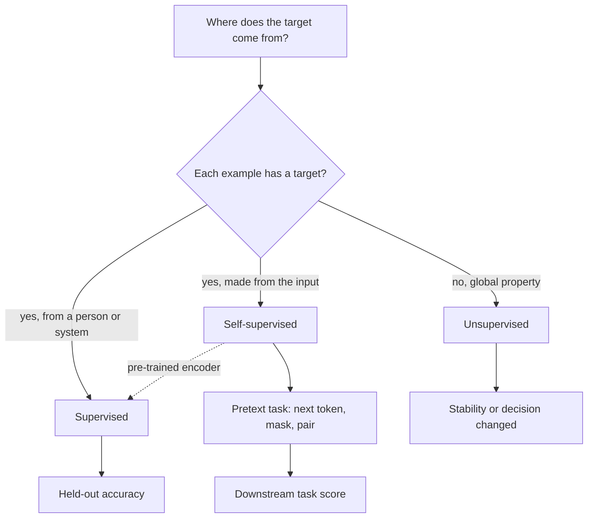

## TL;DR
The three paradigms differ only in where the training signal comes from: a human label (supervised), a
property of the data (unsupervised), or a label manufactured from the input (self-supervised). LLMs exist
because self-supervision turned the internet into free labels.

## Why it exists
- **Every loss needs a target.** Every learning algorithm minimises a loss, and a loss needs something to
  compare the model's output against. The entire question is who supplies that target.
- **Human labels are the bottleneck.** Supervised learning works when the task is narrow and labels are
  cheap. A routing label on a support ticket costs a few seconds of a trained agent's time; a radiology
  label costs a specialist's time; however cheap one label is, you cannot buy billions of them.
- **Unlabelled data is enormous, but structure is not your task.** Text, images, code and logs exist in
  huge quantities with no labels. Unsupervised learning optimises structure instead (compact clusters,
  directions of maximum variance, a density that assigns the data high likelihood). Clustering tickets
  does not tell you which to escalate, and with no ground truth you can only judge the result by looking.
- **Self-supervision hides part of the data and predicts it.** The signal is as plentiful as the data,
  and predicting the hidden part well requires learning grammar, facts, visual structure and code
  semantics, because those are what make the hidden part predictable. This is what "pre-training" means.
- **A small supervised step then suffices.** Once that representation exists, fine-tuning on a few
  thousand examples works where training from scratch on them would not.

## How it works
### The three paradigms at a glance
| Paradigm | Data | Target | Typical loss | How you evaluate |
|---|---|---|---|---|
| Supervised | pairs (x, y) | given by a person or system | cross-entropy, squared error | held-out accuracy or error |
| Unsupervised | x only | a property of the data | distance to centre, variance, likelihood | internal metrics, stability, downstream decision |
| Self-supervised | x only | manufactured from x by a pretext task | cross-entropy, contrastive | downstream task performance |

### Supervised: the target is given
- **Setup.** The dataset is pairs (x, y). The model is a function f_θ(x). The loss compares f_θ(x) with
  y: cross-entropy when y is a class, squared error when y is a number (see the classification and
  regression lessons). Gradient descent pushes θ toward reproducing the human judgements.
- **Coverage limits generalisation.** It depends on the labelled set covering the distribution you will
  see in production, because the model has no signal about anything else.
- **Label quality is the ceiling.** If two annotators disagree on 15% of examples, a model cannot agree
  with both of them on more than 85% of examples. Scored against either one, up to 15 points of apparent
  "error" can be annotator disagreement rather than model error. Measure agreement before blaming the model.

### Unsupervised: the target is a property of the data
- **Only x is available**, and the objective is defined on the data itself:
  - k-means minimises the distance from each point to its cluster centre;
  - PCA keeps the directions of largest variance;
  - a density model maximises the likelihood it assigns to the observed points.
- **The output is structure for a human to interpret.** Because there is no y, "accuracy" does not exist;
  evaluation is by internal metrics, by stability, or by whether the structure helps a downstream
  decision. The clustering lesson covers the main algorithms.

### Self-supervised: the target is manufactured from the data
Only x is available, but a *pretext task* turns each x into one or more (x', y') pairs automatically.
Three designs dominate:

- **Autoregressive (GPT-style).** Input: the tokens so far; label: the next token. A document of n tokens
  yields n − 1 training examples. The loss is ordinary cross-entropy over the vocabulary, so this is a
  classification problem with on the order of 100k classes whose labels cost nothing.
- **Masked (BERT-style).** Replace a fraction of tokens (15% in the original recipe) with a mask and
  predict the originals from both sides. It produces strong encoders for embeddings and classification
  but is awkward for generation, because the model never learned to produce text left to right.
- **Contrastive (SimCLR, CLIP, most embedding models).** Build pairs that should match (two augmentations
  of one image, an image and its caption, a query and the document that answered it) and train the model
  to pick the true partner out of a batch of impostors. The label "which one matches" is known because you
  constructed the pair. The loss-functions lesson derives the objective.

**Why it works: compression.** To predict the next token of "the capital of France is", the model must
store a fact. To predict a masked verb, it must learn agreement. The pretext task is a proxy, but the
representation it forces into existence transfers to tasks nobody labelled.

### How they combine in a real system
A modern LLM pipeline uses all three in sequence:
1. **Pre-training** is self-supervised on trillions of tokens.
2. **Supervised fine-tuning** teaches instruction following on thousands to millions of human-written
   (prompt, response) pairs.
3. **Preference optimisation** (RLHF, DPO) uses human *comparisons* between responses, a form of
   supervision at the level of preferences rather than exact outputs.
4. **Unsupervised methods run constantly underneath:** clustering embeddings of production traffic to
   discover what to label next, deduplicating training data, finding outliers.

Hybrids and neighbours:
- **Semi-supervised** learning trains on a few labels plus many unlabelled inputs, for example
  pseudo-labelling, where a model's confident predictions on unlabelled data are added as labels. It works
  only if those confident predictions are mostly right.
- **Weak supervision** takes noisy labels cheaply from heuristics, metadata or an LLM and cleans or
  combines them before training.
- **Reinforcement learning**, where the signal is a scalar reward from an environment rather than a label,
  is the fourth paradigm and underlies the RL part of RLHF; it is covered in the training module.

### Where the boundary blurs
The labels are conventions, not laws, and an expert should know where they leak:
- **Next-token prediction is density estimation.** It is literally maximum-likelihood estimation of
  p(text), the textbook unsupervised objective. It is called self-supervised because the computation is a
  per-position classification with a known target.
- **Autoencoders**, which reconstruct their own input, are filed under either heading depending on the
  author.
- **Working test.** If the loss compares each example's output with a specific target, whatever produced
  that target, the supervised toolkit (cross-entropy, held-out accuracy, label-noise reasoning) applies.
  If the loss scores a global property such as cluster compactness, it does not, and evaluation becomes a
  judgement call.

## Diagram
Follow the question "where does the target come from?" to the paradigm, then to how you evaluate it.



## Examples
### One corpus, three paradigms: support ticket routing
A support organisation has about 2,000,000 historical tickets and budget to hand-label roughly 5,000 of
them with one of 12 routing categories (illustrative numbers).

| Approach | What it does | Result |
|---|---|---|
| Supervised only | train a classifier on the 5,000 labelled tickets | works, but categories with 40 examples are learned poorly, and the model knows nothing about the 1,995,000 unlabelled tickets |
| Unsupervised | embed all 2,000,000 tickets with a pretrained sentence encoder and cluster into 40 groups | humans read central examples and find three recurring problems the 12-category taxonomy never had; cluster ids are not labels, but show what to label and how to sample |
| Self-supervised | the encoder was trained contrastively on hundreds of millions of unlabelled text pairs; continued pre-training on tickets (60 tokens average) creates about 120,000,000 next-token targets for free | fine-tuning that adapted model on the 5,000 labels usually gives the best classifier |

The last row wins because the supervised step only has to teach the category boundaries, not the language
of the domain. The encoder's contrastive training is also why its notion of "similar" is useful at all.

### Labels as a function of the input
The code shows the one operation that makes self-supervision different: the labels are produced by a
function of the input, not by a person.

```python
import random

supervised_example = ("card declined at checkout again", "billing")   # one (x, y) pair: paid for

def next_token_pairs(ids):
    """Autoregressive pretext task: every prefix is an input, the token after it is the label."""
    return [(ids[:i], ids[i]) for i in range(1, len(ids))]

def masked_pairs(ids, mask_id=0, p=0.15, seed=1):
    """Masked-LM pretext task: hide ~15% of tokens; the hidden originals are the labels."""
    rng = random.Random(seed)
    corrupted, targets = list(ids), {}
    for pos, tok in enumerate(ids):
        if rng.random() < p:
            corrupted[pos], targets[pos] = mask_id, tok
    return corrupted, targets

ids = [312, 7, 2201, 54, 887, 19]          # token ids for the same sentence (illustrative values)
print(len(next_token_pairs(ids)))          # 5 labelled examples from one unlabelled line
print(masked_pairs(ids))                   # ([0, 7, 2201, 54, 887, 19], {0: 312}) with seed=1; seed=0 happens to mask nothing
```

### Contrastive pairs from a batch
In-batch contrastive training: the diagonal of the similarity matrix holds the true pairs, so the
"label" for row i is simply i.

```python
import torch
import torch.nn.functional as F

def in_batch_contrastive_loss(q_emb, d_emb, temperature=0.05):
    q = F.normalize(q_emb, dim=-1)
    d = F.normalize(d_emb, dim=-1)
    logits = q @ d.T / temperature              # [batch, batch] similarity matrix
    labels = torch.arange(q.size(0))            # query i matches document i: a free label
    return F.cross_entropy(logits, labels)

q, d = torch.randn(8, 384), torch.randn(8, 384)
print(in_batch_contrastive_loss(q, d))          # random embeddings: loss near log(8) or above
```

## Production patterns
- **Harvest implicit labels before buying annotation.** When the system already records a decision (the
  category an agent picks on close, a merged PR, a click), log it with the input snapshot at decision
  time. Monitor label noise by having experts re-label a small random sample each month.
- **Cluster, then stratify the labelling queue.** Embed the corpus with a pre-trained encoder, run k-means
  (for example scikit-learn `KMeans`), and sample a fixed number per cluster for experts. Monitor per-class
  counts in the labelled set and per-class recall on the held-out set.
- **Measure inter-annotator agreement first.** Double-label a few hundred examples and compute agreement
  (for example Cohen's kappa via scikit-learn `cohen_kappa_score`) before training. Treat the agreement
  rate as the accuracy ceiling when reading model scores.
- **Fine-tune a public checkpoint instead of pre-training.** For a narrow domain, start from an open
  pre-trained model and, if needed, run a short continued pre-training pass on in-domain raw text before
  supervised fine-tuning. Monitor a general-capability eval alongside the task metric to catch forgetting.
- **Gate pseudo-labels on confidence and audit them.** Add only predictions above a high confidence
  threshold, and spot-check a random sample by hand. Monitor the human agreement rate on the audited
  pseudo-labels; stop if it falls.

## Trade-offs
- **Supervised: accuracy per example vs label cost.** Highest task accuracy per example and a directly
  measurable score, but every example costs human time and the model inherits the annotators' blind
  spots. The cost argument flips when labels fall out of the system for free (resolved-ticket
  categories, clicks, merged PRs).
- **Unsupervised: no labels vs no score.** Needs no labels and surfaces structure nobody asked about, but
  produces no accuracy number and needs a human to interpret the output. It wins when the goal is
  exploration, not prediction.
- **Self-supervised: transfer vs compute and proxy gap.** Transferable representations from unlimited
  data, but large compute, and the pretext task is only a proxy: a model excellent at next-token
  prediction is not automatically good at following instructions. For a narrow domain, fine-tuning a
  public checkpoint almost always beats pre-training your own.
- **Combining paradigms: best result vs more stages.** Pre-train, cluster, label, fine-tune gives the best
  result but multiplies the stages that must be evaluated, versioned and debugged.

## Pitfalls
- **Treating cluster ids as labels.** Training a supervised model on them gives high "accuracy" against
  the pseudo-labels and poor agreement with human review, because the model learned the clustering's
  artefacts rather than the intended categories.
- **Fine-tuning until pre-trained knowledge is overwritten.** On a large narrow supervised set, the task
  metric rises while general capability and out-of-distribution behaviour degrade.
- **Assuming unlabelled data is neutral.** Nobody labelled it, but pre-training text carries the biases
  and errors of its sources, and self-supervision reproduces them faithfully.
- **Judging pre-training by its own loss alone.** Perplexity falls while the downstream task you care
  about does not move, because the proxy and the task diverged.
- **Building a label from a field that will not exist at inference time.** For example, the agent's final
  resolution note as a feature for routing. Symptom: near-perfect offline scores and a useless model in
  production. The train-test-leakage lesson covers this in depth.

## When to use
Start from the question "what signal do I have, and what does more of it cost?"
- **Use supervised when** you have labels and a narrow, stable target: a small model is usually the
  cheapest, fastest and most measurable option.
- **With a large unlabelled domain corpus,** you almost never pre-train from scratch. Use a pre-trained
  model and either embed and cluster to understand the data, or label a stratified few thousand examples
  and fine-tune.
- **Measure** supervised work with held-out accuracy at the natural class distribution, unsupervised work
  by whether it changed a decision, and self-supervised work by downstream task performance, never only by
  its own loss.
- **Interviews:** expect "why is next-token prediction self-supervised rather than unsupervised?" The loss
  is a normal supervised loss against a target; the target just came from the data instead of a person.

## Role lens
- **Engineer:** Chooses the fine-tuning data format that matches the signal available, labelled pairs
  for a classifier or raw text for continued pre-training, and the loss that goes with it.
- **Architect:** Decides where labels come from at scale, annotation budget, implicit feedback capture or
  a pre-trained vendor model, because that choice fixes cost and iteration speed for years.
- **FDE:** Audits what the customer actually has, usually millions of unlabelled documents and a handful
  of experts, and designs the clustering pass and labelling session that make those experts efficient.

## Check yourself
**Q:** A customer wants 3 million internal documents sorted into their 40 categories, has no labels, and
says "just use unsupervised learning so we don't have to label anything". How do you respond, and what
pipeline do you propose?
**A:** Clustering alone cannot deliver their 40 categories. It groups by whatever similarity dominates the
embedding space, with no guarantee that matches their taxonomy, and it gives no way to measure accuracy
against the categories they care about. Propose a pipeline instead: embed all documents with a
pre-trained (self-supervised, contrastively trained) encoder; cluster to see the natural structure and
to sample diverse documents; have their experts label a stratified sample of a few thousand, measuring
inter-annotator agreement so the ceiling is known; train a supervised classifier on that sample and
evaluate on a held-out labelled set at the natural class distribution; and use the clusters afterwards
to find categories the taxonomy misses and to prioritise further labelling. The labels are what make the
categories theirs; the unsupervised step makes the labelling cheap.

## Interview questions
### What is the difference between supervised, unsupervised and self-supervised learning?
- **Definition:** they differ in the source of the target. Supervised uses labels from outside the input,
  unsupervised optimises a property of the data, self-supervised builds labels from the input itself.
- **Why it matters:** self-supervision gives as many targets as there are tokens or pixels, which is what
  made pre-training on internet-scale data possible.
- **Evaluation follows the paradigm:** held-out accuracy for supervised, downstream impact for
  unsupervised, downstream task score for self-supervised.

### Your classifier plateaus at 84% accuracy and the team wants a bigger model. What do you check first?
- **Label agreement.** Double-label a sample; if annotators agree on only about 85%, the model is near the
  ceiling and the remaining "error" is disagreement.
- **Coverage.** Compare the labelled set's class and input distribution with production traffic; missing
  regions cannot be learned.
- **Then** fix the label guidelines or sample more data before scaling the model.

### When would you not pre-train your own model on a large internal corpus?
- **Almost always for a narrow domain.** Fine-tuning a public checkpoint beats pre-training, because
  pre-training needs large compute and the general language is already learned.
- **Middle ground:** short continued pre-training on in-domain text, then supervised fine-tuning.
- **Cost of the proxy:** a low next-token loss does not guarantee instruction following or task accuracy.

### How would you use 2 million unlabelled tickets and budget for 5,000 labels?
- **Embed and cluster** all tickets to find the real structure and missing categories.
- **Stratify the 5,000 labels** across clusters so rare categories get enough examples.
- **Fine-tune** a pre-trained encoder or model on those labels, optionally after continued pre-training
  on the tickets, and evaluate at the natural class distribution.

### Is pseudo-labelling safe? How do you control it in production?
- **Only if confident predictions are mostly right;** otherwise the model trains on its own mistakes and
  confirms them.
- **Controls:** a high confidence threshold, a hand-audited random sample of pseudo-labels, and a held-out
  human-labelled set that pseudo-labels never touch.
- **Monitor** audited agreement and per-class recall over time.

## Quiz
### Q: Why is next-token prediction described as self-supervised rather than unsupervised?
- [ ] Because a human verifies each predicted token before it is used
- [x] Because it trains with a standard supervised loss on a target that is constructed from the data itself
- [ ] Because the model scores its own samples and trains on the best ones
- [ ] Because the tokens were labelled during tokenisation
> The objective is ordinary cross-entropy against a known correct token, exactly like supervised
> classification; the only difference from supervised learning is that the label came from the text
> rather than from an annotator. Classical unsupervised objectives such as k-means score a global
> property of the data instead of a per-example target.

### Q: A team receives about 200,000 labelled examples per day for free, because agents pick a final category when they close each ticket. Which paradigm fits a routing model best?
- [ ] Unsupervised, because labels produced by a system rather than annotators cannot be trusted
- [ ] Self-supervised, because the volume is large enough to pre-train a model from scratch
- [x] Supervised, because an abundant, cheap, task-aligned label stream removes the usual bottleneck
- [ ] Reinforcement learning, because the closing category acts as a reward
> Supervised learning is limited by label cost and coverage; here labels are free and directly
> aligned with the routing task. Agent labels can be noisy, but that is something to measure on a sample,
> not a reason to throw away the signal.

### Q: What makes contrastive training of an embedding model self-supervised?
- [ ] Annotators choose the negative examples for each anchor
- [ ] The loss contains no cross-entropy term, so no labels are involved
- [x] Positive pairs are produced automatically, so the target "which candidate is the match" is derived from the data
- [ ] The embeddings are evaluated without any labelled benchmark
> Two views of the same item, or a naturally paired query and document, give a known correct match; the
> model is trained to identify it among the other items in the batch. That target is a label, just one
> that cost nothing to create.
