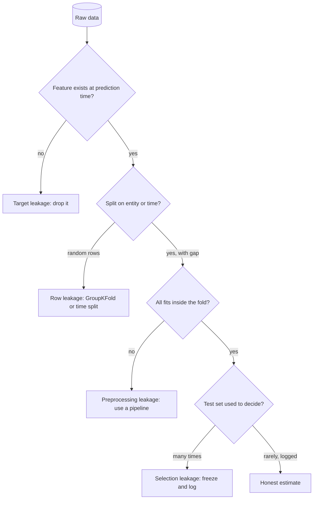

## TL;DR
Leakage is any path by which eval answers, or information unavailable at decision time, reach your agent
or its metric: few-shots, memory, the retrieval corpus, fine-tune traces, prompt tuning. It always
flatters offline scores, so the agent collapses on real users.

## For agent builders
- **Why it matters for agents.** Agent evals are small, hand-built and reused for months, and agents have
  many side doors to the answers: few-shot examples, long-term memory, the RAG index, cached tool results
  and fine-tuning traces. A few small leaks can turn a 66% agent into a "92%" one (see the scenario below).
- **Where it shows up in your stack.** Your golden task set, eval harness fixtures, vector store, memory
  store, prompt templates and any fine-tuning file built from production traces.
- **What you control.** Who writes eval tasks, a dev/test split for prompt iteration, splitting traces by
  conversation or customer, and a CI check that dedupes eval items against every artifact the agent reads.
- **What you can skip.** Purging and embargo details for finance-style time series, unless your agent
  forecasts; keep the rule "leave a gap of one label horizon".

## Why it exists
- **A held-out set simulates the future.** Data the model has never seen, scored once, gives an unbiased
  estimate of post-deployment performance. Every leakage mechanism breaks that simulation in a way that
  flatters the model.
- **The error never averages out.** It is always in the same direction, and the model is genuinely good at
  exploiting the leaked signal, so nothing in the training loop complains: loss goes down, the metric goes
  up, the demo works.
- **"We split the data, so we are fine" fails.** Splitting rows is not splitting *information*. It crosses
  through three doors: **features** (a "cancellation reason" field on a churn dataset is populated only
  for churners), **shared entities and time** (the same customer on both sides, or training on April to
  predict March), and the **fitting procedure**.
- **The fitting door is the subtle one.** Any statistic computed on the full dataset before the split leaks:
  a scaler's mean, an imputer's median, a target encoder's per-category average, a selection step's
  chosen features, or, in LLM work, prompt wording iterated against the test set.
- **The leaks have moved up a level for AI engineers.** Benchmarks sit inside pretraining corpora, golden
  sets get pasted into few-shot prompts, and eval sets are regenerated by the model being evaluated. Same
  mechanism, new surface.

## How it works
### Target leakage: the feature is the label in disguise
- **Definition:** a feature's value is caused by the outcome rather than predictive of it, or it is
  captured after the moment a real prediction would be made.
- **The timestamp test:** *at the instant the model would run in production, would this value exist with
  this content?*
- **Typical failures:** "days until account closed", "number of collection calls", a support ticket's
  "resolution notes". They are the strongest features *because* they are downstream of the label, and
  they vanish or change meaning at inference time.

### Row leakage: the split is on the wrong key
- **Random row splits assume independent rows.** That breaks when one entity generates many rows (visits per
  patient, chunks per document, turns per conversation) or when rows are ordered in time.
- **What the model actually learns:** having seen patient 17's other visits, it is partly memorizing patient
  17; trained on next quarter's prices, it is reading the future.
- **Fix: split on the unit of independence.** `GroupKFold` by entity id, or a time-ordered split where
  validation strictly follows training.
- **The score gap is a measurement.** The difference between random-split and group- or time-split scores
  tells you how much you were leaking.

Two refinements matter in practice:
1. **Time splits need a gap when labels or features span a window.** Label "churns within 30 days", training ends 31
   March: late-March labels were decided by April events, the validation period. Leave at least one label
   horizon between training and validation. scikit-learn's `TimeSeriesSplit` has a `gap` argument; finance
   calls this purging and embargo.
2. **Entities are not always labelled for you.** Exact duplicates, near-duplicates (a re-sent support
   ticket, a paragraph in two documents, an image and its crop) and templated rows behave like one entity
   in two places. Hash for exact matches and use MinHash or embedding similarity across the split
   boundary, *because* a random split of a corpus with 5% near-duplicates gives an open-book exam on that 5%.

### Preprocessing leakage: fitted on everything, evaluated on part
| Step fitted on all rows | Severity | Why |
|---|---|---|
| Scaler, imputer | small | each fold's model trained on inputs normalized with statistics that include its test rows |
| Feature selection, target encoding | catastrophic | the step already looked at the test labels to decide what survives |
| Resampling (SMOTE, oversampling) | severe | synthetic minority examples made from the full set put near-copies of test rows into training |

- **Anything with a `fit` step learns from the rows it sees.**
- **The rule is mechanical:** every fitted transform lives inside the pipeline that is fitted *within* each
  fold, on that fold's training rows only.

### Selection leakage: the test set as a training signal
1. **A held-out set survives exactly one honest use.**
2. **Every look-then-change is a vote.** Change a hyperparameter, feature, prompt or retrieval setting after
   seeing the test score and the test set becomes a weak training set.
3. **After thirty iterations** the "test" number is an optimistically biased validation number.
4. **Defence is structural:** iterate on a validation split, keep a frozen test split evaluated rarely and
   logged each time, and use nested cross-validation when data is too small for three partitions.

### LLM-era variants of the same thing
- **Benchmark contamination:** public eval sets appear in web-scale pretraining data; a high score may
  be recall, not reasoning. n-gram overlap checks between eval items and training data are the
  standard, imperfect detector (see the evals module on dataset contamination).
- **Golden-set bleed:** eval examples appear in the system prompt as few-shots, in fine-tuning data, or
  verbatim in the retrieval corpus, so the system is tested on its own notes.
- **Self-generated evals:** questions written by the model under test, from the chunks the retriever
  indexes, in the chunk's own vocabulary. Retrieval looks excellent because lexical overlap is high;
  real users do not phrase questions that way.
- **Prompt overfitting:** iterating the prompt against the full golden set is selection leakage with a
  text box instead of a hyperparameter grid.

### Agent-specific doors
| Door | How the answer leaks | Check |
|---|---|---|
| Few-shot examples | an eval task, or its gold trajectory, sits in the system prompt | dedupe eval items against prompt templates |
| Long-term memory | eval runs write facts or past answers to memory, and later runs read them back | reset or namespace memory per eval run |
| Retrieval corpus | gold answers or the eval spreadsheet itself were indexed | dedupe eval items against the index |
| Tool fixtures | mocked tool results contain the final answer the agent should derive | review fixtures for answer strings |
| Fine-tune traces | production conversations later used as eval tasks were also trained on | split traces by conversation or customer |
| Trajectory splits | turns of one conversation land on both sides | split on conversation id, never on turn |

- **The memory door is new.** Stateful agents learn across runs, so running the eval twice can score
  higher the second time without any code change; that rise is leakage, not improvement.

### Detection checklist
Suspect leakage when:
- a metric beats the published state of the art or human agreement on first try;
- one feature dominates importance;
- random-split and time-split results diverge;
- a model trained on noise still scores above chance;
- production metrics fall far below offline ones with no distribution shift to blame;
- an agent's eval score rises on a rerun with no change to code, prompt or model.

Then audit provenance feature by feature: where was this column computed, from what snapshot, at what
time relative to the label?

## Diagram
Information reaches the test score through three doors; each audit question closes one. For an agent,
read "feature" as anything in the context window and "fit" as any prompt, memory or index built from data.



## Misconceptions
- **"We held out a test split, so there is no leakage."** Splitting rows is not splitting information. The
  same customer, conversation or document on both sides, or a scaler fitted before the split, still carries
  test information into training.
- **"Fitting a scaler or selector on all the data is harmless preprocessing."** Anything with a `fit` step
  learns from the rows it sees. Feature selection on the full set picks columns that correlate with the
  test labels, which is how pure noise scores ~0.87 instead of ~0.47.
- **"A time-ordered split cannot leak."** If the label looks ahead (churn within 30 days), late training
  labels were decided by events in the validation window. Leave a gap of at least one label horizon.
- **"Looking at the test score is fine as long as we never train on it."** Every look-then-change is a vote:
  tuning prompts or thresholds against the reported set turns it into a weak training set, so the number
  becomes optimistically biased.
- **"A higher score on an unchanged rerun means the agent got better."** For a stateful agent it usually
  means the memory store kept answers from the first run. Identical reruns should agree within noise;
  give each run a fresh memory namespace.

## Examples
### Feature-selection and row leakage on pure noise
The classic demonstration: 100 rows, 10,000 pure-noise features, labels unrelated to anything.
- **Leaky:** feature selection on the full dataset before cross-validating gives impressive accuracy on data
  with no signal, because the selector peeked at every fold's test labels.
- **Clean:** the selector inside the pipeline, refitted on each fold's training rows, returns the metric to
  chance where it belongs.
- **The arithmetic:** with 10,000 noise columns and 100 rows, a few dozen correlate with the labels by luck,
  and the leaky selector picks exactly those, *using the labels of the rows it will later be scored on*.

The second half shows row leakage. Each of 40 patients contributes ten visits sharing a feature
fingerprint, and the label is a coin flip per patient, so nothing generalizes to a new patient.

A random row split almost always puts a sibling visit in training, and a 1-nearest-neighbour model scores
near-perfectly by looking it up. Splitting by patient exposes the truth.

```python
import numpy as np
from sklearn.feature_selection import SelectKBest, f_classif
from sklearn.linear_model import LogisticRegression
from sklearn.neighbors import KNeighborsClassifier
from sklearn.model_selection import StratifiedKFold, KFold, GroupKFold, cross_val_score
from sklearn.pipeline import make_pipeline

rng = np.random.default_rng(0)
X = rng.normal(size=(100, 10_000))                     # pure noise
y = rng.integers(0, 2, size=100)                       # labels independent of X
cv = StratifiedKFold(5, shuffle=True, random_state=0)
clf = LogisticRegression(max_iter=1000)

# WRONG: choose the 20 "best" features using all 100 rows, then cross-validate
X_sel = SelectKBest(f_classif, k=20).fit_transform(X, y)
leaky = cross_val_score(clf, X_sel, y, cv=cv).mean()

# RIGHT: selection is a pipeline step, refitted on each fold's training rows only
pipe = make_pipeline(SelectKBest(f_classif, k=20), LogisticRegression(max_iter=1000))
clean = cross_val_score(pipe, X, y, cv=cv).mean()
print(f"leaky CV accuracy: {leaky:.2f}   clean CV accuracy: {clean:.2f}")   # ~0.87 vs ~0.47

# Row leakage: 40 patients x 10 visits; each patient has a feature "fingerprint" and one
# random label, so the features carry no information about the label of an unseen patient.
groups = np.repeat(np.arange(40), 10)
fingerprint = rng.normal(size=(40, 8))
Xp = fingerprint[groups] + 0.3 * rng.normal(size=(400, 8))
yp = rng.integers(0, 2, size=40)[groups]
knn = KNeighborsClassifier(n_neighbors=1)              # a pure memorizer makes the leak obvious
by_row = cross_val_score(knn, Xp, yp, cv=KFold(5, shuffle=True, random_state=0)).mean()
by_patient = cross_val_score(knn, Xp, yp, cv=GroupKFold(5), groups=groups).mean()
print(f"random-row CV: {by_row:.2f}   patient-grouped CV: {by_patient:.2f}")
# Expect ~0.98 by row (a sibling visit is always in training) and near 0.5 by patient,
# noisy because there are only 40 independent units, not 400.
```

### Cross-split duplicate check for an agent eval set
Before reporting an agent metric, check eval tasks against fine-tuning traces, few-shots, memory entries
and the retrieval corpus.
Standard library only; swap the shingle scan for a MinHash index at corpus scale.

```python
import hashlib, re

def norm(t):                                   # cheap normalization before hashing
    return re.sub(r"\s+", " ", t.lower()).strip()

def shingles(t, n=5):
    w = norm(t).split()
    return {" ".join(w[i:i + n]) for i in range(max(1, len(w) - n + 1))}

def jaccard(a, b):
    return len(a & b) / len(a | b)

train = ["My order 1234 never arrived, please refund me.",
         "How do I reset my password on the mobile app?"]
test = ["my order 1234 never arrived,   please refund me.",   # exact after normalization
        "How do I reset my password on the mobile app today?",  # near-duplicate
        "Can I change the delivery address after checkout?"]   # genuinely new

train_hash = {hashlib.sha256(norm(t).encode()).hexdigest() for t in train}
train_sh = [shingles(t) for t in train]
for t in test:
    exact = hashlib.sha256(norm(t).encode()).hexdigest() in train_hash
    near = max(jaccard(shingles(t), s) for s in train_sh)
    print(f"exact={exact!s:5}  max_jaccard={near:.2f}  {t[:40]}")
# exact=True   max_jaccard=1.00  my order 1234 never arrived, ...
# exact=False  max_jaccard=0.62  How do I reset my password ...
# exact=False  max_jaccard=0.00  Can I change the delivery ...
```

Pick the near-duplicate threshold by reading flagged pairs; the right value depends on how templated
your text is.

### Agent scenario: a support agent's eval that leaked three ways
A support agent is scored on 150 golden tasks (illustrative numbers). The audit removes one leak at a time.

| Change | Task success | Leak it removed |
|---|---|---|
| As reported | 92% | none |
| Remove 12 eval tasks copied into few-shots | 84% | few-shot bleed |
| Clear the memory store between eval runs | 77% | answers remembered from earlier runs |
| Rewrite tasks from real tickets, not model-generated from indexed docs | 68% | lexical overlap with the corpus |
| Measured on live traffic the next week | 66% | close: the eval is honest now |

- **Each leak was "small".** Together they inflated the eval by 24 points, and the reported number sat 26
  points above live traffic.
- **The fix is structural:** a frozen test split, memory isolation per run and a CI dedupe step, not a
  one-off cleanup.

### Worked scenario: a 30-day churn label and the missing gap
Daily snapshots, label "churns within 30 days", training data through 31 March.

| Split | Validation window | What leaks | Effect |
|---|---|---|---|
| Random rows | mixed dates | future rows train the model on past ones | highest, least honest score |
| Time split, no gap | from 1 April | late-March labels were decided by April events | earliest validation rows score best |
| Time split, one-horizon gap | from 1 May | nothing from the label window | lower, honest score |

With one row per day, `TimeSeriesSplit(n_splits=5, gap=30)` drops 30 rows between each training and
validation fold; `gap` counts rows, not days, so convert your horizon to rows. With many customers per
day, sort by date and cut on date boundaries yourself, because `TimeSeriesSplit` would split mid-day.

## Production patterns
- **Pipeline every fitted step.** Wrap scalers, imputers, encoders, selectors and resamplers in one
  scikit-learn `Pipeline` and pass the pipeline, not pre-transformed arrays, to `cross_val_score`. Monitor
  the gap between CV score and the score on a fresh batch; a persistent gap points at a fit outside the fold.
- **Group- and time-aware splitters by default.** Use `GroupKFold` (or `StratifiedGroupKFold` when classes
  are imbalanced) keyed on customer, patient or document id, and `TimeSeriesSplit` with `gap` for temporal
  data. Report the random-split score next to it; the difference is your leakage estimate.
- **Point-in-time feature joins.** Join features to labels as of the prediction timestamp, for example with
  `pandas.merge_asof(..., by="customer_id", direction="backward")` on frames sorted by timestamp, or a
  feature store's point-in-time retrieval. Monitor
  feature null rates and distributions between offline training and online serving.
- **Frozen test set with an access log.** Store the test split by content hash, run it only at release
  points from CI, and log every evaluation. Report the test number with the count of times it has been
  consulted.
- **Contamination checks in CI.** Hash and shingle every eval item against few-shot prompts, fine-tuning
  files and the retrieval corpus on each change; fail the build above a reviewed similarity threshold.
  Monitor the count of flagged items per release.
- **Isolated state per agent eval run.** Give every eval run a fresh memory namespace, an empty
  conversation store and recorded tool fixtures reviewed for answer strings, so no run can read what an
  earlier one wrote. Monitor score drift across identical reruns; it should stay within run-to-run noise.

## Trade-offs
- **Honest estimates vs variance.** Group- and time-based splits give honest estimates but higher variance
  and fewer usable folds, which matters when the dataset is small and every held-out entity is expensive.
- **Protected number vs iteration speed.** Freezing a test set and touching it rarely protects the number
  but slows iteration; teams compensate with a larger validation split and accept a less precise final estimate.
- **No temporal leakage vs pipeline complexity.** Strict point-in-time feature computation complicates the
  data pipeline, which is a large part of why feature stores exist in hybrid ML systems.
- **Less optimistic bias vs lost patterns.** Deduplicating near-identical rows across splits removes
  optimistic bias, but aggressive near-duplicate thresholds can also remove legitimate recurring patterns
  the model must learn.
- **Contamination checks vs false confidence.** Checking eval items against pretraining data is
  informative, but n-gram overlap misses paraphrases and translations, so a clean result is weaker
  evidence than a dirty one.

## Pitfalls
- **Fitting scalers, imputers, encoders or feature selection before the split.** Symptom: cross-validation
  scores higher than the score on a truly fresh batch of data. Fix: pipeline them.
- **Random row splits on repeated entities or a time axis.** Symptom: a large drop when you rerun with
  `GroupKFold` or a time-ordered split. Fix: split on the unit of independence.
- **A time-ordered split with no gap when labels look ahead (30-day churn, 90-day default).** Symptom: a
  score that drops when you insert a one-horizon gap, and the earliest validation rows scoring best because
  their outcomes overlap training labels. Fix: a gap of at least one label horizon.
- **A single feature with implausibly high importance.** Symptom: removing it drops the metric to a mundane
  level, and its provenance turns out to be post-outcome. Fix: the timestamp test, then drop or re-snapshot it.
- **Tuning prompts, retrieval settings or thresholds against the set you report.** Symptom: an offline
  number that improves every sprint while user-reported quality does not. Fix: a dev set for iteration.
- **A RAG golden set generated by the model from indexed chunks.** Symptom: near-perfect retrieval recall
  offline and frequent retrieval misses on real queries. Fix: questions from real logs or experts.
- **Agent memory that survives between eval runs.** Symptom: the second run of an unchanged agent scores
  higher than the first. Fix: reset or namespace memory per run and per task.
- **Few-shot examples or fine-tuning data that overlap the eval set.** Symptom: the model reproduces gold
  answers verbatim, sometimes including their formatting quirks. Fix: dedupe eval items against both.

## When to use
Not a technique you adopt but a discipline you apply to every evaluation.
- **Ask before trusting any metric:** what is the unit of independence and did we split on it; which steps
  have a `fit` and do they all live inside the fold; how many times has this test set influenced a decision.
- **For LLM systems, also ask:** did any eval item appear in a prompt, a fine-tuning file or the retrieval
  corpus, and who wrote the eval questions.
- **For agents, also ask:** does the agent's memory, cache or tool fixtures carry anything from earlier
  eval runs, and were fine-tuning traces split by conversation.
- **Measure:** the gap between random and group/time splits; keep a log of test-set evaluations; dedupe
  across splits with both exact and near-duplicate checks.
- **Interviews:** the strong answer to "your model has 0.99 AUC, what do you do" is "look for the leak
  before celebrating", followed by a concrete audit plan.

## Role lens
- **Engineer:** Puts every fitted transform inside the cross-validated pipeline, splits by group or
  time, and deduplicates eval items against prompts and fine-tuning data before reporting a metric.
- **Architect:** Defines the data-partition policy (frozen test set, point-in-time feature rules,
  entity-level splits) and the lineage needed to prove an eval set never touched training.
- **FDE:** Audits the customer's "proven" model or golden set for post-outcome fields and overlap
  with the corpus, since inherited evaluations are where most inflated numbers come from.

## Check yourself
**Q:** A RAG assistant reports 96% answer correctness. The golden set was produced by prompting the
same model to generate question–answer pairs from the indexed chunks, and the prompt was then refined
over thirty runs against that set. What is wrong with the number, and how would you rebuild the
evaluation?
**A:** Two leaks compound. The questions were written by the system under test in the chunks'
vocabulary, so retrieval enjoys lexical overlap real users will not provide and the answers mirror
what the model already produces; that inflates both retrieval and generation scores. Then thirty
rounds of prompt iteration against the full set turned the test set into a validation set, so the
96% is a selection-biased estimate. Rebuild it with questions sourced from real user logs or written
by subject-matter experts in their own phrasing, with answers verified independently of the model;
split into a development set for prompt iteration and a frozen test set evaluated only at release
points, with each evaluation logged; dedupe test questions against few-shot examples and any
fine-tuning data; and report the test number alongside the number of times it has been consulted.

## Interview questions
### What is train/test leakage, and why is it worse than ordinary noise in a metric?
- **Definition:** any path by which information unavailable at prediction time, or belonging to the
  evaluation set, reaches the model or the metric.
- **Why worse:** the bias is always optimistic, so it does not average out across runs, and nothing in the
  training loop complains because the model genuinely exploits the leaked signal.

### Your fraud model has 0.99 AUC offline and 0.70 in production. Walk me through the audit.
- **Features first:** rank by importance and run the timestamp test on the top ones; anything recorded after
  the decision moment is target leakage.
- **Then the split:** rerun with entity-grouped and time-ordered splits with a gap; a large drop measures row leakage.
- **Then fitting and selection:** confirm every fitted step is inside the fold and count how often the test
  set guided decisions.

### When would you choose GroupKFold over a time-ordered split, or the reverse?
- **Group split** answers "how well do we do on new entities", such as a new patient or a new store.
- **Time split** answers "given the past, how well do we predict the future for known entities", such as
  next month's demand for existing stores.
- **Trade-off:** both cost variance and folds compared with random splits; pick the one matching the
  deployment question, and combine them when both new entities and the future matter.

### How do you keep an agent's eval set from leaking into the system it measures?
- **Separate roles:** a development set for prompt iteration and a frozen test set evaluated only at release
  points, with each run logged.
- **Dedupe across artifacts:** hash and near-duplicate check eval items against few-shots, fine-tuning data
  and the retrieval corpus.
- **Source questions independently:** from real user logs or experts in their own phrasing, not generated by
  the model under test from indexed chunks.

### Your corpus has about 5% near-duplicate documents. Does a random split still work?
- **No:** the model gets an open-book exam on that 5%, inflating the score by roughly how well it can recall
  those items.
- **Fix:** cluster near-duplicates with MinHash or embedding similarity, treat each cluster as a group, and
  split with `GroupKFold`.
- **Watch the threshold:** too aggressive and you remove legitimate recurring patterns the model must learn.

### Your stateful agent scores 10 points higher on the second eval run with no code change. What happened?
- **Rule out noise first:** rerun the same configuration a few times; a 10-point jump on a fixed task set
  is far outside normal run-to-run variation for most evals.
- **Suspect memory leakage:** the first run wrote facts, answers or summaries into long-term memory or a
  cache, and the second run retrieved them, so it is reading its own earlier answers.
- **Confirm:** rerun with a fresh memory namespace; if the score falls back, the rise was leakage.
- **Prevent:** isolate state per run and per task, and alert when identical reruns drift beyond noise.

## Quiz
### Q: Why does fitting a StandardScaler on the full dataset before splitting count as leakage, even though the labels are never used?
- [ ] Because the scaler changes the label distribution across folds
- [x] Because the test rows' statistics shape the transform the model trains on, so the model has indirectly seen the test distribution
- [ ] Because StandardScaler is not deterministic across folds
- [ ] It does not count as leakage; only label-dependent steps can leak
> Any fitted step carries information from the rows it saw. For a scaler the bias is usually small,
> but the same mistake with feature selection or target encoding is severe, so the rule is uniform:
> every fitted transform is refitted inside each fold on training rows only.

### Q: A churn model scores 0.99 AUC in cross-validation and 0.70 in production. Its top feature is `days_since_last_login`, computed from a database snapshot taken after the churn label window closed. Which kind of leakage is this?
- [ ] Group leakage, because the same customers appear in several folds
- [ ] Preprocessing leakage, because the feature was scaled before the split
- [x] Target leakage, because the feature was captured after the outcome and partly encodes it
- [ ] Selection leakage, because the test set was reused during tuning
> Customers who churned stopped logging in, so a post-window snapshot of inactivity is a consequence
> of the label, not a predictor available at decision time. The production drop is the feature
> reverting to its honest, much weaker predictive value.

### Q: You must forecast next month's demand for each of 400 existing stores from three years of history. Which split gives an honest estimate?
- [ ] A shuffled random split stratified by store
- [x] A time-ordered split where the validation window comes strictly after the training window
- [ ] GroupKFold holding out whole stores
- [ ] Leave-one-row-out cross-validation
> The deployment question is "given the past, predict the future for these stores", so the
> validation must be the future. A shuffled split lets the model train on months after the ones it is
> scored on. Holding out whole stores answers a different question: generalizing to new stores.

## Use cases & projects
### Use cases
- **Golden-set hygiene for an agent eval harness.** Deduping eval tasks against few-shot examples, the
  RAG index and memory before every release, so a score jump means the agent improved.
- **Fine-tuning on production traces.** Splitting traces by conversation or customer, so near-duplicate
  turns from one session cannot sit on both sides of the split.
- **Prompt iteration without overfitting the test set.** Tuning prompts on a dev split and touching the
  locked test split only for release decisions.
- **Memory-enabled agents.** Checking that long-term memory written during an eval run cannot answer the
  next eval task, by resetting or isolating memory per run.

### Mini project
**Build a leakage detector for an agent eval set (1-3 hours).**
- **Goal:** catch eval tasks whose answers already appear in what the agent reads.
- **Steps:** take a small golden set of agent tasks with reference answers; collect the artifacts the
  agent sees (system prompt few-shots, a sample of the vector store, memory entries, fine-tune traces);
  flag exact and near-duplicate matches using normalized text and embedding similarity; plant three
  deliberate leaks and confirm they are caught; wire the script as a CI step that fails on any hit.
- **Done when:** the script reports every planted leak with its source artifact, raises no false alarms on
  the clean items at the threshold you chose by reading flagged pairs, and you can show the eval score with and without the leaked items.
